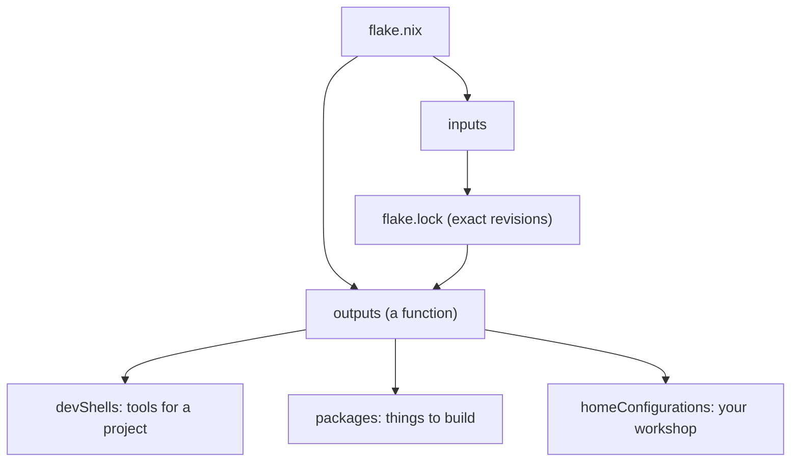
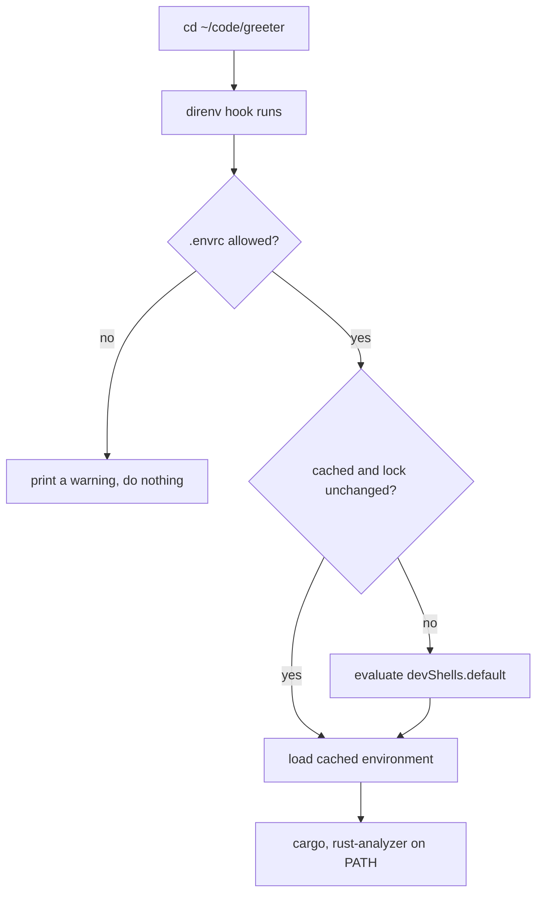
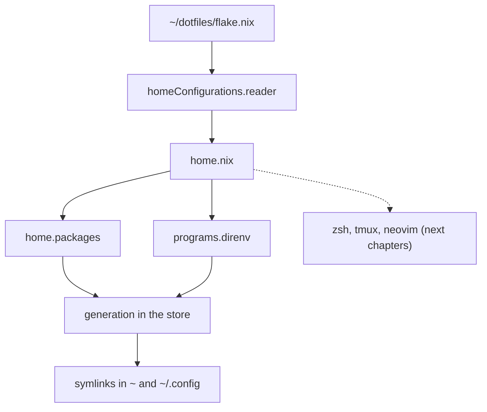

# Nix: a reproducible foundation

A new colleague joins the team on Monday. By lunchtime they've cloned the
repository and run `cargo build`, and it fails. Their `rustc` is six releases
behind yours, because they installed it two years ago for a side project and
never updated it. They update it. Now `cargo clippy` reports forty warnings you
don't see, because your clippy is older than theirs. Someone suggests pinning
the toolchain in a `rust-toolchain.toml`, which fixes `rustc` but not the
`openssl` headers one crate needs, nor the `protoc` binary another one shells
out to, nor the version of `bacon` the README tells you to run.

Every team has lived some version of this afternoon. The phrase for it is
*works on my machine*, and its root cause is that a development environment is
usually an accident: whatever happened to be installed, in whatever order, at
whatever version was current that day. Nobody wrote it down, so nobody can
reproduce it.

This chapter replaces the accident with a description. We'll use **Nix** to
declare, in a file that lives in version control, exactly which tools a
project needs. Anyone who runs one command gets precisely those tools, at
precisely those versions, on macOS or Linux. Then we'll use the same idea one
level up, for your personal workshop: shell, multiplexer, editor and command-line
tools, all declared in one place. By the end you'll have:

- Nix installed, with *flakes* enabled;
- a per-project Rust dev shell that loads automatically when you `cd` into the
  project;
- a `~/dotfiles` flake, managed by *home-manager*, that the next three chapters
  will grow into a complete Rust workshop.

## What Nix is, in one paragraph

Nix is a package manager with an unusual rule: **every package is built from a
complete description of its inputs, and stored under a path that is a hash of
that description**. A `rustc` built from a given source with a given compiler
and given flags lives at something like
`/nix/store/8f3k…-rustc-1.98.1`. Change any input and you get a different hash,
a different path, and a different package, side by side with the old one.
Nothing is ever overwritten, so two projects can use two different toolchains
without noticing each other, and "the environment" stops being a mutable pile of
state and becomes a value you can name.

That last sentence should sound familiar if you've read the preface. Nix
applies to software installation the same ideas this book applies to
programs: immutable values, pure functions from inputs to outputs, and side
effects pushed to the edge. The Nix language is a small, lazy, purely
functional language whose job is to compute those descriptions.

> [!NOTE]
> You don't need to learn the Nix language in depth to follow this part. We'll
> use a handful of constructs: attribute sets (`{ name = value; }`), lists
> (`[ a b c ]`), functions (`x: body`, or `{ a, b }: body` to destructure), `let
> … in`, and string interpolation (`"${x}/bin"`). Each is explained when it
> first appears.

## Installing Nix

There are two good installers. Both work on macOS and on any mainstream Linux
distribution, both set up the multi-user *daemon* (so builds run as dedicated
unprivileged users), and both can be uninstalled cleanly.

The **official installer** from nixos.org:

```sh
sh <(curl --proto '=https' --tlsv1.2 -L https://nixos.org/nix/install) --daemon
```

The official installer leaves two features switched off that we'll use
throughout the book: the modern `nix` command and *flakes*. Turn them on by
adding one line to `/etc/nix/nix.conf` (create the file if it doesn't exist),
then restart the daemon or reboot:

```text
experimental-features = nix-command flakes
```

The **Determinate Systems installer** is a popular alternative. It installs
Determinate's distribution of Nix with flakes already enabled, survives macOS
upgrades well, and has a one-command uninstaller:

```sh
curl --proto '=https' --tlsv1.2 -sSf -L \
  https://install.determinate.systems/nix | sh -s -- install
```

Pick either; nothing in this book depends on the choice. Open a new terminal
afterwards so your shell picks up the new `PATH`, and check:

```sh
nix --version
nix run nixpkgs#hello
```

```text
nix (Nix) 2.35.2
Hello, world!
```

The second command did something worth pausing on. It fetched the `hello`
package from *nixpkgs* (the community package collection, over 100,000
packages), ran it, and left your profile untouched. `hello` isn't "installed"
anywhere you'd notice; it's in the store, and it'll be garbage-collected when
nothing refers to it. That's the default posture of Nix: use things without
installing them.

> [!TIP]
> If your Nix was installed some time ago and the `nix` command complains about
> experimental features, you can pass them per command instead:
> `nix --extra-experimental-features 'nix-command flakes' …`. The repository's
> own build instructions do exactly that, so they work on any Nix.

## Flakes in plain words

A **flake** is a directory with a `flake.nix` file in it. The file has two
parts:

- **`inputs`**: the other flakes this one depends on, usually including
  `nixpkgs`. Think `[dependencies]` in a `Cargo.toml`.
- **`outputs`**: a function from those inputs to the things this flake
  provides: packages, development shells, configurations. Think of it as the
  flake's public API.

The first time you use a flake, Nix resolves each input to an exact revision
(a git commit and a content hash) and writes them to `flake.lock`. Every
later use reads the lock file instead of asking "what's the latest?". That's
exactly how `Cargo.lock` works, and it's why a flake gives the same result
next month as today: the lock pins the *entire* package set, compilers and
system libraries included, not only your direct dependencies. You update on
purpose, with `nix flake update`, and review the change like any other diff.

Here's that structure as a picture. Everything to the right of the lock file is
derived; nothing is fetched by name at use time.



We'll write two kinds of flake in this part: one *per project*, providing a dev
shell, and one *for you*, providing a `homeConfiguration`.

## A dev shell for a Rust project

Let's give a project its toolchain. Make a new crate the usual way (if you
don't have `cargo` yet, borrow one from nixpkgs without installing it):

```sh
mkdir -p ~/code && cd ~/code
nix shell nixpkgs#cargo -c cargo new greeter
cd greeter
```

`nix shell nixpkgs#cargo -c …` runs one command with `cargo` on the `PATH`
and then forgets about it. Fine for a one-off, but we want the project to
*say* which tools it needs. That's a flake whose output is a dev shell.

We'll write it in two steps. First, the skeleton: one input, and an output
that is a function of that input.

```nix
# file: ~/code/greeter/flake.nix
{
  description = "A Rust project";

  inputs.nixpkgs.url = "github:NixOS/nixpkgs/nixpkgs-unstable";

  outputs = { nixpkgs, ... }:
    let
      systems = [ "aarch64-darwin" "x86_64-darwin"
                  "aarch64-linux" "x86_64-linux" ];
      forAllSystems = f: nixpkgs.lib.genAttrs systems
        (system: f nixpkgs.legacyPackages.${system});
    in {
      # devShells go here
    };
}
```

`outputs` is a function: `{ nixpkgs, ... }:` destructures its argument,
picking out the `nixpkgs` input and ignoring the rest. The `let` block exists
because a flake's outputs are per *system* (CPU and OS): the `rustc` for an
Apple Silicon Mac is a different package from the one for an Intel Linux box.
`forAllSystems` is a tiny higher-order function that takes `f`, a function
from a package set to a value, and builds an attribute set with one entry per
system. It saves us writing the shell four times.

Now the shell itself. `pkgs.mkShell` makes an environment rather than a
package: a list of tools to put on the `PATH`, plus any environment variables.

```nix
# file: ~/code/greeter/flake.nix
    in {
      devShells = forAllSystems (pkgs: {
        default = pkgs.mkShell {
          packages = with pkgs; [
            rustc
            cargo
            clippy
            rustfmt
            rust-analyzer
          ];
          RUST_SRC_PATH = "${pkgs.rustPlatform.rustLibSrc}";
        };
      });
    };
```

Five packages: the compiler, the build tool, the linter, the formatter and
the language server our editor will talk to in Workshop 4. `with pkgs;` brings
`pkgs`'s attributes into scope so we can write `rustc` instead of `pkgs.rustc`.
`RUST_SRC_PATH` points rust-analyzer at the standard library's source, so
"go to definition" on `Vec` lands somewhere useful. The `"${…}"` syntax is
string interpolation; interpolating a package gives its store path.

Enter the shell:

```sh
nix develop
cargo --version
rustc --version
```

```text
cargo 1.98.0 (797e8a9bc 2026-08-05)
rustc 1.98.1 (48a229cea 2026-09-01) (built from a source tarball)
```

The first run downloads the toolchain from the binary cache; later runs are
instant. `exit` leaves the shell, and the tools vanish from your `PATH` again.

> [!IMPORTANT]
> Nix only sees files that git knows about. If your project is a git
> repository, `git add flake.nix` before running `nix develop`, or you'll get
> an error saying `flake.nix` doesn't exist. (It doesn't need to be committed,
> only added.) This catches out almost everyone once.

Look in the directory and you'll find a new `flake.lock`. Commit it alongside
`flake.nix`. That lock file is the answer to Monday's onboarding problem: a
colleague who clones the repository and runs `nix develop` gets *your*
`rustc 1.98.1`, not whatever their machine happens to have.

> [!CHECKPOINT]
> In `~/code/greeter`, `nix develop -c cargo run` prints `Hello, world!`, and
> `git status` shows `flake.nix` and `flake.lock` ready to commit.

### More than a compiler

`packages` isn't limited to Rust tools. Anything a project needs to be worked
on belongs in the same list, pinned by the same lock file. The book has one
example in most parts: a *TLA+ interlude* at the end of the part models
the system we've just built and checks its design with a model checker. The tools
for that are packaged in nixpkgs as `tlaplus`, so a project that has specs
adds one line:

```nix
# file: ~/code/greeter/flake.nix
          packages = with pkgs; [
            # ... rustc, cargo and friends, as above
            tlaplus
          ];
```

Re-enter the shell and `tlc`, the TLA+ model checker, is on the `PATH`
alongside `cargo`, at a version every contributor shares. Until a project
needs it, there's no need to install anything: `nix shell nixpkgs#tlaplus -c
tlc -h` borrows it for one command, the same trick we used for `cargo` above.
The first interlude, at the end of Part I, starts from there.

> [!NOTE]
> You *could* put `tlaplus` in `home.packages` (later in this chapter) and
> have `tlc` everywhere. The book doesn't, for the same reason it keeps
> `cargo` out of it: a spec is part of a project, and the project should say
> which tools it needs.

### When nixpkgs' Rust isn't enough

nixpkgs ships one stable Rust toolchain, built for the host. That's all most
projects need, and it's what most of this book uses. Two situations call for
more:

- **Extra targets.** Part IV compiles part of `netdash` to WebAssembly, which
  needs the standard library for `wasm32-unknown-unknown`.
- **A specific version or channel**: nightly for an experimental feature, or
  an exact older release to match production.

For those, the community maintains two overlays that package the official
Rust release binaries: [rust-overlay](https://github.com/oxalica/rust-overlay)
and [fenix](https://github.com/nix-community/fenix). They do the same job; the
book uses rust-overlay. The change to the flake is small: add the input, apply
the overlay to nixpkgs, and replace the five separate packages with one
toolchain that you configure:

```nix
# file: flake.nix
  inputs.rust-overlay.url = "github:oxalica/rust-overlay";

  # ... in the dev shell, with the overlay applied to pkgs:
  toolchain = pkgs.rust-bin.stable.latest.default.override {
    targets = [ "wasm32-unknown-unknown" ];
    extensions = [ "rust-src" "rust-analyzer" ];
  };
```

We'll do this for real in Part IV. Until then, plain nixpkgs is simpler and
faster, because its toolchain comes from the same binary cache as everything
else.

## Loading the shell on `cd`: direnv

Typing `nix develop` every time you open a terminal gets old fast, and it
starts a *new* shell, so your prompt, history and aliases don't come with you.
**direnv** fixes both. It's a small tool that hooks into your shell and, every
time you change directory, checks for a file called `.envrc`. If there is one
(and you've approved it), direnv loads the environment it describes into your
*current* shell; when you leave the directory, it unloads it again.

On its own, direnv knows nothing about Nix. **nix-direnv** adds a `use flake`
command for `.envrc` files and, crucially, caches the result, so entering the
directory a second time takes milliseconds rather than a re-evaluation. It
also registers the shell with Nix's garbage collector, so `nix store gc`
doesn't delete your toolchain from under you.

The whole `.envrc` is one line:

```sh
# file: ~/code/greeter/.envrc
use flake
```

Here's what happens when you `cd` into the project, once everything is wired
up:



The "allowed?" step matters. An `.envrc` can run arbitrary shell code, so
direnv refuses to load one until you've said yes with `direnv allow`, and asks
again whenever its contents change. A repository you've just cloned can't run
anything on your machine simply because you `cd`'d into it.

We haven't installed direnv yet, and we're not going to install it the way you
might expect. That brings us to the second, larger half of this chapter.

## Declaring the rest of the workshop: home-manager

A dev shell describes a *project's* tools. But a lot of what makes you
productive belongs to *you*, not to any project: your shell and its prompt, your
terminal multiplexer, your editor and its plugins, and the dozen small
command-line tools you reach for every hour. Most people accumulate these by
hand, `brew install` here, a dotfile copied from a blog there, and end up with
exactly the same problem as Monday's colleague, one level up: a setup that
works on *this* machine, that nobody wrote down, and that takes a weekend to
recreate on a new laptop.

**home-manager** is a Nix tool for declaring your user environment the way a
flake declares a project's: the packages you want, and the *configuration* of
programs like zsh, tmux and Neovim, written as typed Nix options and turned into
the right dotfiles in the right places. Change the declaration, run one
command, and your environment matches it. Take the declaration to a new
machine, run the same command, and you have the same workshop.

There are three ways to run home-manager. We'll use the **standalone** mode,
which works the same on macOS and every Linux distribution and doesn't need
root.

> [!NOTE]
> If you already manage a whole machine with Nix, home-manager also comes as a
> module for **NixOS** (`home-manager.nixosModules.home-manager`) and for
> **nix-darwin** on macOS (`home-manager.darwinModules.home-manager`). The
> configuration you write in this part goes inside `home-manager.users.<name>`
> unchanged; only the wiring at the top differs, and `nixos-rebuild` or
> `darwin-rebuild` applies it instead of `home-manager switch`.

### A dotfiles flake

The workshop lives in a git repository called `~/dotfiles`. Start it now:

```sh
mkdir ~/dotfiles && cd ~/dotfiles
git init
```

Its `flake.nix` has two inputs, nixpkgs and home-manager, and one output: a
home configuration for you. Replace `reader` with your username (`whoami`
prints it) and set `system` to match your machine.

```nix
# file: ~/dotfiles/flake.nix
{
  description = "My workshop: shell, multiplexer and editor";

  inputs = {
    nixpkgs.url = "github:NixOS/nixpkgs/nixpkgs-unstable";
    home-manager = {
      url = "github:nix-community/home-manager";
      inputs.nixpkgs.follows = "nixpkgs";
    };
  };

  outputs = { nixpkgs, home-manager, ... }:
    let
      system = "aarch64-darwin"; # or x86_64-linux, aarch64-linux, ...
      pkgs = nixpkgs.legacyPackages.${system};
    in {
      homeConfigurations.reader =
        home-manager.lib.homeManagerConfiguration {
          inherit pkgs;
          modules = [ ./home.nix ];
        };
    };
}
```

Two lines deserve a comment.

`inputs.nixpkgs.follows = "nixpkgs"` tells home-manager to use *our* nixpkgs
instead of fetching its own. Without it you'd download two package sets and
could end up with two subtly different copies of the same library. It's the
Nix equivalent of unifying a dependency version across a Cargo workspace.

`homeManagerConfiguration` takes a package set and a list of **modules**. A
module is a Nix file that *sets options*, and home-manager defines a few
thousand of them: `programs.zsh.enable`, `programs.tmux.prefix`,
`home.packages`. home-manager merges every module's settings, checks them,
and computes the files to write. `inherit pkgs;` is shorthand for
`pkgs = pkgs;`.

### The first module

Our first module says who you are and installs a few tools. Every file in this
part starts like this one, as a function that receives `pkgs` (and other
arguments we can ignore with `...`) and returns an attribute set of option
settings.

```nix
# file: ~/dotfiles/home.nix
{ pkgs, ... }:
{
  home.username = "reader";
  home.homeDirectory = "/Users/reader"; # /home/reader on Linux
  home.stateVersion = "26.05";

  programs.home-manager.enable = true;
  xdg.enable = true;
}
```

`home.stateVersion` is not "the version of home-manager you're using". It
records which release's *defaults* your configuration was written against, so
that when a later release changes a default (where zsh keeps its config files,
say), your setup doesn't silently move. Set it once, to the current release,
and leave it alone. `programs.home-manager.enable` puts the `home-manager`
command itself in your environment. `xdg.enable` tells programs that support
the XDG directory conventions to keep their configuration under `~/.config`
rather than scattering dotfiles across your home directory.

Now the everyday tools. These are the ones the rest of the part assumes:

```nix
# file: ~/dotfiles/home.nix
  home.packages = with pkgs; [
    git
    ripgrep
    fd
    jq
    bacon
    cargo-nextest
  ];
```

`ripgrep` (`rg`) and `fd` are fast, `.gitignore`-aware replacements for
`grep -r` and `find`; Neovim's fuzzy finder will use both. `jq` slices JSON.
`bacon` watches your project and re-runs `cargo check`, `clippy` or tests on
every save; it's the "second pane" in our tmux layout. `cargo-nextest` is a
faster test runner with clearer output. `bat`, `eza` and `fzf` are missing from
the list on purpose: they get proper `programs.*` modules in the next chapter,
which configure them as well as installing them.

> [!NOTE]
> Notice what *isn't* in `home.packages`: `rustc` and `cargo`. Toolchains
> belong to projects, in their dev shells, pinned by their lock files. If
> `cargo` were also installed globally, you'd never be quite sure which one a
> terminal was using. Keeping it out means "no dev shell" fails loudly with
> `command not found` instead of quietly using the wrong compiler.

Finally, direnv. home-manager has a module for it, so instead of adding the
package to the list we *enable the program*, and switch on nix-direnv:

```nix
# file: ~/dotfiles/home.nix
  programs.direnv = {
    enable = true;
    nix-direnv.enable = true;
  };
```

That's a different kind of setting from `home.packages`. A `programs.*`
module installs the program *and* writes its configuration, and it knows how
to integrate with other modules. Here, as soon as home-manager also manages
your zsh (the next chapter), `programs.direnv` adds its shell hook to your
`.zshrc` automatically. We'll lean on that kind of cross-module wiring a lot.

Here's how the pieces fit together:



### Switching

Add the files to git (remember, Nix only sees tracked files) and apply the
configuration. The very first time, `home-manager` isn't installed yet, so we
run it straight from its flake:

```sh
cd ~/dotfiles
git add .
nix run home-manager/master -- switch --flake .#reader
```

After that, the `home-manager` command is on your `PATH` (we enabled
`programs.home-manager`), and every later change is applied with:

```sh
home-manager switch --flake ~/dotfiles#reader
```

`switch` builds a new **generation**, a complete, immutable snapshot of your
environment in the Nix store, and then points `~/.nix-profile` and the
managed dotfiles at it. If the new generation is broken, the old one is still
there: `home-manager generations` lists them, and each has an `activate`
script that switches back. Rolling back your entire workshop is one command.

> [!WARNING]
> home-manager refuses to overwrite files it didn't create. If you already
> have a `~/.zshrc` or `~/.config/tmux/tmux.conf`, the first switch that
> manages it stops with "Existing file … would be clobbered". Pass `-b backup`
> to have home-manager add a `.backup` suffix to the old file and carry on, then
> mine the backup for anything worth keeping.

> [!CHECKPOINT]
> `which rg fd bacon direnv` prints paths under `~/.nix-profile/bin` (or
> `/etc/profiles/per-user/…` with the NixOS or nix-darwin module), and
> `home-manager generations` lists one generation. Commit `~/dotfiles`,
> including `flake.lock`.

Until the next chapter hands your zsh to home-manager, direnv's hook isn't in
your shell yet. If you'd like the project shell to load on `cd` today, add
`eval "$(direnv hook zsh)"` to the end of your existing `~/.zshrc`; Workshop 2
replaces that file anyway. Then, in the project:

```sh
cd ~/code/greeter
direnv allow
```

```text
direnv: loading ~/code/greeter/.envrc
direnv: using flake
direnv: nix-direnv: Renewed cache
direnv: export +AR +AS +CC ... +IN_NIX_SHELL ... +RUST_SRC_PATH ... ~PATH
```

The first time takes a few seconds while nix-direnv evaluates the flake and
caches the result. After that the third line reads `Using cached dev shell`,
and entering the directory is instant until `flake.nix` or `flake.lock`
changes.

`cd ..` and `cargo` disappears; `cd greeter` and it's back. Add `.direnv/`
(nix-direnv's cache) to the project's `.gitignore`.

## Typed configuration: the boundary that refuses

Here's where the workshop starts to rhyme with the rest of the book.

Most dotfiles are untyped text read by a program at startup. Misspell an
option in `tmux.conf` and you find out when tmux starts and prints an error,
if you're lucky, or when a key binding silently doesn't work, if you're not. A
YAML config that says `enable: yes` might mean `true`, or the string `"yes"`,
depending on which parser reads it. Every mistake is discovered *late*, at
runtime, by whoever happens to hit it.

home-manager options are **typed**. Each option declares what it accepts:
`programs.zsh.enable` is a `boolean`, `programs.tmux.baseIndex` is an unsigned
integer, `home.packages` is a list of packages. Before anything is built, let
alone written to your home directory, home-manager checks every definition
against its option's type. Let's break the zsh setting from the next chapter
on purpose and see what that looks like:

```nix
# file: ~/dotfiles/home/zsh.nix
  programs.zsh = {
    enable = "yes";
```

```sh
home-manager switch --flake ~/dotfiles#reader
```

```text
error:
       … while evaluating the option `programs.zsh.enable':

       (stack trace truncated; use '--show-trace' to show the full,
       detailed trace)

       error: A definition for option `programs.zsh.enable' is not of type
       `boolean'. Definition values:
       - In `/nix/store/…-source/home/zsh.nix': "yes"
```

Nothing was built. Your current environment is exactly as it was. The error
names the option, the type it wanted, the value it got, and the file that
supplied it. A misspelled option fares no better:

```text
error: The option `programs.zsh.autosugestion' does not exist.
       Definition values:
       - In `/nix/store/…-source/home/zsh.nix':
           {
             enable = true;
           }
       Did you mean `programs.zsh.autosuggestion',
       `programs.zsh.enableAutosuggestions' or `programs.zsh.siteFunctions'?
```

(Both errors are trimmed of their stack-trace preamble; the last lines are the
ones that matter.)

This is the same idea Chapter 4 calls *parse, don't validate*, applied at a
different boundary. Your Nix files are untrusted input. home-manager's module
system *parses* them into a typed configuration once, at evaluation time, and
refuses anything that doesn't fit. Only a well-typed configuration gets to
produce files, and the programs downstream (zsh, tmux, Neovim) receive config
that was generated by code that knew their syntax. It's the shape of every
program in this book: a strict boundary, then trusted values inside it.

Part II takes the idea further: we'll write our *own* typed options, in a NixOS
module for the DNS daemon, and have them generate the daemon's TOML config. If
it type-checks in Nix, it parses in Rust.

## Where we've got to

Your dotfiles repository now looks like this:

```text
~/dotfiles
├── flake.lock
├── flake.nix
└── home.nix
```

And your first project:

```text
~/code/greeter
├── .envrc
├── Cargo.toml
├── flake.lock
├── flake.nix
└── src/main.rs
```

Two flakes, two lock files, and no tool on your machine whose version you
can't name. The next three chapters add one module each to `~/dotfiles`
(`home/zsh.nix`, `home/tmux.nix`, `home/neovim.nix`), so let's leave a place
for them now:

```nix
# file: ~/dotfiles/home.nix
{ pkgs, ... }:
{
  imports = [
    ./home/zsh.nix
    ./home/tmux.nix
    ./home/neovim.nix
  ];

  home.username = "reader";
  # ...
}
```

`imports` is how modules compose: each file sets the options it cares about,
and home-manager merges them. Comment out the three lines until you've written
the files, or create each one as `{ ... }: { }` (a module that sets nothing)
and fill it in as you go.

## What we learned

- **An environment is a value, not an accident.** Nix builds every package
  from a complete description of its inputs and stores it under a hash of that
  description, so versions never collide and nothing is overwritten.
- **Flakes pin everything.** `flake.nix` declares inputs and outputs;
  `flake.lock` records exact revisions of the whole package set, like
  `Cargo.lock` for your toolchain and system libraries.
- **Per-project dev shells** (`devShells.default` with `mkShell`) give every
  contributor the same `rustc`, `clippy` and `rust-analyzer`. rust-overlay or
  fenix step in when you need extra targets like wasm, or a specific channel.
- **direnv with nix-direnv** loads the dev shell into your current shell on
  `cd`, cached, and only after you've allowed it.
- **home-manager** declares your personal environment as typed modules in a
  `~/dotfiles` flake; `home-manager switch` builds a new generation you can
  roll back.
- **Typed options are a parsing boundary.** A wrong type or a misspelled
  option fails at evaluation, before anything is built or written: *parse,
  don't validate* for your dotfiles.

## Exercises

> [!EXERCISE] Read your lock file
> Open `~/dotfiles/flake.lock`. Find the nixpkgs revision it pinned, then run
> `nix flake update` and `git diff flake.lock`. What changed? Run
> `home-manager switch` and then `home-manager generations`: how would you go
> back to the generation from before the update?

> [!EXERCISE] One more tool, two ways
> Add `hyperfine` (a benchmarking tool) to `home.packages` and switch. Then
> remove it, and instead add it to the *greeter* project's dev shell. Which
> place is right for it, and why? What would you decide for `cargo-nextest`?

> [!EXERCISE] Break it on purpose
> Set `programs.direnv.enable = 1;` and run `home-manager switch`. Then
> misspell `nix-direnv` as `nixDirenv`. Read both errors slowly and compare
> them with the `rustc` errors you'll meet in Part I: what does each tell you
> about *where* the mistake is, and what the checker expected?
