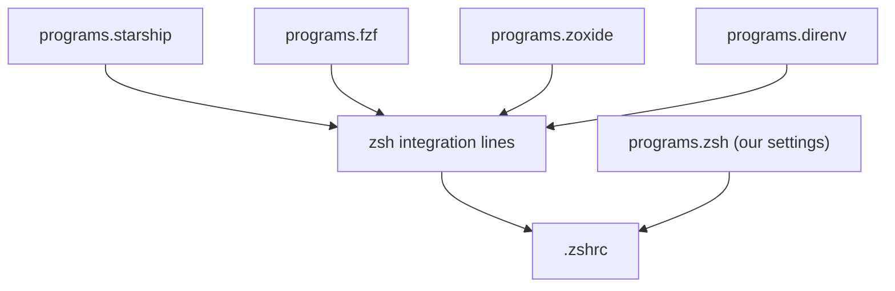

# zsh: a shell that works with you

You'll type thousands of commands while working through this book. Most of
them you've typed before: `cargo test`, `cargo clippy --all-targets`,
`git status`, `cd` back into the project you were in ten minutes ago. A bare
shell makes you type every one of them from scratch, character by character,
and gives you nothing back when you get one wrong.

A good shell is the opposite. It remembers what you've run and offers it
again. It completes flags and paths. It colours a command red *before* you
press Enter if the program doesn't exist. Its prompt tells you, at a glance,
which branch you're on, which Rust toolchain is active, and whether you're
inside a project's dev shell. None of that is exotic; it's just rarely
written down, and so it's usually rebuilt from memory, badly, on every new
machine.

This chapter hands zsh to home-manager. We'll keep it lean: every piece has to
earn its place by saving keystrokes or preventing a mistake, and there are no
frameworks. By the end, your zsh configuration will be about sixty lines of
typed Nix, and the generated `.zshrc` will wire in six other tools without you
writing a single `eval "$(…)"` line yourself.

> [!NOTE]
> Why zsh? It's the default shell on macOS, it's available everywhere, and
> its completion system is excellent. Everything here translates to bash or
> fish with home-manager's `programs.bash` and `programs.fish` modules. The
> integrations (`enableZshIntegration` and friends) exist for all three.

## Handing over the shell

Create the module file and import it from `home.nix` (Workshop 1 left a
place for it). The smallest useful version only turns zsh on:

```nix
# file: ~/dotfiles/home/zsh.nix
{ lib, ... }:
{
  programs.zsh = {
    enable = true;
  };
}
```

`lib` is nixpkgs' standard library; we'll use one function from it later in
the chapter. Switch, and look at what home-manager wrote:

```sh
home-manager switch --flake ~/dotfiles#reader
ls -a ~/.config/zsh
```

```text
.  ..  .zprofile  .zshenv  .zshrc
```

Because we set `xdg.enable` and a `home.stateVersion` of 26.05,
home-manager keeps zsh's files under `~/.config/zsh` instead of littering
your home directory. A one-line `~/.zshenv` points zsh there by setting
`ZDOTDIR`, the variable zsh consults to find the rest of its configuration.
All three files are symlinks into the Nix store: read-only, versioned, and
replaced as a set on the next switch.

> [!WARNING]
> If you already had a `~/.zshrc`, it's now ignored, because zsh reads
> `$ZDOTDIR/.zshrc` instead. Nothing is deleted. Open the old file and
> decide, line by line, what deserves a place in `zsh.nix`. Most long-lived
> `.zshrc` files are a geological record of tools you no longer use.

Two things to know before going further. First, never edit the generated
files: they're read-only, and the next switch would replace them anyway.
Change the Nix and switch. Second, if zsh isn't already your login shell
(most Linux distributions default to bash), make it so with `chsh -s
"$(which zsh)"`, adding that path to `/etc/shells` first if `chsh` refuses.

> [!CHECKPOINT]
> Open a new terminal. `echo $ZDOTDIR` prints `~/.config/zsh` (expanded),
> and `readlink ~/.config/zsh/.zshrc` points into `/nix/store`.

## Completion, suggestions and highlighting

Three features change how a shell *feels* more than any others. Each is one
line.

```nix
# file: ~/dotfiles/home/zsh.nix
  programs.zsh = {
    enable = true;
    enableCompletion = true;
    autosuggestion.enable = true;
    syntaxHighlighting.enable = true;
  };
```

**Completion** (`enableCompletion`) loads zsh's completion system, so Tab
completes not only file names but subcommands and flags: `cargo cl<Tab>`
offers `clean` and `clippy`; `git checkout <Tab>` lists branches. Every
package home-manager installs can ship completion definitions, and they're
picked up automatically.

**Autosuggestions** show, in grey after the cursor, the most recent command
from your history that starts with what you've typed. Type `cargo n` and the
shell suggests `cargo nextest run` because you ran it yesterday; press the
right-arrow key to accept it. It's the single biggest saving of keystrokes in
this chapter, and it costs nothing when you ignore it.

**Syntax highlighting** colours the command line *as you type*: green for a
command that exists, red for one that doesn't, underlined paths that exist.
You see `crago` turn red before you press Enter. That's the shell doing a tiny
version of what the compiler will do for your Rust: checking early, at the
cheapest possible moment.

> [!TIP]
> One more line many people like: `zstyle ':completion:*' matcher-list
> 'm:{a-z}={A-Z}'` makes completion case-insensitive, so `cd doc<Tab>`
> finds `Documents`. We add it in a moment with the other raw zsh settings.

## History that remembers

Autosuggestions and fuzzy search are only as good as the history behind them.
zsh's default keeps a small history per terminal and loses most of it. We'll
keep a lot, de-duplicated, shared between terminals:

```nix
# file: ~/dotfiles/home/zsh.nix
    history = {
      size = 50000;
      save = 50000;
      ignoreDups = true;
      ignoreSpace = true;
      extended = true;
      share = true;
    };
```

`size` and `save` are how many entries to keep in memory and on disk. Fifty
thousand lines is a few megabytes; it's years of work. `ignoreDups` skips a
command identical to the one before it, so pressing Up after running
`cargo test` five times doesn't walk you through five copies.
`ignoreSpace` leaves out any command you start with a space, the
conventional way to keep a command containing a token or password out of the
history file. `extended` records a timestamp with each entry. `share` makes
every open terminal (including every tmux pane, next chapter) append to the
same history as you go, so the command you ran in one pane is suggested in
the next.

These are typed options. `size` is an integer, `ignoreDups` a boolean. Write
`share = "yes";` and home-manager stops with the same kind of error we saw in
Workshop 1, before anything changes. Compare that with a hand-written
`.zshrc`, where `setopt SHARE_HISTRY` fails quietly at the next shell start
and you don't notice for a month.

## A few aliases, and the raw escape hatch

Aliases are where shell configuration usually goes to rot: hundreds of
two-letter abbreviations nobody remembers. We'll add six, for commands the
rest of this book has you typing constantly:

```nix
# file: ~/dotfiles/home/zsh.nix
    shellAliases = {
      cb = "cargo build";
      ct = "cargo nextest run";
      cl = "cargo clippy --all-targets";
      gs = "git status --short";
      gd = "git diff";
      gl = "git log --oneline --graph -20";
    };
```

`cl` runs clippy over *all* targets (tests, examples and benchmarks, not only
the library), which is the setting this book uses throughout. `ct` uses
`cargo-nextest`, which we installed in Workshop 1. We avoid `cc`: it's the
name of the C compiler, which some Rust build scripts call, and shadowing it
would be a memorable afternoon.

> [!NOTE]
> Why not `alias cargo-test=…` style names, or functions? Because
> `shellAliases` is a typed attribute set from names to strings, and
> home-manager renders it to `alias -- name='…'` with correct quoting.
> You never write shell quoting by hand, which is where most alias bugs live.

For the handful of settings no module covers, there's `initContent`: a
string of raw zsh appended to `.zshrc`. Use it sparingly; everything in it is
untyped again.

```nix
# file: ~/dotfiles/home/zsh.nix
    initContent = ''
      bindkey -e
      setopt AUTO_CD
      zstyle ':completion:*' matcher-list 'm:{a-z}={A-Z}'
    '';
```

`''…''` is Nix's multi-line string; indentation common to every line is
stripped. `bindkey -e` selects Emacs-style line editing (Ctrl-A for start of
line, Ctrl-E for end), which is what most people's fingers expect; we'll get
vi keys in tmux and Neovim, where they pay off. `AUTO_CD` lets you type a
directory name on its own to `cd` into it.

> [!CHECKPOINT]
> After a switch and a new terminal: `cargo cl<Tab>` completes, a misspelt
> command turns red as you type, and `alias cl` prints
> `cl='cargo clippy --all-targets'`.

## A prompt that tells you where you are

The prompt is the one piece of UI you look at before every command. It should
answer the questions you'd otherwise have to run a command to answer: where
am I, which branch, is the tree dirty, which Rust, and am I in the project's
dev shell?

[Starship](https://starship.rs) is a fast, cross-shell prompt written in
Rust. It has a module for almost everything, each of which only appears when
it's relevant: the `rust` module shows only in directories with a
`Cargo.toml`, the `git_branch` module only inside a repository. We enable it
and replace its very full default layout with the five modules we care about:

```nix
# file: ~/dotfiles/home/zsh.nix
  programs.starship = {
    enable = true;
    validateFiles.config = true;
    settings = {
      add_newline = false;
      format = lib.concatStrings [
        "$directory" "$git_branch" "$git_status"
        "$rust" "$nix_shell" "$line_break" "$character"
      ];
      git_branch.format = "on [$branch]($style) ";
      rust.format = "[rust( $version)]($style) ";
      nix_shell.format = "[nix shell]($style) ";
      character = {
        success_symbol = "[>](bold green)";
        error_symbol = "[>](bold red)";
      };
    };
  };
```

This block sits *beside* `programs.zsh`, not inside it: it's a different
program with its own module. `settings` is an attribute set that
home-manager serialises to `~/.config/starship.toml`, so you write Nix and
get TOML. `lib.concatStrings` joins a list of strings, which keeps the long
`format` line readable.

`validateFiles.config` deserves a closer look, because it closes a gap in the
typing. To home-manager, `settings` is *freeform*: it knows the value must be
something TOML can represent, but not which keys starship understands or what
type each one takes. Without validation, `cmd_duration.min_time = "5s";`
(starship wants a number of milliseconds) would build happily, and starship
would complain at every prompt. With it, the build runs starship's own JSON
schema over the generated file and refuses:

```text
> Schema validation errors were encountered.
>   …-starship-config::$.cmd_duration.min_time: '5s' is not of type 'integer'
```

It's the same boundary as before, extended one level down: the module system
checks the shape of our Nix, and the tool's schema checks the shape of the file
it will read. Wherever a schema exists, wire it in at build time.

Most modules keep their defaults. We override three formats to drop the
icons starship uses by default (they need a special font), and explain the
two that matter most for Rust work:

- **`rust`** runs `rustc --version` and shows the result. Because `rustc`
  only exists inside a project's dev shell (we kept it out of
  `home.packages` on purpose), this doubles as a check that the right
  toolchain is active. The parentheses in `( $version)` make that part
  conditional: if there's no `rustc`, the version is simply omitted.
- **`nix_shell`** appears whenever the `IN_NIX_SHELL` variable is set, which
  both `nix develop` and nix-direnv do. It's how you tell, without
  thinking, whether direnv has loaded the project's environment.

`git_status` (left at its default) adds compact markers after the branch:
`[!]` for modified files, `[?]` for untracked ones, `[+]` for staged
changes. `character` is the prompt symbol itself: green after a successful command,
red after a failure, so a failing `cargo test` is visible even after you've
cleared the screen.

Here's the prompt in `~/code/greeter` once direnv has loaded the dev shell,
with one file modified:

```text
greeter on main [!] rust v1.98.1 nix shell
>
```

Inside a git repository, the directory is shown relative to the repository's
root, so it stays short however deep you go.

The second line is where you type. Keeping the command on its own line means
long paths and branch names never push your cursor across the screen.

> [!TIP]
> If you like icons, install a [Nerd Font](https://www.nerdfonts.com) in
> your terminal emulator and look at starship's presets
> (`starship preset --list`); `nerd-font-symbols` is a good start. We've kept
> to plain text here so everything renders on any terminal, and in this book.

## Fuzzy everything: fzf

**fzf** is a general-purpose fuzzy finder: it reads a list of lines, lets you
narrow it by typing any fragment, and prints the one you pick. On its own
that's a curiosity. Wired into the shell, it changes how you move around.

```nix
# file: ~/dotfiles/home/zsh.nix
  programs.fzf = {
    enable = true;
    defaultCommand = "fd --type f --hidden --exclude .git";
    fileWidgetCommand = "fd --type f --hidden --exclude .git";
    changeDirWidgetCommand = "fd --type d --hidden --exclude .git";
  };
```

Enabling the module installs three key bindings into zsh:

| Key | What it does |
|---|---|
| Ctrl-R | Search your whole history fuzzily, and put the chosen command on the line |
| Ctrl-T | Pick a file below the current directory, and insert its path |
| Alt-C | Pick a directory below the current one, and `cd` into it |

Ctrl-R is the one you'll use every hour. Type `clip test` and fzf finds
`cargo clippy --all-targets --tests` from last week, however the words are
spaced. With fifty thousand lines of shared history behind it, your history
becomes a searchable notebook of every command you've ever got right.

The three `*Command` options tell fzf to list files with `fd` (installed in
Workshop 1) instead of `find`. `fd` respects `.gitignore`, so Ctrl-T in a
Rust project doesn't wade through the thousands of files in `target/`.

## Jumping around: zoxide

Rust projects nest. You'll spend your days moving between
`~/code/ddns/src/domain`, `~/code/tdo/tests` and `~/dotfiles/home`.
**zoxide** remembers every directory you visit and ranks them by how often and
how recently you've been there. Then `z` jumps to the best match for any
fragment:

```nix
# file: ~/dotfiles/home/zsh.nix
  programs.zoxide.enable = true;
```

```sh
z ddns        # ~/code/ddns
z ddns dom    # ~/code/ddns/src/domain
zi            # pick interactively, with fzf
```

It learns from ordinary `cd` too, so there's nothing to maintain. After a
day or two, `cd` with a long path starts to feel like typing a URL in full.

## Nicer `cat` and `ls`: bat and eza

Two small replacements that make output easier to read:

```nix
# file: ~/dotfiles/home/zsh.nix
  programs.bat.enable = true;

  programs.eza = {
    enable = true;
    git = true;
  };
```

**bat** is `cat` with syntax highlighting, line numbers and git change
markers. `bat src/lib.rs` is a quick way to read a file without opening an
editor, and `bat Cargo.toml` highlights the TOML. We don't alias `cat` to it:
scripts expect `cat` to be `cat`.

**eza** is a modern `ls`. The module does alias `ls` to `eza` (and adds `ll`,
`la` and `lt` for long, all and tree listings), because eza's output is a
compatible superset for interactive use. `git = true` adds a column showing
each file's git status in long listings, so `ll` tells you what you've
changed.

## direnv, revisited

In Workshop 1 we enabled `programs.direnv` in `home.nix` and noted that its
shell hook would arrive "when home-manager manages your zsh". That moment is
now, and we don't have to do anything. If you added `eval "$(direnv hook
zsh)"` to your old `.zshrc` as a stop-gap, it's gone along with that file.

This is the part of home-manager that's easy to miss and hard to give up.
Look at the generated `.zshrc` (trimmed):

```sh
# file: ~/.config/zsh/.zshrc
eval "$(/nix/store/…-zoxide-0.10.0/bin/zoxide init zsh )"
# ...
source <(/nix/store/…-fzf-0.74.5/bin/fzf --zsh)
# ...
eval "$(/nix/store/…-starship-1.26.0/bin/starship init zsh)"
eval "$(/nix/store/…-direnv-2.38.2/bin/direnv hook zsh)"
```

We didn't write any of those lines. Each `programs.*` module has an
`enableZshIntegration` option, which defaults to `true`, and when
`programs.zsh` is also enabled, the module contributes its own line to the
zsh configuration. Every line refers to an exact store path, so the hook
can never call a different version of the tool than the one you configured.

Here's the shape of it:



Each module owns its own tool, and contributes to the shared file through a
typed interface (`programs.zsh.initContent`, `programs.zsh.shellAliases`)
rather than by editing it. Remove `programs.zoxide` and its line disappears
too; nothing is left behind. If you've ever tried to uninstall something by
hunting through a `.zshrc` for the lines it added, you'll appreciate that.

There's a lesson here that recurs throughout this book: **composition works
when each part declares what it contributes, and something else assembles
the whole**. Modules don't know about each other's files; they set options,
and the module system merges them. It's the same reason the pure functions
in Chapter 1 compose: each takes values and returns values, and `main`
wires them together.

## The whole module

You've now seen every line of `home/zsh.nix`. It's about sixty lines, and
everything in it is either a typed option or one of three lines of raw zsh in
`initContent`. Switch, open a new terminal, and `cd ~/code/greeter`:

```text
direnv: loading ~/code/greeter/.envrc
direnv: using flake
direnv: nix-direnv: Using cached dev shell
direnv: export +AR +AS +CC ... +IN_NIX_SHELL ... +RUST_SRC_PATH ... ~PATH
greeter on main rust v1.98.1 nix shell
>
```

> [!TIP]
> direnv's `export` line lists every variable the dev shell sets, which gets
> noisy. Add `programs.direnv.config.global.hide_env_diff = true;` to
> `home.nix` to hide it; the prompt's `nix shell` marker already tells you
> what you need to know.

> [!CHECKPOINT]
> In a new terminal: Ctrl-R opens fzf over your history; `z greeter` jumps
> to the project; the prompt shows `rust v1.98.1` and `nix shell` there, and
> neither outside it; `ll` shows a git status column. Commit `~/dotfiles`.

## What we learned

- **home-manager owns the whole zsh setup**: `programs.zsh` writes
  `~/.config/zsh/.zshrc` and friends as read-only links into the store. You
  change the Nix, never the generated file.
- **Completion, autosuggestions and syntax highlighting** are one line each,
  and catch mistakes before you press Enter.
- **Typed history options** (`size`, `share`, `ignoreSpace`) replace
  hand-written `setopt` lines that fail silently when misspelt.
- **`shellAliases` is typed and quoted for you**; `initContent` is the
  untyped escape hatch, kept small.
- **starship** shows the Rust version and whether a Nix shell is active, so
  you can see at a glance that direnv loaded the right toolchain.
- **fzf, zoxide, bat and eza** each earn their place: history search, fast
  directory jumps, readable files and listings.
- **Integrations compose**: each `programs.*` module contributes its own hook
  to `.zshrc`, and removing the module removes the hook.

## Exercises

> [!EXERCISE] Read what you generated
> Run `bat ~/.config/zsh/.zshrc` and match every line to the option in
> `zsh.nix` (or the other module) that produced it. Which lines came from
> modules you never mentioned inside `programs.zsh`?

> [!EXERCISE] A prompt for your work
> Add starship's `cmd_duration` module to the `format` list so slow commands
> show how long they took, and set `cmd_duration.min_time` so that only
> commands over five seconds report. (A full `cargo build` should; `ls`
> shouldn't.) Then set `validateFiles.config = false;`, write `min_time =
> "5s";`, switch, and open a new terminal. Where does the mistake surface now,
> and who would notice it?

> [!EXERCISE] Port the old `.zshrc`
> If you had a `~/.zshrc` before this chapter, go through it and move
> anything still useful into `zsh.nix`, preferring a typed option or a
> `programs.*` module to `initContent` wherever one exists. How much of the
> old file survives?
