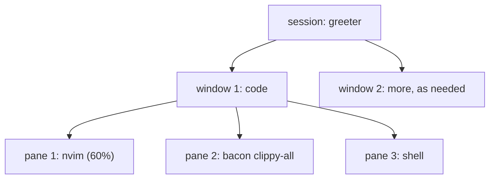
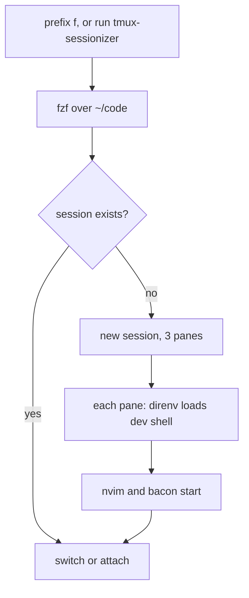

# tmux: a workspace that survives

It's half past four. You have an editor open on `src/domain/ip.rs`, a
terminal running `bacon` beside it, another where you've been poking at the
Cloudflare API with `curl`, and a fourth tailing the daemon's logs. Then the
laptop restarts for an update, or the terminal app crashes, or the SSH
connection to your home server drops on the train. Every one of those
windows is gone, along with its scrollback, its working directory and
whatever was running in it. Tomorrow morning you'll spend ten minutes putting
it all back the way it was.

A **terminal multiplexer** separates the programs you're running from the
window you're looking at them through. **tmux** runs a small server in the
background that owns your shells; your terminal is just a client attached to
it. Close the terminal, or lose the network, and the server carries on.
Re-attach and everything is exactly where you left it, mid-compile if need be.

That's the headline, but it isn't why most people stay. tmux also gives you:

- **Layouts in one terminal**: split it into panes, group panes into windows,
  and move between them from the keyboard. No window manager, and the same
  on every operating system.
- **Remote work that feels local**: the same tmux on a server over SSH, with
  the same keys and the same layout, surviving disconnects.
- **Scriptable workspaces**: a few `tmux` commands build a whole layout, so
  "open this project" can mean "editor, compiler watcher and shell, side by
  side, in the right directory".

This chapter configures tmux with home-manager, makes it play well with
Neovim, builds a layout for Rust work, and finishes with a small script that
opens any project in that layout from a fuzzy-finder.

## Sessions, windows and panes

tmux has three nested ideas, and every key binding acts on one of them:

- A **session** is a named workspace, usually one per project. It survives
  detaching.
- A **window** is a full-screen tab within a session. Each session has one
  or more, shown in the status bar along the bottom.
- A **pane** is a rectangular split of a window, each running its own shell.

Here's the layout we'll build for Rust work: one session per project, its
first window split into three panes.



Pane 1 takes the left 60% of the screen; panes 2 and 3 share the right
40%, one above the other. The editor gets most of the room, the compiler's
running commentary is always in view, and a shell is a keystroke away for git
and one-off commands.

All tmux commands start with the **prefix** key: you press the prefix, let
go, then press a command key. The default prefix is Ctrl-B, so Ctrl-B then
`c` creates a window, and Ctrl-B then `d` detaches. We're about to change
that.

## The module, a piece at a time

Create `home/tmux.nix` and import it from `home.nix`. We'll begin with the
settings that make tmux comfortable before adding anything Rust-specific.

```nix
# file: ~/dotfiles/home/tmux.nix
{ pkgs, ... }:
{
  programs.tmux = {
    enable = true;
    prefix = "C-a";
    mouse = true;
    keyMode = "vi";
    baseIndex = 1;
  };
}
```

**`prefix = "C-a"`.** Ctrl-B is awkward to reach, and you'll press the prefix
hundreds of times a day. Ctrl-A sits under your little finger, especially if
you've mapped Caps Lock to Ctrl (worth doing, if you haven't). The cost is
that Ctrl-A no longer jumps to the start of a line in the shell; home-manager
binds Ctrl-A twice (`C-a C-a`) to send a literal Ctrl-A through, which is
enough. If you'd rather keep Ctrl-A for the shell, `C-Space` is the other
popular choice.

**`mouse = true`.** Click a pane to focus it, drag a border to resize, scroll
to page back through output. Purists turn it off; when you're new to tmux,
it's the difference between feeling trapped and feeling at home.

**`keyMode = "vi"`.** tmux has a *copy mode* (Ctrl-A then `[`) for scrolling
back and selecting text without the mouse. With vi keys it behaves like
Neovim: `k` and `j` to move, `/` to search, `v` to start a selection, `y` to
copy. We'll add those last two bindings shortly.

**`baseIndex = 1`.** Windows and panes are numbered from zero by default, so
your first window is reached with Ctrl-A `0`, on the far right of the
keyboard. Starting at one puts the numbers in the order the keys are.
home-manager sets both `base-index` and `pane-base-index`; our layout script
relies on panes being numbered 1, 2 and 3.

> [!CHECKPOINT]
> Switch, run `tmux`, and press Ctrl-A then `c` twice. The status bar shows
> windows `1`, `2` and `3`. Ctrl-A `d` detaches; `tmux attach` brings them
> back.

### Settings for Neovim

The next group exists because we'll run Neovim inside tmux, and three of
tmux's defaults get in its way.

```nix
# file: ~/dotfiles/home/tmux.nix
    escapeTime = 0;
    focusEvents = true;
    terminal = "tmux-256color";
    historyLimit = 50000;
```

**`escapeTime = 0`.** When tmux sees the Escape key, it waits (500 ms by
default) to see whether it's the start of an escape sequence such as an
arrow key. In Neovim you press Escape constantly to leave insert mode, and
half a second of lag every time is maddening. Modern terminals send escape
sequences in one burst, so zero is safe.

**`focusEvents = true`** passes "this pane gained focus" events through to
programs. Neovim uses them to notice that a file changed on disk while you
were in another pane, for instance after `cargo fmt` or `git checkout`.

**`terminal = "tmux-256color"`** sets the `TERM` that programs inside tmux
see. It tells them tmux supports 256 colours, italics and the other modern
capabilities; the old default (`screen`) makes Neovim's colour scheme look
washed out.

**`historyLimit = 50000`** keeps fifty thousand lines of scrollback per pane.
The default of two thousand is about three `cargo build` error dumps.

### True colour and the rest: `extraConfig`

Some settings have no typed option. `extraConfig` appends raw tmux commands to
the generated file, just as `initContent` did for zsh:

```nix
# file: ~/dotfiles/home/tmux.nix
    extraConfig = ''
      set -as terminal-features ",xterm*:RGB"
      set -g renumber-windows on

      bind | split-window -h -c "#{pane_current_path}"
      bind - split-window -v -c "#{pane_current_path}"
      bind c new-window -c "#{pane_current_path}"

      bind -T copy-mode-vi v send -X begin-selection
      bind -T copy-mode-vi y send -X copy-selection-and-cancel
    '';
```

The first line declares that the terminal *outside* tmux supports 24-bit
("true") colour. Almost every modern terminal emulator (iTerm2, WezTerm,
Kitty, Ghostty, Alacritty, GNOME Terminal) advertises itself as some kind of
`xterm`, so the pattern `xterm*` covers them. Without it, tmux downsamples
colours to its 256-colour palette and Neovim's theme loses its subtlety.
`renumber-windows` closes the gaps when you close a window, so `1 2 4`
becomes `1 2 3`.

The three `bind` lines replace tmux's split and new-window keys with ones that
are easier to remember (`|` splits side by side, `-` splits top and bottom,
as the characters look) and that **keep the current directory**. By default a
new pane starts in the directory the *session* started in, which in practice
means you `cd` again in every new pane. `#{pane_current_path}` is a tmux
*format*: it expands to the working directory of the pane you split from.
Because direnv hooks into every new shell, a new pane inside a Rust project
gets the project's dev shell automatically.

The last two lines finish vi copy mode: `v` begins a selection and `y` copies
it and leaves copy mode, the same keys as in Neovim.

> [!NOTE]
> `extraConfig` is untyped, like zsh's `initContent`. tmux does check it, but
> only when it starts: a typo shows up as a message in the status bar the
> next time you launch tmux, not when you run `home-manager switch`. That's
> a good reason to keep it short, and to prefer typed options wherever they
> exist.

## Moving between panes and Neovim splits

Here's a friction point that's easy to miss until you live with it. Neovim
has its own *splits* (windows within the editor), and you move between them
with Ctrl-W followed by `h`, `j`, `k` or `l`. tmux has panes, and you move
between them with the prefix followed by an arrow key. With Neovim in one
pane, you have to remember which kind of boundary you're about to cross
before you press a key.

**vim-tmux-navigator** removes the distinction. With it installed on *both*
sides, Ctrl-H, Ctrl-J, Ctrl-K and Ctrl-L move left, down, up and right,
whether the next thing over is a Neovim split or a tmux pane. The tmux half
checks whether the current pane is running Neovim; if so, it passes the key
through and lets Neovim decide, and Neovim hands control back to tmux when
you're already at the edge of the editor.

The tmux half is a plugin. home-manager packages tmux plugins in nixpkgs, so
there's no plugin manager to install:

```nix
# file: ~/dotfiles/home/tmux.nix
    plugins = with pkgs.tmuxPlugins; [ vim-tmux-navigator ];
```

We'll add the Neovim half in the next chapter. Until then, Ctrl-H/J/K/L move
between tmux panes. (Ctrl-L used to clear the screen; with the plugin,
Ctrl-A then Ctrl-L does that instead.)

> [!TIP]
> Plugins from `pkgs.tmuxPlugins` are pinned by your flake lock like
> everything else. There's no TPM (tmux plugin manager) cloning repositories
> from GitHub at startup, so a new machine gets exactly the plugin versions
> you have, with no network access needed.

## A layout for Rust

The layout from the diagram is three tmux commands. In a session, from the
project root:

```sh
tmux split-window -h -l 40% -c "#{pane_current_path}"
tmux split-window -v -c "#{pane_current_path}"
tmux select-pane -t 1
```

The first splits the window side by side, giving the new right-hand pane 40%
of the width. The second splits that right-hand pane top and bottom. The
third puts the focus back in pane 1, where the editor goes. You'd then run
`nvim` in pane 1, `bacon clippy-all` in pane 2, and keep pane 3 as a shell.

### Why `bacon clippy-all`

**bacon** watches your source files and re-runs a cargo command on every
save, showing the results in a compact, scrollable list that keeps the most
important error at the top. It's the "compiler's running commentary" in our
layout. Its jobs are named; `bacon --list-jobs` shows them. The two we care
about:

| Job | Runs |
|---|---|
| `clippy` | `cargo clippy` |
| `clippy-all` | `cargo clippy --all-targets` |

The difference matters more than it looks. Plain `cargo clippy` checks your
library and binaries but skips `#[cfg(test)]` code, so a type error *in a
test* doesn't show up until you run the tests. `clippy-all` checks
everything, which is the setting this book uses. While bacon is running,
press `t` to switch to the test job, `c` for clippy, `r` to run the program,
and `i` to go back to the job you started with.

> [!NOTE]
> `cargo watch` is the older tool for this job, and still works. bacon's
> advantage is that it *parses* the output rather than streaming it:
> warnings and errors are grouped, the first error is always visible, and the
> screen doesn't scroll away from it on every save.

## A sessionizer: one key to any project

Typing those commands every time you open a project would undo the point of
the layout. What we want is: press a key, pick a project from a list, and land
in its session, with the layout built if it's new or reattached if it isn't.
This idea is usually called a **sessionizer**, after a script ThePrimeagen
popularised.

It's about twenty lines of shell. We'll write the script as its own file, so
it gets shell syntax highlighting in the editor, and have Nix package it.

### Choosing a project

The first half decides *which* project. With an argument, it uses that
directory; without one, it lists the directories in `~/code` and lets you pick
one with fzf:

```sh
# file: ~/dotfiles/home/tmux-sessionizer.sh
root="${CODE_DIR:-$HOME/code}"

if [[ $# -eq 1 ]]; then
  dir=$1
else
  dir=$(find "$root" -mindepth 1 -maxdepth 1 -type d | fzf) || exit 0
fi

name=$(basename "$dir" | tr '.:' '__')
```

`${CODE_DIR:-$HOME/code}` uses `$CODE_DIR` if it's set and `~/code`
otherwise, so you can point it elsewhere without editing the script. If you
press Escape in fzf, it exits non-zero, and `|| exit 0` turns that into a
quiet exit. The session name is the directory's name with `.` and `:`
replaced, because tmux uses those two characters in *targets* like
`greeter:code.2` ("pane 2 of window `code` in session `greeter`").

### Building or reusing the session

The second half creates the session with our layout if it doesn't exist, and
then attaches to it:

```sh
# file: ~/dotfiles/home/tmux-sessionizer.sh
if ! tmux has-session -t "=$name" 2>/dev/null; then
  tmux new-session -d -s "$name" -n code -c "$dir"
  tmux send-keys -t "=$name:code.1" "nvim" Enter
  tmux split-window -h -l 40% -t "=$name:code.1" -c "$dir"
  tmux send-keys -t "=$name:code.2" "bacon clippy-all" Enter
  tmux split-window -v -t "=$name:code.2" -c "$dir"
  tmux select-pane -t "=$name:code.1"
fi

if [[ -n "${TMUX:-}" ]]; then
  tmux switch-client -t "=$name"
else
  tmux attach-session -t "=$name"
fi
```

A few details:

- The `=` in `-t "=$name"` asks for an *exact* match. Without it, tmux
  matches session names by prefix, so `greet` would happily attach to
  `greeter`.
- `new-session -d` creates the session *detached*, so we can build its layout
  before anyone looks at it. `-n code` names the first window, and `-c`
  starts it in the project directory.
- `send-keys … Enter` types a command into a pane, as if you had. The pane's
  shell runs it after its first prompt, which is after direnv has loaded the
  dev shell. So `nvim` starts with the project's `rust-analyzer` on its
  `PATH`, and `bacon` with the project's `cargo`. That ordering is what makes
  the next chapter's editor setup work.
- At the end, if we're already inside tmux (`$TMUX` is set), we switch the
  current client to the new session; otherwise we attach. Attaching from
  inside tmux would nest one tmux inside another, which is never what you
  want.

### Packaging it with Nix

Now we turn the file into a command. `pkgs.writeShellApplication` takes a
name, a script and a list of runtime dependencies, and produces a package
with a `bin/` entry:

```nix
# file: ~/dotfiles/home/tmux.nix
{ pkgs, ... }:
let
  sessionizer = pkgs.writeShellApplication {
    name = "tmux-sessionizer";
    runtimeInputs = with pkgs; [ tmux fzf findutils coreutils ];
    text = builtins.readFile ./tmux-sessionizer.sh;
  };
in
{
  home.packages = [ sessionizer ];

  programs.tmux = {
    # ... as before
  };
}
```

`writeShellApplication` does three things a hand-installed script in
`~/bin` wouldn't:

1. It **pins the dependencies**. `runtimeInputs` puts exact store paths for
   `tmux`, `fzf`, `find`, `basename` and `tr` at the front of the script's
   `PATH`, so it works the same on macOS (where `find` is BSD's) and Linux
   (where it's GNU's), and doesn't care what else is installed.
2. It adds **strict mode**: `set -o errexit -o nounset -o pipefail`, so a
   failing command or an unset variable stops the script instead of
   ploughing on.
3. It runs **ShellCheck** over the script *at build time*. A quoting bug, an
   unused variable or a `[ $x == y ]` that should be `[[ … ]]` fails
   `home-manager switch`, before the script is ever installed. We're back at
   the boundary again: the script is checked once, when it's built, rather
   than every time it misbehaves.

Finally, a key binding. Inside tmux, Ctrl-A then `f` opens the sessionizer
in a floating popup:

```nix
# file: ~/dotfiles/home/tmux.nix
      bind f display-popup -E "${sessionizer}/bin/tmux-sessionizer"
      bind r source-file ~/.config/tmux/tmux.conf \; display "reloaded"
```

These two lines go at the end of `extraConfig`. Notice the
`${sessionizer}`: we're interpolating the package we defined in the `let`
block, so tmux's config refers to the script's exact store path. The binding
can't drift out of step with the script, and it works even if `~/.nix-profile`
isn't on tmux's `PATH`. `-E` closes the popup when the script exits.
`prefix r` reloads the config without restarting tmux, which is handy while
you experiment (though remember `home-manager switch` first).

Here's the whole flow, from key press to layout:



> [!CHECKPOINT]
> Switch, then outside tmux run `tmux-sessionizer` and pick `greeter`. You
> land in a session called `greeter` with Neovim on the left, bacon on the
> top right reporting no warnings, and a shell below it whose prompt shows
> `rust v1.98.1 nix shell`. Ctrl-A `d` detaches; `tmux-sessionizer
> ~/code/greeter` reattaches without rebuilding the layout.

## Working remotely

Everything in this chapter applies unchanged on a remote machine. If your
home server or cloud VM has Nix and home-manager, apply the same dotfiles
flake there (with a `homeConfigurations` entry for that machine's username
and system), and you get the same zsh, tmux and Neovim. Then:

```sh
ssh -t homeserver tmux new-session -A -s main
```

`-A` attaches to the session `main` if it exists and creates it if not; `-t`
gives ssh a terminal. When the connection drops, the session carries on, with
your build still running. Reconnect with the same command and you're back,
mid-sentence.

> [!TIP]
> To support several machines from one flake, add one
> `homeConfigurations.<name>` per machine, each passing its own `system`
> and username, and share the modules. Part II does something similar for
> NixOS hosts.

## What we learned

- **A multiplexer decouples programs from windows.** tmux's server owns your
  shells, so sessions survive closed terminals, crashes and dropped SSH
  connections.
- **Sessions, windows and panes** nest; every binding acts on one of them.
- **A handful of typed options make tmux comfortable**: a reachable prefix,
  mouse support, vi copy mode, numbering from 1, and `escapeTime = 0` with
  true colour and focus events for Neovim.
- **Splits that keep the current path** mean direnv loads the right dev shell
  in every new pane.
- **vim-tmux-navigator** makes Ctrl-H/J/K/L cross tmux panes and Neovim splits
  alike, installed from nixpkgs with no plugin manager.
- **`bacon clippy-all`** keeps the compiler's verdict on *all* targets,
  tests included, in view as you type.
- **`writeShellApplication`** turns a script into a package with pinned
  dependencies, strict mode, and ShellCheck at build time; interpolating it
  into `tmux.conf` keeps the binding and the script in step.

## Exercises

> [!EXERCISE] A second window
> Extend the sessionizer so new sessions also get a second window called
> `run` in the project directory, for `cargo run` and logs. Make sure
> `select-pane` still leaves you in the editor. Does ShellCheck have anything
> to say about your change?

> [!EXERCISE] Break the script
> Remove the double quotes around `"$dir"` in the `new-session` line and run
> `home-manager switch`. What does ShellCheck report, and which directory
> name would actually break the unquoted version?

> [!EXERCISE] Projects in more than one place
> Change the sessionizer to search both `~/code` and `~/dotfiles`, and
> projects one level deeper (for example `~/code/work/api`). Keep the session
> names unique. What should happen when two directories have the same name?
