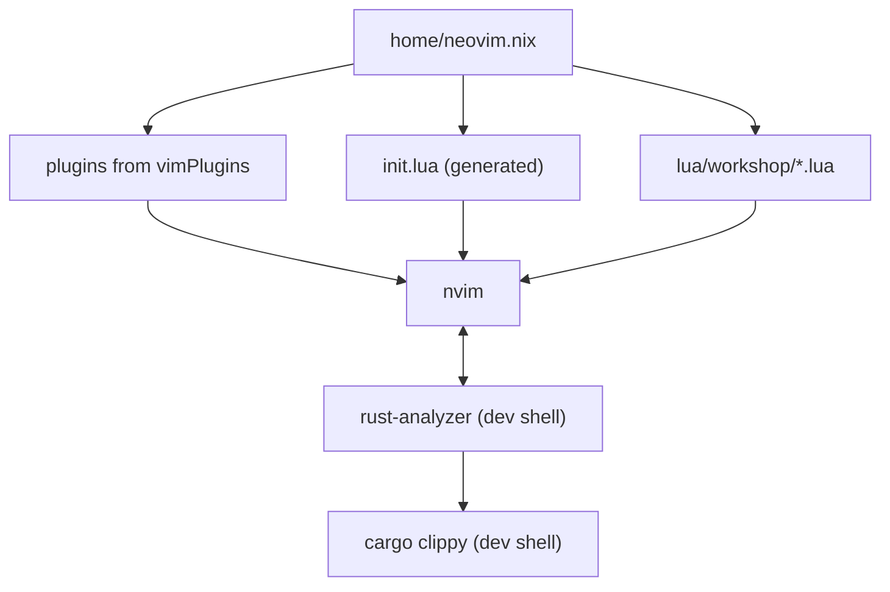
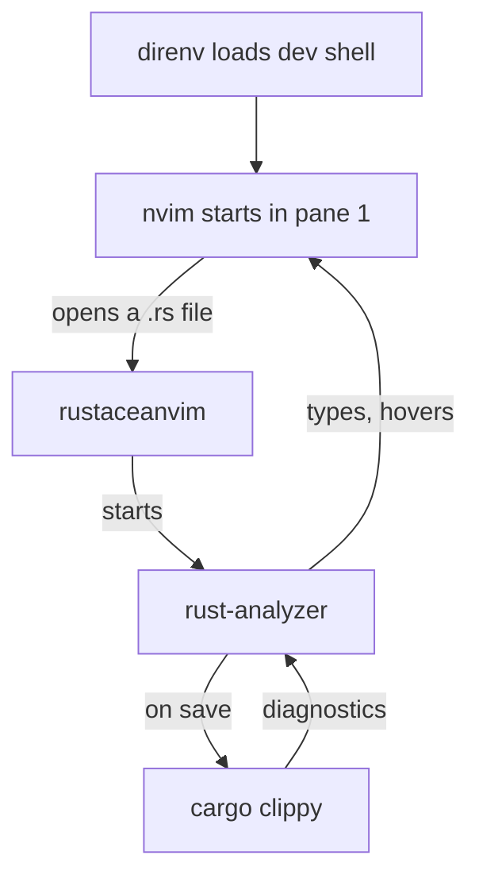

# Neovim: an editor that understands Rust

Open `src/lib.rs` in an editor that doesn't understand Rust and you see text.
`let name = parse_name(input);` is a line of characters. What *type* is
`name`? You'd have to find `parse_name`, read its signature, and remember the
answer. Did that line compile? Switch to a terminal and run `cargo check`.
What does this error mean, which line is it on, and what are the other places
this function is called? More switching, more reading, more remembering.

Rust leans on its type system harder than almost any mainstream language,
and most of those types are *inferred*: you don't write them down, the
compiler works them out. That's a gift when you're writing code and a puzzle
when you're reading it, unless your editor can ask the compiler. This book's
whole method (types first, signatures before bodies, let the compiler guide
the implementation) depends on that conversation being instant.

This chapter builds an editor that has it. We'll configure **Neovim**
declaratively with home-manager, so every plugin is pinned in your flake lock
and the setup is identical on every machine, and connect it to
**rust-analyzer**, the Rust language server, running from each project's own
dev shell. By the end you'll have inferred types shown inline, errors as you
type, completion, format on save, a fuzzy finder, git hunks in the gutter,
running and debugging single tests from the editor, and a language server for
the Nix files you've been writing all along.

> [!NOTE]
> If you're not a Vim user, this chapter is still worth a read: the
> rust-analyzer and dev-shell ideas apply to any editor. VS Code with the
> rust-analyzer extension and the direnv extension, launched from a project
> directory, gets you the same "editor uses the project's toolchain"
> behaviour. Neovim's modal editing has a learning curve; `vimtutor` (try
> `nvim +Tutor`) takes about half an hour and is the best way in.

## Three ways to configure Neovim with Nix

Most Neovim setups use a plugin manager such as **lazy.nvim**, which clones
plugins from GitHub the first time Neovim starts and updates them when you ask
it to. It works well, but it's exactly the kind of untracked, network-at-runtime
state we spent Workshop 1 getting rid of: a new machine gets whatever the
plugins' default branches happen to point at that day.

With Nix there are two declarative alternatives:

- **home-manager's `programs.neovim`**, which installs plugins from nixpkgs'
  `vimPlugins` set and lets you write your configuration in ordinary Lua.
  Plugins are pinned by your flake lock; nothing is downloaded when Neovim
  starts.
- **nixvim**, a separate project that wraps hundreds of plugins in typed Nix
  options (`plugins.telescope.enable = true;`) and generates the Lua for you.

We'll use `programs.neovim`. nixvim is impressive, but it puts a translation
layer between you and every plugin's documentation, which is written in Lua.
With `programs.neovim`, Nix decides *which* plugins are installed (the part
that benefits from pinning), and Lua says how they're configured (the part
where you want to copy from the plugin's README). Each tool does the job it's
good at.

Here's how the pieces fit together:



## The module skeleton

Create `home/neovim.nix` and import it from `home.nix`. Start with Neovim
itself and one plugin, a colour scheme, so you can see that plugins load:

```nix
# file: ~/dotfiles/home/neovim.nix
{ pkgs, ... }:
{
  programs.neovim = {
    enable = true;
    defaultEditor = true;
    vimAlias = true;

    plugins = with pkgs.vimPlugins; [
      tokyonight-nvim
    ];

    initLua = ''
      require("workshop")
    '';
  };

  xdg.configFile."nvim/lua/workshop".source = ./nvim;
}
```

`defaultEditor` sets `$EDITOR` to `nvim`, so `git commit` and friends open
it. `vimAlias` makes `vim` run Neovim too.

The last two settings are the structure of our configuration. `initLua` is
the text of Neovim's `init.lua`; home-manager prepends its own setup and
writes the file. We keep it to a single line that loads a Lua module called
`workshop`. `xdg.configFile."nvim/lua/workshop".source = ./nvim;` links the
directory `~/dotfiles/home/nvim` to `~/.config/nvim/lua/workshop`, which is
where Neovim's `require` looks. So `require("workshop")` runs
`home/nvim/init.lua`, and `require("workshop.rust")` runs
`home/nvim/rust.lua`.

Why separate Lua files instead of one long string in Nix? Because Lua in
`.lua` files gets Lua syntax highlighting, and a Lua language server if you
want one, and because each file can be read on its own. The Nix module
decides *what* is installed; the Lua tree says *how* it behaves.

> [!WARNING]
> The Lua files are copied into the Nix store when you switch, so editing
> `~/dotfiles/home/nvim/rust.lua` changes nothing until the next `home-manager
> switch`. That's the price of reproducibility, and it's small: switching
> takes a few seconds. Keep `~/dotfiles` open in a tmux window while you're
> tuning the editor.

### The Lua tree

The entry point lists the modules in the order they should load. We'll write
each one in turn through this chapter:

```lua
-- file: ~/dotfiles/home/nvim/init.lua
require("workshop.options")
require("workshop.treesitter")
require("workshop.completion")
require("workshop.rust")
require("workshop.finder")
require("workshop.git")
require("workshop.nix")
```

Until a module exists, comment out its line. The first is plain editor
settings:

```lua
-- file: ~/dotfiles/home/nvim/options.lua
vim.g.mapleader = " "
vim.g.maplocalleader = " "

local opt = vim.opt
opt.number = true
opt.relativenumber = true
opt.signcolumn = "yes"
opt.termguicolors = true
opt.expandtab = true
opt.shiftwidth = 4
opt.ignorecase = true
opt.smartcase = true
opt.undofile = true
opt.updatetime = 250
opt.splitright = true
opt.splitbelow = true

vim.cmd.colorscheme("tokyonight-night")
```

The **leader** key is a prefix for your own shortcuts, as tmux's prefix is for
tmux's. Space is the popular choice: it's the biggest key on the keyboard
and does nothing useful in normal mode. Every custom mapping in this chapter
starts with it, written `<leader>`.

The rest are small comforts. `signcolumn = "yes"` reserves a column on the
left for diagnostics and git markers, so the text doesn't jump sideways when
one appears. `termguicolors` enables 24-bit colour (which tmux now passes
through). `undofile` keeps undo history across restarts. `updatetime = 250`
makes Neovim fire its "cursor has been still" event after a quarter of a
second instead of four, which makes hover and diagnostics feel responsive.

> [!CHECKPOINT]
> Switch, and run `nvim`. The tokyonight colours appear and there are no
> errors. `:echo $MYVIMRC` shows `~/.config/nvim/init.lua`, a link into the
> Nix store.

## Syntax that understands structure: Tree-sitter

Neovim's traditional syntax highlighting is a pile of regular expressions.
**Tree-sitter** replaces it with real parsers that build a syntax tree for
the file and update it incrementally as you type. Highlighting becomes
precise (a type in a generic position is coloured as a type), and the tree
powers indentation and text objects.

Each language needs a grammar, a small compiled parser. With lazy.nvim you'd
run `:TSInstall rust`, which downloads and compiles it at runtime on every
machine. nixpkgs ships them prebuilt, so we pick the ones we want in Nix:

```nix
# file: ~/dotfiles/home/neovim.nix
    plugins = with pkgs.vimPlugins; [
      tokyonight-nvim
      (nvim-treesitter.withPlugins (p: [ p.rust p.toml p.nix p.lua ]))
    ];
```

`withPlugins` is a function that takes a function. We pass it
`p: [ p.rust p.toml p.nix p.lua ]`, which picks four grammars out of the set
of all grammars `p`. Rust for our code, TOML for `Cargo.toml`, Nix for our
flakes, and Lua for this configuration.

Then we ask Neovim to use them:

```lua
-- file: ~/dotfiles/home/nvim/treesitter.lua
vim.api.nvim_create_autocmd("FileType", {
  pattern = { "rust", "toml", "nix", "lua" },
  callback = function()
    vim.treesitter.start()
    vim.bo.indentexpr = "v:lua.require'nvim-treesitter'.indentexpr()"
  end,
})
```

An *autocommand* runs code when an event happens; here, whenever a buffer of
one of those file types opens, we start Tree-sitter highlighting and use its
indentation rules.

> [!NOTE]
> Older guides configure nvim-treesitter with
> `require("nvim-treesitter.configs").setup({ highlight = { enable = true } })`.
> That module no longer exists: nvim-treesitter was rewritten so that Neovim's
> built-in `vim.treesitter` does the work and the plugin only supplies
> parsers and queries. If you see an error about `nvim-treesitter.configs`,
> you've found an old guide.

## rust-analyzer, from the project's dev shell

Now the centrepiece. **rust-analyzer** is a *language server*: a program
that understands one language deeply and answers an editor's questions about
it over the Language Server Protocol (LSP). What's the type of the thing
under the cursor? Where is it defined? What are the errors in this file? What
can I type here? Neovim has an LSP client built in; it needs to be told which
server to start for which files, and how.

For Rust, the plugin that does that best is **rustaceanvim**. It starts
rust-analyzer when you open a Rust file, finds the workspace root, and adds
Rust-specific commands on top of plain LSP: run the test under the cursor,
explain an error code, open the crate's `Cargo.toml`, start a debugger.

The important design decision is **where rust-analyzer comes from**. We could
install it in Neovim's own environment. We won't. rust-analyzer has to agree
with the compiler about the language: which edition features exist, how
macros expand, which version of the standard library you're using. And it
runs `cargo` to check your code, so *that* `cargo` had better be the
project's. Both are already in every project's dev shell, pinned by its
flake lock. So we rely on them being on the `PATH`.

That's why the order of events in the tmux chapter mattered: the pane's shell
starts, direnv loads the dev shell, *then* `nvim` runs, inheriting a `PATH`
with the project's `rust-analyzer`, `cargo` and `rustfmt` on it. Open
`greeter` and you get `greeter`'s toolchain; open a Part IV project with its
wasm-enabled rust-overlay toolchain and you get that one. No editor setting
changes.



> [!TIP]
> home-manager adds `programs.neovim.extraPackages` to the *end* of Neovim's
> `PATH`. If you'd like a fallback rust-analyzer for editing stray `.rs`
> files outside any project, you can add one there, and the dev shell's will
> still win whenever there is one.

### Wiring it up

Add the plugin:

```nix
# file: ~/dotfiles/home/neovim.nix
      rustaceanvim
```

rustaceanvim is configured by setting a global table, `vim.g.rustaceanvim`,
before it loads. The interesting parts are the server settings and an
`on_attach` function, which runs each time rust-analyzer attaches to a
buffer and is the place to set up buffer-local key mappings:

```lua
-- file: ~/dotfiles/home/nvim/rust.lua
local function on_attach(_, bufnr)
  local map = function(lhs, rhs, desc)
    vim.keymap.set("n", lhs, rhs, { buffer = bufnr, desc = desc })
  end
  map("gd", vim.lsp.buf.definition, "Go to definition")
  map("K", function() vim.cmd.RustLsp({ "hover", "actions" }) end, "Hover")
  map("<leader>a", function() vim.cmd.RustLsp("codeAction") end,
    "Code action")
  -- ... run, test and debug mappings, later in the chapter
  vim.lsp.inlay_hint.enable(true, { bufnr = bufnr })
end
```

```lua
-- file: ~/dotfiles/home/nvim/rust.lua
vim.g.rustaceanvim = {
  server = {
    on_attach = on_attach,
    default_settings = {
      ["rust-analyzer"] = {
        check = { command = "clippy" },
      },
    },
  },
  -- dap = { ... }, added in the debugging section
}
```

`check = { command = "clippy" }` makes rust-analyzer run `cargo clippy`
rather than `cargo check` each time you save, so clippy's lints appear in the
editor alongside compiler errors. (rust-analyzer passes `--all-targets` by
default, so test code is checked too.)

Notice what's missing: there's no path to rust-analyzer anywhere.
rustaceanvim runs whatever `rust-analyzer` is first on the `PATH`, which is
exactly what we want.

> [!CHECKPOINT]
> In `~/code/greeter` (with direnv loaded), open `src/main.rs` in Neovim and
> run `:checkhealth rustaceanvim`. You should see, among others:
>
> ```text
> - OK rust-analyzer: found rust-analyzer 2026-10-12
> - OK Cargo: found cargo 1.98.0 (797e8a9bc 2026-08-05)
> - OK rustc: found rustc 1.98.1 (48a229cea 2026-09-01)
> - OK cargo-nextest: found cargo-nextest 0.9.146
> - OK tree-sitter parser for Rust detected.
> ```
>
> Then `:lua =vim.lsp.get_clients()[1].config.cmd[1]` prints a
> `/nix/store/…-rust-analyzer-…/bin/rust-analyzer` path: the dev shell's.

## Seeing the types: hover and inlay hints

The last line of `on_attach` turns on **inlay hints**: rust-analyzer's
inferred types, drawn in faint text after the code that produced them. Take
this little `main`:

```rust
// file: src/main.rs
fn main() {
    let names = ["Ada", "Grace"];
    for n in names.iter() {
        println!("Hello, {n}!");
    }
}
```

In the editor, the first two lines read:

```text
    let names: [&str; 2] = ["Ada", "Grace"];
    for n: &&str in names.iter() {
```

The `: [&str; 2]` and `: &&str` aren't in the file; they're hints. They answer
the question you'd otherwise stop and puzzle over, and they're particularly
illuminating in Chapter 2, where `&&str` (a reference to a reference to a
string slice) is exactly the kind of thing ownership makes you think about.
Toggle them with `:lua vim.lsp.inlay_hint.enable(not
vim.lsp.inlay_hint.is_enabled())` if they get noisy.

For anything else, put the cursor on it and press `K` for **hover**. On
`names` you'd see:

```rust
let names: [&str; 2]
```

```text
size = 32 (0x20), align = 0x8, no Drop
```

The type (an array of two string slices), and below it the value's size in
memory and whether it owns resources that need cleaning up when it goes away. We mapped `K` to rustaceanvim's hover
*actions*, which adds links at the bottom of the popup ("Go to `Vec`",
"Run", "Debug") that you can jump through by pressing `K` again.

## Diagnostics: errors where they happen

rust-analyzer reports two kinds of problem. Its own analysis catches many type
errors *as you type*, before you save. When you save, it runs `cargo clippy`
and reports the compiler's full errors and clippy's lints. Neovim shows all
of them as **diagnostics**: a sign in the gutter, an underline, and a message
at the end of the line.

A little configuration makes them easier to read:

```lua
-- file: ~/dotfiles/home/nvim/options.lua
vim.diagnostic.config({
  virtual_text = true,
  severity_sort = true,
  float = { border = "rounded", source = true },
})
vim.keymap.set("n", "<leader>e", vim.diagnostic.open_float,
  { desc = "Diagnostic under cursor" })
```

`virtual_text` shows the message at the end of the offending line (Neovim
0.11 turned it off by default). `severity_sort` puts errors above warnings
when several land on one line. `float` styles the pop-up window that
`<leader>e` opens, which shows the full multi-line message, including where
it came from (`rustc`, `clippy` or `rust-analyzer`).

To move between them, Neovim already provides `]d` and `[d` (next and
previous diagnostic). With those, a compiler error is never a matter of
reading a line number in a terminal and finding it by hand: `]d` puts the
cursor on it. `<leader>rx` (mapped below) runs `rustc --explain` on the error
code under the cursor and shows the long-form explanation in a window.

## Format on save

rustfmt settles every argument about layout, so let it run every time you
save. rust-analyzer already knows how to call it (the dev shell's `rustfmt`,
naturally), so we only need to ask:

```lua
-- file: ~/dotfiles/home/nvim/rust.lua
vim.api.nvim_create_autocmd("BufWritePre", {
  pattern = "*.rs",
  callback = function() vim.lsp.buf.format({ async = false }) end,
})
```

`BufWritePre` fires just before the buffer is written. `async = false` makes
the save wait for the formatter, so the file on disk is always the formatted
version. Write `for n in names.iter() { println!("Hello, {n}!"); }` on one
line, save, and it becomes the tidy three lines above.

## Completion: blink.cmp

Neovim has basic completion built in, but a completion *engine* makes the
LSP's suggestions pleasant to use: a menu as you type, ranked by fuzzy match,
with documentation beside it. We'll use **blink.cmp**. It's fast (its fuzzy
matcher is written in Rust, and nixpkgs ships it prebuilt), needs no extra
"source" plugins for the basics, and works with rustaceanvim without any glue.

```nix
# file: ~/dotfiles/home/neovim.nix
      blink-cmp
```

```lua
-- file: ~/dotfiles/home/nvim/completion.lua
require("blink.cmp").setup({
  keymap = { preset = "default" },
  completion = { documentation = { auto_show = true } },
  signature = { enabled = true },
  sources = { default = { "lsp", "path", "buffer" } },
  fuzzy = { implementation = "prefer_rust" },
})
```

The `default` key preset uses Ctrl-Y to accept a suggestion, Ctrl-N and
Ctrl-P to move through the list, and Ctrl-Space to open it on demand.
(Neovim's own completion uses the same keys, so your fingers learn one set.)
`documentation.auto_show` shows the selected item's docs beside the menu:
when rust-analyzer offers `.split_once(…)`, you see its signature and doc
comment before you accept it. `signature` shows the parameter list while you
type a call's arguments.

> [!NOTE]
> The other popular engine is **nvim-cmp**, which is older and has a larger
> ecosystem of sources. Either is fine. If you follow an older guide that
> mentions `cmp_nvim_lsp.default_capabilities()`, that's nvim-cmp's way of
> telling servers what the client supports; blink.cmp and rustaceanvim
> arrange it between themselves.

## Finding things: fzf-lua

You'll spend more time finding code than writing it. A fuzzy finder inside
the editor does for files and symbols what fzf did for shell history.
**fzf-lua** uses the same fzf you already have, and `ripgrep` and `fd` for
searching, so its results match what you'd get in the shell. (The other
favourite is telescope.nvim, which is pure Lua and equally capable.)

```nix
# file: ~/dotfiles/home/neovim.nix
      fzf-lua
```

```lua
-- file: ~/dotfiles/home/nvim/finder.lua
local fzf = require("fzf-lua")
fzf.setup({})

local map = function(lhs, rhs, desc)
  vim.keymap.set("n", lhs, rhs, { desc = desc })
end
map("<leader>ff", fzf.files, "Find files")
map("<leader>fg", fzf.live_grep, "Grep project")
map("<leader>fb", fzf.buffers, "Buffers")
map("<leader>fd", fzf.diagnostics_workspace, "Diagnostics")
map("<leader>fs", fzf.lsp_live_workspace_symbols, "Symbols")
map("<leader>fr", fzf.lsp_references, "References")
```

The last three are the Rust-flavoured ones. `<leader>fd` lists every
diagnostic in the workspace, so after a refactor you can walk the compiler's
to-do list from one picker. `<leader>fs` searches every symbol rust-analyzer
knows about (type `Reading` to jump to the struct). `<leader>fr` lists every
use of the thing under the cursor, which is how you find out what a change
will break *before* you make it.

fzf-lua runs `fzf`, `rg` and `fd` as programs, so they need to be on Neovim's
`PATH`. We installed them in `home.packages`, but it's better for the editor
to declare its own dependencies than to rely on that. `extraPackages` adds
packages to Neovim's environment only:

```nix
# file: ~/dotfiles/home/neovim.nix
    extraPackages = with pkgs; [ fzf ripgrep fd nil nixfmt ];
```

(`nil` and `nixfmt` are for later in the chapter.)

## Git in the gutter, and crates in `Cargo.toml`

Two more plugins earn their place in a Rust workflow.

**gitsigns** marks added, changed and deleted lines in the sign column, and
lets you act on each *hunk* (a contiguous block of changes) without leaving
the editor:

```lua
-- file: ~/dotfiles/home/nvim/git.lua
require("gitsigns").setup({
  on_attach = function(bufnr)
    local gs = require("gitsigns")
    local map = function(lhs, rhs, desc)
      vim.keymap.set("n", lhs, rhs, { buffer = bufnr, desc = desc })
    end
    map("]h", function() gs.nav_hunk("next") end, "Next hunk")
    map("[h", function() gs.nav_hunk("prev") end, "Previous hunk")
    map("<leader>hp", gs.preview_hunk, "Preview hunk")
    map("<leader>hs", gs.stage_hunk, "Stage hunk")
    map("<leader>hr", gs.reset_hunk, "Reset hunk")
  end,
})
```

`]h` and `[h` mirror `]d` and `[d`: square brackets move, the letter says
what to. Staging hunk by hunk with `<leader>hs` makes small, focused commits
natural, which matters in a type-driven workflow where one change ripples
through several files.

**crates.nvim** understands `Cargo.toml`. Open it and each dependency shows
its latest version beside the one you've asked for; completion offers crate
names, versions and feature flags; and hovering a crate shows its
description and links. It runs as a tiny in-process language server, so it
uses the same completion menu and hover keys as everything else:

```lua
-- file: ~/dotfiles/home/nvim/git.lua
require("crates").setup({
  lsp = { enabled = true, actions = true, completion = true, hover = true },
})
```

Add both to the plugin list:

```nix
# file: ~/dotfiles/home/neovim.nix
      gitsigns-nvim
      crates-nvim
```

## Running tests from the editor

Back in `on_attach`, the remaining mappings give rustaceanvim's commands
short names:

```lua
-- file: ~/dotfiles/home/nvim/rust.lua
  map("<leader>rr", function() vim.cmd.RustLsp("runnables") end, "Run")
  map("<leader>rt", function() vim.cmd.RustLsp("testables") end, "Test")
  map("<leader>rl", function()
    vim.cmd.RustLsp({ "testables", bang = true })
  end, "Re-run last test")
  map("<leader>rd", function() vim.cmd.RustLsp("debuggables") end, "Debug")
  map("<leader>rx", function() vim.cmd.RustLsp("explainError") end,
    "Explain error")
  map("<leader>rc", function() vim.cmd.RustLsp("openCargo") end,
    "Open Cargo.toml")
```

rust-analyzer knows, for any cursor position, what could be run there: the
test function you're in, the `tests` module around it, the binary, the whole
package. `<leader>rt` shows that list in a picker, with the closest match
first. Inside a test function, the first entry is that one test, and
choosing it runs it in a split. `<leader>rl` (the "bang" form) re-runs the
last one without asking, which is what you want in a tight loop: edit, save,
`<leader>rl`.

Because `cargo-nextest` is installed, rustaceanvim runs tests through it
automatically, so you get nextest's output: one line per test, timing, and a
clear summary. We'll use this in the next chapter.

## Debugging with nvim-dap and codelldb

Most of the time, a failing test plus a good type is enough to see what's
wrong. Occasionally you need to stop a program and look at it. **nvim-dap**
is Neovim's client for the Debug Adapter Protocol, the debugging counterpart
of LSP. It needs an *adapter* for the language; for Rust, the standard
choice is **codelldb**, an adapter built on LLVM's debugger, LLDB.

rustaceanvim integrates with nvim-dap: `<leader>rd` lists the *debuggables*
(the same list as runnables), builds the one you pick with debug info, and
launches it under codelldb. All it needs is to know where codelldb lives.

Here's a nice use of Nix interpolation. nixpkgs packages codelldb as part of
the VS Code extension `vadimcn.vscode-lldb`. We look up its paths in Nix and
pass them to Lua as global variables in the generated `init.lua`:

```nix
# file: ~/dotfiles/home/neovim.nix
{ pkgs, ... }:
let
  lldb = pkgs.vscode-extensions.vadimcn.vscode-lldb;
  lldbDir = "${lldb}/share/vscode/extensions/vadimcn.vscode-lldb";
  ext = pkgs.stdenv.hostPlatform.extensions.sharedLibrary;
in
{
  programs.neovim = {
    # ...
    initLua = ''
      vim.g.codelldb_path = "${lldbDir}/adapter/codelldb"
      vim.g.liblldb_path = "${lldbDir}/lldb/lib/liblldb${ext}"
      require("workshop")
    '';
  };
}
```

`ext` is `.dylib` on macOS and `.so` on Linux, so the same module works on
both. The generated `init.lua` contains the absolute store paths, which can
never point at a debugger that isn't there: if the package didn't build,
neither would your configuration.

On the Lua side, we hand those paths to rustaceanvim and add four keys for
driving the debugger:

```lua
-- file: ~/dotfiles/home/nvim/rust.lua
local cfg = require("rustaceanvim.config")

vim.g.rustaceanvim = {
  server = { --[[ as before ]] },
  dap = {
    adapter = cfg.get_codelldb_adapter(vim.g.codelldb_path, vim.g.liblldb_path),
  },
}

local dap = require("dap")
vim.keymap.set("n", "<leader>db", dap.toggle_breakpoint,
  { desc = "Toggle breakpoint" })
vim.keymap.set("n", "<leader>dc", dap.continue, { desc = "Continue" })
vim.keymap.set("n", "<leader>dn", dap.step_over, { desc = "Step over" })
vim.keymap.set("n", "<leader>di", dap.step_into, { desc = "Step into" })
```

And the plugin:

```nix
# file: ~/dotfiles/home/neovim.nix
      nvim-dap
```

To try it, put the cursor in a test, press `<leader>db` to set a breakpoint
on a line, then `<leader>rd` and pick the test. Execution stops at the
breakpoint; `:lua require("dap").repl.open()` opens a console where you can
print variables, and `<leader>dn` steps.

> [!NOTE]
> The first build of the codelldb adapter can take a few minutes if it isn't
> in the binary cache for your platform. It's a one-off; after that it's in
> your store like everything else.

## Editing Nix with a language server

You've been writing Nix for three chapters without any help from the editor.
Let's fix that. **nil** is a language server for Nix: it reports syntax and
evaluation errors as you type, completes attribute names, jumps to
definitions within a file, and can format with **nixfmt**, the official Nix
formatter. (**nixd** is the other option; it goes further, evaluating your
flake to complete option names like `programs.tmux.`, at the cost of more
setup.)

We added both programs to `extraPackages` earlier. Neovim 0.11 and later can
configure a language server without any plugin:

```lua
-- file: ~/dotfiles/home/nvim/nix.lua
vim.lsp.config("nil_ls", {
  cmd = { "nil" },
  filetypes = { "nix" },
  root_markers = { "flake.nix", ".git" },
  settings = {
    ["nil"] = { formatting = { command = { "nixfmt" } } },
  },
})
vim.lsp.enable("nil_ls")
```

`vim.lsp.config` describes the server: the command to start, the file types
it handles, and how to find a project's root. `vim.lsp.enable` turns it on.
Now open `~/dotfiles/home/tmux.nix`, delete a semicolon, and watch the error
appear before you save.

Neovim 0.11 also added default LSP mappings that work with every server,
nil and rust-analyzer alike: `grn` renames the symbol under the cursor across
the project, `gra` lists code actions, `grr` lists references, and Ctrl-S in
insert mode shows the signature of the call you're typing.

## Editing TLA+ specs

Most parts of the book end with a *TLA+ interlude*, where we model the
system we've built and check its design with TLC, the TLA+ model checker
(Workshop 1 showed how a project's dev shell provides it). Specs are plain
text files ending in `.tla`, and they deserve the same structural
highlighting as the code.

nixpkgs ships a Tree-sitter grammar for TLA+ called `tlaplus`, so it's a
fifth entry in the list we gave `withPlugins`:

```nix
# file: ~/dotfiles/home/neovim.nix
      (nvim-treesitter.withPlugins (p: [
        p.rust p.toml p.nix p.lua p.tlaplus
      ]))
```

Neovim already recognises `*.tla` files and gives them the file type `tla`,
and nvim-treesitter knows that the `tla` file type uses the `tlaplus`
grammar. All that's left is to start highlighting, with its own autocommand:

```lua
-- file: ~/dotfiles/home/nvim/treesitter.lua
-- TLA+ specs (*.tla): highlighting only; there are no indent rules.
vim.api.nvim_create_autocmd("FileType", {
  pattern = "tla",
  callback = function()
    vim.treesitter.start()
  end,
})
```

It's separate from the first autocommand because the TLA+ grammar comes with
highlighting queries but no indentation rules, so we leave Neovim's ordinary
indentation alone. That suits TLA+, where you line up `/\` and `\/` columns
by hand anyway.

There's no language server to configure. The checkers are command-line
programs, and the habit from the tmux chapter carries straight over: bacon
watches the Rust in one pane, so let TLC watch the spec in another. In the
spare shell pane, from the directory holding the spec:

```sh
ls *.tla *.cfg | entr -c tlc Thermostat.tla
```

`entr` (add it to the project's dev shell next to `tlaplus`) re-runs the
command whenever a listed file changes, clearing the screen first. Save in
Neovim, glance right, and TLC's verdict is there. For a quick syntax check
without running the model checker, `tlasany Thermostat.tla` parses the spec
and reports the first error.

> [!CHECKPOINT]
> After a switch, open any `.tla` file (the first interlude writes one) and
> `:set filetype?` prints `filetype=tla`;
> `:lua print(vim.treesitter.get_parser():lang())` prints `tlaplus`, and
> keywords such as `MODULE`, `VARIABLES` and `UNCHANGED` are highlighted.

## The other half of vim-tmux-navigator

The last plugin completes what we started in the tmux chapter:

```nix
# file: ~/dotfiles/home/neovim.nix
      vim-tmux-navigator
```

No configuration needed. Now Ctrl-H/J/K/L move between Neovim splits and,
at the edge of the editor, carry straight on into the neighbouring tmux pane:
from the code to bacon's output and back without thinking about which is
which.

> [!CHECKPOINT]
> Your `home/neovim.nix` plugin list now reads `tokyonight-nvim`,
> nvim-treesitter (with five grammars), `rustaceanvim`, `blink-cmp`,
> `fzf-lua`, `gitsigns-nvim`, `crates-nvim`, `nvim-dap` and
> `vim-tmux-navigator`, and `home/nvim/` contains `init.lua` plus seven
> modules. After a switch, `nvim --headless "+lua print('ok')" +qa` prints
> `ok` and nothing else. In `greeter`, `:checkhealth rustaceanvim` is all OK.
> Commit `~/dotfiles`.

## The keymap, on one page

Here's every mapping from this chapter, plus the Neovim defaults we rely on.
`<leader>` is Space.

| Keys | Action | From |
|---|---|---|
| `K` | Hover (type, docs, actions) | rustaceanvim |
| `gd` | Go to definition | our `on_attach` |
| `grr` / `grn` / `gra` | References / rename / code action | Neovim |
| `]d` / `[d` | Next / previous diagnostic | Neovim |
| `<leader>e` | Show full diagnostic | `options.lua` |
| `<leader>a` | Rust code action | rustaceanvim |
| `<leader>rt` / `<leader>rl` | Pick a test / re-run the last | rustaceanvim |
| `<leader>rr` / `<leader>rd` | Run / debug a target | rustaceanvim |
| `<leader>rx` | Explain the error under the cursor | rustaceanvim |
| `<leader>rc` | Open `Cargo.toml` | rustaceanvim |
| `<leader>ff` / `<leader>fg` | Find file / grep project | fzf-lua |
| `<leader>fs` / `<leader>fr` | Symbols / references | fzf-lua |
| `<leader>fd` / `<leader>fb` | Diagnostics / buffers | fzf-lua |
| `]h` / `[h` | Next / previous git hunk | gitsigns |
| `<leader>hp` / `hs` / `hr` | Preview / stage / reset hunk | gitsigns |
| `<leader>db` / `dc` | Breakpoint / continue | nvim-dap |
| `<leader>dn` / `di` | Step over / into | nvim-dap |
| Ctrl-H/J/K/L | Move between splits and panes | vim-tmux-navigator |
| Ctrl-N / Ctrl-P / Ctrl-Y | Next / previous / accept completion | blink.cmp |

You don't need to memorise it. You'll use `K`, `]d`, `<leader>rt` and
`<leader>ff` within the first hour, and the rest when you need them.

## What we learned

- **Declarative Neovim**: `programs.neovim` installs plugins from nixpkgs,
  pinned by the flake lock, with no plugin manager fetching code at startup.
  Nix chooses *what*; a Lua tree linked into `~/.config/nvim/lua` says *how*.
- **Tree-sitter grammars come prebuilt** through `withPlugins`, and the
  rewritten nvim-treesitter hands highlighting to Neovim's own
  `vim.treesitter.start()`.
- **rust-analyzer comes from the project's dev shell**, so the editor always
  agrees with the project's compiler; rustaceanvim finds it on the `PATH`
  that direnv set up.
- **Inlay hints, hover and diagnostics** make inferred types and compiler
  errors visible where they happen; clippy runs on save; rustfmt formats on
  save.
- **blink.cmp, fzf-lua, gitsigns and crates.nvim** each cover one job:
  completion, finding, hunks, and dependencies.
- **Tests and debugging from the editor**: rustaceanvim's testables (run
  through nextest), and nvim-dap with codelldb, whose store paths are
  interpolated from Nix into Lua.
- **nil and nixfmt** give the Nix files the same treatment, configured with
  Neovim's built-in `vim.lsp.config`.

## Exercises

> [!EXERCISE] Toggle the hints
> Add a mapping, `<leader>ih`, that toggles inlay hints for the current
> buffer. (`vim.lsp.inlay_hint.is_enabled({ bufnr = 0 })` tells you the
> current state.) Where should it live: in `on_attach`, or globally? What
> difference does it make for non-Rust buffers?

> [!EXERCISE] A Lua language server
> You've been editing Lua without a language server. Add
> `lua-language-server` to `extraPackages` and configure it with
> `vim.lsp.config("lua_ls", { ... })` the way we did for nil. Teach it that
> `vim` is a global (look up the `Lua.diagnostics.globals` setting) so it
> stops warning about it.

> [!EXERCISE] Prove where rust-analyzer comes from
> In `greeter`, run `:lua =vim.lsp.get_clients({ name = "rust-analyzer"
> })[1].config.cmd[1]`. Now quit, `cd ~` (leaving the dev shell), run `nvim
> ~/code/greeter/src/main.rs`, and try again. What happens, and why is that
> the behaviour you want?
