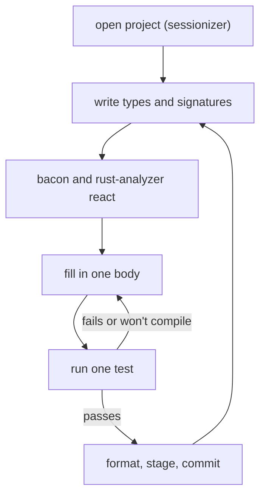

# The daily loop

Tools are only as good as the habits they support. Over the last four chapters
we've assembled a shell, a multiplexer and an editor, each configured in typed
Nix and pinned by a lock file. This short chapter puts them to work. We'll
walk through one small, complete piece of work in the finished workshop, from
opening the project to committing the result, and watch how the pieces hand
off to each other.

The piece of work is deliberately tiny, so that the workflow is what you
notice. It's also the workflow the rest of this book teaches: Chapter 1 calls
it **Type-Driven Development**. Write the types and signatures first, with
`todo!()` bodies; get them compiling; then fill in the bodies one at a time,
letting the compiler check each against the design. Here we'll see what that
feels like when the compiler is a pane away and the editor can ask it
questions.

Here's the loop we're about to go round:



## Opening the project

We'll use `greeter`, the project from Workshop 1, and give it a small
library: parse a person's name from untrusted input, and greet them.

From anywhere, inside tmux or not, open the sessionizer: `tmux-sessionizer`
in a shell, or Ctrl-A then `f` inside tmux. Type `gre`, press Enter.

Several things happen in the next two seconds, each set up by a different
chapter:

1. tmux creates a session called `greeter` with three panes, all starting in
   `~/code/greeter` (Workshop 3).
2. Each pane's zsh starts, and its direnv hook sees the `.envrc`. nix-direnv
   finds its cache is still valid and loads the dev shell instantly
   (Workshops 1 and 2).
3. Only then do the queued commands run: `nvim` in the left pane and `bacon
   clippy-all` at the top right, both with the project's `cargo`, `rustc` and
   `rust-analyzer` on their `PATH`.
4. The shell pane's prompt confirms it:

```text
greeter on main rust v1.98.1 nix shell
>
```

If the project is new, there's one extra step the first time: copy
`flake.nix` and `.envrc` from another project (or write them as in
Workshop 1), run `git add flake.nix`, and `direnv allow`. After that,
opening it is always one key.

> [!TIP]
> Got interrupted? Ctrl-A `d` detaches, and the session keeps running with
> bacon still watching. Tomorrow, the sessionizer reattaches to it with the
> cursor exactly where you left it.

## Types and signatures first

In Neovim, create the library file with `:e src/lib.rs`. (Once it exists,
`<leader>ff` and a few letters of its name will find it.) Following Chapter 1's method,
before any logic we write down what's true:

- A **name** is text that has been trimmed and isn't empty.
- **Parsing** a name from input can fail, because the input might be blank.
- **Greeting** someone can't fail, because by then we have a real name.

As Rust, with no bodies yet:

```rust
// file: src/lib.rs
/// A person's name: trimmed, and never empty.
#[derive(Debug, Clone, PartialEq)]
pub struct Name(String);

pub fn parse_name(input: &str) -> Option<Name> {
    todo!()
}

pub fn greet(name: &Name) -> String {
    todo!()
}
```

Save. Two things happen without you asking.

The bacon pane re-runs `cargo clippy --all-targets` and shows its verdict: no
errors, two warnings.

```text
warning: unused variable: `input`
 --> src/lib.rs:5:19
  |
5 | pub fn parse_name(input: &str) -> Option<Name> {
  |                   ^^^^^ help: if this is intentional, prefix it with an
  |                         underscore: `_input`

warning: unused variable: `name`
 --> src/lib.rs:9:14
  |
9 | pub fn greet(name: &Name) -> String {
  |              ^^^^ help: if this is intentional, prefix it with an
  |                   underscore: `_name`
```

And in the editor, the same two warnings appear as diagnostics at the end of
lines 5 and 9. This is exactly the state Chapter 1 asks for: the design
*compiles*. The signatures are checked against each other and against the
types, and the warnings are a to-do list of the bodies still to write.
Nothing has run, and nothing needed to.

## Filling in a body

Put the cursor inside `parse_name`, replace `todo!()`, and write the body:

```rust
// file: src/lib.rs
pub fn parse_name(input: &str) -> Option<Name> {
    let trimmed = input.trim();
    if trimmed.is_empty() {
        return None;
    }
    Some(Name(trimmed.to_string()))
}
```

As you type, blink.cmp offers `trim`, `trim_start`, `trim_end` and friends
after `input.`, with each one's documentation beside the menu. When you
accept `trim`, the inlay hint after `trimmed` shows `: &str`: a borrowed
slice of the input, not a new string. That's a detail Chapter 2 makes a lot
of, and here it is, visible without asking.

If you want more than the hint, put the cursor on `trimmed` and press `K`:

```rust
let trimmed: &str
```

```text
size = 16 (0x10), align = 0x8, no Drop
```

*No Drop* means a `&str` owns nothing that needs cleaning up; it's a view into
`input`. Compare `Name(trimmed.to_string())` on the last line: `K` on
`to_string` shows it returns a `String`, which *does* own its memory. The
moment where we copy the text into something we own is right there, on one
line, and the editor will tell you so.

Fill in `greet` the same way:

```rust
// file: src/lib.rs
pub fn greet(name: &Name) -> String {
    format!("Hello, {}!", name.0)
}
```

Save. bacon's pane goes quiet: no warnings, no errors.

## A test, and a mistake

Now a test for each behaviour. At the bottom of the file:

```rust
// file: src/lib.rs
#[cfg(test)]
mod tests {
    use super::*;

    #[test]
    fn rejects_blank_names() {
        assert_eq!(parse_name("   "), None);
    }

    #[test]
    fn greets_by_name() {
        let name = parse_name("  Ada ");
        assert_eq!(greet(&name), "Hello, Ada!");
    }
}
```

There's a mistake in `greets_by_name`, and you won't need to save to find
it. rust-analyzer underlines `&name` almost as you finish typing, with a
short message at the end of the line:

```text
expected &Name, found &Option<Name>
```

Save, and clippy (through rust-analyzer, and in bacon's pane at the same
moment) adds the compiler's full error. Press `<leader>e` with the cursor
on the line to read it in a float:

```text
error[E0308]: mismatched types
  --> src/lib.rs:29:26
   |
29 |         assert_eq!(greet(&name), "Hello, Ada!");
   |                    ----- ^^^^^ expected `&Name`, found `&Option<Name>`
   |                    |
   |                    arguments to this function are incorrect
   |
   = note: expected reference `&Name`
              found reference `&Option<Name>`
note: function defined here
  --> src/lib.rs:13:8
   |
13 | pub fn greet(name: &Name) -> String {
   |        ^^^^^ -----------
```

In a larger file you'd get here with `]d`, which jumps to the next
diagnostic. It also stops at the *hints* attached to an error, such as the
"function defined here" note on `greet`'s signature, so you can walk from the
call to the definition and back. `<leader>fd` lists every diagnostic in the
workspace when there are many.

Read the error the way Chapter 1 suggests: calmly, as a design partner's
remark. `parse_name` returns an `Option<Name>` because parsing can fail. We
designed it that way. `greet` takes a `Name`, because greeting can't fail.
The compiler is pointing at the exact place where we tried to skip the
"might not be a name" step. Put the cursor on `name` and press `K` to confirm
it: `let name: Option<Name>`.

In a test, a failed parse is a bug in the test, so we say so:

```rust
// file: src/lib.rs
        let name = parse_name("  Ada ").expect("a valid name");
```

The underline disappears. `.expect` unwraps the `Some` and would panic with
that message on `None`; Chapter 4 explains when that's the right call and
when it isn't.

## Running one test

Leave the cursor inside `greets_by_name` and press `<leader>rt`. The picker
lists what rust-analyzer can run from here, closest first: this test, the
`tests` module, and the whole package. Choose the first. rustaceanvim runs it
through nextest in a split:

```text
    Starting 1 test across 2 binaries (1 test skipped)
        PASS [   0.011s] (1/1) greeter tests::greets_by_name
────────────
     Summary [   0.012s] 1 test run: 1 passed, 1 skipped
```

One test, a fraction of a second. From now on, `<leader>rl` re-runs it
without the picker. That's the inner loop: change a body, save, `<leader>rl`,
read the result, without the cursor ever leaving the code.

When you want the whole suite, the shell pane is a Ctrl-L away (with
vim-tmux-navigator, Ctrl-L at the right edge of Neovim moves into tmux's
right-hand panes; Ctrl-J moves down to the shell). The `ct` alias from
Workshop 2 runs everything:

```sh
ct
```

```text
    Starting 2 tests across 2 binaries
        PASS [   0.020s] (1/2) greeter tests::rejects_blank_names
        PASS [   0.021s] (2/2) greeter tests::greets_by_name
────────────
     Summary [   0.022s] 2 tests run: 2 passed, 0 skipped
```

## Format, review, commit

We never ran `cargo fmt`. Every save went through rustfmt, so the file is
already formatted; if you'd written the test body on one line, it's three
lines now.

Before committing, look at what you're about to commit. In Neovim, the
gitsigns markers in the sign column show every changed line; `]h` walks the
hunks and `<leader>hp` previews each one. In the shell pane, `gs` gives the
short status and `gd` the full diff, paged and highlighted.

Then, from the shell pane:

```sh
git add src/lib.rs
git commit
```

`git commit` opens Neovim (it's `$EDITOR`, from Workshop 4) for the message.
Write it, `:wq`, and you're done. bacon is still watching, and the next piece
of work starts the same way: types and signatures first.

> [!CHECKPOINT]
> `greeter` has `src/lib.rs` with `Name`, `parse_name`, `greet` and two
> tests. `ct` reports `2 tests run: 2 passed`, `cl` (clippy on all targets)
> prints no warnings, and `git log --oneline` shows your commit.

## What the workshop did for us

Look back over that session and count the things you didn't have to do:

- **Install or select a toolchain.** The lock file in `greeter` chose
  `rustc 1.98.1`, and direnv loaded it into every pane.
- **Ask "does it compile?"** bacon and rust-analyzer answered on every save,
  and often before it.
- **Hold types in your head.** Inlay hints and `K` showed `&str`,
  `Option<Name>` and what each one owns.
- **Find the error.** `]d` and `<leader>e` put it under the cursor with the
  full explanation.
- **Run the right test.** `<leader>rt` ran exactly one, `<leader>rl` ran it
  again.
- **Format or tidy up.** rustfmt ran on save; gitsigns showed the diff.

None of those is about Rust syntax. They're about shortening the distance
between a design decision and the compiler's opinion of it. That distance is
what makes type-driven development practical: when checking a signature is
instant, you write signatures first because it's the fastest way to think.

And the workshop itself is built the same way. Your `~/dotfiles` is a set of
typed modules, checked at a boundary before anything changes, with
composition handled by the module system and every dependency pinned. If you
want to change it, the loop is the same: edit, `home-manager switch`, read
the error if there is one, and fix it.

## Where next

Part I starts here. Chapter 1 builds a slightly larger version of what we
just did, a parser and summary for temperature readings, and names the ideas
we've been using: *Type-Driven Development*, and *Functional Core,
Imperative Shell*. The setup section there assumes this workshop, though
everything also works with `rustup` and any editor with rust-analyzer.

Start each project the same way: `cargo new`, a `flake.nix` with the dev
shell, a one-line `.envrc`, `direnv allow`, and the sessionizer. Then types
first.

## What we learned

- **One key opens a project**: the sessionizer, tmux, direnv and nix-direnv
  hand off so that the editor and bacon start with the project's toolchain.
- **Type-Driven Development in practice**: signatures with `todo!()` compile,
  bacon's warnings list the bodies still to write, and each body is checked
  as soon as it's saved.
- **The editor makes inferred types visible**: inlay hints and hover show
  what Rust worked out, including what owns its data.
- **Errors arrive where they happen**: rust-analyzer flags mistakes as you
  type, clippy adds the full message on save, and `]d` and `<leader>e` take
  you there.
- **A tight test loop**: `<leader>rt` runs one test through nextest,
  `<leader>rl` repeats it, and `ct` runs the suite.
- **Formatting and review are ambient**: rustfmt on save, gitsigns in the
  gutter, and the aliases from Workshop 2 in the shell pane.

## Exercises

> [!EXERCISE] A third behaviour
> Add a requirement: names longer than 50 characters are rejected. Start by
> writing the test, then change `parse_name`. Did the signature need to
> change? What would you change if callers needed to know *why* a name was
> rejected? (Chapter 4 has the answer; for now, write the signature you'd
> want, with `todo!()`, and see what bacon says.)

> [!EXERCISE] Debug a test
> Set a breakpoint on the `if trimmed.is_empty()` line with `<leader>db`,
> then debug `rejects_blank_names` with `<leader>rd`. When it stops, open the
> REPL (`:lua require("dap").repl.open()`) and print `trimmed`. What is it,
> for an input of three spaces?

> [!EXERCISE] Time the loop
> Make a deliberate type error, and time how long it takes from saving to
> seeing the error in the editor, in bacon, and from `<leader>rl`. Which is
> fastest, and why? (Think about which tools run `cargo` and which ask
> rust-analyzer.)
