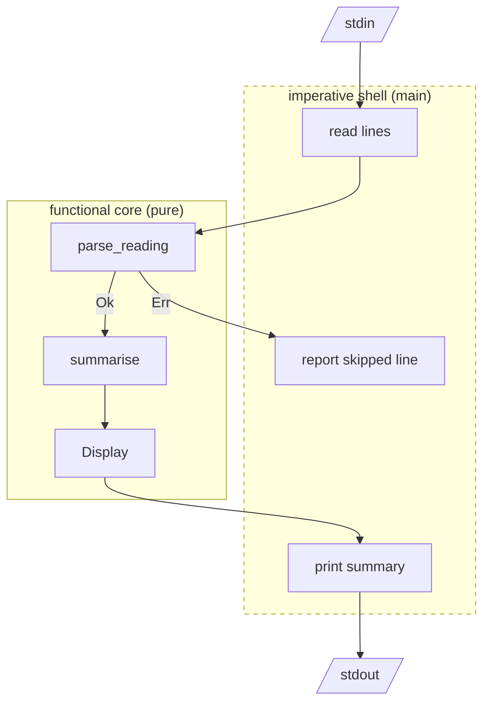

# The design mindset

There's a small computer in a cupboard somewhere in your house. Every few minutes a
handful of cheap temperature sensors report in, and a script appends what they say
to a text file:

```text
kitchen, 21.5C
garage, 50F
study, 22.0C
```

One evening you want a quick summary: how many readings, the average, the coldest
and warmest rooms. It's twenty lines of code in any language. We'll write it twice
in Rust: first the way most of us would write it on autopilot, then the way the rest
of this book will teach you to write *everything*.

The second version isn't longer because it's more clever. It's longer because it
says more: about what the data *is*, what can go wrong, and which parts of the
program are allowed to touch the outside world. That extra information is what lets
the compiler help us, lets tests be trivial, and lets the program grow without
rotting. By the end of this chapter you'll have seen the three ideas that run through
every project in the book:

1. **Design the types first.** Decide what is true about your data and write it
   down as types before writing any logic.
2. **Keep the core pure.** The interesting decisions are ordinary functions from
   values to values. Input and output live at the edges.
3. **Let the compiler be a design partner.** When the types say something precise,
   the compiler can point at every place a change needs to ripple to.

## Getting set up

If you worked through Part 0, you already have everything: open a tmux session,
`cd` into a fresh directory, and the Nix dev shell gives you `rustc` (the
compiler), `cargo` (the build tool and package manager), `clippy` (a linter),
`rustfmt` (a formatter) and `rust-analyzer` (which powers Neovim's Rust
support). If you skipped Part 0, install [rustup](https://rustup.rs), the
official toolchain manager, and come back to the workshop later:

```sh
curl --proto '=https' --tlsv1.2 -sSf https://sh.rustup.rs | sh
rustup component add clippy rustfmt rust-analyzer
```

Then create the project we'll build in this chapter:

```sh
cargo new readings
cd readings
cargo run
```

`cargo new` gives you a `Cargo.toml` (the package manifest: name, edition,
dependencies) and a `src/main.rs` containing hello world. `cargo run` compiles and
runs it. Two more commands you'll use constantly are `cargo test` and
`cargo clippy`. That's the whole toolchain story; there's no separate build system
to learn.

## The version we write on autopilot

Here's the summary program as you might dash it off. It reads the file, splits each
line on the comma, strips the `C`, parses a number and keeps a running total.

```rust
// file: src/main.rs
fn main() {
    let input = std::fs::read_to_string("readings.txt").unwrap();

    let mut total = 0.0;
    let mut count = 0;
    for line in input.lines() {
        let parts: Vec<&str> = line.split(',').collect();
        let temp: f64 = parts[1].trim().trim_end_matches('C').parse().unwrap();
        total += temp;
        count += 1;
    }

    println!("average: {}", total / count as f64);
}
```

Even if you've never read Rust, most of this should look familiar. `let` introduces
a variable; `let mut` one we intend to change. `.unwrap()` means "I'm sure this
worked; crash if it didn't". `f64` is a 64-bit float. `Vec<&str>` is a growable
array of borrowed string slices (Chapter 2 is all about what *borrowed* means).

It compiles. It even works on the happy path. Now let's feed it the three files the
real world will eventually hand us.

The sample file above, which has a Fahrenheit reading in it:

```text
thread 'main' panicked at src/main.rs:8:71:
called `Result::unwrap()` on an `Err` value: ParseFloatError { kind: Invalid }
```

An empty file, because the sensors were offline:

```text
average: NaN
```

A file with a trailing blank line:

```text
thread 'main' panicked at src/main.rs:8:30:
index out of bounds: the len is 1 but the index is 1
```

None of these are exotic. Each one is a fact about the domain that the code didn't
write down anywhere:

- Readings come in **more than one unit**, and the code assumed one.
- A batch can be **empty**, and "the average of nothing" isn't a number, even
  though `0.0 / 0.0` happily produces one (`NaN`, *not a number*).
- **Lines can be malformed**, and "crash the whole program" is a poor policy for
  one bad line.

There's a fourth, structural problem. Reading the file, parsing text, doing
arithmetic and printing are all tangled in one loop. To test the averaging we'd have
to write a file to disk. To reuse the parsing elsewhere we'd copy and paste it.

The fix isn't to sprinkle `if` statements over the loop until the crashes stop. It's
to step back and ask a different first question.

## Ask what is true about the data

Before any logic, let's list the *things* in this problem and what we know about
them. Programmers who practise domain-driven design call this finding the
**ubiquitous language**: the words the domain uses, which should also be the
names in the code. We'll come back to that idea properly in Part II.

- A **room** is a name like `kitchen`. It's never empty.
- A **temperature** is a number with a unit. Once we've read it, we'd like a single
  canonical unit so comparisons make sense. Let's say Celsius.
- A **reading** is a room plus a temperature.
- A **summary** is how many readings there were, their mean, and which reading was
  coldest and which warmest. A summary only exists if there was at least one
  reading.
- Turning a line of text into a reading **can fail**, in a handful of specific,
  nameable ways.

Now we write those sentences down in Rust, and only those sentences: no logic yet.
Create `src/lib.rs` next to `main.rs`. Cargo treats it as a *library* for your
package, and that's where the pure core will live; `main.rs` will stay a thin
program that uses it.

```rust
// file: src/lib.rs
/// The name of a room a sensor lives in.
pub struct Room(String);

/// A temperature, always stored in degrees Celsius.
pub struct Celsius(f64);

/// One line of sensor output, understood.
pub struct Reading {
    pub room: Room,
    pub temperature: Celsius,
}
```

`Room` and `Celsius` are *tuple structs* with one field each. At runtime a
`Celsius` is exactly an `f64` (no boxing, no overhead) but to the compiler it's a
different type. You can't accidentally pass a raw float, or a Fahrenheit value
you forgot to convert, where a `Celsius` is expected. We'll make a lot of these.
Chapter 3 gives the technique its name: the **Newtype** pattern.

`Reading` is an ordinary struct with named fields. `pub` makes things visible
outside the module. The `///` lines are documentation comments; `cargo doc` turns
them into HTML.

Next, the ways parsing can fail. In many languages you'd throw an exception with a
message string. In Rust, a failure is a *value*, and the set of possible failures is
a type:

```rust
/// Everything that can be wrong with a line of input.
pub enum ParseError {
    MissingSeparator,
    EmptyRoom,
    MissingValue,
    MissingUnit,
    UnknownUnit(char),
    BadNumber(String),
}
```

An `enum` in Rust is a *sum type*: a `ParseError` is exactly one of these variants,
and some variants carry data (`UnknownUnit` remembers which character it saw). If
you know TypeScript, think of a discriminated union; if you know Java, think of a
sealed interface with records, minus the ceremony.

Finally, the summary:

```rust
/// What we want to know about a batch of readings.
pub struct Summary {
    pub count: usize,
    pub mean: Celsius,
    pub coldest: Reading,
    pub warmest: Reading,
}
```

Notice what this type *can't* express: a summary with no coldest reading. If
`Summary` exists, there was data. We'll lean on that in a moment.

## Signatures are designs

With the nouns written down, the verbs come next. We write the function
*signatures* and leave the bodies as `todo!()`, a macro that compiles to "panic if
anyone ever runs this".

```rust
pub fn parse_reading(line: &str) -> Result<Reading, ParseError> {
    todo!()
}

pub fn summarise(readings: &[Reading]) -> Option<Summary> {
    todo!()
}
```

This compiles, and it already tells a story a reviewer could check against the
requirements, without reading a line of implementation:

- `parse_reading` takes a borrowed piece of text (`&str`) and returns
  `Result<Reading, ParseError>`: *either* `Ok(reading)` *or* `Err(error)`. The
  failure is in the signature, so every caller has to decide what to do about it.
  Nobody can forget, because a `Result<Reading, _>` is not a `Reading`. You can't
  read `.room` off it without first dealing with the error case.
- `summarise` takes a borrowed slice of readings (`&[Reading]`) and returns
  `Option<Summary>`: either `Some(summary)` or `None`. The empty-batch case is no
  longer a `NaN` that leaks into a report. It's a `None` the caller must handle.
- Neither function mentions files, standard input or printing. They *can't* do I/O
  without us changing their signatures (well, Rust won't stop a function calling
  `println!`, but nothing in their inputs gives them anything to read). They
  transform values into values.

> [!PATTERN] Type-Driven Development
> Write the types and function signatures first, with `todo!()` bodies, and get
> them compiling. The signatures become an executable design: what each step
> needs, what it produces, and how it can fail. Then fill in the bodies one at a
> time, letting the compiler check each against the design.

## Filling in the core

### Parsing a line

Let's fill in `parse_reading`. We split the line at the first comma, check the room,
and hand the rest to a helper:

```rust
pub fn parse_reading(line: &str) -> Result<Reading, ParseError> {
    let (room, value) =
        line.split_once(',').ok_or(ParseError::MissingSeparator)?;

    let room = room.trim();
    if room.is_empty() {
        return Err(ParseError::EmptyRoom);
    }

    let temperature = parse_temperature(value.trim())?;
    Ok(Reading { room: Room(room.to_string()), temperature })
}
```

Two small pieces of machinery are doing a lot of work here.

`split_once(',')` returns an `Option<(&str, &str)>`: `Some((before, after))` if
there was a comma, `None` if not. Compare that with the autopilot version's
`parts[1]`, which assumed a comma and crashed when there wasn't one. `.ok_or(...)`
turns that `Option` into a `Result`, supplying the error to use for `None`.

The `?` at the end of the line is Rust's early return for errors. If the `Result`
is `Err(e)`, the function immediately returns `Err(e)`; if it's `Ok(v)`, the
expression evaluates to `v` and we carry on. It's the same control flow as an
exception propagating, except that it's visible at every call site and the error
type is checked. Chapter 4 is devoted to it.

We also shadow `room`: the second `let room` makes a new variable with the same
name, holding the trimmed slice. It's idiomatic Rust for "the same idea, refined"
and saves inventing names like `room_trimmed`.

### Units, and a first taste of exhaustiveness

Our domain says temperatures come in units. Rather than comparing characters all
over the place, we give units a type of their own:

```rust
/// The units our sensors report in.
pub enum Unit {
    Celsius,
    Fahrenheit,
}

fn parse_unit(symbol: char) -> Result<Unit, ParseError> {
    match symbol {
        'C' => Ok(Unit::Celsius),
        'F' => Ok(Unit::Fahrenheit),
        other => Err(ParseError::UnknownUnit(other)),
    }
}

fn to_celsius(value: f64, unit: Unit) -> Celsius {
    match unit {
        Unit::Celsius => Celsius(value),
        Unit::Fahrenheit => Celsius((value - 32.0) * 5.0 / 9.0),
    }
}
```

`match` compares a value against patterns, top to bottom, and evaluates to the arm
that matches. Like almost everything in Rust, `match` is an *expression*: it
produces a value, so `to_celsius` needs no `return` statement. The last expression
in a function body, written without a trailing semicolon, is its result.

Notice how the two functions split the work. `parse_unit` deals with untrusted text
and so can fail. `to_celsius` deals with a `Unit` that has already been understood,
and so *cannot* fail: its return type is plain `Celsius`. The uncertainty is
handled once, at the edge, and everything downstream works with facts.

Now `parse_temperature` is just glue: peel off the unit symbol, parse the number,
convert.

```rust
fn parse_temperature(text: &str) -> Result<Celsius, ParseError> {
    let symbol = text.chars().last().ok_or(ParseError::MissingValue)?;
    if symbol.is_ascii_digit() {
        return Err(ParseError::MissingUnit);
    }

    let unit = parse_unit(symbol)?;
    let number = &text[..text.len() - symbol.len_utf8()];
    let value: f64 = number
        .parse()
        .map_err(|_| ParseError::BadNumber(number.to_string()))?;

    Ok(to_celsius(value, unit))
}
```

`.map_err(...)` transforms the standard library's float-parsing error into *our*
error type, so `?` can propagate it. The `|_| ...` is a closure (an anonymous
function) that ignores its argument. Chapter 6 covers closures properly.

> [!NOTE]
> `&text[..n]` takes a *slice* of the string: a view of its first `n` bytes, with
> no copying. Rust strings are UTF-8, and slicing in the middle of a multi-byte
> character panics, which is why we subtract `symbol.len_utf8()` rather than `1`.
> The compiler won't catch that one for you; the type of a byte index can't know
> where characters begin. That's a hint of where types stop and tests begin.

### Summarising

`summarise` has a gift waiting for it in its own signature: it returns an
`Option`, so it can use `?` on *options* too. If the slice is empty there's no
minimum, `min_by` returns `None`, and `?` returns `None` from the whole function.
The empty case falls out naturally; there's no special-case `if` at all.

```rust
pub fn summarise(readings: &[Reading]) -> Option<Summary> {
    let by_temperature = |a: &&Reading, b: &&Reading| {
        a.temperature.0.total_cmp(&b.temperature.0)
    };

    let coldest = readings.iter().min_by(by_temperature)?;
    let warmest = readings.iter().max_by(by_temperature)?;
    let total: f64 = readings.iter().map(|r| r.temperature.0).sum();

    Some(Summary {
        count: readings.len(),
        mean: Celsius(total / readings.len() as f64),
        coldest: coldest.clone(),
        warmest: warmest.clone(),
    })
}
```

This is our first *iterator pipeline*. `readings.iter()` produces each reading in
turn; `.map(...)` transforms each one; `.sum()` folds them into a total. There's no
index variable to get wrong and no mutable accumulator. We describe *what* we want
and the iterator machinery does the looping. It compiles to the same tight loop
you'd write by hand.

The `by_temperature` closure is there because floats are awkward to compare: `NaN`
isn't less than, equal to, or greater than anything, so `f64` deliberately doesn't
implement Rust's "total ordering" trait. `total_cmp` supplies an ordering that
handles every value, `NaN` included. It's a small example of Rust making you
*decide* something other languages decide silently for you.

The `.clone()` calls copy the coldest and warmest readings into the summary.
Without them the summary would *borrow* from the slice and be tied to its lifetime.
That's perfectly possible, and Chapter 2 shows how, but copying two small values is
simpler, and in Rust every copy of heap data is spelled out where you can see it.
For `clone` to exist at all, the types need `#[derive(Clone)]`; we'll add those
derives in a moment.

## The imperative shell

Everything so far is pure: no files, no terminal, no clock. Somewhere, a program has
to actually read input and print output. That's `main`'s job, and *only* `main`'s
job:

```rust
// file: src/main.rs
use std::io::{self, BufRead};

use readings::{parse_reading, summarise};

fn main() -> io::Result<()> {
    let mut readings = Vec::new();

    for (index, line) in io::stdin().lock().lines().enumerate() {
        let line = line?;
        match parse_reading(&line) {
            Ok(reading) => readings.push(reading),
            Err(e) => eprintln!("line {}: skipped: {e}", index + 1),
        }
    }

    match summarise(&readings) {
        Some(summary) => println!("{summary}"),
        None => println!("no valid readings"),
    }
    Ok(())
}
```

The shell is where *policy* lives. The core says "this line is malformed, and
here's exactly how". The shell decides that, for this tool, a malformed line is
reported and skipped. A different program (say, a strict importer) could reuse
the same `parse_reading` and decide to stop at the first error instead. The core
doesn't need to know.

`use readings::...` imports from our own library: a package with both
`lib.rs` and `main.rs` gets a library crate named after the package, and the
binary uses it like any other dependency. `main` itself returns a `Result` (`io::Result<()>` is shorthand for
`Result<(), io::Error>`), so reading from standard input can use `?` too. If reading
fails, `main` returns the error and Rust prints it and exits with a non-zero status.

This shape (a pure centre, a thin layer of I/O around it) is the most important
architectural idea in the book. It has a name.

> [!PATTERN] Functional Core, Imperative Shell
> Put decisions and transformations in pure functions that take values and return
> values. Put all I/O (files, network, clocks, randomness, printing) in a thin outer
> layer that gathers inputs, calls the core, and acts on its outputs. The core
> becomes trivial to test and reason about; the shell becomes too simple to hide
> bugs.

Here's our program drawn that way. Solid boxes are pure; the dashed shell is the
only part that touches the world.



To make the summary printable with `{summary}` we implement `Display`, Rust's
trait for user-facing formatting. A *trait* is a named set of behaviour a type can
provide; `println!` works with any type that implements `Display`. Chapter 5 is
about traits. For now, read it as "here's how to turn a `Summary` into text":

```rust
impl fmt::Display for Summary {
    fn fmt(&self, f: &mut fmt::Formatter<'_>) -> fmt::Result {
        writeln!(f, "readings: {}", self.count)?;
        writeln!(f, "mean:     {}", self.mean)?;
        writeln!(
            f,
            "coldest:  {} ({})",
            self.coldest.temperature,
            self.coldest.room.as_str()
        )?;
        // ... warmest, the same way
    }
}
```

`Celsius` and `ParseError` get `Display` implementations in the same style, so
temperatures print as `21.5°C` and errors print as readable sentences. Let's run
it on the input that crashed our first version, with a few more bad lines for good
measure:

```sh
printf 'kitchen, 21.5C\ngarage, 50F\nloft, 294K\nstudy 22C\n' \
  | cargo run
```

```text
line 3: skipped: unknown unit `K`
line 4: skipped: expected `room, value`
readings: 2
mean:     15.8°C
coldest:  10.0°C (garage)
warmest:  21.5°C (kitchen)
```

Fahrenheit converted, the kelvin reading and the missing comma reported precisely,
and the summary is correct. An empty input prints `no valid readings` instead of
`NaN`.

## Tests come almost for free

Because the core is pure, testing it needs no files, mocks or setup. Rust tests
live next to the code, in a module that's only compiled for `cargo test`:

```rust
#[cfg(test)]
mod tests {
    use super::*;

    #[test]
    fn converts_fahrenheit() {
        assert_eq!(parse_reading("garage, 50F"), Ok(reading("garage", 10.0)));
    }

    #[test]
    fn rejects_bad_lines() {
        assert_eq!(parse_reading("kitchen 21C"), Err(ParseError::MissingSeparator));
        assert_eq!(parse_reading("loft, 294K"), Err(ParseError::UnknownUnit('K')));
    }

    #[test]
    fn nothing_to_summarise() {
        assert_eq!(summarise(&[]), None);
    }
}
```

`assert_eq!` needs to compare values and print them if they differ, so our types
need to support equality and debug printing. Rather than write that code by hand,
we ask the compiler to generate it with `derive`:

```rust
#[derive(Debug, Clone, PartialEq)]
pub struct Reading {
    pub room: Room,
    pub temperature: Celsius,
}
```

Each type gets a similar line. `Debug` gives a developer-facing representation,
`Clone` an explicit deep copy, and `PartialEq` the `==` operator. (*Partial*
because of `NaN` again: for floats, `x == x` isn't always true.) Every behaviour a
type has is something you opted into. Nothing is comparable or copyable by
accident.

```sh
cargo test
```

```text
running 5 tests
test tests::converts_fahrenheit ... ok
test tests::nothing_to_summarise ... ok
test tests::parses_celsius ... ok
test tests::rejects_bad_lines ... ok
test tests::summarises_readings ... ok

test result: ok. 5 passed; 0 failed; 0 ignored; 0 measured
```

## The compiler as a design partner

Six months later, someone adds a sensor that reports in kelvin. We add a variant to
`Unit`:

```rust
pub enum Unit {
    Celsius,
    Fahrenheit,
    Kelvin,
}
```

and build:

```text
error[E0004]: non-exhaustive patterns: `Unit::Kelvin` not covered
  --> src/lib.rs:96:11
   |
96 |     match unit {
   |           ^^^^ pattern `Unit::Kelvin` not covered
   |
note: `Unit` defined here
  --> src/lib.rs:66:10
   |
66 | pub enum Unit {
   |          ^^^^
...
69 |     Kelvin,
   |     ------ not covered
help: ensure that all possible cases are being handled by adding a match
      arm with a wildcard pattern or an explicit pattern as shown
   |
99 ~         Unit::Kelvin => todo!(),
```

Read that error as a to-do list the compiler wrote for us. Every `match` over
`Unit` in the whole program is listed, and the build won't succeed until each one
says what kelvin means. In a codebase where units were strings or `char`s
compared in `if` chains, the same change would compile cleanly and then do
something wrong at runtime.

This is what "let the compiler be a design partner" means in practice. It isn't
about the compiler being strict for its own sake. When the types say something
precise ("a unit is exactly one of these"), the compiler can do the tedious,
error-prone work of finding every place a change needs to ripple to. The more of
your domain you put into types, the more of that work you hand over.

> [!EXERCISE] Finish the kelvin change
> Add `Unit::Kelvin`, follow the compiler's errors until it builds, and add a test
> that `"loft, 294.15K"` parses to `21.0°C` (allowing for float rounding, or
> comparing with a tolerance).

## What Rust brings to this way of working

We've used a lot of Rust in passing. Here's the map of where each piece is
explained properly, and why it matters to the style of programming this book
teaches:

| Feature | What it gave us here | Chapter |
|---|---|---|
| Ownership and borrowing | `&str` and `&[Reading]` let functions *read* data without copying or taking it; `.clone()` makes copies visible | 2 |
| Structs, enums, `match` | `Reading`, `Unit`, `ParseError`; exhaustive matching on new variants | 3 |
| `Result`, `Option`, `?` | Failure and absence in signatures; early return without exceptions | 4 |
| Traits and `derive` | `Display` for output; `Debug`, `Clone`, `PartialEq` on demand | 5 |
| Closures and iterators | `min_by`, `map`, `sum`; loops without indices | 6 |
| Modules and tests | Pure core in a library module; tests beside the code | 7 |

The rest of Part I takes these one at a time, still through small problems. From
Part II onwards we build real software: a dynamic DNS daemon you can deploy on
NixOS, a to-do app, a live network dashboard, a double-entry ledger, a log query
language and a concurrent link checker. They use the same three moves every time:
write down what's true as types, keep decisions pure, and push I/O to the edges.

## What we learned

- **Autopilot code hides domain facts.** Units, empty input and malformed lines were
  all real, and the first version didn't say so anywhere.
- **Types first, then signatures, then bodies.** `todo!()` lets an unfinished design
  compile, so the compiler can check it while you think. That's *Type-Driven
  Development*.
- **Newtypes** (`Room`, `Celsius`) give meaning to primitives at zero runtime cost.
- **`Result` and `Option` put failure and absence in the signature**, and `?`
  propagates them with visible, typed control flow.
- **Functional core, imperative shell**: pure functions decide, `main` does the I/O
  and owns the policy. Testing the core needs no setup.
- **Exhaustive `match`** turns "add a variant" into a compiler-generated checklist.
- **`derive`** opts types into behaviour (`Debug`, `Clone`, `PartialEq`); nothing is
  comparable or copyable by accident.

## Exercises

> [!EXERCISE] Not a number
> Try `printf 'kitchen, NaNC\n' | cargo run`. Rust's float parser
> accepts `NaN` and `inf`. Decide what *your* domain should do with them, then
> make `Celsius` impossible to construct with a non-finite value. (Hint: make the
> field private and add a constructor that returns `Option<Celsius>`. Chapter 4
> calls this a smart constructor.)

> [!EXERCISE] Strict mode
> Add a `--strict` flag to the shell that stops at the first malformed line and
> exits with a non-zero status. You shouldn't need to change `parse_reading` or
> `summarise` at all. If you find yourself wanting to, ask why.

> [!EXERCISE] Per-room summaries
> Change the program to print one summary per room. Start by writing the new
> function's signature with `todo!()`. What should it return? (One option:
> `Vec<(Room, Summary)>`. Another: a map from room to summary. What would `Room`
> need to derive to be a map key?)

> [!EXERCISE] Break it on purpose
> Delete `#[derive(PartialEq)]` from `Reading` and run `cargo test`. Read the error
> slowly. Rust's compiler errors are unusually good, and learning to read them
> calmly is the most valuable Rust skill there is.
