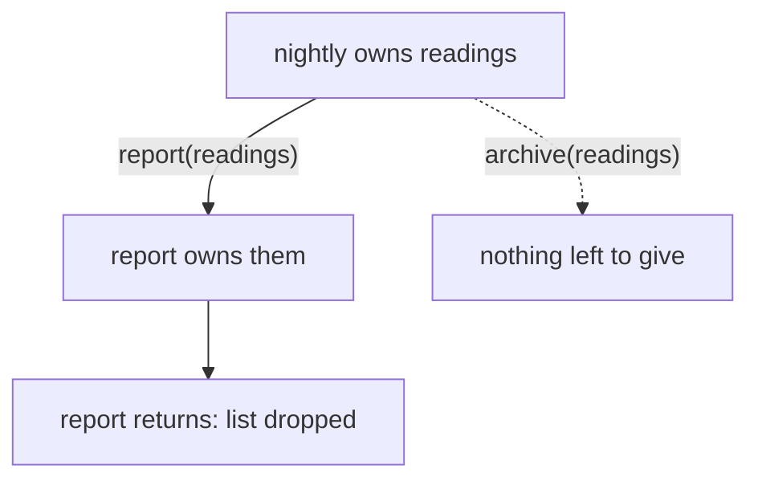
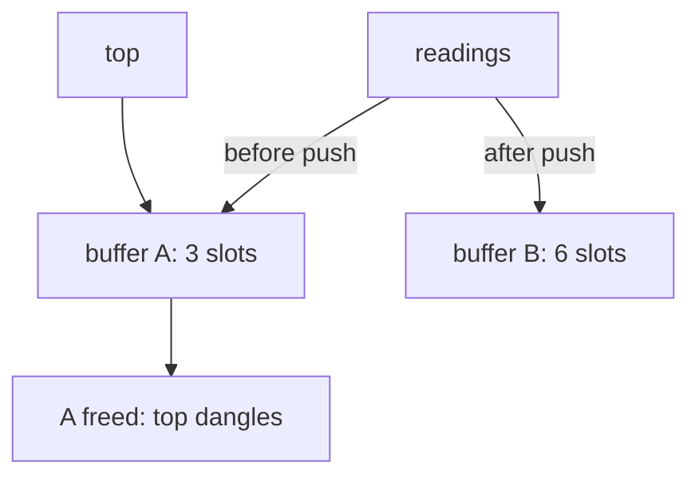
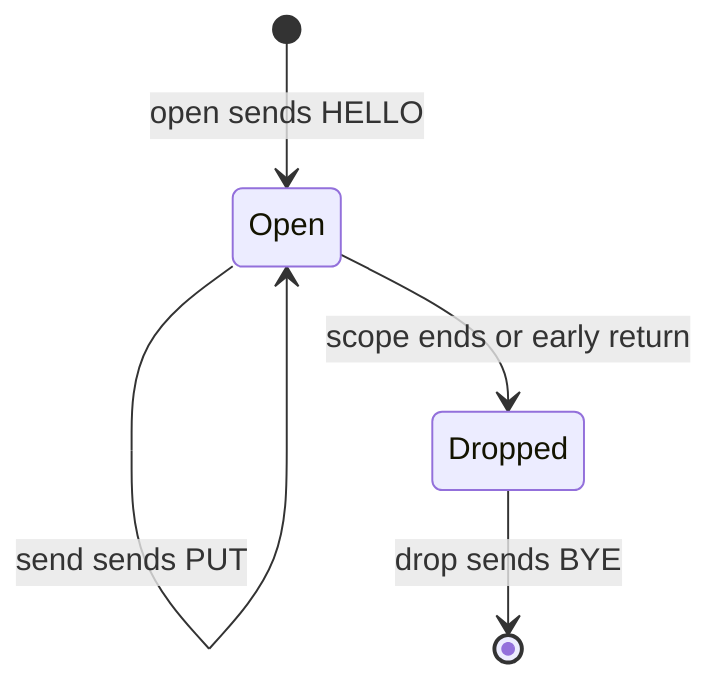

# Ownership as a design tool

It's late, and the sensor box in the cupboard has one more job to do before
midnight. It takes the day's readings, emails you a one-line report, and then
archives the readings to disk so you can draw graphs at the weekend. Two steps,
one after the other, on the same list. You've written this program a hundred
times in other languages without a second thought.

In Rust, the obvious version doesn't compile. That surprises almost everyone the
first time, and the usual reaction is to treat the compiler as an obstacle:
sprinkle `.clone()` until the red goes away and move on. This chapter takes the
opposite view. The rule the compiler is enforcing, *ownership*, is a piece of
design vocabulary. Every function signature in Rust says, in a few characters,
whether the function **takes** a value, **reads** it, or **changes** it. Once
you can read and write that vocabulary, signatures start telling you things that
other languages leave to documentation and good intentions.

By the end of the chapter you'll know what a move is and why it happens, how
borrowing lets functions read data without taking it, why Rust allows many
readers *or* one writer but never both, what a lifetime really is (a
relationship, not a duration), and how ownership gives us deterministic cleanup
for free. Along the way we'll see why all of this makes pure functions the path
of least resistance.

## A workbook for Part I

Chapter 1's `readings` program is finished. For the rest of Part I we'll work in
a single *workbook* crate, with one module per chapter, so each chapter's
experiments stay separate but can still use each other:

```sh
cargo new foundations --lib
cd foundations
```

Each chapter adds a file such as `src/ch02_ownership.rs` and registers it in
`src/lib.rs` with a line like `pub mod ch02_ownership;`. Tests live inside each
module, so `cargo test` runs the whole workbook. (Chapter 7 explains modules
properly; for now, `pub mod` just means "this file is part of the crate".)

## A function that eats its argument

To keep ownership the only new idea on the page, we'll use a simpler `Reading`
than Chapter 1's: a plain `String` and a plain `f64`.

```rust
// file: src/ch02_ownership.rs
#[derive(Debug, Clone, PartialEq)]
pub struct Reading {
    pub room: String,
    pub celsius: f64,
}

impl Reading {
    pub fn new(room: &str, celsius: f64) -> Self {
        Reading { room: room.to_string(), celsius }
    }
}
```

`new` is a plain convenience constructor for tests; we'll see what `impl`
blocks and that `&str` parameter mean later in the chapter.

Here's the nightly job, written the way it comes out of your fingers. `report`
builds the text for the email; `archive` stores the readings somewhere safe.

```rust
// does not compile
fn report(readings: Vec<Reading>) -> String {
    format!("{} readings", readings.len())
}

fn archive(readings: Vec<Reading>) {
    // ... write them to disk and keep them
}

pub fn nightly(readings: Vec<Reading>) {
    println!("{}", report(readings));
    archive(readings);
}
```

```text
error[E0382]: use of moved value: `readings`
  --> src/lib.rs:16:13
   |
14 | pub fn nightly(readings: Vec<Reading>) {
   |                -------- move occurs because `readings` has type
   |                         `Vec<Reading>`, which does not implement the
   |                         `Copy` trait
15 |     println!("{}", report(readings));
   |                           -------- value moved here
16 |     archive(readings);
   |             ^^^^^^^^ value used here after move
   |
note: consider changing this parameter type in function `report` to borrow
      instead if owning the value isn't necessary
  --> src/lib.rs:6:21
   |
 6 | fn report(readings: Vec<Reading>) -> String {
   |    ------           ^^^^^^^^^^^^ this parameter takes ownership of the
   |    |                             value
   |    in this function
```

Read the error from the top. "Value moved here", pointing at the call to
`report`. "Value used here after move", pointing at `archive`. And then a note
that is, in fact, the answer: `report` *takes ownership* of its argument, and it
probably doesn't need to.

Before we fix it, let's understand what a move is, because the fix only makes
sense once the rule does.

## One owner at a time

Every value in Rust has exactly one **owner**: the variable (or struct field, or
collection slot) responsible for it. When the owner goes out of scope, the value
is **dropped**: its memory is freed and any other resources it holds are
released. There's no garbage collector deciding when, and no `free` for you to
forget. The end of the owner's scope *is* the cleanup.

A `Vec<Reading>` is a small header on the stack (a pointer, a length and a
capacity) pointing at a buffer on the heap, and each `Reading` in that buffer
points at its own heap-allocated room name. When you pass `readings` to a
function that takes `Vec<Reading>`, Rust copies the three-word header into the
function and **moves** ownership along with it. The heap data doesn't move at
all; what moves is the *responsibility* for it. From that moment, `nightly` no
longer owns anything, and the compiler won't let it use `readings` again.

Here's the life of our list in the broken version:



If Rust allowed the second call, `archive` would be handed a header pointing at
a buffer that `report` had already freed. In C that's a *use-after-free*, one of
the most common security bugs there is. In a garbage-collected language it can't
happen, but you pay for that with a collector running alongside your program.
Rust's answer is to track ownership at compile time, so the bug is a type error
and there's nothing to pay at runtime.

> [!NOTE]
> Small values that live entirely on the stack, such as `f64`, `i32`, `bool`
> and `char`, are `Copy`: assigning or passing them copies the bits and the
> original stays usable. That's why `let a = 21.5; let b = a;` leaves both
> `a` and `b` valid. A type can only be `Copy` if copying its bits is a
> complete, independent copy, which rules out anything that owns heap memory,
> like `String` or `Vec`. Our `Reading` contains a `String`, so it moves.

Moves aren't a tax. They're how Rust says "this function now owns this value and
may keep it, change it or destroy it". And look at our two functions again with
that in mind. `archive` stores the readings for later: it genuinely *should*
own them. `report` only looks at them to produce some text. Its signature claims
far more than it needs.

## The quick fix: clone

The compiler's second note (which we trimmed) suggested cloning. If `Reading`
implements `Clone`, which ours does via `derive`, we can hand `report` its own
copy:

```rust
pub fn nightly(readings: Vec<Reading>) {
    println!("{}", report(readings.clone()));
    archive(readings);
}
```

This compiles and works. `readings.clone()` allocates a new buffer, clones every
`Reading` into it (each with its own freshly allocated `String`), and gives that
to `report`, which drops it a microsecond later.

For a dozen readings, nobody will ever notice. But notice what `clone` has done
to the code: the cost is *right there*, on the page, as a method call. In
Python or JavaScript, deciding whether a function gets a copy or a reference is
implicit and differs by type; in Rust every deep copy of heap data is spelled
out. That's a feature. When you're reading unfamiliar code and see `.clone()`,
you know an allocation is happening and can ask whether it needs to.

> [!TIP]
> `clone` is not a sin. Cloning a small value to keep the code simple is often
> the right call, and Chapter 1 did exactly that to put the coldest and warmest
> readings into a `Summary`. The habit to build is noticing *why* you're
> cloning. "Because the function signature asked for ownership it doesn't need"
> is a reason to change the signature instead.

## The better fix: borrow

`report` doesn't need to own the list; it needs to *read* it. Rust has a type
for exactly that: a **reference**, written `&`. A reference lets you use a value
without taking ownership of it. Creating one is called **borrowing**, and the
borrow ends when the reference stops being used.

```rust
fn report(readings: &Vec<Reading>) -> String {
    format!("{} readings", readings.len())
}

pub fn nightly(readings: Vec<Reading>) {
    println!("{}", report(&readings));
    archive(readings);
}
```

`&readings` lends the list to `report`. When `report` returns, the loan is over,
`nightly` still owns its list, and `archive` can take it. The signatures now tell
the truth: `report` reads, `archive` keeps.

We can do one better. `&Vec<Reading>` says "a reference to a `Vec`
specifically", but `report` doesn't care how the readings are stored, only that
they're a contiguous run of `Reading`s. That's a **slice**, written
`&[Reading]`: a pointer and a length, viewing some or all of a sequence owned by
someone else.

```rust
pub fn report(readings: &[Reading]) -> String {
    match warmest(readings) {
        Some(top) => format!(
            "{} readings, warmest in the {}",
            readings.len(),
            top.room
        ),
        None => "no readings".to_string(),
    }
}
```

The call site doesn't change: Rust automatically turns `&Vec<Reading>` into
`&[Reading]` where a slice is expected. But now `report` also accepts an array,
or part of a list (`report(&readings[..2])` reports on the first two), or
anything else that can lend out a run of readings. Clippy, the linter, will
nudge you towards this if you write `&Vec<T>` in a parameter.

(`warmest` is the same idea as Chapter 1's `max_by`; we'll look at its signature
properly when we get to lifetimes.)

> [!PATTERN] Borrow, Don't Own
> A function should take the weakest form of access it needs: `&T` to read,
> `&mut T` to change in place, `T` by value only to keep, consume or transform.
> Prefer borrowed views (`&str`, `&[T]`) over references to owners (`&String`,
> `&Vec<T>`). Callers keep their data, nothing is copied, and the signature
> documents the function's intent.

## Many readers or one writer

Borrowing raises an obvious question. If several parts of the program can hold
references to the same list, what stops one of them changing it while the others
are looking?

Here's a plausible scenario. A sensor's reading arrives late, after we've
already worked out the warmest room. We add it to the list and then print the
warmest room we found earlier.

```rust
// does not compile
pub fn late_arrival(mut readings: Vec<Reading>, late: Reading) {
    let top = warmest(&readings).unwrap();
    readings.push(late);
    println!("warmest so far: {}", top.room);
}
```

```text
error[E0502]: cannot borrow `readings` as mutable because it is also borrowed
              as immutable
  --> src/lib.rs:12:5
   |
11 |     let top = warmest(&readings).unwrap();
   |                       --------- immutable borrow occurs here
12 |     readings.push(late);
   |     ^^^^^^^^^^^^^^^^^^^ mutable borrow occurs here
13 |     println!("warmest so far: {}", top.room);
   |                                    -------- immutable borrow later used
   |                                             here
```

`top` is a `&Reading`: a reference into the list's buffer. `push` needs to
*change* the list, which in Rust means borrowing it **mutably**, as
`&mut Vec<Reading>`. And Rust's central borrowing rule is that, at any moment, a
value can have:

- **any number of shared references** (`&T`), or
- **exactly one mutable reference** (`&mut T`),

but never both at once. Many readers *xor* one writer.

This isn't pedantry; the code above has a real bug in it. A `Vec` stores its
elements in a buffer with some spare capacity. When `push` runs out of room, it
allocates a bigger buffer, moves the elements across, and frees the old one. If
that happens, `top` is left pointing into freed memory:



In C++ this is *iterator invalidation*, and it's undefined behaviour. In Java,
modifying a list while iterating over it throws a
`ConcurrentModificationException` at runtime, if you're lucky enough to hit that
code path in testing. Rust refuses to compile it. The same rule, applied across
threads, is why Rust programs don't have data races (Chapter 27 shows that in
action).

The fix depends on what we meant. If we wanted the warmest reading *including*
the late one, we push first and ask afterwards. If we really wanted the old
answer, we take what we need out of the borrow before mutating:

```rust
let top_room = warmest(&readings).unwrap().room.clone();
readings.push(late);
println!("warmest so far: {top_room}");
```

Either way, the compiler made us decide which program we were writing. Notice
also that the borrow ends when `top` is *last used*, not at the end of the
block. Rust's borrow checker works out how long each reference is actually
needed, so code that finishes with a borrow before mutating is accepted without
any ceremony.

## Three signatures, three contracts

The readers-xor-writer rule turns out to be more than a safety net. It makes
function signatures unusually informative. Suppose the kitchen sensor is known to
read half a degree low, and we want to calibrate a batch of readings. There are
three honest ways to write it.

The first changes the caller's readings in place:

```rust
pub fn calibrate_in_place(readings: &mut [Reading], offset: f64) {
    for reading in readings.iter_mut() {
        reading.celsius += offset;
    }
}
```

The second leaves the input alone and returns new readings:

```rust
pub fn calibrated(readings: &[Reading], offset: f64) -> Vec<Reading> {
    readings
        .iter()
        .map(|r| Reading { room: r.room.clone(), celsius: r.celsius + offset })
        .collect()
}
```

The third takes ownership, transforms, and hands the result back:

```rust
pub fn calibrate(mut readings: Vec<Reading>, offset: f64) -> Vec<Reading> {
    calibrate_in_place(&mut readings, offset);
    readings
}
```

Without reading the bodies, here's what the signatures promise.

`calibrate_in_place` takes `&mut [Reading]`, so it *will* change the readings,
and the caller has to write `&mut` at the call site to allow it:
`calibrate_in_place(&mut readings, 0.5)`. Mutation is never a surprise in Rust;
it's visible where you call the function, not just where you define it.

`calibrated` takes `&[Reading]`, so it *cannot* change the readings. Not "it's
documented not to", or "we froze the object first": the type system forbids it.
It returns a new `Vec`, at the cost of allocating one and cloning every room
name.

`calibrate` takes `Vec<Reading>` by value. The caller gives the list up, and gets
a calibrated list back. No reading is copied: the same buffer is updated and
returned. From the caller's point of view, though, it behaves exactly like a pure
function. Nobody else can be holding a reference to the old list, because the
caller had to give up ownership to make the call. Nobody can observe the
mutation, so for all practical purposes it didn't happen.

```rust
let readings = calibrate(readings, 0.5);
```

That last style is worth dwelling on, because it's the heart of why Rust and
functional design get on so well. Functional programming prizes pure functions:
values in, values out, nothing changed behind your back. In most languages,
achieving that means either copying everything defensively (Java's
`List.copyOf`, JavaScript's spread) or trusting everyone to behave. Rust gives
you the guarantee for free. A function taking `&T` can't mutate; a function
taking `T` owns the only copy; a function taking `&mut T` says so at both ends.

Throughout this book our functional cores will take `&` for things they read and
`T` for things they transform, and almost never reach for `&mut` across a module
boundary. Not because mutation is wicked, but because the first two make
reasoning local: to understand a function, you read the function.

## `String` and `&str`

The same owned-versus-borrowed split appears in Rust's two string types, and it
trips up everyone at first. Here's a helper that formats a room name as a
heading:

```rust
// does not compile
fn label(room: &String) -> String {
    format!("[{}]", room.to_uppercase())
}

pub fn demo() {
    let heading = label("kitchen");
    println!("{heading}");
}
```

```text
error[E0308]: mismatched types
 --> src/lib.rs:6:25
  |
6 |     let heading = label("kitchen");
  |                   ----- ^^^^^^^^^ expected `&String`, found `&str`
  |                   |
  |                   arguments to this function are incorrect
  |
  = note: expected reference `&String`
             found reference `&'static str`
```

A **`String`** is an owned, growable, heap-allocated buffer of UTF-8 text. It's
the `Vec` of text: it has a capacity, you can push onto it, and dropping it frees
the memory. A **`&str`** (a *string slice*) is a borrowed view of some UTF-8
text that lives somewhere else: inside a `String`, or baked into the program
binary, which is where the literal `"kitchen"` lives. `&str` is to `String` what
`&[Reading]` is to `Vec<Reading>`.

Our `label` demands a reference to a `String` specifically, so a literal doesn't
fit. The fix is the same as before: ask for the view, not the owner.

```rust
pub fn label(room: &str) -> String {
    format!("[{}]", room.to_uppercase())
}
```

Now `label("kitchen")` works, and so does `label(&reading.room)`, because Rust
will automatically turn a `&String` into a `&str` when that's what's needed
(this is called *deref coercion*). One signature, every kind of caller.

`label` *returns* a `String` because it builds new text that has to outlive the
function. You can't return a `&str` pointing at a local `String`: the local is
dropped when the function returns and the view would point at nothing.

That gives us a rule of thumb you can use almost everywhere:

| Where | Use | Why |
|---|---|---|
| Function parameters you read | `&str`, `&[T]` | Accept every caller, copy nothing |
| Struct fields | `String`, `Vec<T>` | The struct owns its data and can live anywhere |
| Return values you built | `String`, `Vec<T>` | New data needs an owner |

`Reading` follows it: the room is a `String` field, so a `Reading` is
self-contained and can be stored, moved between threads or kept for as long as we
like. Which raises the question: what if we *did* want a struct to hold a
reference?

## Lifetimes are relationships

### A function that returns a borrow

Let's start with a function. Given two readings, return the warmer one. There's
no need to copy anything: the answer is one of the inputs, so we can return a
reference to it.

```rust
// does not compile
pub fn warmer(a: &Reading, b: &Reading) -> &Reading {
    if a.celsius >= b.celsius { a } else { b }
}
```

```text
error[E0106]: missing lifetime specifier
 --> src/lib.rs:6:44
  |
6 | pub fn warmer(a: &Reading, b: &Reading) -> &Reading {
  |                  --------     --------     ^ expected named lifetime
  |                                              parameter
  |
  = help: this function's return type contains a borrowed value, but the
          signature does not say whether it is borrowed from `a` or `b`
help: consider introducing a named lifetime parameter
  |
6 | pub fn warmer<'a>(a: &'a Reading, b: &'a Reading) -> &'a Reading {
  |              ++++     ++              ++              ++
```

The help line is the clearest explanation of lifetimes you'll ever read: the
signature *does not say whether it is borrowed from `a` or `b`*. A returned
reference has to be borrowed from something. Callers need to know what, because
it decides how long they may keep the result. The compiler checks each function
on its own, using only signatures to reason about calls, so the signature has to
say.

We take the suggestion:

```rust
pub fn warmer<'a>(a: &'a Reading, b: &'a Reading) -> &'a Reading {
    if a.celsius >= b.celsius { a } else { b }
}
```

`'a` (pronounced "tick a") is a **lifetime parameter**. It names a region of the
program during which a borrow is valid. Read the signature as a sentence: *for
some region `'a` in which both `a` and `b` are valid, `warmer` returns a
reference that is valid for that region too.* In practice that means the result
may be used for as long as *both* inputs are still around.

The important word there is *relationship*. A lifetime annotation never makes
anything live longer or shorter. It's a statement about how the output of a
function relates to its inputs, which the compiler then checks at every call
site.

### Catching a dangling reference

Here's what that check catches. We want the warmest reading of the day to
survive a block in which the day's readings are loaded:

```rust
// does not compile
pub fn champion() {
    let champion;
    {
        let today = load_today();
        champion = warmest(&today).unwrap();
    }
    println!("champion: {}", champion.room);
}
```

```text
error[E0597]: `today` does not live long enough
  --> src/lib.rs:16:28
   |
15 |         let today = load_today();
   |             ----- binding `today` declared here
16 |         champion = warmest(&today).unwrap();
   |                            ^^^^^^ borrowed value does not live long enough
17 |     }
   |     - `today` dropped here while still borrowed
18 |     println!("champion: {}", champion.room);
   |                              ------------- borrow later used here
```

`today` owns the readings and is dropped at the closing brace. `champion`
borrows from it, so using `champion` afterwards would read freed memory. The
compiler knows `champion` borrows from `today` purely from `warmest`'s
signature. Let's look at it:

```rust
pub fn warmest(readings: &[Reading]) -> Option<&Reading> {
    readings.iter().max_by(|a, b| a.celsius.total_cmp(&b.celsius))
}
```

There's no `'a` anywhere. That's because of **lifetime elision**: a small set of
rules that fill in the obvious cases for you. The most useful is that if a
function takes exactly one reference, any reference it returns is assumed to be
borrowed from that one. `warmest` takes one slice, so its result borrows from the
slice. Written out in full it would be
`fn warmest<'a>(readings: &'a [Reading]) -> Option<&'a Reading>`. `warmer` took
*two* references, which is why the compiler had to ask.

### A struct that borrows

Back in Chapter 1, `summarise` cloned the coldest and warmest readings into its
`Summary`, and we promised to show how to borrow them instead. Here's the naive
attempt:

```rust
// does not compile
pub struct Summary {
    pub count: usize,
    pub warmest: &Reading,
}
```

```text
error[E0106]: missing lifetime specifier
 --> src/lib.rs:8:18
  |
8 |     pub warmest: &Reading,
  |                  ^ expected named lifetime parameter
  |
help: consider introducing a named lifetime parameter
  |
6 ~ pub struct Summary<'a> {
7 |     pub count: usize,
8 ~     pub warmest: &'a Reading,
  |
```

A struct holding a reference can't outlive the thing it refers to, so the type
itself must carry that relationship. `Summary<'a>` reads as "a summary that
borrows from something valid for `'a`".

```rust
pub struct Summary<'a> {
    pub count: usize,
    pub coldest: &'a Reading,
    pub warmest: &'a Reading,
}

pub fn summarise(readings: &[Reading]) -> Option<Summary<'_>> {
    let coldest = readings
        .iter()
        .min_by(|a, b| a.celsius.total_cmp(&b.celsius))?;
    let warmest = warmest(readings)?;
    Some(Summary { count: readings.len(), coldest, warmest })
}
```

`Summary<'_>` in the return type means "the elided lifetime", which by the rule
above is the lifetime of `readings`. The summary copies nothing, and the compiler
guarantees it can never outlive the list it describes.

Is this better than Chapter 1's version? It depends, and that's the design
lesson. The borrowing `Summary` is cheaper, but it's *tied* to the readings: you
can't return it from a function that loads and then drops them, and you can't
stash it somewhere long-lived. The owning `Summary` costs two small clones and is
free to go anywhere. For a report that gets printed and thrown away, either is
fine. For a value that's going into a cache or across a thread, owning wins.
Borrowed structs shine when the data is large and the view is short-lived, which
is exactly the situation in Part VI, where `logq` parses log lines as borrowed
views of an input buffer.

> [!TIP]
> If lifetime annotations are spreading through your types and you're fighting
> to make them line up, take it as a design signal. Usually it means a struct
> wants to own its data. Change the reference to an owned type and see if the
> problem disappears.

## Cleaning up is the owner's job

We've treated *drop* as "memory gets freed", but it's more general than that.
When a value is dropped, Rust runs its **destructor**, and any type can supply
one by implementing the `Drop` trait. Combined with single ownership, this gives
us something remarkably useful: cleanup that happens exactly once, at a
predictable place, on every path out of a scope.

### A session that always says goodbye

Our sensor hub speaks a little line-based protocol. You open a session with
`HELLO`, send readings with `PUT`, and you *must* end with `BYE`, or the hub
holds the connection open until it times out. Forgetting `BYE` on an error path
is exactly the bug that `try`/`finally` blocks exist to prevent in other
languages, and exactly the bug that slips through when someone adds a new early
return.

We'll model the session as a type. So the chapter stays testable, the
"connection" is a borrowed `Vec<String>` transcript standing in for a socket:

```rust
pub struct Session<'a> {
    transcript: &'a mut Vec<String>,
    hub: String,
}

impl<'a> Session<'a> {
    pub fn open(transcript: &'a mut Vec<String>, hub: &str) -> Session<'a> {
        transcript.push(format!("HELLO {hub}"));
        Session { transcript, hub: hub.to_string() }
    }

    pub fn send(&mut self, reading: &Reading) {
        let line = format!("PUT {} {:.1}", reading.room, reading.celsius);
        self.transcript.push(line);
    }
}
```

An `impl` block attaches functions to a type. `open` is an *associated
function* that builds a session. `send` is a *method*: its first parameter,
`&mut self`, means it borrows the session mutably, using exactly the borrowing
rules we've already seen. (A method that only reads would take `&self`; one that
consumes the value would take `self`.)

Now the important part. Saying goodbye isn't a method the caller has to
remember. It's what happens when a session is dropped:

```rust
impl Drop for Session<'_> {
    fn drop(&mut self) {
        self.transcript.push(format!("BYE {}", self.hub));
    }
}
```

A test shows the shape. The session lives inside a block; at the closing brace
it's dropped and says `BYE`:

```rust
#[test]
fn session_says_bye_when_dropped() {
    let mut transcript = Vec::new();
    {
        let mut session = Session::open(&mut transcript, "hub-1");
        session.send(&Reading::new("kitchen", 21.5));
    }
    assert_eq!(transcript, ["HELLO hub-1", "PUT kitchen 21.5", "BYE hub-1"]);
}
```

### Every path out

The real test of a cleanup mechanism is the unhappy path. Here's an upload that
refuses to send a reading that isn't a finite number, returning early with an
error. (`Result` and `Err` were introduced in Chapter 1; Chapter 4 is all about
them.)

```rust
pub fn upload(
    transcript: &mut Vec<String>,
    hub: &str,
    readings: &[Reading],
) -> Result<usize, Rejected> {
    let mut session = Session::open(transcript, hub);
    for reading in readings {
        if !reading.celsius.is_finite() {
            return Err(Rejected { room: reading.room.clone() });
        }
        session.send(reading);
    }
    Ok(readings.len())
}
```

There's no `BYE` anywhere in that function, and none is needed. Whether we
return `Ok` at the end or `Err` from the middle of the loop, `session` goes out
of scope and its destructor runs. A test proves it, by feeding in a `NaN`
reading from the loft:

```rust
#[test]
fn session_says_bye_on_early_return() {
    let mut transcript = Vec::new();
    let readings = [
        Reading::new("kitchen", 21.5),
        Reading::new("loft", f64::NAN),
        Reading::new("study", 22.0),
    ];
    let result = upload(&mut transcript, "hub-1", &readings);
    assert_eq!(result, Err(Rejected { room: "loft".to_string() }));
    assert_eq!(transcript, ["HELLO hub-1", "PUT kitchen 21.5", "BYE hub-1"]);
}
```

(`Rejected` is a one-field struct holding the room name, deriving `Debug` and
`PartialEq` so `assert_eq!` can compare it.) If someone later adds a third way out of
`upload`, or a `?` that propagates some other error, the session will still
close. There's simply no way to write a path that leaks it.

Here's the session's whole life:



### The borrow checker keeps guarding

Because `Session` holds a `&mut` to the transcript, the readers-xor-writer rule
still applies while the session is open. Try to peek at the transcript
mid-conversation:

```rust
// does not compile
let mut session = Session::open(&mut transcript, "hub-1");
session.send(first);
println!("{} lines so far", transcript.len());
session.send(second);
```

```text
error[E0502]: cannot borrow `transcript` as immutable because it is also
              borrowed as mutable
  --> src/lib.rs:35:33
   |
33 |     let mut session = Session::open(&mut transcript, "hub-1");
   |                                     --------------- mutable borrow
   |                                                     occurs here
34 |     session.send(first);
35 |     println!("{} lines so far", transcript.len());
   |                                 ^^^^^^^^^^ immutable borrow occurs here
36 |     session.send(second);
   |     ------- mutable borrow later used here
```

With a real socket, that's the same protection that stops one part of a program
writing to a connection while another part believes it has exclusive use of it.
If you genuinely need to finish early, `drop(session)` ends the session (and its
borrow) on the spot.

### You've been using this all along

This technique has an unlovely name from C++: **RAII**, *Resource Acquisition Is
Initialisation*. The idea is that acquiring a resource and creating the value
that owns it are the same step, so releasing the resource and destroying the
value are the same step too. Rust's standard library is built on it:

- A `File` closes its handle when dropped. There's no `close` method to forget.
- A `MutexGuard`, returned by `mutex.lock()`, unlocks the mutex when dropped.
  You can't forget to unlock, and you can't touch the data without the guard.
- A `Vec` or `String` frees its buffer when dropped, which is where we started.

Garbage-collected languages handle memory automatically but need `finally`,
`using`, `with` or `defer` for everything else, and the programmer has to
remember to write them. In Rust, memory is just one resource among many, and all
of them are handled the same way.

> [!PATTERN] Ownership as Resource Management (RAII)
> Tie a resource (memory, a file, a lock, a connection, a session) to a value
> that owns it, and release the resource in that value's `Drop`. Single
> ownership guarantees the release happens exactly once, at the end of the
> owner's scope, on every path out of it, including early returns and `?`.

> [!CHECKPOINT]
> If you've been typing along, this chapter's code lives in
> `src/ch02_ownership.rs`, registered in `src/lib.rs` with
> `pub mod ch02_ownership;`. It should hold `Reading`, `report`, `warmest`,
> `warmer`, the three calibrations, `label`, the borrowing `Summary`, and
> `Session` with its `Drop`. Both session tests should pass:
>
> ```sh
> cargo test ch02
> ```
>
> ```text
> test ch02_ownership::tests::session_says_bye_when_dropped ... ok
> test ch02_ownership::tests::session_says_bye_on_early_return ... ok
> ```

## What we learned

- **Every value has one owner**, and is dropped when its owner goes out of
  scope. Passing a non-`Copy` value by value **moves** ownership; using it
  afterwards is a compile error, not a use-after-free.
- **`clone` is an explicit, visible cost.** It's often fine; just know why
  you're doing it.
- **Borrow, Don't Own**: take `&T` to read, `&mut T` to change in place, `T` to
  keep or transform. Prefer views (`&str`, `&[T]`) to references to owners.
- **Many readers xor one writer** prevents iterator invalidation and data races
  at compile time, and makes mutation visible at the call site.
- **Signatures are contracts**: `&T` can't mutate, `T` owns the only copy, so
  pure functions and in-place efficiency stop being at odds.
- **`String` owns, `&str` borrows.** Own in struct fields and return values;
  borrow in parameters.
- **Lifetimes are relationships** between inputs and outputs, not durations.
  Elision covers the common cases; when it can't, say which input a result
  borrows from.
- **RAII**: `Drop` ties cleanup to ownership, so it runs exactly once on every
  path out of a scope.

## Exercises

> [!EXERCISE] Report the coldest too
> Extend `report` to include the coldest room as well as the warmest, without
> cloning anything and without changing its parameter type. Then change it to
> take `Vec<Reading>` again and fix every caller. Which version would you rather
> review?

> [!EXERCISE] Return a borrowed summary
> Write `fn load_and_summarise() -> Option<Summary<'static>>` that calls a
> function returning `Vec<Reading>` and summarises it with the borrowing
> `summarise`. Read the error carefully. Then fix it in two different ways: by
> returning the readings alongside the summary's numbers, and by switching to an
> owning summary like Chapter 1's. Which fits better, and why?

> [!EXERCISE] Closing on purpose
> Add `pub fn close(self) -> usize` to `Session`, returning how many `PUT` lines
> were sent. Because it takes `self` by value, the caller can't use the session
> afterwards. Try calling `send` after `close` and read the error. Make sure
> `BYE` is still written exactly once. (Hint: `close` doesn't need to write it
> itself.)

> [!EXERCISE] Predict, then compile
> For each line below, predict whether it compiles, then check:
> `let a = Reading::new("hall", 19.0); let b = a; let c = a.celsius;`
> and `let x = 19.0; let y = x; let z = x + y;`. Explain the difference in one
> sentence using the word `Copy`.
