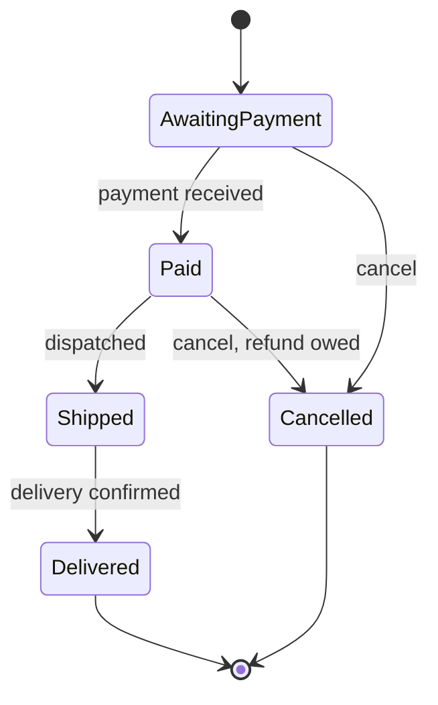
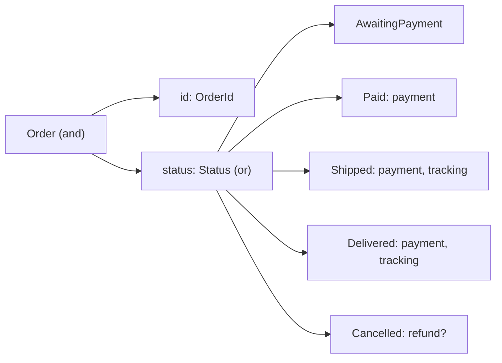

# Modelling with types

Suppose you run a small coffee roastery with an online shop. One Monday morning
this lands in the support inbox:

> Your website says order 1042 is "on its way", but there's no tracking number
> and I don't think I've been charged. Is it coming?

You look at the order page, then at the code behind it, and find that nothing is
*broken*, exactly. Every line does what it says. The problem is that the program
let an order get into a state that can't happen in the real world (shipped but
never paid for, with no tracking number) and then reported it with a straight
face.

This chapter is about making that kind of bug impossible to write. Chapter 1
gave us enums for units and errors, and newtypes for rooms and temperatures,
without dwelling on why they work. Here we slow down and look at the design
idea underneath: that **structs and enums are a small algebra for describing
data**, and that if you describe your domain precisely enough, whole categories
of bug have nowhere to live. We'll model an order's lifecycle the obvious way,
count what's wrong with it, rebuild it with enums, and finish by watching the
compiler turn a new requirement into a checklist.

## The order, as a bag of flags

Here's the order as it might appear in a first version of the shop. Each step in
the order's life got a `bool` when it was added, and each piece of data that only
exists at some point got an `Option`:

```rust
pub struct Order {
    pub id: u32,
    pub paid: bool,
    pub payment_ref: Option<String>,
    pub shipped: bool,
    pub tracking: Option<String>,
    pub delivered: bool,
    pub cancelled: bool,
}
```

This is a perfectly normal-looking struct. You've almost certainly written one
like it, in a database table if nowhere else. The order page turns it into a
label with a chain of `if`s, checked in a carefully chosen order:

```rust
fn status_label(order: &Order) -> &'static str {
    if order.cancelled {
        "cancelled"
    } else if order.delivered {
        "delivered"
    } else if order.shipped {
        "on its way"
    } else if order.paid {
        "paid, being packed"
    } else {
        "awaiting payment"
    }
}
```

(`&'static str` is a string slice that lives for the whole program, which string
literals do. Chapter 2 explained the `'` syntax.)

Now the warehouse integration, written months later by someone else, receives a
"parcel scanned" message. It sets the flag that obviously corresponds:

```rust
let mut order = Order::new(1042);
order.shipped = true; // the warehouse scanned the parcel
println!("order {}: {}", order.id, status_label(&order));
let tracking = order.tracking.as_ref().unwrap();
println!("tracking: {tracking}");
```

```text
order 1042: on its way

thread 'main' panicked at src/main.rs:43:44:
called `Option::unwrap()` on a `None` value
```

There's the support ticket. The order says it's on its way. It was never paid
for. The tracking page crashes, because someone reasonably assumed that a
shipped order has a tracking number.

Whose fault is it? The warehouse code didn't set `paid` or `tracking`, but
nothing told it to. The label function trusted `shipped`. The tracking page
trusted that `shipped` implies `tracking`. Every rule that matters ("you can't
ship an unpaid order", "a shipped order has a tracking number", "a delivered
order can't be cancelled") lives in people's heads and in scattered `if`
statements, and the type happily holds any combination of values.

## Counting the states

Let's be precise about how many combinations this type allows. Ignore *which*
string is in each `Option` and just ask whether it's `Some` or `None`. That
gives four `bool`s and two `Option`s, each with two shapes:

2 × 2 × 2 × 2 × 2 × 2 = **64** possible shapes of `Order`.

How many does the business actually have? Awaiting payment; paid; shipped;
delivered; cancelled before payment; cancelled after payment (so we owe a
refund). **Six.** The other 58 are bugs waiting for a code path to reach them:
delivered but not shipped, cancelled *and* delivered, a tracking number on an
unpaid order. Every function that reads an `Order` has to either defend against
all 58 or trust that nobody ever creates them. And every new flag doubles the
count.

That multiplication isn't a coincidence; it's the key to the whole chapter.

## Structs are *and*, enums are *or*

A struct holds one value of each of its fields: an `Order` is an id **and** a
`paid` flag **and** a payment reference, and so on. The number of possible
values of a struct is the *product* of the possibilities of its fields, which is
why our 64 came from multiplying. Type theorists call a struct a **product
type**. Tuples, like `(u32, bool)`, are product types too.

An enum holds exactly one of its variants: a Chapter 1 `Unit` is `Celsius`
**or** `Fahrenheit`. The number of possible values of an enum is the *sum* of
the possibilities of its variants. So an enum is a **sum type**. Rust's enum
variants can carry data, and each one can carry different data, which makes
them far more expressive than the enums of C, Java or C#, which are just named
integers.

Rust has three shapes of variant, and all three can mix in one enum:

```rust
pub enum Example {
    Unit,                          // carries nothing
    Tuple(u32, String),            // carries unnamed fields
    Struct { id: u32, note: String }, // carries named fields
}
```

Put products and sums together, nesting them as deeply as you like, and you have
**algebraic data types**. The "algebra" is literal: you can count the values of
a type by multiplying across structs and adding across enums. That makes it a
design tool. When a type admits more values than your domain has states, the
difference is the space where bugs live.

> [!PATTERN] Algebraic Data Types
> Describe data by combining *products* (structs and tuples: this **and** that)
> with *sums* (enums: this **or** that), nesting freely. Count a type's values
> by multiplying across fields and adding across variants, and compare the count
> to the number of situations your domain really has. In Rust: `struct`, tuples,
> and `enum` with data-carrying variants.

If you're coming from TypeScript, a Rust enum is a discriminated union in which
the compiler checks the discriminant for you. From Java, think sealed interfaces
and records. From Python or Go, there isn't a direct equivalent, which is
exactly why the flag-bag struct is so common in those languages.

## The lifecycle as an enum

So let's rewrite the order with the arithmetic in mind. The order is in exactly
one stage at a time, so the stage is an enum. Each stage carries the data that is
true *in that stage*, and nothing else:

```rust
// file: src/ch03_modelling.rs
#[derive(Debug, Clone, PartialEq, Eq)]
pub enum Status {
    AwaitingPayment,
    Paid { payment: PaymentId },
    Shipped { payment: PaymentId, tracking: TrackingNumber },
    Delivered { payment: PaymentId, tracking: TrackingNumber },
    Cancelled { refund: Option<PaymentId> },
}
```

(`PaymentId` and `TrackingNumber` are newtypes around `String`. We'll come back
to why they aren't plain strings later in the chapter; for now read them as
"a payment reference" and "a tracking number".)

Count again. `AwaitingPayment`, `Paid`, `Shipped` and `Delivered` have one
shape each; `Cancelled` has two, depending on whether a refund is owed. 1 + 1 +
1 + 1 + 2 = **6**. Exactly the number of real situations, and not one more.

Look at what that buys us, case by case:

- A shipped order without a tracking number isn't a bug we have to check for. It
  **can't be constructed**: the `Shipped` variant requires one.
- An unpaid shipped order can't exist either. `Shipped` requires a `PaymentId`,
  and the only place to get one is from a payment.
- "Cancelled *and* delivered" is gone, because an enum is one variant at a time.
- The tracking page can't forget to check whether there's a tracking number,
  because there's no `tracking` field to read without first asking which stage
  the order is in.

> [!PATTERN] Make Illegal States Unrepresentable
> Design types so that every value they can hold is a valid state of the domain.
> Replace combinations of flags and optional fields with an enum whose variants
> are the real states, each carrying only the data that exists in that state.
> Invalid combinations then can't be constructed, so no code has to check for
> them.

The legal stages and the moves between them now fit in a picture. This is the
diagram you'd draw on a whiteboard when explaining the business, and our type
says the same thing:



Notice one more thing. `Cancelled` still has an `Option` in it, and that's fine.
The problem with the original struct wasn't `Option` itself; it was using
`Option` and `bool` to *encode which stage we're in*, so that the stage had to be
inferred from a combination of fields. Inside `Cancelled`, whether a refund is
owed is a genuine "maybe" with a clear meaning: `Some(payment)` if the customer
paid before cancelling, `None` if they didn't.

### Products of sums

An order is more than its status. It has an id, and in a real shop it'd have a
customer, some line items and a delivery address. Those are true in every stage,
so they belong in a struct *around* the enum:

```rust
#[derive(Debug, Clone, PartialEq, Eq)]
pub struct Order {
    pub id: OrderId,
    pub status: Status,
}

impl Order {
    pub fn new(id: OrderId) -> Self {
        Order { id, status: Status::AwaitingPayment }
    }
}
```

This shape is everywhere in well-modelled Rust: a product (fields that always
exist) containing a sum (the part that varies). The question to ask of every
field is "is this true in every state?" If yes, it goes in the struct. If no, it
goes in the variants where it's true.



## Moving between states with `match`

With the states modelled, we need the transitions. Rather than scatter them over
the code base, as the warehouse integration did with `order.shipped = true`,
let's put the entire lifecycle in one function. First, the things that can
happen to an order, as another enum:

```rust
#[derive(Debug, Clone, PartialEq, Eq)]
pub enum Event {
    PaymentReceived(PaymentId),
    Dispatched(TrackingNumber),
    DeliveryConfirmed,
    CancelRequested,
}
```

Then a function that takes the current status and an event, and returns the new
status. Not every event makes sense in every state, so it can be refused, in
which case we hand both back to the caller so nothing is lost:

```rust
#[derive(Debug, Clone, PartialEq, Eq)]
pub struct Refused {
    pub status: Status,
    pub event: Event,
}
```

And the transition function itself, which is the state diagram above written as
code:

```rust
pub fn apply(status: Status, event: Event) -> Result<Status, Refused> {
    match (status, event) {
        (Status::AwaitingPayment, Event::PaymentReceived(payment)) => {
            Ok(Status::Paid { payment })
        }
        (Status::Paid { payment }, Event::Dispatched(tracking)) => {
            Ok(Status::Shipped { payment, tracking })
        }
        (Status::Shipped { payment, tracking }, Event::DeliveryConfirmed) => {
            Ok(Status::Delivered { payment, tracking })
        }
        (Status::AwaitingPayment, Event::CancelRequested) => {
            Ok(Status::Cancelled { refund: None })
        }
        (Status::Paid { payment }, Event::CancelRequested) => {
            Ok(Status::Cancelled { refund: Some(payment) })
        }
        (status, event) => Err(Refused { status, event }),
    }
}
```

There's a lot packed into this, so let's take it slowly.

**We match on a tuple.** `(status, event)` builds a pair, and each arm's pattern
describes a pair: "the status is `Paid` *and* the event is `Dispatched`". Matching
on the combination of state and input is the natural way to write any state
machine, and it reads almost exactly like the arrows in the diagram.

**Patterns take values apart.** `Status::Paid { payment }` doesn't just test
which variant we have; it *binds* the `payment` field to a new variable. Then
`Status::Shipped { payment, tracking }` builds the next state from the pieces.
(Writing `{ payment }` instead of `{ payment: payment }` is field shorthand, the
same as in JavaScript object literals.)

**Ownership flows through.** `apply` takes `status` and `event` by value. This is
the "take ownership, transform, hand it back" style from Chapter 2: the
`PaymentId` is *moved* out of the old `Paid` state and into the new `Shipped`
state. No string is copied, and the old state can't be used again by mistake,
because the caller gave it up.

**The last arm catches everything else.** `(status, event)` is a pattern with no
constraints: it binds whatever is left. That's every combination we didn't list,
such as dispatching an unpaid order or cancelling a delivered one, and each is
refused. Because patterns are tried top to bottom, this arm must come last.

Here's the warehouse bug from the start of the chapter, replayed against the new
model. Dispatching an order that's still awaiting payment is refused, and the
caller gets the untouched status back:

```rust
#[test]
fn cannot_ship_before_payment() {
    let refused = apply(Status::AwaitingPayment, dispatch()).unwrap_err();
    assert_eq!(refused.status, Status::AwaitingPayment);
    assert_eq!(refused.event, dispatch());
}
```

(`dispatch()` and `pay()` are two-line test helpers that build an
`Event::Dispatched` and an `Event::PaymentReceived` with made-up references. `unwrap_err` is `unwrap`'s
mirror image: it returns the error and panics if there wasn't one, which is
exactly what we want in a test that expects failure.)

And the happy path, threading one status through four events:

```rust
#[test]
fn happy_path() {
    let order = Order::new(OrderId::new(1042));
    let status = apply(order.status, pay()).unwrap();
    let status = apply(status, dispatch()).unwrap();
    let status = apply(status, Event::DeliveryConfirmed).unwrap();
    assert_eq!(describe(&status), "delivered");
}
```

`apply` is a pure function: a value in, a value out. There's no `&mut self`, no
database, no clock. That makes it trivial to test exhaustively, and it's the seed
of an idea we'll grow into a whole architecture in Part III, where a to-do list
is rebuilt by replaying events through exactly this kind of function.

## Reading a status

Transitions consume statuses. Most code just wants to *look* at one, so it
borrows (`&Status`) and matches on the reference. Here's the order page:

```rust
pub fn describe(status: &Status) -> String {
    match status {
        Status::AwaitingPayment => "awaiting payment".to_string(),
        Status::Paid { .. } => "paid, being packed".to_string(),
        Status::Shipped { tracking, .. } => {
            format!("on its way, tracking {}", tracking.as_str())
        }
        Status::Delivered { .. } => "delivered".to_string(),
        Status::Cancelled { refund: Some(_) } => {
            "cancelled, refund on its way".to_string()
        }
        Status::Cancelled { refund: None } => "cancelled".to_string(),
    }
}
```

Compare it with `status_label` from the start of the chapter. There's no
carefully chosen order of checks, because there's nothing to prioritise: each
status is exactly one variant. A few new pieces of pattern syntax appear:

- `{ .. }` means "I don't care about the fields". `Paid { .. }` matches any paid
  order.
- `{ tracking, .. }` binds one field and ignores the rest. Because we're matching
  on a `&Status`, `tracking` is bound as a *reference* (`&TrackingNumber`)
  into the status, not a copy. Rust works this out for you.
- Patterns nest. `Cancelled { refund: Some(_) }` matches a cancelled order whose
  refund is `Some` of anything (`_` is the "ignore this" pattern), and the next
  arm handles `None`. One `match` reaches two levels into the data.

When you only care about one case, a full `match` is more ceremony than you need.
`if let` runs a block if a single pattern matches:

```rust
pub fn refund_due(status: &Status) -> Option<&PaymentId> {
    if let Status::Cancelled { refund: Some(payment) } = status {
        Some(payment)
    } else {
        None
    }
}
```

And when several variants should be treated the same way, `|` combines patterns
in one arm, as long as they bind the same names:

```rust
pub fn tracking(status: &Status) -> Option<&TrackingNumber> {
    match status {
        Status::Shipped { tracking, .. }
        | Status::Delivered { tracking, .. } => Some(tracking),
        Status::AwaitingPayment
        | Status::Paid { .. }
        | Status::Cancelled { .. } => None,
    }
}
```

That second arm could have been a single `_ => None`. We spelled out every
variant on purpose, and by the end of the chapter you'll see why.

> [!TIP]
> There's also `let ... else`, for when a function should bail out unless a
> pattern matches:
> `let Status::Shipped { tracking, .. } = status else { return None; };`.
> After that line, `tracking` is in scope for the rest of the function. It keeps
> the happy path unindented.

> [!CHECKPOINT]
> Your `src/ch03_modelling.rs` (registered in `src/lib.rs` with
> `pub mod ch03_modelling;`) should now hold the `OrderId`, `PaymentId` and
> `TrackingNumber` newtypes (for now, `pub struct PaymentId(String);` plus a
> `new` function is enough; we'll look at them properly next), `Status`,
> `Event`, `Refused`, `Order`, `apply`, `describe`, `refund_due` and
> `tracking`. `cargo test ch03` should pass `happy_path` and
> `cannot_ship_before_payment`.

## `Option` is just an enum

We've used `Option` since Chapter 1 as though it were built into the language.
It isn't. Here's its definition from the standard library, give or take some
attributes:

```rust
pub enum Option<T> {
    None,
    Some(T),
}
```

That's all. The `<T>` makes it *generic* (one definition that works for any
type `T`; Chapter 5 covers generics), but otherwise it's an ordinary sum type
with two variants, one of which carries data. `Result<T, E>` is the same idea
with `Ok(T)` and `Err(E)`.

The consequence is that Rust has no `null`. A `&TrackingNumber` *always* refers
to a tracking number. If a function might not have one to give you, it returns
`Option<&TrackingNumber>`, and you can't call `.as_str()` on that without
deciding what happens when it's `None`. Tony Hoare, who invented the null
reference, called it his "billion-dollar mistake"; Rust's answer is to make
absence an ordinary value in the type system, so the compiler can track it.

Remember the crash at the start of the chapter: `order.tracking.unwrap()` on an
order that had been marked shipped. The new `tracking` function returns an
`Option` too. What changed? In the old model, `Option` was answering "has this
order been shipped?", a question `shipped` was *also* answering, and the two
could disagree. In the new model, `Option` answers only "does this order have a
tracking number?", and the answer comes from the one place that knows: which
variant we're in. They can't disagree, because there's only one source of truth.

So the rule isn't "avoid `Option`". It's: **use `Option` for data that's
genuinely optional, and an enum for which stage something is in.** If you find
two `Option` fields that are always `Some` or `None` together, or an `Option`
that must be `Some` whenever a `bool` is true, that's an enum trying to get out.

## Newtypes: strings with a job title

We've been leaning on `PaymentId` and `TrackingNumber` without justifying them.
Let's see what happens without them. Suppose `Event` used plain strings:

```rust
pub enum Event {
    PaymentReceived(String),
    Dispatched(String),
    // ...
}
```

A payment reference and a tracking number are both strings, so the compiler
can't tell them apart. Here's a line from a warehouse handler that has both to
hand and grabs the wrong one:

```rust
apply(status, Event::Dispatched(payment))
```

It compiles. It runs. The customer's tracking link now contains a payment
provider's charge id. Nothing will notice until a human does.

Chapter 1 met the fix informally with `Room` and `Celsius`. A **newtype** is a
struct with one field, wrapping an existing type to give it a distinct identity:

```rust
#[derive(Debug, Clone, PartialEq, Eq)]
pub struct TrackingNumber(String);

impl TrackingNumber {
    pub fn new(number: &str) -> Self {
        TrackingNumber(number.to_string())
    }

    pub fn as_str(&self) -> &str {
        &self.0
    }
}
```

`PaymentId` is written the same way. With `Dispatched(TrackingNumber)` in the
enum, the mix-up no longer compiles:

```text
error[E0308]: mismatched types
   --> src/lib.rs:141:37
    |
141 |     apply(status, Event::Dispatched(payment)).unwrap()
    |                   ----------------- ^^^^^^^ expected `TrackingNumber`,
    |                   |                         found `PaymentId`
    |                   arguments to this enum variant are incorrect
    |
note: tuple variant defined here
   --> src/lib.rs:56:5
    |
 56 |     Dispatched(TrackingNumber),
    |     ^^^^^^^^^^
```

A newtype costs nothing at runtime. A `TrackingNumber` has exactly the same size
and layout as the `String` inside it, and the wrapper disappears entirely when
the program is compiled. All the cost is paid by the compiler, once.

The same idea applies to numbers, where it's arguably even more valuable. Our
`OrderId` wraps a `u32`; without it, `order_id` and `quantity` are both `u32`
and swapping them is invisible. Wrap them and they can't be confused. When the
mix-up would be about *units* (pence and pounds, bytes and kilobytes) the payoff
is larger still, and Parts IV and V lean on it heavily.

> [!PATTERN] Newtype
> Wrap a primitive in a single-field struct (`struct TrackingNumber(String);`)
> so the compiler can tell apart values that share a representation but not a
> meaning. It costs nothing at runtime. Expose only the operations that make
> sense for the domain concept, rather than every method of the wrapped type.

That last sentence is the newtype's second superpower. A `String` can be pushed
to, truncated and uppercased; a tracking number shouldn't be. Because the field
is private (no `pub` before `String`), code outside the module can only do what
our `impl` block offers: make one with `new`, read it with `as_str`. Right now
`new` accepts any string. In Chapter 4 we'll make constructors like it *refuse*
bad input, so that holding a `TrackingNumber` proves it's well-formed. Chapter 7
explains how module privacy makes that proof watertight.

## Exhaustiveness as a refactoring tool

Six months on, the roastery starts accepting returns. A delivered order can be
returned, and the customer is refunded. Following our own advice, we add a
variant carrying exactly the data that's true in that state:

```rust
pub enum Status {
    // ... the five variants we already had
    Returned { refund: PaymentId },
}
```

And build:

```text
error[E0004]: non-exhaustive patterns: `&Status::Returned { .. }` not covered
   --> src/lib.rs:106:11
    |
106 |     match status {
    |           ^^^^^^ pattern `&Status::Returned { .. }` not covered
    |
note: `Status` defined here
   --> src/lib.rs:44:10
    |
 44 | pub enum Status {
    |          ^^^^^^
...
 50 |     Returned { refund: PaymentId },
    |     -------- not covered
    = note: the matched value is of type `&Status`

error[E0004]: non-exhaustive patterns: `&Status::Returned { .. }` not covered
   --> src/lib.rs:131:11
    |
131 |     match status {
    |           ^^^^^^ pattern `&Status::Returned { .. }` not covered
```

A `match` in Rust must be **exhaustive**: it has to handle every possible value
of the thing being matched. When we add a variant, every `match` that doesn't
handle it stops compiling. The first error is `describe` (what should the order
page say about a returned order?) and the second is `tracking` (does a returned
parcel still have a tracking number?). These are product questions, and the
compiler has found exactly the places where someone needs to answer them.

In the flag-bag version, adding `returned: bool` would have compiled without a
murmur, and `status_label` would have carried on showing returned orders as
"delivered", because that `if` comes first.

> [!PATTERN] Exhaustive Matching
> Handle enums with `match` and list every variant explicitly, so that adding a
> variant turns into a compile error at every place that needs a decision.
> Treat the error list as a to-do list. Avoid catch-all `_` arms where a new
> variant would deserve a new decision; keep them for cases where "everything
> else" is genuinely one rule.

### The catch-all that didn't complain

Look at what *isn't* in that error list: `apply`. It has a final
`(status, event) => Err(...)` arm that matches anything, so the new variant
falls into it and is quietly refused. Here, that's arguably correct: "any
transition we haven't listed is refused" is a real business rule, and refusing
a returned order's dispatch is right. But it also means the compiler won't
remind us to *add* the new transition, from `Delivered` to `Returned`. We have
to remember that ourselves.

That's the trade-off a wildcard arm makes. It says "I've thought about every
case I haven't listed, including ones that don't exist yet". Sometimes that's
true. Often it isn't, and the wildcard turns a compile error into a silent
runtime default. It's why `tracking` spelled out
`AwaitingPayment | Paid { .. } | Cancelled { .. }` instead of using `_`: a new
status is exactly the moment we *want* to be asked whether it has a tracking
number.

> [!WARNING]
> `_ => ...` in a `match` over your own enum opts out of exhaustiveness checking
> for every variant added in the future. Use it when the rule really is "all
> other cases behave the same", and think twice when it's just saving typing.

The fix for the two errors is two new arms, each a small decision:

```rust
// in describe
Status::Returned { .. } => "returned, refund on its way".to_string(),

// in tracking: the parcel came back, so there's no live tracking
Status::AwaitingPayment
| Status::Paid { .. }
| Status::Cancelled { .. }
| Status::Returned { .. } => None,
```

Adding the transition to `apply`, and an event for it, is the first exercise.

This is what people mean when they say Rust makes refactoring fearless. The
types describe the domain; the compiler knows every place that inspects them;
when the domain changes, it walks you through the code base, one decision at a
time. The more precisely the types describe the domain, the more of that walk
the compiler can do for you.

## What we learned

- **Flags and options multiply.** Four `bool`s and two `Option`s made 64 shapes
  for a domain with six states. The difference is where bugs live.
- **Algebraic Data Types**: structs and tuples are products (*and*), enums are
  sums (*or*). Count a type's values to check it against the domain.
- **Make Illegal States Unrepresentable**: give each state its own variant,
  carrying only the data that's true in it. Invalid combinations can't be
  built, so nothing needs to check for them.
- **Products of sums**: data true in every state goes in a struct around the
  enum; data true in some states goes in those variants.
- **`match` on tuples** expresses a state machine directly, and moving data from
  the old state into the new one costs nothing.
- **Patterns** bind (`{ tracking, .. }`), nest (`Some(_)`), combine (`|`) and
  have lighter forms (`if let`, `let ... else`).
- **`Option` is an ordinary enum**, so there's no `null`. Use it for genuinely
  optional data, not to encode which stage something is in.
- **Newtype** gives a primitive a distinct identity at zero runtime cost and
  limits it to operations that make sense.
- **Exhaustive Matching** turns a new variant into a compiler-generated to-do
  list; wildcard arms opt out of it.

## Exercises

> [!EXERCISE] Finish the returns feature
> Add `Status::Returned { refund: PaymentId }`, fix `describe` and `tracking`,
> then add an `Event::ReturnReceived` and the `Delivered` to `Returned`
> transition in `apply`. Write a test that a returned order owes a refund, and
> update `refund_due` so it says so. Which of these changes did the compiler
> ask you for, and which did you have to remember?

> [!EXERCISE] Two kinds of cancelled
> Replace `Cancelled { refund: Option<PaymentId> }` with two variants,
> `CancelledUnpaid` and `CancelledRefundDue { payment: PaymentId }`. Count the
> states again. Which functions became simpler and which became longer? When
> would you prefer each design?

> [!EXERCISE] Count it
> How many shapes does `struct Light { on: bool, colour: Option<Colour>,
> brightness: Option<u8> }` have if `Colour` is an enum of three variants and
> you treat each `u8` value as distinct? Now model a light that is either off,
> or on with a colour and a brightness, and count again.

> [!EXERCISE] A connection lifecycle
> A network client has `connected: bool`, `connecting: bool`,
> `retry_count: u32`, `session_id: Option<String>` and `last_error:
> Option<String>`. List the real states (start with Disconnected, Connecting,
> Connected and Failed), write them as an enum, and write
> `fn apply(state: Connection, event: NetEvent) -> Connection`. Where did
> `retry_count` end up?
