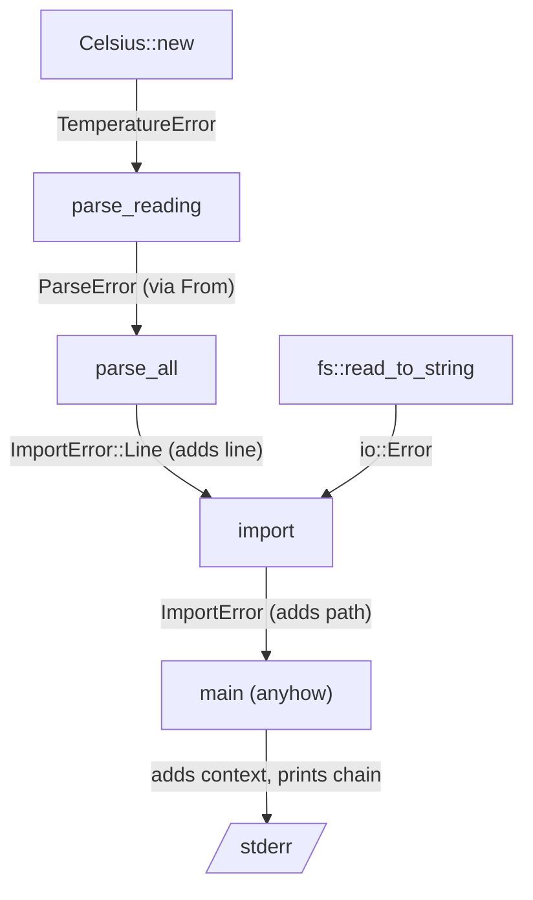

# Errors are values

At the end of Chapter 1 we left a small trap in the exercises. Rust's float
parser accepts `NaN` and `inf`, so a sensor that glitches and sends `NaN` slips
straight through our carefully typed program:

```sh
printf 'kitchen, 21.5C\nloft, NaNC\nstudy, 22.0C\n' \
  | cargo run --bin readings
```

```text
readings: 3
mean:     NaN°C
coldest:  21.5°C (kitchen)
warmest:  NaN°C (loft)
```

Nothing crashed. Nothing was reported. The summary is just quietly wrong, and
the "warmest room" is a room whose temperature isn't a number. A reading of
−300°C, colder than absolute zero, would sail through too.

The fix is obviously "check the number". The interesting question, and the
subject of this chapter, is *where* the check lives and what failing looks like.
Get that right and a whole class of defensive code disappears: functions deep in
the program stop asking "but is this value valid?", because the type already
answers. Get it wrong and checks get scattered, forgotten and duplicated.

Along the way we'll formalise what Chapter 1 used in passing: `Result`, `?`,
and error enums. We'll see how errors from different layers fit together, meet
the two crates nearly every Rust project uses for errors (`thiserror` and
`anyhow`), and draw a firm line between an *error*, which is a value your
program handles, and a *panic*, which is a bug.

## Validating, the usual way

To keep the focus on errors, this chapter's input lines carry plain Celsius
numbers: `kitchen, 21.5`. Chapter 1's unit handling slots back in unchanged, and
one of the exercises does exactly that.

The reflex in most languages is a validation function:

```rust
pub fn is_valid_temperature(value: f64) -> bool {
    value.is_finite() && value >= -273.15
}
```

and a check at the point where readings come in:

```rust
let reading = parse_reading(&line)?;
if is_valid_temperature(reading.temperature.value()) {
    readings.push(reading);
}
```

This works, today. Now consider the program in six months. Chapter 2's
calibration step adds an offset to each temperature, building a fresh `Celsius`
from arithmetic. A second importer reads readings from a sensor hub's JSON API.
A test helper builds readings by hand. Each of these creates a `Celsius`, and
each has to remember to call `is_valid_temperature`. One won't.

The deeper problem is what the check *does with what it learns*. It inspects the
number, discovers something important ("this is a real temperature"), returns a
`bool`, and then that knowledge evaporates. The `Celsius` that comes out the
other side is exactly the same type as one that was never checked. So
`summarise`, receiving a `&[Reading]`, can't tell whether the readings were
validated. If it's cautious, it checks again. If everyone is cautious, the
program is full of redundant checks; if anyone isn't, NaN gets through.

Validation tells you something and lets you forget it. We want a check whose
result we *can't* forget.

## Parse, don't validate

Here's the alternative. Instead of checking a `Celsius` after it exists, we make
the check the *only way to create one*. The constructor returns a `Result`:
either a `Celsius` that is guaranteed sensible, or an error saying why not.

```rust
// file: src/ch04_errors.rs
#[derive(Debug, Clone, Copy, PartialEq, PartialOrd)]
pub struct Celsius(f64);

impl Celsius {
    pub const ABSOLUTE_ZERO: f64 = -273.15;

    pub fn new(value: f64) -> Result<Celsius, TemperatureError> {
        if !value.is_finite() {
            return Err(TemperatureError::NotFinite);
        }
        if value < Self::ABSOLUTE_ZERO {
            return Err(TemperatureError::BelowAbsoluteZero(value));
        }
        Ok(Celsius(value))
    }

    pub fn value(self) -> f64 {
        self.0
    }
}
```

`TemperatureError` is an enum with one variant per reason; we'll design it
properly in a moment.

The crucial detail is the one that *isn't* there: the field inside `Celsius` has
no `pub`. Code outside this module can't write `Celsius(f64::NAN)` to get
around `new`. If it tries:

```rust
// does not compile
pub mod temperature {
    #[derive(Debug, Clone, Copy, PartialEq)]
    pub struct Celsius(f64);
}

use temperature::Celsius;

pub fn sneaky() -> Celsius {
    Celsius(f64::NAN)
}
```

```text
error[E0423]: cannot initialize a tuple struct which contains private fields
 --> src/lib.rs:9:5
  |
9 |     Celsius(f64::NAN)
  |     ^^^^^^^
  |
note: constructor is not visible here due to private fields
 --> src/lib.rs:3:24
  |
3 |     pub struct Celsius(f64);
  |                        ^^^ private field
```

(Ignore the help line suggesting we make the field public. The compiler doesn't
know that the privacy is the point.)

So every `Celsius` in the program went through `new`, and every `Celsius` is
finite and above absolute zero. Holding one is *proof*. The calibration step
has to call `Celsius::new` on its result, so it has to handle the possibility
that the offset pushed a value out of range. The JSON importer has to do the
same. `summarise` takes `&[Reading]` and doesn't check anything, because there's
nothing left to check.

This is the difference between *validating* and *parsing*. A validator looks at
data and answers yes or no. A parser looks at less-structured data and returns
more-structured data, or an error. "A number" goes in; "a temperature" comes
out. The knowledge gained by the check is kept, in the type, for the rest of the
value's life. The phrase *parse, don't validate* comes from an essay of that name
by Alexis King, and it's one of the most useful slogans in type-driven design.

> [!PATTERN] Parse, Don't Validate (Smart Constructor)
> Don't check data and carry on with the same loose type. Convert it, once, at
> the edge, into a type that can only hold valid values: make the fields
> private and offer a constructor returning `Result<Self, Error>` (or
> `Option<Self>`). Everything downstream takes the precise type and can't fail
> for that reason. In Rust: private fields, `fn new(...) -> Result<Self, E>`,
> and often `impl TryFrom`.

Chapter 1 already did a small version of this without naming it: `parse_unit`
turned an untrusted `char` into a `Unit` and could fail, while `to_celsius` took
a `Unit` and couldn't. Smart constructors are the same move applied to values
with rules about their *contents*.

### The standard spelling: `TryFrom`

Rust's standard library has a trait for fallible conversions from one type to
another, `TryFrom`. Implementing it for our smart constructor lets `Celsius`
join in with generic code that converts values, and lets callers write
`Celsius::try_from(21.5)` or `21.5.try_into()`:

```rust
impl TryFrom<f64> for Celsius {
    type Error = TemperatureError;

    fn try_from(value: f64) -> Result<Self, Self::Error> {
        Celsius::new(value)
    }
}
```

`type Error = ...` declares which error the conversion produces. We'll meet
`TryFrom`, `From` and their relatives properly in Chapter 5; for now, think of
`TryFrom` as the conventional name for "a constructor that can fail".

> [!NOTE]
> Smart constructors only work because of module privacy. In this chapter the
> module is a single file, so "outside the module" means "any other file".
> Chapter 7 looks at modules and visibility in depth, and why private fields
> turn a constructor from a convenience into a guarantee.

## Errors are values

We've been returning `Result` since Chapter 1 without stopping to look at it.
It's time. Like `Option` in Chapter 3, `Result` is an ordinary enum:

```rust
pub enum Result<T, E> {
    Ok(T),
    Err(E),
}
```

A function that returns `Result<Celsius, TemperatureError>` returns either
`Ok` with a temperature, or `Err` with an error. That's all an error is in Rust:
a value, returned like any other value. There are no exceptions flying up the
stack past code that didn't know they were coming.

That has consequences you'll feel immediately if you come from Java, Python or
JavaScript.

**Failure is in the signature.** In Python, any function might raise anything,
and the only way to know is to read it (and everything it calls). In Rust, a
function that can fail says so in its return type, and says *how*: the error
type is right there.

**You can't use the value without facing the error.** A
`Result<Celsius, TemperatureError>` isn't a `Celsius`. You have to `match` on
it, propagate it with `?`, or explicitly give up with `unwrap`. Each is a visible
decision.

**Ignoring an error is noticed.** `Result` is marked `#[must_use]`, so calling a
fallible function and discarding the result draws a warning:

```text
warning: unused `Result` that must be used
  --> src/lib.rs:81:5
   |
81 |     parse_reading(line);
   |     ^^^^^^^^^^^^^^^^^^^
   |
   = note: this `Result` may be an `Err` variant, which should be handled
```

**Errors are data.** Because an error is just a value, you can store it, put it
in a `Vec`, compare it in a test, or transform it into another error. All of the
tools for working with values work on errors too. We'll lean on that heavily in
the rest of this chapter.

> [!PATTERN] Errors as Values
> Represent failure as an ordinary return value (`Result<T, E>`) rather than
> as control flow (exceptions). The possibility of failure appears in the
> signature, callers must handle or propagate it explicitly, and errors can be
> inspected, transformed and tested like any other data. Use `Option<T>` for
> plain absence, where there's nothing to explain.

That last line is worth a moment. `Option` and `Result` look similar, and
Chapter 1 used both. The difference is whether there's something to *say*.
`summarise` on an empty slice returns `None`: there is no summary, and there's
nothing more to explain. `Celsius::new(f64::NAN)` returns `Err(NotFinite)`:
something was wrong with the input, and the caller (and probably a human) will
want to know what. If you ever find yourself wishing an `Option` could say *why*
it's `None`, it wants to be a `Result`. Converting between them is a method
call: `.ok_or(error)` turns an `Option` into a `Result`, and `.ok()` goes the
other way, throwing the error away.

### What `?` really does

Chapter 1 described `?` as "return early if this is an error". Here's what it
expands to, more or less, for a line like `let t = Celsius::new(number)?;`:

```rust
let t = match Celsius::new(number) {
    Ok(value) => value,
    Err(error) => return Err(From::from(error)),
};
```

Notice the `From::from(error)`. `?` doesn't just pass the error up; it
*converts* it into the error type of the function it's in. That one detail is
what lets errors from different layers fit together, and it's about to matter.

## Designing an error type

`TemperatureError` needs to say what went wrong. Here it is as a plain enum:

```rust
#[derive(Debug, Clone, Copy, PartialEq)]
pub enum TemperatureError {
    NotFinite,
    BelowAbsoluteZero(f64),
}
```

Two questions guide the design of any error type.

**What will the caller want to decide?** Each variant is a distinct situation
a caller might handle differently. A dashboard might show `NotFinite` as "sensor
fault" and `BelowAbsoluteZero` as "check calibration". If those were one
variant, or worse, one `String`, the caller would have to parse the message to
tell them apart.

**What will a human need to understand it?** `BelowAbsoluteZero` carries the
offending value so the message can say which number was wrong. `NotFinite`
doesn't need to, because "not a number" says it all.

To be a proper error, a type needs two more things. It needs `Display`, the
human-readable message. And it should implement the standard library's
`std::error::Error` trait, which marks it as an error and lets it plug into
error-handling tools (`anyhow`, which we'll meet shortly, requires it). Written
by hand:

```rust
impl fmt::Display for TemperatureError {
    fn fmt(&self, f: &mut fmt::Formatter<'_>) -> fmt::Result {
        match self {
            TemperatureError::NotFinite => {
                write!(f, "temperature is not a finite number")
            }
            TemperatureError::BelowAbsoluteZero(v) => {
                write!(f, "{v}°C is below absolute zero")
            }
        }
    }
}

impl std::error::Error for TemperatureError {}
```

The empty `impl` block is enough: every method on `std::error::Error` has a
sensible default. This is a fair amount of boilerplate for a two-variant enum.
Hold that thought.

> [!WARNING]
> It's tempting to make every error a `String`: `Result<Celsius, String>`, with
> `Err(format!("bad temperature {v}"))`. It compiles and it reads fine in a log.
> But callers can't `match` on a string to decide what to do, tests end up
> comparing sentences, and changing a message's wording silently breaks anyone
> who was matching on it. Use an enum. It costs a few lines and gives the
> compiler something to check.

## When the error types don't line up

Now let's use the smart constructor in the line parser. Here's the shape of
`parse_reading` from Chapter 1, simplified for plain Celsius numbers, with the
last step now going through `Celsius::new`:

```rust
// does not compile
pub fn parse_reading(line: &str) -> Result<Reading, ParseError> {
    let (room, value) =
        line.split_once(',').ok_or(ParseError::MissingSeparator)?;

    let room = room.trim();
    if room.is_empty() {
        return Err(ParseError::EmptyRoom);
    }

    let value = value.trim();
    let number: f64 = value
        .parse()
        .map_err(|_| ParseError::BadNumber(value.to_string()))?;
    let temperature = Celsius::new(number)?;

    Ok(Reading { room: room.to_string(), temperature })
}
```

```text
error[E0277]: `?` couldn't convert the error to `ParseError`
  --> src/lib.rs:64:43
   |
51 | pub fn parse_reading(line: &str) -> Result<Reading, ParseError> {
   |                                     --------------------------- expected
   |                                     `ParseError` because of this
...
64 |     let temperature = Celsius::new(number)?;
   |                       --------------------^ the trait
   |                       |   `From<TemperatureError>` is not implemented
   |                       |   for `ParseError`
   |                       |
   |                       this can't be annotated with `?` because it has
   |                       type `Result<_, TemperatureError>`
   |
   = note: the question mark operation (`?`) implicitly performs a conversion
           on the error value using the `From` trait
```

This is the `From::from` from the expansion of `?`, showing itself. The function
promises to fail with a `ParseError`; `Celsius::new` fails with a
`TemperatureError`; and nobody has said how to turn one into the other.

Two things need to happen. `ParseError` needs a way to *hold* a temperature
error, which is a new variant:

```rust
#[derive(Debug)]
pub enum ParseError {
    MissingSeparator,
    EmptyRoom,
    BadNumber(String),
    Temperature(TemperatureError),
}
```

and `?` needs to know how to convert, which is an implementation of `From`:

```rust
impl From<TemperatureError> for ParseError {
    fn from(error: TemperatureError) -> Self {
        ParseError::Temperature(error)
    }
}
```

Now `Celsius::new(number)?` compiles. If the temperature is bad, the
`TemperatureError` is wrapped in `ParseError::Temperature` and returned. The
inner error isn't flattened into a message or thrown away: a caller who cares
can match all the way down,
`ParseError::Temperature(TemperatureError::NotFinite)`, and a test can assert
exactly that.

Notice the direction of knowledge. `ParseError` knows about `TemperatureError`,
because parsing a line involves making a temperature. `TemperatureError` knows
nothing about lines, commas or rooms. Each layer's errors describe that layer's
job and wrap the errors of the layers it uses.

## `thiserror`: the boilerplate, derived

We now have hand-written `Display`, `Error` and `From` implementations, and
we'll want them on every error type we write. That's exactly the kind of
mechanical code a derive macro can generate. The `thiserror` crate provides one.
Add it to your project:

```sh
cargo add thiserror
```

Here are both error types again, with everything we wrote by hand expressed as
attributes:

```rust
use thiserror::Error;

#[derive(Debug, Clone, Copy, PartialEq, Error)]
pub enum TemperatureError {
    #[error("temperature is not a finite number")]
    NotFinite,
    #[error("{0}°C is below absolute zero")]
    BelowAbsoluteZero(f64),
}

#[derive(Debug, Clone, PartialEq, Error)]
pub enum ParseError {
    #[error("expected `room, value`")]
    MissingSeparator,
    #[error("room name is empty")]
    EmptyRoom,
    #[error("`{0}` is not a number")]
    BadNumber(String),
    #[error("bad temperature")]
    Temperature(#[from] TemperatureError),
}
```

`#[derive(Error)]` implements `std::error::Error`. Each `#[error("...")]`
becomes that variant's `Display` message, with `{0}` referring to the first
field. `#[from]` generates the `From` implementation that `?` needs, *and*
records the inner error as this error's **source**: the error that caused it.
We'll see why the source matters when we print errors at the end of the
chapter.

`thiserror` generates exactly the code we'd have written by hand. It isn't a
framework: nothing about it shows up in your public API, and your callers don't
need to know you used it. That's why it's the conventional choice for libraries
and for the domain code in every project in this book.

> [!CHECKPOINT]
> Your `src/ch04_errors.rs` (with `pub mod ch04_errors;` in `src/lib.rs`)
> should now have `Celsius` with its smart constructor and `TryFrom`,
> `TemperatureError`, `Reading`, `ParseError` and `parse_reading`. Tests worth
> writing now: `Celsius::new(f64::NAN)` is `Err(TemperatureError::NotFinite)`,
> and `parse_reading("loft, NaN")` is
> `Err(ParseError::Temperature(TemperatureError::NotFinite))`.

## Adding context at the boundary

`parse_reading` handles one line. A real import reads a whole file, and two new
things can go wrong. The file might not be readable at all, which shows up as a
`std::io::Error`. Or one of its lines might not parse, in which case we
desperately want to know *which* line.

This is a new layer, so it gets its own error type. Each variant carries the
context this layer knows about, plus the lower-level error as its source:

```rust
#[derive(Debug, Error)]
pub enum ImportError {
    #[error("could not read {}", path.display())]
    Io {
        path: PathBuf,
        #[source]
        source: io::Error,
    },
    #[error("line {line}")]
    Line {
        line: usize,
        #[source]
        source: ParseError,
    },
}
```

`PathBuf` is the owned version of a filesystem path, as `String` is to `&str`.
`#[source]` marks a field as the underlying cause without generating a `From`
implementation, and we'll see why we don't want one in a moment.

Parsing a whole text, line by line:

```rust
pub fn parse_all(text: &str) -> Result<Vec<Reading>, ImportError> {
    let mut readings = Vec::new();
    for (index, line) in text.lines().enumerate() {
        if line.trim().is_empty() {
            continue;
        }
        let reading = parse_reading(line)
            .map_err(|source| ImportError::Line { line: index + 1, source })?;
        readings.push(reading);
    }
    Ok(readings)
}
```

And reading the file, translating the I/O error in the same way:

```rust
pub fn import(path: &Path) -> Result<Vec<Reading>, ImportError> {
    let text = fs::read_to_string(path).map_err(|source| ImportError::Io {
        path: path.to_path_buf(),
        source,
    })?;
    parse_all(&text)
}
```

This is why we used `map_err` rather than `#[from]`. A `ParseError` on its own
doesn't know which line it came from; `parse_reading` was only ever given one
line. A `From<ParseError>` implementation would have to invent a line number,
and there isn't one to invent. `map_err` runs at the place where the context is
known (inside the loop, where `index` is in scope) and builds the richer error
there. Likewise `io::Error`, famously, doesn't say which file it was about. The
`Io` variant adds the path.

The rule of thumb: use `#[from]` when wrapping adds no information, and
`map_err` with a struct variant when the boundary knows something the inner
error doesn't.

Here's the whole flow, from the innermost check to the outermost report:



Each arrow is a translation. Each layer receives errors in the vocabulary of the
layer below, and passes them on in its own vocabulary, adding what it knows.
Nothing above `parse_reading` needs to know what a comma is; nothing below
`import` needs to know what a file is.

> [!PATTERN] Error Translation at Boundaries
> Give each layer its own error type, describing failures in that layer's
> terms. When an error crosses a boundary, translate it: wrap the lower-level
> error as the `source`, and add the context only this layer knows (a line
> number, a path, an id). In Rust: one `thiserror` enum per layer, `#[from]`
> when wrapping adds nothing, `map_err` when it adds context.

In later parts this pattern grows up. In Part II, errors from Cloudflare's HTTP
API are translated at the adapter boundary so that the domain never sees a
status code; that's one half of an *anti-corruption layer*.

## Reporting in the shell: `anyhow`

The functional core is done: every failure is a precise, typed, testable value.
Now somebody has to tell a human. That's the imperative shell's job, and it has
different needs. `main` doesn't want to match on twelve variants and decide what
to do about each; it wants to print a clear message and exit with a failure
status. For that, there's `anyhow`:

```sh
cargo add anyhow
```

`anyhow::Error` is a single type that can hold *any* error (anything that
implements `std::error::Error`), and `anyhow::Result<T>` is shorthand for
`Result<T, anyhow::Error>`. Because every error converts into it, `?` works on
everything. And its `Context` trait adds a human-readable layer on top of any
error:

```rust
// file: src/bin/import.rs
use std::path::Path;

use anyhow::Context;
use foundations::ch04_errors::import;

fn main() -> anyhow::Result<()> {
    let path = std::env::args().nth(1).context("usage: import <file>")?;

    let readings = import(Path::new(&path))
        .with_context(|| format!("importing readings from {path}"))?;

    println!("imported {} readings", readings.len());
    Ok(())
}
```

`.context(...)` works on `Option` too: `nth(1)` returns `None` if there's no
argument, and `context` turns that into an error with a usage message.
`with_context` takes a closure, so the `format!` only runs if there's an error.

When `main` returns an `Err`, Rust prints it and exits with status 1. `anyhow`
prints the whole chain of sources, which is where all that careful wrapping
pays off. Given a file whose third line is `loft, NaN`:

```sh
cargo run --bin import readings.txt
```

```text
Error: importing readings from readings.txt

Caused by:
    0: line 3
    1: bad temperature
    2: temperature is not a finite number
```

And given a file that doesn't exist:

```text
Error: importing readings from missing.txt

Caused by:
    0: could not read missing.txt
    1: No such file or directory (os error 2)
```

Every layer contributed exactly what it knew, and none of them had to know about
the others. Notice also that no message repeats another. That's why each
`#[error("...")]` described only its own layer (`"line {line}"`, not
`"line {line}: {source}"`): the source is printed separately by whoever reports
the chain. Put it in both places and you'll see it twice.

So the book's rule, which every project from Part II onwards follows:

| Where | Use | Why |
|---|---|---|
| Domain and library code | `thiserror` enums | Callers need to match on precise variants |
| `main` and the outermost shell | `anyhow` | It only needs to add context and report |

> [!TIP]
> If you find yourself wanting to match on an `anyhow::Error` to decide what to
> do, that's a sign the decision belongs in a layer that still has a typed
> error. `anyhow` is for the end of the line.

## Every problem at once

Here's a line from a sensor that has had a bad night:

```text
 , NaN
```

Two things are wrong with it: the room is empty *and* the temperature isn't a
number. `parse_reading` tells us about the first and stops. Fix the room, run
it again, and only then do we hear about the temperature. For one line that's
a mild annoyance. For a configuration file with a dozen fields, or a web form,
it's the experience everyone hates: submit, fix one thing, submit, fix the
next.

The reason is `?`. Each `?` says "if this failed, stop here", which is exactly
right when a later step *needs* the result of an earlier one. We can't trim
the room until `split_once` has found the comma, so the separator check
really must come first. But once the line is split, checking the room and
checking the temperature are **independent**: neither needs the other's
answer. There's no reason to stop after the first.

### Two ways to combine checks

Haskell draws this distinction sharply, and it's worth seeing there because
the names are useful. Here is an order being checked two ways, with three
validators that each inspect an input `i`:

```haskell
-- Either: stops at the first failure, like Rust's `?`
checkOrder :: Input -> Either OrderError Order
checkOrder i = do
  customer <- validateCustomer i
  amount   <- validateAmount i
  currency <- validateCurrency i
  pure (Order customer amount currency)

-- Validation: runs all three, keeps every failure
validateOrder :: Input -> Validation [OrderError] Order
validateOrder i =
  Order <$> validateCustomer i
        <*> validateAmount   i
        <*> validateCurrency i
```

`Either e a` is Haskell's `Result<A, E>`, with `Left` for errors and `Right`
for success. The `do` block reads like a sequence of `let x = f()?;` lines,
and behaves like one: the first `Left` ends it. Because each step *could* use
the values bound before it, Haskell has no choice but to stop. This style of
sequencing, where later steps may depend on earlier results, is called
**monadic**, and `?` is Rust's version of it.

The second form is different in kind. `Order <$> a <*> b <*> c` means "apply
the `Order` constructor to the results of `a`, `b` and `c`". None of the
three validators can see another's result; they're arguments side by side.
That's called **applicative** combination, and because the steps are
independent, the type doing the combining is free to run them all.
`Validation` (from a small Haskell library of the same name) does exactly
that: if any fail, it collects all of their errors into the list.

### Applicative validation in Rust

Rust has no `<*>`, but it doesn't need one. The idea is just: compute each
independent result, *then* look at them together. First, split the existing
checks into small functions, one per field:

```rust
fn room(text: &str) -> Result<String, ParseError> {
    let room = text.trim();
    if room.is_empty() {
        return Err(ParseError::EmptyRoom);
    }
    Ok(room.to_string())
}
```

`temperature(text) -> Result<Celsius, ParseError>` is the number parsing and
`Celsius::new` from `parse_reading`, moved into a function of its own. Then a
small generic combinator that takes two results and keeps every error:

```rust
/// Combine two independent results, keeping *every* error.
pub fn both<A, B, E>(
    a: Result<A, E>,
    b: Result<B, E>,
) -> Result<(A, B), Vec<E>> {
    match (a, b) {
        (Ok(a), Ok(b)) => Ok((a, b)),
        (a, b) => Err(a.err().into_iter().chain(b.err()).collect()),
    }
}
```

If both succeeded, we get both values. Otherwise, `.err()` turns each
`Result` into an `Option` of its error, and chaining the two options together
gathers whichever errors there were, one or two, into a `Vec`.

Now the parser uses `?` for the step that really is sequential, and `both`
for the two that aren't:

```rust
/// Like `parse_reading`, but reports every problem with the line.
pub fn parse_reading_all(line: &str) -> Result<Reading, Vec<ParseError>> {
    let (room_text, value_text) = line
        .split_once(',')
        .ok_or_else(|| vec![ParseError::MissingSeparator])?;
    both(room(room_text), temperature(value_text))
        .map(|(room, temperature)| Reading { room, temperature })
}
```

The last two lines are the Rust spelling of `Reading <$> room <*> temperature`:
run both checks, and if they both succeed, build the reading from their
results. And the bad night's line now gets a complete answer:

```rust
#[test]
fn reports_every_problem() {
    assert_eq!(
        parse_reading_all(" , NaN"),
        Err(vec![
            ParseError::EmptyRoom,
            ParseError::Temperature(TemperatureError::NotFinite),
        ])
    );
}
```

The return type is honest about the policy, too. `Result<Reading,
Vec<ParseError>>` says "a reading, or a list of everything wrong with it". (A
pickier type would say *non-empty* list, since `Err(vec![])` makes no sense;
some crates provide a `NonEmpty` vector for exactly that.)

`both` handles two checks. For three or more, you can nest it, or write the
same idea once as a small `Validation` type whose combining method appends
error lists; either way it's a dozen lines, written once.

> [!PATTERN] Applicative Validation (Accumulate Errors)
> When several checks are independent of each other, run all of them and
> collect every failure, instead of stopping at the first with `?`. Keep `?`
> for steps that need an earlier step's result. In Rust: return
> `Result<T, Vec<E>>`, compute each independent `Result` first, then combine
> them with a small helper (or a `Validation` type) that keeps every `Err`.

Which to use is a question about the *reader of the errors*. A program
deciding what to do next usually wants the first error, and `?` gives it
that. A person fixing a file wants all of them. You'll see this again:
Chapter 8 validates the DDNS daemon's configuration file, and one of its
exercises turns the first-error version into one that reports every problem;
and the ledger's journal reader in Chapter 23 keeps going after a bad
transaction and returns every error, each with its line number.

## Panics are for bugs

There's one more way for a Rust program to fail. `panic!` stops the current
thread, unwinding the stack and running destructors (so Chapter 2's sessions
still say `BYE`), and if it's the main thread, the program exits with an error
message. We've seen several things that panic: `unwrap()` on an `Err` or `None`,
`expect("...")` (the same with a message of your choosing), indexing past the
end of a slice, and slicing a string through the middle of a character.

The rule that keeps this straight:

> [!IMPORTANT]
> An **error** is something that can happen when the program is correct: bad
> input, a missing file, a network timeout. Return it as a value. A **panic** is
> for something that can only happen if the program itself is wrong: a broken
> invariant, an impossible case. If a user, a file or a network can trigger it,
> it isn't a panic.

Under that rule, Chapter 1's autopilot version was wrong to `unwrap()` the result
of parsing a line, because a malformed line is something the outside world can
send. It's a bug report waiting to happen.

But `unwrap` and `expect` aren't banned. They're right when you, the programmer,
know something the type system can't see. In tests, for instance, a panic is
exactly how you want a test to fail, which is why this book's tests use `unwrap`
freely. Or in code where a value is constant:

```rust
let freezing = Celsius::new(0.0).expect("0°C is a valid temperature");
```

`expect` is better than `unwrap` here because its message documents *why* you
believe it can't fail. If you turn out to be wrong, the panic message tells the
next person what assumption broke.

Between them, errors and panics give us a clean division. `Result` is for the
expected unhappy paths, which are part of the domain and so part of the types.
Panics are for the unexpected ones, which are bugs, and the right response to a
bug is to stop loudly and fix the code.

## What we learned

- **Validation forgets; parsing remembers.** A `bool` check leaves the type
  unchanged, so every consumer has to wonder. A smart constructor returns a
  type that can only hold valid values.
- **Parse, Don't Validate (Smart Constructor)**: private fields plus
  `fn new(...) -> Result<Self, E>` (and `TryFrom`) make every value of the type
  proof that it was checked.
- **Errors as Values**: `Result` is an ordinary enum. Failure is in the
  signature, can't be silently ignored, and can be inspected, stored and tested.
  `Option` is for absence with nothing to explain.
- **`?` converts errors with `From`**, which is how errors from different layers
  fit together.
- **Design error enums for callers and humans**: a variant per decision, data
  for the message. Not strings.
- **`thiserror`** derives `Display`, `Error` and `From`; use it in domain and
  library code.
- **Error Translation at Boundaries**: one error type per layer, wrap the inner
  error as the source, add the context only that layer knows with `map_err`.
- **`anyhow`** is for the shell: add context and print the whole chain.
- **Applicative Validation**: `?` stops at the first error, which is right
  when steps depend on each other; independent checks can all run, returning
  `Result<T, Vec<E>>` with every problem.
- **Panics are for bugs**, not for anything the outside world can trigger.
  Prefer `expect` with a reason to a bare `unwrap`.

## Exercises

> [!EXERCISE] Units again
> Bring back Chapter 1's units, so lines read `garage, 50F`. Add the unit
> variants (`MissingUnit`, `UnknownUnit(char)`) to `ParseError`, and make
> conversion go through `Celsius::new`. Can a Fahrenheit reading now fail with
> `BelowAbsoluteZero`? Write a test that proves it.

> [!EXERCISE] A room is never empty
> Chapter 1 said a room name is never empty. Make `Room` a smart-constructed
> newtype that trims its input and rejects empty names with a `RoomError`.
> Remove the `EmptyRoom` check from `parse_reading`. Where does the error
> variant end up, and how does `?` get it there?

> [!EXERCISE] Collect every problem
> `parse_all` stops at the first bad line. Write `parse_all_lenient` that keeps
> going and returns the good readings *and* a list of problems. What should its
> return type be? (One candidate: `(Vec<Reading>, Vec<ImportError>)`.) Is there
> still a reason for it to return a `Result` at all?

> [!EXERCISE] Strict or forgiving
> Add a `--skip-bad-lines` flag to the `import` binary that uses
> `parse_all_lenient` and prints each problem with `eprintln!`, while a
> missing file is still fatal. Notice that the policy lives entirely in the
> shell, and that you didn't need `anyhow` to tell the two cases apart, because
> the core's errors are still typed.
