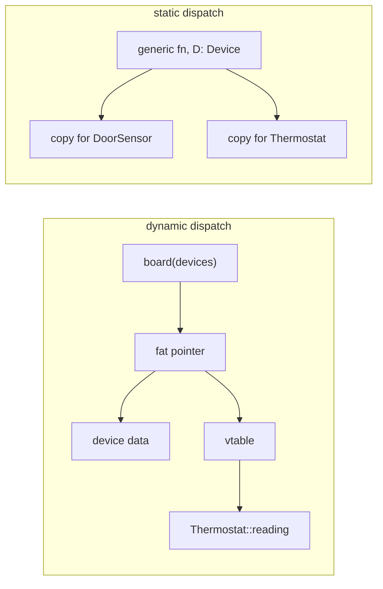

# Traits and generics

The temperature sensors from Chapter 1 have friends now. There's a smart
thermostat in the hall, a contact sensor on the back door, and a plan for a
little status board on the kitchen wall that shows every device on one screen:

```text
! hall: 16.0°C (target 21.0°C)
  back door: closed
```

The board doesn't care *what* each device is. It needs every device to answer
the same three questions: what are you called, what do you read, and should
someone come and look at you? Next month there'll be a humidity sensor, and the
board shouldn't need to change when it arrives.

That's the problem this chapter solves. So far our functions have worked on
one concrete type each. Now we want code that works for *any* type that can do
certain things, and we want the compiler to check that it really can. Rust's
tools for this are **generics** (code with type parameters) and **traits**
(named sets of behaviour that types opt into). Together they're how Rust
expresses abstraction, and they turn out to be closer to Haskell's typeclasses
than to the interfaces of Java or C#.

By the end of the chapter we'll have a status board, a family of unit
conversions, a way to bolt new methods onto types we didn't write, and a first
glimpse of the idea that will shape every project in the book: a trait as a
*port* between pure logic and the outside world.

## The same function, three times

Let's warm up with something smaller. The board wants to highlight the warmest
room, and the energy page wants the largest meter reading. We write the first
function without thinking:

```rust
fn largest_i32(items: &[i32]) -> Option<&i32> {
    let mut best = items.first()?;
    for item in items {
        if item > best {
            best = item;
        }
    }
    Some(best)
}
```

It borrows the slice (Chapter 2's *Borrow, Don't Own*), returns `None` for an
empty slice rather than inventing a value, and uses `?` on the `Option` from
`first()` to bail out early. Then we need it for `f64`, and copy it as
`largest_f64`. Then for `Celsius`. Three functions, identical except for one
word in the signature. Every bug fix now has to be made three times.

The obvious refactor is to make the type a parameter. `<T>` after the name
introduces a *type parameter*: a placeholder that each caller fills in.

```rust
// does not compile
pub fn largest<T>(items: &[T]) -> Option<&T> {
    let mut best = items.first()?;
    for item in items {
        if item > best {
            best = item;
        }
    }
    Some(best)
}
```

```text
error[E0369]: binary operation `>` cannot be applied to type `&T`
 --> src/lib.rs:4:17
  |
4 |         if item > best {
  |            ---- ^ ---- &T
  |            |
  |            &T
  |
help: consider restricting type parameter `T` with trait `PartialOrd`
  |
1 | pub fn largest<T: std::cmp::PartialOrd>(items: &[T]) -> Option<&T> {
  |                 ++++++++++++++++++++++
```

This is the crack, and it's an instructive one. A bare `T` means *any type at
all*: a `String`, a `Vec<u8>`, a file handle, a closure. Most of those can't be
compared with `>`. In a dynamically typed language this function would run
happily until someone passed it two things that can't be ordered. In C++ a
template would compile until someone instantiated it with such a type, then
produce a page of errors from deep inside the function. Rust checks the generic
function *once, on its own*, against what its signature promises. The body may
only use abilities the signature has asked for.

The compiler's suggestion tells us how to ask. `PartialOrd` is the standard
library's trait for "can be compared with `<`, `>`, `<=` and `>=`". Adding it
as a **trait bound** narrows `T` from "any type" to "any type that implements
`PartialOrd`":

```rust
// file: src/ch05_traits.rs
pub fn largest<T: PartialOrd>(items: &[T]) -> Option<&T> {
    let mut best = items.first()?;
    for item in items {
        if item > best {
            best = item;
        }
    }
    Some(best)
}
```

Now `largest(&[3, 9, 4])` returns `Some(&9)`, `largest(&[Celsius(18.0),
Celsius(22.5)])` works because `Celsius` derives `PartialOrd`, and
`largest(&[some_file, other_file])` is rejected at the call site with an error
about `File` not implementing `PartialOrd`. The bound is a contract in both
directions: callers must supply a type that meets it, and the body may rely on
nothing else.

> [!NOTE]
> Generic functions cost nothing at runtime. The compiler generates a separate,
> specialised copy of `largest` for each type it's used with (`largest::<i32>`,
> `largest::<Celsius>`), each as fast as the hand-written version. This is
> called **monomorphisation**: turning one polymorphic function into many
> monomorphic ones. The price is paid in compile time and binary size instead.

## What a signature forbids

"The body may only use abilities the signature has asked for" sounds like a
restriction on the person writing the function. Turn it round and it's a
gift to the person *reading* it. A generic signature tells you not only what
a function may do, but a great deal about what it can't.

### A function with one possible body

Haskell programmers have a party trick here. Given only a type, they can
often tell you what the function does:

```haskell
identity :: a -> a
identity x = x
```

The lower-case `a` is a type variable, like Rust's `T`; Haskell quietly reads
it as "for every type `a`". The claim is that, ignoring crashes and infinite
loops, `identity` has only one possible implementation. Think about it from
inside the function. You've been handed a value of a type you know nothing
about, and you must return a value of that same type. You can't make one up,
because you don't know what type it is. You can't inspect the one you've got,
because you don't know what operations it has. All you can do is hand it
back.

Rust's version is the same function, and the same argument applies:

```rust
pub fn identity<T>(x: T) -> T {
    x
}
```

This property is called **parametricity**: a function generic in `T` must
treat every `T` the same way, because it can't find out which `T` it has. The
facts you can deduce from a signature alone have a lovely name, too: **free
theorems**, because you get them without reading, or testing, the body.

### Trait bounds are permissions

`identity` is a toy. Here's something the status board really needs: it has
room for ten lines, newest first.

```rust
/// The board has room for ten lines, newest first.
pub fn fit_board<T>(lines: Vec<T>) -> Vec<T> {
    lines.into_iter().rev().take(10).collect()
}
```

Look only at the signature, `fn fit_board<T>(lines: Vec<T>) -> Vec<T>`, and
ask what *any* implementation could do. Every element of the output must have
come from the input, because the function has no other way to get a `T`. It
can't compare elements, or print them, or check whether one is "the hall
thermostat", because `T` has no methods. It can't even duplicate an element,
because copying a `T` needs `Clone`, and the signature didn't ask for it. What
remains is dropping elements and rearranging the rest. That's all.

There's a precise version of that free theorem: for any function `g`, mapping
`g` over the list and then calling `fit_board` gives the same result as
calling `fit_board` and then mapping `g`. The function can't tell the
difference, because it never looks at the elements. (That makes a neat
property test, of the kind Chapter 7 introduces.)

Now suppose the board should sort its lines instead. With the same bare `T`,
the compiler stops us:

```rust
// does not compile
pub fn tidy<T>(mut items: Vec<T>) -> Vec<T> {
    items.sort();
    items
}
```

```text
error[E0277]: the trait bound `T: Ord` is not satisfied
 --> src/lib.rs:2:11
  |
2 |     items.sort();
  |           ^^^^ the trait `Ord` is not implemented for `T`
  |
help: consider restricting type parameter `T` with trait `Ord`
  |
1 | pub fn tidy<T: std::cmp::Ord>(mut items: Vec<T>) -> Vec<T> {
  |              +++++++++++++++
```

Adding `T: Ord` fixes it, and it changes what the signature *permits*. The
function may now compare elements, and nothing more. Each bound is a
permission: `T: Ord` to compare, `T: Clone` to duplicate, `T: Display` to
print, `T: Default` to conjure up a fresh value. In Haskell the same
permission is written `Ord a =>` in front of the type, as in
`sort :: Ord a => [a] -> [a]`, which makes the reading more literal still:
"given that `a` can be ordered, ...".

The `largest` function from the last section has a free theorem of its own.
Its signature is `fn largest<T: PartialOrd>(items: &[T]) -> Option<&T>`. The
only way to produce a `&T` is to borrow one of the items, so whatever it
returns is either `None` or a reference to an element of the slice. It can't
return a made-up maximum, whatever bug is lurking in its body.

### Where Rust's version leaks

Haskell's free theorems come with small print, and Rust's come with more. A
generic Rust function is parametric in what it can do *with its `T`*, not in
everything it can do. A function with `fit_board`'s signature could still:

- **panic** or **loop forever**, so "returns a rearrangement" really means
  "returns a rearrangement, if it returns";
- **perform side effects**: print, write a file, read the clock, or touch a
  global variable, since nothing in a Rust signature mentions effects;
- **ask about the type's layout** with `std::mem::size_of::<T>()`, which works
  for any `T`, so a function can quietly behave differently for large types;
- **ask which type it has**, if the signature allows `T: 'static`: then
  `std::any::Any` and `TypeId` can test for a particular type at runtime and
  take a different path.

None of these is common in ordinary code, and the last two need the author to
go out of their way. But they're why we say "parametric in `T`" rather than
"pure".

### Why it matters for review

This might seem academic. It becomes very practical when you're reviewing
code you didn't write, whether a colleague's or an AI assistant's. A unit
test checks one input. A generic signature constrains every implementation
that could ever be written for it. If a helper is declared
`fn pick<T>(items: Vec<T>) -> Vec<T>`, you know, before reading the body,
that it can't have invented an element or changed one. If it's declared
over `Vec<Thermostat>` instead, it could build new thermostats, change their
targets or pick them by name, and the only way to know is to read every
line. When you have the choice, ask for the most generic
signature the job allows: the fewer permissions a function has, the fewer
ways it can be wrong.

> [!PATTERN] Parametricity (Constraints as Permissions)
> Write functions as generically as the job allows, and treat each trait bound
> as a permission the body is granted: no bound means the function can only
> move, drop or rearrange its `T`s; `Clone` lets it duplicate, `Ord` lets it
> compare. Readers (and reviewers) can then deduce what the function can't do
> from its signature alone. Rust's guarantee covers what the code does *with
> `T`*, not panics, loops or side effects.

## Defining a contract

Back to the status board. We have two kinds of device, and they share no data
at all: a thermostat has a current temperature and a target, a door sensor has
an open-or-closed flag. What they share is *behaviour*. A **trait** names that
behaviour:

```rust
/// Anything that can appear on the status board.
pub trait Device {
    /// A short human name, like "hall door".
    fn name(&self) -> &str;

    /// The current reading, formatted for people.
    fn reading(&self) -> String;

    /// Whether someone should go and look at it.
    fn needs_attention(&self) -> bool;
}
```

A trait is a list of method signatures with no bodies. `&self` means each
method borrows the device it's called on. Notice that this reads like a
specification written in the domain's language: the board's three questions,
and nothing about how any device answers them.

Each device type then *implements* the trait, with an `impl Trait for Type`
block:

```rust
pub struct DoorSensor {
    pub name: String,
    pub open: bool,
}

impl Device for DoorSensor {
    fn name(&self) -> &str {
        &self.name
    }

    fn reading(&self) -> String {
        if self.open { "open".into() } else { "closed".into() }
    }

    fn needs_attention(&self) -> bool {
        self.open
    }
}
```

`Thermostat` gets its own `impl Device for Thermostat`, reporting its current
temperature against its target and asking for attention when the gap is more
than three degrees. If either `impl` forgets a method, or gets a signature
wrong, the compiler says so and names the missing piece. Implementing a trait is
an explicit, checked statement: "this type keeps this contract".

That explicitness is the first difference from interfaces in Go or TypeScript,
where a type satisfies an interface simply by having the right method names
(*structural* typing). In Rust, a type has a method called `name` *and*
implements `Device` only if somebody wrote `impl Device`. A method that happens
to share a name doesn't sign you up for a contract you never read.

### Default methods

Every device needs a line on the board, and that line is built the same way
from the three answers. Rather than repeat it in each `impl`, a trait can
provide a **default method** written in terms of the required ones:

```rust
pub trait Device {
    fn name(&self) -> &str;
    fn reading(&self) -> String;
    fn needs_attention(&self) -> bool;

    /// One line for the board. Implementors get this for free.
    fn status_line(&self) -> String {
        let flag = if self.needs_attention() { "!" } else { " " };
        format!("{flag} {}: {}", self.name(), self.reading())
    }
}
```

Implementors get `status_line` without writing it, and can override it if they
have a better idea. This is how much of the standard library works: implement
one or two required methods and inherit dozens of useful ones. We'll see the
most dramatic example in the next chapter, where implementing a single method,
`next`, buys a type more than seventy iterator methods.

> [!PATTERN] Traits as Contracts
> Describe a role in your domain as a trait: a small set of methods, named in
> the domain's language, that any type can sign up to with `impl Trait for
> Type`. Code that needs the role depends on the trait, not on concrete types.
> Keep traits small and focused; add default methods for behaviour that
> follows from the required ones.

## Using a contract: one board, many devices

Now let's write code that consumes the contract. The simplest form takes any
single type that implements `Device`:

```rust
/// Static dispatch: one copy of this function per concrete `D`.
pub fn attention_count<D: Device>(devices: &[D]) -> usize {
    devices.iter().filter(|d| d.needs_attention()).count()
}
```

It works on a slice of door sensors, or a slice of thermostats. The board,
though, wants *both at once*. So we try the obvious thing:

```rust
// does not compile
let devices = vec![
    Thermostat { /* ... */ },
    DoorSensor { /* ... */ },
];
```

```text
error[E0308]: mismatched types
 --> src/lib.rs:8:9
  |
8 |         DoorSensor,
  |         ^^^^^^^^^^ expected `Thermostat`, found `DoorSensor`
```

The compiler isn't being obtuse. A `Vec<T>` stores its elements side by side in
memory, each exactly `size_of::<T>()` bytes, so every element must be the
*same* type. A `Thermostat` and a `DoorSensor` are different sizes with
different layouts. Generic code like `attention_count::<D>` picks one `D` per
call; it can't hold a mixture.

What we need is a value that says "some device, I'll find out which at
runtime". Rust spells that `dyn Device`, a **trait object**. Because different
devices have different sizes, a trait object always lives behind a pointer:
`&dyn Device` borrows one, `Box<dyn Device>` owns one on the heap.

```rust
/// Dynamic dispatch: one copy of this function, a vtable call per device.
pub fn board(devices: &[Box<dyn Device>]) -> String {
    devices
        .iter()
        .map(|d| d.status_line())
        .collect::<Vec<_>>()
        .join("\n")
}
```

And the mixed list now builds:

```rust
let devices: Vec<Box<dyn Device>> = vec![
    Box::new(Thermostat {
        name: "hall".into(),
        current: Celsius(16.0),
        target: Celsius(21.0),
    }),
    Box::new(DoorSensor { name: "back door".into(), open: false }),
];
print!("{}", board(&devices));
```

That prints exactly the two lines from the start of the chapter. When the
humidity sensor arrives, it implements `Device`, gets boxed and joins the list.
`board` doesn't change and doesn't even need recompiling.

### Two kinds of dispatch

We've now called trait methods two different ways, and the difference matters.
With `attention_count::<D>`, the compiler knows the concrete type at every call
site. It stamps out a specialised copy of the function per type and calls
`DoorSensor::needs_attention` directly, often inlining it. That's **static
dispatch**.

With `&[Box<dyn Device>]`, the concrete type is only known at runtime. Each
`Box<dyn Device>` is a *fat pointer*: one pointer to the data and one to a
**vtable**, a small table of function pointers for that type's `Device`
methods. Calling `d.status_line()` looks up the right function in the table and
calls it. That's **dynamic dispatch**.



There's a shorthand worth knowing for the static form. In argument position,
`impl Device` means "some type that implements `Device`, chosen by the caller":

```rust
fn print_status(device: &impl Device) {
    println!("{}", device.status_line());
}
```

That's exactly equivalent to `fn print_status<D: Device>(device: &D)`, with
less ceremony. In *return* position, `-> impl Trait` means "some type I've
chosen, which I'm not naming". We'll use that heavily in Chapter 6 to return
closures and iterators, whose real types are unwieldy or literally unnameable.

> [!PATTERN] Static vs Dynamic Dispatch
> Use generics or `impl Trait` (static dispatch) by default: the compiler
> specialises the code per type, so calls are direct and can be inlined. Reach
> for `dyn Trait` behind a pointer (`&dyn`, `Box<dyn>`) when you need values of
> *different* types in one collection, or want to choose an implementation at
> runtime. The cost is an indirect call and a heap allocation for `Box`; the
> gain is one compiled copy and a uniform type.

> [!TIP]
> If you know every variant up front and they're all yours, consider an `enum`
> instead (Chapter 3). An `enum Device { Thermostat(..), Door(..) }` is a
> *closed* set: exhaustive `match`, no boxing, but adding a variant touches
> every `match`. A trait is an *open* set: anyone can add an implementor, but
> you can't `match` over "all devices". Pick the one whose kind of change you
> expect.

## The standard traits, and `derive`

Most of the traits we use every day come from the standard library, and many
of them can be implemented automatically. Let's meet them through a problem.

The board wants a list of rooms with at least one sensor, without duplicates.
A set is the natural shape, so we reach for `HashSet`:

```rust
// does not compile
#[derive(Debug, Clone, PartialEq)]
pub struct Room(String);

pub fn distinct_rooms(rooms: &[Room]) -> HashSet<Room> {
    rooms.iter().cloned().collect()
}
```

```text
error[E0277]: the trait bound `Room: Eq` is not satisfied
 --> src/lib.rs:6:27
  |
6 |     rooms.iter().cloned().collect()
  |                           ^^^^^^^ the trait `Eq` is not implemented for `Room`
  |
  = note: required for `HashSet<Room>` to implement `FromIterator<Room>`
...
help: consider annotating `Room` with `#[derive(Eq)]`
  |
3 + #[derive(Eq)]
4 | pub struct Room(String);
  |

error[E0277]: the trait bound `Room: Hash` is not satisfied
...
help: consider annotating `Room` with `#[derive(Hash)]`
```

A hash set has to do two things with its elements: hash them, to find the
right bucket, and test them for equality, to spot duplicates within it. Those
abilities are the traits `Hash` and `Eq`, and `HashSet<T>` requires both of `T`.
This is the same bound-checking we saw with `largest`, applied to a library
type: the requirement is written in `HashSet`'s signature, so the compiler can
tell us precisely what's missing, and where.

`#[derive(...)]` asks the compiler to write the implementation for us,
field by field. Since `String` already implements `Eq` and `Hash`, deriving
them for `Room` is safe:

```rust
/// The name of a room. Derives everything a map or set key needs.
#[derive(Debug, Clone, PartialEq, Eq, Hash, PartialOrd, Ord)]
pub struct Room(String);
```

That line is dense, so here's what each trait promises:

| Trait | Promise | Unlocks |
|---|---|---|
| `Debug` | a developer-facing format | `{:?}`, `assert_eq!` messages |
| `Clone` | an explicit (possibly deep) copy | `.clone()` |
| `Copy` | copying is a cheap bit-copy | implicit copies instead of moves |
| `PartialEq` | an `==` that may have exceptions | `==`, `!=` |
| `Eq` | `==` with no exceptions (`x == x` always) | `HashSet`, `HashMap` keys |
| `PartialOrd` | an ordering that may have gaps | `<`, `>`, `largest` |
| `Ord` | a total ordering | `.sort()`, `BTreeMap` keys |
| `Hash` | consistent hashing | `HashSet`, `HashMap` keys |
| `Default` | a sensible starting value | `T::default()` |

The derived versions work field by field: two `Room`s are equal if their
strings are, ordered alphabetically because strings are, and so on.

### When a derive is refused

The pairs `PartialEq`/`Eq` and `PartialOrd`/`Ord` look like pedantry until you
try to break them. Chapter 1 mentioned that floats are awkward. Let's see how
awkward:

```rust
// does not compile
#[derive(Debug, Clone, Copy, PartialEq, Eq)]
pub struct Celsius(f64);
```

```text
error[E0277]: the trait bound `f64: Eq` is not satisfied
 --> src/lib.rs:2:20
  |
1 | #[derive(Debug, Clone, Copy, PartialEq, Eq)]
  |                                         -- in this derive macro expansion
2 | pub struct Celsius(f64);
  |                    ^^^ the trait `Eq` is not implemented for `f64`
```

`Eq` promises that every value equals itself. `f64` can't keep that promise,
because `NaN != NaN`. So `f64` implements only `PartialEq`, and anything built
from an `f64` can only be `PartialEq` too. The derive refuses rather than lie.
The knock-on effect is real: our `Celsius` can't be a `HashMap` key, and you
can't call `.sort()` on a `Vec<Celsius>`. You have to decide what `NaN` means
(perhaps by sorting with `total_cmp`, as Chapter 1 did, or by making a
`NaN` `Celsius` unconstructible) instead of having the library decide for you.

This is what it means for traits to be contracts rather than conveniences. A
trait carries *laws*: things that must be true of every implementation, beyond
what the method signatures say. The compiler can't check all laws, but the
standard library is designed so that the ones it can check, it does.

### Writing one by hand: `Default` and `Display`

Some traits can't be derived sensibly, because the right answer is a domain
decision. The heating settings need a default target temperature, and
`Celsius::default()` would give `0.0°C`, which is a terrible thermostat
setting. So we implement `Default` ourselves:

```rust
#[derive(Debug, Clone, PartialEq)]
pub struct Settings {
    pub target: Celsius,
    pub tolerance: f64,
}

impl Default for Settings {
    fn default() -> Self {
        Settings { target: Celsius(20.0), tolerance: 1.5 }
    }
}
```

`Self` inside an `impl` is shorthand for the type being implemented. With a
`Default` in place, struct update syntax lets callers override only what they
care about: `Settings { tolerance: 0.5, ..Settings::default() }`.

`Display`, the trait behind `{}` in `println!`, is never derivable, because
there's no mechanical answer to "how should people see this?". Chapter 1 wrote
one for `Celsius`, printing `21.5°C`, and that's the pattern: `Debug` is for
developers and can be derived; `Display` is for users and is a design decision.

## A family of conversions

The new thermostat came from an American manufacturer and reports in
Fahrenheit. We have a `Fahrenheit` newtype alongside `Celsius`, and need to get
from one to the other. We could write `fn fahrenheit_to_celsius(f: Fahrenheit)
-> Celsius`, and then `kelvin_to_celsius`, and so on, each with its own name
that callers have to discover.

The standard library has a better convention: a small family of conversion
traits that everyone recognises.

(In this chapter, `Celsius` and `Fahrenheit` are bare newtypes with a public
`f64` field, `pub struct Celsius(pub f64);`, so we can concentrate on traits.
Chapter 7
shows how a private field and a module boundary make Chapter 4's smart
constructors impossible to bypass.)

### `From` and `Into`: conversions that can't fail

Every Fahrenheit temperature has a Celsius equivalent, so this conversion is
*infallible*. That's the job of `From`:

```rust
impl From<Fahrenheit> for Celsius {
    fn from(f: Fahrenheit) -> Self {
        Celsius((f.0 - 32.0) * 5.0 / 9.0)
    }
}
```

Now `Celsius::from(Fahrenheit(50.0))` is `Celsius(10.0)`. Better still, the
standard library contains a *blanket implementation*, an `impl` for every type
meeting a bound, which says roughly "if `U: From<T>`, then `T: Into<U>`". So by
writing one `From`, we also get `into()` for free:

```rust
let c: Celsius = Fahrenheit(212.0).into();
assert_eq!(c, Celsius(100.0));
```

`into()` relies on the expected type (here, the `: Celsius` annotation) to pick
which conversion to run. It reads well in function arguments and is why you see
`"hall".into()` everywhere in Rust code: the target is `String`, and
`String: From<&str>`.

You've met `From` before. Chapter 4 used `From` implementations to let `?`
convert one error type into another automatically. That wasn't a special
feature of `?`; it's this same trait.

### `TryFrom`: conversions that can fail

Chapter 4 also introduced `TryFrom` as the shape of a smart constructor: a
conversion that returns `Result<Self, Self::Error>` because not every input is
valid. `TryFrom<f64> for Celsius`, rejecting values below absolute zero, is the
canonical example. It comes with its own free partner, `TryInto`, via the same
blanket-implementation trick. The rule is simple: if a conversion can't fail,
implement `From`; if it can, implement `TryFrom`; never implement `From` and
panic inside it.

### `FromStr`: parsing text

The most common conversion of all is from text. We'd like to read `"21.5C"` or
`"70F"` from a config file and get a `Celsius`. The trait for that is
`FromStr`, and it's what powers `str::parse`:

```rust
impl FromStr for Celsius {
    type Err = ParseTemperatureError;

    fn from_str(s: &str) -> Result<Self, Self::Err> {
        let s = s.trim();
        let unit = s.chars().last().ok_or(ParseTemperatureError::Empty)?;
        let number = &s[..s.len() - unit.len_utf8()];
        let value: f64 = number
            .parse()
            .map_err(|_| ParseTemperatureError::BadNumber(number.into()))?;
        match unit {
            'C' => Ok(Celsius(value)),
            'F' => Ok(Fahrenheit(value).into()),
            other => Err(ParseTemperatureError::UnknownUnit(other)),
        }
    }
}
```

The body is Chapter 1's parsing logic, now reusing our `From` for the
Fahrenheit arm. The payoff is at the call site, where `Celsius` now behaves
like every other parseable type in Rust:

```rust
assert_eq!("21.5C".parse(), Ok(Celsius(21.5)));
assert_eq!("50F".parse::<Celsius>(), Ok(Celsius(10.0)));
```

(`::<Celsius>` is the *turbofish*: an explicit type argument, needed when
nothing else tells the compiler which `parse` you mean.)

> [!PATTERN] Conversion Traits (`From` / `TryFrom` / `FromStr`)
> Express conversions between your types with the standard traits instead of
> ad-hoc functions: `From` for conversions that always succeed (and get `Into`
> free), `TryFrom` for ones that can fail (the smart constructor shape), and
> `FromStr` for parsing text (and get `.parse()` free). Callers already know
> these names, `?` uses `From` to convert errors, and generic code can accept
> "anything convertible into `T`".

## Associated types: outputs that belong to the impl

Look again at the first line inside `impl FromStr for Celsius`:

```rust
type Err = ParseTemperatureError;
```

That's an **associated type**: a type that the trait leaves blank and each
implementation fills in. `FromStr` is declared roughly like this:

```rust
pub trait FromStr: Sized {
    type Err;
    fn from_str(s: &str) -> Result<Self, Self::Err>;
}
```

Why not make the error a type parameter, `FromStr<E>`, the way `From<T>` takes
its source as a parameter? Because the two express different relationships.

`From<T>` is generic because one type can sensibly be converted *from many
sources*: `Celsius` could implement `From<Fahrenheit>` and `From<Kelvin>`, two
separate implementations. But parsing a `Celsius` from text has exactly one
error type. If the error were a parameter, every call to `parse` would have to
say which one it meant, even though there's only ever one.

A good rule of thumb: **inputs are type parameters; outputs are associated
types.** A parameter means "this trait can be implemented many times for one
type, once per choice". An associated type means "once per type, and the
implementation decides". You'll meet the most important associated type in the
next chapter: `Iterator::Item`, the type of thing an iterator yields.

## Adding methods to types you don't own

The board computes the mean of a batch of temperatures in several places, and
writing `mean(&temps)` everywhere feels clumsy next to `temps.len()` and
`temps.first()`. We'd like `temps.mean()`. Methods are added with `impl`, so we
try:

```rust
// does not compile
impl [Celsius] {
    pub fn mean(&self) -> Option<Celsius> {
        todo!()
    }
}
```

```text
error[E0390]: cannot define inherent `impl` for primitive types
 --> src/lib.rs:2:1
  |
2 | impl [Celsius] {
  | ^^^^^^^^^^^^^^
  |
  = help: consider using an extension trait instead
```

An *inherent* `impl` (one without a trait) can only be written in the crate
that defines the type. Slices belong to the language, `Vec` to the standard
library. If any crate could add inherent methods to `Vec`, two of your
dependencies could add different `mean` methods and your program would have no
way to choose between them.

The compiler's hint names the way out. We define a trait of our own, and
implement it for the foreign type:

```rust
/// Extra methods on slices of temperatures.
pub trait TemperaturesExt {
    fn mean(&self) -> Option<Celsius>;
}

impl TemperaturesExt for [Celsius] {
    fn mean(&self) -> Option<Celsius> {
        if self.is_empty() {
            return None;
        }
        let total: f64 = self.iter().map(|c| c.0).sum();
        Some(Celsius(total / self.len() as f64))
    }
}
```

Now any code that has `use ch05_traits::TemperaturesExt;` in scope can write
`temps.mean()` on a slice, an array or a `Vec` of `Celsius` (the last two
borrow as slices automatically). Code that doesn't import the trait doesn't see
the method, so there's no ambiguity: you opt in per module.

> [!PATTERN] Extension Trait
> To add methods to a type you don't own, define a trait (by convention named
> `SomethingExt`) and implement it for that type. Callers bring the methods
> into scope with `use`. It's how crates such as `itertools` add dozens of
> methods to every iterator, and how you can give a slice, `str` or `Vec` a
> method in your domain's language.

### The orphan rule

There's a symmetric restriction lurking here. We were allowed to implement *our*
trait for a *foreign* type. Can we implement a *foreign* trait for a *foreign*
type, say `Display` for `Vec<f64>`?

```rust
// does not compile
impl fmt::Display for Vec<f64> {
    fn fmt(&self, f: &mut fmt::Formatter<'_>) -> fmt::Result {
        write!(f, "{} readings", self.len())
    }
}
```

```text
error[E0117]: only traits defined in the current crate can be implemented for
types defined outside of the crate
 --> src/lib.rs:2:1
  |
2 | impl fmt::Display for Vec<f64> {
  | ^^^^^^^^^^^^^^^^^^^^^^--------
  |                       |
  |                       `Vec` is not defined in the current crate
  |
  = note: define and implement a trait or new type instead
```

This is the **orphan rule**: to write `impl Trait for Type`, you must own the
trait, or the type, or both. It guarantees that for any trait and type there is
at most one implementation in the whole program, so adding a dependency can
never change what `{}` means for a `Vec`. The note offers both escapes. Define
your own trait (the extension trait we just wrote), or wrap the foreign type in
a newtype you own (Chapter 3's *Newtype*), and implement `Display` for that.
Newtypes keep paying their way.

## Traits as typeclasses

So far, every trait method has taken `self`. Traits can do more than describe
methods on values; they can describe *capabilities of a type as a whole*. This
is where Rust's traits show their functional heritage. They're modelled on
Haskell's **typeclasses**, and the classic typeclass example translates
directly.

Many things in our domain can be combined. Two partial tallies of readings
combine into one bigger tally. Two strings concatenate. Two sets union. In each
case there's also an "empty" value that changes nothing when combined: the zero
tally, the empty string, the empty set. Mathematicians call a type with such an
operation and identity a **monoid**. We can write that down as a trait:

```rust
/// Things with an "empty" value and a way to combine two into one.
pub trait Monoid {
    fn empty() -> Self;
    fn combine(self, other: Self) -> Self;
}
```

`empty` takes no `self` at all. It belongs to the type, not to a value, and we
call it as `M::empty()` or `Tally::empty()`. That's something a Java interface
can't express cleanly (an interface describes objects you already have), but a
typeclass can.

With the trait in place, we can write one generic function that combines *any*
number of *any* monoid:

```rust
pub fn combine_all<M: Monoid>(items: impl IntoIterator<Item = M>) -> M {
    let mut acc = M::empty();
    for item in items {
        acc = acc.combine(item);
    }
    acc
}
```

`impl IntoIterator<Item = M>` accepts arrays, `Vec`s and iterators alike. Now
the domain type. A `Tally` is a count and a running total, which is exactly
what you need to compute a mean later, and two tallies combine by adding both
fields:

```rust
impl Monoid for Tally {
    fn empty() -> Self {
        Tally { count: 0, total: 0.0 }
    }

    fn combine(self, other: Self) -> Self {
        Tally {
            count: self.count + other.count,
            total: self.total + other.total,
        }
    }
}
```

and because `Monoid` is our trait, the orphan rule lets us implement it for
`String` too:

```rust
let tally = combine_all([Celsius(18.0), Celsius(22.0)].map(Tally::of));
assert_eq!(tally.mean(), Some(Celsius(20.0)));

let words = ["warm", "er"].map(String::from);
assert_eq!(combine_all(words), "warmer");
```

Why bother? Because the laws of a monoid (combining with `empty` changes
nothing; grouping doesn't matter) mean you can split the work any way you like.
Tally each room separately and combine the tallies; tally each day and combine
the days; tally on four threads and combine at the end. The answer is the same.
That's a property of the *type*, captured once, and every generic function that
asks for `M: Monoid` can rely on it.

Look closely at `combine_all`: start with a value, walk the items, fold each
one into an accumulator. That shape has a name, and it's the star of the next
chapter.

## A preview: traits as ports

There's one more use of traits we need to meet now, because it underpins the
architecture of every project in the book.

The heating target depends on the time of day: 21°C during the day, 17°C
overnight. The direct way to write that asks the operating system for the time
inside the function. But then the function isn't pure any more: its answer
depends on when you run it, and testing the overnight case means running the
test at 3am.

Chapter 1's *Functional Core, Imperative Shell* says to push I/O to the edges.
A trait lets us do that without restructuring everything. We describe what the
core *needs* from the outside world, and nothing more:

```rust
/// Where the current hour of the day comes from.
pub trait Clock {
    fn hour(&self) -> u8;
}

/// The heating target depends on the time of day.
pub fn target_for(clock: &impl Clock) -> Celsius {
    match clock.hour() {
        7..=22 => Celsius(21.0),
        _ => Celsius(17.0),
    }
}
```

The production program passes a `SystemClock` that asks the operating system.
The tests pass a clock that always says the same thing:

```rust
pub struct FixedClock(pub u8);

impl Clock for FixedClock {
    fn hour(&self) -> u8 {
        self.0
    }
}

assert_eq!(target_for(&FixedClock(3)), Celsius(17.0));
assert_eq!(target_for(&FixedClock(12)), Celsius(21.0));
```

`target_for` is now a pure function of whatever clock it's handed. The trait is
a *port*: a socket in the core, shaped in the core's own terms, into which the
shell plugs an *adapter* that talks to the real world. In Chapter 10 the ports
become `IpSource` and `DnsProvider`, the adapters make HTTP calls to Cloudflare,
and the fakes let us test a whole daemon without a network. The pattern is
called *Ports and Adapters*, and it starts with a three-line trait like this
one.

> [!CHECKPOINT]
> Your `src/ch05_traits.rs`, registered in `src/lib.rs` with
> `pub mod ch05_traits;`, should now hold `largest`, `Celsius` and
> `Fahrenheit` with their `From` and `FromStr` impls, `Room`, `Settings`, the
> `Device` trait with `Thermostat` and `DoorSensor`, `attention_count` and
> `board`, `TemperaturesExt`, `Monoid` with `Tally`, and `Clock` with
> `FixedClock`, each with a test or two.
>
> ```sh
> cargo test --lib ch05
> ```
>
> ```text
> test result: ok. 10 passed; 0 failed; 0 ignored; 0 measured
> ```

## What we learned

- **Generics with trait bounds** let one function work for many types, and the
  bound is checked once, at the definition: the body may only use what the
  signature asks for.
- **Monomorphisation** makes generic code as fast as hand-written code.
- **Parametricity**: a function generic in `T` can't inspect or invent `T`s,
  so its signature alone rules out whole families of bugs. Trait bounds are
  the permissions it's been granted.
- **Traits as Contracts**: a trait names a role in the domain; types sign up
  explicitly with `impl Trait for Type`, and default methods build on the
  required ones.
- **Static vs Dynamic Dispatch**: generics and `impl Trait` specialise per type;
  `dyn Trait` behind a pointer allows mixed collections at the cost of a
  vtable call. Use static by default.
- **The standard traits** (`Debug`, `Clone`, `PartialEq`, `Eq`, `Ord`, `Hash`,
  `Default`, `Display`) carry laws, and `derive` refuses when a field can't
  keep them, as `f64` can't keep `Eq`.
- **Conversion Traits**: `From`, `TryFrom` and `FromStr` give conversions names
  everyone knows, and buy `into`, `try_into` and `parse` for free.
- **Associated types** are outputs fixed per implementation; type parameters
  are inputs that can vary.
- **Extension Trait** adds methods to foreign types; the **orphan rule** keeps
  every trait implementation unique.
- **Traits as typeclasses** can describe a type's capabilities, not just its
  methods: `Monoid` gives us one `combine_all` for every combinable type.
- **Traits as ports** keep the core pure by describing what it needs from the
  world. Chapter 10 builds on this.

## Exercises

> [!EXERCISE] A humidity sensor
> Add a `HumiditySensor` with a relative humidity percentage that needs
> attention above 70%. Implement `Device` for it and add one to the board in a
> test. Did `board` change? Now override `status_line` for humidity sensors only,
> to append a hint such as "open a window".

> [!EXERCISE] Kelvin, the conventional way
> Add a `Kelvin` newtype and `impl From<Kelvin> for Celsius`, then teach
> `Celsius::from_str` to accept a `K` suffix. Write a generic function
> `fn to_celsius_all<T: Into<Celsius>>(items: Vec<T>) -> Vec<Celsius>` and use
> it for both Fahrenheit and Kelvin values.

> [!EXERCISE] More monoids
> Implement `Monoid` for a `Coldest(Option<Celsius>)` type whose `combine` keeps
> the lower temperature. What is `empty`? Check that `combine_all` over an empty
> list gives `Coldest(None)`. Why does this type need an `Option` inside when
> `Tally` doesn't?

> [!EXERCISE] Static or dynamic?
> Rewrite `board` to take `&[&dyn Device]` instead of `&[Box<dyn Device>]`. What
> does the calling code need to change, and when would you prefer each? Then try
> writing `fn board_static<D: Device>(devices: &[D])` and calling it with a mixed
> list. Read the error and explain it in your own words.
