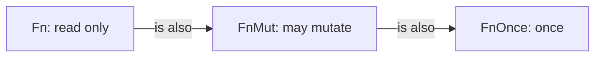
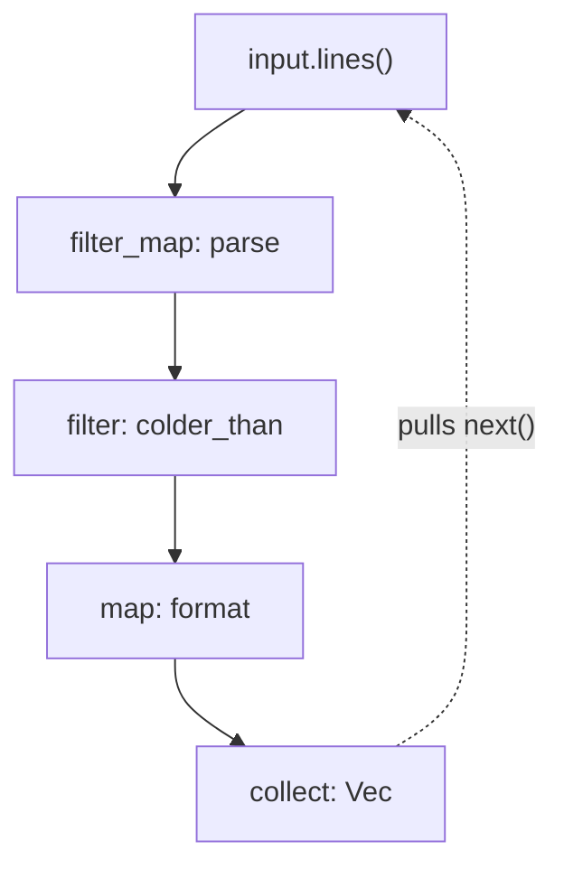

# Closures and iterators

It's a cold January morning and the study feels like a fridge. The sensors
logged all night, and you'd like to know what happened:

```text
hall, 17.5C
study, 14.0C
loft, 294K
kitchen, 19.0C
study, 13.5C
```

Which readings were below 16°C? How many readings did each room send? What
were the coldest, warmest and mean temperatures? Would the answers change if
we refused to trust a file with a bad line in it?

Each question is a loop. In most languages we'd write each one as a `for` loop
with a mutable accumulator, and by the fourth question we'd have four loops
that look almost the same and differ in one or two lines. This chapter is
about pulling those differences out into values, so that the loop is written
once and the *question* is what changes. The tools are **closures** (functions
that capture the variables around them) and **iterators** (lazy sequences
that closures can transform). Together they give us the *iterator pipeline*,
the functional workhorse that the rest of the book uses everywhere.

We'll build on Chapter 1's `Reading` and `parse_reading`, so a reading is a
`Room` and a `Celsius`, and `r.temperature.value()` gives the raw `f64`.

## The loop we keep writing

Let's answer the first question the way we would on autopilot:

```rust
fn cold_readings(readings: &[Reading]) -> Vec<&Reading> {
    let mut cold = Vec::new();
    for reading in readings {
        if reading.temperature.value() < 16.0 {
            cold.push(reading);
        }
    }
    cold
}
```

It borrows the readings and returns references into them, so nothing is
copied (Chapter 2). It works. Then the boiler engineer asks which readings
were *above* 25°C, and we copy the function as `hot_readings`, changing one
line. Then someone wants the study's readings only, and a third copy appears.

The crack here isn't a compiler error. It's duplication: three functions, each
with the same loop, the same `Vec`, the same `push`, differing only in the
condition. If we later decide the result should be sorted, or capped at a
hundred entries, we change it in three places and probably miss one.

The part that varies is a *decision about one reading*: a function from
`&Reading` to `bool`. So let's make it a parameter.

## Functions as values

Rust functions can take other functions as arguments. Here's the loop written
once, with the decision passed in:

```rust
// file: src/ch06_iterators.rs
/// Keep the readings that `keep` approves of.
pub fn select(
    readings: &[Reading],
    keep: impl Fn(&Reading) -> bool,
) -> Vec<&Reading> {
    let mut kept = Vec::new();
    for reading in readings {
        if keep(reading) {
            kept.push(reading);
        }
    }
    kept
}
```

`impl Fn(&Reading) -> bool` reads as "some callable thing that takes a
`&Reading` and returns a `bool`". It's the `impl Trait` argument syntax from
Chapter 5: `Fn` is a trait, and every closure and function with the right
shape implements it. As with any generic, the compiler generates a specialised
`select` for each closure we pass, so calling `keep` costs the same as writing
the condition inline.

A function that takes (or returns) another function is a **higher-order
function**. Now the three questions are one-liners:

```rust
let cold = select(&readings, |r| r.temperature.value() < 16.0);
let hot = select(&readings, |r| r.temperature.value() > 25.0);
let study = select(&readings, |r| r.room.as_str() == "study");
```

The `|r| ...` syntax is a **closure**: an anonymous function written inline.
Its parameters go between the bars, and its body is a single expression (or a
`{ ... }` block). We didn't write `r`'s type, because the compiler knows from
`select`'s signature that it's a `&Reading`.

> [!PATTERN] Higher-Order Functions
> When several functions share a shape and differ in one decision, write the
> shape once and take the decision as a parameter: `impl Fn(A) -> B` for a
> function that's called many times, `FnMut` if it may keep state, `FnOnce` if
> it's called at most once. Callers pass closures. Return `impl Fn(..)` to
> build specialised functions from configuration.

## Closures capture their environment

The 16°C threshold shouldn't be hard-coded. In a real program it would come
from the settings, so let's make it a variable:

```rust
let limit = 16.0;
let cold = select(&readings, |r| r.temperature.value() < limit);
```

The closure uses `limit`, which isn't one of its parameters. It's a variable
from the surrounding function, and the closure has *captured* it. That's the
difference between a closure and a plain function: a closure carries some of
its environment along with it. If you've used lambdas in JavaScript, Python or
C#, this will feel familiar.

What's different in Rust is that the compiler cares *how* a closure captures
each variable, because that's an ownership question. There are three ways:

- **By shared reference**, if the closure only reads the variable. Our
  `limit` closure does this.
- **By mutable reference**, if the closure changes the variable.
- **By value** (taking ownership), if the closure moves the variable
  somewhere, or if we ask for it with the `move` keyword.

And each mode gives the closure different powers, expressed as three traits.

### `Fn`, `FnMut`, `FnOnce`

Suppose we're curious how many readings `select` actually looked at, and count
them from inside the closure:

```rust
// does not compile
let mut checked = 0;
let cold = select(readings, |r| {
    checked += 1;
    r.temperature.value() < 16.0
});
```

```text
error[E0594]: cannot assign to `checked`, as it is a captured variable in a
`Fn` closure
  --> src/lib.rs:19:9
   |
 5 | pub fn select(readings: &[Reading], keep: impl Fn(&Reading) -> bool)
   |                                     ------------------------- change this
   |                                     to accept `FnMut` instead of `Fn`
...
17 |     let mut checked = 0;
   |         ----------- `checked` declared here, outside the closure
18 |     let cold = select(readings, |r| {
   |                ------           --- in this closure
   |                |
   |                expects `Fn` instead of `FnMut`
19 |         checked += 1;
   |         ^^^^^^^^^^^^ cannot assign
```

Read this error calmly; it says something precise. Our closure *mutates* a
captured variable, so it captures `checked` by mutable reference. A closure
like that implements `FnMut`, "callable, but it may change things as it goes".
But `select` asked for `Fn`, "callable any number of times *without changing
anything*", which our closure can't promise.

Who's wrong? The compiler's suggestion points at `select`, and it's right.
`select` calls `keep` once per reading, one call after another, never twice at
the same time. It doesn't need the stronger promise of `Fn`. Asking for more
than you need makes your function harder to call. So we relax the bound:

```rust
pub fn select(
    readings: &[Reading],
    mut keep: impl FnMut(&Reading) -> bool,
) -> Vec<&Reading> {
    // ... the body is unchanged
}
```

(`keep` needs `mut` now, because calling an `FnMut` mutates its captured
state.) Every closure that worked before still works, and the counting one
works too.

The third trait shows up when a closure gives away something it captured.
Here's a function that calls its argument twice, and a closure that hands
over a `String` it owns:

```rust
// does not compile
fn twice(f: impl Fn() -> String) -> (String, String) {
    (f(), f())
}

let greeting = String::from("hello");
let pair = twice(move || greeting);
```

```text
error[E0507]: cannot move out of `greeting`, a captured variable in an `Fn`
closure
  --> src/lib.rs:11:30
   |
10 |     let greeting = String::from("hello");
   |         --------   --------------------- move occurs because `greeting`
   |         |          has type `String`, which does not implement the
   |         |          `Copy` trait
   |         captured outer variable
11 |     let pair = twice(move || greeting);
   |                      ------- ^^^^^^^^ `greeting` is moved here
   |                      |
   |                      captured by this `Fn` closure
   |
help: `Fn` and `FnMut` closures require captured values to be able to be
consumed multiple times, but `FnOnce` closures may consume them only once
```

The first call would move `greeting` out of the closure, leaving nothing for
the second. That closure can only be called *once*, so it implements only
`FnOnce`. A function that genuinely calls its argument at most once should ask
for `impl FnOnce`, and then this closure is fine. The standard library does
exactly that wherever it can: `Option::map`, `unwrap_or_else` and
`thread::spawn` all take `FnOnce`.

The three traits nest. Every `Fn` is also an `FnMut` (a closure that changes
nothing can certainly be called where changing things is allowed), and every
`FnMut` is also an `FnOnce`:



So the rule for *accepting* closures is the reverse of what you might expect:
ask for the **weakest** trait your function can work with. `FnOnce` accepts
every closure; `FnMut` accepts most; `Fn` is the pickiest. Ask for `Fn` only
when you need it, for example when the same closure might be called from
several threads at once.

### Returning closures

Thresholds appear all over the place, so let's write a function that *builds*
a predicate from a limit. It returns a closure, using `impl Trait` in return
position ("some type that implements `Fn(&Reading) -> bool`; I won't name
it"):

```rust
// does not compile
pub fn colder_than(limit: f64) -> impl Fn(&Reading) -> bool {
    |r| r.temperature.value() < limit
}
```

```text
error[E0373]: closure may outlive the current function, but it borrows
`limit`, which is owned by the current function
 --> src/lib.rs:6:5
  |
6 |     |r| r.temperature.value() < limit
  |     ^^^                         ----- `limit` is borrowed here
  |     |
  |     may outlive borrowed value `limit`
  |
help: to force the closure to take ownership of `limit` (and any other
referenced variables), use the `move` keyword
  |
6 |     move |r| r.temperature.value() < limit
  |     ++++
```

This is Chapter 2's ownership rules applied to closures. The closure only
reads `limit`, so by default it captures a reference. But `limit` is a
parameter, and it disappears when `colder_than` returns. The closure would
outlive the thing it points at: a dangling reference, which Rust refuses to
create. In a garbage-collected language this would silently keep `limit`
alive; in C++ it would silently dangle.

`move` tells the closure to take ownership of what it captures, copying
`limit` into itself:

```rust
/// A predicate factory: "colder than `limit` degrees Celsius".
pub fn colder_than(limit: f64) -> impl Fn(&Reading) -> bool {
    move |r| r.temperature.value() < limit
}
```

The closure is now a small self-contained value: some code plus one `f64`.
Taking ownership doesn't stop it being `Fn`, because it only *reads* its own
copy. And because it's a value, we can name it, store it and pass it along:
`select(&readings, colder_than(16.0))`.

Functional programmers will recognise `colder_than` as *partial application*:
fixing one argument of a two-argument comparison to get a one-argument
predicate. It's a small idea that composes beautifully, as we're about to see.

## Iterators: the loop, as a value

`select` is a nice abstraction, but we'd soon want `map`, `count`, `take`,
`sum`... and writing each as a function over slices would rebuild a library
Rust already has. That library is the `Iterator` trait. Its definition is
surprisingly small:

```rust
pub trait Iterator {
    type Item;
    fn next(&mut self) -> Option<Self::Item>;
    // ... and about 75 provided methods
}
```

There's Chapter 5's associated type: `Item` is what the iterator yields, fixed
per implementation. The one required method, `next`, either produces the next
item (`Some(item)`) or says the sequence is over (`None`). Every `for` loop in
Rust is sugar for calling `next` until it returns `None`.

Everything else (`map`, `filter`, `fold`, `sum`, `take`, `zip` and dozens
more) is a default method, built on `next`. That's the *Traits as Contracts*
payoff from Chapter 5: implement one method, inherit a toolkit.

Collections give you iterators: `readings.iter()` yields `&Reading`s,
`input.lines()` yields `&str`s, `0..10` yields numbers. *Adaptors* such as
`filter` and `map` take one iterator and return another. *Consumers* such as
`collect`, `count` and `sum` drive an iterator to the end and produce a result.

With those pieces, `select` becomes one line, and we don't need `select` at
all:

```rust
let cold: Vec<&Reading> =
    readings.iter().filter(|r| r.temperature.value() < 16.0).collect();
```

### Laziness

There's something unusual about adaptors that's worth seeing go wrong. Let's
print each temperature with `map`:

```rust
pub fn shout(readings: &[Reading]) {
    readings.iter().map(|r| println!("{}", r.temperature));
}
```

It compiles, but prints nothing, and the compiler warns us:

```text
warning: unused `Map` that must be used
 --> src/lib.rs:4:5
  |
4 |     readings.iter().map(|r| println!("{}", r.temperature));
  |     ^^^^^^^^^^^^^^^^^^^^^^^^^^^^^^^^^^^^^^^^^^^^^^^^^^^^^^
  |
  = note: iterators are lazy and do nothing unless consumed
...
help: you might have meant to use `Iterator::for_each`
```

**Iterators are lazy.** Calling `map` doesn't touch a single reading. It
returns a `Map` value that *remembers* the closure and the iterator underneath
it. Work only happens when something calls `next`, and here nothing does.

That's not a quirk; it's the design. Because nothing runs until it's pulled,
a pipeline does exactly as much work as the consumer needs. `find` stops at
the first match, so in

```rust
let first_cold = night
    .into_iter()
    .inspect(|r| seen.push(r.room.as_str().to_string()))
    .find(colder_than(16.0));
```

`inspect` (an adaptor for peeking at items as they pass) only sees `hall` and
`study`: the rest of the night is never examined. Laziness also makes infinite
sequences perfectly reasonable. `(1..)` counts up forever, and this is fine:

```rust
let squares: Vec<u64> = (1..).map(|n| n * n).take(4).collect();
assert_eq!(squares, [1, 4, 9, 16]);
```

Notice also that we passed `colder_than(16.0)` straight to `find`. The
predicate factory from the last section slots into the standard adaptors
unchanged, because they all take closures by `FnMut`.

> [!NOTE]
> The warning's suggestion, `for_each`, is the consumer to use when you want
> side effects for each item. But a plain `for` loop is often clearer for
> effects. A good rule of thumb: pipelines for *computing values*, `for`
> loops for *doing things*.

## Pipelines

Now we can answer the first question properly, straight from the raw text:
which readings were below the limit, formatted as alert lines?

```rust
/// One alert line per reading below `limit`, skipping malformed lines.
pub fn alerts(input: &str, limit: f64) -> Vec<String> {
    input
        .lines()
        .filter_map(|line| parse_reading(line).ok())
        .filter(colder_than(limit))
        .map(|r| format!("{}: {}", r.room.as_str(), r.temperature))
        .collect()
}
```

Read it top to bottom; it says what it does. Take the lines; parse each one,
keeping the successes; keep the cold ones; describe each; collect them. The
only new adaptor is `filter_map`, which applies a function returning an
`Option` and keeps the `Some`s. `parse_reading(line).ok()` turns a `Result`
into an `Option`, discarding the error, which is our lenient policy for this
report.

It helps to see the pipeline as a flow, because that's how it runs:



The dotted arrow is the laziness. `collect` asks for an item; `map` asks
`filter`; `filter` asks `filter_map`, possibly several times until a cold
reading turns up; `filter_map` asks `lines`. One line of text travels all the
way through before the next is read. There's no intermediate `Vec` between the
stages, and the compiler fuses the whole chain into a single loop as tight as
the one we'd write by hand.

On our night's data:

```rust
assert_eq!(alerts(NIGHT, 16.0), ["study: 14.0°C", "study: 13.5°C"]);
```

The kelvin line was quietly dropped by `filter_map`. Whether that's right is a
policy decision, and we'll make the opposite one shortly.

> [!PATTERN] Iterator Pipeline
> Express a computation over a sequence as a source, a chain of adaptors
> (`filter`, `map`, `filter_map`, `take_while`, `enumerate`...) and one
> consumer (`collect`, `sum`, `count`, `find`, `fold`). Each step is a small,
> usually pure, closure. Pipelines are lazy, so they do no more work than the
> consumer needs, and they compile to a single loop.

> [!TIP]
> The pipeline is a functional core in miniature. Every closure in `alerts` is
> pure: given the same input it returns the same output and changes nothing.
> That's why we could test it with a string constant and no setup.

## Fold: the universal loop

The second question was about statistics: count, minimum, maximum, mean. We
could call `count()`, then `min_by`, then `max_by`, then `sum()`, walking the
readings four times. Or we could look at what all four have in common.

Each one starts with an initial value and combines it with every item in
turn: the count starts at `0` and adds one; the sum starts at `0` and adds the
item; the maximum starts with the smallest possible value and keeps the larger.
That shape, *start with an accumulator, combine each item into it, return the
accumulator*, is a **fold**, and every iterator has one:

```rust
let xs = [3, 1, 4, 1, 5];
let sum = xs.iter().fold(0, |acc, x| acc + x);
let count = xs.iter().fold(0, |acc, _| acc + 1);
let max = xs.iter().fold(i32::MIN, |acc, &x| acc.max(x));
```

`fold(initial, step)` calls `step(accumulator, item)` for each item and uses
the result as the next accumulator. Compare it with Chapter 5's `combine_all`:
same shape, with `M::empty()` as the initial value and `combine` as the step.
`sum`, `count`, `max`, `min`, `collect`: all of them *can* be written as
folds. A fold is what a `for` loop with a mutable accumulator *means*, with
the mutation taken out: each step is a pure function from the old accumulator
to a new one.

So let's gather all our statistics in one pass, with a fold whose accumulator
is a small struct:

```rust
#[derive(Debug, Clone, Copy, PartialEq)]
pub struct Stats {
    pub count: usize,
    pub min: f64,
    pub max: f64,
    pub total: f64,
}

impl Stats {
    fn start(t: f64) -> Stats {
        Stats { count: 1, min: t, max: t, total: t }
    }

    fn add(self, t: f64) -> Stats {
        Stats {
            count: self.count + 1,
            min: self.min.min(t),
            max: self.max.max(t),
            total: self.total + t,
        }
    }
}
```

`add` takes the old `Stats` by value and returns a new one. There's no `&mut`
anywhere: it's a pure step function, trivially testable on its own. The fold
itself is now two lines:

```rust
/// Statistics for a batch of readings, or `None` if it's empty.
pub fn stats(readings: &[Reading]) -> Option<Stats> {
    let mut temps = readings.iter().map(|r| r.temperature.value());
    let first = temps.next()?;
    Some(temps.fold(Stats::start(first), Stats::add))
}
```

Two details deserve a look. First, we start the fold from the first item
rather than from some "empty" `Stats`, because there's no honest minimum of
nothing. If the iterator is empty, `next()` returns `None` and `?` returns
`None` from the function, the same trick Chapter 1 used. The type says
"statistics only exist if there was data", and the code can't produce a
`Stats` with an invented `min`.

Second, we passed `Stats::add` itself as the step, not a closure. `fold`
wants something callable as `FnMut(Stats, f64) -> Stats`, and a method that
takes `self` by value and an `f64` *is* a function of exactly that shape.
Named functions are values too.

> [!PATTERN] Fold (Reduce)
> To turn a sequence into one value, give an initial accumulator and a pure
> step function `(accumulator, item) -> accumulator`, and let `fold` run it.
> Most loops with a mutable variable are folds in disguise. Making the step a
> named function on the accumulator type keeps it small, pure and testable.
> In other languages it's called `reduce` or `inject`.

Folds will come back again and again. In Part III, rebuilding a to-do list
from its history of events is a fold. In Part V, every accounting report is a
fold over the journal. Learn to see them.

## Collecting into other shapes

`collect` has been producing `Vec`s, but it's more general than that, and the
first time you use it carelessly the compiler tells you so:

```rust
// does not compile
let parsed = input.lines().map(parse_reading).collect();
```

```text
error[E0283]: type annotations needed
 --> src/lib.rs:6:9
  |
6 |     let parsed = input.lines().map(parse_reading).collect();
  |         ^^^^^^                                    ------- type must be
  |                                                   known at this point
  |
  = note: the type must implement `FromIterator<Result<Reading, ParseError>>`
help: consider giving `parsed` an explicit type
  |
6 |     let parsed: Vec<_> = input.lines().map(parse_reading).collect();
  |               ++++++++
```

`collect` can build any type that implements the `FromIterator` trait, and it
chooses which by looking at the type we ask for. That's Chapter 5's
traits-as-typeclasses idea again: the *return* type selects the
implementation. `Vec<_>` (with `_` meaning "work out the element type") is one
choice, but not the only one, and some of the others are remarkably useful.

### Into a `Result`: strict parsing

The `alerts` report skipped malformed lines. A strict importer, like the one
in Chapter 1's exercises, should do the opposite: either every line parses, or
we report the first one that didn't. That sounds like a loop with an early
`return`. It's actually a `collect`:

```rust
/// Parse every line, or report the first bad one with its line number.
pub fn parse_strict(input: &str) -> Result<Vec<Reading>, (usize, ParseError)> {
    input
        .lines()
        .enumerate()
        .map(|(i, line)| parse_reading(line).map_err(|e| (i + 1, e)))
        .collect()
}
```

An iterator of `Result<T, E>` can be collected into a `Result<Vec<T>, E>`.
If every item is `Ok`, you get `Ok` of all the values; at the first `Err`,
collection *stops* and that error is the result. `enumerate` pairs each line
with its index, and `map_err` attaches a line number to the error, so on our
night's data the answer is `Err((3, UnknownUnit('K')))`. Lenient and strict
policies, two pipelines, one shared `parse_reading`. The same works for
`Option`: collecting `Option<T>`s into `Option<Vec<T>>` gives `None` if any
item was `None`.

### Into a `HashMap`

The third question: how many readings did each room send? Grouping is a fold
whose accumulator is a map:

```rust
/// How many readings each room produced.
pub fn readings_per_room(readings: &[Reading]) -> HashMap<&str, usize> {
    readings.iter().fold(HashMap::new(), |mut counts, r| {
        *counts.entry(r.room.as_str()).or_insert(0) += 1;
        counts
    })
}
```

`entry(key).or_insert(0)` finds the count for a room, inserting zero first if
it's new, and gives back a mutable reference to it, which we increment. The
step closure takes the map by value (`mut counts`), updates it, and hands it
back: still the fold shape, with the mutation kept local to one step. The keys
are `&str`s borrowed from the readings, which is why the result's lifetime is
tied to the input slice, exactly as Chapter 2 would predict.

And if we just want "the latest reading for each room", `collect` can build a
map directly from `(key, value)` pairs, with later pairs overwriting earlier
ones:

```rust
pub fn latest_by_room(readings: &[Reading]) -> HashMap<&str, Celsius> {
    readings
        .iter()
        .map(|r| (r.room.as_str(), r.temperature))
        .collect()
}
```

## Writing an iterator

Every sequence so far came from somewhere else: a slice, a string, a range.
Sometimes the sequence is the thing we're designing. The sensors are polled at
fixed intervals through the day (every 15 minutes, say) and we'd like the poll
times as a sequence we can `take`, `skip`, `zip` and `map` like any other.

To make our own iterator, we need some state and an implementation of `next`:

```rust
const MINUTES_PER_DAY: u32 = 24 * 60;

/// The minutes past midnight at which we poll the sensors.
pub struct PollTimes {
    next: u32,
    step: u32,
}

impl Iterator for PollTimes {
    type Item = u32;

    fn next(&mut self) -> Option<u32> {
        if self.next >= MINUTES_PER_DAY {
            return None;
        }
        let now = self.next;
        self.next += self.step;
        Some(now)
    }
}
```

`next` takes `&mut self`, because producing an item advances the state. The
state is entirely private to the iterator; callers just see a sequence. And
because we implemented `Iterator`, every adaptor comes free:

```rust
let labels: Vec<String> =
    PollTimes::every(15).skip(2).take(2).map(hhmm).collect();
assert_eq!(labels, ["00:30", "00:45"]);
```

(`PollTimes::every` is a constructor that starts at midnight, and `hhmm` turns
minutes into a `HH:MM` string. Again, a named function passed straight to
`map`.)

For simple sequences you often don't need a struct at all. `std::iter::
successors` builds an iterator from a first item and a closure that computes
each item from the last:

```rust
/// The same sequence, built from a seed and a step function.
pub fn poll_times(step: u32) -> impl Iterator<Item = u32> {
    std::iter::successors(Some(0), move |m| Some(m + step))
        .take_while(|&m| m < MINUTES_PER_DAY)
}
```

This is *unfolding*, the mirror image of a fold: a fold consumes a sequence
into one value, an unfold grows a sequence out of one value. The closure
captures `step` with `move`, for the same reason as `colder_than`: it outlives
the function that made it. And the return type is `impl Iterator<Item = u32>`,
because the real type is a nest of adaptor types wrapping an unnameable
closure. We tell callers what they can *do* with it, and nothing more.

> [!WARNING]
> What does `PollTimes::every(0)` do? It yields `0` forever, and any `collect`
> on it never finishes. Infinite iterators are fine when the consumer stops
> early (`take`, `find`); they're a hang when it doesn't. The exercises ask you
> to make a zero step impossible to express.

> [!CHECKPOINT]
> Your `src/ch06_iterators.rs`, registered in `src/lib.rs` with
> `pub mod ch06_iterators;`, should now contain `select`, `colder_than`,
> `alerts`, `parse_strict`, `Stats` and `stats`, `readings_per_room`,
> `latest_by_room`, `PollTimes` and `poll_times`, with a test for each.
>
> ```sh
> cargo test --lib ch06
> ```
>
> ```text
> test result: ok. 12 passed; 0 failed; 0 ignored; 0 measured
> ```

## What we learned

- **Higher-Order Functions**: when functions differ only in a decision, pass
  the decision in as `impl Fn...`, and build specialised functions by returning
  closures.
- **Closures capture their environment**, by reference, mutable reference or
  value, and the compiler checks those captures against ownership rules.
  `move` makes a closure own what it captures, which it must if it outlives
  the current function.
- **`Fn`, `FnMut`, `FnOnce`** describe what a closure may do with its captures.
  When *accepting* closures, ask for the weakest trait that works.
- **The `Iterator` trait** has one required method, `next`, and inherits the
  rest. Iterators are **lazy**: nothing runs until a consumer pulls.
- **Iterator Pipeline**: source, adaptors, consumer. Readable top to bottom,
  no intermediate collections, compiled to a single loop.
- **Fold (Reduce)** is the universal loop: an initial value and a pure step.
  `sum`, `count`, `max` and grouping are all folds.
- **`collect` is driven by the type you ask for**: `Vec`, `HashMap`, and
  `Result<Vec<_>, _>` for "all or the first error".
- **Writing an iterator** means state plus `next`; `successors` unfolds simple
  sequences without a struct.

## Exercises

> [!EXERCISE] Warmer than, and between
> Write `warmer_than(limit: f64)` and `between(low: f64, high: f64)` predicate
> factories. Then write `fn both(a: impl Fn(&Reading) -> bool, b: impl
> Fn(&Reading) -> bool) -> impl Fn(&Reading) -> bool` and use it to express
> `between` in terms of `warmer_than` and `colder_than`. What does `both` need
> to do with `a` and `b` to return a closure that uses them?

> [!EXERCISE] Mean per room
> Write `fn mean_by_room(readings: &[Reading]) -> HashMap<&str, f64>`. Start
> with a fold into `HashMap<&str, Stats>`, or reuse Chapter 5's `Tally` and
> `Monoid`. Which version is easier to test?

> [!EXERCISE] The biggest jump
> Slices have a `windows(2)` method that yields overlapping pairs. Use it to
> find the largest change in temperature between consecutive readings of the
> same room. (Hint: group by room first.) What should the function return for a
> room with only one reading?

> [!EXERCISE] No zero steps
> Change `PollTimes::every` to take a `std::num::NonZeroU32`, so that
> `every(0)` can't be written. How does the calling code change? Is it better
> or worse than checking for zero and returning an `Option<PollTimes>`?
