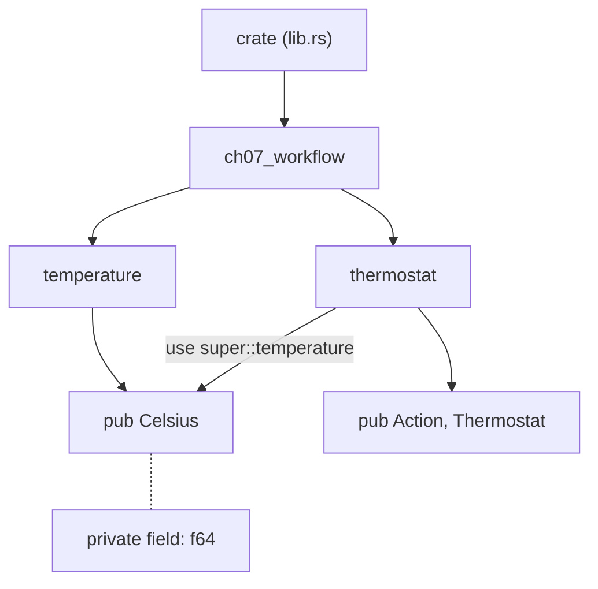
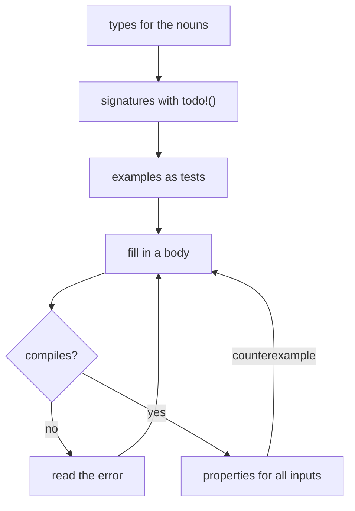

# Modules, tests and the type-driven workflow

In Chapter 4 we gave `Celsius` a smart constructor. `Celsius::new(-300.0)`
returns an error, because nothing can be colder than absolute zero, and every
`Celsius` that exists has been checked. That was the idea, anyway.

Months later, a colleague adds sensor calibration. Cheap sensors read a little
high or low, so each one has an offset, and they write the obvious function:

```rust
pub fn calibrate(reading: Celsius, offset: f64) -> Celsius {
    Celsius(reading.0 + offset)
}
```

It compiles. It passes review, because it looks harmless. And when a
misconfigured sensor arrives with an offset of `-500.0`, it produces a
`Celsius` of `-479°C`, which flows into the summary, the thermostat and the
weekly report. Every function downstream trusted that a `Celsius` was a real
temperature, and the trust was misplaced.

The smart constructor wasn't wrong. It was *optional*. As long as anyone can
write `Celsius(...)` directly, the check in `new` is a suggestion, and a type's
promise is only as strong as its weakest constructor. This chapter is about
turning suggestions into guarantees. We'll use Rust's **module system** to
make the smart constructor the only way in, look at the different kinds of
**tests** Rust supports (including *property-based* tests that hunt for bugs we
didn't think of), and then put everything from Part I together in the
**type-driven workflow**: types first, `todo!()` bodies, tests, and a calm
conversation with the compiler until it all fits.

## Privacy is per module

Here's the shape of the problem. Everything lives in one file:

```rust
// file: src/ch07_workflow.rs
pub struct Celsius(f64);

impl Celsius {
    pub fn new(value: f64) -> Result<Celsius, TemperatureError> {
        // ... check for NaN and absolute zero
    }
}

pub fn calibrate(reading: Celsius, offset: f64) -> Celsius {
    Celsius(reading.0 + offset)
}
```

The field of `Celsius` has no `pub`, so it's private. But private to *what*?
Rust's answer is: **private to the module it's declared in**, and everything
inside that module. Not the type, not the `impl` block: the module. Since
`calibrate` sits in the same module as `Celsius`, it can build one directly,
and the compiler sees nothing wrong.

That's a deliberate design choice, and a good one. Privacy in Rust isn't about
types keeping secrets from each other; it's about drawing a boundary around a
piece of code that you can reason about as a whole. So let's draw a smaller
boundary. A module can be declared inline, with `mod name { ... }`:

```rust
pub mod temperature {
    pub struct Celsius(f64);

    impl Celsius {
        pub fn new(value: f64) -> Result<Celsius, TemperatureError> {
            // ...
        }

        pub fn value(self) -> f64 {
            self.0
        }
    }
}
```

Now `temperature` is a module containing the type, its constructor and an
accessor. `pub struct Celsius` makes the *type* visible outside the module,
but its field is still private, so the only code that can write `Celsius(..)`
or read `.0` is the code inside `temperature`. Everyone else has to go
through `new` and `value`.

Let's check that by trying to cheat from outside. Here's a test file that
tries to build an impossible temperature directly:

```rust
// file: tests/sneaky.rs
// does not compile
use foundations::ch07_workflow::Celsius;

#[test]
fn sneak_past_the_constructor() {
    let impossible = Celsius(-500.0);
}
```

```text
error[E0423]: cannot initialize a tuple struct which contains private fields
  --> tests/sneaky.rs:5:22
   |
 5 |     let impossible = Celsius(-500.0);
   |                      ^^^^^^^
   |
note: constructor is not visible here due to private fields
  --> src/ch07_workflow/temperature.rs:10:20
   |
10 | pub struct Celsius(f64);
   |                    ^^^ private field
```

And reading the raw field is refused in the same way:

```text
error[E0616]: field `0` of struct `Celsius` is private
 --> tests/peek.rs:6:18
  |
6 |     assert_eq!(c.0, 21.0);
  |                  ^ private field
```

This is the crack from the start of the chapter, closed. Our colleague's
`calibrate` now has to be written in terms of the public API:

```rust
pub fn calibrate(
    reading: Celsius,
    offset: f64,
) -> Result<Celsius, TemperatureError> {
    Celsius::new(reading.value() + offset)
}
```

Notice what happened to the signature. The compiler didn't just block a bad
line; it forced the *fact* that calibration can fail into the return type.
Every caller of `calibrate` now sees the `Result` and must decide what a
nonsense offset means. The design improved because the shortcut disappeared.

### Why this is a proof

There's a way of looking at this that makes it click. Inside the
`temperature` module, there's exactly one place that creates a `Celsius`:
`new`, which checks the value. Nothing outside the module can create one, or
change one. So if you're holding a `Celsius` anywhere in the program, it *must*
have come from `new`, which means the check *must* have passed. The value is
evidence. You never need to re-validate it, and no function that takes a
`Celsius` needs a defensive `if`.

The cost of that guarantee is an audit of one small module. To convince
yourself that every `Celsius` is valid, you read `temperature` (its
constructor, and any method that builds or modifies a `Celsius`) and nothing
else. A codebase of a hundred thousand lines can rest on a module of thirty.

> [!PATTERN] Encapsulated Invariants (Privacy as Proof)
> Put a type with an invariant in its own module, keep its fields private, and
> make a smart constructor (Chapter 4) the only way to create it. The module
> boundary turns the check from optional to mandatory: any value of the type is
> proof the invariant holds. Only the module's own code can break the
> invariant, so only that module needs auditing.

> [!TIP]
> Not every struct needs private fields. A plain bundle of data with no rules
> (Chapter 5's `Settings`, say) is clearer with `pub` fields. Make fields
> private when there's an invariant to protect, and only then.

## Modules in files

An inline `mod` is fine for a quick boundary, but real modules live in their
own files. The rule is mechanical: `mod temperature;` (with a semicolon instead
of a body) tells the compiler "the contents of this module are in a file".
For a module declared in `src/ch07_workflow.rs`, that file is
`src/ch07_workflow/temperature.rs`.

Our chapter's code now has this layout:

```text
src/
├── lib.rs                  pub mod ch07_workflow;
├── ch07_workflow.rs        pub mod temperature; pub mod thermostat;
└── ch07_workflow/
    ├── temperature.rs      Celsius, TemperatureError
    └── thermostat.rs       Action, Thermostat
tests/
└── ch07_thermostat.rs      integration test
```

The file tree mirrors the module tree, and the module tree is the boundary
map. Here it is drawn as modules, with what each one exposes:



Three small pieces of syntax hold it together.

`use` brings a name into scope, so `thermostat.rs` can say `Celsius` instead
of `super::temperature::Celsius`. `super` means "the parent module", `crate`
means "the root of this crate", and `self` means "this module".

`pub use` *re-exports* a name. The parent module, `src/ch07_workflow.rs`, is
three lines of declarations and two re-exports:

```rust
// file: src/ch07_workflow.rs
pub mod temperature;
pub mod thermostat;

pub use temperature::{Celsius, TemperatureError};
pub use thermostat::{Action, Thermostat};
```

Users can write `ch07_workflow::Celsius` without knowing which file it lives
in. The internal layout can change without breaking anyone: the public path is
a decision, separate from the file structure.

Finally, visibility has more settings than "public" and "private". `pub(crate)`
makes an item visible anywhere in this crate but not to other crates, and
`pub(super)` makes it visible to the parent module only. They're useful for
helpers that several modules share but the outside world shouldn't depend on.

> [!NOTE]
> You'll also see an older layout, `src/ch07_workflow/mod.rs`, instead of
> `src/ch07_workflow.rs`. Both work. This book uses the newer style, which
> avoids having a dozen files named `mod.rs` open in your editor.

## Crates and workspaces

A **crate** is Rust's unit of compilation: the thing `rustc` compiles in one
go, and the outermost privacy boundary. Our project has one *library crate*,
rooted at `src/lib.rs`, and one *binary crate* per file in `src/bin/`, such as
Chapter 1's `readings`. The binaries use the library exactly as an outside
crate would, through `use foundations::...`, and so they can only see what the
library makes `pub`. That's another reason the functional core belongs in the
library: the shell can't reach past its public API even if it wanted to.

A **package** is what a `Cargo.toml` describes: one library crate at most,
any number of binaries. When a project outgrows one package (say, a domain
library, a command-line tool and a web server that share it) you group
several packages into a **workspace**, with a `Cargo.toml` at the root:

```toml
# file: Cargo.toml
[workspace]
members = ["domain", "cli", "server"]
resolver = "3"
```

Members share one `Cargo.lock` and one `target/` directory, and depend on each
other by path. Splitting along crate lines is the strongest boundary Rust
offers: `domain` *can't* depend on `server` unless its manifest says so. We'll
use that in Part IV to share types between a server and a browser.

## Three kinds of test

Now that we have boundaries, we can be precise about tests, because Rust's
three kinds of test sit on different sides of them.

**Unit tests** live in a `#[cfg(test)] mod tests` inside the module they test,
as we've done since Chapter 1. The test module is a *child* of the module under
test, and child modules can see their ancestors' private items. So unit tests
can poke at internals:

```rust
// file: src/ch07_workflow/temperature.rs
#[cfg(test)]
mod tests {
    use super::*;

    #[test]
    fn unit_tests_can_see_private_fields() {
        assert_eq!(Celsius::new(21.5).unwrap().0, 21.5);
    }
}
```

**Integration tests** live in the `tests/` directory. Each file there is
compiled as a separate crate that depends on your library, so it sees only the
public API, just like a real user. That's why `tests/sneaky.rs` couldn't build
a `Celsius`. Integration tests are where you check that the public pieces fit
together. Here's one that simulates a chilly evening and checks the thermostat
switches the boiler at sensible moments (we'll build the thermostat in a
moment):

```rust
// file: tests/ch07_thermostat.rs
use foundations::ch07_workflow::{Action, Celsius, Thermostat};

#[test]
fn a_chilly_evening() {
    let hall = Thermostat { target: Celsius::new(21.0).unwrap(), band: 1.5 };
    let temps = [18.0, 19.5, 20.6, 21.0, 20.5, 19.4];

    let actions: Vec<Action> = temps
        .iter()
        .scan(Action::Rest, |now, &t| {
            *now = hall.decide(Celsius::new(t).unwrap(), *now);
            Some(*now)
        })
        .collect();

    use Action::{Heat, Rest};
    assert_eq!(actions, [Heat, Heat, Heat, Rest, Rest, Heat]);
}
```

`scan` is a fold that yields every intermediate accumulator, which is exactly
the shape of "a thermostat reacting to a stream of readings".

**Doc tests** are code examples inside `///` comments. `cargo test` extracts
and runs them, so documentation can't silently go stale:

```rust
/// Check a raw value and wrap it.
///
/// ```
/// use foundations::ch07_workflow::Celsius;
///
/// assert!(Celsius::new(21.5).is_ok());
/// assert!(Celsius::new(-300.0).is_err());
/// assert!(Celsius::new(f64::NAN).is_err());
/// ```
pub fn new(value: f64) -> Result<Celsius, TemperatureError> {
```

Like integration tests, doc tests are compiled as an outside crate, so they
show users exactly the code *they* would write. They're the best kind of
documentation: examples that are checked on every build.

## The type-driven workflow, end to end

We've been practising *Type-Driven Development* since Chapter 1. Let's now do
it deliberately, start to finish, on a small but real problem, paying
attention to each step and to what the compiler says along the way.

### The problem

The hall thermostat controls a gas boiler. The naive rule, "heat when it's
below the target, rest when it's not", has a nasty flaw. When the temperature
hovers around the target, it will switch the boiler on and off every few
seconds as readings wobble by a tenth of a degree. Boilers hate that.

Real thermostats use **hysteresis**: a band below the target. When heating,
keep going until you reach the target. When resting, don't start again until
you've fallen below the band. In between, keep doing whatever you were doing.

### Step 1: write down the nouns

What are the things here? A thermostat has a target and a band. Its output is
a decision, which is one of exactly two things. Let's say that and only that:

```rust
// file: src/ch07_workflow/thermostat.rs
use super::temperature::Celsius;

/// What the boiler should do next.
#[derive(Debug, Clone, Copy, PartialEq, Eq)]
pub enum Action {
    Heat,
    Rest,
}

/// Heat until we reach `target`; start again once we fall `band` degrees
/// below it. Between the two, keep doing whatever we were doing.
#[derive(Debug, Clone, Copy, PartialEq)]
pub struct Thermostat {
    pub target: Celsius,
    pub band: f64,
}
```

The target is a `Celsius`, so it's guaranteed to be a real temperature. The
band is a plain number of degrees; it's a *difference* between temperatures,
not a temperature, so `Celsius` would be the wrong type. (Whether it should
have a type of its own is one of the exercises.)

### Step 2: write the verb's signature

What does the decision need? The current temperature, obviously. But the
problem statement said "keep doing whatever you were doing", so the decision
also depends on *what we're doing now*. That's easy to miss, and writing the
signature is what flushes it out:

```rust
impl Thermostat {
    pub fn decide(&self, current: Celsius, now: Action) -> Action {
        todo!()
    }
}
```

The signature is a design statement: deciding is a pure function of the
settings, the current temperature and the current action. It returns an
`Action`, not a `Result`, because with a valid `Celsius` there's nothing that
can go wrong. No clocks, no I/O, no hidden state; the previous action is
passed in, not remembered. That makes the thermostat a tiny *state machine*
whose state is owned by the caller, which is exactly how the integration test
drove it with `scan`.

`todo!()` lets this compile. The compiler checks the types around it, warns us
that `current` and `now` are unused, and moves on.

### Step 3: write examples as tests

Before implementing, we write down a couple of cases we're sure about:

```rust
#[cfg(test)]
mod tests {
    use super::*;

    fn c(value: f64) -> Celsius {
        Celsius::new(value).unwrap()
    }

    fn hall() -> Thermostat {
        Thermostat { target: c(21.0), band: 1.5 }
    }

    #[test]
    fn heats_when_cold() {
        assert_eq!(hall().decide(c(15.0), Action::Rest), Action::Heat);
    }

    #[test]
    fn rests_when_warm() {
        assert_eq!(hall().decide(c(23.0), Action::Heat), Action::Rest);
    }
}
```

These compile against the `todo!()`, which is the point: we've checked that
the API is pleasant to *use* before writing any of it. Running them tells us
honestly where we are:

```text
running 2 tests
test ch07_workflow::thermostat::tests::heats_when_cold ... FAILED
test ch07_workflow::thermostat::tests::rests_when_warm ... FAILED

---- ch07_workflow::thermostat::tests::heats_when_cold stdout ----

thread 'ch07_workflow::thermostat::tests::heats_when_cold' panicked at
src/ch07_workflow/thermostat.rs:22:9:
not yet implemented
```

### Step 4: the simplest thing that could work

Let's be honest about what most of us would type first:

```rust
pub fn decide(&self, current: Celsius, now: Action) -> Action {
    if current < self.target { Action::Heat } else { Action::Rest }
}
```

`current < self.target` compiles because `Celsius` derives `PartialOrd`
(Chapter 5). Both tests pass. But the compiler has left us a clue:

```text
warning: unused variable: `now`
  --> src/ch07_workflow/thermostat.rs:21:44
   |
21 |     pub fn decide(&self, current: Celsius, now: Action) -> Action {
   |                                            ^^^ help: if this is
   |                         intentional, prefix it with an underscore: `_now`
```

We put `now` in the signature because the requirement needed it, and the
implementation ignores it. A warning about an unused parameter is often a
warning about an unimplemented requirement. That's the boiler-flicker bug,
and our two example tests are too far from the target to notice. We could add
more examples, carefully chosen near the boundaries. Or we could ask the
computer to choose them.

## Property-based testing

An example test says "for *this* input, expect *that* output". A **property**
says "for *every* input of this shape, this should be true". A property-based
testing library then generates hundreds of random inputs, checks the property
on each, and, when one fails, *shrinks* it to the simplest input that still
fails.

Rust's most popular library for this is `proptest`. It's only needed for
tests, so it's a *dev-dependency*:

```toml
# file: Cargo.toml
[dev-dependencies]
proptest = "1"
```

### Saying what must always be true

What's true of every thermostat, at every temperature? Reading the
requirement again, three things:

1. At or above the target, it always rests.
2. Below the band, it always heats.
3. Inside the band, it keeps doing what it was doing.

To test those, proptest needs to know how to generate the inputs. A
**strategy** describes how to produce random values of a type. Ranges are
strategies, tuples of strategies are strategies, and `prop_map` turns one
strategy's values into another type:

```rust
use proptest::prelude::*;

fn thermostat() -> impl Strategy<Value = Thermostat> {
    (5.0..30.0, 0.1..5.0)
        .prop_map(|(target, band)| Thermostat { target: c(target), band })
}

fn action() -> impl Strategy<Value = Action> {
    prop_oneof![Just(Action::Heat), Just(Action::Rest)]
}
```

Targets between 5°C and 30°C, bands between a tenth of a degree and five
degrees, and either action. `Just(x)` is the strategy that always produces
`x`; `prop_oneof!` picks between strategies. There's Chapter 6 again: a
strategy is a value, built from smaller ones with closures.

Now the properties themselves, inside the `proptest!` macro. Each parameter
is written `name in strategy`:

```rust
proptest! {
    #[test]
    fn keeps_going_inside_the_band(
        th in thermostat(),
        depth in 0.01..0.99,
        now in action(),
    ) {
        let current = c(th.target.value() - th.band * depth);
        prop_assert_eq!(th.decide(current, now), now);
    }
}
```

Instead of generating a temperature and hoping it lands in the band, we
generate *how far into the band* to go (`depth`, as a fraction) and compute a
temperature that's guaranteed to be inside it. Generating inputs that satisfy
a property's precondition by construction, rather than filtering random ones,
is the most useful trick in property-based testing. The other two properties
follow the same pattern: `target + above` for the first, and
`target - band - below` for the second.

`prop_assert_eq!` is `assert_eq!` for properties; it reports failures to
proptest instead of panicking straight away, so proptest can shrink them.

### Watching it find the bug

Against our naive implementation, the first two properties pass. The third
doesn't:

```text
running 5 tests
test ch07_workflow::thermostat::tests::heats_when_cold ... ok
test ch07_workflow::thermostat::tests::rests_when_warm ... ok
test ch07_workflow::thermostat::tests::keeps_going_inside_the_band ... FAILED
test ch07_workflow::thermostat::tests::rests_at_or_above_target ... ok
test ch07_workflow::thermostat::tests::heats_below_the_band ... ok

---- ch07_workflow::thermostat::tests::keeps_going_inside_the_band stdout ----
Test failed: assertion failed: `(left == right)`
  left: `Heat`,
 right: `Rest` at src/ch07_workflow/thermostat.rs:85.
minimal failing input: th = Thermostat {
    target: Celsius(
        5.0,
    ),
    band: 0.1,
}, depth = 0.01, now = Rest
```

Read the *minimal failing input*. Proptest found a failing case at random,
then shrank every input towards the simplest value its strategy allows: the
lowest target, the narrowest band, the shallowest depth. What's left is the
essence of the bug: a resting thermostat, a hair below its target, which
decides to heat. That's precisely the flicker.

Proptest also saves the failing case to a file in `proptest-regressions/`, and
re-runs it first every time from now on. Commit that file, so the bug stays
caught.

> [!PATTERN] Property-Based Testing
> Instead of hand-picking examples, state properties that must hold for *all*
> inputs ("at or above the target, always rest") and let a library such as
> `proptest` generate hundreds of cases. On failure it *shrinks* the input to a
> minimal counterexample. Properties pair naturally with pure functions and
> smart constructors: generate valid domain values by construction, then check
> laws, round trips and invariants.

### Properties for the constructor, too

The same tool checks our encapsulated invariant from the other side. These
properties say that the constructor accepts exactly the possible temperatures,
and that no `Celsius` can ever hold anything else:

```rust
proptest! {
    #[test]
    fn accepts_every_possible_temperature(x in ABSOLUTE_ZERO..1.0e6) {
        prop_assert_eq!(Celsius::new(x).map(Celsius::value), Ok(x));
    }

    #[test]
    fn every_celsius_is_valid(x in any::<f64>()) {
        if let Ok(c) = Celsius::new(x) {
            prop_assert!(c.value().is_finite());
            prop_assert!(c.value() >= ABSOLUTE_ZERO);
        }
    }
}
```

`any::<f64>()` generates *any* float, including `NaN`, infinities and
negative zero, the values hand-written examples always forget. Together with
the private field, these tests are as close to a proof as testing gets: the
module is the only way in, and the way in is checked against every kind of
float there is.

## Reading compiler errors calmly

Back to the thermostat. Now we know what's wrong, we write the real rule:
below the band, heat; at or above the target, rest; otherwise, carry on. Our
first attempt:

```rust
// does not compile
pub fn decide(&self, current: Celsius, now: Action) -> Action {
    if current < self.target - self.band {
        return Action::Heat;
    }
    todo!()
}
```

```text
error[E0369]: cannot subtract `f64` from `temperature::Celsius`
  --> src/ch07_workflow/thermostat.rs:22:34
   |
22 |         if current < self.target - self.band {
   |                      ----------- ^ --------- f64
   |                      |
   |                      temperature::Celsius
   |
note: an implementation of `Sub<f64>` might be missing for
`temperature::Celsius`
  --> src/ch07_workflow/temperature.rs:10:1
   |
10 | pub struct Celsius(f64);
   | ^^^^^^^^^^^^^^^^^^ must implement `Sub<f64>`
note: the trait `Sub` must be implemented
```

Rust's error messages are long, and when you're new they can feel like being
shouted at. They're not. They have a consistent anatomy, and reading them in
order turns a wall of text into a short conversation:

1. **The headline and code.** `E0369: cannot subtract f64 from Celsius`. That
   sentence alone is usually enough. `rustc --explain E0369` prints a longer
   explanation with examples.
2. **The location.** File, line and column, so your editor can jump there.
3. **The primary span** (`^`) and its label: the exact operator that failed.
   **Secondary spans** (`-`) label the pieces involved: a `Celsius` on the
   left, an `f64` on the right.
4. **Notes** say *why*: `-` is the `Sub` trait (Chapter 5), and nobody has
   implemented `Sub<f64>` for `Celsius`.
5. **Help**, when present, suggests a fix. Treat it as a suggestion, not an
   instruction.

And then, the most important step: ask what the error means *for the design*.
The compiler is offering one fix, implementing `Sub<f64>` for `Celsius`. Should
we? Subtracting a number of degrees from a temperature does give a
temperature, so it's not absurd. But it could also produce a value below
absolute zero, and an operator can't return a `Result` without becoming
awkward to use. Implementing it would punch a hole in the invariant we spent
half this chapter building. The error has caught a real design question. For
now, the honest answer is to do the arithmetic on plain numbers, where it
belongs:

```rust
// does not compile
pub fn decide(&self, current: Celsius, now: Action) -> Action {
    let low = self.target.value() - self.band;
    match current.value() {
        t if t < low => Action::Heat,
        t if t >= self.target => Action::Rest,
        _ => now,
    }
}
```

```text
error[E0308]: mismatched types
  --> src/ch07_workflow/thermostat.rs:25:23
   |
25 |             t if t >= self.target => Action::Rest,
   |                  -    ^^^^^^^^^^^ expected `f64`, found `Celsius`
   |                  |
   |                  expected because this is `f64`
```

Shorter, and the same reading order works: mismatched types; on line 25;
`t` is an `f64` (because we matched on `current.value()`) and `self.target`
is a `Celsius`. The newtype is doing its job, refusing to let a raw number and
a temperature be compared as if they were the same thing. We forgot one
`.value()`:

```rust
// file: src/ch07_workflow/thermostat.rs
impl Thermostat {
    pub fn decide(&self, current: Celsius, now: Action) -> Action {
        let low = self.target.value() - self.band;
        match current.value() {
            t if t < low => Action::Heat,
            t if t >= self.target.value() => Action::Rest,
            _ => now,
        }
    }
}
```

The `match` with guards (`t if t < low`) reads like the requirement: three
cases, checked in order, the last one falling through to "carry on". And `now`
is finally used, so the warning has gone too.

> [!TIP]
> When the build produces several errors, fix the **first** one and rebuild.
> Later errors are often consequences of earlier ones, and vanish on their own.
> If an error confuses you, shrink the code around it, or reproduce it in a
> scratch project of five lines: small programs produce small errors.

### Step 5: everything green

```sh
cargo test --lib ch07
```

```text
running 10 tests
test ch07_workflow::temperature::tests::absolute_zero_itself_is_allowed ... ok
test ch07_workflow::temperature::tests::unit_tests_can_see_private_fields ... ok
test ch07_workflow::thermostat::tests::heats_when_cold ... ok
test ch07_workflow::temperature::tests::every_celsius_is_valid ... ok
test ch07_workflow::temperature::tests::rejects_everything_colder ... ok
test ch07_workflow::thermostat::tests::heats_below_the_band ... ok
test ch07_workflow::temperature::tests::accepts_every_possible_temperature ... ok
test ch07_workflow::thermostat::tests::rests_when_warm ... ok
test ch07_workflow::thermostat::tests::rests_at_or_above_target ... ok
test ch07_workflow::thermostat::tests::keeps_going_inside_the_band ... ok

test result: ok. 10 passed; 0 failed; 0 ignored; 0 measured
```

Step back and look at the route we took. Nouns as types. The verb as a
signature with a `todo!()` body, which flushed out a missing input (`now`).
Examples as tests, written against an API that didn't work yet. A naive body,
which the compiler's warning and a property test showed to be wrong. Then the
real body, with two compiler errors that were really design questions: should
temperatures support subtraction, and is that number a temperature? Each step
was small, and at every step something (the compiler, a test, a property)
told us where we stood.



> [!CHECKPOINT]
> Your `src/ch07_workflow.rs`, registered in `src/lib.rs` with
> `pub mod ch07_workflow;`, should declare the `temperature` and `thermostat`
> modules (in `src/ch07_workflow/`). You should also have the integration
> test in `tests/ch07_thermostat.rs`, and `proptest` under
> `[dev-dependencies]`.
> `cargo test` should run the unit and property tests above, one integration
> test (`a_chilly_evening`) and one doc test (`Celsius::new`), all passing.

## Tidy as you go: clippy and rustfmt

Two more tools belong in the everyday loop.

`cargo fmt` runs **rustfmt**, which formats your code in the community's
standard style. There's almost nothing to configure, which is the point: no
one on a Rust team argues about brace placement. Run `cargo fmt --check` in CI
to fail builds that aren't formatted.

`cargo clippy` runs **clippy**, a linter with hundreds of checks for
suspicious, slow or merely long-winded code. It's an excellent teacher,
because it often knows a more idiomatic way to say what you meant. Write a
fold by hand where a simpler method exists, for example:

```rust
pub fn heating_minutes(sessions: &[u32]) -> u32 {
    sessions.iter().fold(0, |acc, s| acc + s)
}
```

and clippy points you at Chapter 6's vocabulary:

```text
warning: this `.fold` can be written more succinctly using another method
 --> src/lib.rs:4:21
  |
4 |     sessions.iter().fold(0, |acc, s| acc + s)
  |                     ^^^^^^^^^^^^^^^^^^^^^^^^^ help: try: `sum()`
  |
  = help: for further information visit
    https://rust-lang.github.io/rust-clippy/master/index.html#unnecessary_fold
```

Every fold is a loop, but not every loop needs to be spelled as a fold:
`sum()` says the same thing in one word. When you genuinely mean to write
something clippy dislikes (to make a point in a book chapter, say), an
`#[allow(clippy::unnecessary_fold)]` attribute on the item silences it
locally and documents that the choice was deliberate.

> [!TIP]
> A good local loop: save, let rust-analyzer show errors inline, then
> `cargo clippy --all-targets` and `cargo test` before you commit.
> `--all-targets` lints tests and binaries too, not just the library.

## What we learned

- **Privacy is per module**, not per type. Code in the same module can see
  private fields; code outside can't.
- **Encapsulated Invariants (Privacy as Proof)**: a type in its own module,
  with private fields and a smart constructor, can only be created through the
  check. Any value is evidence that the invariant holds, and only the module
  needs auditing.
- **Modules map to files**; `use`, `super` and `crate` navigate the tree;
  `pub use` separates the public path from the file layout; `pub(crate)` sits
  in between.
- **Crates** are compilation and privacy units; **workspaces** group packages
  that share a lock file and build directory.
- **Unit tests** see private items; **integration tests** (`tests/`) and
  **doc tests** see only the public API, like real users.
- **The type-driven workflow**: nouns as types, verbs as signatures with
  `todo!()`, examples as tests, then bodies. Unused-variable warnings can point
  at unimplemented requirements.
- **Property-Based Testing** with `proptest`: state what's true for all
  inputs, generate valid inputs by construction, and let shrinking find the
  minimal counterexample.
- **Read compiler errors in order**: headline, location, spans, notes, help.
  Then ask what the error says about the design.
- **rustfmt and clippy** keep code uniform and idiomatic with almost no effort.

## Exercises

> [!EXERCISE] Calibration, properly
> Add `calibrate(reading: Celsius, offset: f64) -> Result<Celsius,
> TemperatureError>` *outside* the `temperature` module. Write a property test
> that calibrating by `offset` and then by `-offset` gives back the original
> temperature (within a small tolerance) whenever both steps succeed. Why
> "within a tolerance"?

> [!EXERCISE] A band that can't be negative
> What does `decide` do with `band: -2.0`? Write a property that exposes it.
> Then introduce a `Band` newtype in its own module with a private field and a
> smart constructor, and make `Thermostat`'s fields private with a
> `Thermostat::new`. Which tests had to change, and which didn't?

> [!EXERCISE] Read three errors
> Make each of these mistakes in turn and read the error in the order from this
> chapter: call `decide` with a raw `f64`; add a third `Action` variant
> `Boost`; and remove `#[derive(Clone, Copy)]` from `Action`. For each, write
> one sentence saying what the compiler is really telling you about the design.

> [!EXERCISE] A doc test that fails
> Add an example to `Thermostat::decide`'s documentation. Then deliberately get
> the expected value wrong and run `cargo test --doc`. Where does the failure
> point, and how would a reader of your documentation have been misled if doc
> tests didn't run?
