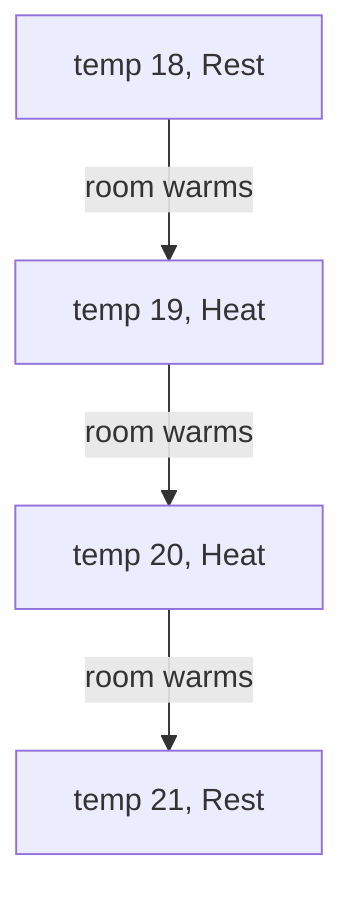
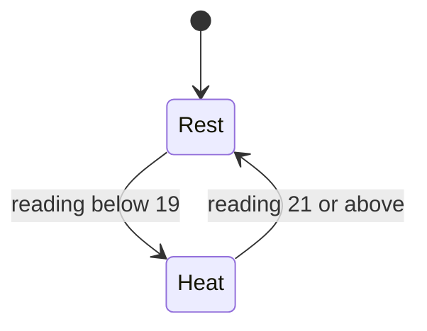

# Interlude: Thinking in states

Chapter 7 ended well. The hall thermostat had a `decide` function, two
example tests, three properties and an integration test, and they all passed.
Along the way `proptest` caught the boiler-flicker bug in the naive version:
a resting thermostat, a hair below its target, that decided to heat.

But look again at what we actually wanted. The requirement wasn't really
"`decide` returns `now` inside the band". That was our *design*. The
requirement was about the boiler: **it mustn't switch on and off in quick
succession**. That's a claim about time. It talks about a sequence of
readings, arriving one after another from a room whose temperature we don't
control, fed through `decide` again and again, with each answer becoming the
next call's `now`. None of our tests says it. The properties check one call
at a time. The integration test checks one evening, the one we typed in.

So here's a question our tests can't answer well: **is there any sequence of
room temperatures that makes the hysteresis thermostat switch the boiler
twice within a few readings?** Proptest could generate random sequences and
look, and it would probably find nothing, which is not the same as there
being nothing to find.

This interlude introduces a tool built for exactly this kind of question.
**TLA+** lets us describe a system, and its environment, as a state machine,
and its model checker **TLC** explores *every* way that machine can run, up
to bounds we choose. We'll model the thermostat and the room from scratch,
have TLC find the flicker as a concrete sequence of temperatures, fix it with
hysteresis, and then make TLC tell us precisely what hysteresis guarantees.
No previous TLA+ is assumed. This is the first of six interludes; each later
one builds on this.

## What TLA+ is, and what it isn't

TLA+ is a language for writing down how a system behaves, designed by Leslie
Lamport (the *TLA* is the *Temporal Logic of Actions*). You describe the
system's possible states and the steps that move it from one state to the
next, using ordinary mathematics: integers, sets, logic. That description is
called a **specification**, or *spec*. **TLC** is a program that takes a spec
and a few settings, starts from every possible initial state, and follows
every possible step, checking at each state that the things you said should
be true really are.

We already have two ways of being sure about code, so it's worth being clear
about where the third fits:

- **Types constrain values.** A `Celsius` is never below absolute zero;
  an `Action` is `Heat` or `Rest` and nothing else. The compiler checks this
  for every value, everywhere, but it says nothing about what happens *over
  time*.
- **Tests sample executions.** An example test runs one execution; a property
  test runs a few hundred random ones. They run the real code, which is their
  great strength, but they only see the executions they happen to try.
- **TLA+ describes all behaviours.** A spec says what every possible run of
  the system looks like, and TLC checks *all of them*, exhaustively, for a
  small, finite version of the system (a *model*). For small models, "all"
  really means all.

And just as important, what TLA+ isn't:

- **It's not a programming language.** There's no compiler, no binary, no
  `main`. A spec is never executed in production.
- **It's not your code.** TLC never reads a line of Rust. A spec is a
  separate, deliberately simplified *model* of the design, and it can
  disagree with the code. Keeping them in step is our job.
- **It's not a replacement for types or tests.** It's for the bugs that live
  between values: in sequences, interleavings and "what if the world does
  *this* next?". When a bug can be found by looking at one call, a property
  test is cheaper.

> [!NOTE]
> TLC is a *model checker*: it enumerates states. There's also a proof
> system, TLAPS, which can prove properties for unbounded models, at a much
> higher cost. This book uses TLC only, as most working engineers do.

## States and behaviours

Two words carry most of the weight in TLA+.

A **state** is an assignment of values to variables. For the thermostat,
the interesting variables are the room's temperature and what the boiler is
doing, so one state is "the room is at 19 degrees and the boiler is
resting". Nothing else exists: no stack, no heap, no program counter, unless
we choose to make them variables.

A **behaviour** is a sequence of states: what you'd see if you photographed
the system after every step. Here's one behaviour of a hall that starts cold
on a chilly evening, controlled by Chapter 7's naive rule (heat whenever it's
below 21):



A **spec** is a description of *which behaviours are allowed*. It has two
parts: a formula saying what the initial states can be, and a formula saying
which pairs of states (*before*, *after*) count as a legal step. Everything
the system can ever do follows from those two.

This should feel familiar. In Chapter 7 we gave `decide` the signature
`(&self, current: Celsius, now: Action) -> Action`, and noticed it made the
thermostat a tiny state machine whose state the caller owns. The integration
test's `scan` walked that machine through one behaviour. TLA+ asks us to
write down the same machine, plus the room, and then hands *every* behaviour
to TLC instead of one.

## Getting the tools

nixpkgs packages the TLA+ command-line tools as `tlaplus`. To try them
without installing anything:

```sh
nix shell nixpkgs#tlaplus -c tlc -h
```

That puts four commands on the `PATH` for one command: `tlc` (the model
checker), `tlasany` (the parser and checker for TLA+ syntax), `pcal` (the
PlusCal translator, which we'll meet in Interlude 4) and `tlatex` (a
typesetter). They're Java programs underneath; Nix brings the Java runtime
along, so there's nothing else to set up.

Specs belong to the project they describe, so let's add the tools to the
`foundations` workbook's dev shell, exactly as Workshop 1 added the Rust
toolchain:

```nix
# file: flake.nix
          packages = with pkgs; [
            rustc
            cargo
            clippy
            rustfmt
            rust-analyzer
            tlaplus
            entr
          ];
```

`entr` is a tiny file watcher we'll use to re-run TLC on save. With direnv,
`cd` back into the workbook and both are there. We'll keep specs in their own
directory next to the Rust code:

```sh
mkdir spec
cd spec
echo states/ >> ../.gitignore
```

TLC writes its working files to a `states/` directory beside the spec on
every run, and there's no reason to commit them.

> [!TIP]
> If you prefer a graphical tool, the TLA+ Toolbox (an Eclipse-based IDE)
> and the TLA+ extension for VS Code both bundle TLC. Everything here works
> from the command line, and Workshop 4 shows how to get TLA+ highlighting
> in Neovim.

## A first module

A TLA+ spec lives in a **module**, and a module lives in a file with the same
name. Here's the smallest one that does anything:

```tla
\* file: Thermostat.tla
---- MODULE Thermostat ----
EXTENDS Integers

\* ...

====
```

The line of dashes with `MODULE Thermostat` opens the module and the line of
equals signs closes it. The number of dashes and equals signs doesn't matter
as long as there are at least four; people like them long because it looks
tidy. `EXTENDS Integers` imports the standard module that defines integer
arithmetic: `+`, `-`, `<`, and `..` for ranges. Without it, TLA+ doesn't even
know what `1 + 1` means. `\*` starts a comment that runs to the end of the
line; `(* ... *)` is a block comment.

### Variables and definitions

The state is the room's temperature and the boiler's mode:

```tla
\* file: Thermostat.tla
VARIABLES temp, boiler

MinTemp == 15
MaxTemp == 25
Target  == 21
```

`VARIABLES` declares the state. Variables have no types in TLA+; any variable
can hold any value, and we'll come back to what that means shortly.

`==` means "is defined as". `MinTemp == 15` doesn't create storage; it's a
name for the expression `15`, like a `const` in Rust. Definitions can take
parameters, which makes them look like functions:

```tla
\* file: Thermostat.tla
\* The naive controller from Chapter 7: heat below the target.
Decide(t) == IF t < Target THEN "Heat" ELSE "Rest"
```

That's Chapter 7's first attempt at `decide`, the one that ignored `now`.
`IF ... THEN ... ELSE` is an expression, like Rust's `if`, and the strings
`"Heat"` and `"Rest"` stand in for the two variants of `Action`.

Notice the first deliberate difference from the Rust. The Rust thermostat
measures `Celsius`, an `f64`; this model uses **whole degrees**. TLC has to
enumerate states, and there are rather a lot of `f64`s between 15 and 25.
Whole degrees keep the model finite and small, and for a question about
*switching patterns* they lose nothing important. Deciding what to leave out
is half the skill of writing specs, and we'll do it in every interlude.

### The initial states

`Init` says what the system can look like before anything has happened:

```tla
\* file: Thermostat.tla
Init == /\ temp \in MinTemp..MaxTemp
        /\ boiler = "Rest"
```

`/\` is logical **and** (think of it as the `∧` symbol drawn with ASCII), and
`\/` is logical **or**. TLA+ has a layout rule that makes long formulas
readable: a column of `/\` or `\/` at the same indentation is a *bulleted
list*, meaning "all of these" or "any of these". So `Init` reads as: the
temperature is in the range 15 to 25, *and* the boiler is resting.

`MinTemp..MaxTemp` is the set of integers from 15 to 25, and `\in` means "is a
member of". (We'll meet sets properly in Interlude 2; for now, `a..b` and
`\in` are all we need.)

Here's the first idea that surprises programmers. `Init` is not code that
*sets* `temp` to something. It's a *formula*, a statement that is either true
or false of a given state, and the initial states are all the states where it
is true. That's eleven states: one for each starting temperature, all with the
boiler resting. We haven't said which; TLC will try them all. Being
deliberately vague like this is called **nondeterminism**, and it's how specs
say "I don't know, and I don't want to assume".

### Steps: actions and primes

Now the steps. A step relates two states, the one before and the one after.
In TLA+ we write the *after* value of a variable with a **prime**: `temp` is
the temperature now, `temp'` (read "temp prime") is the temperature in the
next state. A formula that mentions primed variables is called an
**action**, and it's true or false of a *pair* of states.

The thermostat's job is to decide based on the new reading:

```tla
\* file: Thermostat.tla
Control == boiler' = Decide(temp')
```

"In the next state, the boiler's mode is whatever `Decide` says about the
next temperature." Again, `=` is not assignment: it's equality, a condition
the pair of states has to meet.

The room is the environment. It can warm up by a degree or cool down by one,
and we don't know which; the sun comes out, a door opens. Each of those is
an action, and each includes the controller's reaction:

```tla
\* file: Thermostat.tla
Warmer == /\ temp' = temp + 1
          /\ Control

Cooler == /\ temp' = temp - 1
          /\ Control

Next == \/ Warmer
        \/ Cooler
```

`Next` is the **next-state relation**: a step is legal if it's a `Warmer`
step *or* a `Cooler` step. That `\/` is where the nondeterminism lives. At
every state TLC will try both.

Because these are formulas and not statements, order doesn't matter.
`Control` mentions `temp'`, the new temperature, and that's fine whether it's
written before or after the conjunct that pins `temp'` down. TLC finds the
pairs of states that make the whole formula true.

So in a single step the room changes by one degree and the thermostat reacts
to the new reading. That matches how the Rust is used: one call to `decide`
per reading.

> [!PATTERN] Specification as State Machine
> Describe a system as variables (its state), an initial-state predicate
> `Init`, and a next-state relation `Next` built from *actions*, formulas
> relating the current state to the next (primed) one. The spec's meaning is
> the set of all behaviours that start in `Init` and take only `Next` steps.
> Model the environment as actions too, nondeterministically, so the checker
> explores everything the world might do.

### TypeOK: types, after the fact

Rust would never let `boiler` hold the number 7. TLA+ will, because its
variables are untyped. Instead we write down what we *expect* the types to be,
as a formula, and ask TLC to check it:

```tla
\* file: Thermostat.tla
TypeOK == /\ temp \in MinTemp..MaxTemp
          /\ boiler \in {"Heat", "Rest"}
```

`{"Heat", "Rest"}` is a set written out in full. Calling this `TypeOK` is a
convention every TLA+ spec follows. It's the TLA+ cousin of Rust's types,
with an important difference: in Rust the type *constrains* what the program
can do, and wrong code doesn't compile. In TLA+, `TypeOK` is a *claim* about
what the spec does, and TLC checks the claim by visiting every reachable
state. The type comes after the fact, as something to verify.

## Running TLC

TLC needs to be told which formula is `Init`, which is `Next`, and what to
check. That goes in a configuration file with the same name as the module:

```text
\* file: Thermostat.cfg
INIT Init
NEXT Next

INVARIANT TypeOK
```

An **invariant** is a formula that should be true in *every* state of
*every* behaviour. TLC checks each one at each state it reaches. Now run it
from the `spec` directory:

```sh
tlc Thermostat.tla
```

TLC finds `Thermostat.cfg` by itself (`-config` names a different one).
After a banner and some parsing messages, it says this:

```text
Finished computing initial states: 11 distinct states generated.
Error: Invariant TypeOK is violated.
Error: The behavior up to this point is:
State 1: <Initial predicate>
/\ boiler = "Rest"
/\ temp = 15

State 2: <Cooler line 21, col 11 to line 22, col 20 of module Thermostat>
/\ boiler = "Heat"
/\ temp = 14

13 states generated, 13 distinct states found, 11 states left on queue.
The depth of the complete state graph search is 2.
```

Our first counterexample, and it's a bug in the *spec*, not the design.

### Reading an error trace

An **error trace** is a behaviour that ends in a state where the invariant is
false. TLC prints it state by state, with each variable as a bulleted `/\`
line, so it reads as a formula describing the state:

1. **State 1** satisfies the `<Initial predicate>`: the room is at 15, the
   lowest temperature we allowed, and the boiler is resting.
2. **State 2** was reached by a `Cooler` step (TLC names the action and its
   location in the file; line numbers will differ if your layout does). The
   room cooled to 14, and the controller sensibly switched to `Heat`.
3. 14 isn't in `MinTemp..MaxTemp`, so `TypeOK` is false. TLC stops.

Nothing stopped `Cooler` from going below `MinTemp`. We meant the bounds to
describe the room, but we only wrote them into `Init` and `TypeOK`. Unbounded,
the temperature would wander forever, and TLC would never finish. `TypeOK`
caught it at the first step outside the range, which is precisely its job.

TLC searches **breadth-first**: it checks all states one step from the
start, then all states two steps away, and so on. So the first violation it
finds is reached by a *shortest* trace. Counterexamples from TLC are as short
as they can be, much as proptest shrinks its failing inputs.

### Guards

The fix is to say when each action is allowed. In TLA+ that's just another
conjunct, one without primes:

```tla
\* file: Thermostat.tla
Warmer == /\ temp < MaxTemp
          /\ temp' = temp + 1
          /\ Control

Cooler == /\ temp > MinTemp
          /\ temp' = temp - 1
          /\ Control
```

A conjunct that only talks about the current state is called a **guard**.
When the room is at 15, `temp > MinTemp` is false, so the whole `Cooler`
formula is false for every possible next state: the action is not *enabled*,
and TLC doesn't take it. There's no `if` and no early return; a false
conjunct simply rules the step out.

While we're here, let's add the first property that's about the design rather
than the spec:

```tla
\* file: Thermostat.tla
RestWhenWarm == temp >= Target => boiler = "Rest"
```

`=>` is **implies**: if the room is at or above the target, the boiler is
resting. When the left-hand side is false, an implication is true whatever the
right-hand side says, so `RestWhenWarm` says nothing about cold rooms. The
same idea can be written with `~`, which is **not**:

```tla
\* file: Thermostat.tla
NeverHeatWhenWarm == ~(temp >= Target /\ boiler = "Heat")
```

The two are equivalent; use whichever reads better. Add
`INVARIANT RestWhenWarm` to the config, and run TLC again:

```text
Finished computing initial states: 11 distinct states generated.
Model checking completed. No error has been found.
42 states generated, 17 distinct states found, 0 states left on queue.
The depth of the complete state graph search is 2.
```

### What the numbers mean

The last two lines are worth learning to read, because they tell you how much
TLC actually checked:

- **States generated** counts every state TLC computed, including ones it had
  already seen. Eleven initial states, then the successors of every state it
  explored: 42 in all.
- **Distinct states found** counts the unique ones: 17. Those are the
  eleven resting states plus "heating" at 15 to 20. TLC remembers a
  fingerprint of each state, so a state reached by two routes is checked once.
- **States left on queue** is zero: nothing unexplored remains. The check was
  *complete*.
- **Depth** is the length of the longest shortest path from an initial state:
  every reachable state is at most two states into a behaviour.

So "No error has been found" means something precise: *every* reachable state
of this model satisfies both invariants. Not 256 random ones; all 17.

> [!TIP]
> Keep TLC running in a tmux pane, the way bacon keeps `cargo clippy`
> running. In the workbook's spare shell pane:
>
> ```sh
> ls *.tla *.cfg | entr -c tlc Thermostat.tla
> ```
>
> `entr` re-runs the command whenever one of the listed files changes, and
> `-c` clears the screen first. Save the spec in Neovim and the verdict
> appears in the next pane.

## Flicker is about time

The naive controller passes. That's not a surprise: "rest when warm" is the
one thing the naive rule gets right. What it gets wrong is flicker, and
there's a difficulty: an invariant is checked one state at a time, but
flicker isn't visible in any single state. "Heating at 20 degrees" is fine.
"Resting at 21" is fine. What's wrong is going from one to the other and
back again within a couple of steps.

When a property is about the past, we give the spec a memory. We add two
variables that exist only so we can state the property:

- `run`: how many steps since the boiler last switched;
- `lastRun`: how many steps the previous run lasted, recorded at the moment
  of each switch.

Variables like these are called **history variables**. Nothing in the Rust
corresponds to them; they're bookkeeping for the property, the way a test
might record calls in a `Vec` to make an assertion about them. With them,
"the boiler never short-cycles" becomes a property of a single state:

```tla
\* file: Thermostat.tla
MinRun == 3

NoShortCycling == lastRun >= MinRun
```

Every completed run of the boiler, on or off, must last at least three steps.
(Three isn't sacred; it's a number we want to be true, and we'll see shortly
how to find out what *is* true.)

There's one trap. If `run` counted forever, it could take infinitely many
values, so the model would have infinitely many states and TLC would never
finish. We only care whether it has reached `MinRun`, so it stops counting
there; it *saturates*. Keeping every variable finite and small is a habit
worth forming now.

The initial state needs values for the new variables. We'll say the boiler has
been resting for a long time, so neither counter is short:

```tla
\* file: Thermostat.tla
VARIABLES temp, boiler, run, lastRun

\* ...

Init == /\ temp \in MinTemp..MaxTemp
        /\ boiler = "Rest"
        /\ run = MinRun
        /\ lastRun = MinRun
```

### Keep or switch

The controller now has two cases, and they update the history differently.
Either `Decide` agrees with what the boiler is already doing, and the run gets
longer, or it doesn't, and the boiler switches. Here's a first attempt:

```tla
\* file: Thermostat.tla
Keep == /\ Decide(temp') = boiler
        /\ run' = IF run < MinRun THEN run + 1 ELSE run
        /\ UNCHANGED lastRun

Switch == /\ Decide(temp') /= boiler
          /\ boiler' = Decide(temp')
          /\ lastRun' = run + 1
          /\ run' = 0

Control == \/ Keep
           \/ Switch
```

`/=` is "not equal" (TLA+ also accepts `#`). `UNCHANGED lastRun` is shorthand
for `lastRun' = lastRun`. On a switch, the run that just ended lasted `run + 1`
steps, counting this one, and a new run starts at zero.

We also extend `TypeOK` with the new variables, so TLC checks that the
counters stay in their ranges:

```tla
\* file: Thermostat.tla
TypeOK == /\ temp \in MinTemp..MaxTemp
          /\ boiler \in {"Heat", "Rest"}
          /\ run \in 0..MinRun
          /\ lastRun \in 1..(MinRun + 1)
```

Add `INVARIANT NoShortCycling` to the config, run TLC, and it complains
before checking anything we asked for:

```text
Error: Successor state is not completely specified by action Warmer of the next-state relation. The following variable is not assigned: boiler.

Error: The behavior up to this point is:
State 1: <Initial predicate>
/\ run = 3
/\ boiler = "Rest"
/\ temp = 20
/\ lastRun = 3

State 2: <Warmer line 31, col 11 to line 33, col 20 of module Thermostat>
/\ run = 3
/\ boiler = null
/\ temp = 21
/\ lastRun = 3
```

`Keep` says `Decide(temp') = boiler`, which is a condition on the *current*
boiler, and says nothing at all about `boiler'`. In mathematics, a variable
you don't constrain can be anything, so as written `Keep` allows the boiler to
become `"Rest"`, `"Heat"`, 7, or the set of all integers. TLC can't enumerate
"anything", so it stops and tells us which variable we forgot. (The `null` in
State 2 is TLC's way of saying "unassigned".)

This is the most common slip in TLA+, and the reason `UNCHANGED` exists.
**Every action must say what happens to every variable**, even when the
answer is "nothing". The fix lists both:

```tla
\* file: Thermostat.tla
Keep == /\ Decide(temp') = boiler
        /\ run' = IF run < MinRun THEN run + 1 ELSE run
        /\ UNCHANGED <<boiler, lastRun>>
```

`<<boiler, lastRun>>` is a tuple; `UNCHANGED` of a tuple means every element
keeps its value. (Tuples and sequences get their own interlude, the third.)

### The counterexample

Run TLC once more:

```text
Finished computing initial states: 11 distinct states generated.
Error: Invariant NoShortCycling is violated.
Error: The behavior up to this point is:
State 1: <Initial predicate>
/\ run = 3
/\ boiler = "Rest"
/\ temp = 19
/\ lastRun = 3

State 2: <Warmer line 31, col 11 to line 33, col 20 of module Thermostat>
/\ run = 0
/\ boiler = "Heat"
/\ temp = 20
/\ lastRun = 4

State 3: <Warmer line 31, col 11 to line 33, col 20 of module Thermostat>
/\ run = 0
/\ boiler = "Rest"
/\ temp = 21
/\ lastRun = 1

41 states generated, 24 distinct states found, 6 states left on queue.
The depth of the complete state graph search is 3.
```

Read it as a story. The hall is at 19 with the boiler off. The room warms a
degree, and the controller, seeing 20 (below the target), lights the boiler.
The room warms another degree to 21, and the controller turns the boiler off
again. The heating run lasted one step. `lastRun = 1` is less than `MinRun`,
and TLC stops, with six states it never needed to explore still queued.

That is Chapter 7's bug. Proptest reported it as "a resting thermostat, a hair
below its target, decides to heat": a fact about one call. TLC reports it as
something a person could witness: a sequence of temperatures, from a
perfectly ordinary starting point, along which the boiler clicks on and off.
It's the same root cause, seen from the side of the requirement.

> [!PATTERN] Invariants over Behaviours (Safety)
> State "nothing bad ever happens" as an *invariant*: a predicate that must
> hold in every reachable state of every behaviour, and let the model checker
> visit them all. When the bad thing is about history ("switched twice too
> quickly"), add bounded *history variables* so it becomes visible in a
> single state. A violation comes back as a shortest trace from an initial
> state: a reproducible story, not just a failing input.

## Adding hysteresis

Chapter 7's fix was to give the decision a band: heat below `target - band`,
rest at or above the target, and in between keep doing whatever we were
doing. In the spec, `Decide` gains the current mode as a parameter, exactly
as `decide` gained `now`:

```tla
\* file: Thermostat.tla
Band    == 2

\* Chapter 7's controller, with hysteresis.
Decide(t, now) == IF t < Target - Band THEN "Heat"
                  ELSE IF t >= Target THEN "Rest"
                  ELSE now
```

The three branches are the three arms of the Rust `match`. And the second
deliberate difference from the Rust: the hall's band is 1.5 degrees, and our
model works in whole degrees, so we use a band of 2. With a target of 21, the
model heats at 18 and below, rests at 21 and above, and carries on at 19
and 20. Here's the controller on its own:



Every other reading leaves the mode where it is. That's the whole design: the
boiler can only change mode at the two edges of the band, never in the middle.

`Keep` and `Switch` pass the current mode along:

```tla
\* file: Thermostat.tla
Keep == /\ Decide(temp', boiler) = boiler
        \* ...

Switch == /\ Decide(temp', boiler) /= boiler
          /\ boiler' = Decide(temp', boiler)
          \* ...
```

Nothing else changes. Run TLC:

```text
Finished computing initial states: 11 distinct states generated.
Model checking completed. No error has been found.
129 states generated, 63 distinct states found, 0 states left on queue.
The depth of the complete state graph search is 12.
```

All 63 reachable states satisfy all three invariants. However the
temperature wanders, within our model the boiler never switches twice within
three steps.

### What does hysteresis actually promise?

"At least three steps" was a number we picked. Is it the best we can claim?
Let's ask for more, `MinRun == 4`, and see what TLC says:

```text
Finished computing initial states: 11 distinct states generated.
Error: Invariant NoShortCycling is violated.
Error: The behavior up to this point is:
State 1: <Initial predicate>
/\ run = 4
/\ boiler = "Rest"
/\ temp = 17
/\ lastRun = 4

State 2: <Warmer line 34, col 11 to line 36, col 20 of module Thermostat>
/\ run = 0
/\ boiler = "Heat"
/\ temp = 18
/\ lastRun = 5

State 3: <Warmer line 34, col 11 to line 36, col 20 of module Thermostat>
/\ run = 1
/\ boiler = "Heat"
/\ temp = 19
/\ lastRun = 5

State 4: <Warmer line 34, col 11 to line 36, col 20 of module Thermostat>
/\ run = 2
/\ boiler = "Heat"
/\ temp = 20
/\ lastRun = 5

State 5: <Warmer line 34, col 11 to line 36, col 20 of module Thermostat>
/\ run = 0
/\ boiler = "Rest"
/\ temp = 21
/\ lastRun = 3
```

The boiler lights at 18, the room warms steadily, and it goes off at 21: a
run of three steps. That's the fastest the room can cross the band, so three
is exactly what hysteresis guarantees, no more. A failed check is a
measurement as well as a verdict: put the claim one notch past what you
believe, and TLC shows you the edge.

Look at *why* the answer is three. The band spans three degrees (18 to 21),
and the room moves at most one degree per step. That second fact isn't in
`Decide` at all. It's in `Warmer` and `Cooler`: it's an assumption about the
*environment*. No test of `decide` alone could establish the minimum run,
because the minimum run isn't a property of `decide`; it's a property of
`decide` running in a room that changes slowly enough. The spec makes that
assumption explicit and puts a number on it. (The first exercise breaks it.)

## Stuttering, briefly

One more idea, which matters little today and a great deal later.

A **stuttering step** is a step in which none of the variables changes. Our
`Next` never stutters, because every step changes `temp`. But TLA+ takes the
view that a spec should always *allow* stuttering steps. The reason is
composition. Our thermostat will one day be part of a bigger spec, a house
with lights, doors and a burglar alarm, and in a behaviour of the house there
are many steps in which the doors move and the thermostat's variables don't.
A spec that forbade stuttering would forbid the rest of the world from doing
anything.

For invariants, stuttering is harmless: a step that changes nothing leads to
a state we've already checked, so it can't break anything. Where it matters is
when we ask whether something *eventually* happens, because "the system
stutters for ever" is then a legitimate behaviour that we'll have to rule
out. That's the subject of Interlude 2, which also shows the full form of a
spec, in which stuttering is written in explicitly.

## Sampling versus exhausting

Let's set what proptest did in Chapter 7 next to what TLC did here.

Proptest generated random thermostats, depths and actions, ran the real
`decide`, and found a failing case. Then it *shrank* it to the simplest:
target 5.0, band 0.1, a resting thermostat a hair below target. It worked on
the real code, with real `f64`s, and it took one line of setup. But it
checked a property of single calls, and it sampled: 256 cases by default,
out of an astronomically large input space.

TLC never touched the code. It checked a hand-written model, with whole
degrees and one fixed thermostat. But inside that model it checked *every*
behaviour, it checked a property that spans many steps, and it found the
shortest counterexample by construction, with no shrinking needed.

How big can the model get before exhaustive checking hurts? Here's the
hysteresis spec with the temperature range widened, everything else equal:

| `MinTemp..MaxTemp` | Distinct states | Depth |
|---|---:|---:|
| 15..25 | 63 | 12 |
| 0..40 | 183 | 26 |
| -20..60 | 343 | 46 |
| -100..100 | 903 | 126 |
| -1000..1000 | 8,103 | 1,026 |

All of them pass, and all finish in under a second. The count grows roughly
in proportion to the range, because only one variable grew. In general a
model's state space is something like the *product* of its variables' ranges,
and that product grows very fast as variables are added: a second room, a
second thermostat, a message queue. Interlude 5 is about living with that.

The table also shows something reassuring. Widening the range from 11 degrees
to 2,001 found nothing new. Everything interesting about this thermostat
happens near the band, and a small model that covers the band covers every
kind of behaviour there is. Bugs in designs tend to show up in small
instances, which is why small models catch so much.

> [!NOTE]
> Could proptest check `NoShortCycling` directly? Yes: generate random walks
> of temperatures that move at most one degree per step, fold `decide` over
> them as the integration test did with `scan`, and check the gap between
> switches. It would find the naive bug quickly. For the hysteresis version
> it would pass, but only for the walks it happened to generate. TLC checks
> them all, and the model told us what assumption to put in the generator
> in the first place.

### Mapping back to Rust

Here's how the spec lines up with Chapter 7's code:

| Chapter 7 (Rust) | `Thermostat.tla` |
|---|---|
| `enum Action { Heat, Rest }` | `{"Heat", "Rest"}` in `TypeOK` |
| `Thermostat { target, band }` | `Target`, `Band` (fixed values) |
| `Thermostat::decide(current, now)` | `Decide(t, now)` |
| The caller holding `now` (the `scan`) | The variable `boiler` |
| `Celsius` (an `f64`) | `temp`, an integer from `MinTemp` to `MaxTemp` |
| The integration test's six readings | One behaviour |
| Nothing | `Warmer`, `Cooler`: the room |
| Nothing | `run`, `lastRun`, `NoShortCycling` |

The last two rows are what the spec added: an explicit model of the
environment, and a property about time. And there's traffic the other way.
The spec takes for granted things that the Rust *guarantees*: that every
temperature is a real number above absolute zero (`Celsius`'s smart
constructor), that `decide` is total and pure (its signature), and that there
are exactly two actions (the enum, checked exhaustively). TLA+ assumed them;
Rust's types made them true. They're two halves of one argument.

And the honest limits. The spec checks a model, not the code: if someone
changes `decide` tomorrow, TLC won't notice. The model uses whole degrees and
one target; we argued that's enough, but it is an argument. The model is
finite, so TLC's "no error" covers exactly the bounds we set. None of that
makes the result weak. It makes it a precise statement of what we know, which
is more than most designs get.

## What we learned

- **TLA+ describes systems as state machines**, in mathematics; **TLC**
  explores every reachable state of a finite model. It's not a programming
  language, it's never executed, and it doesn't read your code.
- **Types constrain values, tests sample executions, TLA+ covers all
  behaviours** of a small model. Each catches bugs the others can't.
- **States and behaviours**: a state assigns values to variables; a
  behaviour is a sequence of states; a spec says which behaviours are
  allowed.
- **A module** runs from `---- MODULE Name ----` to `====`, in `Name.tla`;
  `EXTENDS Integers` brings in arithmetic; `==` defines names and operators.
- **`Init` and `Next`** are formulas, not code. Primed variables name the
  next state; `/\`, `\/`, `~` and `=>` combine conditions, with bulleted
  lists for readability; a conjunct without primes is a **guard**.
- **Specification as State Machine**: variables, `Init`, and `Next` built
  from actions, with the environment as nondeterministic actions too.
- **Every action must constrain every variable**; `UNCHANGED` says "this
  stays the same", and TLC complains when you forget.
- **`TypeOK`** is the TLA+ cousin of a type: a claim checked by TLC rather
  than a constraint enforced by a compiler.
- **Invariants over Behaviours (Safety)**: invariants are checked in every
  reachable state; bounded **history variables** make properties about time
  checkable one state at a time.
- **Running TLC**: a `.cfg` names `INIT`, `NEXT` and each `INVARIANT`;
  `tlc Spec.tla` finds `Spec.cfg`. Read *distinct states*, *queue* and
  *depth* to know what was checked, and read an **error trace** as a story
  from an initial state, shortest first.
- **Stuttering steps** change nothing; specs always allow them, they can't
  break invariants, and they'll matter for liveness in Interlude 2.
- **A failing check is a measurement**: raise the claim one notch to find the
  edge of what a design guarantees, and which environment assumption it
  rests on.

## Exercises

> [!EXERCISE] Gusts
> Front doors open. Add a third environment action, `Gust`, in which the
> temperature drops by *two* degrees in one step (guard it so `TypeOK` still
> holds), and add it to `Next`. What does TLC say about `NoShortCycling`
> with `Band == 2`? Find the smallest band for which three-step runs are
> guaranteed again, predict it before you run TLC, and explain the answer in
> terms of the trace.

> [!EXERCISE] A room that holds steady
> Add `Steady`, a step in which the temperature stays the same and the
> controller reacts as usual. Predict, then check, what happens to the
> distinct-state count and to the invariants. Some `Steady` steps change
> nothing at all: which ones? What does TLC do when a step leads back to a
> state it has already seen?

> [!EXERCISE] A boiler in any mode
> Change `Init` so the boiler may start in either mode
> (`boiler \in {"Heat", "Rest"}`). Which invariant fails, how long is the
> trace, and what is it telling you: a bug in the design, or in what we
> assumed about the starting state? Fix it in `Init`, not in the invariant.

> [!EXERCISE] The proptest TLC suggested
> Back in the `foundations` workbook, write a property test in Rust that
> generates random walks of 50 readings, each within one degree of the last,
> drives `decide` along them with `scan`, and checks that the boiler never
> switches twice within three readings. Run it against the naive `decide`
> and the hysteresis one. Then change the generator to allow two-degree drops,
> and compare what proptest finds with what TLC found in the first exercise.
