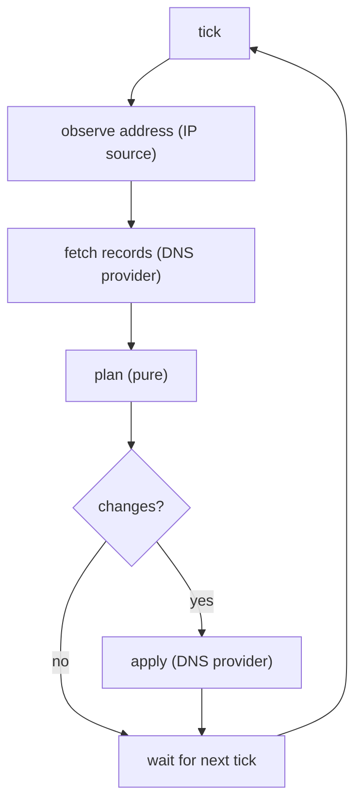
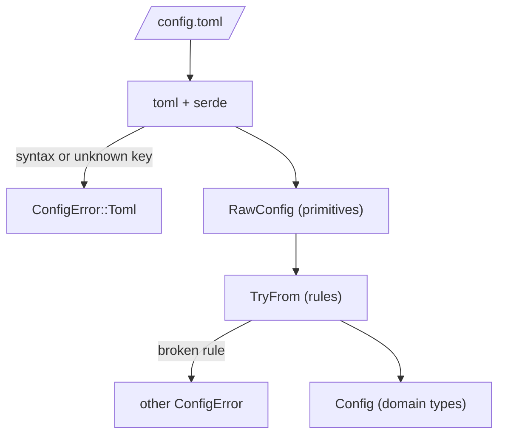

# Understanding the domain

At 03:12 on a Tuesday, your internet provider quietly hands your router a new
public IP address. Nothing breaks at home: the lights stay on and the laptop
keeps streaming. But `home.example.com`, the name you gave your home server,
still points at the *old* address. The next morning, from a café on the other
side of the country, your VPN won't connect, your photo library won't sync, and
the only clue is a timeout.

The fix is *dynamic DNS*: a small program on a machine at home that keeps
asking "what's my public address?" and, whenever the answer changes, updates the
DNS record so the name follows the address. Cloudflare, which hosts DNS for a
great many personal domains, has an HTTP API that makes the updating part easy.

That's the program we'll build in this part of the book: `cf-ddns`, a daemon
that runs under systemd on NixOS, checks every few minutes, and keeps one or
more A and AAAA records pointed at the right place. By the end of Chapter 12 you
can add it to a NixOS machine with a few lines of configuration.

It's a good first project because it's small but not a toy. It talks to two
kinds of remote service, it runs forever, it handles secrets, and the network
fails in all the usual ways. And it has a genuinely interesting decision at its
centre. This chapter doesn't touch the network at all. We'll find the words the
domain uses, turn them into types, and parse a configuration file into a value
that can't be wrong. Everything later stands on this.

## The version we'd write on autopilot

The shape of the job fits on a napkin: find out our address, find out what the
record says, and if they differ, fix the record. A first sketch of the fixing
step might look like this:

```rust
// does not appear in the finished program
async fn update_record(
    token: &str,
    zone: &str,
    record: &str,
    name: &str,
    ip: &str,
) -> Result<(), reqwest::Error> {
    // PATCH https://api.cloudflare.com/client/v4/zones/{zone}/dns_records/{record}
    // ...
}
```

It compiles, and it would work. It is also a small museum of future bugs:

- **Five strings in a row.** Swap `zone` and `record` at a call site and the
  compiler is perfectly content. Cloudflare's zone IDs and record IDs are both
  32-character hex strings, so even a human reading the logs won't spot it.
- **`ip: &str` will be wrong.** The services that report your public address
  reply with text such as `"203.0.113.7\n"`. Compare that with the record's
  `"203.0.113.7"` and they differ, so the daemon "fixes" the record every five
  minutes, forever.
- **Nothing stops an IPv6 address going into an A record.** A records hold IPv4
  addresses; AAAA records hold IPv6. Cloudflare will reject the mismatch, but
  only at runtime, at 03:12, when nobody is watching.
- **The token is just a string.** The first time someone writes
  `debug!(?config)` while chasing a bug, the API token goes into the system
  journal in plain text.

None of these are exotic, and none of them are fixed by being careful. They're
fixed the way Chapter 1 fixed the temperature reader: by asking what's true
about the data before writing any logic.

## Speaking the domain's language

Let's list the nouns and verbs of the problem, the way someone who runs DNS
would say them. When we're done, these words will be the names in our code, and
the names in our code will be these words.

| Term | Meaning |
|---|---|
| **zone** | A domain whose DNS Cloudflare hosts, such as `example.com`. Identified by a **zone ID**. |
| **record** | One DNS entry in a zone: a name, a type, and some content. Identified by a **record ID**. |
| **name** | The fully qualified host name a record answers for: `home.example.com`. |
| **record type** | For us, `A` (holds an IPv4 address) or `AAAA` (holds an IPv6 address). |
| **observed address** | Our public address as some outside service reports it right now. |
| **IP source** | A service that tells us our observed address. |
| **DNS provider** | The service that holds our records: Cloudflare. |
| **desired state** | "Every configured name has one record per family, holding the observed address." |
| **stack** | Which address families a name follows: IPv4, IPv6, or both (*dual-stack*). |
| **reconcile** | Compare the desired state with the actual records and correct the difference. |
| **tick** | One round of observing and reconciling. The daemon ticks every few minutes. |

A few of these deserve a comment. *Observed* is a deliberate word: an IP source
can be wrong or unreachable, so what we have is an observation, not a fact.
*Reconcile* is borrowed from systems like Kubernetes, and it describes the
whole program in one word: we don't *push* updates, we repeatedly bring reality
into line with a description of how it should be. That framing will make
Chapter 9's core almost trivial.

> [!PATTERN] Ubiquitous Language
> Agree on the words the domain uses and use exactly those words everywhere:
> in conversation, documentation, type names, function names and log messages.
> When the code says `ZoneId` and `reconcile`, and so does the person who runs
> the DNS, there is no translation step for bugs to hide in. In Rust the
> language becomes types, so the compiler enforces the vocabulary.

Here's the whole program as a picture in that language, before we write any of
it. Each box is a step in one tick; the next four chapters fill them in.



## Setting up the project

Let's create the crate. It's a library with a binary on top: the library holds
the domain, the core and the adapters, and the binary (Chapter 11) is a thin
shell around it.

```sh
cargo new cf-ddns
cd cf-ddns
touch src/lib.rs
cargo add serde --features derive
cargo add toml thiserror secrecy
```

We'll add dependencies as we need them. For now: `serde` for deserialising,
`toml` for the configuration format, `thiserror` for error enums (Chapter 4),
and `secrecy` for the API token. The domain types get a module of their own,
split into small files:

```text
src/
  lib.rs
  config.rs
  domain/
    mod.rs
    address.rs
    ids.rs
    name.rs
    record.rs
    token.rs
```

`domain/mod.rs` declares the files as private modules and re-exports their
public types, so the rest of the crate writes `use crate::domain::ZoneId`
without caring which file it lives in:

```rust
// file: src/domain/mod.rs
//! The words of the domain, as types.

mod address;
mod ids;
mod name;
mod record;
mod token;

pub use address::{Address, RecordType};
pub use ids::{IdError, RecordId, ZoneId};
pub use name::{DnsName, NameError};
pub use record::{DnsRecord, OnMissing, Stack};
pub use token::{ApiToken, TokenError};
```

## Identifiers that know what they are

Start with the five-strings problem. Chapter 3's *Newtype* pattern is the
obvious tool: give the zone ID and the record ID their own types, and swapping
them becomes a type error.

```rust
pub struct ZoneId(String);
pub struct RecordId(String);
```

That closes the swap, but it raises a new question. If the field is a plain
`String` and anyone can write `ZoneId("example.com".into())`, the type promises
more than it delivers. We know something about zone IDs: Cloudflare shows them
on the zone's overview page as 32 hexadecimal characters. Someone filling in a
config file will, sooner or later, paste the zone *name* instead. We'd like to
catch that when the file is read, with a helpful message, not as a 404 from the
API on the first tick.

So, as Chapter 7 taught, the field is private and the only way in is a
constructor that checks. For "parse a value from text" the standard library
already has a trait, `FromStr`, which also gives us `.parse()` for free:

```rust
// file: src/domain/ids.rs
/// Which Cloudflare zone (domain) we manage. Typed by a human, so we
/// check its shape: 32 hexadecimal characters.
#[derive(Debug, Clone, PartialEq, Eq, Hash)]
pub struct ZoneId(String);

impl FromStr for ZoneId {
    type Err = IdError;

    fn from_str(s: &str) -> Result<Self, IdError> {
        let id = s.trim().to_ascii_lowercase();
        if id.len() != 32 {
            return Err(IdError::Length(id.len()));
        }
        match id.chars().find(|c| !c.is_ascii_hexdigit()) {
            Some(c) => Err(IdError::NotHex(c)),
            None => Ok(ZoneId(id)),
        }
    }
}
```

The constructor *normalises* as well as checking: it trims stray whitespace
and lowercases. Two zone IDs that differ only in case are the same zone, and
after parsing they're also equal as Rust values. That's a small thing that
matters later, when we compare what we have with what Cloudflare returns.

`RecordId` gets a much more relaxed constructor:

```rust
impl FromStr for RecordId {
    type Err = IdError;

    fn from_str(s: &str) -> Result<Self, IdError> {
        match s.trim() {
            "" => Err(IdError::Empty),
            id => Ok(RecordId(id.to_string())),
        }
    }
}
```

Why not check for 32 hex characters here too? Because nobody types record IDs.
They arrive from Cloudflare, and Cloudflare owns their format. If Cloudflare
changes it next year, a strict check would turn a harmless change into an
outage. So we're strict about what humans give us and only as strict as we need
to be about what a partner system gives us. The type still does its main job:
a `RecordId` can't be passed where a `ZoneId` is expected.

Both types also implement `Display` so they can be formatted into URLs and log
lines, and `IdError` is an ordinary `thiserror` enum:

```rust
#[derive(Debug, Clone, PartialEq, Eq, Error)]
pub enum IdError {
    #[error("expected 32 hexadecimal characters, found {0}")]
    Length(usize),
    #[error("`{0}` is not a hexadecimal digit")]
    NotHex(char),
    #[error("an identifier cannot be empty")]
    Empty,
}
```

These types have a particular character. They have no identity of their own:
two `ZoneId`s with the same characters are interchangeable, the way two £5
notes are. They can't change after construction. And they can't exist in an
invalid state, because the only way to make one runs the checks. Domain-driven
design has a name for this kind of type.

> [!PATTERN] Value Object
> A small immutable type defined entirely by its value, with equality by value
> and its invariants checked on construction. `ZoneId`, `DnsName` and
> `Ipv4Addr` are value objects; a Cloudflare *record*, which keeps its identity
> while its content changes, is not. In Rust: a struct with private fields, a
> validating constructor (`FromStr` or `TryFrom`), and derived `Clone`,
> `PartialEq`, `Eq` and `Hash`.

> [!NOTE]
> The zone is an *entity* at Cloudflare: it has a lifecycle and its settings
> change. But our program never models the zone, only a reference to it. A
> `ZoneId` is a value object that *points at* an entity, which is a very common
> shape for identifiers.

## Names that are valid DNS

`home.example.com` is the next noun. A DNS name has real rules, and a user can
break every one of them in a config file:

- It's a sequence of *labels* separated by dots: `home`, `example`, `com`.
- Each label is 1 to 63 characters; the whole name is at most 253.
- For host names, labels use letters, digits and hyphens, and don't start or
  end with a hyphen.
- Names are case-insensitive, and a trailing dot (`home.example.com.`) means
  the same name written in its fully qualified form.

The last rule is about *normalisation* again. Cloudflare reports names in
lowercase without a trailing dot. If the config says `Home.Example.com.` and we
compare it naively with what Cloudflare returns, we'll decide the record is
missing and create a duplicate. So `DnsName` stores the canonical form, and the
comparison problem disappears before it can start.

```rust
// file: src/domain/name.rs
/// A fully qualified host name such as `home.example.com`: lowercase,
/// without a trailing dot, and valid as a DNS name.
#[derive(Debug, Clone, PartialEq, Eq, Hash, PartialOrd, Ord)]
pub struct DnsName(String);

impl FromStr for DnsName {
    type Err = NameError;

    fn from_str(s: &str) -> Result<Self, NameError> {
        let name = s.trim().trim_end_matches('.').to_ascii_lowercase();
        if name.is_empty() {
            return Err(NameError::Empty);
        }
        if name.len() > 253 {
            return Err(NameError::TooLong(name));
        }
        for label in name.split('.') {
            check_label(label, &name)?;
        }
        Ok(DnsName(name))
    }
}
```

`check_label` is a private helper that returns early with the first rule a
label breaks. Here are its middle checks; the rest follow the same pattern:

```rust
    let bad = label
        .chars()
        .find(|c| !c.is_ascii_alphanumeric() && *c != '-');
    if let Some(c) = bad {
        return Err(NameError::BadCharacter(label.to_string(), c));
    }
    if label.starts_with('-') || label.ends_with('-') {
        return Err(NameError::Hyphen(label.to_string()));
    }
```

Each `NameError` variant carries enough to write a useful message. Compare
"invalid name" with this, which is what the user will actually see:

```rust
    #[error("label `{0}` contains `{1}`; use letters, digits and hyphens")]
    BadCharacter(String, char),
```

Validation rules are exactly the kind of thing table-driven tests are for. One
test, one row per rule:

```rust
#[test]
fn rejects_what_dns_rejects() {
    use NameError::*;
    let long_label = "a".repeat(64);
    let cases = [
        ("", Empty),
        ("home..example.com", EmptyLabel("home..example.com".into())),
        (&*long_label, LabelTooLong(long_label.clone())),
        ("home_1.example.com", BadCharacter("home_1".into(), '_')),
        ("-home.example.com", Hyphen("-home".into())),
    ];
    for (input, expected) in cases {
        assert_eq!(input.parse::<DnsName>(), Err(expected), "{input}");
    }
}
```

`&*long_label` turns the `String` into a `&str` so every row of the array has
the same type. The last argument to `assert_eq!` is a message printed on
failure, so a broken row tells us which input it was.

> [!NOTE]
> Underscores *are* legal in some DNS records (`_acme-challenge` for TXT
> records, for example), just not in host names, which is all an A or AAAA
> record is for. Domain rules are always relative to *your* domain. We're
> modelling "a name that can have an address", not every possible DNS name.

## Addresses, and which record they belong in

The standard library already has excellent value objects for addresses:
`std::net::Ipv4Addr`, `Ipv6Addr`, and the enum `IpAddr`, which is one or the
other. They parse from text and reject anything that isn't an address, stray
newline included: `"203.0.113.7\n".parse::<Ipv4Addr>()` is an error, which is
exactly what we want. We'll trim the reply *once*, where it arrives,
and from then on compare addresses as addresses rather than as text. The
"fixes the record every five minutes" bug can't happen once both sides of the
comparison are `Ipv4Addr`.

The harder question is how to model a *record*. The obvious translation of
"a record has a type and an address" is a struct with both:

```rust
// a first attempt
pub enum RecordType {
    A,
    Aaaa,
}

pub struct DnsRecord {
    pub id: RecordId,
    pub name: DnsName,
    pub record_type: RecordType,
    pub address: IpAddr,
}
```

And here's the crack, compiling without complaint:

```rust
let record = DnsRecord {
    id,
    name,
    record_type: RecordType::Aaaa,
    address: "203.0.113.7".parse()?,
};
```

An AAAA record holding an IPv4 address. Two fields that must agree, with
nothing making them agree. Chapter 3 called this a representable illegal
state, and the fix it taught was to stop storing the redundant fact.

One option is to drop `record_type` and compute it from the address: an
`IpAddr::V4` means A, a `V6` means AAAA. That works for a single record, but
the daemon handles the two families side by side, and Chapter 9 compares an
*observed* address with *existing* records. With `IpAddr` everywhere, nothing
stops us comparing an observed IPv4 address with a list of AAAA records.

The stronger option is to make the family part of the *type*. A record of IPv4
addresses and a record of IPv6 addresses become different types, and the
compiler keeps them apart. We'll make `DnsRecord` generic over its address
type:

```rust
// file: src/domain/record.rs
/// One address record as the DNS provider holds it. The record type
/// is not a field: it follows from the address type `A`.
#[derive(Debug, Clone, PartialEq, Eq)]
pub struct DnsRecord<A> {
    pub id: RecordId,
    pub name: DnsName,
    pub address: A,
}
```

A `DnsRecord<Ipv4Addr>` is an A record; a `DnsRecord<Ipv6Addr>` is an AAAA
record. Now try the mistake:

```rust
// does not compile
pub fn mixed(id: RecordId, name: DnsName) -> DnsRecord<Ipv6Addr> {
    DnsRecord { id, name, address: Ipv4Addr::new(203, 0, 113, 7) }
}
```

```text
error[E0308]: mismatched types
  --> src/lib.rs:15:36
   |
15 |     DnsRecord { id, name, address: Ipv4Addr::new(203, 0, 113, 7) }
   |                                    ^^^^^^^^^^^^^^^^^^^^^^^^^^^^^ expected `Ipv6Addr`, found `Ipv4Addr`
```

We still need to get from the type to the DNS vocabulary, though: code that
talks to Cloudflare has to say `type=A` or `type=AAAA`. That's what a trait
with an *associated constant* is for. Each address type declares which kind
of record it lives in:

```rust
// file: src/domain/address.rs
/// An address that can live in exactly one kind of DNS record.
pub trait Address:
    Copy
    + Eq
    + fmt::Debug
    + fmt::Display
    + FromStr<Err = AddrParseError>
    + Into<IpAddr>
    + Send
    + Sync
    + 'static
{
    const RECORD_TYPE: RecordType;
}

impl Address for Ipv4Addr {
    const RECORD_TYPE: RecordType = RecordType::A;
}

impl Address for Ipv6Addr {
    const RECORD_TYPE: RecordType = RecordType::Aaaa;
}
```

`RecordType` is the two-variant enum from before, with an `as_str` method that
returns `"A"` or `"AAAA"` and a matching `Display`.

There's a lot in that trait header, so let's read it. Everything after the
colon is a *supertrait*: to be an `Address`, a type must also be `Copy`,
comparable, printable, parseable from text (with the standard library's
`AddrParseError`), convertible into an `IpAddr`, and safe to share between
threads (`Send + Sync + 'static`, which Chapter 10 will need). Both `Ipv4Addr`
and `Ipv6Addr` already have all of those. The trait adds exactly one new fact:
`RECORD_TYPE`.

Generic code can now ask the type a question. Inside a function generic over
`A: Address`, `A::RECORD_TYPE` is a constant known at compile time, and after
*monomorphisation* (the compiler making one copy of the generic code per
concrete type, Chapter 5) it's just the literal `RecordType::A` or
`RecordType::Aaaa`. There's no runtime tag to keep in sync, because there's
no runtime tag at all.

> [!TIP]
> Implementing our own trait for the standard library's `Ipv4Addr` is allowed
> because the *trait* is local to our crate. Rust's *orphan rule* only forbids
> implementing someone else's trait for someone else's type.

## Keeping secrets secret

The last value object is the API token. Here's the problem, made concrete. A
configuration struct with a `String` token and a derived `Debug`:

```rust
#[derive(Debug)]
pub struct Config {
    pub zone_id: String,
    pub api_token: String,
}
```

Six months later, someone chasing a bug adds `tracing::debug!(?config)`, and the
journal now contains:

```text
DEBUG config=Config { zone_id: "023e105f4ecef8ad9ca31a8372d0c353", api_token: "lP3qk9Zf0tM7uH2wB8xYcR4nJ6vA1sDgE5eK0iTo" }
```

Logs are copied, shipped to aggregators, pasted into bug reports. The token
has escaped. What we want is a type whose `Debug` output *can't* reveal its
contents, and whose contents are hard to reach for by accident.

The `secrecy` crate provides `SecretString`, a string that redacts itself in
`Debug` and wipes its memory when dropped. We wrap it in our own value object,
so the domain speaks of `ApiToken` rather than of a library type:

```rust
// file: src/domain/token.rs
/// A Cloudflare API token. It never appears in `Debug` output, and the
/// only way to read it is the deliberately loud `expose`.
pub struct ApiToken(SecretString);

impl FromStr for ApiToken {
    type Err = TokenError;

    fn from_str(s: &str) -> Result<Self, TokenError> {
        let token = s.trim();
        if token.is_empty() {
            return Err(TokenError::Empty);
        }
        if token.contains(char::is_whitespace) {
            return Err(TokenError::Whitespace);
        }
        Ok(ApiToken(SecretString::from(token)))
    }
}
```

The trimming matters more than it looks. Tokens live in files, and files end in
newlines; an HTTP header containing `"...\n"` is rejected by the HTTP client
with a baffling error. Trimming once, here, means nobody downstream has to
remember to.

Then the two methods that make it safe:

```rust
impl ApiToken {
    pub fn expose(&self) -> &str {
        self.0.expose_secret()
    }
}

impl fmt::Debug for ApiToken {
    fn fmt(&self, f: &mut fmt::Formatter<'_>) -> fmt::Result {
        f.write_str("ApiToken(<redacted>)")
    }
}
```

There's no `Display` and no `Clone`, so you can't format a token or casually
copy it around. The only way to the text is `expose()`, which is easy to
search for: there will be exactly one call, where we build the
`Authorization` header. And a test pins the most important promise down:

```rust
#[test]
fn debug_output_never_shows_the_token() {
    let token: ApiToken = "s3cr3t-t0ken\n".parse().unwrap();
    assert_eq!(format!("{token:?}"), "ApiToken(<redacted>)");
    assert_eq!(token.expose(), "s3cr3t-t0ken");
}
```

> [!CAUTION]
> Redacting `Debug` protects against accidents, not attackers. The token still
> sits in the process's memory and in whatever file it was read from. Chapter 12
> keeps it out of the world-readable Nix store and hands it to the daemon
> through systemd's credentials mechanism.

## Configuration as a boundary

We have value objects. Now they need values, and those come from a file the
user writes. Here's the configuration we're aiming for:

```toml
# file: examples/config.toml
# The zone's ID, from the Cloudflare dashboard's Overview page.
zone_id = "023e105f4ecef8ad9ca31a8372d0c353"

# How often to check, in seconds (minimum 30).
interval_secs = 300

# "create" a missing record, or report an "error" and leave it alone.
on_missing = "create"

# Where to read the API token. Leave this out under systemd, and the
# daemon reads the `cloudflare-api-token` credential instead.
# api_token_file = "/run/secrets/cloudflare-api-token"

[[records]]
name = "home.example.com"
ipv6 = true            # maintain an AAAA record as well as the A record

[[records]]
name = "vpn.example.com"   # ipv4 defaults to true, ipv6 to false
```

`[[records]]` is TOML's syntax for an array of tables: each one adds an
element to a `records` list.

### The tempting shortcut

`serde` can deserialise straight into almost any struct, so the tempting move
is to derive `Deserialize` on the domain `Config` itself and let serde do
everything. It falls apart on contact. serde knows nothing about our rules for
`ZoneId` or `DnsName`, so either they'd need serde-specific code woven into the
domain, or the domain `Config` would have to hold plain `String`s and every
user of it would have to re-check them. More importantly, some rules aren't
about single fields at all: "no duplicate names", "at least one record". There's
no field to hang those on.

The structure that works is two types with a conversion between them.

### The raw DTO

First, a *data transfer object*: a struct shaped exactly like the file, with
no ambitions beyond being deserialised. Its fields are the primitive types the
format can express:

```rust
// file: src/config.rs
/// The file, exactly as written. Nothing here has been checked.
#[derive(Debug, Deserialize)]
#[serde(deny_unknown_fields)]
pub struct RawConfig {
    pub zone_id: String,
    #[serde(default = "default_interval")]
    pub interval_secs: u64,
    #[serde(default)]
    pub on_missing: OnMissing,
    pub api_token_file: Option<PathBuf>,
    #[serde(default)]
    pub records: Vec<RawRecord>,
}

#[derive(Debug, Deserialize)]
#[serde(deny_unknown_fields)]
pub struct RawRecord {
    pub name: String,
    #[serde(default = "yes")]
    pub ipv4: bool,
    #[serde(default)]
    pub ipv6: bool,
}
```

The serde attributes say how the file maps to the struct. `default` fills in a
missing key, either from the type's `Default` or from a named function
(`default_interval` returns 300; `yes` returns `true`). `Option` fields are
simply `None` when absent. And `deny_unknown_fields` turns a typo into an error
rather than a silently ignored setting, which is the difference between a
helpful message and an afternoon wondering why `intervall_secs = 60` has no
effect. Here's how the finished daemon (Chapter 11) reports that typo:

```text
ERROR in bad.toml: invalid TOML: TOML parse error at line 2, column 1
  |
2 | intervall_secs=60
  | ^^^^^^^^^^^^^^
unknown field `intervall_secs`, expected one of `zone_id`, `interval_secs`,
`on_missing`, `api_token_file`, `records`
```

`OnMissing` is the one domain type that appears in the DTO. It's a plain enum
with no invariants to protect, so letting serde build it directly costs nothing
(`rename_all = "lowercase"` maps `"create"` to `Create`):

```rust
// file: src/domain/record.rs
/// What to do when a configured name has no record yet.
#[derive(Debug, Clone, Copy, PartialEq, Eq, Default, Deserialize)]
#[serde(rename_all = "lowercase")]
pub enum OnMissing {
    #[default]
    Create,
    Error,
}
```

### Two booleans, four states

Look at `RawRecord` again. `ipv4` and `ipv6` are two booleans, so a record has
four possible combinations, and one of them, both `false`, is nonsense: a name
we're asked to maintain with no address of any kind. The file format can't
prevent it, but the domain can refuse to represent it. Three meaningful states
means an enum with three variants:

```rust
/// Which address families a name should follow.
#[derive(Debug, Clone, Copy, PartialEq, Eq)]
pub enum Stack {
    V4,
    V6,
    Dual,
}

impl Stack {
    pub fn includes(self, record_type: RecordType) -> bool {
        matches!(
            (self, record_type),
            (Stack::Dual, _)
                | (Stack::V4, RecordType::A)
                | (Stack::V6, RecordType::Aaaa)
        )
    }
}
```

`matches!` is shorthand for a `match` that returns `true` if the value fits the
pattern and `false` otherwise. Matching on a tuple of two enums is a compact
way to write a small truth table.

### The validated domain type

Now the type the rest of the program will use. Every field is a domain type,
and if you hold a `Config`, it's valid:

```rust
/// The configuration, understood. If you hold one, it is valid.
#[derive(Debug, Clone, PartialEq, Eq)]
pub struct Config {
    pub zone: ZoneId,
    pub interval: Duration,
    pub on_missing: OnMissing,
    pub token: TokenSource,
    pub records: Vec<RecordSpec>,
}

/// One name we keep up to date, and which families it follows.
#[derive(Debug, Clone, PartialEq, Eq)]
pub struct RecordSpec {
    pub name: DnsName,
    pub stack: Stack,
}
```

`interval` is a `Duration`, not a `u64` of unknown units. And notice what *isn't*
in `Config`: the token itself. Reading a file is I/O, and parsing configuration
should be pure, so `Config` says only *where* the token comes from:

```rust
/// Where the API token comes from.
#[derive(Debug, Clone, PartialEq, Eq)]
pub enum TokenSource {
    /// A file path given in the configuration.
    File(PathBuf),
    /// A systemd credential, read from `$CREDENTIALS_DIRECTORY/<name>`.
    Credential(String),
}
```

An `Option<PathBuf>` in the file becomes a two-way choice in the domain: an
explicit file, or a systemd credential called `cloudflare-api-token`. Chapter
12 explains credentials; for now it's enough that "no path given" means
something specific rather than "missing".

### The conversion

The bridge between the two is `TryFrom`, the standard trait for conversions
that can fail (Chapter 5). Per-record checks go in a helper on `RawRecord`; it
consumes the raw record (`self`, not `&self`) because the raw value has no
further use once it's been understood:

```rust
impl RawRecord {
    fn validate(self, index: usize) -> Result<RecordSpec, ConfigError> {
        let name: DnsName = self
            .name
            .parse()
            .map_err(|source| ConfigError::Name { index, source })?;
        let stack = match (self.ipv4, self.ipv6) {
            (true, false) => Stack::V4,
            (false, true) => Stack::V6,
            (true, true) => Stack::Dual,
            (false, false) => {
                return Err(ConfigError::NoFamily { index, name });
            }
        };
        Ok(RecordSpec { name, stack })
    }
}
```

The `match` on `(ipv4, ipv6)` is where four states become three. Because the
compiler checks it for exhaustiveness, we can't forget the illegal one: we have
to say what it means, and what it means is an error.

The `TryFrom` implementation then reads top to bottom like the rules in plain
English:

```rust
impl TryFrom<RawConfig> for Config {
    type Error = ConfigError;

    fn try_from(raw: RawConfig) -> Result<Self, ConfigError> {
        if raw.interval_secs < MIN_INTERVAL_SECS {
            return Err(ConfigError::IntervalTooShort(raw.interval_secs));
        }
        if raw.records.is_empty() {
            return Err(ConfigError::NoRecords);
        }
        let records = raw
            .records
            .into_iter()
            .enumerate()
            .map(|(index, record)| record.validate(index))
            .collect::<Result<Vec<_>, _>>()?;
        check_unique(&records)?;

        Ok(Config {
            zone: raw.zone_id.parse()?,
            interval: Duration::from_secs(raw.interval_secs),
            on_missing: raw.on_missing,
            token: match raw.api_token_file {
                Some(path) => TokenSource::File(path),
                None => TokenSource::Credential(TOKEN_CREDENTIAL.into()),
            },
            records,
        })
    }
}
```

Two techniques from Part I are carrying the weight. Collecting an iterator of
`Result`s into `Result<Vec<_>, _>` (Chapter 6) stops at the first error and
otherwise gives us the whole vector. And `raw.zone_id.parse()?` works because
`ConfigError` has a `#[from] IdError` variant, so `?` converts the error on
the way out (Chapter 4).

`check_unique` uses a `HashSet` and runs on *validated* names, which is why
`a.example.com` and `A.example.com.` are caught as duplicates: by the time we
compare them, they're both `a.example.com`.

Here's `ConfigError`, the vocabulary of everything that can be wrong with a
file:

```rust
#[derive(Debug, Error)]
pub enum ConfigError {
    #[error("invalid TOML")]
    Toml(#[from] toml::de::Error),
    #[error("zone_id")]
    Zone(#[from] IdError),
    #[error("interval_secs must be at least {MIN_INTERVAL_SECS}, not {0}")]
    IntervalTooShort(u64),
    #[error("no [[records]] are configured")]
    NoRecords,
    #[error("records[{index}]")]
    Name { index: usize, source: NameError },
    #[error("records[{index}] ({name}): ipv4 and ipv6 are both false")]
    NoFamily { index: usize, name: DnsName },
    #[error("{0} is listed more than once")]
    Duplicate(DnsName),
}
```

Variants that wrap another error (`Toml`, `Zone`, `Name`) describe only
*where* the problem is, and leave the *what* to the wrapped error, which
`thiserror` exposes as the error's `source`. When the shell prints the chain in
Chapter 11 we get `records[0]: ` followed by the `NameError`'s message, with
nothing repeated. Putting the source's text in both places is a common mistake
that makes every message appear twice.

Finally, a convenience that ties the two steps together, and a query the rest
of the program will lean on:

```rust
impl Config {
    /// Parse and validate a configuration file's contents.
    pub fn from_toml(text: &str) -> Result<Config, ConfigError> {
        let raw: RawConfig = toml::from_str(text)?;
        Config::try_from(raw)
    }

    /// The names that want a record for addresses of type `A`.
    pub fn names<A: Address>(&self) -> impl Iterator<Item = &DnsName> {
        self.records
            .iter()
            .filter(|spec| spec.stack.includes(A::RECORD_TYPE))
            .map(|spec| &spec.name)
    }
}
```

`names` is generic over the address type, and asks it which record type it
means. Callers pick the family with a *turbofish*, `config.names::<Ipv4Addr>()`,
and get back an iterator borrowing from the config: no allocation, no copying.

Here is the journey a configuration file takes, from text to a value the rest
of the program can trust:



> [!PATTERN] Raw DTO → Validated Domain
> Deserialise external input into a *raw* type that mirrors the format and
> holds only primitives, then convert it with `TryFrom` into a domain type
> built from value objects. Format concerns (serde attributes, defaults,
> renames) stay on the DTO; rules (validity, cross-field constraints) live in
> the conversion; and the domain type can't hold an invalid value.

> [!TIP]
> serde can also call your smart constructors directly:
> `#[serde(try_from = "String")]` on `DnsName` makes deserialisation go through
> `TryFrom<String>`. That's handy for leaf types, but you lose control over
> error context (which record was it?) and you still need somewhere for
> cross-field rules. The explicit DTO scales better.

### Testing the boundary

The tests read like the rules. One parses the example file shipped with the
project, so the documentation can never drift from what the program accepts:

```rust
#[test]
fn parses_the_example_file() {
    let text = include_str!("../examples/config.toml");
    let config = Config::from_toml(text).unwrap();
    assert_eq!(config.interval, Duration::from_secs(300));
    assert_eq!(config.on_missing, OnMissing::Create);
    assert_eq!(
        config.token,
        TokenSource::Credential(TOKEN_CREDENTIAL.into())
    );
    let v4: Vec<_> = config.names::<Ipv4Addr>().collect();
    let v6: Vec<_> = config.names::<Ipv6Addr>().collect();
    assert_eq!(v4.len(), 2);
    assert_eq!(v6.len(), 1);
}
```

`include_str!` embeds the file's contents into the test binary at compile time.
The others each break one rule and check for the matching variant:

```rust
#[test]
fn two_false_flags_are_an_error() {
    let text = with_records(
        "[[records]]\nname = \"home.example.com\"\nipv4 = false\n",
    );
    let error = Config::from_toml(&text).unwrap_err();
    assert!(matches!(error, ConfigError::NoFamily { index: 0, .. }));
}
```

`with_records` is a two-line test helper that prefixes a valid `zone_id`, so
each test only spells out the part it's about.

> [!CHECKPOINT]
> `src/lib.rs` declares `pub mod config;` and `pub mod domain;`. Your domain
> module has `ZoneId`, `RecordId`, `DnsName`, `ApiToken`, `RecordType`,
> `Address`, `DnsRecord<A>`, `Stack` and `OnMissing`, each in its own small
> file with tests beside it, and `config.rs` turns `examples/config.toml` into
> a `Config`.
>
> ```sh
> cargo test
> ```
>
> ```text
> test result: ok. 11 passed; 0 failed; 0 ignored; 0 measured
> ```
>
> That's two tests each for the identifiers, names and token, and five for
> the configuration. If you wrote more, even better: what matters is that
> every rule has one.

## What we learned

- **Ubiquitous Language**: we named the domain's nouns and verbs (zone,
  record, observed address, reconcile, tick) and used exactly those names in the
  code, so there's no translation layer for misunderstandings to live in.
- **Value Objects** (`ZoneId`, `DnsName`, `ApiToken`) are newtypes with private
  fields and validating constructors. They normalise as well as check, which
  makes later comparisons trivially correct.
- **Be strict with humans, tolerant with partners**: `ZoneId` checks its
  format, `RecordId` only that it exists, because Cloudflare owns that format.
- **Generics can carry domain facts.** `DnsRecord<A>` with an `Address` trait
  and an *associated constant* makes "an AAAA record holding an IPv4 address"
  a compile error rather than a 400 from the API.
- **Secrets need their own type.** A hand-written redacting `Debug`, no
  `Display`, no `Clone`, and one greppable `expose()`.
- **Raw DTO → Validated Domain**: serde fills a dumb struct that mirrors the
  file; `TryFrom` turns it into a `Config` built from value objects, where
  cross-field rules (no duplicates, at least one family) have a home.
- **Two booleans with an illegal combination become a three-variant enum**,
  and the exhaustive `match` forces us to say what the fourth combination means.

## Exercises

> [!EXERCISE] Every error at once
> `TryFrom<RawConfig>` stops at the first problem. Change it to report *all* of
> them: return `Result<Config, Vec<ConfigError>>`, validate every record, and
> only build the `Config` if the vector is empty. Which is the better
> experience for someone editing the file, and what does it cost in code?

> [!EXERCISE] A TTL value object
> Cloudflare accepts a TTL of `1` (meaning "automatic") or anything from 60 to
> 86400 seconds. Add an optional `ttl` to the configuration and a `Ttl` value
> object whose constructor enforces those rules. Should "automatic" be the
> number 1, or an enum variant? Argue it both ways, then pick.

> [!EXERCISE] serde's way
> Implement `TryFrom<String>` for `DnsName` and add
> `#[serde(try_from = "String")]` to it. Change `RawRecord::name` to a
> `DnsName` and remove the manual parsing in `validate`. What happens to the
> error message for a bad name? Decide which version you prefer, and why.

> [!EXERCISE] No private addresses
> An IP source that's misconfigured, or a router doing something odd, might
> report `192.168.1.20`. Publishing that in public DNS is never right. Design a
> `PublicAddress<A>` value object that rejects private, loopback, link-local
> and unspecified addresses. (The standard library has `is_private`,
> `is_loopback` and friends on `Ipv4Addr`; what do you need for IPv6?)
