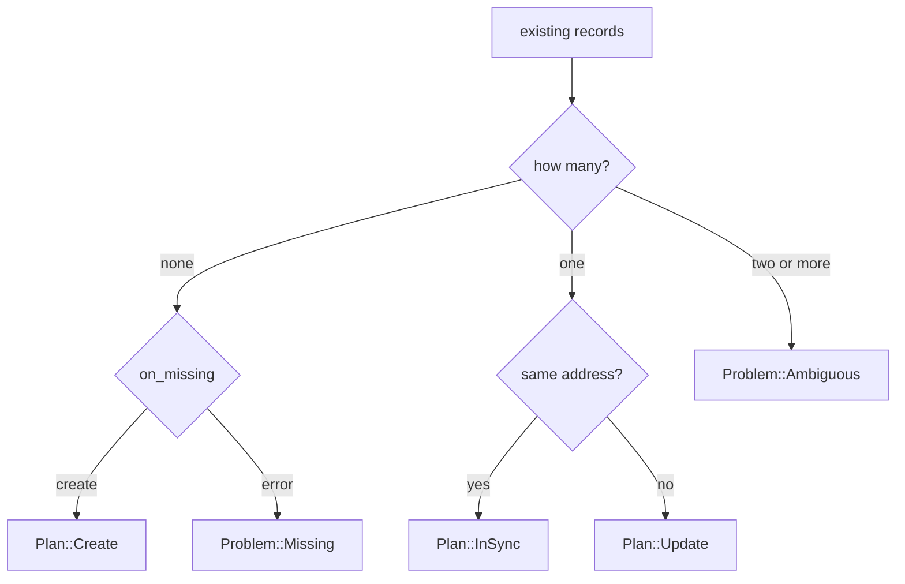

# The functional core

A friend runs a dynamic DNS script on a Raspberry Pi. One weekend they add a
second A record for `home.example.com`, pointing at a backup line, so that
DNS round-robins between the two connections. On Monday their ISP changes the
primary address. The script fetches "the" A record, gets the first one in the
list, which happens to be the backup, sees that it differs from the observed
address, and overwrites it. Now both records point at the primary line, the
backup is gone, and nothing in the logs says anything unusual happened.

The bug isn't in the HTTP code or the JSON parsing. It's in the *decision*:
given what we observed and what the provider holds, what should we do? That
decision is small, but every interesting failure in this program lives there.
It deserves to be written as carefully as we wrote the domain types, and it
deserves tests that cover every case, including the ones we haven't thought of
yet.

In this chapter we'll write that decision as a single pure function. It takes
values and returns a value. It doesn't fetch, sleep, log or retry. It doesn't
even know the network exists. By the end we'll have a table of tests that
reads like a specification, and property tests that check a promise no table
could: whatever the starting state, carrying out the plan leaves nothing more
to do.

## What the decision depends on

Let's be precise about the inputs, using the vocabulary from Chapter 8. For one
configured name and one address family, a tick knows:

- the **name** we're maintaining (`DnsName`);
- the **observed address** (an `Ipv4Addr` or `Ipv6Addr`);
- the **existing records** the provider holds for that name and type: zero,
  one, or several `DnsRecord`s;
- the **policy** for a missing record (`OnMissing`).

That's everything. Not the zone ID, not the token, not the time. If a fact
doesn't change the decision, it isn't an input.

## The obvious first attempt

The question sounds like it has a yes-or-no answer, so the obvious signature
returns a `bool`:

```rust
// a first attempt
fn needs_update(observed: IpAddr, current: Option<IpAddr>) -> bool {
    current != Some(observed)
}
```

It's pure and easy to test, and it doesn't answer the question. Look at what
the caller still has to work out after getting `true` back:

- *Update or create?* `current` was `None`, or it wasn't. The caller has to
  look again.
- *Which record?* An update needs a record ID. `needs_update` threw that away
  when it accepted an `Option<IpAddr>`.
- *What about two records?* There's no way to even ask. The caller had to
  squash a list into an `Option` before calling, which is exactly where the
  Raspberry Pi script went wrong: it took the first element.
- *What about the policy?* Somebody, somewhere else, has to check
  `on_missing`.

A `bool` is the smallest possible answer, and here it's too small. All the
real decisions leak back into the caller, which is the part of the program
that does I/O and is hard to test.

The opposite reflex is to stop returning anything and just *do* it: an `async
fn sync(...)` that fetches, compares and patches in one go. Now the decision is
complete, but it's welded to the network. Testing the "two records" case means
standing up a fake Cloudflare. And there's no way to ask "what *would* you
do?" without doing it.

What we want is between the two: a function that makes the whole decision and
hands it back as a value.

## A plan is a value

Let's write the answer down as a type. There are three things that can
reasonably happen to a name, and each needs different information to carry
out:

```rust
// file: src/plan.rs
/// What should happen to one name, for one address family.
#[derive(Debug, Clone, PartialEq, Eq)]
pub enum Plan<A> {
    InSync {
        name: DnsName,
        address: A,
    },
    Update {
        name: DnsName,
        id: RecordId,
        from: A,
        to: A,
    },
    Create {
        name: DnsName,
        address: A,
    },
}
```

Each variant carries exactly what's needed to act on it, and nothing else.
`Update` has the record's ID, because the API needs it, and both addresses,
because a log line saying "updated home.example.com" without saying from what
to what is useless at 03:12. `Create` has no ID because the record doesn't exist
yet. And `InSync` exists as a variant at all, rather than being "no plan",
because "we looked, and it's fine" is a real outcome worth reporting.

Like `DnsRecord`, `Plan` is generic over the address type, so a
`Plan<Ipv4Addr>` can only ever describe an A record. The `from` and `to` of an
update are guaranteed to be the same family as each other, and as the record.

Then there are the situations where the right answer is *don't*. If the record
is missing and the policy says `error`, or if there are several records and we
can't know which one is ours, the daemon shouldn't act. These aren't plans,
they're problems for a human, so they get their own type:

```rust
/// Situations a human has to sort out; the daemon will not guess.
#[derive(Debug, Clone, PartialEq, Eq, Error)]
pub enum Problem {
    #[error("{name} has no {record_type} record and on_missing is `error`")]
    Missing {
        name: DnsName,
        record_type: RecordType,
    },
    #[error("{name} has {count} {record_type} records; not guessing")]
    Ambiguous {
        name: DnsName,
        record_type: RecordType,
        count: usize,
    },
}
```

Why make problems the `Err` side of a `Result` instead of two more `Plan`
variants? Because they're different in kind. Every `Plan` can be carried out;
no `Problem` can. Splitting them means the code that executes plans (Chapter
10) never has to say "and if it's a problem, do nothing". And the caller can
still treat problems as data: they're values, they carry their details, and
they print as readable sentences. `Problem` isn't generic: it only needs to
say which record type was involved, so it stores the `RecordType` itself.

Now the signature, with the body left for later (Chapter 1's *Type-Driven
Development*):

```rust
/// Decide what to do about `name`, given the address we observed and
/// the records the provider holds for it.
pub fn plan<A: Address>(
    name: &DnsName,
    observed: A,
    existing: &[DnsRecord<A>],
    on_missing: OnMissing,
) -> Result<Plan<A>, Problem> {
    todo!()
}
```

Read it as a specification. It borrows the name and the existing records
(Chapter 2's *Borrow, Don't Own*: the decision only needs to look at them). It
takes the observed address by value, because addresses are `Copy`. The
*same* `A` appears in `observed` and in `existing`, so the compiler won't let
anyone compare an observed IPv6 address with a list of A records. And it
returns either a plan or a problem: never a `bool`, never a half-decision.

Nothing in the signature is `async`. Nothing takes a client, a clock or a
logger. That's not an accident of this function; it's the point of it.

> [!PATTERN] Decision as Data (Plan / Command result)
> Separate *deciding* from *doing*. A pure function inspects the current state
> and returns a value (an enum) describing what should happen, with each
> variant carrying exactly what's needed to carry it out. The shell executes
> the value. Decisions become trivially testable, loggable and printable, and
> a "dry run" is just choosing not to execute.

## Filling in the body with slice patterns

The decision depends on how many records exist, so let's match on the slice.
Rust's *slice patterns* match a slice by its shape: `[]` is empty, `[x]` is
exactly one element (bound to `x`), `[first, rest @ ..]` is one or more, and so
on. They read almost exactly like the cases we wrote down in prose.

Here's a first version, written the way the cases came to mind: nothing there,
one record that matches, one record that doesn't.

```rust
// does not compile
pub fn plan<A: Address>(
    name: &DnsName,
    observed: A,
    existing: &[DnsRecord<A>],
    on_missing: OnMissing,
) -> Result<Plan<A>, Problem> {
    let name = name.clone();
    match existing {
        [] => match on_missing {
            OnMissing::Create => Ok(Plan::Create {
                name,
                address: observed,
            }),
            OnMissing::Error => Err(Problem::Missing {
                name,
                record_type: A::RECORD_TYPE,
            }),
        },
        [record] if record.address == observed => Ok(Plan::InSync {
            name,
            address: observed,
        }),
        [record] => Ok(Plan::Update {
            name,
            id: record.id.clone(),
            from: record.address,
            to: observed,
        }),
    }
}
```

```text
error[E0004]: non-exhaustive patterns: `&[_, _, ..]` not covered
  --> src/plan.rs:54:11
   |
54 |     match existing {
   |           ^^^^^^^^ pattern `&[_, _, ..]` not covered
   |
   = note: the matched value is of type `&[DnsRecord<A>]`
help: ensure that all possible cases are being handled by adding a match arm
      with a wildcard pattern or an explicit pattern as shown
   |
74 ~         }),
75 ~         &[_, _, ..] => todo!(),
   |
```

This is the Raspberry Pi bug, found by the compiler before we wrote a single
test. `&[_, _, ..]` is "two or more records", and we hadn't said what to do
about it. The compiler can't know the *right* answer, but it knows we haven't
given one. In a language where we'd written
`if records.len() == 0 { ... } else { records[0] ... }`, this case would have
compiled straight into the bug.

What *is* the right answer? Cloudflare happily holds several A records with
the same name; that's how DNS round-robin works. If there are two, one of them
might be ours and the other deliberate, or both might be stale, or someone
might be halfway through a migration. The daemon can't tell. So it refuses to
guess, and says so:

```rust
        many => Err(Problem::Ambiguous {
            name,
            record_type: A::RECORD_TYPE,
            count: many.len(),
        }),
```

A bare identifier like `many` is a catch-all pattern that binds the whole
value. Since the arms above it have taken zero and one, `many` here always has
two or more elements.

A few other details in the finished body are worth a second look:

- **`let name = name.clone();`** happens once, up front. Every arm needs an
  owned `DnsName` to put in its plan or problem, and exactly one arm runs, so
  one clone is enough. The compiler is happy to move `name` into whichever arm
  wins.
- **`[record] if record.address == observed`** is a *match guard*: the arm
  only matches if the pattern fits *and* the condition holds. Otherwise
  matching falls through to the next arm, which is the unguarded `[record]`.
  The order matters, and reads naturally: "one record that already matches"
  before "one record".
- **The comparison is `A == A`**, typed addresses rather than strings, so
  `"203.0.113.7\n"` versus `"203.0.113.7"` can't happen here. That bug was
  closed in Chapter 8, at the boundary, and it stays closed.
- **`A::RECORD_TYPE`** turns the type parameter back into a domain word for
  the problem report. It's a compile-time constant; there's no runtime
  dispatch.

Here's the whole decision as a picture. It's the same shape as the `match`,
which is rather the point: the code *is* the diagram.



## Plans that explain themselves

Because a plan is a value, it can describe itself. A `Display` implementation
turns each plan into the line we'd want to read in a log:

```rust
impl<A: Address> fmt::Display for Plan<A> {
    fn fmt(&self, f: &mut fmt::Formatter<'_>) -> fmt::Result {
        let kind = A::RECORD_TYPE;
        match self {
            Plan::InSync { name, address } => {
                write!(f, "{name} {kind} {address} (in sync)")
            }
            Plan::Update { name, from, to, .. } => {
                write!(f, "{name} {kind} {from} -> {to} (update)")
            }
            Plan::Create { name, address } => {
                write!(f, "{name} {kind} {address} (create)")
            }
        }
    }
}
```

`Plan::Update { name, from, to, .. }` destructures the fields it needs and
ignores the rest (`..`), so the record ID doesn't clutter the message. The
`impl` is for `Plan<A>` where `A: Address`, which is what lets us use
`A::RECORD_TYPE` and format the addresses.

The output is something a human can act on:

```text
home.example.com A 198.51.100.4 -> 203.0.113.7 (update)
```

## Testing the decision as a table

A pure function with a handful of cases is the ideal subject for a
*table-driven* test: each row is an input and the expected answer, and one loop
checks them all. The test helpers are tiny: `ip("203.0.113.7")` parses an
address, `home()` is the name, and `record("r1", OLD)` builds a
`DnsRecord<Ipv4Addr>` with ID `r1` holding the address `OLD`.

The table checks *which* decision is made. A helper reduces each result to a
short label:

```rust
/// The kind of decision, without the details.
fn outcome(decision: &Result<Plan<Ipv4Addr>, Problem>) -> &'static str {
    match decision {
        Ok(Plan::InSync { .. }) => "in sync",
        Ok(Plan::Update { .. }) => "update",
        Ok(Plan::Create { .. }) => "create",
        Err(Problem::Missing { .. }) => "missing",
        Err(Problem::Ambiguous { .. }) => "ambiguous",
    }
}
```

And the table itself, which reads like the specification we started with:

```rust
#[test]
fn decides_by_table() {
    use OnMissing::Error;
    #[rustfmt::skip]
    let cases = [
        // records at the provider            policy  decision
        (vec![],                               Create, "create"),
        (vec![],                               Error,  "missing"),
        (vec![record("r1", NEW)],              Error,  "in sync"),
        (vec![record("r1", OLD)],              Create, "update"),
        (vec![record("r1", OLD), record("r2", NEW)],
                                               Create, "ambiguous"),
    ];
    for (existing, on_missing, expected) in cases {
        let decision = plan(&home(), ip(NEW), &existing, on_missing);
        assert_eq!(outcome(&decision), expected, "{existing:?}");
    }
}
```

`#[rustfmt::skip]` asks the formatter to leave our column alignment alone; a
table is easier to review when it looks like one. Notice the third row: a
record that's already correct is `InSync` even when the policy is `Error`,
because the policy only matters when something is missing. Writing the table
is a good way to discover rules like that before a user does.

Note also that `outcome` is itself an exhaustive `match`. If we ever add a
fourth kind of plan, this test helper stops compiling until we decide what to
call it.

The details of each decision get their own focused tests. Here's the one that
checks an update targets the right record:

```rust
#[test]
fn updates_carry_the_record_id() {
    let decision = plan(&home(), ip(NEW), &[record("r1", OLD)], Create);
    let expected = Plan::Update {
        name: home(),
        id: id("r1"),
        from: ip(OLD),
        to: ip(NEW),
    };
    assert_eq!(decision, Ok(expected));
}
```

None of these tests are `async`. None of them need a mock, a fake server or a
temporary directory. They run in microseconds, and they'll keep running in
microseconds however large the rest of the program grows.

## Testing a promise: plans converge

The table covers the cases we thought of. The most important property of a
reconciler isn't a case, though; it's a promise: **after carrying out the plan,
there's nothing left to do.** If that ever fails, the daemon will flap, making
the same change every tick, or worse, alternating between two.

Chapter 7 introduced *property-based testing* with `proptest`: instead of
choosing inputs, we state a property and let the library generate hundreds of
random inputs looking for a counterexample. Let's add it as a development
dependency:

```sh
cargo add --dev proptest
```

To check "plan, apply, plan again", the test needs to *apply* a plan. We can't
call Cloudflare from a unit test, and we don't need to: applying a plan to a
list of records is itself a pure function, and a short one. It lives in the
test module, as a model of what the provider does:

```rust
/// What the provider would hold after carrying out `plan`.
fn simulate<A: Address>(
    mut records: Vec<DnsRecord<A>>,
    plan: &Plan<A>,
) -> Vec<DnsRecord<A>> {
    match plan {
        Plan::InSync { .. } => {}
        Plan::Update { id, to, .. } => {
            for record in &mut records {
                if record.id == *id {
                    record.address = *to;
                }
            }
        }
        Plan::Create { name, address } => records.push(DnsRecord {
            id: "new".parse().unwrap(),
            name: name.clone(),
            address: *address,
        }),
    }
    records
}
```

The property itself is a generic function, so the same check runs for both
families:

```rust
/// Plan, carry out the plan, plan again: there should be nothing
/// left to do.
fn converges<A: Address>(observed: A, current: Option<A>) {
    let existing: Vec<_> = current
        .map(|address| DnsRecord {
            id: id("r1"),
            name: home(),
            address,
        })
        .into_iter()
        .collect();
    let first = plan(&home(), observed, &existing, OnMissing::Create)
        .expect("zero or one record is never a problem");
    let after = simulate(existing, &first);
    let second = plan(&home(), observed, &after, OnMissing::Create);
    assert_eq!(
        second,
        Ok(Plan::InSync {
            name: home(),
            address: observed
        })
    );
}
```

`current` is an `Option<A>`: either no record yet, or one record holding some
address. `Option::into_iter` turns it into an iterator of zero or one items,
which `collect` makes into the `Vec` we need. It's a neat way to say "a list
with at most one thing in it".

Then `proptest!` generates the inputs. `any::<Ipv4Addr>()` produces arbitrary
IPv4 addresses (proptest knows how to make the standard library's address
types), and `proptest::option::of` wraps a strategy to sometimes produce
`None`:

```rust
proptest! {
    #[test]
    fn v4_plans_converge(
        observed in any::<Ipv4Addr>(),
        current in proptest::option::of(any::<Ipv4Addr>()),
    ) {
        converges(observed, current);
    }

    #[test]
    fn v6_plans_converge(
        observed in any::<Ipv6Addr>(),
        current in proptest::option::of(any::<Ipv6Addr>()),
    ) {
        converges(observed, current);
    }
}
```

Each test runs 256 random cases by default. Most generated pairs differ, so
they exercise `Update`; `None` exercises `Create`. The equal case is rare with
random addresses (one chance in four billion for IPv4), but the table already
covers it explicitly. Properties and tables complement each other: the table
pins down the cases we know matter, and the properties hunt the space around
them.

A second property checks the *direction* of an update, which is an easy thing
to get backwards and a miserable thing to debug in production:

```rust
#[test]
fn updates_go_from_the_record_to_the_observation(
    observed in any::<Ipv4Addr>(),
    current in any::<Ipv4Addr>(),
) {
    let existing =
        [DnsRecord { id: id("r1"), name: home(), address: current }];
    match plan(&home(), observed, &existing, OnMissing::Error) {
        Ok(Plan::Update { from, to, .. }) => {
            prop_assert_eq!(from, current);
            prop_assert_eq!(to, observed);
            prop_assert_ne!(from, to);
        }
        Ok(Plan::InSync { .. }) => prop_assert_eq!(current, observed),
        other => prop_assert!(false, "unexpected {:?}", other),
    }
}
```

(This lives inside the same `proptest!` block.) `prop_assert_eq!` is proptest's
version of `assert_eq!`: rather than panicking straight away, it reports the
failure to proptest, which then *shrinks* the input, searching for the
simplest addresses that still fail, before showing you the counterexample.

> [!TIP]
> Try breaking `plan` on purpose to see the properties earn their keep. Swap
> `from` and `to` in the `Update` arm, or change the guard to `!=`, and run
> `cargo test`. The table catches some mistakes; the properties catch the rest,
> and shrinking hands you a minimal failing case like `observed = 0.0.0.0,
> current = 0.0.0.1`.

## What we didn't have to write

Step back and look at what the core *doesn't* contain:

- **No I/O.** No HTTP client, no file handles, no `async`. The core can't fail
  because the network is down, because it never touches the network.
- **No clock.** Ticks, intervals and backoff belong to the shell (Chapter 11).
- **No logging.** The plan's `Display` gives the shell everything it needs to
  log; the core doesn't decide *whether* to log, or at what level.
- **No policy about problems.** The core reports `Problem::Ambiguous`; whether
  that becomes a warning, an exit code or a page to someone's phone is the
  shell's decision.

That's Chapter 1's *Functional Core, Imperative Shell* at the scale of a real
program. The core is the part we most need to be correct, and we've made it
the part that's easiest to make correct.

There's also a bonus waiting. Since the decision is a value, the shell can
choose not to carry it out. A `--dry-run` flag that prints "this is what I'd
change" usually means threading a `dry_run: bool` through every function that
does I/O. For us it'll be one `match` arm in Chapter 10, because the decision
was never entangled with the doing.

> [!CHECKPOINT]
> `src/lib.rs` now declares `pub mod plan;` alongside `config` and `domain`.
> `src/plan.rs` has `Plan<A>`, `Problem`, the `plan` function, its `Display`,
> and a test module with the table, the focused test and three properties.
>
> ```sh
> cargo test
> ```
>
> ```text
> test plan::tests::decides_by_table ... ok
> test plan::tests::updates_carry_the_record_id ... ok
> test plan::tests::plans_read_like_log_lines ... ok
> test plan::tests::v4_plans_converge ... ok
> test plan::tests::v6_plans_converge ... ok
> test plan::tests::updates_go_from_the_record_to_the_observation ... ok
> ...
> test result: ok. 17 passed; 0 failed; 0 ignored; 0 measured
> ```
>
> (`plans_read_like_log_lines` checks the `Display` output shown above.)

## What we learned

- **A `bool` is often too small an answer.** When the caller has to re-derive
  *why* it was `true`, the real decision has leaked into the code that does
  I/O.
- **Decision as Data**: a pure function returns an enum describing what
  should happen, each variant carrying exactly what's needed to do it. Testing,
  logging and dry runs all fall out of that.
- **Separate "can be done" from "must not be done"** with `Result<Plan,
  Problem>`, so executors never have to handle non-actions.
- **Slice patterns** (`[]`, `[x]`, `many`) and **match guards** let the code
  mirror the case analysis, and exhaustiveness checking found the
  two-records case for us.
- **Table-driven tests** pin down known cases readably; `#[rustfmt::skip]`
  keeps the table looking like a table.
- **Property-based tests** check promises like convergence across thousands of
  inputs, using a pure `simulate` model of the outside world. Generic test
  helpers run the same property for IPv4 and IPv6.

## Exercises

> [!EXERCISE] Adopt the right record
> Some people *do* want round-robin. Add an `OnAmbiguous` policy with
> `Refuse` (today's behaviour) and `UpdateAll`. What should `Plan` look like
> when several records need updating: a new variant holding a `Vec` of IDs, or
> a `Vec<Plan<A>>`? Write the table rows first, then the code. Does the
> convergence property still hold?

> [!EXERCISE] Ignore proxied records
> Cloudflare can *proxy* a record, so that its public answer is a Cloudflare
> address rather than yours. Suppose `DnsRecord` gained a `proxied: bool`.
> Should a proxied record ever be planned for update? Decide, encode the rule
> in `plan` (or in a type, if you can see how), and add rows to the table.

> [!EXERCISE] Shrinking in action
> Introduce a deliberate bug: in the `Update` arm, set `to: record.address`.
> Run the tests and read proptest's output. What minimal counterexample does
> it report, and which of the three properties caught it first? Then remove
> the bug and check that `cargo test` is green again.
