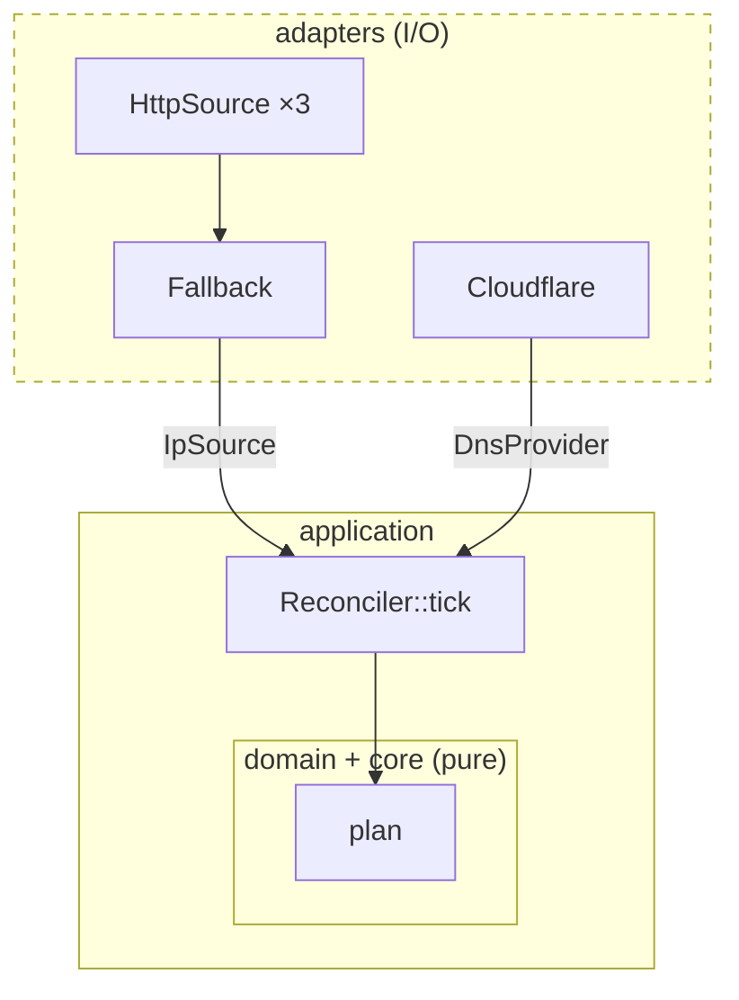
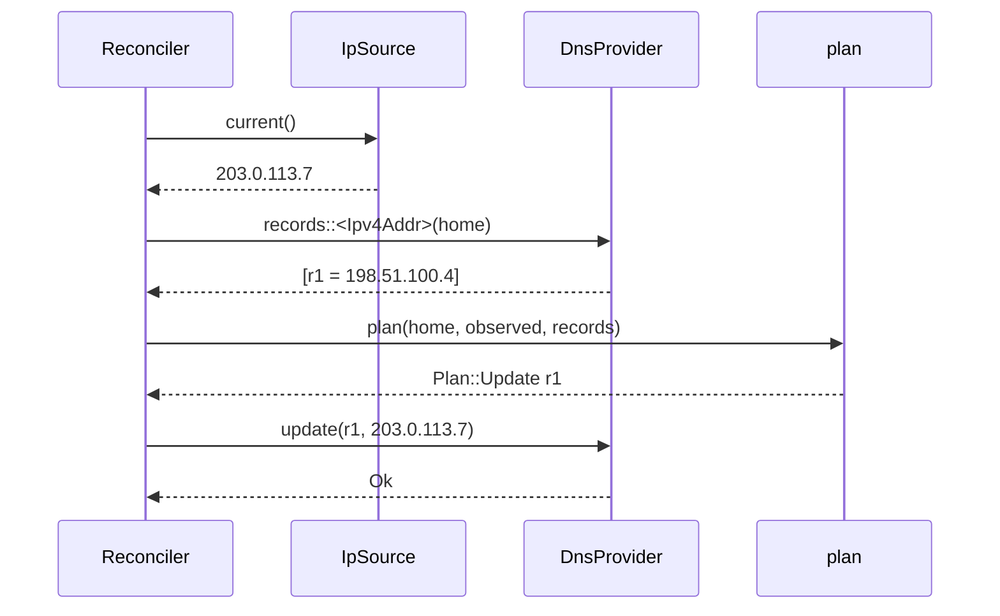

# Ports and adapters

One Saturday morning, the service you use to look up your public IP address
goes down for a few hours. It happens to every free service eventually. If
your daemon has `https://api.ipify.org` written into the middle of its main
loop, it spends those hours logging the same error every five minutes, and if
your ISP happens to change your address in that window, your DNS is wrong
until somebody notices. There are at least three other services that would have
answered the same question perfectly well.

Our core from Chapter 9 doesn't care where addresses come from; it takes one as
an argument. Now we need to supply it, along with the records from Cloudflare,
and someone to carry out the plans. This is the chapter where the program
finally touches the network, and the challenge is to let it do that *without*
the network leaking back into everything we've built.

The technique is to describe what the application needs from the outside world
as traits, written in the domain's vocabulary, and then implement those traits
for real services. We'll write a trait for "somewhere that knows our address"
and another for "somewhere that holds our records"; implement them over HTTP for
ipify, icanhazip, Cloudflare's trace endpoint and the Cloudflare API; combine
several IP sources into one that falls back gracefully; keep Cloudflare's JSON
firmly on Cloudflare's side of the fence; and test the whole application without
a single real request.

## Drawing the boundary

Before any code, let's place every piece of the program on a picture. In the
middle sit the domain and the pure core. Around them sits a thin *application
service* that runs one tick: observe, fetch, plan, apply. The application talks
to the outside world only through two traits, which we'll call **ports**. Real
implementations of the ports, the **adapters**, sit at the edge, and so do the
fakes we'll use in tests.



The arrows point inwards. The application depends on the ports, which are
defined in its own terms; the adapters depend on the ports too, because they
implement them. Nothing in the middle depends on an adapter. The application
doesn't know that Cloudflare exists, only that there's a `DnsProvider`.

That's the whole idea, and it has a name.

> [!PATTERN] Ports and Adapters
> Describe each thing the application needs from the outside world as an
> interface owned by the application and phrased in its language: a *port*.
> Implement each port with an *adapter* for a specific technology (an HTTP API,
> a database, a fake for tests). In Rust, ports are traits and adapters are
> types that implement them; the application is generic over the traits, so
> swapping an adapter never touches application code. Also known as *hexagonal
> architecture*.

## A very short introduction to async

Both ports involve waiting on the network, and in Rust that means `async`.
If you've used `async`/`await` in JavaScript, C# or Python, most of this will
feel familiar; there are two differences worth knowing up front.

An `async fn` doesn't run when you call it. It returns a *future*, a value
describing work that can be driven to completion later. `.await` drives a future
until it finishes, yielding to other work while it waits. So far, so
JavaScript.

The first difference: Rust has no built-in runtime to drive futures. You choose
one, and almost everyone chooses `tokio`. Without a runtime, futures just sit
there. The second: a future is an ordinary value with an ordinary type, which
the compiler generates for each `async fn`. Like any value, it can be `Send`
(safe to move to another thread) or not, depending on what it holds across
`.await` points. That will matter in a moment.

Let's add the dependencies for this chapter:

```sh
cargo add tokio --features macros,rt,time
cargo add reqwest --no-default-features --features rustls,json,query
cargo add serde_json tracing
cargo add --dev wiremock
```

`reqwest` is the standard HTTP client. Version 0.13 uses `rustls`, a TLS
implementation written in Rust, for HTTPS; we turn off its default features so
we only compile what we use: `json` for request bodies and `query` for query
strings.

## The IP source port

What does the application need from an IP source? One thing: the current
address, of one family, or a reason it couldn't get it. Let's write the trait
in exactly those words.

```rust
// file: src/ports/mod.rs
/// Somewhere that can tell us our public address of one family.
pub trait IpSource: Send + Sync {
    type Addr: Address;

    async fn current(&self) -> Result<Self::Addr, IpError>;
}
```

`type Addr: Address` is an *associated type* (Chapter 5): each implementation
says which address type it produces. We could have made the trait generic
instead (`IpSource<A>`), but that would allow one type to implement both
`IpSource<Ipv4Addr>` and `IpSource<Ipv6Addr>`. A source that queries
`https://api.ipify.org` is an IPv4 source, full stop, so "one implementation,
one family" is the honest model, and associated types express exactly that.

The `Send + Sync` supertraits say a source can be shared between threads.
Ours will be, by the runtime, so let's require it once here rather than
repeating it at every use.

It compiles. With a warning:

```text
warning: use of `async fn` in public traits is discouraged as auto trait
         bounds cannot be specified
  --> src/ports/mod.rs:17:5
   |
17 |     async fn current(&self) -> Result<Self::Addr, IpError>;
   |     ^^^^^
   |
   = note: you can suppress this lint if you plan to use the trait only in
           your own code, or do not care about auto traits like `Send` on
           the `Future`
   = note: `#[warn(async_fn_in_trait)]` on by default
help: you can alternatively desugar to a normal `fn` that returns `impl
      Future` and add any desired bounds such as `Send`, but these cannot be
      relaxed without a breaking API change
   |
17 -     async fn current(&self) -> Result<Self::Addr, IpError>;
17 +     fn current(&self) -> impl std::future::Future<Output = Result<Self::Addr, IpError>> + Send;
   |
```

This is the `Send` wrinkle. Native `async fn` in traits has been stable since
Rust 1.75, but the trait says nothing about whether the future each
implementation returns is `Send`. Generic code calling `source.current()` can't
assume it is, so it can't, for example, hand that future to `tokio::spawn`,
which may move it to another thread. The compiler's suggestion is the standard
fix: write the method as an ordinary `fn` returning `impl Future`, and state the
bound:

```rust
/// Somewhere that can tell us our public address of one family.
pub trait IpSource: Send + Sync {
    type Addr: Address;

    fn current(
        &self,
    ) -> impl Future<Output = Result<Self::Addr, IpError>> + Send;
}
```

The good news is that this only changes the *declaration*. Implementations
can still write `async fn current(&self)`, and the compiler checks that the
future they produce is `Send`. We get the bound for callers and the
convenience for implementers.

> [!NOTE]
> The `async-trait` crate solved this problem before the language did, by
> boxing every future. You'll see it in older code. Native `async fn` in
> traits avoids the allocation and is what this book uses.

The error type deserves a moment, because it's where the boundary is easiest
to get wrong. The tempting thing is to let `reqwest::Error` through. But then
the port, which belongs to the application, would mention an HTTP library, and
a source that read the address from a router over SNMP would have to invent a
`reqwest::Error`. The port's error is phrased in the domain's terms instead:

```rust
/// An IP source could not tell us our address.
#[derive(Debug, Error)]
#[error("{source_name}: {reason}")]
pub struct IpError {
    pub source_name: String,
    pub reason: String,
}
```

Which source failed and why, in words. That's everything the application can
usefully do with it: log it and try again later.

## An HTTP IP source

Now an adapter. The services we'll use come in two styles. ipify and
icanhazip reply with the address and nothing else:

```text
203.0.113.7
```

Cloudflare's `/cdn-cgi/trace` endpoint, which you can reach at `1.1.1.1`,
replies with a list of `key=value` lines, one of which is our address:

```text
fl=12f1
h=1.1.1.1
ip=203.0.113.7
ts=1729
```

Two formats is a small enum. And *finding the address in a reply* is a pure
function from text to address, so let's write it as one, separate from the
HTTP request, where it can be tested without a network:

```rust
// file: src/adapters/ip_sources.rs
/// How a service writes our address in its reply.
#[derive(Debug, Clone, Copy, PartialEq, Eq)]
pub enum Format {
    /// The whole body is the address: `203.0.113.7\n`.
    PlainText,
    /// `key=value` lines, one of them `ip=203.0.113.7`.
    Trace,
}

/// Find the address in a reply. Pure, so it is tested without a network.
pub fn parse_reply<A: Address>(
    format: Format,
    body: &str,
) -> Result<A, String> {
    let text = match format {
        Format::PlainText => body.trim(),
        Format::Trace => body
            .lines()
            .find_map(|line| line.strip_prefix("ip="))
            .ok_or("no `ip=` line in the reply")?
            .trim(),
    };
    text.parse().map_err(|_| {
        format!("`{text}` cannot go in an {} record", A::RECORD_TYPE)
    })
}
```

Here's the `.trim()` we promised in Chapter 8: the one place a trailing newline
is dealt with. `find_map` walks the lines and returns the first one for which
the closure gives `Some`, so `strip_prefix("ip=")` both finds the line and cuts
the key off. And because `parse_reply` is generic over `A`, the same function
refuses an IPv6 reply when we asked for IPv4, with a message in the domain's
words:

```rust
#[test]
fn refuses_the_wrong_family() {
    let result = parse_reply::<Ipv4Addr>(Format::PlainText, "2001:db8::7");
    assert_eq!(
        result.unwrap_err(),
        "`2001:db8::7` cannot go in an A record"
    );
}
```

The adapter itself holds a URL, a format, a name for error messages, and an
HTTP client:

```rust
/// A service that tells us our address of type `A`.
pub struct HttpSource<A> {
    name: String,
    url: String,
    format: Format,
    http: Client,
    family: PhantomData<A>,
}
```

`PhantomData<A>` deserves an explanation. `HttpSource` is generic over the
address type it produces, but none of its fields *holds* an `A`. Rust rejects
a type parameter that isn't used, because it can't tell how the type relates
to it. `PhantomData<A>` is a zero-sized field that says "act as though this
struct contains an `A`". It costs nothing at runtime. Chapter 21 builds a whole
technique on it; here it simply lets `HttpSource<Ipv4Addr>` and
`HttpSource<Ipv6Addr>` be different types.

The implementation fetches the body and hands it to `parse_reply`:

```rust
impl<A: Address> IpSource for HttpSource<A> {
    type Addr = A;

    async fn current(&self) -> Result<A, IpError> {
        let fail = |reason: String| IpError {
            source_name: self.name.clone(),
            reason,
        };
        let response = self.http.get(&self.url).send().await;
        let body = response
            .and_then(|response| response.error_for_status())
            .map_err(|e| fail(e.to_string()))?
            .text()
            .await
            .map_err(|e| fail(e.to_string()))?;
        parse_reply(self.format, &body).map_err(fail)
    }
}
```

This is where the `reqwest::Error`s are translated into `IpError`s, inside the
adapter, so they never cross the port. `error_for_status` turns an HTTP 503
into an error, so a maintenance page never gets as far as `parse_reply`. And the
`fail` closure keeps each translation down to a single `map_err`.

## Combining sources

We have three services per family. How should the application use them?

### The tempting design

The first idea most of us have is a list and a loop: store the sources in a
`Vec<Box<dyn IpSource>>` and try each one until something works. That's the
classic *Strategy* pattern, with the loop as the thing that chooses between
strategies.

It runs into a wall straight away: our trait isn't *dyn-compatible*. A method
returning `impl Future` has a different, compiler-generated return type for
each implementation, so there's no single function signature for a `dyn
IpSource` to put in its vtable. There are workarounds (boxing every future),
but the wall is a useful prompt to ask whether we wanted a loop at all.

The loop also hides decisions in the application: try them in order? All at
once? Require two to agree? Each is a different policy, and with a list they'd
all be `if` statements in the tick.

### A source made of sources

Here's a different idea. What if "try this, and if it fails, try that" were
itself an `IpSource`? Then the application keeps asking one source for one
address, and the policy lives in how we *build* that source.

```rust
// file: src/ports/fallback.rs
/// An IP source that asks `first`, and only asks `second` if `first`
/// fails. Built with [`IpSource::or`].
pub struct Fallback<P, S> {
    first: P,
    second: S,
}

impl<P, S> IpSource for Fallback<P, S>
where
    P: IpSource,
    S: IpSource<Addr = P::Addr>,
{
    type Addr = P::Addr;

    async fn current(&self) -> Result<P::Addr, IpError> {
        match self.first.current().await {
            Ok(address) => Ok(address),
            Err(error) => {
                warn!(%error, "IP source failed; trying the next one");
                self.second.current().await
            }
        }
    }
}
```

The `where` clause is the interesting part. `Fallback<P, S>` is an IP source
whenever `P` is one, and `S` is one *that produces the same kind of address*
(`IpSource<Addr = P::Addr>`). The output type is `P::Addr`. The struct holds
both sources by value, so there's no boxing and no dynamic dispatch: the
compiler generates one specialised `current` for each combination we build.

`warn!` comes from the `tracing` crate, which Chapter 11 sets up properly. The
`%error` syntax records the error using its `Display` implementation.

To make building these pleasant, we add a provided method to the trait itself,
with a default body:

```rust
    /// Try `self`; if it fails, try `next`.
    fn or<S>(self, next: S) -> Fallback<Self, S>
    where
        Self: Sized,
        S: IpSource<Addr = Self::Addr>,
    {
        Fallback::new(self, next)
    }
```

(`Fallback::new` is the obvious two-line constructor.) `Self: Sized` is needed
because `or` takes `self` by value. Every `IpSource` now gets `.or()` for free,
including `Fallback` itself, so chains build naturally:

```rust
/// ipify, then Cloudflare's trace endpoint, then icanhazip.
pub fn default_v4(http: &Client) -> impl IpSource<Addr = Ipv4Addr> + use<> {
    use Format::{PlainText, Trace};
    let source = |name, url, format| HttpSource::new(http, name, url, format);
    source("ipify", "https://api.ipify.org", PlainText)
        .or(source("cloudflare", "https://1.1.1.1/cdn-cgi/trace", Trace))
        .or(source("icanhazip", "https://ipv4.icanhazip.com", PlainText))
}
```

The concrete type of that value is
`Fallback<Fallback<HttpSource<Ipv4Addr>, HttpSource<Ipv4Addr>>,
HttpSource<Ipv4Addr>>`, which nobody wants to write, so the function returns
`impl IpSource<Addr = Ipv4Addr>`: "some IPv4 source; you don't need to know
which". `default_v6` is the same chain over `api6.ipify.org`, Cloudflare's IPv6
resolver address and `ipv6.icanhazip.com`.

> [!NOTE]
> `+ use<>` says the returned value borrows nothing from the arguments. In the
> 2024 edition an `impl Trait` return type is assumed to capture every
> lifetime in scope, including the `&Client`'s, which would tie the source to
> the borrow. Each `HttpSource` clones the client (cheaply: a `reqwest::Client`
> is a handle to a shared connection pool), so we can promise it doesn't.

And the `where` clause on `Fallback` earns its keep the first time someone
falls back from an IPv4 source to an IPv6 one:

```rust
// does not compile
pub fn mixed(http: &reqwest::Client) -> impl IpSource {
    let v4: HttpSource<Ipv4Addr> = HttpSource::new(/* ... */);
    let v6: HttpSource<Ipv6Addr> = HttpSource::new(/* ... */);
    v4.or(v6)
}
```

```text
error[E0271]: type mismatch resolving `<HttpSource<Ipv6Addr> as
              IpSource>::Addr == Ipv4Addr`
  --> src/lib.rs:20:11
   |
20 |     v4.or(v6)
   |        -- ^^ type mismatch resolving `<HttpSource<Ipv6Addr> as
   |        |     IpSource>::Addr == Ipv4Addr`
   |        |
   |        required by a bound introduced by this call
   |
note: expected this to be `Ipv4Addr`
  --> src/adapters/ip_sources.rs:42:17
   |
42 |     type Addr = A;
   |                 ^
note: required by a bound in `IpSource::or`
  --> src/ports/mod.rs:25:21
   |
22 |     fn or<S>(self, next: S) -> Fallback<Self, S>
   |        -- required by a bound in this associated function
...
25 |         S: IpSource<Addr = Self::Addr>,
   |                     ^^^^^^^^^^^^^^^^^ required by this bound in
   |                                       `IpSource::or`
```

"If ipify can't tell us our IPv4 address, ask for our IPv6 address instead"
is a bug, and it's now one that can't be written.

> [!PATTERN] Combinators over Strategies (fallback, retry)
> Instead of a list of interchangeable strategies and a loop that picks
> between them, write small generic types that *combine* implementations of a
> trait into another implementation of the same trait: `a.or(b)`, `a.retry(n)`,
> `a.timeout(d)`. Policies compose by nesting, the application sees a single
> port, and Rust's generics compile the whole chain to direct calls.

## The DNS provider port

The second port is everything we need from somewhere that holds DNS records:
find the records for a name, update one, create one. Each method is generic
over the address family, so the same provider serves both A and AAAA records,
and a `DnsRecord<Ipv6Addr>` can only ever come back from a request for IPv6
records.

```rust
/// Somewhere that holds DNS records for our zone.
pub trait DnsProvider: Send + Sync {
    fn records<A: Address>(
        &self,
        name: &DnsName,
    ) -> impl Future<Output = Result<Vec<DnsRecord<A>>, DnsError>> + Send;

    fn update<A: Address>(
        &self,
        id: &RecordId,
        address: A,
    ) -> impl Future<Output = Result<(), DnsError>> + Send;

    fn create<A: Address>(
        &self,
        name: &DnsName,
        address: A,
    ) -> impl Future<Output = Result<(), DnsError>> + Send;
}
```

There's no zone in these signatures. Which zone we're managing is a fact about
how the provider is *set up*, not about each call, so the Cloudflare adapter
will be given its zone when it's constructed. A fake provider in a test doesn't
need one at all.

Generic methods make this trait dyn-incompatible as well, and here that's no
loss: the application is generic over its provider, so everything is resolved
at compile time.

`DnsError` is again in our vocabulary, not HTTP's. It names the situations the
application might want to treat differently:

```rust
/// Something went wrong talking to the DNS provider, in the provider's
/// terms translated into ours.
#[derive(Debug, Error)]
pub enum DnsError {
    #[error("could not reach the DNS provider: {0}")]
    Unreachable(String),
    #[error("the DNS provider is rate limiting us")]
    RateLimited,
    #[error("the DNS provider is having trouble (HTTP {0})")]
    ProviderDown(u16),
    #[error("the API token was rejected")]
    TokenRejected,
    #[error("the DNS provider refused the request: {0}")]
    Rejected(String),
    #[error("the DNS provider sent something unexpected: {0}")]
    Unexpected(String),
}
```

Chapter 11 will sort these into "try again soon" and "give up", which is why
they're separate variants rather than one string.

## The Cloudflare adapter

### What Cloudflare speaks

Cloudflare's v4 API is a conventional JSON-over-HTTPS API. The three calls we
need are:

```text
GET   /client/v4/zones/{zone_id}/dns_records?type=A&name=home.example.com
PATCH /client/v4/zones/{zone_id}/dns_records/{record_id}
POST  /client/v4/zones/{zone_id}/dns_records
```

Every request carries `Authorization: Bearer <token>`. Every response,
successful or not, comes wrapped in the same envelope:

```json
{
  "success": true,
  "errors": [],
  "messages": [],
  "result": [
    {
      "id": "372e67954025e0ba6aaa6d586b9e0b59",
      "zone_id": "023e105f4ecef8ad9ca31a8372d0c353",
      "name": "home.example.com",
      "type": "A",
      "content": "198.51.100.4",
      "proxied": false,
      "ttl": 1,
      "comment": null,
      "tags": [],
      "created_on": "2014-01-01T05:20:00.12345Z",
      "modified_on": "2014-01-01T05:20:00.12345Z"
    }
  ]
}
```

This is Cloudflare's model, and it isn't ours. Its record has a `type` that's
a string, `content` that's a string (an address for A records, text for TXT
records, a host name for CNAMEs), and a dozen fields we don't care about.
Failures come as `success: false` with a list of numbered error messages.

If we let these shapes into the application (say, by making `DnsProvider`
return Cloudflare's record struct) then the core would start checking
`record.type == "A"`, the string-typed content would come back, and moving to
another DNS provider would mean rewriting the middle of the program. The
domain we built in Chapter 8 would slowly be *corrupted* by a model that
isn't ours.

### Cloudflare's types, in a box

So Cloudflare's shapes get a module of their own, private to the adapter.
These are DTOs again, like `RawConfig`, but for someone else's format:

```rust
// file: src/adapters/cloudflare/dto.rs
/// Every Cloudflare v4 response comes wrapped in one of these.
#[derive(Debug, Deserialize)]
pub struct Envelope<T> {
    pub success: bool,
    #[serde(default)]
    pub errors: Vec<ApiMessage>,
    pub result: Option<T>,
}

#[derive(Debug, Deserialize)]
pub struct ApiMessage {
    pub code: u32,
    pub message: String,
}

/// A DNS record as Cloudflare describes it. We ignore the many fields
/// we do not need (ttl, proxied, comment, tags, ...).
#[derive(Debug, Clone, Deserialize)]
pub struct RecordDto {
    pub id: String,
    pub name: String,
    #[serde(rename = "type")]
    pub record_type: String,
    pub content: String,
}
```

`#[serde(rename = "type")]` is needed because `type` is a Rust keyword.
`Envelope<T>` is generic over the `result`, so one type covers "a list of
records" and "one record".

Notice what's *missing*: `deny_unknown_fields`. Our config file is strict,
because a typo there is a mistake we want to report. Cloudflare's responses are
deliberately lenient: Cloudflare adds fields to its API all the time, and an
adapter that broke on every new field would be a liability. Be strict with
input you own, tolerant of input you don't. (This is sometimes called the
*tolerant reader*.)

### The translation

Now the important part: turning Cloudflare's record into ours, checking
everything on the way in. It's a `TryFrom`, just like the configuration:

```rust
/// The anti-corruption layer: Cloudflare's record, checked and
/// translated into ours.
impl<A: Address> TryFrom<RecordDto> for DnsRecord<A> {
    type Error = DnsError;

    fn try_from(dto: RecordDto) -> Result<Self, DnsError> {
        let unexpected = |what: String| DnsError::Unexpected(what);
        if dto.record_type != A::RECORD_TYPE.as_str() {
            let wanted = A::RECORD_TYPE;
            return Err(unexpected(format!(
                "asked for {wanted} records, got {}",
                dto.record_type
            )));
        }
        Ok(DnsRecord {
            id: dto.id.parse().map_err(|e| unexpected(format!("id: {e}")))?,
            name: dto
                .name
                .parse()
                .map_err(|e| unexpected(format!("name: {e}")))?,
            address: dto
                .content
                .parse()
                .map_err(|e| unexpected(format!("content: {e}")))?,
        })
    }
}
```

Each string field goes through the domain's own constructor: `RecordId`,
`DnsName`, `A`. If we asked for A records and Cloudflare hands back an AAAA
record, or an A record whose content isn't an IPv4 address, the translation
refuses it, and the application never sees a record it can't trust. The
`type` field is checked and then *thrown away*; in our domain the record type
lives in `A`, not in a string.

> [!PATTERN] Anti-Corruption Layer
> Keep a foreign system's model (its DTOs, string codes and quirks) inside the
> adapter that talks to it, and translate at the boundary into your own domain
> types, validating as you go. The rest of the application only ever sees its
> own vocabulary, so a change in the foreign API, or a switch to a different
> provider, is contained in one module. In Rust: private DTO types plus
> `TryFrom` into domain types.

The envelope gets a translation too. Success with a result is the result;
anything else is a refusal, carrying Cloudflare's own messages:

```rust
impl<T> Envelope<T> {
    pub fn into_result(self) -> Result<T, DnsError> {
        match self {
            Envelope {
                success: true,
                result: Some(result),
                ..
            } => Ok(result),
            Envelope { errors, .. } => {
                let messages: Vec<String> =
                    errors.iter().map(ApiMessage::to_string).collect();
                Err(DnsError::Rejected(messages.join("; ")))
            }
        }
    }
}
```

(`ApiMessage` has a `Display` that prints `message (code 81058)`.)

### The adapter

The adapter holds its client, its base URL, the zone and the token:

```rust
// file: src/adapters/cloudflare/mod.rs
/// The real API's base URL. Tests point the adapter somewhere else.
pub const API: &str = "https://api.cloudflare.com/client/v4";

pub struct Cloudflare {
    http: Client,
    base: String,
    zone: ZoneId,
    token: ApiToken,
}
```

The base URL is a field rather than a constant baked into each request, so a
test can point the adapter at a fake server. That one decision is what makes
the adapter testable.

Every call goes through one private method that attaches the token, sends the
request, and interprets the answer. Interpreting is pure (a status code and a
body in, a result out), so it's a separate function:

```rust
/// Turn an HTTP status and body into a result, in our vocabulary.
fn interpret<T: DeserializeOwned>(
    status: StatusCode,
    body: &str,
) -> Result<T, DnsError> {
    match status {
        StatusCode::UNAUTHORIZED | StatusCode::FORBIDDEN => {
            return Err(DnsError::TokenRejected);
        }
        StatusCode::TOO_MANY_REQUESTS => return Err(DnsError::RateLimited),
        s if s.is_server_error() => {
            return Err(DnsError::ProviderDown(s.as_u16()));
        }
        _ => {}
    }
    let envelope: Envelope<T> = serde_json::from_str(body)
        .map_err(|e| DnsError::Unexpected(e.to_string()))?;
    envelope.into_result()
}
```

The status codes that mean something specific to us are checked first. A 502
from a load balancer usually has an HTML body, and we'd rather report "the
provider is having trouble" than a JSON parse error. Everything else, success
or failure, should be an envelope. `DeserializeOwned` is serde's bound for "can
be deserialised without borrowing from the input".

`send` is the only `async` part, and the only place the token is exposed:

```rust
    async fn send<T: DeserializeOwned>(
        &self,
        request: RequestBuilder,
    ) -> Result<T, DnsError> {
        let unreachable =
            |e: reqwest::Error| DnsError::Unreachable(e.to_string());
        let response = request
            .bearer_auth(self.token.expose())
            .send()
            .await
            .map_err(unreachable)?;
        let status = response.status();
        let body = response.text().await.map_err(unreachable)?;
        interpret(status, &body)
    }
```

With that in place, each port method is a few lines: build a request, send it,
translate the result. Here's `records`:

```rust
impl DnsProvider for Cloudflare {
    async fn records<A: Address>(
        &self,
        name: &DnsName,
    ) -> Result<Vec<DnsRecord<A>>, DnsError> {
        let query =
            [("type", A::RECORD_TYPE.as_str()), ("name", name.as_str())];
        let request = self.http.get(self.records_url()).query(&query);
        let found: Vec<RecordDto> = self.send(request).await?;
        found.into_iter().map(DnsRecord::try_from).collect()
    }

    // ...
}
```

`A::RECORD_TYPE` appears once more, choosing the `type` query parameter. The
last line is the anti-corruption layer at work: every `RecordDto` is turned
into a `DnsRecord<A>`, and `collect` gathers the results into
`Result<Vec<_>, _>`, failing if any record didn't translate.

`update` sends a `PATCH` whose body is a small `PatchRecord { content }`
struct. Only the content changes; Cloudflare keeps the record's TTL, proxy
setting and comments as they were. `create` sends a `POST` with a `NewRecord`
holding the type, name, content, `ttl: 1` (Cloudflare's code for "automatic")
and `proxied: false`. Both are `Serialize` DTOs in `dto.rs`, so not even the
*outgoing* shapes escape the adapter.

> [!TIP]
> Create the API token in the Cloudflare dashboard (*My Profile → API Tokens*)
> using the *Edit zone DNS* template, restricted to the one zone you need. A
> token that can only edit one zone's DNS is far less dangerous to lose than
> your account's global API key.

### Testing against a fake Cloudflare

`interpret` and the `TryFrom` have ordinary unit tests. To check the adapter
sends the right requests, we want something that speaks HTTP. The `wiremock`
crate starts a real HTTP server on a random local port and lets each test
declare what it expects:

```rust
// file: tests/cloudflare.rs
#[tokio::test]
async fn finds_records_by_type_and_name() {
    let server = MockServer::start().await;
    Mock::given(method("GET"))
        .and(path(RECORDS))
        .and(query_param("type", "A"))
        .and(query_param("name", "home.example.com"))
        .and(header("authorization", "Bearer test-token"))
        .respond_with(ok(json!([a_record("198.51.100.4")])))
        .expect(1)
        .mount(&server)
        .await;

    let found: Vec<DnsRecord<Ipv4Addr>> =
        adapter(&server).records(&home()).await.unwrap();
    assert_eq!(found[0].address, Ipv4Addr::new(198, 51, 100, 4));
    assert_eq!(found[0].id.to_string(), RECORD);
}
```

`#[tokio::test]` is `#[test]` with a tokio runtime, so the test body can
`.await`. The mock only answers a `GET` to the right path, with the right query
and the right bearer token, and `.expect(1)` fails the test if it isn't called
exactly once. `ok(...)` and `a_record(...)` are small helpers that build a
Cloudflare-shaped envelope and record with `serde_json::json!`, and `adapter`
constructs a `Cloudflare` pointed at `server.uri()`. Similar tests check that an
update sends exactly `{"content": "203.0.113.7"}` and that a 403 comes back as
`DnsError::TokenRejected`.

These tests are slower than unit tests (milliseconds rather than microseconds)
and there are only a handful of them. They check the adapter's one real job:
that it speaks Cloudflare correctly. Everything about *what* to say was tested
in Chapter 9.

## The application service

Now we can write the piece in the middle of the picture: one tick. It owns the
configuration, an IPv4 source, an IPv6 source, and a DNS provider, and it's
generic over all three ports:

```rust
// file: src/app.rs
pub struct Reconciler<V4, V6, D> {
    config: Config,
    v4: V4,
    v6: V6,
    dns: D,
}

impl<V4, V6, D> Reconciler<V4, V6, D>
where
    V4: IpSource<Addr = Ipv4Addr>,
    V6: IpSource<Addr = Ipv6Addr>,
    D: DnsProvider,
{
    // ...
}
```

The bounds say what each slot must be: an IPv4 source, an IPv6 source and a DNS
provider. Hand it the sources the other way round and it won't compile.

A tick produces a report:

```rust
/// What one tick found and did.
#[derive(Debug, Default, PartialEq, Eq)]
pub struct Report {
    pub in_sync: usize,
    pub changed: usize,
    pub problems: Vec<Problem>,
}
```

And it can fail, with either port's error. For now, a plain wrapper is enough;
Chapter 11 will give this type a lot more thought:

```rust
// for now; Chapter 11 refines this
#[derive(Debug, Error)]
pub enum TickError {
    #[error(transparent)]
    Ip(#[from] IpError),
    #[error(transparent)]
    Dns(#[from] DnsError),
}
```

The tick itself runs the same steps for each family:

```rust
    /// Observe, compare, and (in `Mode::Apply`) correct every record.
    pub async fn tick(&self, mode: Mode) -> Result<Report, TickError> {
        let mut report = Report::default();
        self.reconcile(&self.v4, mode, &mut report).await?;
        self.reconcile(&self.v6, mode, &mut report).await?;
        Ok(report)
    }
```

> [!WARNING] Hold that thought
> Those two `?`s look harmless, and every test in this part passes with them.
> But if IPv4 lookups keep failing, every tick stops at the first `?` and the
> AAAA records are never looked at, even though IPv6 works. We didn't spot it
> while writing the chapter; a model checker did. TLA+ Interlude 2 finds it,
> explains why tests miss it, and fixes it.

`reconcile` is generic over the source, which lets one function handle both
families. Everything inside it takes its family from `S::Addr`:

```rust
    async fn reconcile<S: IpSource>(
        &self,
        source: &S,
        mode: Mode,
        report: &mut Report,
    ) -> Result<(), TickError> {
        let names: Vec<&DnsName> = self.config.names::<S::Addr>().collect();
        if names.is_empty() {
            return Ok(());
        }
        let observed = source.current().await?;
        for name in names {
            let existing = self.dns.records::<S::Addr>(name).await?;
            match plan(name, observed, &existing, self.config.on_missing) {
                Ok(plan) => self.carry_out(plan, mode, report).await?,
                Err(problem) => {
                    warn!(%problem, "needs attention");
                    report.problems.push(problem);
                }
            }
        }
        Ok(())
    }
```

Read it as the flowchart from Chapter 8. Which names want this family? If none,
we don't even ask for an address (so a config with no IPv6 records never
touches an IPv6 source). Observe once. Then for each name: fetch, plan,
act. A `Problem` is recorded and the loop moves on to the next name; one
ambiguous record shouldn't stop the others from being maintained. An error
from a port, by contrast, stops the tick with `?`.

Here's one tick, for one name, as a sequence of messages:



### Carrying out a plan, or not

The last step turns a `Plan` into calls on the provider. This is where Chapter
9's promise pays out. A dry run needs one extra input, a `Mode`:

```rust
/// Whether to carry plans out, or only report them.
#[derive(Debug, Clone, Copy, PartialEq, Eq)]
pub enum Mode {
    Apply,
    DryRun,
}
```

and one `match` arm:

```rust
    async fn carry_out<A: Address>(
        &self,
        plan: Plan<A>,
        mode: Mode,
        report: &mut Report,
    ) -> Result<(), TickError> {
        match (&plan, mode) {
            (Plan::InSync { .. }, _) => {
                debug!(%plan);
                report.in_sync += 1;
                return Ok(());
            }
            (_, Mode::DryRun) => {}
            (Plan::Update { id, to, .. }, Mode::Apply) => {
                self.dns.update(id, *to).await?;
            }
            (Plan::Create { name, address }, Mode::Apply) => {
                self.dns.create(name, *address).await?;
            }
        }
        info!(%plan, ?mode, "change");
        report.changed += 1;
        Ok(())
    }
```

Matching on the pair `(&plan, mode)` lays every combination out as a table, and
the compiler checks that the table is complete. A plan that's in sync is
counted and nothing else happens, whatever the mode. A change in dry-run mode
falls through to the log line without touching the provider. Only the
combinations of a change *and* `Mode::Apply` do any I/O.

Compare that with the usual way a dry-run flag is added to a program: an `if
!dry_run` around every write, scattered through the code, each one a chance to
forget. Here there's exactly one place, because there was exactly one place
where decisions turn into actions.

## Testing the application with fakes

The application is generic over its ports, so tests can plug in anything that
implements them. A fake IP source is three lines of logic:

```rust
// file: tests/reconcile.rs
/// An IP source that always gives the same answer.
struct FixedIp<A>(Option<A>);

impl<A: Address> IpSource for FixedIp<A> {
    type Addr = A;

    async fn current(&self) -> Result<A, IpError> {
        self.0.ok_or_else(|| IpError {
            source_name: "fixed".into(),
            reason: "offline".into(),
        })
    }
}
```

`FixedIp(None)` is a source that's always offline. It also makes a neat test
for the fallback combinator:

```rust
#[tokio::test]
async fn fallback_tries_the_next_source() {
    let source = FixedIp::<Ipv4Addr>(None).or(FixedIp(Some(V4)));
    assert_eq!(source.current().await.unwrap(), V4);
}
```

The fake DNS provider keeps records in memory. A useful trick is to store them
*as strings, the way Cloudflare does*, and parse on the way out. That way the
fake answers requests for A and AAAA records the same way the real service
would, without needing its own generic storage:

```rust
/// One record as the fake stores it: strings, as the real API does.
#[derive(Debug, Clone, PartialEq, Eq)]
struct Stored {
    id: String,
    kind: RecordType,
    name: String,
    content: String,
}

/// An in-memory DNS provider. Clones share the same records, so a test
/// can keep a handle and look inside after the app has run.
#[derive(Clone, Default)]
struct FakeDns {
    records: Arc<Mutex<Vec<Stored>>>,
    reject_token: bool,
}
```

The `Mutex` is there because the port's methods take `&self` but `update` and
`create` need to change the records: the mutex provides that interior
mutability safely, and the `Arc` lets a test keep its own handle to the same
records. Its `records` method filters by `A::RECORD_TYPE` and name, then parses
each match into a `DnsRecord<A>`; `update` and `create` edit the vector.
`reject_token: true` makes every call fail with `DnsError::TokenRejected`,
which we'll use in Chapter 11.

Now the tests describe behaviour in the domain's terms. Here's a provider with
one stale A record, one stale AAAA record and one correct A record:

```rust
fn stale() -> FakeDns {
    FakeDns::with(&[
        ("r1", "home.example.com", "198.51.100.4"),
        ("r2", "home.example.com", "2001:db8::1"),
        ("r3", "vpn.example.com", "203.0.113.7"),
    ])
}
```

Two ticks: the first fixes two records, and the second finds nothing to do.
That's the convergence property from Chapter 9, checked again, this time
through the real application code:

```rust
#[tokio::test]
async fn updates_stale_records() {
    let app = app(stale());
    let report = app.tick(Mode::Apply).await.unwrap();
    assert_eq!(
        report,
        Report {
            in_sync: 1,
            changed: 2,
            problems: vec![]
        }
    );

    let again = app.tick(Mode::Apply).await.unwrap();
    assert_eq!(
        again,
        Report {
            in_sync: 3,
            changed: 0,
            problems: vec![]
        }
    );
}
```

`app(dns)` builds a `Reconciler` from a small TOML config, two `FixedIp`
sources and the given fake. And the dry-run test checks the promise that
matters most for a dry run, that nothing was touched:

```rust
#[tokio::test]
async fn dry_run_changes_nothing() {
    let dns = stale();
    let before = dns.snapshot();
    let report = app(dns.clone()).tick(Mode::DryRun).await.unwrap();
    assert_eq!(report.changed, 2);
    assert_eq!(dns.snapshot(), before);
}
```

These tests run the real `Reconciler`, the real `plan`, and the real `Config`
parser. Only the two edges are fake, and the edges are exactly the parts that
have their own tests against `wiremock`. Between the two kinds of test, every
piece is covered, and not one of them needs a network or a Cloudflare account.

> [!CHECKPOINT]
> Your library now has `ports` (with `fallback.rs`), `adapters/ip_sources.rs`,
> `adapters/cloudflare/{mod,dto}.rs` and `app.rs`, and two integration test
> files: `tests/cloudflare.rs` (against `wiremock`) and `tests/reconcile.rs`
> (against fakes).
>
> ```sh
> cargo test
> ```
>
> ```text
>      Running unittests src/lib.rs
> test result: ok. 24 passed; 0 failed; 0 ignored; 0 measured
>      Running tests/cloudflare.rs
> test result: ok. 4 passed; 0 failed; 0 ignored; 0 measured
>      Running tests/reconcile.rs
> test result: ok. 5 passed; 0 failed; 0 ignored; 0 measured
> ```
>
> The new unit tests are `parse_reply`'s four and three for the Cloudflare
> adapter (`interpret` and the `TryFrom`). The five application tests are
> updating, dry run, creating, the ambiguous case and the fallback.

## What we learned

- **Ports and Adapters**: the application depends on traits it owns, phrased
  in its own vocabulary (`IpSource`, `DnsProvider`), and adapters implement
  them for real services or for tests. Dependencies point inwards.
- **`async fn` in traits** works natively, but to promise callers a `Send`
  future, declare the method as `fn ... -> impl Future<Output = ...> + Send`.
  Implementations can still use `async fn`.
- **Ports have their own error types**, so no adapter's library leaks through
  them; adapters translate their errors at the boundary.
- **Pure helpers inside adapters** (`parse_reply`, `interpret`) keep even the
  I/O code mostly testable without I/O.
- **Combinators over Strategies**: `Fallback<P, S>` is an `IpSource` made of
  two `IpSource`s, built with `.or()`. The `Addr = P::Addr` bound makes mixing
  families a compile error.
- **Anti-Corruption Layer**: Cloudflare's JSON lives in private DTOs, is read
  tolerantly, and is translated into domain types with `TryFrom`, validating
  every field.
- **Decision as Data pays off**: a dry run is one `match` arm.
- **Fakes beat mocks** for application tests: small, honest implementations of
  the ports, with the real core in between.

## Exercises

> [!EXERCISE] Two must agree
> Write an `Agree<P, S>` combinator that asks both sources and only succeeds if
> they report the same address. When would you want this instead of
> `Fallback`? Add an `.agree_with(other)` method alongside `.or()`, and test it
> with `FixedIp`.

> [!EXERCISE] Ask everyone at once
> `Fallback` waits for the first source to fail before asking the second, which
> could take a full timeout. Write a `Race<P, S>` combinator that asks both
> concurrently and returns the first success. (Look at `tokio::select!`, or
> `futures::future::select_ok`.) What happens to the slower request?

> [!EXERCISE] A different provider
> Sketch a `DnsProvider` adapter for another DNS host whose API you know (deSEC,
> Hetzner, Route 53...). You don't need to finish it. Which parts of the
> program would you have to change? Which DTOs would you need, and where would
> its error codes be translated?

> [!EXERCISE] Pagination
> Cloudflare returns at most 100 records per page, with a `result_info` object
> describing the pages. Our queries filter by name and type, so we'll never get
> close, but a careful adapter shouldn't assume. Extend the `Envelope` to read
> `result_info.total_pages` and turn "more than one page" into a
> `DnsError::Unexpected`. Should that be the adapter's decision or the
> application's?
