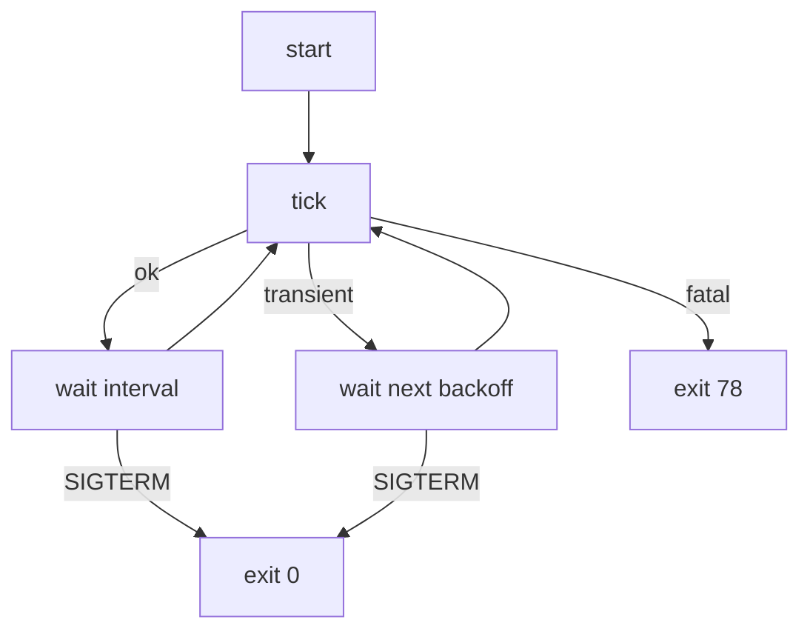

# The daemon

A daemon is a program with nobody watching it. It starts at boot, runs for
months, and the only evidence of how it's doing is what it writes to the
journal. During those months the Wi-Fi will drop, Cloudflare will have a bad
afternoon, someone will revoke the API token, and the machine will be rebooted
for updates more times than anyone can count. Each of those needs a different
response: wait a bit and try again, give up and say why loudly, or stop
cleanly and promptly when asked.

Everything we've built so far is a library: the domain, the pure core, the
ports and adapters, and a `Reconciler` that runs one tick. In this chapter we
write the program around it, the *imperative shell* from Chapter 1. It's the
only part of the project that reads arguments and files, owns the clock, sleeps,
listens for signals, and decides what an exit code means.

Shells are where programs usually get messy, because this is where all the
special cases pile up. We'll keep ours tidy with three ideas: errors that carry
their own classification in their type, a retry schedule that's just an
iterator, and a main loop that's a straightforward `match` over what happened.

## What the shell is responsible for

Let's list the jobs before writing any of them:

1. Parse the command line: which config file, run once or forever, dry run or
   not.
2. Read the config file and the API token (I/O), and validate the config (pure,
   already written).
3. Build the adapters and the `Reconciler`.
4. Tick. If the tick worked, wait for the configured interval. If it failed
   in a way that might fix itself, wait a little and retry, a bit longer each
   time. If it failed in a way that won't, stop with a clear message and an
   exit code that says so.
5. Stop promptly on `SIGTERM` (systemd) or ctrl-c (a human).
6. Log what's going on, in a form that suits both a terminal and the journal.

Step 4 is the heart of it. Here it is as a picture:



Let's add this chapter's dependencies. `clap` parses arguments, `anyhow`
reports errors in `main`, `tracing-subscriber` prints our `tracing` events,
and `fastrand` supplies a little randomness. tokio needs its `signal` feature
too:

```sh
cargo add clap --features derive
cargo add anyhow fastrand
cargo add tracing-subscriber --features env-filter
cargo add tokio --features macros,rt,time,signal
```

## A command line

`clap`'s derive API turns a struct into an argument parser. Field names become
flags, doc comments become help text, and the types say what's expected:

```rust
// file: src/main.rs
/// Keep Cloudflare DNS records pointed at this machine's public IP.
#[derive(Debug, Parser)]
#[command(version, about)]
struct Cli {
    /// Path to the TOML configuration file.
    #[arg(long, short, default_value = "/etc/cf-ddns/config.toml")]
    config: PathBuf,
    /// Reconcile once and exit, instead of running as a daemon.
    #[arg(long)]
    once: bool,
    /// Report what would change, without changing anything.
    #[arg(long)]
    dry_run: bool,
}
```

```text
Keep Cloudflare DNS records pointed at this machine's public IP

Usage: cf-ddns [OPTIONS]

Options:
  -c, --config <CONFIG>  Path to the TOML configuration file
                         [default: /etc/cf-ddns/config.toml]
      --once             Reconcile once and exit, instead of running as a
                         daemon
      --dry-run          Report what would change, without changing anything
  -h, --help             Print help
  -V, --version          Print version
```

`dry_run` becomes `--dry-run`, and `#[command(version)]` reads the version from
`Cargo.toml`. Two `bool` flags are fine here: they're independent, and all
four combinations make sense. (`--once --dry-run` is the most useful command in
this chapter.) Inside the program, though, `dry_run` is turned into the `Mode`
enum from Chapter 10 straight away, so nothing downstream has to remember what
`true` meant.

## Wiring it together

`main` is tiny. It sets up logging, runs the program, and turns the outcome
into an exit status:

```rust
#[tokio::main(flavor = "current_thread")]
async fn main() -> ExitCode {
    init_tracing();
    match run(Cli::parse()).await {
        Ok(code) => code,
        Err(error) => {
            error!("{error:#}");
            ExitCode::from(EX_CONFIG)
        }
    }
}
```

`#[tokio::main]` wraps `main` in a tokio runtime so it can be `async`. The
`current_thread` flavour runs everything on one thread, which is plenty for a
program that spends nearly all its time asleep. The `{error:#}` format prints
an `anyhow` error with its whole chain of causes on one line.

`run` is where the shell does its I/O and assembly. As Chapter 4 recommended,
the shell is the one place we use `anyhow`: we don't need to match on these
errors, only to report them with context:

```rust
async fn run(cli: Cli) -> anyhow::Result<ExitCode> {
    let text = fs::read_to_string(&cli.config)
        .with_context(|| format!("reading {}", cli.config.display()))?;
    let config = Config::from_toml(&text)
        .with_context(|| format!("in {}", cli.config.display()))?;
    let token = load_token(&config.token)?;

    let http = reqwest::Client::builder()
        .timeout(Duration::from_secs(10))
        .user_agent(concat!("cf-ddns/", env!("CARGO_PKG_VERSION")))
        .build()?;
    let dns = Cloudflare::new(
        http.clone(),
        cloudflare::API,
        config.zone.clone(),
        token,
    );
    let v4 = ip_sources::default_v4(&http);
    let v6 = ip_sources::default_v6(&http);
    let app = Reconciler::new(config, v4, v6, dns);
    // ... choose the mode, then run `once` or `daemon`
}
```

Everything we built in the last three chapters gets plugged together in about
fifteen lines. That's the payoff of keeping each piece focused: the shell is
just wiring.

Two details matter more than they look. The client has a 10-second timeout,
so a service that accepts a connection and then says nothing can't hang a tick
forever. And one `reqwest::Client` is shared by every adapter (each `clone` is a
cheap handle to the same connection pool), so connections to Cloudflare are
reused from tick to tick.

`.with_context` adds a layer to the error chain. When the config is wrong, the
whole chain reads as one sentence:

```text
ERROR in bad.toml: records[0]: `a..b` has an empty label (two dots in a row?)
```

That's three layers: `run`'s context, `ConfigError::Name`'s `records[0]`, and
the `NameError`. This is why Chapter 8 kept each layer's message to its own
part of the story.

Reading the token follows the `TokenSource` decided in the config:

```rust
fn load_token(source: &TokenSource) -> anyhow::Result<ApiToken> {
    let path = match source {
        TokenSource::File(path) => path.clone(),
        TokenSource::Credential(name) => {
            let dir = env::var_os("CREDENTIALS_DIRECTORY").context(
                "no api_token_file in the config, and no systemd \
                 credentials directory ($CREDENTIALS_DIRECTORY) either",
            )?;
            Path::new(&dir).join(name)
        }
    };
    let text = fs::read_to_string(&path).with_context(|| {
        format!("reading the API token from {}", path.display())
    })?;
    Ok(text.parse()?)
}
```

`$CREDENTIALS_DIRECTORY` is set by systemd when a service has credentials;
Chapter 12 explains it. Outside systemd, the error message tells the user
exactly which two things they could do about it.

## Not all failures are equal

### The crack

In Chapter 10, a failed tick returned a `TickError` that simply wrapped
whichever port failed:

```rust
pub enum TickError {
    Ip(IpError),
    Dns(DnsError),
}
```

Now the loop has to decide what to do with one. Some failures will fix
themselves (the network is down, Cloudflare returned a 502, we're being rate
limited) and the right response is to wait and retry. Others won't: if the
token was revoked, retrying every five seconds for a year just fills the
journal and annoys Cloudflare. The right response there is to stop, say why,
and let a human fix it.

The tempting way to tell them apart is a method on the error:

```rust
// a first attempt
impl TickError {
    fn is_retryable(&self) -> bool {
        match self {
            TickError::Dns(DnsError::TokenRejected) => false,
            TickError::Dns(DnsError::Rejected(_)) => false,
            _ => true,
        }
    }
}
```

It works today. Now imagine a colleague adds a `DnsError::ZoneNotFound`
variant next year. It compiles. It falls into the `_` arm, so it's
"retryable", and the daemon retries a zone that doesn't exist, forever. The
wildcard took a decision that should have been made consciously, and it did so
silently.

And there's a second, quieter problem. Every caller has to remember to call
`is_retryable()`. The `TickError` type says *where* a failure came from, which
is the one thing the loop doesn't care about. What the loop cares about is
*what to do next*.

### Classification in the type

So let's make the type say what the loop cares about:

```rust
// file: src/app.rs
/// Why a tick stopped early, classified by what the caller should do.
#[derive(Debug, Error)]
pub enum TickError {
    /// Worth retrying soon: a network or provider hiccup.
    #[error("{0}")]
    Transient(Cause),
    /// Retrying will not help. A human needs to change something.
    #[error("{0}")]
    Fatal(Cause),
}

#[derive(Debug, Error)]
pub enum Cause {
    #[error(transparent)]
    Ip(#[from] IpError),
    #[error(transparent)]
    Dns(#[from] DnsError),
}
```

The *outer* layer is now the decision: transient or fatal. The original error
is still there, inside, as the `Cause`, for logging. The loop can match on
`Transient` and `Fatal` without knowing anything about IP sources or DNS
providers.

The classification itself happens in exactly one place, the `From` conversions
that `?` uses. Every `IpError` is transient: if none of three IP services can
tell us our address, the network is almost certainly down, and that passes.
`DnsError`s are sorted, variant by variant, with no wildcard:

```rust
impl From<IpError> for TickError {
    fn from(error: IpError) -> Self {
        TickError::Transient(error.into())
    }
}

impl From<DnsError> for TickError {
    fn from(error: DnsError) -> Self {
        match error {
            DnsError::Unreachable(_)
            | DnsError::RateLimited
            | DnsError::ProviderDown(_) => TickError::Transient(error.into()),
            DnsError::TokenRejected
            | DnsError::Rejected(_)
            | DnsError::Unexpected(_) => TickError::Fatal(error.into()),
        }
    }
}
```

The application code doesn't change at all. `reconcile` still says
`source.current().await?` and `self.dns.records(name).await?`, and `?` calls
these conversions, so every error leaving a tick is already classified.

Now let's be that colleague, and add a variant to `DnsError`:

```rust
    #[error("the DNS provider took too long to answer")]
    TimedOut,
```

```text
error[E0004]: non-exhaustive patterns: `DnsError::TimedOut` not covered
  --> src/app.rs:56:15
   |
56 |         match error {
   |               ^^^^^ pattern `DnsError::TimedOut` not covered
   |
note: `DnsError` defined here
  --> src/ports/mod.rs:62:10
   |
62 | pub enum DnsError {
   |          ^^^^^^^^
...
66 |     TimedOut,
   |     -------- not covered
   = note: the matched value is of type `DnsError`
help: ensure that all possible cases are being handled by adding a match
      arm with a wildcard pattern or an explicit pattern as shown
   |
62 ~             | DnsError::Unexpected(_) => TickError::Fatal(error.into()),
63 ~             DnsError::TimedOut => todo!(),
   |
```

The build won't pass until someone decides whether a timeout is worth retrying.
(It is.) That's Chapter 1's "compiler as a design partner" again, applied to
operations rather than domain logic: the question "what should the daemon do
about this?" can't be skipped.

> [!PATTERN] Error Classification by Type (transient vs fatal)
> When callers need to *react* differently to failures, make the reaction part
> of the error's type: an outer enum such as `Transient(cause)` / `Fatal(cause)`
> wrapping the detailed error. Classify in one place, in exhaustive `From`
> conversions with no wildcard arms, so that `?` classifies automatically and
> every new error variant forces a conscious decision.

Two application tests pin down the classification, using the fakes from Chapter
10:

```rust
#[tokio::test]
async fn an_offline_ip_source_is_transient() {
    let config = Config::from_toml(CONFIG).unwrap();
    let app =
        Reconciler::new(config, FixedIp(None), FixedIp(Some(V6)), stale());
    let result = app.tick(Mode::Apply).await;
    assert!(matches!(result, Err(TickError::Transient(_))));
}

#[tokio::test]
async fn a_rejected_token_is_fatal() {
    let dns = FakeDns {
        reject_token: true,
        ..stale()
    };
    let result = app(dns).tick(Mode::Apply).await;
    assert!(matches!(result, Err(TickError::Fatal(_))));
}
```

`..stale()` is *struct update syntax*: take every field we didn't mention from
another value of the same type.

> [!NOTE]
> Where do `Problem`s fit? A missing or ambiguous record isn't an error at all
> for the tick: it's in the `Report`, the tick succeeds, and the other names
> are still maintained. That's a third category, *needs attention but keep
> going*, and it lives in the success value. Three reactions, three places in
> the types.

## How long to wait

When a tick fails transiently, we wait and retry. How long? Not a fixed five
seconds: if Cloudflare is down for an hour, that's 720 failed requests. The
standard answer is *exponential backoff*: wait 5 seconds, then 10, then 20,
doubling up to a cap.

### The loop-counter version

Here's how backoff usually ends up written, threaded through the loop:

```rust
// a first attempt
let mut attempt = 0;
loop {
    match app.tick(mode).await {
        Ok(_) => {
            attempt = 0;
            sleep(interval).await;
        }
        Err(_) => {
            let wait = Duration::from_secs(5 * 2u64.pow(attempt));
            attempt += 1;
            sleep(wait.min(Duration::from_secs(300))).await;
        }
    }
}
```

The policy (start at 5, double, cap at 300) is smeared across five lines of the
loop, mixed in with the mechanism. It has a latent bug: after 64 failures,
`2u64.pow(attempt)` overflows and panics in debug builds. To test it, you'd have
to run the loop and measure sleeps. And it's missing *jitter*: if a thousand
machines lose their connection in the same outage, they'll all retry at
exactly 5, 10 and 20 seconds, hitting the recovering service in synchronised
waves. Spreading retries out with a little randomness avoids that.

### The schedule is a sequence

Step back and look at what backoff *is*: a sequence of durations. 5, 10, 20,
40, 80, 160, 300, 300, 300... The loop just takes the next one each time it
needs to wait. Rust has a name for "something that produces the next value of
a sequence on demand": `Iterator`.

```rust
// file: src/backoff.rs
/// Exponential backoff: `base`, then double each time up to `max`, each
/// delay scaled by a `jitter` factor that must lie in `0.0..=1.0`.
pub fn backoff(
    base: Duration,
    max: Duration,
    mut jitter: impl FnMut() -> f64,
) -> impl Iterator<Item = Duration> {
    iter::successors(Some(base.min(max)), move |delay| {
        Some(delay.saturating_mul(2).min(max))
    })
    .map(move |delay| delay.mul_f64(jitter()))
}
```

`iter::successors` builds an iterator from a first value and a function that
computes each next value from the previous one. It stops when the function
returns `None`; ours never does, so the sequence is infinite, and that's fine:
iterators are lazy, and the caller takes only as many as it needs.
`saturating_mul` caps at the largest `Duration` instead of overflowing, and
`.min(max)` applies our cap, so the overflow bug can't happen.

Jitter is applied by a final `.map`. And here's the important design choice:
the randomness is *passed in* as a closure (Chapter 6's `FnMut`), not called
from inside. `backoff` doesn't know or care where the jitter factors come from.
That makes it a pure function of its arguments, and makes it trivially
testable: tests pass in a closure that returns whatever they like.

```rust
#[test]
fn doubles_up_to_the_cap() {
    let delays: Vec<_> =
        backoff(secs(5), secs(60), || 1.0).take(6).collect();
    assert_eq!(
        delays,
        [secs(5), secs(10), secs(20), secs(40), secs(60), secs(60)]
    );
}

#[test]
fn jitter_scales_each_delay() {
    let mut factors = [0.5, 1.0, 0.25].into_iter();
    let delays: Vec<_> =
        backoff(secs(8), secs(60), || factors.next().unwrap())
            .take(3)
            .collect();
    assert_eq!(delays, [secs(4), secs(16), secs(8)]);
}
```

The second test feeds in a scripted sequence of "random" factors and checks
each one was applied to the right delay. No real randomness, no sleeping, no
flakiness. A property test adds the guarantee that matters most, over any base,
cap and jitter factor:

```rust
proptest! {
    #[test]
    fn never_exceeds_the_cap(
        base in 1u64..600,
        max in 1u64..3600,
        factor in 0.0f64..=1.0,
    ) {
        let delays = backoff(secs(base), secs(max), || factor).take(50);
        for delay in delays {
            prop_assert!(delay <= secs(max));
        }
    }
}
```

The shell decides the actual policy and supplies the real randomness. It's one
small function, which is the only place in the program that knows the numbers:

```rust
// file: src/main.rs
/// Up to five minutes between retries, starting at five seconds.
fn retry_schedule() -> impl Iterator<Item = Duration> {
    let jitter = || 0.5 + fastrand::f64() / 2.0;
    backoff(Duration::from_secs(5), Duration::from_secs(300), jitter)
}
```

`fastrand::f64()` returns a random number in `0.0..1.0`, so each delay is
scaled to between 50% and 100% of its nominal value. That's often called
*equal jitter*: it always waits at least half the nominal delay, but no two
machines wait exactly the same time.

> [!PATTERN] Schedule as Iterator (backoff)
> Model a schedule (retry delays, polling intervals, timeouts) as a pure
> function returning `impl Iterator<Item = Duration>`. The policy is stated
> once, tested by collecting a prefix, and composed with ordinary adaptors
> (`take`, `map`, `chain`). Inject side effects such as randomness as closures
> so the schedule stays deterministic in tests. The loop just calls `next()`.

## The main loop

Now the loop itself. Each ingredient has been prepared, so it reads almost
like the flowchart at the start of the chapter:

```rust
async fn daemon<V4, V6, D>(
    app: &Reconciler<V4, V6, D>,
    mode: Mode,
) -> io::Result<ExitCode>
where
    // ... the same bounds as Reconciler
{
    let mut shutdown = pin!(shutdown_signal()?);
    let mut retries = retry_schedule();
    info!(interval = ?app.config().interval, ?mode, "started");
    loop {
        let outcome = tokio::select! {
            outcome = app.tick(mode) => outcome,
            () = &mut shutdown => break,
        };
        let wait = match outcome {
            Ok(report) => {
                log_report(&report);
                retries = retry_schedule();
                app.config().interval
            }
            Err(TickError::Transient(cause)) => {
                let wait = retries.next().unwrap_or(app.config().interval);
                warn!(%cause, ?wait, "temporary failure; will retry");
                wait
            }
            Err(TickError::Fatal(cause)) => {
                error!(%cause, "giving up");
                return Ok(ExitCode::from(EX_CONFIG));
            }
        };
        tokio::select! {
            () = tokio::time::sleep(wait) => {}
            () = &mut shutdown => break,
        }
    }
    info!("shutting down");
    Ok(ExitCode::SUCCESS)
}
```

Let's walk through the parts that are new.

**The `match` decides how long to wait**, and it's an expression, so `wait`
is simply its value. Success waits the configured interval and *resets* the
retry schedule by replacing the iterator with a fresh one: the next failure
starts at five seconds again. A transient failure takes the next delay from the
schedule. A fatal failure leaves the loop with exit status 78.

**`retries.next().unwrap_or(...)`**: our schedule is infinite, so `next()`
will never actually return `None`, but its type doesn't know that.
`Iterator::next` always returns an `Option`. Rather than `unwrap()` on a promise
the type system can't check, we give a sensible fallback.

**`tokio::select!` waits for whichever future finishes first** and runs that
branch; the other future is dropped, which cancels it. The second `select!`
races the sleep against the shutdown signal, so a `SIGTERM` during a
five-minute wait stops the daemon immediately instead of five minutes later.

The first `select!` does the same during a tick, which deserves a moment's
thought. Cancelling a tick halfway could, in principle, leave things half done:
we might have updated the A record and not the AAAA record. Is that safe? It is,
because of how we designed the core. A tick doesn't remember anything between
runs; every tick starts by reading the actual state and planning from there,
and Chapter 9's convergence property says planning from *any* state leads to
the right one. A half-finished tick is just another starting state. The design
that made testing easy is the same design that makes cancellation safe.

**`pin!(shutdown_signal()?)`**: we poll the same shutdown future in two
different `select!`s, across many loop iterations, so we pass it by `&mut`
reference. Polling a future through a reference requires it to be *pinned*,
guaranteed not to move in memory, because a future may hold references into
itself. `std::pin::pin!` pins it in place on the stack. You rarely need to think
harder about pinning than "when `select!` complains about `Unpin`, pin the
future first".

## Stopping politely

`shutdown_signal` builds the future that the loop waits on:

```rust
/// Resolves when we receive SIGTERM (systemd stopping us) or ctrl-c.
fn shutdown_signal() -> io::Result<impl Future<Output = ()>> {
    let mut terminate = signal(SignalKind::terminate())?;
    Ok(async move {
        tokio::select! {
            _ = terminate.recv() => {}
            _ = tokio::signal::ctrl_c() => {}
        }
    })
}
```

The function is split into two stages on purpose. Registering the `SIGTERM`
handler can fail, and we want that failure *now*, at startup, reported as an
error, not later inside a future where the only option would be to panic. So
the fallible setup runs immediately and returns an `io::Result`, and the
`async move` block it returns can't fail: it just waits for either signal.

systemd sends `SIGTERM` when it stops a service, and waits (90 seconds by
default) before resorting to `SIGKILL`. Because we exit within moments of
receiving it, `systemctl stop` and reboots are quick and quiet.

> [!WARNING]
> Without a `SIGTERM` handler a tokio program is still killed by `SIGTERM`, so
> it might look like this code is unnecessary. The difference is *how* it ends:
> abruptly, mid-request, with no final log line, and recorded by systemd as a
> failure. A handler turns that into a clean exit with status 0.

## Running once, and exit codes

`--once` runs a single tick and reports the outcome through the exit status, so
it works from cron, a systemd timer or a shell script:

```rust
async fn once<V4, V6, D>(app: &Reconciler<V4, V6, D>, mode: Mode) -> ExitCode
where
    // ... the same bounds as Reconciler
{
    match app.tick(mode).await {
        Ok(report) if report.problems.is_empty() => {
            log_report(&report);
            ExitCode::SUCCESS
        }
        Ok(report) => {
            log_report(&report);
            ExitCode::FAILURE
        }
        Err(TickError::Transient(cause)) => {
            error!(%cause, "temporary failure");
            ExitCode::from(EX_TEMPFAIL)
        }
        Err(TickError::Fatal(cause)) => {
            error!(%cause, "giving up");
            ExitCode::from(EX_CONFIG)
        }
    }
}
```

The exit codes come from BSD's `sysexits.h`, a long-standing convention that
systemd and many tools understand:

| Status | Meaning |
|---|---|
| 0 | Everything is in sync (or was put in sync). |
| 1 | The tick ran, but some records need a human (`Problem`s). |
| 75 (`EX_TEMPFAIL`) | A transient failure; try again later. |
| 78 (`EX_CONFIG`) | A fatal failure: bad config, missing or rejected token. |

That last row is more useful than it looks. In Chapter 12 we'll tell systemd
to restart the daemon if it fails, *except* when it exits with 78, because
restarting a daemon with a revoked token just produces the same failure again.
The exit status carries our error classification across the process boundary.

## Logs worth reading

We've been calling `info!`, `warn!` and `debug!` since Chapter 10. Those macros
create *events*; something has to collect and print them. That's
`tracing-subscriber`:

```rust
fn init_tracing() {
    let filter = EnvFilter::try_from_default_env()
        .unwrap_or_else(|_| EnvFilter::new("info"));
    let logs = tracing_subscriber::fmt()
        .with_env_filter(filter)
        .with_target(false);
    // Under systemd, journald adds its own timestamps and colours.
    if env::var_os("JOURNAL_STREAM").is_some() {
        logs.without_time().with_ansi(false).init();
    } else {
        logs.init();
    }
}
```

`EnvFilter` reads the `RUST_LOG` environment variable, so `RUST_LOG=debug`
shows the in-sync plans too, and `RUST_LOG=cf_ddns=debug,reqwest=trace` shows
everything about HTTP. The default is `info`.

systemd sets `JOURNAL_STREAM` when a service's output goes to the journal.
journald records its own timestamp for every line and doesn't interpret colour
codes, so we drop both. This is the shell adapting to its environment, which is
exactly what shells are for.

Events carry *fields* as well as messages. `info!(%plan, ?mode, "change")`
records `plan` using `Display` (`%`) and `mode` using `Debug` (`?`), and the
subscriber prints them as `key=value` pairs. Here's a dry run against a zone
where `home.example.com` has a stale A record and a correct AAAA record, and
`vpn.example.com` doesn't exist yet:

```sh
RUST_LOG=debug cargo run -- --config config.toml --once --dry-run
```

```text
 INFO change plan=home.example.com A 198.51.100.4 -> 203.0.113.7 (update) mode=DryRun
 INFO change plan=vpn.example.com A 203.0.113.7 (create) mode=DryRun
DEBUG plan=home.example.com AAAA 2001:db8::7 (in sync)
 INFO tick complete in_sync=1 changed=2 problems=0
```

Every line is a `Plan`'s `Display` from Chapter 9. We never wrote a "format a
log message for an update" function; the decision already knew how to
describe itself.

> [!TIP]
> Always run `--once --dry-run` against your real zone before letting the
> daemon loose. It reads everything and writes nothing, so it's the safest
> possible way to check the token, the zone ID and your record names.

> [!CHECKPOINT]
> You now have a working binary. `src/backoff.rs` (declared with
> `pub mod backoff;` in `lib.rs`) holds the schedule,
> `src/app.rs` has the classified `TickError`, and `src/main.rs` has the CLI,
> `run`, `load_token`, `once`, `daemon`, `shutdown_signal` and
> `init_tracing`.
>
> ```sh
> cargo test
> cargo clippy --all-targets
> ```
>
> ```text
>      Running unittests src/lib.rs
> test result: ok. 27 passed; 0 failed; 0 ignored; 0 measured
>      Running tests/cloudflare.rs
> test result: ok. 4 passed; 0 failed; 0 ignored; 0 measured
>      Running tests/reconcile.rs
> test result: ok. 7 passed; 0 failed; 0 ignored; 0 measured
> ```
>
> With a real zone ID in your config and a token in a file named by
> `api_token_file`, `cargo run -- -c config.toml --once --dry-run` should
> print one line per record and exit with status 0.

## What we learned

- **The shell is wiring.** With the domain, core and adapters done, assembling
  the program is about fifteen lines; the shell's real work is policy: when to
  retry, when to stop, what to log, which exit code.
- **`anyhow` with `.with_context` in the shell** turns layered typed errors into
  one readable sentence, as long as each layer only describes its own part.
- **Error Classification by Type**: `TickError::Transient` and `Fatal` put the
  caller's decision in the type, `From` conversions classify in one exhaustive
  place, and a new error variant can't be added without deciding how to treat
  it.
- **Schedule as Iterator**: backoff is `iter::successors` plus a jitter `map`,
  with randomness injected as a closure so it can be tested deterministically.
- **`tokio::select!`** races a tick or a sleep against a shutdown signal; a
  pinned future can be polled across loop iterations.
- **Idempotent reconciliation makes cancellation safe**: an interrupted tick
  is just another starting state.
- **Exit codes carry meaning** to whoever runs us (`sysexits.h`), and
  `tracing` fields plus a plan's `Display` give logs we never had to format by
  hand.

## Exercises

> [!EXERCISE] Retry within the provider
> Rate limiting (`429`) often comes with a `Retry-After` header saying exactly
> how long to wait. Change `DnsError::RateLimited` to carry an
> `Option<Duration>` and make the loop prefer it over the backoff schedule when
> it's present. Which layers did you have to touch, and did any of them stop
> being pure?

> [!EXERCISE] Partial progress
> If the IPv4 source fails, `tick` returns early and the IPv6 records aren't
> checked at all. That's not a reporting nicety but a convergence bug: with
> IPv4 down for good, a wrong AAAA record stays wrong for good (TLA+
> Interlude 2 proves it). Change `tick` so a failure for one family doesn't
> prevent the other from being reconciled, then combine the errors, fatal
> before transient. How does that change the `Report`? Write the test with
> `FixedIp(None)` first.

> [!EXERCISE] A paused clock
> tokio has a `test-util` feature with `tokio::time::pause()`, which makes
> `sleep` return instantly while advancing a virtual clock. Write a test for
> `daemon`-like behaviour: a fake provider that fails twice then succeeds,
> asserting that the virtual time elapsed matches the backoff schedule. What
> would you need to change about `daemon` to make it testable (hint: what does
> it get from the outside world that a test would want to control)?

> [!EXERCISE] Not too fast
> Cloudflare's API allows a generous number of requests, but a misconfigured
> `interval_secs` combined with many records could still exceed it. Using only
> iterator adaptors, write a function that spreads a tick's requests out so
> there's at least 200 ms between them. Where should it live: in the adapter,
> the application, or the shell?
