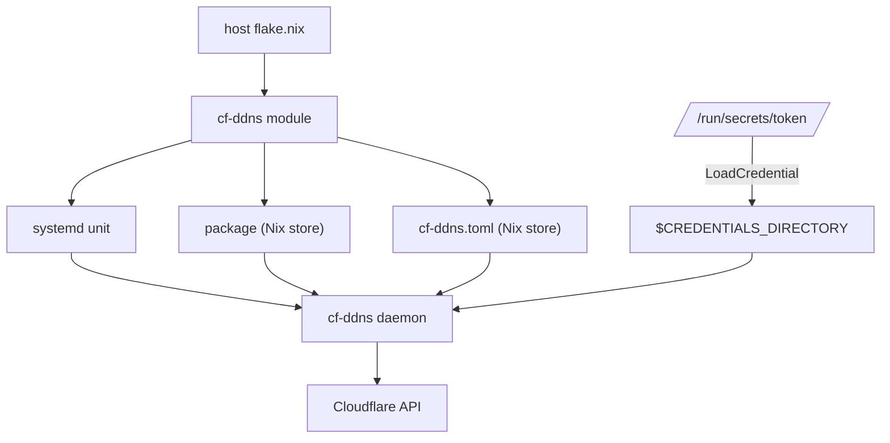

# Shipping on Nix

The daemon works. On your laptop, `cargo run -- --once --dry-run` prints the
right plans, and the tests are green. But the daemon doesn't belong on your
laptop. It belongs on the small machine in the cupboard, the one that's always
on, which in this book runs NixOS. Getting it there "by hand" means copying a
binary, writing a config file in `/etc`, putting the token somewhere safe,
writing a systemd unit, remembering to harden it, and then repeating all of that,
from memory, on the next machine or after the next reinstall.

NixOS offers something better. A NixOS machine is described by its
configuration, and services are switched on by setting typed options:

```nix
services.cf-ddns = {
  enable = true;
  zoneId = "023e105f4ecef8ad9ca31a8372d0c353";
  apiTokenFile = "/run/secrets/cloudflare-api-token";
  records = [
    { name = "home.example.com"; ipv6 = true; }
    { name = "vpn.example.com"; }
  ];
};
```

By the end of this chapter, that block, plus one line adding our project to the
host's flake, is all it takes to build the daemon, generate its config, deliver
its token securely, and run it as a locked-down systemd service. We'll write two
small Nix files in the project: a *package*, which says how to build the binary,
and a *module*, which says how to run it on NixOS.

Part 0 introduced Nix, flakes and dev shells, and showed home-manager's typed
options refusing a bad value. This chapter builds on that, so if `nix build`
or `inputs`/`outputs` are unfamiliar, it's worth a quick look back first.

## Packaging the binary

Nix builds everything in a *sandbox*: a clean environment with no network
access and nothing on disk except the declared inputs. That's what makes builds
reproducible, and it raises an immediate question for a Rust project: how does
`cargo build` download its crates?

The answer is `Cargo.lock`. It records the exact version and checksum of every
crate in the dependency graph. nixpkgs' `rustPlatform.buildRustPackage` reads
it, fetches each crate as a separate, checksummed Nix download *before* the
sandboxed build starts, and points cargo at the result. The lock file you
already have is all the information Nix needs.

The package lives in its own file:

```nix
# file: nix/package.nix
{ lib, rustPlatform }:

rustPlatform.buildRustPackage {
  pname = "cf-ddns";
  version = "0.1.0";

  src = lib.fileset.toSource {
    root = ../.;
    fileset = lib.fileset.unions [
      ../Cargo.toml
      ../Cargo.lock
      ../src
      ../tests
      ../examples
    ];
  };

  cargoLock.lockFile = ../Cargo.lock;

  meta = {
    description = "Keeps Cloudflare DNS records pointed at this host";
    mainProgram = "cf-ddns";
    license = lib.licenses.mit;
  };
}
```

The file is a function. Its arguments, `lib` and `rustPlatform`, are things
from nixpkgs that it needs, and whoever calls it supplies them. (That's
`callPackage`'s job, as we'll see in the flake.)

`src` deserves the most attention. We could write `src = ../.;` and copy the
whole project directory into the build. But then editing the README, or the
flake itself, would change the source and trigger a full rebuild, and any stray
files lying around (a `target/` directory, a token you were testing with) would
be copied into the Nix store. `lib.fileset` lets us list exactly what the build
needs. `tests` and `examples` are included because `buildRustPackage` runs
`cargo test` after building (the *check phase*), and one of our config tests
reads `examples/config.toml` with `include_str!`.

That's a nice property to notice: every `nix build` runs the whole test suite,
including the `wiremock` tests, which only need a local port and so work fine
in the sandbox. A package that fails its tests doesn't get built.

`cargoLock.lockFile` is the line that does the vendoring described above.
`meta.mainProgram` names the binary, which lets other Nix code find it with
`lib.getExe` instead of hard-coding `bin/cf-ddns`.

> [!WARNING]
> If your project is a git repository, flakes only see files that git knows
> about. A new file that you haven't `git add`ed is invisible to `nix build`,
> and the error ("path does not exist") can be baffling. Staging is enough; you
> don't need to commit.

## The flake

The flake is the project's front door. It pins nixpkgs and declares what the
project offers to the world: a package, a NixOS module, and a dev shell.

```nix
# file: flake.nix
{
  description = "cf-ddns: keep Cloudflare DNS records pointed at this host";

  inputs.nixpkgs.url = "github:NixOS/nixpkgs/nixos-unstable";

  outputs = { self, nixpkgs }:
    let
      systems = [
        "x86_64-linux"
        "aarch64-linux"
        "x86_64-darwin"
        "aarch64-darwin"
      ];
      forAllSystems = f:
        nixpkgs.lib.genAttrs systems
          (system: f nixpkgs.legacyPackages.${system});
    in
    {
      # ... outputs, below
    };
}
```

`forAllSystems` is a small helper that runs a function once per platform and
collects the results into an attribute set keyed by system name: the shape
flakes expect for `packages` and `devShells`. With it, the outputs are short:

```nix
      packages = forAllSystems (pkgs: {
        default = pkgs.callPackage ./nix/package.nix { };
      });

      nixosModules.default = import ./nix/module.nix self;

      devShells = forAllSystems (pkgs: {
        default = pkgs.mkShell {
          packages = with pkgs; [ cargo rustc clippy rustfmt ];
        };
      });
```

`callPackage` reads the function's argument list (`{ lib, rustPlatform }`),
finds those names in `pkgs`, and calls it. `nixosModules.default` isn't
per-system: a module is a function of the *machine's* configuration, and the
machine knows its own platform. We pass `self` (this flake) into the module so
it can find our package for whichever platform it's running on.

Build it:

```sh
nix build
./result/bin/cf-ddns --version
```

```text
cf-ddns 0.1.0
```

The first build takes a few minutes: Nix fetches every crate, compiles them,
compiles us, and runs our tests. After that, the result is cached in the Nix
store, keyed by a hash of every input, and only a change to the source or the
lock file causes a rebuild.

> [!NOTE]
> The TLS library behind `reqwest`, `rustls`, uses `aws-lc-rs` for its
> cryptography by default, which compiles some C. `buildRustPackage` provides a
> C compiler, so nothing extra is needed. If you ever switch a project to
> native TLS (OpenSSL), you'd add `pkg-config` to `nativeBuildInputs` and
> `openssl` to `buildInputs`.

## Designing the module's interface

A NixOS *module* is a function that receives the whole machine's
configuration and returns two things: **options** it declares (the settings a
user can write) and **config** it contributes (systemd units, users, files)
based on those settings. Ours starts like this:

```nix
# file: nix/module.nix
self:
{ config, lib, pkgs, ... }:

let
  cfg = config.services.cf-ddns;
  toml = pkgs.formats.toml { };
in
{
  options.services.cf-ddns = {
    # ... the interface
  };

  config = lib.mkIf cfg.enable {
    # ... what enabling it does
  };
}
```

The file is a function of `self` (our flake, supplied by the flake's
`import ./nix/module.nix self`) that returns a module, which is itself a
function of the machine's `config`, `lib` and `pkgs`. `cfg` is a shorthand for
our own options' values. `lib.mkIf cfg.enable` means the whole `config` section
only applies when the service is switched on.

### The tempting shortcut

The quickest way to write the interface is to let the user write the TOML
themselves:

```nix
# a first attempt
options.services.cf-ddns.configText = lib.mkOption {
  type = lib.types.lines;
  description = "Contents of the cf-ddns config file.";
};
```

It works, and it throws away everything we've been building. The TOML is an
opaque string to Nix. A zone name pasted where the zone ID belongs, or an
`interval_secs = 5`, is accepted happily, the host builds, the switch succeeds,
and only then does the daemon start, read its config, and exit with status 78.
The mistake is discovered on the server, after deployment, in the journal.

Chapter 8 drew the boundary at the config file and validated everything there.
We can do better than that: draw the *same* boundary one layer further out, so
the mistake never gets as far as the server.

### Typed options

Each option declares its type, and the NixOS module system checks every value
against it before anything is built. Our types mirror our Rust domain:

```nix
    zoneId = lib.mkOption {
      type = lib.types.strMatching "[0-9a-fA-F]{32}";
      description = "The Cloudflare zone ID (32 hexadecimal characters).";
    };

    interval = lib.mkOption {
      type = lib.types.ints.between 30 86400;
      default = 300;
      description = "Seconds between checks.";
    };

    onMissing = lib.mkOption {
      type = lib.types.enum [ "create" "error" ];
      default = "create";
      description = "What to do when a configured record does not exist.";
    };
```

`strMatching` is a string that must match a regular expression, the same rule
`ZoneId::from_str` enforces. `ints.between` is a bounded integer, matching
`MIN_INTERVAL_SECS`. `enum` is a closed set of strings, matching the
`OnMissing` enum's serde names.

Records are a list of structured values. A `submodule` is a nested set of
typed options, the Nix equivalent of a struct:

```nix
  recordType = lib.types.submodule {
    options = {
      name = lib.mkOption {
        type = lib.types.str;
        example = "home.example.com";
        description = "Fully qualified name of the record to maintain.";
      };
      ipv4 = lib.mkOption {
        type = lib.types.bool;
        default = true;
        description = "Maintain an A record for this name.";
      };
      ipv6 = lib.mkOption {
        type = lib.types.bool;
        default = false;
        description = "Maintain an AAAA record for this name.";
      };
    };
  };
```

This lives in the `let` block, and the option uses it as the element type of a
list that may not be empty, matching `ConfigError::NoRecords`:

```nix
    records = lib.mkOption {
      type = lib.types.nonEmptyListOf recordType;
      description = "The records to keep pointed at this host.";
    };
```

The defaults, `ipv4 = true` and `ipv6 = false`, are the same as `RawRecord`'s
serde defaults, so the module and the file format agree on what an omitted
setting means.

The last two options are `enable`, made with the `mkEnableOption` helper, and
`package`, which defaults to the package from our own flake for the machine's
platform, so users get our binary without having to name it, but can override
it:

```nix
    enable = lib.mkEnableOption "the Cloudflare dynamic DNS daemon";

    package = lib.mkOption {
      type = lib.types.package;
      default = self.packages.${pkgs.stdenv.hostPlatform.system}.default;
      defaultText = lib.literalExpression "cf-ddns from its flake";
      description = "The cf-ddns package to run.";
    };
```

Here's what a typo in the host configuration now looks like:

```nix
services.cf-ddns.zoneId = "example.com";
```

```text
error: A definition for option `services.cf-ddns.zoneId' is not of type
       `string matching the pattern [0-9a-fA-F]{32}'. Definition values:
       - In `/nix/store/…-source/flake.nix': "example.com"
```

That's the same message shape Part 0 showed for home-manager, and the same
outcome: nothing was built, nothing was deployed, and the machine is exactly
as it was. The mistake was caught on *your* machine, at evaluation time.

Not every rule fits in an option type. "At least one of `ipv4` and `ipv6`" is
a rule about two fields together, like the `(false, false)` arm in Chapter 8's
`validate`. NixOS has a place for those, *assertions*, checked before the
system is built:

```nix
  config = lib.mkIf cfg.enable {
    assertions = [{
      assertion = lib.all (r: r.ipv4 || r.ipv6) cfg.records;
      message = "services.cf-ddns: every record needs ipv4 or ipv6.";
    }];

    # ...
  };
```

> [!WARNING]
> Pick option names carefully. nixpkgs already ships a module called
> `services.cloudflare-ddns` (for a different program), and declaring our
> options under the same name fails with
> ``The option `services.cloudflare-ddns.enable' ... is already declared``.
> Naming the options after the binary, `services.cf-ddns`, avoids the clash.
> It's worth searching the [NixOS options](https://search.nixos.org/options)
> before settling on a name.

### Typed configuration, all the way down

Line the layers up and a pattern appears:

| Rule | Nix option type | Rust (Chapter 8) |
|---|---|---|
| zone ID is 32 hex characters | `strMatching "[0-9a-fA-F]{32}"` | `ZoneId::from_str` |
| interval is at least 30 s | `ints.between 30 86400` | `ConfigError::IntervalTooShort` |
| missing-record policy | `enum [ "create" "error" ]` | `enum OnMissing` |
| at least one record | `nonEmptyListOf` | `ConfigError::NoRecords` |
| a record has a family | assertion | `Stack` (no `(false, false)`) |
| token stays out of the store | `pathWith { inStore = false; }` | `TokenSource` |

Each layer parses what it receives into types, refuses what doesn't fit, and
only then hands it on. The Nix module checks the host configuration and
*generates* the TOML, so the file the daemon reads was written by code that
knew its format. The daemon still validates the file, because the Rust program
can't assume who wrote it; someone running it outside NixOS writes the TOML by
hand. Neither layer trusts the other, and each catches mistakes as early as it
can.

There's some duplication here: the regular expression for a zone ID is written
in two languages. It's a deliberate trade. The Nix check moves the error from
"on the server, after deploying" to "on your laptop, before building"; the Rust
check keeps the daemon honest wherever it runs. If the two ever disagree, the
stricter one wins, and the worst case is a confusing message, never a broken
record.

> [!PATTERN] Typed Configuration at Every Layer (Nix module)
> Give every layer that accepts configuration its own typed boundary: NixOS
> module options with precise types and assertions at deployment, a raw DTO
> converted into validated domain types at startup. Generate each layer's input
> from the typed layer above it (Nix writes the TOML) rather than accepting
> free text. Mistakes are reported by the outermost layer that can see them,
> as early as possible, in terms of the option the user actually wrote.

### Generating the TOML

With typed values in hand, generating the config file is one call.
`pkgs.formats.toml` knows how to turn a Nix value into TOML and write it to the
store:

```nix
  configFile = toml.generate "cf-ddns.toml" {
    zone_id = cfg.zoneId;
    interval_secs = cfg.interval;
    on_missing = cfg.onMissing;
    records = cfg.records;
  };
```

Notice the translation from Nix naming (`zoneId`, `camelCase` by NixOS
convention) to our file format's names (`zone_id`). It's small, but it's the
same kind of mapping as Chapter 10's DTOs: each side keeps its own
conventions, and one place translates. For the example configuration at the
start of the chapter, this produces:

```toml
interval_secs = 300
on_missing = "create"
zone_id = "023e105f4ecef8ad9ca31a8372d0c353"

[[records]]
ipv4 = true
ipv6 = true
name = "home.example.com"

[[records]]
ipv4 = true
ipv6 = false
name = "vpn.example.com"
```

`configFile` is a path in `/nix/store`, and that brings us to the token.

## Keeping the token out of the store

Everything in `/nix/store` is readable by every user on the machine. It's also
copied into binary caches, closures and backups. Our generated TOML belongs
there; an API token absolutely does not. That's why the config file has no
`api_token_file` line, and why the module asks for a *path* to a file that
already exists on the machine, rather than for the token itself.

Even a path option has a trap. If someone writes `apiTokenFile = ./token;`
(a Nix path literal, without quotes), Nix helpfully copies that file into the
store so it can refer to it. So the option's type rules that out:

```nix
    apiTokenFile = lib.mkOption {
      type = lib.types.pathWith { inStore = false; absolute = true; };
      example = "/run/secrets/cloudflare-api-token";
      description = ''
        File containing a Cloudflare API token with Zone.DNS edit
        permission. Passed to the service as a systemd credential; it
        is never copied into the Nix store.
      '';
    };
```

```text
error: A definition for option `services.cf-ddns.apiTokenFile' is not of
       type `absolute path not in the Nix store'. Definition values:
       - In `/nix/store/…-source/flake.nix': /home/you/nixos/token
```

A security rule, enforced by a type, before anything is built.

> [!CAUTION]
> The token file itself has to get onto the machine somehow, and not via the
> Nix store. Tools such as `sops-nix` and `agenix` decrypt secrets at boot into
> `/run/secrets`; or you can simply create the file by hand, owned by root,
> with mode `0400`. Whatever you choose, never write the token as a string in
> your NixOS configuration.

### Handing it over with `LoadCredential`

The daemon will run as an unprivileged user, so how does it read a file that
only root can read? systemd's *credentials* mechanism solves exactly this. One
line in the unit:

```nix
        LoadCredential = "cloudflare-api-token:${cfg.apiTokenFile}";
```

When the service starts, systemd (running as root) reads the file and places a
copy in a private directory that only this service can see, then sets the
environment variable `$CREDENTIALS_DIRECTORY` to that directory's path. The
copy is named `cloudflare-api-token`, on an in-memory filesystem, and it
vanishes when the service stops.

That's precisely what Chapter 8's `TokenSource::Credential` and Chapter 11's
`load_token` were written for. With no `api_token_file` in the config, the
daemon reads `$CREDENTIALS_DIRECTORY/cloudflare-api-token`. The design decision
we made back then, "the config says *where* the token comes from, not what it
is", is what lets the token go from root-only file to daemon without ever
touching the store, the environment or the command line.

> [!NOTE]
> The alternative you'll often see is `EnvironmentFile=`, which loads
> `KEY=value` lines into the service's environment. It works, but environment
> variables are inherited by child processes, show up in `/proc/<pid>/environ`
> for the same user, and tend to end up in crash reports. Credentials are
> scoped to the one service and live in a file only it can read.

## The systemd service

Now the unit itself. NixOS describes systemd units as Nix values, under
`systemd.services.<name>`:

```nix
    systemd.services.cf-ddns = {
      description = "Cloudflare dynamic DNS";
      wantedBy = [ "multi-user.target" ];
      wants = [ "network-online.target" ];
      after = [ "network-online.target" ];

      serviceConfig = {
        ExecStart = "${lib.getExe cfg.package} --config ${configFile}";
        LoadCredential = "cloudflare-api-token:${cfg.apiTokenFile}";
        Restart = "on-failure";
        RestartSec = 30;
        # 78 is EX_CONFIG: a bad token or config. Restarting won't fix it.
        RestartPreventExitStatus = 78;
        # ... hardening, below
      };
    };
```

`wantedBy = [ "multi-user.target" ]` starts the service at boot.
`network-online.target` asks systemd to wait until the network is actually up,
so the first tick doesn't fail just because DHCP hasn't finished.

`ExecStart` is where Nix's string interpolation does something remarkable.
`${lib.getExe cfg.package}` becomes the binary's full store path, and
`${configFile}` becomes the generated TOML's. Interpolating them doesn't just
paste in text: it records a *dependency*, so building the system builds the
package and the config file, and the unit always points at exactly the
versions it was built with. There's no `/etc/cf-ddns/config.toml` to drift out
of date.

`Restart = "on-failure"` asks systemd to restart the daemon if it crashes or
exits with an error, after `RestartSec`. But a daemon that exited because its
token was revoked will fail identically on every restart, so
`RestartPreventExitStatus = 78` makes an exception for exactly that status.
This is Chapter 11's error classification crossing one more boundary:
`TickError::Fatal` became exit status 78 in Rust, and now status 78 means
"don't restart" in systemd. A transient problem is retried inside the daemon
with backoff; a fatal one stops, stays stopped, and shows up as a failed unit
in `systemctl --failed`.

### Hardening

Our daemon needs remarkably little from the operating system: no files to
write, no state to keep, no privileges, network access and nothing else.
That's a consequence of the design (all its state is at Cloudflare, re-read
every tick), and systemd lets us turn it into a guarantee:

```nix
        DynamicUser = true;
        NoNewPrivileges = true;
        ProtectSystem = "strict";
        ProtectHome = true;
        PrivateTmp = true;
        PrivateDevices = true;
        ProtectKernelTunables = true;
        ProtectKernelModules = true;
        ProtectControlGroups = true;
        RestrictAddressFamilies = [ "AF_UNIX" "AF_INET" "AF_INET6" ];
        RestrictNamespaces = true;
        LockPersonality = true;
        MemoryDenyWriteExecute = true;
        SystemCallArchitectures = "native";
        SystemCallFilter = [ "@system-service" "~@privileged" ];
        CapabilityBoundingSet = "";
        UMask = "0077";
```

The most important lines:

| Setting | Effect |
|---|---|
| `DynamicUser` | Runs as a fresh, unprivileged user allocated at start; no account to manage. |
| `ProtectSystem = "strict"` | The entire filesystem is read-only to the service. |
| `ProtectHome` | `/home`, `/root` and `/run/user` are invisible. |
| `NoNewPrivileges` | The process (and anything it runs) can never gain privileges. |
| `CapabilityBoundingSet = ""` | No Linux capabilities at all. |
| `RestrictAddressFamilies` | Only IPv4, IPv6 and Unix sockets (for name resolution via `systemd-resolved`). |
| `SystemCallFilter` | Only the system calls a typical service needs. |
| `MemoryDenyWriteExecute` | No writable-and-executable memory, which defeats many exploit techniques. |

If an attacker somehow took control of the process (a bug in a TLS library,
say), they would find themselves as a throwaway user, unable to write anywhere,
see anyone's files, load kernel modules or gain privileges. The one valuable
thing the process holds is the token, scoped to editing one zone's DNS.

> [!TIP]
> On the host, `systemd-analyze security cf-ddns` scores a unit's exposure
> from 0 to 10 and lists the hardening settings it doesn't use yet. A unit with
> no hardening at all is rated "UNSAFE"; run it before and after adding these
> settings to see the difference. It's a good habit for every service you
> write.

## Installing it on a NixOS host

That's the whole module. Here's how the pieces fit together on a running
machine:



Publish the project somewhere a flake can fetch it from, such as a git
repository on GitHub. Then, in the NixOS host's own flake, add it as an input
and include its module:

```nix
# file: flake.nix (the NixOS host's)
{
  inputs = {
    nixpkgs.url = "github:NixOS/nixpkgs/nixos-unstable";
    cf-ddns.url = "github:you/cf-ddns";
    cf-ddns.inputs.nixpkgs.follows = "nixpkgs";
  };

  outputs = { nixpkgs, cf-ddns, ... }: {
    nixosConfigurations.cupboard = nixpkgs.lib.nixosSystem {
      system = "x86_64-linux";
      modules = [
        cf-ddns.nixosModules.default
        ./configuration.nix
      ];
    };
  };
}
```

`inputs.nixpkgs.follows = "nixpkgs"` tells our flake to use the *host's*
nixpkgs instead of its own pinned copy, so the daemon is built with the same
compiler and libraries as the rest of the system, and nixpkgs isn't downloaded
twice.

Then switch the service on in `configuration.nix`, with the block from the
start of the chapter, and rebuild:

```sh
sudo nixos-rebuild switch --flake .#cupboard
systemctl status cf-ddns
journalctl -u cf-ddns -f
```

```text
 INFO started interval=300s mode=Apply
 INFO change plan=home.example.com A 198.51.100.4 -> 203.0.113.7 (update) mode=Apply
 INFO tick complete in_sync=2 changed=1 problems=0
```

No timestamps from us, no colour codes: that's `init_tracing` noticing
`JOURNAL_STREAM`, and journald adding its own timestamps.

> [!TIP]
> You can check that a module evaluates without a Linux machine at all. From
> any machine with Nix, in the host's flake directory:
>
> ```sh
> nix eval .#nixosConfigurations.cupboard.config.systemd.services.cf-ddns.serviceConfig.ExecStart
> ```
>
> evaluates the host's whole configuration, type-checks every option, and
> prints the command line systemd would run, without building anything.

> [!CHECKPOINT]
> Your project now has `flake.nix`, `nix/package.nix` and `nix/module.nix`
> alongside the Rust code. `nix build` produces `result/bin/cf-ddns` and runs
> the test suite on the way. On a NixOS host, adding the flake input and the
> `services.cf-ddns` block, then running `nixos-rebuild switch`, gives you a
> running, hardened `cf-ddns.service`. Try setting `zoneId = "example.com";`
> and confirm that the rebuild refuses before building anything.

## Not running NixOS?

Nix itself runs on any Linux distribution (and macOS), so you can still use the
package. Install the binary into the system-wide default profile, rather than
your own, because the hardened service can't see anything under `/home` or
`/root`:

```sh
sudo nix profile install --profile /nix/var/nix/profiles/default \
  github:you/cf-ddns
```

Then do by hand what the module did for you: write
`/etc/cf-ddns/config.toml` (start from `examples/config.toml`), put the token in
a root-only file, and add a unit. A cut-down version of the generated unit
looks like this:

```ini
# file: /etc/systemd/system/cf-ddns.service
[Unit]
Description=Cloudflare dynamic DNS
Wants=network-online.target
After=network-online.target

[Service]
ExecStart=/nix/var/nix/profiles/default/bin/cf-ddns \
  --config /etc/cf-ddns/config.toml
LoadCredential=cloudflare-api-token:/etc/cf-ddns/token
Restart=on-failure
RestartPreventExitStatus=78
DynamicUser=yes
ProtectSystem=strict
ProtectHome=yes
NoNewPrivileges=yes

[Install]
WantedBy=multi-user.target
```

The profile path stays the same when you upgrade with `nix profile upgrade`,
so the unit never needs editing. Then `systemctl daemon-reload` and
`systemctl enable --now cf-ddns`. You lose the evaluation-time checks, which
is exactly the point of the comparison: the Rust layer still validates the
file, so mistakes are still caught, just later, in the journal.

## What we learned

- **`rustPlatform.buildRustPackage` with `cargoLock.lockFile`** builds a Rust
  project reproducibly in Nix's sandbox; `Cargo.lock` is all the vendoring
  information it needs, and the check phase runs our tests on every build.
- **`lib.fileset`** keeps the build's source to what it needs, so unrelated
  edits don't rebuild and stray files don't leak into the store.
- **A NixOS module declares typed options and contributes config.** Option
  types (`strMatching`, `ints.between`, `enum`, `nonEmptyListOf`, `submodule`,
  `pathWith`) and assertions mirror the Rust domain's rules.
- **Typed Configuration at Every Layer**: Nix checks the host configuration and
  generates the TOML; Rust still parses and validates it. Mistakes surface at
  the earliest layer that can see them.
- **Secrets never go in the Nix store.** A `pathWith { inStore = false; }`
  option refuses path literals, and `LoadCredential` hands a root-only file to
  an unprivileged service through `$CREDENTIALS_DIRECTORY`.
- **Error classification crosses process boundaries**: exit status 78 plus
  `RestartPreventExitStatus` means fatal errors stay stopped, while transient
  ones are retried inside the daemon.
- **A stateless, pure-cored daemon is easy to lock down.** It needs no
  writable files and no privileges, so systemd's hardening options cost us
  nothing.

## Exercises

> [!EXERCISE] A TTL, end to end
> If you did Chapter 8's TTL exercise, carry it all the way through: a `ttl`
> option in the module with a type that accepts `1` or `60..86400` (look at
> `lib.types.either` and `lib.types.ints.between`), a key in the generated
> TOML, a field in `RawConfig`, the `Ttl` value object, and the `NewRecord`
> DTO. Count the layers that had to change. Which ones caught a bad value in
> your testing?

> [!EXERCISE] A timer instead of a daemon
> systemd can run `cf-ddns --once` every five minutes from a *timer* unit,
> instead of keeping a process alive. Add a `mode` option to the module,
> `enum [ "daemon" "timer" ]`, that generates either the service we wrote or a
> oneshot service plus `systemd.timers.cf-ddns`. What do you gain and lose?
> (Think about backoff, and about what exit status 75 should mean to a timer.)

> [!EXERCISE] A NixOS VM test
> nixpkgs can boot real NixOS virtual machines in a test with
> `pkgs.testers.runNixOSTest`. Write a test with two machines: one running a
> tiny fake Cloudflare (a few lines of Python, or a small axum app), and one
> running our module pointed at it. You'll need a way to override the API base
> URL; where should that option live, and should it be exposed to users at all?

> [!EXERCISE] Secrets, properly
> Set up `agenix` or `sops-nix` on a NixOS machine, encrypt the token, and
> point `apiTokenFile` at the decrypted path under `/run`. Then run
> `nix-store --query --requisites` on your system's toplevel and confirm that
> neither the token nor the encrypted file's plaintext appears anywhere in it.
