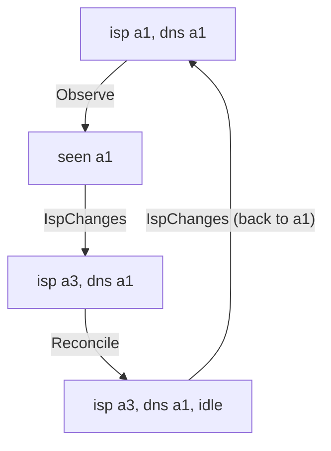
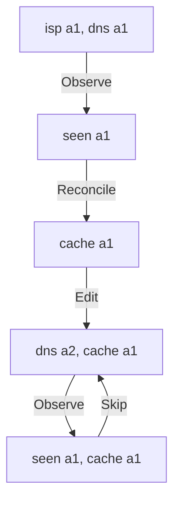

# Interlude: Will it converge?

`cf-ddns` is installed. It will run in the cupboard for years, and in that
time the ISP will hand out new addresses at three in the morning, the IP
lookup services will have bad days, Cloudflare will return the odd 502, and
at least once somebody will "just fix it quickly" in the Cloudflare
dashboard. Through all of that we're making one promise: **DNS will match our
address**.

Not *always*: there's always a moment after the ISP changes the address and
before the daemon notices. What we mean is weaker and harder to pin down:
whatever happens, *eventually* the record is right, and stays right. Chapter 9
tested a piece of that. Its convergence property planned, simulated the
change, planned again, and found nothing left to do. That's one tick, from one
starting state, with a world that holds still while we work.

The real promise is about *all futures*. Every test we can write, example or
property, runs for a finite number of steps and then checks something. But
"eventually" can't be refuted by a finite run: if the record is still wrong
after a thousand ticks, maybe it's right on the thousand and first. And it
can't be confirmed by one either, because the world might change its mind
on the next step. Questions about *eventually* need a tool that reasons about
infinite behaviours.

TLC is one. In this interlude we'll model the reconcile loop against a world
that changes at arbitrary moments, write down what "converge" means as a
formula, and let TLC search every future of a small model. It will find a
race we can't fix, an assumption we hadn't stated, a plausible design that
never converges, and a small flaw in the book's own code. This builds
directly on Interlude 1.

## Deciding what to leave out

Interlude 1 rounded temperatures to whole degrees. Here we have to throw away
much more, and deciding what goes is the first real design decision of any
spec. The rule is Chapter 9's, turned around: *if a fact can't change whether
we converge, it isn't in the model*.

So we leave out:

- **HTTP, JSON, tokens and Cloudflare's API.** The adapters translate them
  into domain values; the question is about what happens to those values.
- **Time.** The interval and the backoff schedule decide *when* the next tick
  happens, not *whether*. We'll come back to "whether"; it turns out to be an
  assumption worth naming.
- **IPv6, and every name but one.** One record of one family is enough to ask
  the question. (Near the end we'll put a second family back, because it does
  matter.)
- **Missing and duplicate records.** The record always exists, exactly once.
  `Problem::Missing` and `Problem::Ambiguous` are cases where the daemon
  *deliberately* refuses to converge until a human acts; there's nothing to
  check.
- **Fatal errors.** A rejected token stops the daemon for good, by design
  (Chapter 12 tells systemd not to restart it). Convergence after that is a
  human's job.
- **What an address looks like.** `203.0.113.7` versus `198.51.100.4` doesn't
  matter, only whether two addresses are the same.

What's left is small: our real public address, which the ISP controls; the
address in the Cloudflare record; and what the daemon has observed partway
through a tick.

## Constants and model values

Throwing away what an address looks like needs a new idea. We want "some
addresses", without saying how many or what they are. TLA+ lets a module
declare **constants**: names whose values are fixed for a run but not given in
the spec.

```tla
\* file: Ddns.tla
---- MODULE Ddns ----
CONSTANTS Addrs, NoAddr

VARIABLES isp, dns, seen
```

The three variables are the three things we kept: `isp`, `dns` and `seen`.
`Addrs` will be the set of possible addresses. `NoAddr` will stand for "no
address observed yet", the model's version of `Option::None`. The spec never
says what they are; the `.cfg` file does, when we run TLC:

```text
\* file: Ddns.cfg
CONSTANTS
    Addrs = {a1, a2, a3}
    NoAddr = NoAddr
```

`a1`, `a2`, `a3` and `NoAddr` aren't strings or numbers. They're **model
values**: names TLC invents for the run, each equal to itself and different
from everything else. You can compare them with `=` and nothing more; no
arithmetic, no ordering, no "starts with". That's exactly the abstraction we
want. An address is an opaque token, and anything the spec tries to do with it
beyond comparing would be an error. `NoAddr = NoAddr` reads oddly, but it
says "make `NoAddr` a model value of its own", which guarantees it's different
from every address.

Why three addresses and not two, or a thousand? A thousand would just
multiply the states without adding new kinds of behaviour. Two turns out to be
too few for one of the properties we'll write: with only two addresses, a
changing ISP keeps landing back on the address we wrote. We'll use three, and
an exercise lets you watch two hide a bug.

### Sets

`Addrs` is a **set**, and sets are the main data structure of TLA+. Interlude
1 used `\in` with a range and a literal; here's the rest of what we need:

- `{a1, a2, a3}` is a set written out; `{}` is the empty set.
- `x \in S` is membership, and `x \notin S` its opposite.
- `S \cup T` is the union of two sets, and `S \ T` (set difference) is the
  elements of `S` that aren't in `T`.
- `BOOLEAN` is the set `{TRUE, FALSE}`.

So the type invariant reads naturally:

```tla
\* file: Ddns.tla
TypeOK == /\ isp \in Addrs
          /\ dns \in Addrs
          /\ seen \in Addrs \cup {NoAddr}
```

`seen` is an address, or `NoAddr`: the `Option<Ipv4Addr>` of the model.

## The world, nondeterministically

`Init` says the record may start out holding any address, right or wrong, and
the daemon hasn't observed anything yet:

```tla
\* file: Ddns.tla
Init == /\ isp \in Addrs
        /\ dns \in Addrs
        /\ seen = NoAddr
```

Three choices for `isp` times three for `dns`: nine initial states. Now the
ISP. It can hand us a different address at any moment, and we have no idea
which one:

```tla
\* file: Ddns.tla
\* The world: the ISP hands us a different address.
IspChanges == /\ \E a \in Addrs \ {isp} : isp' = a
              /\ UNCHANGED <<dns, seen>>
```

`\E a \in S : P` is **there exists**: it's true if `P` holds for at least one
`a` in `S`. Here the set is "every address except the current one", and `P`
says the next address is `a`. As an action, that's true of any step in which
the ISP moves to *some* other address, so TLC tries each of them. Its partner
`\A a \in S : P`, **for all**, is true if `P` holds for every `a`.

In Interlude 1 the room could warm or cool, two cases written out with `\/`.
`\E` is the same idea for "any one of a set": `IspChanges` is shorthand for
"the ISP moves to `a1`, or to `a2`, or to `a3`", minus whichever we're on.
It doesn't say *when*, either. `IspChanges` is enabled in every state, so the
ISP can strike between any two steps of the daemon. That's the point.

> [!PATTERN] Model the Environment as Nondeterminism
> Don't script the world; describe everything it *might* do. Write each kind
> of outside event as an action, enabled whenever it could happen, and use
> `\E x \in S` (or `\/`) to say "any one of these" without choosing. The model
> checker then plays the most awkward environment possible, at the most
> awkward moments. Separately, write down what you *assume* the world
> eventually does, and keep those assumptions visible.

## The daemon

The daemon's tick has two steps that matter. First it asks an `IpSource` for
our address; then it reads the record, plans, and writes:

```tla
\* file: Ddns.tla
\* The daemon: observe our address, then plan and write.
Observe == /\ seen = NoAddr
           /\ seen' = isp
           /\ UNCHANGED <<isp, dns>>

Reconcile == /\ seen /= NoAddr
             /\ dns' = seen
             /\ seen' = NoAddr
             /\ UNCHANGED isp
```

`Reconcile` is Chapter 9's `plan` and Chapter 10's `carry_out` together,
collapsed by our abstraction. With exactly one record, `plan` gives
`InSync` when the record matches and `Update` when it doesn't, and either way
the record afterwards holds what we observed. That one line, `dns' = seen`,
is what Chapter 9's convergence property proved about `plan` and `simulate`.
Then the tick ends, and `seen` goes back to `NoAddr`: the Rust `Reconciler`
keeps nothing between ticks, and neither does the model.

We've merged reading the record and writing it into one step. In reality
Cloudflare could change between the two; we'll accept that gap, and say so.

What about an IP lookup that fails? The tick ends with a transient error, and
*nothing in the model changes*. A step that changes nothing is a stuttering
step, and as we're about to see, every spec allows those already. A failed
lookup costs us no extra action at all.

Finally, the whole next-state relation:

```tla
\* file: Ddns.tla
Daemon == Observe \/ Reconcile
Next == Daemon \/ IspChanges
```

## The whole spec as one formula

Interlude 1 gave TLC two formulas, `Init` and `Next`, and promised a better
way. Here it is:

```tla
\* file: Ddns.tla
vars == <<isp, dns, seen>>
Spec == Init /\ [][Next]_vars
```

`vars` is a tuple of every variable, as in `UNCHANGED`. `Spec` is a single
**temporal formula**: a formula that's true or false of a whole behaviour,
not of one state or one step. Read it piece by piece:

- `Init`, on its own in a temporal formula, means "the first state satisfies
  `Init`".
- `[]` is **always**: `[]F` means `F` holds at every point of the behaviour.
- `[Next]_vars` means `Next \/ UNCHANGED vars`: a `Next` step, *or* a step in
  which none of the variables changes.

So `Spec` says: the behaviour starts in an `Init` state, and every step is
either a `Next` step or a stuttering step. Stuttering is written into the
spec, explicitly, and that's the precise sense in which TLA+ specs always
allow it. Interlude 1 explained why (composition with the rest of the world).
Here it's also useful, because a failed IP lookup is exactly such a step.

The config now names the specification instead of `INIT` and `NEXT`:

```text
\* file: Ddns.cfg
CONSTANTS
    Addrs = {a1, a2, a3}
    NoAddr = NoAddr

SPECIFICATION Spec

INVARIANT TypeOK
```

We'll use `SPECIFICATION Spec` from now on. For invariants it changes nothing;
for what's coming, it's essential.

## Safety: what must never happen

Let's start with the promise in its most naive form, as an invariant:

```tla
\* file: Ddns.tla
InSync == dns = isp
```

Add `INVARIANT InSync` to the config, and run `tlc Ddns.tla` from the
`spec` directory (add `tlaplus` and `entr` to the `cf-ddns` dev shell's
`packages`, exactly as Interlude 1 did for the workbook):

```text
Error: Invariant InSync is violated by the initial state:
/\ seen = NoAddr
/\ isp = a1
/\ dns = a2
```

Of course. We allowed the record to start out wrong, and it does. "Always in
sync" was never the promise, and TLC took one state to say so. Take it out of
the config.

Here's something that sounds much more reasonable: **the daemon never makes
a correct record wrong**. The ISP can break things; we shouldn't.

```tla
\* file: Ddns.tla
NeverMakesItWorse == [][Reconcile /\ InSync => InSync']_vars
```

This is a property of *steps*, not states, so it has the `[][...]_vars` shape
of `Spec`: every step that is a `Reconcile` from an in-sync state leads to an
in-sync state. `InSync'` primes a definition, which primes every variable in
it: `dns' = isp'`. Properties that aren't plain invariants go in the config
as `PROPERTY`:

```text
\* file: Ddns.cfg
PROPERTY NeverMakesItWorse
```

```text
Finished computing initial states: 9 distinct states generated.
Error: Action property NeverMakesItWorse is violated.
Error: The behavior up to this point is:
State 1: <Initial predicate>
/\ seen = NoAddr
/\ isp = a1
/\ dns = a2

State 2: <Observe line 15, col 12 to line 17, col 36 of module Ddns>
/\ seen = a1
/\ isp = a1
/\ dns = a2

State 3: <IspChanges line 11, col 15 to line 12, col 40 of module Ddns>
/\ seen = a1
/\ isp = a2
/\ dns = a2

State 4: <Reconcile line 19, col 14 to line 22, col 29 of module Ddns>
/\ seen = NoAddr
/\ isp = a2
/\ dns = a1

70 states generated, 36 distinct states found, 15 states left on queue.
The depth of the complete state graph search is 3.
```

Read it as a story. The record says `a2`; we're on `a1`. The daemon asks
ipify and hears `a1`. Before it writes, the ISP moves us to `a2`, which
happens to be what the record already says: we're in sync, by luck. Then the
daemon writes the `a1` it observed a moment ago, and makes a correct record
wrong.

Is that a bug? It's a *race*, and it's inherent. Any design that observes and
then acts has a window between the two, and the ISP doesn't wait for us. In
the Rust the window is the time between `source.current()` returning and
`dns.update` landing, a second or so. We could narrow it, by asking again just
before writing, but never close it: the ISP could change between the second
ask and the write. No test would have shown us this, because no test lets
the ISP act *during* a tick.

There *is* honest safety in the model. `TypeOK` says `dns` is always a real
address: the daemon never writes `NoAddr`, which is to say it never writes
something it didn't observe. But we've just learned that safety can't express
our real promise. "The record is right" can't be guaranteed at every moment.
What we can hope for is that it becomes right, eventually. That needs a
different kind of property.

## Liveness: something good eventually happens

A **safety** property says nothing bad ever happens. If one fails, there's a
point where it failed, and TLC can show the finite trace that got there,
as it just did. A **liveness** property says something good *eventually*
happens. No finite trace can violate it, because the good thing could always
be just round the corner. A counterexample has to be an *infinite* behaviour
in which the good thing never comes.

TLA+ has a few operators for saying these things. With `[]` for "always", the
new ones are:

- `<>P`, **eventually**: `P` is true at some point (now, or later).
- `<>[]P`, **eventually always**: from some point on, `P` is true for ever.
- `[]<>P`, **always eventually**, or *infinitely often*: `P` keeps coming
  back, however far along we are.
- `P ~> Q`, **leads to**: whenever `P` is true, `Q` is true then or later.
  It's shorthand for `[](P => <>Q)`.

Now we can say what "converge" means:

```tla
\* file: Ddns.tla
Converges == <>[]InSync
```

From some point on, the record is right for good. Replace
`PROPERTY NeverMakesItWorse` in the config with `PROPERTY Converges`, and run
TLC. After exploring the states it
does something new: it checks the temporal property over the whole state
graph, looking for a loop.

```text
Finished computing initial states: 9 distinct states generated.
Error: Temporal properties were violated.

Error: The following behavior constitutes a counter-example:

State 1: <Initial predicate>
/\ seen = NoAddr
/\ isp = a1
/\ dns = a1

State 2: <Observe line 15, col 12 to line 17, col 36 of module Ddns>
/\ seen = a1
/\ isp = a1
/\ dns = a1

State 3: <IspChanges line 11, col 15 to line 12, col 40 of module Ddns>
/\ seen = a1
/\ isp = a3
/\ dns = a1

State 4: <Reconcile line 19, col 14 to line 22, col 29 of module Ddns>
/\ seen = NoAddr
/\ isp = a3
/\ dns = a1

Back to state 1: <IspChanges line 11, col 15 to line 12, col 40 of module Ddns>

117 states generated, 36 distinct states found, 0 states left on queue.
```

### Reading a lasso

The last line is the new part. The model is finite, so an infinite behaviour
must eventually revisit a state, and from then on it can repeat the same
cycle for ever. TLC prints a prefix and then says where the cycle closes:
`Back to state 1`. A trace like this is called a **lasso**: a handle, then a
loop.



Here the handle is empty and the whole thing is the loop. The daemon starts
in sync and observes `a1`. The ISP moves to `a3`. The daemon writes its
`a1`, which is already there, and finishes the tick, out of sync. Then the
ISP moves back to `a1`, and we're where we started. Round and round, for
ever. `InSync` keeps coming back, but it never *stays*, so `<>[]InSync` is
false of this behaviour.

## What "converge" can honestly mean

Is this a bug in the daemon? No. If the ISP changes our address every few
seconds for ever, *no* daemon can keep DNS in step, because DNS itself takes
time. TLC has told us something true: the promise we wrote down is one that
nobody could keep.

So what *do* we mean? We mean that once the world calms down, we catch up.
That's a condition on the environment, and the honest move is to write it
down as part of the property:

```tla
\* file: Ddns.tla
WorldSettles == <>[][Daemon]_vars
ConvergesOnceSettled == WorldSettles => Converges
```

`[][Daemon]_vars` is the shape of `Spec` again: every step is a daemon step
(or a stutter). `<>` in front makes it "eventually, only the daemon acts".
The ISP may change our address as often as it likes, for as long as it likes,
as long as it stops at some point. And the property says: *if* the world
settles, *then* the record converges. It promises nothing about a world that
never settles, which is exactly right.

There were other ways to weaken the claim. `[]<>InSync` (we're right
infinitely often) and `~InSync ~> InSync` (being wrong always leads to being
right) both sound like they need no assumption. Both fail with three
addresses, for the same reason as `Converges`. An ISP that never settles can
keep us wrong for ever.

Change the config to `PROPERTY ConvergesOnceSettled`, and run TLC:

```text
Finished computing initial states: 9 distinct states generated.
Error: Temporal properties were violated.

Error: The following behavior constitutes a counter-example:

State 1: <Initial predicate>
/\ seen = NoAddr
/\ isp = a1
/\ dns = a2

State 2: <Observe line 15, col 12 to line 17, col 36 of module Ddns>
/\ seen = a1
/\ isp = a1
/\ dns = a2

State 3: Stuttering
117 states generated, 36 distinct states found, 0 states left on queue.
```

## Stuttering, properly

The ISP settled, all right. So did the daemon: it observed `a1` and then did
nothing, for ever. `State 3: Stuttering` is TLC's way of drawing a lasso
whose loop is a single stuttering step, repeated without end.

That's allowed by `Spec`. `[Next]_vars` permits stuttering steps, and nothing
says they ever *stop*. A spec of the form `Init /\ [][Next]_vars` describes
what the system *may* do; it never says it *must* do anything. That's why
safety came for free and liveness doesn't. Every one of our safety checks
would pass for a daemon that does nothing at all, and the stuttering
behaviour is precisely that daemon.

In the real program, something does force the next step: the `tokio` loop.
After every tick it sleeps, for the interval or the next backoff delay, and
then it ticks again. Nothing in the spec says that, so let's add it.

### Fairness

The tool is **weak fairness**:

```tla
\* file: Ddns.tla
Spec == Init /\ [][Next]_vars /\ WF_vars(Daemon)
```

`WF_vars(Daemon)` says: *if the daemon can take a step that changes
something, and stays able to, then eventually it does.* "Can take a step" is
precise: some `Daemon` step from the current state would change `vars`. Here
the daemon can always do something (observe, or write), so weak fairness says
it never stalls for ever. It still allows any finite amount of stuttering,
which is how the model includes slow ticks, long backoffs, and IP lookups
that fail for a while. Not for ever, though: since a failed lookup is a
stutter, weak fairness quietly assumes the IP sources eventually answer.

> [!NOTE]
> Written out, `WF_vars(A)` is
> `<>[](ENABLED <<A>>_vars) => []<><<A>>_vars`. `<<A>>_vars` means an `A`
> step that changes `vars`; `ENABLED` means such a step is possible from the
> current state. So: if from some point an `A` step is always possible, then
> `A` steps happen infinitely often. There's also *strong* fairness,
> `SF_vars(A)`, for actions that are enabled only on and off. We don't need
> it here.

Fairness is a conjunct of `Spec`, not a property to check, and that's
important. It's an *assumption*, as much as `WorldSettles` is. TLC can't check
that the Rust loop really does keep ticking; we tell it so, and it reasons
from there. Run TLC once more:

```text
Finished computing initial states: 9 distinct states generated.
Model checking completed. No error has been found.
117 states generated, 36 distinct states found, 0 states left on queue.
The depth of the complete state graph search is 3.
```

Every behaviour of this model in which the ISP eventually stops changing
our address ends with the record right, and staying right.

> [!PATTERN] Liveness and Fairness
> Safety ("nothing bad happens") holds for a system that does nothing, so
> state what must *eventually* happen as a liveness property with `<>`,
> `<>[]`, `[]<>` or `~>`. Then add fairness (`WF_vars(A)`) to the spec for
> the actions the implementation really does keep taking, and make
> assumptions about the environment explicit in the property:
> `Assumption => Goal`. Counterexamples are lassos: a path into a cycle that
> never reaches the goal.

## A ruder world

The ISP isn't the only thing out there. Cloudflare can fail mid-tick, and
people edit records by hand. Both are more environment:

```tla
\* file: Ddns.tla
\* The world: someone edits the record in the dashboard.
Edit == /\ \E a \in Addrs : dns' = a
        /\ UNCHANGED <<isp, seen>>

\* The world: Cloudflare fails, and the tick is abandoned.
CloudflareFails == /\ seen /= NoAddr
                   /\ seen' = NoAddr
                   /\ UNCHANGED <<isp, dns>>

World == IspChanges \/ Edit \/ CloudflareFails
```

`CloudflareFails` is a transient `TickError`: the tick ends, the record is
untouched, and the observation is thrown away with the rest of the tick's
locals. We put it in `World`, not `Daemon`, because whether Cloudflare
answers is up to Cloudflare. `Next` becomes `Daemon \/ World`, and nothing
else changes. In particular `WorldSettles` still says "eventually only the
daemon acts", which now includes "Cloudflare eventually stops failing" and
"people eventually stop editing".

```text
Finished computing initial states: 9 distinct states generated.
Model checking completed. No error has been found.
252 states generated, 36 distinct states found, 0 states left on queue.
The depth of the complete state graph search is 3.
```

There's one more kind of failure worth a thought: the half-failed write,
where Cloudflare applies the update and the response is lost on the way back.
In our model that's indistinguishable from a successful `Reconcile`, because
the daemon remembers nothing about what it wrote. Hold on to that.

## A plausible design that never converges

Here's an optimisation that would pass code review. Every tick costs a
Cloudflare API call, and our address almost never changes. So: remember the
last address we wrote, and if this tick observes the same one, skip Cloudflare
entirely. One field, one `if`, and the daemon makes a fraction of the calls.

Let's model it before we write it. A copy of the spec, `CachedDdns.tla`, gets
a fourth variable, `cache`, which starts as `NoAddr` and joins `vars`,
`TypeOK` and every `UNCHANGED`. The daemon gains a step:

```tla
\* file: CachedDdns.tla
\* Same address as last time: skip Cloudflare entirely.
Skip == /\ seen /= NoAddr
        /\ seen = cache
        /\ seen' = NoAddr
        /\ UNCHANGED <<isp, dns, cache>>

Reconcile == /\ seen /= NoAddr
             /\ seen /= cache
             /\ dns' = seen
             /\ cache' = seen
             /\ seen' = NoAddr
             /\ UNCHANGED isp

Daemon == Observe \/ Skip \/ Reconcile
```

`Reconcile` now only runs when the observation differs from the cache, and
records what it wrote. Same world, same `Spec` with weak fairness, same
property. TLC:

```text
Finished computing initial states: 9 distinct states generated.
Error: Temporal properties were violated.

Error: The following behavior constitutes a counter-example:

State 1: <Initial predicate>
/\ seen = NoAddr
/\ isp = a1
/\ dns = a1
/\ cache = NoAddr

State 2: <Observe line 27, col 12 to line 29, col 43 of module CachedDdns>
/\ seen = a1
/\ isp = a1
/\ dns = a1
/\ cache = NoAddr

State 3: <Reconcile line 37, col 14 to line 42, col 29 of module CachedDdns>
/\ seen = NoAddr
/\ isp = a1
/\ dns = a1
/\ cache = a1

State 4: <Edit line 16, col 9 to line 17, col 41 of module CachedDdns>
/\ seen = NoAddr
/\ isp = a1
/\ dns = a2
/\ cache = a1

State 5: <Observe line 27, col 12 to line 29, col 43 of module CachedDdns>
/\ seen = a1
/\ isp = a1
/\ dns = a2
/\ cache = a1

Back to state 4: <Skip line 32, col 9 to line 35, col 40 of module CachedDdns>

981 states generated, 144 distinct states found, 0 states left on queue.
```

This lasso has a handle and a loop:



The daemon syncs once and caches `a1`. Then someone edits the record to `a2`
in the dashboard, once, and never touches it again: the world has settled.
From then on the daemon observes `a1`, sees that it matches the cache, skips
Cloudflare, and goes round for ever, perfectly happy, with DNS pointing
somewhere else. The ISP never changed anything. Weak fairness is satisfied,
because the daemon keeps taking steps. They just never look at the record.

The cache isn't wrong about *our* address. It's wrong about *Cloudflare's*,
and it can't know, because it stopped asking. A manual edit is one way in;
others are a record restored from a backup, a second daemon on another host,
or a write the cache believed succeeded. Each is a world event that happens
once, and the cached design never recovers from any of them, short of a
restart.

Chapter 9's `plan` takes `existing: &[DnsRecord<A>]`, which Chapter 10 reads
from Cloudflare on every tick. It compares the observation against what the
provider *says*, never against what we think we did. That's why the half-
failed write was harmless, and why the book's design passed with `Edit` in
the world. Reading the record every tick isn't waste. It's what makes the
daemon converge.

## Two families, one question mark

Our model has one record. The real daemon reconciles IPv4 and then IPv6 in
one tick, and Chapter 10's `tick` does it like this:

```rust
self.reconcile(&self.v4, mode, &mut report).await?;
self.reconcile(&self.v6, mode, &mut report).await?;
```

Let's ask the convergence question about the AAAA record, with a world in
which IPv4 lookups may be broken. That's a real situation: an ISP whose IPv4
service is down, or an IPv6-only line. We can throw almost everything away.
Addresses don't matter, only whether the AAAA record is stale, so a new
module, `Families.tla`, uses booleans:

```tla
\* file: Families.tla
---- MODULE Families ----
VARIABLES v4Works, aaaaStale, at

Init == /\ v4Works \in BOOLEAN
        /\ aaaaStale \in BOOLEAN
        /\ at = "v4"

\* The world: our IPv6 address changes.
V6Changes == /\ aaaaStale' = TRUE
             /\ UNCHANGED <<v4Works, at>>
```

`v4Works` is chosen once, in `Init`: either the IPv4 sources work for the
rest of time, or they don't. `at` says which half of the tick comes next.
The tick follows the code:

```tla
\* file: Families.tla
TickV4 == /\ at = "v4"
          /\ v4Works        \* if not, `?` ends the tick here
          /\ at' = "v6"
          /\ UNCHANGED <<v4Works, aaaaStale>>

TickV6 == /\ at = "v6"
          /\ aaaaStale' = FALSE
          /\ at' = "v4"
          /\ UNCHANGED v4Works
```

With `Daemon == TickV4 \/ TickV6`, `Next == Daemon \/ V6Changes`, and `vars`
and `Spec` exactly as before, we ask whether the AAAA record converges once
the IPv6 world settles. `Families.cfg` needs no constants, just
`SPECIFICATION Spec` and `PROPERTY AaaaConverges`.

```tla
\* file: Families.tla
AaaaConverges == <>[][Daemon]_vars => <>[]~aaaaStale
```

```text
Finished computing initial states: 4 distinct states generated.
Error: Temporal properties were violated.

Error: The following behavior constitutes a counter-example:

State 1: <Initial predicate>
/\ aaaaStale = TRUE
/\ at = "v4"
/\ v4Works = FALSE

State 2: Stuttering
```

IPv4 lookups fail, every tick ends at the first `?`, and the AAAA record is
never looked at. Weak fairness doesn't help, because the tick can't make
progress: a failing tick is a stutter. The IPv6 world settled long ago, IPv6
lookups would work, and the daemon keeps the AAAA record wrong for as long as
IPv4 is down.

This is a genuine flaw in the design we built, and it's worth being plain
about it: the daemon as written in Part II doesn't keep its promise for IPv6.
Chapter 10 chose to let a port error stop the tick, which is right
*within* a family: there's no point planning without an observation. Across
families it couples two independent promises. TLC didn't discover anything
we hadn't written; what it did was make us state the property per record,
and then show us the dependency in two states.

The fix is to reconcile each family whatever happened to the other, and
report the failure afterwards. In the model, `TickV4` loses its guard:

```tla
\* file: Families.tla
TickV4 == /\ at = "v4"
          \* IPv4 worked or failed: carry on regardless
          /\ at' = "v6"
          /\ UNCHANGED <<v4Works, aaaaStale>>
```

```text
Finished computing initial states: 4 distinct states generated.
Model checking completed. No error has been found.
20 states generated, 8 distinct states found, 0 states left on queue.
The depth of the complete state graph search is 2.
```

In the Rust, that means `tick` runs both `reconcile` calls before using `?`,
and combines their errors, fatal before transient, so the loop still knows
what to do. Chapter 11 spotted the symptom in passing: it's the *Partial
progress* exercise. What TLC adds is the diagnosis. It isn't a nicety about
reporting; without the fix, the AAAA record's convergence depends on IPv4.

## Back to Rust

Here's how the spec lines up with Part II:

| Part II (Rust) | `Ddns.tla` |
|---|---|
| `Ipv4Addr`, compared with `==` | Model values in `Addrs` |
| `observed` inside `reconcile` | `seen` (`NoAddr` between ticks) |
| `IpSource::current` | `Observe` |
| `plan`, then `carry_out` | `Reconcile`: `dns' = seen` |
| `TickError::Transient` from DNS | `CloudflareFails` |
| `TickError::Transient` from IP | A stuttering step |
| `TickError::Fatal` | Left out: the daemon stops |
| The `loop`, interval and backoff | `WF_vars(Daemon)` |
| Nothing | `IspChanges`, `Edit`, `WorldSettles` |

The spec checked things no Rust test in Part II could. Chapter 9's property
showed that one plan, applied, leaves nothing to do; the spec showed that
the *loop* converges from any state, against any interleaving of ISP changes,
dashboard edits and failures, provided the world settles. It found the race
that means the daemon can briefly make things worse. It turned "converge"
into a formula with its assumption on display. And it rejected the caching
design before anyone wrote it.

In return, the spec leans on things the Rust *guarantees*:

- **`Reconcile` writes only what was observed.** The guard `seen /= NoAddr`
  is a spec-level rule; in Rust, `plan` takes `observed: A`, not an
  `Option<A>`, so planning without an observation doesn't compile.
- **The reconciler keeps no memory between ticks.** The spec resets `seen`
  by hand. In Rust, `tick` takes `&self`, not `&mut self`, and `Reconciler`
  has no field to remember anything in. Adding the cache would mean changing
  that signature, which is a good moment for someone to ask why.
- **Every failure is classified.** The spec has two kinds of failure,
  transient and out-of-scope. The exhaustive `From<DnsError>` conversion in
  Chapter 11 is what makes that true; a new error variant can't sneak in as
  something else.
- **The loop really does keep ticking.** `WF_vars(Daemon)` is only honest
  because the backoff schedule is capped (Chapter 11's `never_exceeds_the_cap`
  property) and the IP sources fall back to one another (Chapter 10's
  `Fallback`). An uncapped backoff would still satisfy "eventually" in logic,
  and nobody else.

And the limits, as always. The spec is a model: it has one record, merges
reading and writing into one step, and doesn't model time. TLC checked three
addresses, and we argued that's enough. If someone changes `tick` tomorrow,
the spec won't notice. What we have is a precise statement of what the
design promises and under which assumptions, which is more than a README
usually manages.

## What we learned

- **Abstraction comes first**: keep only what could change the answer.
  Here, three variables were enough to ask about convergence, and two
  booleans were enough to find a flaw.
- **`CONSTANTS` and model values** let a spec talk about "some addresses"
  without picking any; model values compare equal only to themselves.
- **Sets** (`{...}`, `\in`, `\cup`, `\`, `BOOLEAN`) and **`\E`** describe
  "any one of these" compactly.
- **Model the Environment as Nondeterminism**: the ISP, the dashboard and
  Cloudflare are actions that may fire between any two daemon steps.
- **`Spec == Init /\ [][Next]_vars`** is the whole spec as one temporal
  formula, with stuttering written in; the config says `SPECIFICATION Spec`.
- **Safety vs liveness**: safety fails at a point in a finite trace;
  liveness (`<>`, `<>[]`, `[]<>`, `~>`) fails only on an infinite behaviour,
  which TLC reports as a **lasso**.
- **Liveness and Fairness**: specs permit doing nothing, so liveness needs
  `WF_vars(A)` for what the implementation really keeps doing, and explicit
  environment assumptions in the property (`WorldSettles => Converges`).
- **Some races are inherent**: the daemon can briefly make DNS worse, and
  only "eventually" can be promised.
- **Compare against the source of truth**: caching what we wrote looks
  harmless and never converges after a one-off edit.
- **Per-record promises expose coupling**: one `?` across families made the
  AAAA record's convergence depend on IPv4.

## Exercises

> [!EXERCISE] Two addresses hide a bug
> Go back to the world before *A ruder world*, where only the ISP acts.
> Check `OftenInSync == []<>InSync` with `Addrs = {a1, a2}` and then with
> `{a1, a2, a3}`, without the `WorldSettles` assumption. Explain from the
> traces why two addresses make it pass. Do the same for
> `~InSync ~> InSync`. What does this tell you about choosing the size of a
> model?

> [!EXERCISE] A model that lies
> Change `Reconcile` so it writes `isp` instead of `seen`. Predict what TLC
> says about `NeverMakesItWorse`, then run it. Why is this model wrong about
> the Rust, even though nothing in it is false about TLA+? What does it
> assume about atomicity?

> [!EXERCISE] Fatal errors
> Add a variable `running` and a world action `TokenRevoked` that sets it
> to `FALSE`, after which the daemon's actions are disabled. What happens to
> `ConvergesOnceSettled`? Weaken the property so it's true, and say in one
> sentence what the daemon now promises.

> [!EXERCISE] Rescue the cache
> Keep the cache, but make it expire: every few ticks, the daemon reads
> Cloudflare even when the observation matches. Model "every few" with a
> small counter that saturates, as in Interlude 1. Does
> `ConvergesOnceSettled` pass? How many API calls does it save, and is the
> remaining risk worth it?
