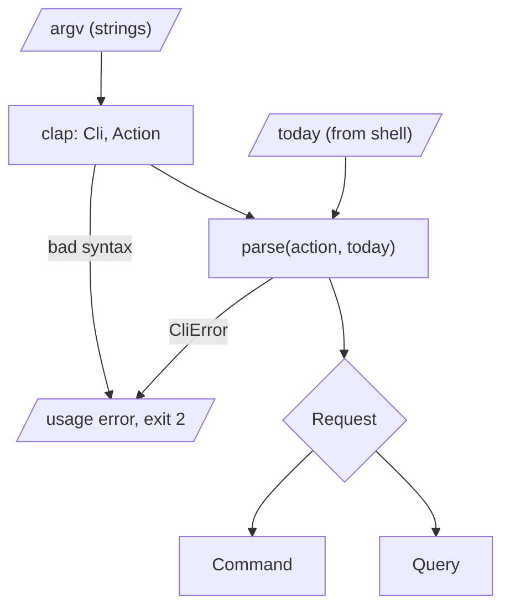

# Commands as data

It's Monday morning and you're halfway through your first coffee when you
remember the passport. You type:

```sh
tdo add "Renew passport" --due tomorrow --tag admin
```

and expect the computer to understand you. Between your keystrokes and the
to-do list there is a boundary, just as there was between Cloudflare's JSON
and our DNS daemon in Part II. On one side is the shell's view of the world:
a list of strings. `"add"`, `"Renew passport"`, `"--due"`, `"tomorrow"`. On the
other side is the domain's view: *add a task called "Renew passport", due on
Tuesday 20 October 2026, tagged `admin`*. Something has to turn the first into
the second, and that something decides how much of the rest of the program has
to worry about strings.

This part of the book builds `tdo`, a to-do list for the terminal. It's a
deliberately familiar domain, so that we can spend our attention on design
rather than on explaining what a task is. Over four chapters we'll parse the
command line into domain commands (this chapter), model tasks and their
lifecycle (Chapter 14), store *what happened* rather than *what is* using event
sourcing (Chapter 15), and finally wire it to a file, a terminal and a test
suite (Chapter 16).

This chapter is about the first step: getting from `argv` to a value the domain
can trust. By the end of it, `tdo` will parse every command it supports into a
small, closed set of domain types, reject nonsense with useful messages, and
print each command back to you in canonical form. It won't remember anything
yet. That's fine: knowing exactly what the user asked for is the foundation
everything else rests on.

## What tdo does

Let's sketch the tool from the outside first, in the words a user would use.
These are the commands we're aiming for:

| Command | Meaning |
|---|---|
| `tdo add "Buy milk" --priority high --due 2026-11-01 --tag home` | Add a task |
| `tdo list [--all] [--tag home]` | Show open tasks (or all of them) |
| `tdo done 3` | Mark task 3 as done |
| `tdo reopen 3` | Mark a finished task as open again |
| `tdo edit 3 --title "..." --priority low --due ... --no-due` | Change a task |
| `tdo rm 3` | Remove a task |
| `tdo undo` | Undo the most recent change |
| `tdo history` | Show every change ever made |

Reading that table as a domain modeller (Chapter 8's *Ubiquitous Language*), a
few nouns stand out: a **task**, which has a **title**, a **priority**, perhaps a
**due date** and some **tags**, and is identified by a small number we'll call
its **id**. The verbs are *add*, *complete*, *reopen*, *edit*, *remove* and *undo*.
Two of the rows aren't verbs at all: `list` and `history` only *look*. Hold on
to that observation; it's going to shape a type.

Let's create the project. `tdo` is a binary, but as in Part II we keep almost
everything in a library crate so that tests can reach it, with a thin
`main.rs` on top.

```sh
cargo new tdo
cd tdo
touch src/lib.rs
cargo add clap --features derive
cargo add jiff thiserror anyhow
```

```toml
# file: Cargo.toml
[dependencies]
anyhow = "1"
clap = { version = "4", features = ["derive"] }
jiff = "0.2"
thiserror = "2"
```

`clap` parses command lines. `jiff` is a date and time library; we need it
because "tomorrow" is a date, and dates are notoriously easy to get wrong with
strings. `thiserror` and `anyhow` play the roles they've played since
Chapter 4: typed errors inside, a reporting wrapper at the very top.

## The obvious thing: match on strings

The standard library hands us the arguments as an iterator of `String`s.
Here's the version most of us would write at eleven at night:

```rust
// file: src/main.rs
fn main() {
    let args: Vec<String> = std::env::args().skip(1).collect();
    match args.first().map(String::as_str) {
        Some("add") => {
            let title = args.get(1).cloned().unwrap_or_default();
            let priority = flag(&args, "--priority").unwrap_or("medium");
            add_task(&title, priority, flag(&args, "--due"));
        }
        Some("done") => complete_task(&args[1]),
        // ... list, reopen, edit, rm, undo, history
        _ => eprintln!("usage: tdo <command> ..."),
    }
}

fn flag<'a>(args: &'a [String], name: &str) -> Option<&'a str> {
    let at = args.iter().position(|a| a == name)?;
    args.get(at + 1).map(String::as_str)
}
```

It's short, and for the happy path it works. But look at what crosses the
boundary into `add_task`: a `&str` title that might be empty, a `&str` priority
that might be `"hgih"`, an `Option<&str>` due date that might be `"next
Tuesday"`. Every function downstream receives text and has to decide, again,
what the text means. `complete_task(&args[1])` panics on `tdo done` with no id.
`tdo add --priority high` (forgetting the title) cheerfully adds a task called
`--priority`. There's no `--help`, and writing one by hand means keeping a
second description of the commands in sync with the first.

The crack is the same one we found in Chapter 1 and again in Chapter 8:
*nothing in the types says what the program believes about its input*. We'll
fix it in two moves. First, let a library deal with the mechanics of `argv`.
Second, and more importantly, decide where clap's world stops and ours begins.

## Let clap read argv

`clap`'s derive API turns a set of annotated types into a parser, a help
screen and error messages. We describe the command line as data and clap writes
the parsing code. The top level is a struct with a subcommand:

```rust
// file: src/cli.rs
use clap::{Args, Parser, Subcommand, ValueEnum};

/// A small, honest to-do list.
#[derive(Debug, Parser)]
#[command(name = "tdo", version)]
pub struct Cli {
    /// Show what would be recorded, but don't record it
    #[arg(long, global = true)]
    pub dry_run: bool,

    #[command(subcommand)]
    pub action: Action,
}
```

`#[derive(Parser)]` is a *procedural macro*: code that runs at compile time and
generates more code, here an implementation of clap's `Parser` trait. The doc
comments aren't decoration; clap uses them as help text. `global = true` makes
`--dry-run` acceptable after any subcommand as well as before it.

Each subcommand is a variant of an enum. Variants with one or two arguments
can carry them inline; bigger ones get their own `Args` struct:

```rust
#[derive(Debug, Subcommand)]
pub enum Action {
    /// Add a task
    Add(AddArgs),
    /// List open tasks (or all of them)
    List(ListArgs),
    /// Mark a task as done
    Done { id: TaskId },
    /// Mark a finished task as open again
    Reopen { id: TaskId },
    /// Change a task's title, priority or due date
    Edit(EditArgs),
    /// Remove a task
    Rm { id: TaskId },
    /// Undo the most recent change
    Undo,
    /// Show every change ever recorded
    History,
}
```

Notice `id: TaskId` rather than `id: String`. We'll come back to what that
costs us in a moment. The `add` arguments look like this:

```rust
#[derive(Debug, Args)]
pub struct AddArgs {
    /// What needs doing
    pub title: String,
    #[arg(short, long, value_enum, default_value_t)]
    pub priority: PriorityArg,
    /// A date (YYYY-MM-DD), `today` or `tomorrow`
    #[arg(short, long)]
    pub due: Option<String>,
    /// A label such as `home`; repeat for more than one
    #[arg(short, long = "tag", value_name = "TAG")]
    pub tags: Vec<String>,
}
```

A field without `#[arg]` is positional; `short, long` gives us both `-d` and
`--due`; `Vec<String>` means "may be repeated"; `Option` means "may be absent".
`ListArgs` (an `--all` flag and an optional `--tag`) and `EditArgs` (an id,
then optional `--title`, `--priority`, `--due`, and a `--no-due` flag marked
`conflicts_with = "no_due"` on `--due`) follow the same pattern.

With a two-line `main` that calls `Cli::parse()`, we already get this for free:

```text
A small, honest to-do list

Usage: tdo [OPTIONS] <COMMAND>

Commands:
  add      Add a task
  list     List open tasks (or all of them)
  done     Mark a task as done
  reopen   Mark a finished task as open again
  edit     Change a task's title, priority or due date
  rm       Remove a task
  undo     Undo the most recent change
  history  Show every change ever recorded
  help     Print this message or the help of the given subcommand(s)

Options:
      --dry-run  Show what would be recorded, but don't record it
  -h, --help     Print help
  -V, --version  Print version
```

And a typo in a priority is caught before any of our code runs:

```text
error: invalid value 'urgent' for '--priority <PRIORITY>'
  [possible values: low, medium, high]

For more information, try '--help'.
```

## The second obvious thing: pass clap's structs inward

Now we have nicely typed structs, the tempting next step is to hand them
straight to the code that does the work:

```rust
fn add(tasks: &mut Vec<Task>, args: &AddArgs) -> Result<(), String> {
    if args.title.trim().is_empty() {
        return Err("title can't be empty".into());
    }
    let due = match &args.due {
        Some(text) => Some(parse_due(text)?),
        None => None,
    };
    // ... build a Task and push it
}
```

This compiles and works. It's also the moment the design starts to rot,
quietly. Count the problems:

- **The domain now depends on clap.** `AddArgs` is a description of a command
  line. If tomorrow we add a TUI, a web form or a test harness, each has to
  build an `AddArgs`, including fields like `dry_run` that mean nothing to the
  domain.
- **Validation happens wherever the data is used.** `add` checks the title is
  non-empty. Will `edit` remember to? The title is still a `String`, so the
  compiler can't tell a checked one from an unchecked one.
- **Context-free strings meet context-dependent meanings.** `"tomorrow"` only
  means something relative to today. Whoever calls `parse_due` has to know
  today's date, which means reading the clock, which means the function is no
  longer pure.
- **Some invalid requests are perfectly valid `EditArgs`.** `tdo edit 3` with no
  flags parses fine. Downstream it would do nothing at all and report success.
  That's a bug the types allowed.

None of this is clap's fault. clap's types describe *the shape of the command
line*: which flags exist, which are optional, which repeat. That's a different
question from *what the user is asking the domain to do*. Chapter 8 called
types like these a **raw DTO** (data transfer object) and argued that the
boundary's job is to turn them into a validated domain type exactly once. A
command line is just another place data comes in.

## Naming what the user can ask for

Let's write down, as types, what a user can ask `tdo` to do, using the domain's
words and nothing else. Remember the observation from the table: some requests
change the list, and some only look at it. That's a real distinction, and we
make it a type:

```rust
// file: src/command.rs
/// Everything `tdo` can be asked to do: change something, or look.
#[derive(Debug, Clone, PartialEq, Eq)]
pub enum Request {
    Command(Command),
    Query(Query),
}

/// A request to look at the to-do list without changing it.
#[derive(Debug, Clone, PartialEq, Eq)]
pub enum Query {
    List(Filter),
    History,
}

/// Which tasks `list` shows.
#[derive(Debug, Clone, PartialEq, Eq, Default)]
pub struct Filter {
    pub include_done: bool,
    pub tag: Option<Tag>,
}
```

Separating *commands* (which change state) from *queries* (which don't) is an
old idea, often called command–query separation. It pays off immediately: in
Chapter 15 the function that decides what a command does will take a
`Command`, and there will be no way to hand it a `List` by mistake, so it never
needs a "this does nothing" arm.

The commands themselves are a sum type with one variant per verb:

```rust
/// A request to change the to-do list.
#[derive(Debug, Clone, PartialEq, Eq)]
pub enum Command {
    Add(Details),
    Complete { id: TaskId, on: Date },
    Reopen { id: TaskId },
    Edit { id: TaskId, changes: Changes },
    Remove { id: TaskId },
    Undo,
}
```

Two things are worth pausing on. The variant is `Complete`, not `Done`: `done`
is a fine thing to type, but the domain verb is *complete*. The boundary is
where those spellings meet. And `Complete` carries the date it happened `on`.
The user didn't type a date, but the domain wants to remember when a task was
finished, and a command that says "complete task 3 on 19 October" is fully
specified. Whatever handles it never needs to ask the clock.

`Date` is `jiff::civil::Date`, a calendar date with no time or time zone, which
is exactly what "due on the 1st" means. `Details` is everything the user says
about a new task:

```rust
// file: src/domain/task.rs
/// Everything about a task that doesn't depend on its lifecycle.
#[derive(Debug, Clone, PartialEq, Eq)]
pub struct Details {
    pub title: Title,
    pub priority: Priority,
    pub due: Option<Date>,
    pub tags: BTreeSet<Tag>,
}
```

Each field is already a domain type. `Title`, `Tag` and `TaskId` are *Value
Objects* in the sense of Chapter 8: newtypes with smart constructors, so that
holding one is proof it passed its checks. Chapter 14 gives them their full
rules; for now, `Title` just refuses to be blank:

```rust
// file: src/domain/title.rs
#[derive(Debug, Clone, PartialEq, Eq)]
pub struct Title(String);

#[derive(Debug, Clone, PartialEq, Eq, thiserror::Error)]
pub enum TitleError {
    #[error("a title can't be empty")]
    Empty,
}

impl Title {
    pub fn parse(raw: &str) -> Result<Self, TitleError> {
        let text = raw.trim();
        if text.is_empty() {
            return Err(TitleError::Empty);
        }
        Ok(Title(text.to_owned()))
    }

    pub fn as_str(&self) -> &str {
        &self.0
    }
}
```

`Tag` has the same shape with a `TagError` (in Chapter 14 it learns to insist
on lower-case letters, digits and hyphens), and `Priority` is a plain enum of
`Low`, `Medium` and `High` with `Medium` marked `#[default]`. Tags live in a
`BTreeSet` rather than a `Vec` because `--tag home --tag home` means one tag,
not two, and because a `BTreeSet` iterates in sorted order, which will keep our
output stable.

> [!TIP]
> Put these in `src/domain/` with a `mod.rs` that re-exports them
> (`pub use title::{Title, TitleError};` and so on), so the rest of the crate
> can write `use crate::domain::Title`. Chapter 7's advice applies: the
> module's private fields are what make the smart constructors mandatory.

### Edits that must change something

`edit` deserves its own type. A user can change the title, the priority, the
due date, or any combination, and "change the due date" itself has two
meanings: set it to something, or clear it. The tempting encoding is
`due: Option<Option<Date>>`, where `None` is "leave it", `Some(None)` is "clear
it" and `Some(Some(d))` is "set it". It works, and nobody reading it six months
later will thank you. A small enum says the same thing in words:

```rust
/// What to do with a task's due date when editing.
#[derive(Debug, Clone, Copy, PartialEq, Eq)]
pub enum DueChange {
    Set(Date),
    Clear,
}
```

Then the edit itself. We found a bug earlier: `tdo edit 3` with no flags was a
valid `EditArgs`. We don't want it to be a valid `Changes`. Private fields plus
a constructor that can refuse (Chapter 7's *Encapsulated Invariants*) make an
empty edit unrepresentable:

```rust
/// At least one change to a task. Private fields: the only way to get
/// one is [`Changes::new`], which refuses an empty edit.
#[derive(Debug, Clone, PartialEq, Eq)]
pub struct Changes {
    title: Option<Title>,
    priority: Option<Priority>,
    due: Option<DueChange>,
}

impl Changes {
    pub fn new(
        title: Option<Title>,
        priority: Option<Priority>,
        due: Option<DueChange>,
    ) -> Option<Changes> {
        let nothing = title.is_none() && priority.is_none() && due.is_none();
        (!nothing).then_some(Changes { title, priority, due })
    }
    // ... getters: title(), priority(), due()
}
```

`bool::then_some` turns a condition into an `Option`: `Some(value)` if true,
`None` if false. It's a neat way to say "only if" in an expression. The getters
are one-liners returning `Option<&Title>`, `Option<Priority>` and
`Option<DueChange>`.

## Parsing the boundary

We have clap's types on one side and ours on the other. Now the function in
between. Its signature is the design:

```rust
// file: src/cli.rs
/// Turn clap's raw arguments into a domain request. Pure: `today` is
/// passed in, so relative dates resolve the same way in tests.
pub fn parse(action: Action, today: Date) -> Result<Request, CliError> {
    todo!()
}
```

Why not `impl TryFrom<Action> for Request`, as Chapter 5 would suggest for
conversions? Because this conversion needs *context*. `"tomorrow"` doesn't mean
anything on its own, and `done 3` needs to record the day it happened. A
`TryFrom` impl has nowhere to put that extra argument, so it would have to read
the clock itself, and then it would no longer be pure. A plain function with
`today` as a parameter keeps the boundary deterministic: the same arguments on
the same day always produce the same `Request`. The shell reads the clock once
and passes the answer in.

The body is one `match`, and it's almost a table:

```rust
pub fn parse(action: Action, today: Date) -> Result<Request, CliError> {
    let command = match action {
        Action::Add(args) => Command::Add(parse_add(args, today)?),
        Action::Done { id } => Command::Complete { id, on: today },
        Action::Reopen { id } => Command::Reopen { id },
        Action::Edit(args) => parse_edit(args, today)?,
        Action::Rm { id } => Command::Remove { id },
        Action::Undo => Command::Undo,
        Action::List(args) => return Ok(Request::Query(parse_list(args)?)),
        Action::History => return Ok(Request::Query(Query::History)),
    };
    Ok(Request::Command(command))
}
```

Because `Action` is an enum, the match is exhaustive. Add a `tdo archive`
subcommand to clap next month and this function stops compiling until you've
said what it means in the domain. That's *Exhaustive Matching* (Chapter 3)
enforcing that the boundary stays complete.

### Optional values that can fail

`parse_add` builds `Details` from `AddArgs`. The due date is the interesting
field: it's an `Option<String>`, and parsing the string can fail. A first
attempt reaches for `map` and `?`:

```rust
// does not compile
fn parse_add(args: AddArgs, today: Date) -> Result<Details, CliError> {
    Ok(Details {
        title: Title::parse(&args.title)?,
        priority: args.priority.into(),
        due: args.due.map(|d| parse_date(&d, today))?,
        tags: BTreeSet::new(),
    })
}
```

```text
error[E0308]: `?` operator has incompatible types
   --> src/cli.rs:295:14
    |
295 |         due: args.due.map(|d| parse_date(&d, today))?,
    |              ^^^^^^^^^^^^^^^^^^^^^^^^^^^^^^^^^^^^^^^^ expected
    |                       `Option<Date>`, found `Result<Date, CliError>`
    |
    = note: `?` operator cannot convert from `Result<jiff::civil::Date,
            CliError>` to `std::option::Option<jiff::civil::Date>`

error[E0277]: the `?` operator can only be used on `Result`s, not
              `Option`s, in a function that returns `Result`
```

Read the types slowly. `args.due` is `Option<String>`. Mapping a fallible
function over it gives `Option<Result<Date, CliError>>`: *maybe* a result.
`?` works on the outer layer, which is the `Option`, and that's not what we
want. We want the layers the other way round, `Result<Option<Date>, CliError>`,
so that `?` can deal with the error and leave us the optional date.

Swapping those two layers is common enough to have a name: `transpose`.
`None` becomes `Ok(None)`, `Some(Ok(d))` becomes `Ok(Some(d))`, and
`Some(Err(e))` becomes `Err(e)`:

```rust
fn parse_add(args: AddArgs, today: Date) -> Result<Details, CliError> {
    Ok(Details {
        title: Title::parse(&args.title)?,
        priority: args.priority.into(),
        due: args.due.map(|d| parse_date(&d, today)).transpose()?,
        tags: args
            .tags
            .iter()
            .map(|t| Tag::parse(t))
            .collect::<Result<BTreeSet<_>, _>>()?,
    })
}
```

The tags line is the same idea for a collection, from Chapter 6: an iterator
of `Result`s can be collected into a `Result` of a collection, stopping at the
first error. One bad tag fails the whole command, which is what we want.

`parse_date` is where "tomorrow" becomes a date. It's small, pure and easy to
extend (try adding `+3d` in the exercises):

```rust
fn parse_date(text: &str, today: Date) -> Result<Date, CliError> {
    let bad = || CliError::Date(text.to_owned());
    match text.trim() {
        "today" => Ok(today),
        "tomorrow" => today.tomorrow().map_err(|_| bad()),
        iso => iso.parse().map_err(|_| bad()),
    }
}
```

`jiff`'s `Date` implements `FromStr` for ISO 8601 dates (`2026-11-01`), so
`.parse()` does the rest. `tomorrow()` returns a `Result` because there is a
last representable date, and jiff won't silently wrap past it.

### Edits, and the bug that's now impossible

`parse_edit` is where the "edit nothing" bug dies:

```rust
fn parse_edit(args: EditArgs, today: Date) -> Result<Command, CliError> {
    let title = args.title.map(|t| Title::parse(&t)).transpose()?;
    let due = match (args.due, args.no_due) {
        (Some(text), _) => Some(DueChange::Set(parse_date(&text, today)?)),
        (None, true) => Some(DueChange::Clear),
        (None, false) => None,
    };
    let priority = args.priority.map(Priority::from);
    let changes =
        Changes::new(title, priority, due).ok_or(CliError::NothingToEdit)?;
    Ok(Command::Edit { id: args.id, changes })
}
```

Matching on a *tuple* of the two flags lets us read the truth table straight
off the page. (clap already rejects `--due` together with `--no-due`, so the
`(Some, true)` case can't occur; the `_` saying "either" is simply honest.)
Then `Changes::new` returns `None` for an empty edit, and `ok_or` turns that
into our error. There is no way to construct a `Command::Edit` that changes
nothing.

### The error type

Everything that can go wrong at this boundary goes in one enum:

```rust
/// Everything that can be wrong with a request before the domain sees it.
#[derive(Debug, Clone, PartialEq, Eq, thiserror::Error)]
pub enum CliError {
    #[error("invalid title")]
    Title(#[from] TitleError),
    #[error("invalid tag")]
    Tag(#[from] TagError),
    #[error("`{0}` is not a date (try 2026-11-01, today or tomorrow)")]
    Date(String),
    #[error("nothing to edit (give --title, --priority, --due or --no-due)")]
    NothingToEdit,
}
```

`#[from]` generates the `From<TitleError> for CliError` impl that lets `?`
convert a title error automatically: *Error Translation at Boundaries*, from
Chapter 4. It also marks the inner error as this error's *source*.

My first version of this enum said `#[error("invalid title: {0}")]`, which
looks friendlier. Here's what it printed once `main` reported errors with
anyhow's alternate format, `{err:#}`, which walks the whole source chain:

```text
tdo: invalid title: a title can't be empty: a title can't be empty
```

The message said the reason, and then anyhow helpfully appended the source,
which said it again. The rule of thumb: an error's `Display` describes *this*
layer ("invalid title"); the source chain supplies the layers beneath. Pick one
place for each piece of information.

### Mirror types for clap

We used a `PriorityArg` enum in `AddArgs` rather than our domain `Priority`.
clap's `ValueEnum` derive is what produces `[possible values: low, medium,
high]`, and we could derive it directly on `Priority`. That would make our
domain module depend on clap, for the sake of one attribute. Instead, the CLI
module keeps a three-line mirror and a conversion:

```rust
/// clap's spelling of a priority. The domain's `Priority` knows
/// nothing about clap; this mirror type keeps it that way.
#[derive(Debug, Clone, Copy, Default, ValueEnum)]
pub enum PriorityArg {
    Low,
    #[default]
    Medium,
    High,
}

impl From<PriorityArg> for Priority {
    fn from(arg: PriorityArg) -> Priority {
        match arg {
            PriorityArg::Low => Priority::Low,
            PriorityArg::Medium => Priority::Medium,
            PriorityArg::High => Priority::High,
        }
    }
}
```

This is a miniature *Anti-Corruption Layer* (Chapter 10). The duplication is
real but tiny, and the exhaustive `match` means that adding `Priority::Urgent`
later produces a compile error right here, pointing at the one place the two
spellings need reconciling.

### Ids, and what clap needs from them

Earlier we wrote `Done { id: TaskId }` in the clap enum. A `TaskId` is a
newtype over `u32`. We didn't use a mirror type here, because unlike a
priority it needs no help text, only a way to be parsed from a string. When I
first wrote it, though, `TaskId` didn't know how to do that, and clap's derive
produced this (trimmed hard, because it goes on for a while):

```text
error[E0599]: the method `value_parser` exists for reference
  `&&&&&&clap::builder::_infer_ValueParser_for<TaskId>`, but its trait
  bounds were not satisfied
  --> src/cli.rs:33:12
   |
33 |     Done { id: TaskId },
   |            ^^ method cannot be called due to unsatisfied trait bounds
   |
   = note: the following trait bounds were not satisfied:
           `TaskId: ValueEnum`
           `TaskId: ValueParserFactory`
           `TaskId: From<OsString>`
           ...
           `TaskId: FromStr`
```

Macro-generated errors are rarely pretty, but this one is legible if you read
the list at the bottom: clap will accept any field type that it knows how to
build from a string, and it's offering us half a dozen ways to teach it. The
most natural for a value object is `FromStr` (Chapter 5's *Conversion
Traits*), which the domain would want anyway:

```rust
// file: src/domain/id.rs
#[derive(Debug, Clone, PartialEq, Eq, thiserror::Error)]
#[error("`{0}` is not a task id (expected a number like 3)")]
pub struct ParseIdError(String);

impl FromStr for TaskId {
    type Err = ParseIdError;

    fn from_str(s: &str) -> Result<Self, Self::Err> {
        s.trim()
            .parse()
            .map(TaskId)
            .map_err(|_| ParseIdError(s.to_owned()))
    }
}
```

`.map(TaskId)` uses the tuple struct's constructor as a function, from `u32`
to `TaskId`. Now clap calls our `FromStr`, and our error message appears inside
its own:

```text
error: invalid value 'abc' for '<ID>': `abc` is not a task id (expected a
number like 3)

For more information, try '--help'.
```

Notice there's no domain dependency on clap here: `FromStr` is a standard
library trait. It just happens to be the one clap looks for.

## The pattern

Here's the whole boundary as a picture. The shell's strings go in at the top;
by the bottom, everything is a domain type, or the request has been refused.



clap handles the *syntax* of the command line: is there a subcommand, does
`--priority` have a value, is that value one of three words. `parse` handles the
*meaning*: is that title acceptable, what date is "tomorrow", is this edit
actually an edit. After that, nothing in the program sees a string the user
typed.

> [!PATTERN] Parse the Boundary (CLI → Domain Command)
> Treat the command-line framework's types as a raw DTO describing syntax.
> Convert them, once, in a pure function, into a closed domain type (here
> `Request` = `Command` | `Query`), passing in any context the conversion
> needs, such as today's date. Keep the framework out of the domain with small
> mirror types. Downstream code receives only commands that are already valid.

## Testing the boundary

Because `parse` is pure and takes `today` as an argument, its tests need
neither a clock nor a process. clap provides `try_parse_from`, which parses a
list of strings instead of the real `argv`, so we can test the full path from
words to domain values:

```rust
// file: src/cli.rs
#[cfg(test)]
mod tests {
    use jiff::civil::date;

    use super::*;

    const TODAY: Date = date(2026, 10, 19);

    fn request(args: &[&str]) -> Result<Request, CliError> {
        let cli = Cli::try_parse_from(args).expect("clap accepts it");
        parse(cli.action, TODAY)
    }
    // ... command(args): unwraps a Request::Command or panics
}
```

`jiff::civil::date` is a `const fn`, so a fixed date can be a `const`. Now
each rule we cared about is one short test:

```rust
#[test]
fn add_resolves_relative_dates_against_today() {
    let Command::Add(details) =
        command(&["tdo", "add", "Buy milk", "--due", "tomorrow"])
    else {
        panic!("expected add");
    };
    assert_eq!(details.due, Some(date(2026, 10, 20)));
    assert_eq!(details.priority, Priority::Medium);
}

#[test]
fn an_edit_must_change_something() {
    assert_eq!(
        request(&["tdo", "edit", "3"]),
        Err(CliError::NothingToEdit)
    );
}
```

`let ... else` is a refutable `let`: if the pattern doesn't match, the `else`
block runs, and it must diverge (return, panic, break). It's handy in tests for
"this had better be an `Add`". Two more tests in the same style check that a
blank title produces `CliError::Title(TitleError::Empty)` and that `list --all`
becomes `Request::Query(Query::List(..))` rather than a command.

## Commands that print as themselves

There's one more thing the outline promised: `Display`. What should a
`Command` look like as text? There are several candidates (a sentence, a
debug dump, JSON), but one answer is unusually useful: print it as *the
canonical `tdo` invocation that means it*. Then `Display` and `parse` are
inverses of each other, and we can test that they agree.

```rust
// file: src/command.rs
/// Commands print as the canonical `tdo` invocation that means them.
impl fmt::Display for Command {
    fn fmt(&self, f: &mut fmt::Formatter<'_>) -> fmt::Result {
        match self {
            Command::Add(details) => {
                write!(f, "add {:?}", details.title.as_str())?;
                write!(f, " --priority {}", details.priority)?;
                if let Some(due) = details.due {
                    write!(f, " --due {due}")?;
                }
                for tag in &details.tags {
                    write!(f, " --tag {}", tag.as_str())?;
                }
                Ok(())
            }
            Command::Complete { id, .. } => write!(f, "done {id}"),
            Command::Remove { id } => write!(f, "rm {id}"),
            // ... reopen, edit and undo in the same style
        }
    }
}
```

`{:?}` on a `&str` prints it quoted, with any awkward characters escaped,
which is close enough to shell quoting for our purposes. `Priority` and
`TaskId` get their own small `Display` impls. Canonical means *normalised*:
the output always spells out `--priority`, even when the user relied on the
default, and `tomorrow` has become a real date.

The test feeds each command's text back through clap and `parse` and checks we
get the same command. We need a tiny helper to split the text into words
the way a shell would, treating double-quoted titles as one word:

```rust
#[test]
fn display_round_trips_through_the_parser() {
    let cases: &[&[&str]] = &[
        &["tdo", "add", "Buy milk", "-p", "high", "-t", "home"],
        &["tdo", "add", "Post card", "--due", "tomorrow"],
        &["tdo", "edit", "2", "--title", "Ring Sam", "--no-due"],
        &["tdo", "done", "3"],
        &["tdo", "undo"],
    ];
    for args in cases {
        let original = command(args);
        let text = format!("tdo {original}");
        let again = words(&text);
        let again: Vec<&str> = again.iter().map(String::as_str).collect();
        assert_eq!(command(&again), original, "{text}");
    }
}

/// Split text like a shell would: double quotes group words.
fn words(text: &str) -> Vec<String> {
    text.split('"')
        .enumerate()
        .flat_map(|(i, part)| match i % 2 {
            0 => part.split_whitespace().map(str::to_owned).collect(),
            _ => vec![part.to_owned()],
        })
        .collect()
}
```

`words` is a little functional gem: splitting on `"` alternates between
outside-quotes and inside-quotes pieces, so even-numbered pieces are split on
whitespace and odd-numbered ones are kept whole. (It doesn't understand
escaped quotes; see the exercises.)

## A temporary shell

We don't have anywhere to store tasks yet, so for now `main` will parse, and
then show us what it understood. That's what `--dry-run` will do in the
finished tool anyway, so we're not writing throwaway code:

```rust
// file: src/main.rs
fn main() -> ExitCode {
    let cli = Cli::parse();
    match run(cli) {
        Ok(()) => ExitCode::SUCCESS,
        Err(err) => {
            eprintln!("tdo: {err:#}");
            let usage = err.downcast_ref::<CliError>().is_some();
            ExitCode::from(if usage { 2 } else { 1 })
        }
    }
}

fn run(cli: Cli) -> anyhow::Result<()> {
    let today = Zoned::now().date();
    match cli::parse(cli.action, today)? {
        Request::Command(command) => println!("would run: tdo {command}"),
        Request::Query(query) => println!("would query: {query:?}"),
    }
    Ok(())
}
```

`main` is the imperative shell (Chapter 1). It reads the real clock
(`jiff::Zoned::now()` is "now, in the system time zone", and `.date()` drops
the time of day) and makes the policy decisions: errors are printed with a
`tdo:` prefix, and usage errors get exit status 2, the convention clap itself
follows, while everything else gets 1. `anyhow::Error::downcast_ref` asks
"is the error inside you a `CliError`?" without us threading a special type
through `run`.

```sh
cargo run -q -- add "Renew passport" --due tomorrow --tag admin
cargo run -q -- edit 3
```

```text
would run: tdo add "Renew passport" --priority medium --due 2026-10-20 --tag admin
tdo: nothing to edit (give --title, --priority, --due or --no-due)
```

Run on Monday 19 October, the relative date has been resolved to Tuesday, the
default priority made explicit, and the empty edit refused with a message that
says how to fix it.

> [!CHECKPOINT]
> Your crate should have `src/lib.rs` declaring `pub mod cli;`,
> `pub mod command;` and `pub mod domain;`, a `src/domain/` folder with
> `id.rs`, `priority.rs`, `tag.rs`, `task.rs` (just `Details` for now) and
> `title.rs`, and the temporary `main.rs` above. The boundary tests pass:
>
> ```sh
> cargo test cli
> ```
>
> ```text
> running 5 tests
> test cli::tests::an_edit_must_change_something ... ok
> test cli::tests::blank_titles_never_reach_the_domain ... ok
> test cli::tests::add_resolves_relative_dates_against_today ... ok
> test cli::tests::list_is_a_query_not_a_command ... ok
> test cli::tests::display_round_trips_through_the_parser ... ok
>
> test result: ok. 5 passed; 0 failed; 0 ignored; 0 measured
> ```

## What we learned

- **clap's derive types are a raw DTO.** They describe the *syntax* of a command
  line, and are the right tool for help text, flags and usage errors. They are
  not the domain.
- **Parse the boundary once, into a closed domain type.** `parse(action, today)`
  turns syntax into meaning, and after it nothing sees a user's string. That's
  the *Parse the Boundary* pattern.
- **Commands and queries are different types.** Separating `Command` from
  `Query` means the code that changes state can never be handed a request that
  only looks.
- **Context belongs in parameters.** Passing `today` in keeps the boundary
  pure, deterministic and testable; the shell reads the clock once.
- **`Option::transpose` and collecting into `Result`** handle "optional and
  fallible" without nested `match`es.
- **Private fields make invalid requests unrepresentable.** `Changes::new`
  refuses an empty edit, so no `Command::Edit` can change nothing.
- **Mirror types keep frameworks out of the domain**, at the cost of a few
  lines and an exhaustive `match` that tells you when they drift.
- **`Display` as the inverse of `parse`** gives commands a canonical text form
  and a round-trip test that keeps the two honest.

## Exercises

> [!EXERCISE] Relative dates
> Teach `parse_date` to accept `+3d` and `+2w` (three days, two weeks from
> today). Write the tests first, using the fixed `TODAY`. jiff's `Date` has a
> `checked_add` that takes a `Span`; what should happen if the result
> overflows?

> [!EXERCISE] Quotes inside titles
> Add `&["tdo", "add", "Buy \"oat\" milk"]` to the round-trip test and watch
> it fail. Is the bug in `Display` or in `words`? Fix whichever you think is
> wrong, and say why the other one is right.

> [!EXERCISE] Several at once
> Change `done` to accept several ids (`tdo done 3 4 7`). What should the
> domain command look like: one `Complete` per id, or a `Complete` holding a
> non-empty collection? Which choice makes "complete nothing" impossible?

> [!EXERCISE] A second front end
> Sketch (signatures only, with `todo!()` bodies) a function that turns a line
> typed into an interactive prompt, such as `add Buy milk !high`, into a
> `Request`. Which of this chapter's types can you reuse unchanged? Which would
> you have had to rewrite if the domain had used `AddArgs` directly?
