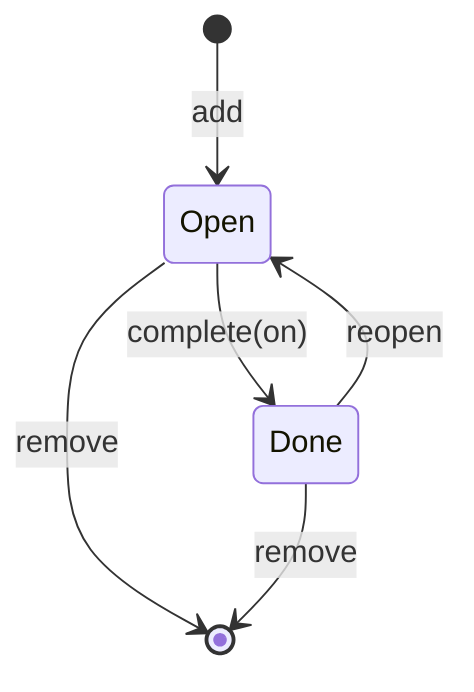
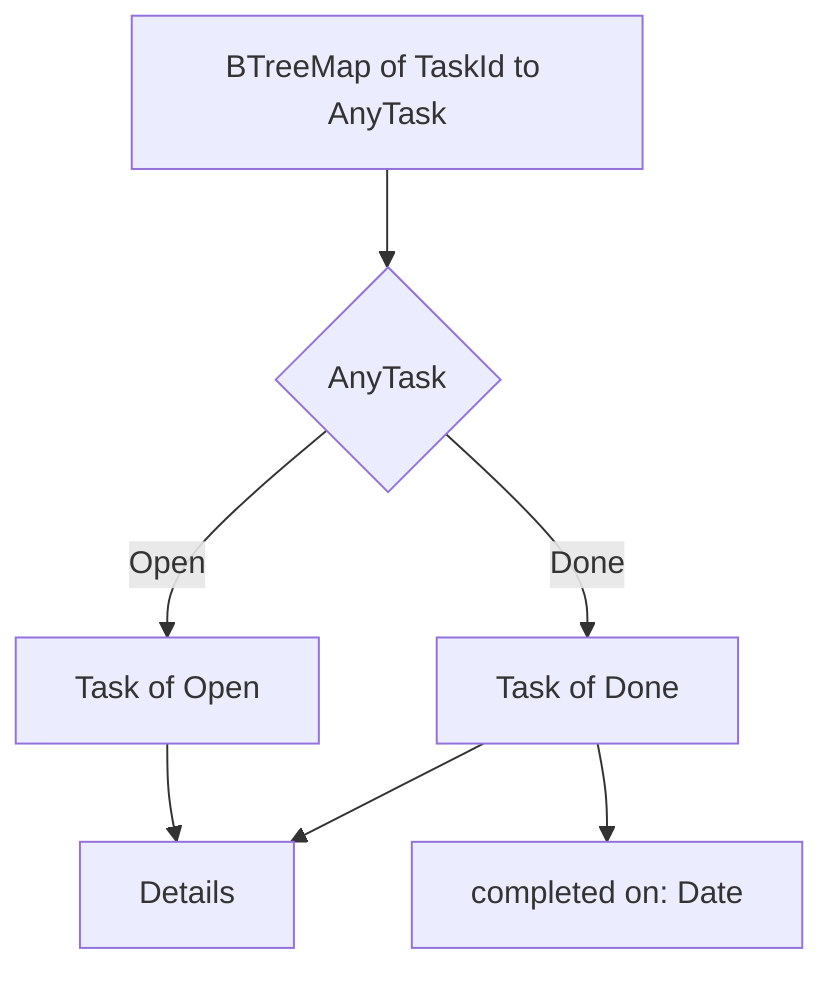

# Modelling tasks

Here's a line from a to-do list I once wrote in a hurry, printed by its own
`list --all` command:

```text
  4  [ ]  Book dentist   (completed 2026-10-12)
```

An open task that was completed a week ago. Nobody set out to write that. A
`done` flag was cleared by "reopen", and the completion date that sat beside it
was left behind. The bug was one forgotten line, but the *possibility* of the
bug was designed in: the type allowed a task to be open and completed at the
same time, so sooner or later one was.

In the last chapter we parsed the command line into a domain `Command`, and
leaned on a few value objects we promised to finish later. This chapter keeps
that promise and then turns to the more interesting question: what *is* a
task, over its lifetime? We'll give `Title`, `Tag`, `TaskId` and `Priority`
their real rules, decide what a due date is, and then model the task lifecycle
three ways: with flags, with an enum, and with **typestate**, a technique for
putting an object's state into its *type* so that the compiler refuses calls
that make no sense in that state.

Typestate is one of those ideas that's thrilling the first time you see it, and
it's easy to come away thinking it's always the right answer. It isn't, and we'll
be honest about where it hurts. The design we end with uses typestate where it
pays and an ordinary enum where it doesn't.

## Value objects, finished

### Titles

Chapter 13's `Title` only refused to be blank. Let's write down what we
actually believe about a title, in the language of the domain:

- It's trimmed: `"  Buy milk "` and `"Buy milk"` are the same title.
- It isn't empty after trimming.
- It fits on one line of `tdo list`, so no newlines or other control
  characters.
- It's not absurdly long. Eighty characters is plenty for a to-do.

Each bullet becomes a variant of the error type, which means each one can be
reported precisely:

```rust
// file: src/domain/title.rs
#[derive(Debug, Clone, PartialEq, Eq, thiserror::Error)]
pub enum TitleError {
    #[error("a title can't be empty")]
    Empty,
    #[error("a title can be at most {max} characters (this one has {len})")]
    TooLong { len: usize, max: usize },
    #[error("a title must fit on one line")]
    ControlCharacter,
}
```

And the smart constructor checks them in order:

```rust
impl Title {
    pub const MAX_CHARS: usize = 80;

    pub fn parse(raw: &str) -> Result<Self, TitleError> {
        let text = raw.trim();
        let len = text.chars().count();
        if len == 0 {
            Err(TitleError::Empty)
        } else if len > Self::MAX_CHARS {
            Err(TitleError::TooLong { len, max: Self::MAX_CHARS })
        } else if text.chars().any(char::is_control) {
            Err(TitleError::ControlCharacter)
        } else {
            Ok(Title(text.to_owned()))
        }
    }
    // ... as_str()
}
```

The subtle line is `text.chars().count()`. `str::len` counts *bytes*, and Rust
strings are UTF-8, so `"é"` is two bytes but one character. A user who writes
in French shouldn't get a shorter limit than one who writes in English. (A
character isn't quite what a human calls a letter either; Unicode's *grapheme
clusters* are closer, but they need an extra crate, and characters are a good
enough approximation for a length limit.)

The `if` / `else if` chain is an expression whose value is the function's
result, so there are no `return`s. The tests read like the bullet list:

```rust
#[test]
fn rejects_blank_long_and_multiline_titles() {
    assert_eq!(Title::parse("   "), Err(TitleError::Empty));
    assert_eq!(
        Title::parse(&"a".repeat(81)),
        Err(TitleError::TooLong { len: 81, max: 80 })
    );
    assert_eq!(
        Title::parse("Buy\nmilk"),
        Err(TitleError::ControlCharacter)
    );
}

#[test]
fn counts_characters_not_bytes() {
    assert!(Title::parse(&"é".repeat(80)).is_ok());
}
```

Here's the payoff of Chapter 13's design. We just changed what a valid title
*is*, and `cli.rs` didn't change at all. `parse_add` still calls `Title::parse`
and converts the error with `?`. The new rules flow out to the command line,
with precise messages, for free:

```text
tdo: invalid title: a title can be at most 80 characters (this one has 90)
```

### Tags

A tag is a short label like `home` or `work`. We'd like `--tag Home` and
`--tag home` to be the same tag, and we'd like tags to be easy to type and
filter on, so: lower-case ASCII letters, digits and hyphens, at most 24
characters. A leading `+` is accepted and dropped, because that's how tags are
displayed. The smart constructor *normalises* before it *validates*:

```rust
// file: src/domain/tag.rs
pub fn parse(raw: &str) -> Result<Self, TagError> {
    let text = raw.trim().trim_start_matches('+').to_lowercase();
    let allowed = |c: &char| c.is_ascii_alphanumeric() || *c == '-';
    if text.is_empty() {
        Err(TagError::Empty)
    } else if text.chars().count() > Self::MAX_CHARS {
        Err(TagError::TooLong { max: Self::MAX_CHARS })
    } else if let Some(bad) = text.chars().find(|c| !allowed(c)) {
        Err(TagError::BadCharacter(bad))
    } else {
        Ok(Tag(text))
    }
}
```

`TagError` has the three variants you'd expect, and `BadCharacter` carries the
offending `char` so the message can name it. `Tag` derives `PartialOrd`, `Ord`
and `Hash` as well as the usual suspects, because it lives in a `BTreeSet`.
Its `Display` adds the `+` back:

```rust
impl fmt::Display for Tag {
    fn fmt(&self, f: &mut fmt::Formatter<'_>) -> fmt::Result {
        write!(f, "+{}", self.0)
    }
}
```

Normalising in the constructor is a quiet but important choice. Because a
`Tag` can only be built through `parse`, *every* `Tag` in the program is
lower-case. Comparing tags never needs `eq_ignore_ascii_case`; equality just
works, and so do sets and maps keyed on tags.

### Ids

A `TaskId` is the number you type after `done`. Two facts matter. Ids start
at 1, because humans count from one. And an id is never reused: if task 4 is
removed, the next task added is 5, not 4. Otherwise `tdo done 4`, typed from
memory of yesterday's list, could complete the wrong task. We can't enforce
"never reused" in `TaskId` itself (it depends on history, which is Chapter 15's
job), but we can give the type a vocabulary that makes the right thing easy:

```rust
// file: src/domain/id.rs
impl TaskId {
    pub const FIRST: TaskId = TaskId(1);

    pub fn new(n: u32) -> Self {
        TaskId(n)
    }

    /// The id that follows this one.
    pub fn next(self) -> TaskId {
        TaskId(self.0 + 1)
    }
}
```

`TaskId` derives `Copy`: it's a `u32` in a trench coat, and copying it is as
cheap as copying the number. It also derives `Ord` and `Hash` so it can key a
map. `TaskId::new` is public because any number is a *possible* id; whether a
task with that id *exists* is a question for the to-do list, not for the id.

### Priority, and why order matters

Priorities are three values that are clearly ordered. Rust can derive the
ordering for us:

```rust
// file: src/domain/priority.rs
/// How much a task matters. Declaration order is the ordering:
/// `Low < Medium < High`.
#[derive(
    Debug, Clone, Copy, PartialEq, Eq, PartialOrd, Ord, Hash, Default,
)]
pub enum Priority {
    Low,
    #[default]
    Medium,
    High,
}
```

`#[derive(PartialOrd, Ord)]` on an enum orders variants by *declaration order*:
the first is smallest. That's a convenience and a trap. If someone tidies this
enum into "most important first" (`High, Medium, Low`), it still compiles, and
every sort in the program silently reverses. The doc comment is there to make
the ordering a visible part of the contract, and a test pins it down:

```rust
#[test]
fn high_outranks_low() {
    assert!(Priority::High > Priority::Medium);
    assert!(Priority::Medium > Priority::Low);
    assert_eq!(Priority::default(), Priority::Medium);
}
```

> [!TIP]
> When padding matters, implement `Display` with `f.pad(...)` rather than
> `f.write_str(...)`. `pad` honours width and alignment, so
> `format!("{:<6}", Priority::High)` produces `"high  "`. `write_str` ignores
> them, and your columns will mysteriously refuse to line up. `Priority`'s
> `Display` matches on `self` and passes `"low"`, `"medium"` or `"high"` to
> `f.pad`.

### Due dates

What kind of thing is "due on 1 November"? It isn't an instant in time: it
doesn't mean midnight UTC, or midnight anywhere. It's a *calendar date*, a
day on a wall calendar, which is exactly what `jiff::civil::Date` represents.
jiff's other types (`Timestamp` for an instant, `Zoned` for an instant in a
time zone) would force us to invent a time and a zone that the user never gave
us, and then to worry about what happens when they fly to New York.

Then there's *overdue*. It's tempting to store an `overdue: bool` on a task.
But overdue isn't a fact about the task; it's a relationship between the task's
due date and today's date, and today keeps changing. So it's a function, and
`today` is its argument:

```rust
pub fn is_overdue(&self, today: Date) -> bool {
    self.details.due.is_some_and(|due| due < today)
}
```

`Option::is_some_and` asks "is there a value, and does it pass this test?",
which reads almost exactly like the sentence. Dates compare with `<` because
`Date` implements `Ord`. We'll see in a moment which type this method belongs
to, because that turns out to be the most interesting decision in the chapter.

## A task, the obvious way

We have the parts. Here is a task as most of us would first write it:

```rust
pub struct Task {
    pub id: TaskId,
    pub details: Details,
    pub done: bool,
    pub completed_on: Option<Date>,
}
```

Two fields describe one idea. `done` and `completed_on` have four
combinations, and only two of them mean anything:

| `done` | `completed_on` | Meaning |
|---|---|---|
| `false` | `None` | open |
| `true` | `Some(date)` | done on `date` |
| `true` | `None` | done... when? |
| `false` | `Some(date)` | the bug at the top of this chapter |

Chapter 3 had a name for the fix, *Make Illegal States Unrepresentable*: put
the two meaningful cases in an enum, and carry the date only in the case that
has one.

```rust
pub enum Status {
    Open,
    Done { on: Date },
}

pub struct Task {
    pub id: TaskId,
    pub details: Details,
    pub status: Status,
}
```

That fixes the *data*. Completing a task now looks like this:

```rust
impl Task {
    pub fn complete(&mut self, on: Date) -> Result<(), AlreadyDone> {
        match self.status {
            Status::Open => {
                self.status = Status::Done { on };
                Ok(())
            }
            Status::Done { .. } => Err(AlreadyDone(self.id)),
        }
    }
}
```

Nothing wrong with this. It's correct, clear and idiomatic, and for a lot of
programs it's where you should stop. But notice what it still allows: anyone
can *call* `complete` on a done task and must then handle the `Err`, and anyone
can call `is_overdue` on a task finished last month and get a meaningless
`true`. The rule "only open tasks can be completed" is checked at runtime,
every time, by every method. Could we instead make it impossible to *ask*?

## Typestate

The idea is to give `Task` a type parameter that records its state. A
`Task<Open>` and a `Task<Done>` are different types, and each gets only the
methods that make sense for it.

### Marker types, and a complaint

First, the states. They're just types, and they don't need any fields:

```rust
pub struct Open;
pub struct Done;
```

A struct with no fields is a *zero-sized type*: it takes no memory at all, and
exists only for the compiler. Then the task, generic over its state:

```rust
// does not compile
pub struct Task<S> {
    id: TaskId,
    details: Details,
}
```

```text
error[E0392]: type parameter `S` is never used
   --> src/domain/task.rs:146:18
    |
146 | pub struct Task<S> {
    |                 ^ unused type parameter
    |
    = help: consider removing `S`, referring to it in a field, or using a
            marker such as `PhantomData`
```

Rust insists that every type parameter of a struct is *used* by some field,
because the compiler needs to know how the struct relates to `S` (for
example, whether a `Task<S>` owns an `S`, which affects when it can be sent
between threads or dropped). The help text names the standard tool for "I use
`S` only as a label": `std::marker::PhantomData<S>`, a zero-sized field that
says "act as though I contain an `S`".

```rust
use std::marker::PhantomData;

pub struct Task<S> {
    id: TaskId,
    details: Details,
    state: PhantomData<S>,
}
```

That compiles, and we could write `impl Task<Open> { fn complete(self) ->
Task<Done> }` right now. But try to write it, and a problem appears: where
does the completion *date* go? `Done` has no fields, and `PhantomData<Done>`
certainly doesn't. We'd have to put `completed_on: Option<Date>` back on every
task, and we're straight back to the table of four combinations.

### State that carries data

The fix is to stop pretending the state is only a label. Let the state types
carry whatever data belongs to that state, and store the state as a real
field:

```rust
// file: src/domain/task.rs
/// Marker state: the task still needs doing.
#[derive(Debug, Clone, PartialEq, Eq)]
pub struct Open;

/// The task is finished, and we remember when.
#[derive(Debug, Clone, PartialEq, Eq)]
pub struct Done {
    on: Date,
}

/// A task in lifecycle state `S` (either [`Open`] or [`Done`]).
#[derive(Debug, Clone, PartialEq, Eq)]
pub struct Task<S> {
    id: TaskId,
    details: Details,
    state: S,
}
```

Now `S` is used by a field, so there's no need for `PhantomData`. `Open` is
still zero-sized, so a `Task<Open>` costs nothing extra; a `Task<Done>` carries
exactly one date. There's no `Option` anywhere, and no way to have an open task
with a completion date, because `Task<Open>` has nowhere to put one.

> [!NOTE]
> `PhantomData` is still the right tool when a state genuinely carries no data,
> or when a type parameter tags a value without being stored, as in a
> `Money<Gbp>` that holds only an integer. Chapter 21 builds on that idea under
> the name *Phantom Types*. Here, the states have data, so they're fields.

### Transitions that consume

The transitions are methods on specific instantiations of `Task`. `complete`
exists only on `Task<Open>`, and it takes `self` *by value*: the open task is
consumed and a done task comes back. A first attempt uses struct update
syntax to copy the other fields across:

```rust
// does not compile
impl Task<Open> {
    pub fn complete(self, on: Date) -> Task<Done> {
        Task { state: Done { on }, ..self }
    }
}
```

```text
error[E0308]: mismatched types
   --> src/domain/task.rs:148:38
    |
148 |         Task { state: Done { on }, ..self }
    |                                      ^^^^ expected `Task<Done>`, found
    |                                           `Task<Open>`
```

`..self` means "the remaining fields from `self`", and Rust requires `self` to
have the same type as the struct being built. Even though we're replacing the
one field that differs, a `Task<Open>` isn't a `Task<Done>`. (A language
feature called *type-changing struct update* would allow this; at the time of
writing it isn't stable.) So we list the fields:

```rust
impl Task<Open> {
    pub fn new(id: TaskId, details: Details) -> Task<Open> {
        Task { id, details, state: Open }
    }

    pub fn complete(self, on: Date) -> Task<Done> {
        Task { id: self.id, details: self.details, state: Done { on } }
    }

    /// Only open tasks can be overdue: a finished task is never late.
    pub fn is_overdue(&self, today: Date) -> bool {
        self.details.due.is_some_and(|due| due < today)
    }
}
```

`is_overdue` has found its home. It lives on `Task<Open>`, because overdue is
a property only open tasks can have. The other direction looks the same:

```rust
impl Task<Done> {
    pub fn completed_on(&self) -> Date {
        self.state.on
    }

    pub fn reopen(self) -> Task<Open> {
        Task { id: self.id, details: self.details, state: Open }
    }
}
```

`reopen` simply drops the `Done` state, date and all. The bug at the top of the
chapter, a reopened task that still remembers its completion date, can't be
written: `Task<Open>` has no field to remember it in.

Methods that make sense in every state go in a generic `impl` block:

```rust
impl<S> Task<S> {
    pub fn id(&self) -> TaskId {
        self.id
    }

    pub fn details(&self) -> &Details {
        &self.details
    }

    /// Change the details without changing the lifecycle state.
    pub fn with_details(self, details: Details) -> Task<S> {
        Task { details, ..self }
    }
}
```

Here struct update syntax *does* work, because the result is the same
`Task<S>` as `self`.

### What the compiler now refuses

Let's see what we bought. Asking whether a finished task is overdue:

```rust
// does not compile
pub fn late(task: &Task<Done>, today: Date) -> bool {
    task.is_overdue(today)
}
```

```text
error[E0599]: no method named `is_overdue` found for reference
              `&Task<Done>` in the current scope
   --> src/domain/task.rs:161:10
    |
161 |     task.is_overdue(today)
    |          ^^^^^^^^^^ method not found in `&Task<Done>`
```

Completing a done task fails the same way: there's no `complete` on
`Task<Done>`. And because `complete` takes `self` by value, the open task is
*gone* afterwards. Ownership (Chapter 2) means you can't complete a task and
then carry on using the stale, open version of it:

```rust
// does not compile
pub fn finish(task: Task<Open>, today: Date) -> Task<Done> {
    let done = task.complete(today);
    println!("finished {}", task.details().title);
    done
}
```

```text
error[E0382]: borrow of moved value: `task`
   --> src/domain/task.rs:148:29
    |
146 | pub fn finish(task: Task<Open>, today: Date) -> Task<Done> {
    |               ---- move occurs because `task` has type `Task<Open>`,
    |                    which does not implement the `Copy` trait
147 |     let done = task.complete(today);
    |                     --------------- `task` moved due to this method call
148 |     println!("finished {}", task.details().title);
    |                             ^^^^ value borrowed here after move
```

(The fix is to use `done.details()`, which is what we meant anyway.) In most
languages, an object's state is a field that might change under you, and every
method has to check it. Here, the state is part of the value's type, and a
transition hands you a new value of a new type. Old references to the old
state can't exist.

The lifecycle we've encoded is small enough to draw. A task is added in the
open state, moves between open and done, and can be removed from either:



Every arrow between states is a method that consumes one type and returns
another. Every arrow that's missing (`Done --> Done: complete`, say) is a method
that doesn't exist.

> [!PATTERN] Typestate
> Encode an object's state in its type, as a type parameter (`Task<Open>`,
> `Task<Done>`), with state types that carry only the data their state needs.
> Put each transition on the state it starts from, taking `self` by value and
> returning the new state's type. Invalid transitions become missing methods,
> found at compile time, and ownership guarantees nobody keeps the old state.

## Where typestate hurts

So far, typestate looks like pure profit. Then we try to build a *to-do list*,
which is to say, a collection of tasks in different states.

### A list of tasks

```rust
// does not compile
pub fn mixed(open: Task<Open>, done: Task<Done>) -> Vec<Task<Open>> {
    let tasks = vec![open, done];
    tasks
}
```

```text
error[E0308]: mismatched types
   --> src/domain/task.rs:152:28
    |
152 |     let tasks = vec![open, done];
    |                            ^^^^ expected `Task<Open>`, found `Task<Done>`
```

Of course. We worked hard to make `Task<Open>` and `Task<Done>` different
types, and a `Vec` holds one type. The type parameter is decided at compile
time, but which tasks are done is decided at *runtime*, by the user. Typestate
works when the state is known statically, at each point in the code; a
collection is precisely where it isn't.

There are two standard ways out. One is a trait object: `Vec<Box<dyn
TaskLike>>`, with a trait that both `Task<Open>` and `Task<Done>` implement
(Chapter 5's *Static vs Dynamic Dispatch*). But we'd lose the ability to *ask*
which state a task is in, without adding `as_open()`-style methods that rebuild
an enum by hand. The other is to write that enum directly: a sum type whose
variants are the typestates. Each variant says "this one is open, and here it
is, fully typed":

```rust
/// A task in whichever state it happens to be in, for collections.
#[derive(Debug, Clone, PartialEq, Eq)]
pub enum AnyTask {
    Open(Task<Open>),
    Done(Task<Done>),
}
```

A `BTreeMap<TaskId, AnyTask>` can hold the whole list. And when we `match` on an
`AnyTask`, each arm gets back the precise type, with exactly its own methods.
That is, the enum is where the runtime question "which state?" is asked; the
typestate is where the answer is *used*.

### Things every task has

The first thing we want from an `AnyTask` is its id. The neat-looking way is an
or-pattern that binds `t` in both arms at once:

```rust
// does not compile
pub fn title_of(task: &AnyTask) -> &Title {
    match task {
        AnyTask::Open(t) | AnyTask::Done(t) => &t.details.title,
    }
}
```

```text
error[E0308]: mismatched types
   --> src/domain/task.rs:157:42
    |
157 |         AnyTask::Open(t) | AnyTask::Done(t) => &t.details.title,
    |                       -                  ^ expected `&Task<Open>`,
    |                       |                    found `&Task<Done>`
    |                       first introduced with type `&Task<Open>` here
    |
    = note: in the same arm, a binding must have the same type in all
            alternatives
```

The same wall, from another angle. A binding has one type, and there are two.
We write two arms, and since both call the same generic method from
`impl<S> Task<S>`, they're identical apart from the variant name:

```rust
impl AnyTask {
    pub fn id(&self) -> TaskId {
        match self {
            AnyTask::Open(task) => task.id(),
            AnyTask::Done(task) => task.id(),
        }
    }

    pub fn details(&self) -> &Details {
        match self {
            AnyTask::Open(task) => task.details(),
            AnyTask::Done(task) => task.details(),
        }
    }

    pub fn is_done(&self) -> bool {
        matches!(self, AnyTask::Done(_))
    }
}
```

This is where grouping the lifecycle-independent fields into `Details` earns its
keep: one accessor for all four of them, rather than four near-identical
`match`es. `matches!` is a macro for "does this match this pattern?", returning
a `bool`. (The outline for this chapter mentioned a `Status`; in this design,
`AnyTask`'s variants *are* the status, and `is_done` is all we need to ask of
it.)

### Changing a task in place

Next, we'd like to complete a task that's sitting in the map. The obvious
code borrows the entry mutably and replaces it:

```rust
// does not compile
pub fn complete_in_place(
    tasks: &mut BTreeMap<TaskId, AnyTask>,
    id: TaskId,
    on: Date,
) {
    if let Some(task) = tasks.get_mut(&id) {
        if let AnyTask::Open(open) = task {
            *task = AnyTask::Done(open.complete(on));
        }
    }
}
```

```text
error[E0507]: cannot move out of `*open` which is behind a mutable reference
   --> src/domain/task.rs:166:35
    |
166 |             *task = AnyTask::Done(open.complete(on));
    |                                   ^^^^ ------------ `*open` moved due
    |                                   |                 to this method call
    |                                   move occurs because `*open` has type
    |                                   `Task<Open>`, which does not implement
    |                                   the `Copy` trait
    |
note: `Task::<Open>::complete` takes ownership of the receiver `self`,
      which moves `*open`
help: consider cloning the value if the performance cost is acceptable
```

`complete` wants to *own* the open task, so that it can turn it into a done
task. But `open` is a `&mut Task<Open>`, a borrow of a value that still belongs
to the map. Moving out of it would leave a hole in the map, a slot containing
no valid task, until we wrote the new one back. If anything panicked in
between, the map would be left with that hole, and Rust doesn't allow it.

The compiler suggests `.clone()`, which works but copies the task to throw
the original away. Two better fixes keep ownership honest. One is
`std::mem::replace`, which swaps a placeholder value in while you work on the
original. The other, which suits us better, is to *take the task out of the
map*, transform it as an owned value, and put the result back:

```rust
/// Replace a task with a transformed version of itself.
fn update(state: &mut State, id: TaskId, f: impl FnOnce(AnyTask) -> AnyTask) {
    if let Some(task) = state.tasks.remove(&id) {
        state.tasks.insert(id, f(task));
    }
}
```

`f` is a function from an owned `AnyTask` to an owned `AnyTask`, which is
exactly the shape of a typestate transition. We'll meet this helper properly in
the next chapter, where it lives inside a function that *also* takes its state
by value and returns a new one. That's not a coincidence: typestate's
consuming transitions sit far more comfortably in code that passes values
through functions than in code that mutates things in place.

### Writing tasks down

Finally, persistence. We'll need to keep tasks between runs, which means
serialising them, and here typestate adds friction rather than walls. You can
derive `serde`'s traits on `Task<S>`, but the derive then requires `S` to be
serialisable too, so `Open` and `Done` grow derives of their own. More
fundamentally, when we read a task *back*, we don't know its state until we've
read it. You can't deserialise "a `Task<S>` for some `S` you'll tell me later";
you deserialise an `AnyTask`, whose variant says which state it is. So the
on-disk shape is the enum, whatever the in-memory shape is.

That's worth stating plainly, because it's the general lesson: **the type
parameter of a typestate exists only at compile time.** Anywhere the state is
decided at runtime (a collection, a file, a network message, user input) you
need a sum type at that boundary, and typestate begins once you've matched on
it.

> [!NOTE]
> As it happens, `tdo` will never serialise a task at all. In Chapter 15 we'll
> store *what happened* (task added, task completed) rather than the tasks
> themselves, and rebuild the tasks from that history each time. The events
> are plain enums with plain data, and they serialise without any of this
> friction.

## The design we keep

Putting it together, `tdo`'s model has two layers, each doing the job it's good
at:



- **An enum, `AnyTask`, for collections and anywhere the state is a runtime
  fact.** The `match` on it is the one place the program asks "which state?",
  and the compiler checks that every such question handles both answers.
- **Typestate, `Task<Open>` and `Task<Done>`, for transitions and
  state-specific behaviour.** Once you've matched, you hold a value whose
  type says exactly what you can do with it. `complete` and `is_overdue` exist
  only on open tasks; `reopen` and `completed_on` only on done ones.

Is the typestate still paying its way, once wrapped in an enum? It's a fair
question; we could have written `enum Task { Open { .. }, Done { .., on: Date } }`
and been done. What the typestate buys is that transitions are *functions
between types*: `Task<Open> -> Task<Done>`. The code that applies them can't
pass the wrong kind of task, can't forget to set the date, and can't keep the
old version around. As the next chapter shows, the code that replays a task's
history ends up being a handful of these transitions plugged into a `match`.
If `tdo` had only "add" and "list", the plain enum would win. With a lifecycle
to manage, the typestate earns its two extra `impl` blocks.

> [!WARNING]
> Typestate scales badly with the number of states. Two states and two
> transitions are pleasant. Seven states with transitions between most of
> them become a thicket of `impl` blocks and an `AnyTask` enum with seven
> two-line accessors. If your state machine is large and mostly decided at
> runtime, prefer a plain enum and a pure transition function, a pattern we'll
> meet in Chapter 27.

A couple of tests for the lifecycle, to finish:

```rust
#[test]
fn completing_and_reopening_round_trips() {
    let done = milk().complete(date(2026, 10, 19));
    assert_eq!(done.completed_on(), date(2026, 10, 19));
    assert_eq!(done.reopen(), milk());
}

#[test]
fn open_tasks_past_their_due_date_are_overdue() {
    assert!(!milk().is_overdue(date(2026, 11, 1)));
    assert!(milk().is_overdue(date(2026, 11, 2)));
}
```

`milk()` is a small helper that builds a `Task<Open>` titled "Buy milk", high
priority, due 1 November. The first test says something nice: reopening a
completed task gives back *exactly* the task we started with, completion date
and all forgotten.

> [!CHECKPOINT]
> `src/domain/` now holds the finished value objects (`id.rs`, `title.rs`,
> `tag.rs`, `priority.rs`) and `task.rs` with `Details`, `Open`, `Done`,
> `Task<S>` and `AnyTask`, all re-exported from `domain/mod.rs`. Chapter 13's
> CLI code compiles unchanged. `cargo test domain` should show the title, tag,
> priority and task tests passing:
>
> ```text
> test domain::priority::tests::high_outranks_low ... ok
> test domain::tag::tests::normalises_case_and_leading_plus ... ok
> test domain::tag::tests::rejects_spaces ... ok
> test domain::task::tests::completing_and_reopening_round_trips ... ok
> test domain::task::tests::open_tasks_past_their_due_date_are_overdue ... ok
> test domain::title::tests::counts_characters_not_bytes ... ok
> test domain::title::tests::rejects_blank_long_and_multiline_titles ... ok
> test domain::title::tests::trims_surrounding_whitespace ... ok
>
> test result: ok. 8 passed; 0 failed; 0 ignored; 0 measured
> ```

## What we learned

- **Value objects state the domain's beliefs.** `Title` trims, counts characters
  rather than bytes and refuses control characters; `Tag` normalises before it
  validates, so equality just works. Tightening them changed no callers.
- **Derived `Ord` on an enum follows declaration order.** Convenient, and a
  silent trap if someone reorders the variants; document it and pin it with a
  test.
- **Due dates are civil dates, and "overdue" is a function of today**, not a
  stored flag.
- **Flags that describe one idea drift apart.** An enum with data only where it
  belongs (*Make Illegal States Unrepresentable*) fixes the data.
- **Typestate moves state into the type.** Consuming transitions
  (`Task<Open> -> Task<Done>`) make invalid transitions missing methods, and
  ownership makes stale states unusable. State types carry their own data;
  `PhantomData` is for states that carry none.
- **Typestate stops at runtime boundaries.** Collections, files and user input
  need a sum type (`AnyTask`); matching on it hands you back the typestate.
- **In-place mutation fights consuming transitions** (E0507); taking the value
  out, transforming it, and putting it back works with them.

## Exercises

> [!EXERCISE] Typestate on trial
> Rewrite `task.rs` as a plain `enum Task { Open { .. }, Done { .., on: Date } }`
> with methods that return `Result` for invalid transitions. Compare the two
> versions line for line. Which bugs can each one prevent at compile time?
> Which one would you rather maintain if a third state, `Snoozed { until: Date }`,
> were added?

> [!EXERCISE] Grapheme clusters
> Try `Title::parse` with a title made of 80 copies of a family emoji
> (`"👨‍👩‍👧"`). How many characters does Rust count, and why? Look up the
> `unicode-segmentation` crate and decide whether `tdo` should use it. What's
> the cost?

> [!EXERCISE] A snoozed state
> Add a `Snoozed { until: Date }` state with `snooze(self, until)` on
> `Task<Open>` and `wake(self)` on `Task<Snoozed>`. Follow the compiler through
> `AnyTask`. Should a snoozed task be able to be overdue? Where does your
> answer show up in the types?

> [!EXERCISE] Mem::replace
> Make `complete_in_place` compile using `std::mem::replace` instead of
> removing and reinserting. What placeholder value do you need, and why is it
> slightly awkward for `AnyTask`? (Hint: is there a cheap, valid `AnyTask` to
> swap in?)
