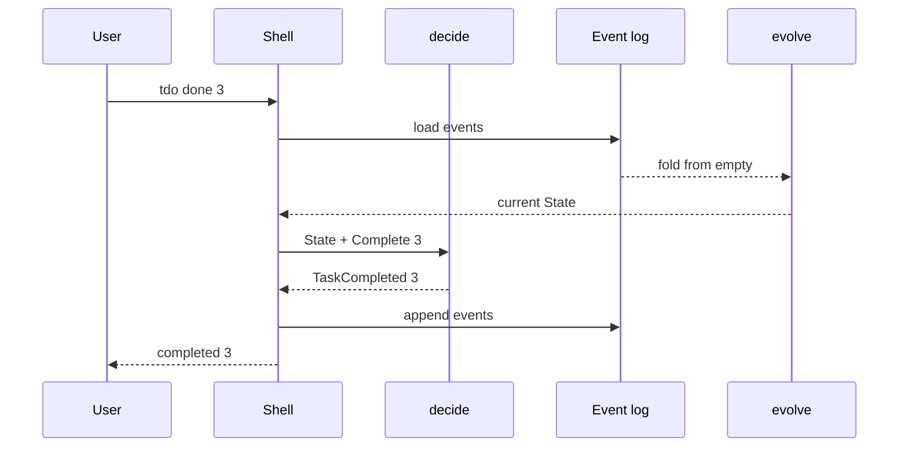

# Event sourcing

You type `tdo rm 3`, press Enter, and in the same instant realise that task 3
was the passport, not the dentist. Every to-do app that has ever existed
eventually gets a feature request with the word "undo" in it, and it usually
arrives in exactly this tone of voice.

Undo is a question about the past: *what was the list like before I did
that?* So is a surprising number of other questions. When did I finish the
boiler service? How many times have I pushed back "do tax return"? Did I delete
that task, or complete it? A program that only stores the *current* list can't
answer any of them, because every change overwrites the evidence.

This chapter changes what `tdo` remembers. Instead of storing the list of tasks,
we'll store the list of *things that happened* to it: task 3 was added, task 3
was completed, task 4 was removed. The current list becomes something we
compute, by replaying those facts from the beginning. The technique is called
**event sourcing**, and in Rust it decomposes into two small pure functions,
`decide` and `evolve`, and a `fold`. Undo and history fall out almost for free,
and so does a `--dry-run` flag, which turns out to be the same thing as
"decide, but don't write it down".

## Storing state, and what it forgets

Let's start, as usual, with the version we'd write without thinking. The
program loads the list of tasks, applies the command to it, and saves the list
back:

```rust
fn execute(tasks: &mut Vec<AnyTask>, command: Command) -> Result<(), Error> {
    match command {
        Command::Complete { id, on } => {
            let index = position(tasks, id)?;
            match tasks.remove(index) {
                AnyTask::Open(open) => {
                    tasks.insert(index, AnyTask::Done(open.complete(on)));
                    Ok(())
                }
                done => {
                    tasks.insert(index, done);
                    Err(Error::AlreadyDone(id))
                }
            }
        }
        // ... add, reopen, edit, remove
        Command::Undo => todo!("what was it before?"),
    }
}
```

The `Undo` arm is honest about the problem. By the time we get here, the
previous list has been overwritten, both in memory and, after the last run,
on disk. To support undo we'd have to keep copies of old lists, and to support
history we'd have to log what changed, somewhere, in some format, in addition
to the list itself. Two sources of truth, which will eventually disagree.

There's a quieter problem too. Look at the shape of the `Complete` arm: it
*checks* (is the task open?) and *changes* (replace it with a done task),
interleaved. That's fine until we want to check without changing. A
`--dry-run` flag that says "this is what would happen" would have to run the
whole thing on a copy and diff the result. The deciding and the doing are
tangled, the same tangle Chapter 9 untangled for the DNS daemon with *Decision
as Data*.

## Commands and events

The way out starts with a distinction we've been circling since Chapter 13.

A **command** is a request: *complete task 3*. It's in the imperative mood. It
might be refused (task 3 is already done; there is no task 3). It describes
what someone *wants*.

An **event** is a fact: *task 3 was completed on 19 October*. It's in the past
tense. It can't be refused, because it has already happened. It describes what
*is the case*.

| | Command | Event |
|---|---|---|
| Mood | imperative: "complete task 3" | past: "task 3 was completed" |
| Can fail? | yes | no; it already happened |
| Who makes it? | the user, via the CLI boundary | the domain, by deciding |
| Kept? | no | yes, forever |

Event sourcing stores the events, and only the events. Everything else (the
current tasks, the next id, what undo should do) is derived from them. Let's
write down the facts `tdo` needs to record:

```rust
// file: src/events.rs
/// Something that happened. Past tense, and never edited once written.
#[derive(Debug, Clone, PartialEq, Eq)]
pub enum Event {
    TaskAdded { id: TaskId, details: Details },
    TaskCompleted { id: TaskId, on: Date },
    TaskReopened { id: TaskId },
    TaskRetitled { id: TaskId, title: Title },
    TaskReprioritised { id: TaskId, priority: Priority },
    TaskRescheduled { id: TaskId, due: Option<Date> },
    TaskRemoved { id: TaskId },
    Undone,
}
```

Every variant name is a past participle, and that's a rule worth keeping:
if you find yourself naming an event `CompleteTask`, you've written a command.
The events are also *finer-grained* than the commands. `tdo edit` is one
command, but changing a title and changing a priority are different facts,
and history will be more useful if it can say which happened. `Undone` is the
odd one out; we'll come to it.

Notice, too, what the events *carry*. `TaskAdded` holds the whole `Details`,
and, crucially, the `id`. The id isn't something we'll recompute on replay; it
was decided once, when the task was added, and it's part of the fact.
`TaskCompleted` holds the date. Events are self-contained records of what was
decided, so that replaying them never needs to consult a clock or make a
choice.

## decide: from intentions to facts

The first function answers the question: *given everything we know, what
happens if we do this?* Its signature is the heart of the design:

```rust
// file: src/decide.rs
/// Decide which events a command produces. Pure, and never panics.
pub fn decide(
    state: &State,
    command: Command,
) -> Result<Vec<Event>, DomainError> {
    todo!()
}
```

It *reads* the state, through a shared reference, so it can't change it. It
takes the command by value, because once decided, a command has served its
purpose. And it returns either the facts that follow from the command, or a
reason for refusing it. Zero events is a perfectly good answer ("that changes
nothing"), and so is more than one.

The refusals are a small error enum:

```rust
#[derive(Debug, Clone, PartialEq, Eq, thiserror::Error)]
pub enum DomainError {
    #[error("there is no task {0}")]
    NoSuchTask(TaskId),
    #[error("task {0} is already done")]
    AlreadyDone(TaskId),
    #[error("task {0} isn't done, so it can't be reopened")]
    NotDone(TaskId),
    #[error("there is nothing to undo")]
    NothingToUndo,
}
```

We haven't defined `State` yet, but `decide` tells us what it needs to offer:
a way to look a task up by id, the next id to hand out, and whether there's
anything to undo. That's the type-driven workflow from Chapter 1. Write the
signature you want, and let it tell you what the types around it must
provide. Here's the body:

```rust
pub fn decide(
    state: &State,
    command: Command,
) -> Result<Vec<Event>, DomainError> {
    let find = |id| state.get(id).ok_or(DomainError::NoSuchTask(id));
    match command {
        Command::Add(details) => Ok(vec![Event::TaskAdded {
            id: state.next_id(),
            details,
        }]),
        Command::Complete { id, on } => match find(id)? {
            AnyTask::Open(_) => Ok(vec![Event::TaskCompleted { id, on }]),
            AnyTask::Done(_) => Err(DomainError::AlreadyDone(id)),
        },
        Command::Reopen { id } => match find(id)? {
            AnyTask::Done(_) => Ok(vec![Event::TaskReopened { id }]),
            AnyTask::Open(_) => Err(DomainError::NotDone(id)),
        },
        Command::Edit { id, changes } => Ok(edits(find(id)?, &changes)),
        Command::Remove { id } => {
            find(id)?;
            Ok(vec![Event::TaskRemoved { id }])
        }
        Command::Undo if state.can_undo() => Ok(vec![Event::Undone]),
        Command::Undo => Err(DomainError::NothingToUndo),
    }
}
```

`find` is a closure that captures `state` and turns "no such task" into an
error, so that every arm can say `find(id)?`. Matching on the `AnyTask` it
returns is where Chapter 14's enum earns its place: completing is allowed
exactly when the task is `Open`, and the compiler makes us say what happens in
the other case. `Command::Undo if state.can_undo()` is a *match guard*: the
arm is chosen only if the pattern matches *and* the condition holds;
otherwise matching falls through to the next arm.

Notice what `decide` doesn't do. It doesn't change anything, print anything,
or read a clock. The `on` date for `Complete` arrived inside the command,
resolved at the boundary in Chapter 13. The id for a new task comes from the
state. Given the same state and the same command, `decide` returns the same
answer, every time.

### Edits that only say what changed

`edit` is worth a closer look, because it's the one command that can produce
zero, one or several events. We want an event for each field that the user
asked to change *and* that is actually different. Retitling "Buy milk" to "Buy
milk" isn't news.

```rust
/// One event per field that actually changes; possibly none at all.
fn edits(task: &AnyTask, changes: &Changes) -> Vec<Event> {
    let id = task.id();
    let current = task.details();

    let title = changes.title().filter(|&t| *t != current.title).map(|t| {
        Event::TaskRetitled { id, title: t.clone() }
    });

    let priority = changes
        .priority()
        .filter(|&p| p != current.priority)
        .map(|priority| Event::TaskReprioritised { id, priority });

    // ... due: the same shape, turning DueChange into an Option<Date>

    [title, priority, due].into_iter().flatten().collect()
}
```

Each change is an `Option` pipeline: *if* the user asked, *and* it differs,
*then* here's the event. `Option::filter` keeps a `Some` only if the predicate
holds. The last line puts three `Option<Event>`s in an array, iterates, and
`flatten` drops the `None`s, because an `Option` is itself an iterator of zero
or one items. No `if`, no `mut`, no `push`.

## evolve: from facts to state

The second function goes the other way. Given the state so far and one fact,
what's the state now?

```rust
// file: src/state.rs
/// Apply one event. Pure: the old state goes in, the new one comes out.
pub fn evolve(mut state: State, event: &Event) -> State {
    todo!()
}
```

The signature is shaped for folding: a state in, an event borrowed, a state
out. It takes `State` by value, which means the caller hands over ownership;
nobody else can be looking at it. That's why the `mut` is harmless. Mutating a
value you exclusively own is invisible to the rest of the program, so `evolve`
is still a pure function, from the caller's point of view, as surely as if it
built a fresh `State` from scratch. Chapter 2 made this point in general:
ownership lets Rust have pure functions without paying for copies.

Now `State` itself. What does it need? `decide` asked for lookups by id, the
next id, and whether we can undo. A map of tasks covers the first; we'll add
the other two as we reach them.

```rust
type Tasks = BTreeMap<TaskId, AnyTask>;

/// Everything we know, rebuilt from the event log.
#[derive(Debug, Clone, Default, PartialEq, Eq)]
pub struct State {
    tasks: Tasks,
    last_id: Option<TaskId>,
    // ... one more field, for undo
}
```

`last_id` is the highest id ever handed out, or `None` if there has never been
a task. `next_id` follows from it: `self.last_id.map_or(TaskId::FIRST,
TaskId::next)`, with `TaskId::next` used as a function, just as `TaskId` was
in Chapter 13. `#[derive(Default)]` gives us the empty state: no tasks, no
ids. That's the state before anything ever happened.

Here's the body of `evolve`, first for the events that create and destroy:

```rust
match event {
    Event::TaskAdded { id, details } => {
        let task = Task::new(*id, details.clone());
        state.tasks.insert(*id, AnyTask::Open(task));
        state.last_id = state.last_id.max(Some(*id));
    }
    Event::TaskRemoved { id } => {
        state.tasks.remove(id);
    }
    // ...
}
state
```

`Option` implements `Ord`, with `None` less than any `Some`, so `max` with
`Some(*id)` updates the high-water mark. Note that removing a task doesn't touch
`last_id`. That single fact is what guarantees ids are never reused.

The lifecycle events are where Chapter 14's typestate plugs in. We take the
task out of the map, match on its state, and apply the consuming transition,
using the `update` helper we sketched at the end of that chapter:

```rust
Event::TaskCompleted { id, on } => {
    update(&mut state, *id, |task| match task {
        AnyTask::Open(open) => AnyTask::Done(open.complete(*on)),
        done => done,
    });
}
Event::TaskReopened { id } => {
    update(&mut state, *id, |task| match task {
        AnyTask::Done(done) => AnyTask::Open(done.reopen()),
        open => open,
    });
}
```

`open.complete(*on)` is a function from `Task<Open>` to `Task<Done>`, and it's
the *only* way to make the latter. There is no code here that sets a flag or
fills in a date by hand.

The edits are a variation, using a second helper, `edit`, that applies a
function to a task's `Details` whichever state it's in (it matches on
`AnyTask` and calls `with_details` on the inner task):

```rust
Event::TaskRetitled { id, title } => {
    edit(&mut state, *id, |d| Details { title: title.clone(), ..d });
}
Event::TaskReprioritised { id, priority } => {
    edit(&mut state, *id, |d| Details { priority: *priority, ..d });
}
Event::TaskRescheduled { id, due } => {
    edit(&mut state, *id, |d| Details { due: *due, ..d });
}
```

`Details { title: ..., ..d }` is struct update syntax again, this time between
values of the same type: a copy of `d` with one field replaced.

### evolve never fails

Look at the signature once more: `evolve` returns `State`, not
`Result<State, _>`. And look at that `done => done` arm. If a `TaskCompleted`
event arrives for a task that's already done, `evolve` shrugs and leaves it
alone.

This is deliberate, and it's the most important rule in event sourcing:
**`decide` validates; `evolve` only records.** An event is a fact. By the time
`evolve` sees it, it has happened, and been written down. If `evolve` could
reject events, a log written by an older version of the program, or one that
had a bug, could become impossible to replay, and you'd lose access to all your
data over one bad line. Instead, `decide` makes sure only sensible events are
produced, and `evolve` is *total*: it handles every event in every state,
doing the most reasonable thing for the oddities that should never occur.

### The compiler as the event checklist

Because `Event` is an enum and `evolve` matches on it, adding a fact to the
domain comes with a to-do list. Here's what happens if we add `TaskRemoved` to
the enum and forget to teach `evolve` about it:

```text
error[E0004]: non-exhaustive patterns: `&Event::TaskRemoved { .. }` not
              covered
  --> src/state.rs:43:11
   |
43 |     match event {
   |           ^^^^^ pattern `&Event::TaskRemoved { .. }` not covered
   |
note: `Event` defined here
  --> src/events.rs:13:10
   |
13 | pub enum Event {
   |          ^^^^^
...
38 |     TaskRemoved {
   |     ----------- not covered
   = note: the matched value is of type `&Event`
```

It's Chapter 1's kelvin moment again, and it's the reason not to put a
`_ => state` catch-all arm in `evolve`. A wildcard would compile, and the new
event would be silently ignored on every replay.

## The present is a fold

We have a function that turns one fact and a state into a new state. The
current state of the whole list is what you get by starting from the empty
state and applying every fact, in order:

```rust
let state = events.iter().fold(State::default(), evolve);
```

That's it. That's the line that makes event sourcing work. It's Chapter 6's
*Fold (Reduce)* pattern with a domain-sized accumulator: `fold` takes an
initial value and a function of `(accumulator, item) -> accumulator`, and
`evolve` has exactly that shape, so we can pass it by name. The present is a
fold over the past.

Put the two functions side by side and you can see the whole cycle. A command
comes in from the CLI; `decide` turns it, in the light of the current state,
into events; the events are appended to the log; and `evolve` folds them into
the next state.



Only the shell talks to the log and to the user. `decide` and `evolve` are
pure, so the whole domain is testable with nothing but values.

> [!PATTERN] Event Sourcing (Decide / Evolve)
> Store facts, not state. A pure `decide(&State, Command) -> Result<Vec<Event>,
> Error>` validates a request and returns the events that follow; a pure,
> total `evolve(State, &Event) -> State` applies one fact. The current state is
> `events.iter().fold(State::default(), evolve)`. History, audit and undo come
> from the log; previews come from calling `decide` without appending.

## Undo

Now the feature that started the chapter. There are three reasonable designs,
and it's worth seeing all three before choosing.

**Truncate the log.** Undo deletes the last command's events from the file. It
needs no new event types and replay stays trivial. But the log stops being
append-only: we'd have to rewrite the file, which (as Chapter 16 will show)
is the expensive and risky kind of write. And history forgets that the undone
command ever happened, which is precisely the information you want when you're
asking "what did I just do?".

**Compensating events.** Undo appends the *inverse* of the last command's
events: `TaskCompleted` is undone by `TaskReopened`, `TaskRetitled` by another
`TaskRetitled` with the old title. This is the textbook answer, and it keeps
the log append-only. But every event type needs an inverse, and some inverses
need information the event doesn't have. What's the inverse of `TaskRemoved`?
A `TaskRestored` carrying the entire removed task, which `decide` would have to
dig out of somewhere. Each new event type adds another inverse to get right.

**Record the undo, and let replay work it out.** Undo appends a single fact,
`Undone`, meaning "the most recent change was reverted". `evolve` interprets it
by returning to the state before that change. The log stays append-only,
history shows the undo, and there's no per-event inverse code at all, because
replay already knows how to compute *every* earlier state; that's what replay
is.

`tdo` takes the third option. `Undone` is still a compensating event in
spirit (it's appended, never deleting anything), but its meaning is computed
rather than spelled out.

### Batches

There's one wrinkle. "The most recent change" means the most recent
*command*, not the most recent event. `tdo edit 3 --title "..." --priority
high` produces two events, and one undo should revert both. So the log needs
to remember which events came from the same command. We give that a name:

```rust
/// The events one command produced: recorded, and undone, together.
pub type Batch = Vec<Event>;
```

A type alias doesn't create a new type (a `Batch` *is* a `Vec<Event>`), but it
gives the concept a name in signatures. Chapter 16 will store one batch per
line, which turns out to matter for crash safety too.

### Checkpoints

To return to the state before a batch, `State` needs to remember it. That's
the last field:

```rust
pub struct State {
    tasks: Tasks,
    last_id: Option<TaskId>,
    checkpoints: VecDeque<Tasks>,
}
```

Before each batch is applied, we push a copy of the tasks; undo pops one.
Applying a batch is a small function of its own, and it uses a *slice pattern*
to recognise the undo batch:

```rust
/// Apply one command's batch of events. Every batch except an undo
/// first saves a checkpoint, so that undo has something to return to.
pub fn apply(state: State, batch: &[Event]) -> State {
    match batch {
        [Event::Undone] => evolve(state, &Event::Undone),
        events => events.iter().fold(checkpoint(state), evolve),
    }
}
```

`[Event::Undone]` matches a slice of exactly one element, which is `Undone`.
Anything else binds the whole slice to `events`, saves a checkpoint, and
folds the events in. The `Undone` arm of `evolve` is then two lines:

```rust
Event::Undone => {
    if let Some(previous) = state.checkpoints.pop_back() {
        state.tasks = previous;
    }
}
```

Two details matter. First, `checkpoints` stores only `tasks`, not `last_id`.
Undoing an `add` brings the task list back, but the id it used stays used, so
the next task gets a fresh number. If you've already seen "task 7" in a
history listing, task 7 always means the same task. Second, `checkpoint` caps
how far back we can go:

```rust
fn checkpoint(mut state: State) -> State {
    state.checkpoints.push_back(state.tasks.clone());
    if state.checkpoints.len() > UNDO_DEPTH {
        state.checkpoints.pop_front();
    }
    state
}
```

A `VecDeque` is a double-ended queue: pushing at the back and popping from the
front are both cheap, so it makes a good bounded buffer. With `UNDO_DEPTH` set
to 50, replay keeps at most 50 copies of the task list in memory at a time.

> [!WARNING] The depth is part of the format
> Because `Undone` is replayed against these checkpoints, `UNDO_DEPTH` affects
> what an old log *means*. Raising it later is safe; lowering it can make an
> old `Undone` restore a different state than it did when it was written.
> TLA+ Interlude 3 finds a four-command example. Treat the number like a
> schema version: change it deliberately, or record it in the log.

> [!NOTE]
> Is copying the whole task list for every command wasteful? For a to-do list,
> no: a few hundred small tasks clone in microseconds, and replaying a few
> thousand commands takes milliseconds. For a system with millions of events,
> you'd use *persistent* data structures, which share unchanged parts between
> versions (the `im` crate offers them for Rust), and you'd periodically save
> a *snapshot* of the state so replay can start from there instead of from the
> beginning. The design is the same; only the bookkeeping changes.

### A fold of folds

Replaying the log is now a fold over batches, each of which is a fold over
events. We'd like to write it the same way as before:

```rust
// does not compile
pub fn replay(log: &[Batch]) -> State {
    log.iter().fold(State::default(), apply)
}
```

```text
error[E0631]: type mismatch in function arguments
   --> src/state.rs:129:39
    |
108 | pub fn apply(state: State, batch: &[Event]) -> State {
    | ---------------------------------------------------- found signature
    |                                                      defined here
...
129 |     log.iter().fold(State::default(), apply)
    |                ----                   ^^^^^ expected due to this
    |                |
    |                required by a bound introduced by this call
    |
    = note: expected function signature `fn(State, &Vec<Event>) -> _`
               found function signature `fn(State, &[Event]) -> _`
help: consider wrapping the function in a closure
```

Iterating a `&[Batch]` yields `&Vec<Event>`, and `apply` wants `&[Event]`.
When you *call* a function, Rust happily coerces `&Vec<T>` to `&[T]` (it's a
*deref coercion*), but passing `apply` by name asks for a function whose
signature matches exactly, and coercions don't apply to signatures. The help
text has the fix: a closure, inside which the call site does the coercion.

```rust
/// Rebuild the present from the whole log: a fold of folds.
pub fn replay(log: &[Batch]) -> State {
    log.iter()
        .fold(State::default(), |state, batch| apply(state, batch))
}
```

Clippy usually nags about closures that just forward their arguments
(`redundant_closure`), but it knows this one isn't redundant and stays quiet.

## History for free

With the log in hand, history isn't a feature we have to build. It's the log,
printed. Each event gets a `Display` that reads as a sentence in the past
tense:

```rust
impl fmt::Display for Event {
    fn fmt(&self, f: &mut fmt::Formatter<'_>) -> fmt::Result {
        match self {
            Event::TaskAdded { id, details } => {
                write!(f, "added {id}: {}", details.title)
            }
            Event::TaskCompleted { id, on } => {
                write!(f, "completed {id} on {on}")
            }
            Event::TaskRemoved { id } => write!(f, "removed {id}"),
            Event::Undone => write!(f, "undid the previous change"),
            // ... the rest in the same style
        }
    }
}
```

Those sentences double as `tdo`'s confirmations: after `tdo done 1`, the shell
prints each new event, so you see `completed 1 on 2026-10-19`.

`render::history` numbers the batches and, for undo batches, works out *which*
change was undone, by keeping a small stack of change numbers as it goes
(push for each ordinary batch, pop for each undo; the same logic as `apply`,
on numbers instead of states). Here's a real session's history, after a few
adds, a completion, an edit that changed two things, a mistaken `rm` and an
undo:

```text
   1  added 1: Buy milk
   2  added 2: Call the plumber
   3  added 3: Renew passport
   4  added 4: Book dentist
   5  completed 1 on 2026-10-19
   6  retitled 3: Renew passport (form in drawer)
      set priority of 3 to high
   7  removed 4
   8  undid change 7
```

Change 6 shows both facts from one `edit`, grouped as one batch. Change 8
records the undo without erasing change 7. Nothing was ever overwritten.

### Previews for free

`--dry-run` is the other gift. Since `decide` is pure, "what would happen?" is
just `decide` without the append:

```text
would run: tdo done 2
would record: completed 2 on 2026-10-19
```

The first line is Chapter 13's `Display` for `Command`; the second is
`decide`'s answer. Nothing was written. We'll wire this into `main` in the
next chapter.

## Testing decide and evolve

Because both functions are pure, tests are just values. A small helper drives
a sequence of commands through `decide` and `apply`, exactly as the shell will,
keeping the log:

```rust
// file: src/decide.rs (tests)
/// Run commands through decide and apply, as the shell would.
fn run(commands: Vec<Command>) -> (State, Vec<Vec<Event>>) {
    let mut log = Vec::new();
    let mut state = State::default();
    for command in commands {
        let events = decide(&state, command).expect("accepted");
        state = apply(state, &events);
        log.push(events);
    }
    (state, log)
}
```

Now each rule is a few lines. Refusals:

```rust
#[test]
fn completing_twice_is_refused() {
    let complete = Command::Complete { id: ID, on: DAY };
    let (state, _) = run(vec![add("Buy milk"), complete.clone()]);
    assert_eq!(decide(&state, complete), Err(DomainError::AlreadyDone(ID)));
}
```

Undo, including the promise about ids:

```rust
#[test]
fn undo_returns_to_the_previous_state_but_keeps_ids_fresh() {
    let (before, _) = run(vec![add("Buy milk")]);
    let (after, _) = run(vec![
        add("Buy milk"),
        Command::Complete { id: ID, on: DAY },
        Command::Undo,
    ]);
    assert_eq!(after.get(ID), before.get(ID));

    let (state, _) = run(vec![add("Buy milk"), Command::Undo]);
    assert_eq!(state.get(ID), None);
    assert_eq!(state.next_id(), ID.next());
}
```

And the central promise of event sourcing: replaying the log from scratch
reproduces the state we built up incrementally.

```rust
#[test]
fn replaying_the_log_reproduces_the_state() {
    let (state, log) = run(vec![
        add("Buy milk"),
        add("Ring Sam"),
        Command::Complete { id: ID, on: DAY },
        Command::Remove { id: ID.next() },
        Command::Undo,
    ]);
    assert_eq!(replay(&log), state);
}
```

`add` builds a `Command::Add` with default details; `ID` and `DAY` are
constants. That last test checks one handpicked sequence. In Chapter 16 we'll
let `proptest` generate thousands of sequences and check the same property for
all of them.

> [!CHECKPOINT]
> New files: `src/events.rs` (`Event`, `Batch`, `Display`), `src/state.rs`
> (`State`, `evolve`, `apply`, `replay`) and `src/decide.rs` (`decide`,
> `DomainError`), each declared in `lib.rs`. `State` exposes `tasks()`,
> `get(id)`, `next_id()` and `can_undo()`. The decide tests pass:
>
> ```text
> test decide::tests::completing_twice_is_refused ... ok
> test decide::tests::edits_that_change_nothing_produce_no_events ... ok
> test decide::tests::nothing_to_undo_at_the_start ... ok
> test decide::tests::replaying_the_log_reproduces_the_state ... ok
> test decide::tests::undo_returns_to_the_previous_state_but_keeps_ids_fresh ... ok
> test decide::tests::unknown_ids_are_refused ... ok
> ```

## What we learned

- **Commands are requests; events are facts.** Commands can be refused and are
  forgotten; events are past tense, can't be refused, and are kept forever.
- **`decide` validates, `evolve` records.** `decide(&State, Command)` returns
  the events that follow or a reason not to; `evolve(State, &Event)` is total
  and never fails, so the log can always be replayed.
- **Owning the state makes local mutation pure.** `evolve` takes `State` by
  value, so its `mut` is invisible to everyone else.
- **The present is a fold over the past.** `events.iter().fold(State::default(),
  evolve)` is the whole replay, and it's Chapter 6's *Fold* with a
  domain-sized accumulator.
- **Typestate transitions plug straight into `evolve`.** Each lifecycle event
  is a `match` on `AnyTask` and a call to a consuming method.
- **Undo as a recorded fact**, interpreted by replay with bounded checkpoints,
  keeps the log append-only and needs no per-event inverse code. Batches make
  "one command" the unit of undo.
- **Exhaustive matching makes new events a checklist.** Never give `evolve` a
  wildcard arm.
- **History and dry runs come free** once facts are data and decisions are
  pure.

## Exercises

> [!EXERCISE] Redo
> Add `tdo redo`, which re-applies the most recently undone change. Start with
> the event: what fact does it record? Then `State`: what would it need to
> remember, and when should that memory be cleared? (Most editors forget the
> redo stack as soon as you make a fresh change. Is that the right behaviour
> here?)

> [!EXERCISE] Compensating events
> Implement the second undo design instead: an `inverse(event, &State) ->
> Event` function, and `decide(Undo)` emitting the inverse of the last batch,
> in reverse order. What do you need to add to `Event` to invert
> `TaskRemoved`? Which design would you rather explain to a colleague?

> [!EXERCISE] Counting procrastination
> Write a pure function `postponements(log: &[Batch], id: TaskId) -> usize`
> that counts how many times a task's due date was moved *later*. You'll need
> to fold over the events while remembering each task's previous due date.
> What does this tell you about the information events carry?

> [!EXERCISE] Clear the decks
> Add a `tdo clear` command that removes every done task. What does `decide`
> return for it, and how many events? Check that one `undo` brings them all
> back.
