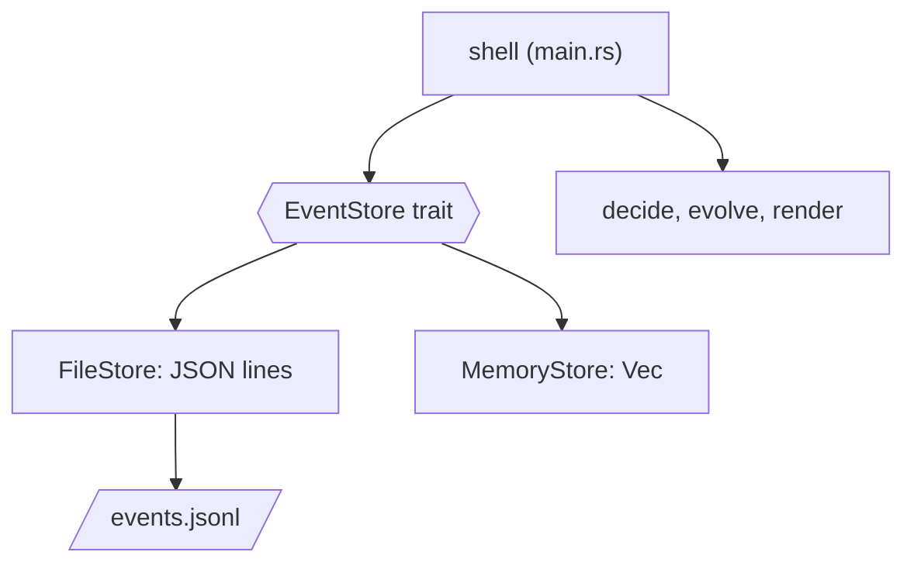
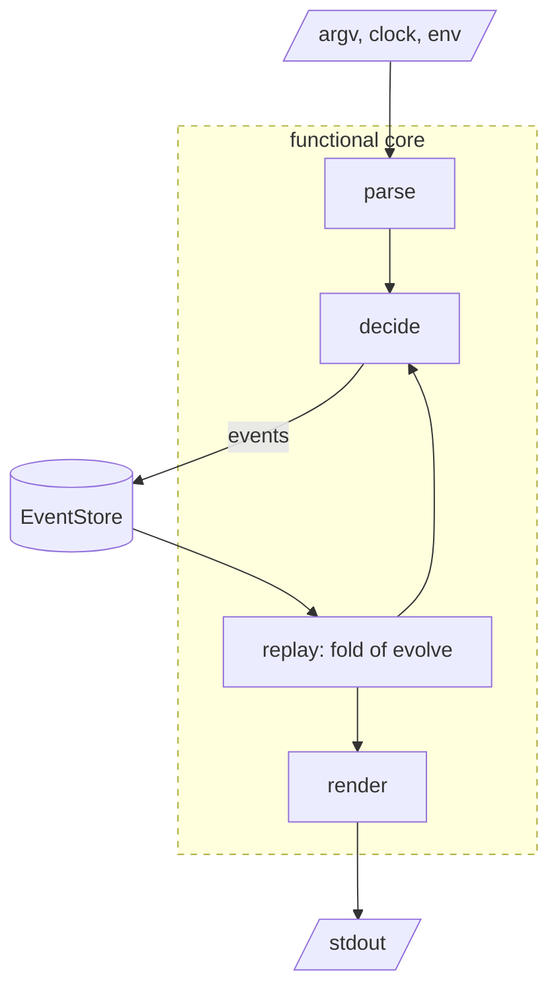

# Persistence and the shell

`tdo` can now parse what you ask for, decide what it means and fold the
consequences into a to-do list. And the moment the process exits, all of it
evaporates. This chapter gives `tdo` a memory that outlives the process, and a
face you can actually use.

Persistence is where programs meet the parts of the world that don't care
about our types. Disks fill up. Laptops run out of battery halfway through a
write. Two terminals run `tdo` at once. A user edits the data file by hand, in
the confident belief that they know what they're doing. Event sourcing turns
out to make most of this easier, because the only thing we ever write is a new
line at the end of a file, but "most" isn't "all", and we'll find a real bug
on the way that would have quietly destroyed a user's data.

By the end of the chapter, `tdo` is a finished tool: a log file in the
platform's data directory, an output format that respects your terminal,
integration tests that run the real binary, and property tests that check the
event-sourcing promises against thousands of generated histories.

## The port: an event store

Before writing any file-handling code, let's decide what the rest of the
program needs from storage. Looking at Chapter 15, the shell does exactly two
things with the log: it loads all of it, to replay; and it appends one batch,
after `decide`. That's the whole interface:

```rust
// file: src/store/mod.rs
/// The repository for our one aggregate: an append-only log of batches.
pub trait EventStore {
    fn load(&self) -> Result<Vec<Batch>, StoreError>;
    fn append(&mut self, batch: &[Event]) -> Result<(), StoreError>;
}
```

This is Chapter 10's *Ports and Adapters* again: a trait owned by the domain
side, describing what it needs in its own terms, with implementations plugged
in from outside. Notice what the trait *doesn't* offer. There's no `update`,
no `delete`, no `save_state`. An event store can only grow. The undo design we
chose in Chapter 15, recording `Undone` rather than truncating, is what makes
such a small interface possible.

`append` takes `&mut self` even though a file-backed store could manage with
`&self`. It's a statement of intent: appending changes the store, and the
borrow checker should treat it that way, so that nobody can hold a `load`ed
view and append at the same time through the same handle.

Domain-driven design has a name for this kind of interface: a **repository**.
A repository gives the domain the illusion of an in-memory collection of its
aggregates, hiding where and how they're really kept. An *aggregate* is a
cluster of objects that change together and are kept consistent as a unit;
here, the whole to-do list is one aggregate, and it changes only through
`decide`. In an event-sourced system, the repository's collection is a log of
events, and loading an aggregate means replaying it.

> [!PATTERN] Repository (Event Store)
> Hide persistence behind a trait shaped like the domain's needs, not the
> database's features. For an event-sourced aggregate the repository is an
> event store with two operations, load the log and append a batch, and
> nothing that edits the past. Adapters implement it for real storage and for
> tests.

The errors are typed, following the book's convention, with the underlying
cause kept as the source:

```rust
#[derive(Debug, thiserror::Error)]
pub enum StoreError {
    #[error("couldn't access the task log")]
    Io(#[from] std::io::Error),
    #[error("line {line} of the task log is damaged")]
    Corrupt {
        line: usize,
        #[source]
        source: serde_json::Error,
    },
}
```

The first adapter is the simplest possible one, for tests:

```rust
// file: src/store/memory.rs
/// An event store that lives and dies with the process. For tests.
#[derive(Debug, Default)]
pub struct MemoryStore {
    log: Vec<Batch>,
}

impl EventStore for MemoryStore {
    fn load(&self) -> Result<Vec<Batch>, StoreError> {
        Ok(self.log.clone())
    }

    fn append(&mut self, batch: &[Event]) -> Result<(), StoreError> {
        self.log.push(batch.to_vec());
        Ok(())
    }
}
```

Here's how the pieces sit. The shell talks to the trait; the trait has two
adapters; the pure core never sees any of them.



## Events on disk

Now the real store. First, events need a serialised form, so `serde` and
`serde_json` join the dependencies, along with `serde`'s support in `jiff`:

```toml
# file: Cargo.toml
[dependencies]
# ...
jiff = { version = "0.2", features = ["serde"] }
serde = { version = "1", features = ["derive"] }
serde_json = "1"
```

`Event` gets `Serialize` and `Deserialize` derives, and two attributes that
decide what it looks like as JSON:

```rust
// file: src/events.rs
#[derive(Debug, Clone, PartialEq, Eq, Serialize, Deserialize)]
#[serde(tag = "type", rename_all = "snake_case")]
pub enum Event {
    TaskAdded {
        id: TaskId,
        #[serde(flatten)]
        details: Details,
    },
    TaskCompleted { id: TaskId, on: Date },
    // ... the rest unchanged
}
```

`tag = "type"` makes each event a JSON object with a `"type"` field naming the
variant, rather than serde's default of wrapping it in an object keyed by the
variant name. `rename_all = "snake_case"` spells those names the way JSON
usually does. `#[serde(flatten)]` lifts the fields of `Details` up into the
event, so a task-added event is one flat object rather than an object with a
`details` object inside it. Here's a real log, after four adds, a completion
and a removal:

```json
[{"type":"task_added","id":1,"title":"Buy milk","priority":"high","due":"2026-11-01","tags":["home"]}]
[{"type":"task_added","id":2,"title":"Call the plumber","priority":"high","due":"2026-10-18","tags":["home"]}]
[{"type":"task_added","id":3,"title":"Renew passport","priority":"medium","due":"2026-10-20","tags":["admin"]}]
[{"type":"task_added","id":4,"title":"Book dentist","priority":"low"}]
[{"type":"task_completed","id":1,"on":"2026-10-19"}]
[{"type":"task_removed","id":4}]
```

The value objects need derives too, and here's where it gets interesting.
`TaskId` should look like a plain number on disk, so it's marked
`#[serde(transparent)]`, meaning "serialise me exactly as my single field".
`Priority` gets `rename_all = "lowercase"`. On `Details`, `due` and `tags` are
skipped when empty and defaulted when missing, which keeps the lines short.

### Parse, don't validate, on the way back in

`Title` is the important one. If we derived `Deserialize` on it in the usual
way, serde would happily build a `Title` from any JSON string, including `""`,
bypassing our smart constructor entirely. Everything Chapter 14 promised about
titles would hold for titles typed at the command line, and not for titles
read from a file someone had edited by hand.

serde can be told to route deserialisation through a conversion instead:

```rust
// file: src/domain/title.rs
#[derive(Debug, Clone, PartialEq, Eq, Serialize, Deserialize)]
#[serde(try_from = "String", into = "String")]
pub struct Title(String);

impl TryFrom<String> for Title {
    type Error = TitleError;

    fn try_from(raw: String) -> Result<Self, Self::Error> {
        Title::parse(&raw)
    }
}
```

`try_from = "String"` says: to deserialise a `Title`, deserialise a `String`
and then call `Title::try_from` on it, failing if it fails. `into = "String"`
is the mirror image for serialising, and needs a matching `From<Title> for
String`. `Tag` gets the same treatment. Now the file is just another boundary,
and the rule from Chapter 4, *Parse, Don't Validate*, holds there too:

```rust
#[test]
fn invalid_titles_are_rejected_on_the_way_in() {
    let json = r#"{"type":"task_retitled","id":1,"title":" "}"#;
    assert!(serde_json::from_str::<Event>(json).is_err());
}
```

> [!WARNING]
> Events are a contract with your past self. Once a log contains
> `"task_added"`, renaming the variant to `TaskCreated` (or changing
> `rename_all`) makes every existing log unreadable. Treat the serialised
> names as a public API. When an event's shape really must change, add a new
> variant and teach `evolve` both, or *upcast* old events to new ones as they're
> loaded. The exercises try this.

## JSON Lines, one batch per line

The file format is [JSON Lines](https://jsonlines.org): one JSON value per
line. Each line holds one *batch*, the events from one command, as a JSON
array. It's a good fit for an append-only log. Adding a batch never touches
existing bytes; any line can be read on its own; and the file stays readable
with `cat`, `grep` and `jq`.

One batch per line also gives us something subtler. A command's events should
be recorded *all or nothing*: if `tdo edit` changes a title and a priority, a
crash shouldn't leave the log holding only the title change. Writing the whole
batch as one line, in one write, makes the line the unit of atomicity. Either
the line made it to disk, or it didn't.

Loading is a pipeline over lines:

```rust
// file: src/store/file.rs
impl EventStore for FileStore {
    fn load(&self) -> Result<Vec<Batch>, StoreError> {
        let text = match fs::read_to_string(&self.path) {
            Ok(text) => text,
            Err(e) if e.kind() == ErrorKind::NotFound => return Ok(vec![]),
            Err(e) => return Err(e.into()),
        };
        parse_log(&text)
    }
    // ... append
}
```

A missing file isn't an error; it's a to-do list on its first day. Every other
I/O error is. The match guard (`if e.kind() == ...`) picks out exactly the case
we want to treat specially. `FileStore` itself is just a `PathBuf`.

## Writing without losing data

Appending sounds simple: open the file, write a line, close it. But "the line
made it to disk" is doing a lot of work in the previous section, and we should
decide carefully what we mean by it. There are two standard ways to change a
file safely.

**Write a temporary file, then rename.** Write the *entire* new contents to
`events.jsonl.tmp`, flush it to disk with `fsync`, then `rename` it over the
original. On POSIX file systems `rename` is atomic: anyone opening the file
sees either the whole old version or the whole new one, never a mixture. It's
the gold standard for replacing a file. Its cost is that every change rewrites
everything, so recording one event in a log of ten thousand means writing ten
thousand lines. (To be fully durable you also `fsync` the directory after the
rename, so that the rename itself survives a crash. The same goes for the very
first append that *creates* the log: until the directory entry is synced, a
power cut can lose the new file. TLA+ Interlude 3 comes back to this.)

**Append, then fsync.** Open the file in append mode, write the new line, and
call `sync_data` so it's on the disk before we report success. It's O(1) per
command, whatever the size of the log. Its cost is that a crash *during* the
write can leave a partial line at the end of the file: a *torn write*.

For an append-only log the second is the natural choice, provided we handle
torn writes. If we'd chosen to implement undo by truncating the log, we'd have
needed the first, at least for undo. That's a nice example of a domain
decision (how undo works) shaping an infrastructure decision (how we write
files).

### Tolerating a torn tail

A torn write leaves a final line with no newline, because the newline is the
last byte we write. That's our signal. When loading, we parse only up to the
last newline and ignore anything after it:

```rust
/// Parse every complete line. A final line with no newline is a write
/// that never finished, so we ignore it rather than fail.
fn parse_log(text: &str) -> Result<Vec<Batch>, StoreError> {
    let complete = match text.rfind('\n') {
        Some(end) => &text[..=end],
        None => "",
    };
    complete
        .lines()
        .enumerate()
        .filter(|(_, line)| !line.trim().is_empty())
        .map(|(index, line)| {
            serde_json::from_str(line).map_err(|source| {
                StoreError::Corrupt { line: index + 1, source }
            })
        })
        .collect()
}
```

Ignoring a torn tail is safe because of the order of operations in the shell:
we only print "completed 3" *after* `append` returns, which is after
`sync_data`. A torn line is a command whose success was never reported. Losing
it is exactly what the user would expect if the laptop died while they were
pressing Enter.

Damage anywhere *else* is different. A bad line in the middle means something
has gone wrong that we don't understand, and the right response is to stop and
say so, with the line number, rather than guess:

```text
tdo: line 2 of the task log is damaged: expected ident at line 1 column 2
```

### The bug

Here's the first version of `append`:

```rust
fn append(&mut self, batch: &[Event]) -> Result<(), StoreError> {
    let mut line =
        serde_json::to_string(batch).expect("events always serialise");
    line.push('\n');
    let mut file = OpenOptions::new()
        .append(true)
        .create(true)
        .open(&self.path)?;
    file.write_all(line.as_bytes())?;
    file.sync_data()?;
    Ok(())
}
```

It passed every test I'd written for it. Then I simulated a crash by
chopping the end off a log, and carried on using `tdo`:

```text
$ tdo list
  1  [ ]  medium               Buy milk
$ tdo add "Ring Sam"
added 2: Ring Sam
$ tdo list
tdo: line 2 of the task log is damaged: expected `:` at line 1 column 37
```

The first `list` was fine: the torn tail was ignored, as designed. Then `add`
appended a perfectly good line... to the end of the torn one. Here's the file:

```text
[{"type":"task_added","id":1,"title":"Buy milk","priority":"medium"}]
[{"type":"task_added","id":2,"tit[{"type":"task_added","id":2,"title":...
```

The torn fragment and the new batch are now one line, *with* a newline, so
it's no longer a torn tail. It's damage in the middle of the log, and
`tdo` refuses to load at all. One crash, followed by one perfectly normal
command, and the user is locked out of their to-do list. That's the kind of
bug that only shows up in production, months later, on someone else's
laptop.

The fix is to repair the tail before appending: if the file doesn't end with
a newline, cut it back to the last one.

```rust
/// If a previous write was cut short, cut the file back to its last
/// complete line so that the next append starts on a fresh line.
fn drop_torn_tail(file: &mut File) -> io::Result<()> {
    if file.metadata()?.len() == 0 {
        return Ok(());
    }
    let mut last = [0u8];
    file.seek(SeekFrom::End(-1))?;
    file.read_exact(&mut last)?;
    if last[0] == b'\n' {
        return Ok(());
    }
    let mut bytes = Vec::new();
    file.seek(SeekFrom::Start(0))?;
    file.read_to_end(&mut bytes)?;
    let keep = bytes.iter().rposition(|&b| b == b'\n').map_or(0, |i| i + 1);
    file.set_len(keep as u64)
}
```

The common case costs one one-byte read at the end of the file. Only after a
crash do we read the whole file, find the last newline (`rposition` searches
from the end), and truncate with `set_len`. `append` now opens the file with
`.read(true)` as well, creates the parent directory if needed, and calls
`drop_torn_tail` before writing:

```rust
if let Some(dir) = self.path.parent() {
    fs::create_dir_all(dir)?;
}
let mut file = OpenOptions::new()
    .read(true)
    .append(true)
    .create(true)
    .open(&self.path)?;
drop_torn_tail(&mut file)?;
file.write_all(line.as_bytes())?;
file.sync_data()?;
```

In append mode every write goes to the current end of the file, so after
`set_len` the new line lands exactly where the torn one began. And now the bug
has a test, so it stays fixed:

```rust
#[test]
fn a_torn_final_line_is_ignored_and_then_repaired() {
    let dir = tempfile::tempdir().unwrap();
    let path = dir.path().join("events.jsonl");
    let torn = "[{\"type\":\"task_removed\",\"id\":1}]\n[{\"type\":\"ta";
    fs::write(&path, torn).unwrap();

    let mut store = FileStore::new(path);
    assert_eq!(store.load().unwrap(), vec![removed(1)]);

    store.append(&removed(2)).unwrap();
    assert_eq!(store.load().unwrap(), vec![removed(1), removed(2)]);
}
```

`tempfile::tempdir()` makes a fresh directory that's deleted when the value is
dropped: Chapter 2's *Ownership as Resource Management (RAII)*, doing
housekeeping for our tests. It's a dev-dependency, along with `proptest`,
which we'll need shortly:

```toml
# file: Cargo.toml
[dev-dependencies]
proptest = "1"
tempfile = "3"
```

> [!CAUTION]
> `flush` is not `fsync`. `Write::flush` only empties Rust's own buffers into
> the operating system; the data may sit in the OS cache for seconds before it
> reaches the disk. `File::sync_data` asks the OS to put it on the disk and
> waits until it has. If you report success to a user before that, a power cut
> can take back a change you told them was saved.

> [!WARNING]
> Two `tdo` processes appending at the same moment could each decide the next
> id is 7. On local file systems, small appends with `O_APPEND` don't
> interleave *within* a line, but nothing stops two processes making
> decisions from the same stale state. For a personal to-do list that's an
> acceptable risk; for anything shared, take an advisory lock on the file
> around load-decide-append. An exercise asks you to add one.

## Where the file lives

Each operating system has a convention for where applications keep their
data. On Linux it's `$XDG_DATA_HOME`, usually `~/.local/share`; on macOS it's
`~/Library/Application Support`; Windows has its own. The `directories` crate
knows them all:

```sh
cargo add directories
```

We also want an override, both for users who keep their to-do list somewhere
synced and for tests, which must never touch the real one. The policy ("an
override wins, unless it's empty; otherwise the platform's data directory")
is a decision, so it goes in a pure function, and the shell supplies the
inputs:

```rust
// file: src/store/path.rs
/// Where the log lives: `$TDO_FILE` if set, otherwise `events.jsonl`
/// in the platform's data directory. Pure: the shell supplies both.
pub fn data_file(
    override_file: Option<PathBuf>,
    data_dir: Option<PathBuf>,
) -> Option<PathBuf> {
    override_file
        .filter(|path| !path.as_os_str().is_empty())
        .or_else(|| data_dir.map(|dir| dir.join("events.jsonl")))
}
```

It returns an `Option` because on a sufficiently strange system (no home
directory at all) there may be no answer, and the shell should say so rather
than write somewhere surprising. The shell's half is three lines:

```rust
// file: src/main.rs
fn log_path() -> Option<PathBuf> {
    let dirs = ProjectDirs::from("", "", "tdo");
    store::data_file(
        env::var_os("TDO_FILE").map(PathBuf::from),
        dirs.map(|d| d.data_dir().to_path_buf()),
    )
}
```

`ProjectDirs::from` takes a reverse-domain qualifier, an organisation and an
application name; for a personal tool the first two can be empty. On a Mac,
the log ends up at `~/Library/Application Support/tdo/events.jsonl`.

## Rendering

The last pure piece is turning a `State` into the text `tdo list` prints. The
signature keeps it pure by taking everything it needs as arguments:

```rust
// file: src/render.rs
/// How to draw a list: what to show, what day it is, whether to colour.
#[derive(Debug, Clone, PartialEq, Eq)]
pub struct ListOptions {
    pub filter: Filter,
    pub today: Date,
    pub colour: bool,
}

pub fn render(state: &State, options: &ListOptions) -> String {
    let mut tasks: Vec<&AnyTask> = state
        .tasks()
        .filter(|t| shows(&options.filter, t))
        .collect();
    if tasks.is_empty() {
        return "nothing to do\n".to_owned();
    }
    tasks.sort_by_key(|t| sort_key(t));
    tasks.iter().map(|t| row(t, options)).collect()
}
```

`render` returns a `String` rather than printing. That's what lets us test it
with `assert_eq!`, and it means "where does output go?" is the shell's
question. `today` is in the options because whether a task is overdue depends
on it, and `colour` is there because whether to use colour depends on the
terminal, which `render` mustn't look at.

`shows` is the filter from Chapter 13: done tasks only with `--all`, and only
tasks carrying the tag if one was given. The order deserves a moment:

```rust
/// Open before done, then most important, then soonest due, then oldest.
fn sort_key(task: &AnyTask) -> impl Ord {
    let d = task.details();
    (
        task.is_done(),
        Reverse(d.priority),
        d.due.is_none(),
        d.due,
        task.id(),
    )
}
```

Tuples compare element by element, so a tuple *is* a multi-level sort key.
`false < true`, so open tasks come first. `std::cmp::Reverse` flips an
ordering, so higher priorities come first; this is where Chapter 14's
carefully ordered `Priority` pays off. `d.due.is_none()` puts tasks with no
due date after those with one, and the id breaks any remaining ties so the
output is stable. Returning `impl Ord` means we don't have to spell out the
tuple's type.

Each row is a `format!` with padded columns. Overdue dates get a `!`, and, if
colour is on, turn red; done tasks are dimmed. Painting is a tiny function
that wraps text in ANSI escape codes, or doesn't:

```rust
fn paint(text: &str, code: &str, enabled: bool) -> String {
    if enabled {
        format!("\x1b[{code}m{text}\x1b[0m")
    } else {
        text.to_owned()
    }
}
```

When should colour be on? Two conventions matter. Output going to a pipe or a
file shouldn't contain escape codes, so colour needs a terminal. And the
[NO_COLOR](https://no-color.org) convention says that if the `NO_COLOR`
environment variable is set to anything non-empty, the user doesn't want
colour, full stop. That's a decision, so it's pure too:

```rust
/// Colour only for a terminal, and never if `NO_COLOR` is set.
pub fn use_colour(is_terminal: bool, no_color: Option<&str>) -> bool {
    is_terminal && no_color.is_none_or(str::is_empty)
}
```

`Option::is_none_or` is the mirror of Chapter 14's `is_some_and`: true for
`None`, or for a `Some` whose value passes the test. Here's the list from a
real session (plain, since it was captured through a pipe):

```text
  2  [ ]  high    2026-10-18!  Call the plumber  +home
  3  [ ]  medium  2026-10-20   Renew passport  +admin
  4  [ ]  low                  Book dentist
```

## The shell

Everything is ready to be wired together. `main` hasn't changed since
Chapter 13: parse with clap, call `run`, map errors to exit codes. `run`
grows into the full shell:

```rust
fn run(cli: Cli) -> anyhow::Result<()> {
    let today = today()?;
    let request = cli::parse(cli.action, today)?;

    let path = log_path().context("can't work out where to keep tasks")?;
    let mut store = FileStore::new(path);
    let log = store.load()?;
    let state = replay(&log);

    match request {
        Request::Command(command) => {
            execute(&mut store, &state, command, cli.dry_run)
        }
        Request::Query(Query::List(filter)) => {
            let colour = render::use_colour(
                io::stdout().is_terminal(),
                env::var("NO_COLOR").ok().as_deref(),
            );
            let options = ListOptions { filter, today, colour };
            print!("{}", render::render(&state, &options));
            Ok(())
        }
        Request::Query(Query::History) => {
            print!("{}", render::history(&log));
            Ok(())
        }
    }
}
```

Read it top to bottom and it's the sequence diagram from Chapter 15: gather
inputs (clock, arguments, log), call the pure core (`parse`, `replay`,
`render`), act on the result. `anyhow::Context::context` adds a human
explanation to a `None` or an error on its way out. `std::io::IsTerminal` is
the standard library's "is this a terminal?" check.

Commands go through `execute`, which is generic over any `EventStore`:

```rust
fn execute(
    store: &mut impl EventStore,
    state: &State,
    command: Command,
    dry_run: bool,
) -> anyhow::Result<()> {
    if dry_run {
        println!("would run: tdo {command}");
    }
    let events = decide(state, command)?;
    if events.is_empty() {
        println!("nothing changed");
        return Ok(());
    }
    if !dry_run {
        store.append(&events)?;
    }
    for event in &events {
        let prefix = if dry_run { "would record: " } else { "" };
        println!("{prefix}{event}");
    }
    Ok(())
}
```

Two small policies live here. An empty batch is never appended: an edit that
changed nothing shouldn't become an undoable change, or `undo` would appear
to do nothing. And confirmations are printed only *after* `append` has
returned, which is after `sync_data`, so "completed 3" on screen means
completed 3 on disk.

The last input is the clock. Tests need a fixed date, and the honest way to
give them one is to treat the clock as configuration that the shell reads:

```rust
/// The clock is an input like any other; `TDO_TODAY` pins it for tests.
fn today() -> anyhow::Result<Date> {
    match env::var("TDO_TODAY") {
        Ok(text) => text.parse().context("TDO_TODAY is not a date"),
        Err(_) => Ok(Zoned::now().date()),
    }
}
```

Here's the finished tool, in a session run with `TDO_TODAY=2026-10-19`:

```text
$ tdo add "Buy milk" --priority high --due 2026-11-01 --tag home
added 1: Buy milk
$ tdo add "Call the plumber" -p high --due 2026-10-18 -t home
added 2: Call the plumber
$ tdo done 1
completed 1 on 2026-10-19
$ tdo list --all --tag home
  2  [ ]  high    2026-10-18!  Call the plumber  +home
  1  [x]  high    2026-11-01   Buy milk  +home
$ tdo done 1
tdo: task 1 is already done
$ tdo undo
undid the previous change
$ tdo reopen 1
tdo: task 1 isn't done, so it can't be reopened
```

The whole architecture fits on one page. Everything inside the dashed box is
pure; everything outside it is the shell and its adapters.



## Testing the binary

Unit tests cover the pieces. We also want a few tests that run the real
binary, the way a user would, to catch mistakes in the wiring. Cargo makes the
path of a crate's binaries available to its integration tests through
`env!("CARGO_BIN_EXE_<name>")`, so `std::process::Command` is all we need:

```rust
// file: tests/cli.rs
fn tdo(log: &Path, args: &[&str]) -> Output {
    Command::new(env!("CARGO_BIN_EXE_tdo"))
        .args(args)
        .env("TDO_FILE", log)
        .env("TDO_TODAY", "2026-10-19")
        .env("NO_COLOR", "1")
        .output()
        .expect("tdo runs")
}
```

Every test gets its own temporary directory and log file, a fixed date, and
no colour. The tests read like the transcripts above:

```rust
#[test]
fn undo_survives_a_restart() {
    let dir = tempfile::tempdir().unwrap();
    let log = dir.path().join("events.jsonl");

    tdo(&log, &["add", "Buy milk"]);
    tdo(&log, &["rm", "1"]);
    tdo(&log, &["undo"]);

    assert!(stdout(&tdo(&log, &["list"])).contains("Buy milk"));
    let history = stdout(&tdo(&log, &["history"]));
    assert!(history.contains("undid change 2"), "{history}");
}
```

Each `tdo(...)` call is a separate process, so this test checks that undo
works *across restarts*: the checkpoints are rebuilt by replay, not kept in
memory. Another test checks exit codes and that a refused command writes
nothing:

```rust
#[test]
fn mistakes_have_distinct_exit_codes() {
    let dir = tempfile::tempdir().unwrap();
    let log = dir.path().join("events.jsonl");

    let blank = tdo(&log, &["add", "  "]);
    assert_eq!(blank.status.code(), Some(2));

    let missing = tdo(&log, &["done", "7"]);
    assert_eq!(missing.status.code(), Some(1));
    assert!(!log.exists(), "refused commands record nothing");
}
```

> [!TIP]
> The `assert_cmd` and `predicates` crates wrap this pattern in a fluent API
> (`cmd.assert().success().stdout(contains("..."))`). They're pleasant, but for
> a handful of tests `std::process::Command` and `assert!` are enough, and one
> fewer dependency is one fewer thing to learn.

## Property tests for replay

The unit tests in Chapter 15 checked hand-picked command sequences. But the
promises event sourcing makes are about *all* sequences: replaying the log
always reproduces the state; ids are never reused; undo always puts things
back. That's exactly what Chapter 7's *Property-Based Testing* is for.

First, `proptest` strategies (recipes for generating random values) for the
pieces of a command. Ids are drawn from a small range on purpose, so that
generated commands often refer to tasks that exist:

```rust
// file: tests/replay.rs
fn id() -> impl Strategy<Value = TaskId> {
    (1u32..6).prop_map(TaskId::new)
}

fn title() -> impl Strategy<Value = Title> {
    "[a-z]{1,8}".prop_map(|s| Title::parse(&s).unwrap())
}
```

A string literal is a strategy too: proptest treats it as a regular expression
and generates matching strings. A `command()` strategy combines these with
`prop_oneof!`, which picks one of several strategies at random:

```rust
fn command() -> impl Strategy<Value = Command> {
    let on = date(2026, 10, 19);
    prop_oneof![
        (title(), priority()).prop_map(|(title, priority)| {
            Command::Add(Details {
                title,
                priority,
                due: None,
                tags: BTreeSet::new(),
            })
        }),
        id().prop_map(move |id| Command::Complete { id, on }),
        id().prop_map(|id| Command::Reopen { id }),
        id().prop_map(|id| Command::Remove { id }),
        Just(Command::Undo),
        // ... and edits, built with Changes::new
    ]
}
```

A `run` helper drives commands through `decide` and `apply` like the shell
does, skipping refused ones (which is also what the shell does: a refused
command records nothing). Then the properties are short:

```rust
proptest! {
    #[test]
    fn replay_reproduces_the_live_state(
        commands in prop::collection::vec(command(), 0..60)
    ) {
        let (state, log) = run(commands);
        prop_assert_eq!(replay(&log), state);
    }

    #[test]
    fn ids_are_never_reused(
        commands in prop::collection::vec(command(), 0..60)
    ) {
        let (_, log) = run(commands);
        let mut seen = HashSet::new();
        for event in log.iter().flatten() {
            if let Event::TaskAdded { id, .. } = event {
                prop_assert!(seen.insert(*id), "id {} reused", id);
            }
        }
    }
}
```

The first property is the core promise of event sourcing: the state built up
command by command is the same as the state rebuilt from the log. The second
checks every `TaskAdded` ever recorded, including ones later removed or
undone. `HashSet::insert` returns `false` if the value was already present,
which makes it a neat duplicate detector.

Two more properties complete the set: rendering any state *without* `--all`
never shows a `[x]`, and for any history and any further successful command
(other than undo), applying `Undone` afterwards gives back exactly the tasks
from before. Each property runs 256 random cases by default, and if one fails,
proptest *shrinks* the input to a minimal failing sequence before reporting
it. When I first wrote these, they found nothing, which is the best possible
outcome and also, honestly, a slight anticlimax.

> [!CHECKPOINT]
> The finished project looks like this:
>
> ```text
> tdo/
>   Cargo.toml
>   src/
>     main.rs  lib.rs  cli.rs  command.rs  decide.rs
>     events.rs  render.rs  state.rs
>     domain/  mod.rs id.rs priority.rs tag.rs task.rs title.rs
>     store/   mod.rs file.rs memory.rs path.rs
>   tests/
>     cli.rs  replay.rs
> ```
>
> and every test passes, with `cargo clippy --all-targets` silent:
>
> ```sh
> cargo test
> ```
>
> ```text
> test result: ok. 30 passed; 0 failed; 0 ignored; 0 measured
> ...
> running 4 tests
> test dry_run_records_nothing ... ok
> test mistakes_have_distinct_exit_codes ... ok
> test add_complete_and_list ... ok
> test undo_survives_a_restart ... ok
> ...
> running 4 tests
> test undo_puts_the_tasks_back ... ok
> test done_tasks_only_appear_with_all ... ok
> test ids_are_never_reused ... ok
> test replay_reproduces_the_live_state ... ok
> ```

## What we learned

- **A repository is a port shaped like the domain's needs.** For an
  event-sourced aggregate it's an event store with two operations, `load` and
  `append`, and nothing that edits the past. That's the *Repository (Event
  Store)* pattern.
- **serde's `try_from` keeps files honest.** Routing deserialisation through a
  smart constructor makes the data file just another boundary where *Parse,
  Don't Validate* applies.
- **Serialised events are a contract.** Variant names and shapes on disk are a
  public API to your past self.
- **Temp-and-rename versus append-and-fsync** is a trade between rewriting
  everything and handling torn writes. An append-only log makes the second
  natural, and the domain's undo design made the log append-only.
- **Torn tails must be repaired, not just ignored.** Ignoring them on load
  wasn't enough; the next append turned a harmless fragment into fatal damage.
- **Decisions stay pure even in the shell.** Where the file lives, whether to
  use colour and how to sort the list are pure functions; the shell only
  gathers their inputs.
- **Integration tests run the real binary** with a temporary log, a pinned
  clock and no colour, using nothing but `std::process::Command`.
- **Property tests check the promises, not the examples.** Replay reproduces
  state, ids are never reused, done tasks stay hidden and undo puts things
  back, for every generated history.

## Exercises

> [!EXERCISE] An upcaster
> Suppose an early version of `tdo` wrote `{"type":"task_done","id":3}`
> without a date. Make `load` accept it, treating the missing date as
> `1970-01-01` (or something better; what *would* be better?). Do it without
> adding `TaskDone` to `Event`: parse old lines into a small `LegacyEvent` enum
> and convert. Where does this code belong, and why not in `evolve`?

> [!EXERCISE] Locking
> Use `File::lock` (stable in the standard library since Rust 1.89) to take an
> exclusive lock on the log for the whole load-decide-append sequence. Write
> an integration test that starts two `tdo add` processes at once and checks
> that the two tasks get different ids. Does the test fail reliably without
> the lock?

> [!EXERCISE] Snapshots
> Add `tdo compact`, which writes the current tasks as a single batch of
> `TaskAdded` and `TaskCompleted` events to a new file and renames it over the
> log. Which file-writing strategy does this need, and why? What happens to
> history and undo, and is that acceptable?

> [!EXERCISE] A JSON view
> Add `tdo list --json`, printing the visible tasks as a JSON array. Should the
> JSON shape be the same as the event format? Write a small `TaskView` DTO with
> its own `Serialize` derive, and explain why keeping it separate from the
> domain types is the same move as Chapter 13's `PriorityArg`.
