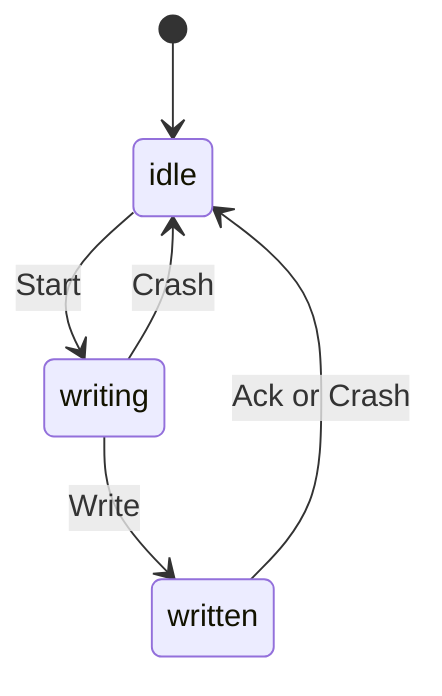
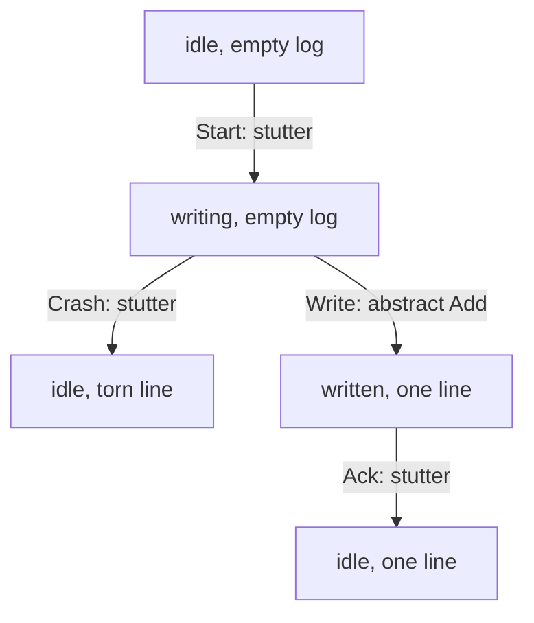

# Interlude: The log is the list

You type `tdo edit 3 --title "Renew passport (form in drawer)" --priority
high`, press Enter, and the laptop's battery gives out. When the machine
comes back, you run `tdo list`. What does it show?

Chapter 16 gave a careful answer. Each command's events go into the log as
one line, written in one call and flushed with `sync_data` before `tdo` says
anything. A line cut short by a crash has no newline, so `load` ignores it,
and `drop_torn_tail` cuts it off before the next append. So the list shows
either the whole edit or none of it, and if `tdo` printed a confirmation,
the edit is there.

That's an argument, though, not a check. The tests behind it are one
hand-made torn file and a set of property tests that replay generated
histories *in memory*, where nothing ever crashes. What we'd really like to
know is whether *every* interleaving of commands, crashes and restarts leaves
a log that replays to a sensible list. There's a second question hiding
here too, the one from Chapter 15: **is undo really the inverse of the last
command?** Undo is computed by replay, so what replay does after a crash, or
with an edit that produced two events, is the whole answer.

Interleavings of crashes and appends are exactly what tests are bad at and
TLC is good at. In this interlude we'll write two specs: one for the to-do
list as the user thinks of it, and one for the log as `tdo` stores it,
crashes included. Then we'll ask TLC to check that the second *implements*
the first. That idea is called **refinement**, and it's the most important
idea in this interlude. Along the way we need TLA+'s data structures:
records, functions and sequences.

## The list as the user sees it

Forget logs for a moment. To the user, `tdo` is a list of tasks. Each task is
open or done, and has a title and a priority. Commands change the list
atomically, and `undo` puts back the list as it was before the last command.
That's the *abstract* spec, and we'll write it first.

### A shared vocabulary

Both specs will talk about tasks, so the vocabulary goes in its own module,
`Tasks.tla`, which the others will `EXTENDS`. It's Chapter 8's *Ubiquitous
Language*, written for TLC.

```tla
\* file: Tasks.tla
---- MODULE Tasks ----
EXTENDS Integers, Sequences

CONSTANTS NoTask, Depth

Ids    == 1..2
Titles == {"t1", "t2"}
Pris   == {"low", "high"}
```

`NoTask` will be a model value, as in Interlude 2: a constant that equals
nothing but itself, which we'll use to mean "no task with this id". `Depth`
is the undo depth, Chapter 15's `UNDO_DEPTH`, which we'll set to 2 rather
than 50. Two ids, two titles and two priorities are as small as we can go
while still letting a task be edited in two ways at once, and that turns out
to matter.

### Records

A task has three fields. TLA+ has **records** for that:

```tla
\* file: Tasks.tla
Task    == [status : {"open", "done"}, title : Titles, pri : Pris]
NewTask == [status |-> "open", title |-> "t1", pri |-> "low"]
```

There are two notations here, and the difference is the arrow. With `|->`,
`NewTask` is *one record*, with a value for each field, much like a Rust
struct literal. With a colon, `Task` is the *set of all records* whose
`status` comes from the first set, `title` from the second and `pri` from the
third: eight records in all, the TLA+ cousin of a struct *type*. A field is
read with a dot, as in Rust: `NewTask.status` is `"open"`.

### Sequences and tuples

Undo needs a memory of earlier lists, newest last. TLA+ has **sequences**
for that, from the standard `Sequences` module we just extended. A sequence
is written between double angle brackets, `<<a, b, c>>`; `<<>>` is the empty
one. These are the same brackets as Interlude 1's `UNCHANGED <<boiler,
lastRun>>`. In TLA+, a **tuple** is just a sequence, so `<<t, p>>` can pair
up a title and a priority, and two tuples are equal when their elements are.

The operators we need are few. `Append(s, x)` adds `x` at the end, `Len(s)`
is the length, `s[n]` is the `n`th element (counting from 1, not 0), `Head(s)`
is the first, `Tail(s)` is everything but the first, `SubSeq(s, m, n)` is
the elements from `m` to `n`, and `s \o t` joins two sequences. Like
everything in TLA+, they return new values; nothing is modified.

Here are the helpers the undo memory needs:

```tla
\* file: Tasks.tla
\* Remember one more list, forgetting the oldest beyond Depth.
Push(stack, x) ==
    LET grown == Append(stack, x)
    IN  IF Len(grown) > Depth THEN Tail(grown) ELSE grown

Last(s) == s[Len(s)]
Pop(s)  == SubSeq(s, 1, Len(s) - 1)
```

`LET ... IN` gives a name to a subexpression, like a `let` binding in a Rust
block. `grown` exists only inside `Push`, and saves us writing
`Append(stack, x)` three times. `Push` is Chapter 15's `checkpoint`: push at
the back, and if the stack is now too long, drop from the front, exactly as
the `VecDeque` does.

### Functions

The list itself maps ids to tasks. In TLA+ that's a **function**. Think of
it as a lookup table with a fixed set of keys (its *domain*) and a value for
every key. `[i \in Ids |-> NoTask]` is the function that maps every id to
`NoTask`, an empty list. Read the arrow as "maps to"; with a single set of
keys it looks like a Rust closure, `|i| NoTask`, but it's a value, not code.
Applying a function uses square brackets: `tasks[1]`.

And as with records, there's a set form. `[Ids -> S]` is the set of *all*
functions from `Ids` to `S`, which is what we need for `TypeOK`. Here's the
abstract module's state:

```tla
\* file: TodoList.tla
---- MODULE TodoList ----
EXTENDS Tasks

VARIABLES tasks, lastId, history
vars == <<tasks, lastId, history>>

Lists == [Ids -> Task \cup {NoTask}]

TypeOK == /\ tasks \in Lists
          /\ lastId \in 0..2
          /\ Len(history) <= Depth
          /\ \A n \in 1..Len(history) : history[n] \in Lists

Init == /\ tasks = [i \in Ids |-> NoTask]
        /\ lastId = 0
        /\ history = <<>>
```

`lastId` is the highest id ever handed out, as in Chapter 15's `State`, and
`history` is the stack of earlier lists that undo returns to.

### EXCEPT

Commands change one task at a time, and saying "the same function, except
at one key" comes up constantly. TLA+ has `EXCEPT` for it:

```tla
\* file: TodoList.tla
\* Every command except undo remembers the list it replaced.
Change(new) == /\ tasks' = new
               /\ history' = Push(history, tasks)

Exists(i) == tasks[i] /= NoTask

Complete(i) == /\ Exists(i)
               /\ tasks[i].status = "open"
               /\ Change([tasks EXCEPT ![i].status = "done"])
               /\ UNCHANGED lastId
```

`[tasks EXCEPT ![i].status = "done"]` is a new function, equal to `tasks`
except that task `i`'s `status` is `"done"`. The `!` stands for "the value
being changed", and the path after it, `[i].status`, can reach into
functions and records together, much as `tasks[&i].status` reads in Rust.
`EXCEPT` works on records too: `[r EXCEPT !.title = "t2"]`.

`Reopen` and `Remove` follow the same shape (`Remove` sets `![i] = NoTask`).
`Add` takes the next id. `Edit` can change two fields in one `EXCEPT`:

```tla
\* file: TodoList.tla
Add == /\ lastId < 2
       /\ lastId' = lastId + 1
       /\ Change([tasks EXCEPT ![lastId + 1] = NewTask])

Edit(i, t, p) == /\ Exists(i)
                 /\ <<t, p>> /= <<tasks[i].title, tasks[i].pri>>
                 /\ Change([tasks EXCEPT ![i].title = t, ![i].pri = p])
                 /\ UNCHANGED lastId
```

The tuple comparison says an edit must change *something*, matching
`tdo`'s policy of never recording an empty batch. And here is undo, as the
user understands it:

```tla
\* file: TodoList.tla
Undo == /\ history /= <<>>
        /\ tasks' = Last(history)
        /\ history' = Pop(history)
        /\ UNCHANGED lastId
```

The list goes back to the last one we remembered, and `lastId` stays put, so
an undone task's id is never reused. `Next` is the disjunction of all six
actions, with `\E` choosing the id, title and priority, and the spec has
Interlude 2's form: `Spec == Init /\ [][Next]_vars`.

### Running it

The config uses `SPECIFICATION` as in Interlude 2, and gives the constants
their values:

```text
\* file: TodoList.cfg
CONSTANTS
    NoTask = NoTask
    Depth = 2

SPECIFICATION Spec

INVARIANT TypeOK

CHECK_DEADLOCK FALSE
```

The last line needs a word. By default TLC also complains about a
**deadlock**, a reachable state where no action is enabled. Our model has
one: once both ids are used, both tasks are removed and the undo history is
spent, there's nothing left to do. That's an artefact of capping ids at 2,
not a property of `tdo`, so we switch the check off. (Interlude 6 is where
deadlock becomes the main event.)

```text
Finished computing initial states: 1 distinct state generated.
Model checking completed. No error has been found.
66169 states generated, 7238 distinct states found, 0 states left on queue.
The depth of the complete state graph search is 11.
```

Nothing failed, and nothing much could: this spec *is* the definition of
correct. Its job is to be obviously right, and it's about forty lines long.

## The list as tdo stores it

Now the implementation, as Chapters 15 and 16 built it: events, an
append-only log of batches, replay, and a process that can die at any
moment. It goes in a second module, `TodoLog.tla`, which also extends
`Tasks`.

### Events are records

Each `Event` variant becomes a record with a `type` field, very like the
`#[serde(tag = "type")]` JSON from Chapter 16:

```tla
\* file: TodoLog.tla
Added(i)            == [type |-> "added", id |-> i]
Completed(i)        == [type |-> "completed", id |-> i]
Retitled(i, t)      == [type |-> "retitled", id |-> i, title |-> t]
Reprioritised(i, p) == [type |-> "reprioritised", id |-> i, pri |-> p]
Undone              == [type |-> "undone"]
\* ... Reopened(i) and Removed(i) in the same style
```

A batch is a sequence of these records, and the log is a sequence of
batches. In Chapter 15, `State` held the tasks, the last id and a
`VecDeque` of checkpoints; here it's a record:

```tla
\* file: TodoLog.tla
Empty == [tasks |-> [i \in Ids |-> NoTask], lastId |-> 0, cps |-> <<>>]
```

That's `State::default()`.

### evolve

`evolve` applies one event to a state, and it's mostly `EXCEPT`, now with
longer paths: `!.tasks[e.id].status` reaches into the record's `tasks` field,
then the function at `e.id`, then that task's `status`.

```tla
\* file: TodoLog.tla
Evolve(s, e) ==
    IF e.type = "added" THEN
        [s EXCEPT !.tasks[e.id] = NewTask, !.lastId = e.id]
    ELSE IF e.type = "completed" THEN
        [s EXCEPT !.tasks[e.id].status = "done"]
    \* ... reopened, retitled, reprioritised, removed: the same shape
    ELSE IF s.cps = <<>> THEN s  \* undone, with nothing to go back to
    ELSE [s EXCEPT !.tasks = Last(s.cps), !.cps = Pop(s.cps)]
```

The last two lines are Chapter 15's `Undone` arm: pop a checkpoint if there
is one, and otherwise do nothing, because `evolve` never fails.

### Replay is a fold

Chapter 15's central line was `events.iter().fold(State::default(),
evolve)`. TLA+ has no loops, so a fold has to be written as a **recursive
operator**. TLC needs to be told in advance that a definition refers to
itself, with a `RECURSIVE` declaration giving its name and number of
arguments:

```tla
\* file: TodoLog.tla
RECURSIVE Fold(_, _, _)
Fold(Op(_, _), acc, seq) ==
    IF seq = <<>> THEN acc
    ELSE Fold(Op, Op(acc, Head(seq)), Tail(seq))
```

Its first parameter, `Op(_, _)`, is itself an operator that takes two
arguments, which is how TLA+ passes `evolve` by name. The body is the
textbook definition of a left fold: with nothing left, the answer is the
accumulator; otherwise apply `Op` to the accumulator and the head, and fold
the tail. Every recursive call is on a shorter sequence, so it always
finishes.

Now the replay. Here's the obvious first version, written the way the
famous line reads: a checkpoint before every event except an undo, and one
fold over everything.

```tla
\* file: TodoLog.tla
Checkpoint(s) == [s EXCEPT !.cps = Push(s.cps, s.tasks)]

Step(s, e) == IF e = Undone THEN Evolve(s, e) ELSE Evolve(Checkpoint(s), e)

Apply(s, batch) == Fold(Step, s, batch)

Replay(log) == Fold(Apply, Empty, log)
```

`Replay` folds batches, and `Apply` folds the events within each batch, but
the checkpoints are taken per event. Hold that thought.

### decide

`decide` becomes an operator from a state and a command to a batch, with
`<<>>` for "refused, or nothing to do". The commands are records too, and
the set of all of them is built from record sets:

```tla
\* file: TodoLog.tla
Commands ==
    {[op |-> "add"], [op |-> "undo"]}
    \cup [op : {"complete", "reopen", "remove"}, id : Ids]
    \cup [op : {"edit"}, id : Ids, title : Titles, pri : Pris]

Edits(task, c) ==
    (IF c.title /= task.title THEN <<Retitled(c.id, c.title)>> ELSE <<>>)
    \o (IF c.pri /= task.pri THEN <<Reprioritised(c.id, c.pri)>> ELSE <<>>)
```

`Edits` is Chapter 15's `edits` function: one event per field that really
changes, joined with `\o`. `Decide` itself is a chain of `IF`s mirroring the
`match` in `decide.rs` (refuse completing a done task, undo with no
checkpoints, and so on); we won't print it all.

### The file, the process, the crash

Now the part the Rust tests never see. The state of the world is the file on
disk and what the one running `tdo` process is doing:

```tla
\* file: TodoLog.tla
VARIABLES disk, pc, pending, acked
vars == <<disk, pc, pending, acked>>

Intact(d) == IF d /= <<>> /\ Last(d) = Torn THEN Pop(d) ELSE d
Load(d)   == Replay(Intact(d))
```

`disk` is a sequence of lines. A line is a batch, or the model value `Torn`,
standing for a partial line with no newline. `Intact` is Chapter 16's
`parse_log`: a torn final line is ignored. `pc` says where the process is
(`"idle"`, `"writing"` or `"written"`), `pending` is the batch it's writing,
and `acked` counts the confirmations printed to the user. `acked` is a
history variable, like Interlude 1's `lastRun`: `tdo` doesn't store it, but
we need it to state what the user was promised.

One run of `tdo` is three steps, and a crash can interrupt it at any point:



In TLA+, `Start` loads and decides, choosing any command that `Decide`
accepts:

```tla
\* file: TodoLog.tla
Start == /\ pc = "idle"
         /\ Len(disk) < MaxLines
         /\ LET state == Load(disk)
            IN  \E c \in Commands :
                  /\ Decide(state, c) /= <<>>
                  /\ pending' = Decide(state, c)
         /\ pc' = "writing"
         /\ UNCHANGED <<disk, acked>>
```

`MaxLines` is a constant (3, for now) that keeps the log finite. `Write` is
`append`: one line, written and synced. `Ack` prints the confirmation:

```tla
\* file: TodoLog.tla
Write == /\ pc = "writing"
         /\ disk' = Append(disk, pending)
         /\ pc' = "written"
         /\ UNCHANGED <<pending, acked>>

Ack == /\ pc = "written"
       /\ acked' = acked + 1
       /\ pc' = "idle"
       /\ pending' = <<>>
       /\ UNCHANGED disk
```

And here is the crash: the battery dies, or the user hits Ctrl-C, or the
kernel panics.

```tla
\* file: TodoLog.tla
Crash == /\ pc /= "idle"
         /\ disk' \in IF pc = "writing"
                      THEN {disk, Append(disk, Torn)}
                      ELSE {disk}
         /\ pc' = "idle"
         /\ pending' = <<>>
         /\ UNCHANGED acked

Next == Start \/ Write \/ Ack \/ Crash
```

A crash while writing leaves the disk as it was, or with a torn fragment on
the end; TLC will try both. The third possibility, the whole line reaching
the disk without `tdo` getting to print anything, is already covered: that's
`Write` followed by `Crash` from `"written"`. Modelling a crash is just
another nondeterministic environment action, as in Interlude 2. The only
thing that makes it a crash is that it throws away the process's state
(`pc`, `pending`) and keeps the disk's.

## Torn writes, again

The first property is the one Chapter 16 learned the hard way: the log must
always load. A `Torn` line anywhere but the end means the file is damaged:

```tla
\* file: TodoLog.tla
Loadable == \A n \in 1..(Len(disk) - 1) : disk[n] /= Torn
```

Notice that `Write` above appends directly to `disk`. That's Chapter 16's
first `append`, before `drop_torn_tail`. With `INVARIANT TypeOK` and
`INVARIANT Loadable` in `TodoLog.cfg` (and `MaxLines = 3` among the
constants), TLC says:

```text
Finished computing initial states: 1 distinct state generated.
Error: Invariant Loadable is violated.
Error: The behavior up to this point is:
State 1: <Initial predicate>
/\ pc = "idle"
/\ disk = <<>>
/\ pending = <<>>
/\ acked = 0

State 2: <Start line 79, col 10 to line 86, col 37 of module TodoLog>
/\ pc = "writing"
/\ disk = <<>>
/\ pending = <<[type |-> "added", id |-> 1]>>
/\ acked = 0

State 3: <Crash line 99, col 10 to line 105, col 27 of module TodoLog>
/\ pc = "idle"
/\ disk = <<Torn>>
/\ pending = <<>>
/\ acked = 0

State 4: <Start line 79, col 10 to line 86, col 37 of module TodoLog>
/\ pc = "writing"
/\ disk = <<Torn>>
/\ pending = <<[type |-> "added", id |-> 1]>>
/\ acked = 0

State 5: <Write line 88, col 10 to line 91, col 40 of module TodoLog>
/\ pc = "written"
/\ disk = <<Torn, <<[type |-> "added", id |-> 1]>>>>
/\ pending = <<[type |-> "added", id |-> 1]>>
/\ acked = 0

23 states generated, 22 distinct states found, 14 states left on queue.
The depth of the complete state graph search is 5.
```

It's the bug from Chapter 16, found from first principles in five states: a
crash tears the first `add`, the next run ignores the fragment (correctly),
decides to add task 1 again, and appends straight after the fragment. In the
real file the two run together into one damaged line; in the model the
`Torn` is no longer last. Either way, `tdo` won't load again.

The fix is `drop_torn_tail`: cut the file back to its last complete line
before appending. In the spec, `Write` appends to `Intact(disk)` instead of
`disk`, and so does `Crash`, since a crash can happen after the repair:

```tla
\* file: TodoLog.tla
         /\ disk' = Append(Intact(disk), pending)
```

```text
Finished computing initial states: 1 distinct state generated.
Model checking completed. No error has been found.
892 states generated, 513 distinct states found, 0 states left on queue.
The depth of the complete state graph search is 10.
```

## Acknowledged means durable

The second property is the promise behind printing "completed 3": **once
`tdo` has said it, a crash can't take it back.** With `acked` that's easy to
state. When no `tdo` is running, there are at least as many complete lines
as confirmations ever printed:

```tla
\* file: TodoLog.tla
Durable == pc = "idle" => acked <= Len(Intact(disk))
```

(Lines are never removed, except torn ones that were never acknowledged, so
counting is enough.) The book's order passes. To see that the order is what
matters, swap it, the way a version that printed first and saved second
would:

```tla
\* file: TodoLog.tla
Ack == /\ pc = "writing"
       /\ acked' = acked + 1
       /\ pc' = "acked"
       /\ UNCHANGED <<disk, pending>>

Write == /\ pc = "acked"
         \* ... appends, then returns to "idle"
```

```text
Finished computing initial states: 1 distinct state generated.
Error: Invariant Durable is violated.
Error: The behavior up to this point is:
State 1: <Initial predicate>
/\ pc = "idle"
/\ disk = <<>>
/\ pending = <<>>
/\ acked = 0

State 2: <Start line 79, col 10 to line 86, col 37 of module TodoLog>
/\ pc = "writing"
/\ disk = <<>>
/\ pending = <<[type |-> "added", id |-> 1]>>
/\ acked = 0

State 3: <Ack line 88, col 8 to line 91, col 37 of module TodoLog>
/\ pc = "acked"
/\ disk = <<>>
/\ pending = <<[type |-> "added", id |-> 1]>>
/\ acked = 1

State 4: <Crash line 99, col 10 to line 105, col 27 of module TodoLog>
/\ pc = "idle"
/\ disk = <<>>
/\ pending = <<>>
/\ acked = 1

7 states generated, 6 distinct states found, 2 states left on queue.
The depth of the complete state graph search is 4.
```

"added 1" on the screen, an empty file on the disk. It's obvious once you see
it, and it's precisely the kind of thing that slips in during a refactor: a
`println!` moved above `store.append(...)` to make the code read better.
Chapter 16's `execute` prints after `append` returns, which is after
`sync_data`, and TLC agrees that it has to.

## Refinement

`Loadable` and `Durable` are about the file. But the question we started
with is about the *list*: after any mix of commands and crashes, does `tdo
list` show something a user could have arrived at by commands alone? And
does `undo` do what the abstract `Undo` does?

That's what **refinement** means. A concrete spec *refines* (or
*implements*) an abstract one when **every behaviour of the implementation is
a behaviour of the abstraction**. Run `TodoLog` any way you like, with any
crashes; then look at it through the right lens, and what you see must be
something `TodoList` allows.

The lens is called a **refinement mapping**: a definition of each abstract
variable in terms of the concrete ones. Here it writes itself, because it's
what `tdo` does on every run. The abstract list is whatever replaying the
log gives:

- `tasks` is `Load(disk).tasks`;
- `lastId` is `Load(disk).lastId`;
- `history` is `Load(disk).cps`, the checkpoints.

Under that mapping, most concrete steps don't change the abstract list at
all. `Start` only reads; `Ack` only prints; a `Crash` that tears a line
changes `disk`, but `Intact` hides the fragment, so `Load` is unchanged.
These are **stuttering steps** of the abstract spec, and here is the payoff
for allowing them, as Interlude 2 did: because `[][Next]_vars` allows steps
that leave `vars` unchanged, an implementation can take as many internal
steps as it needs.
Only `Write` changes the list, and it has to look like exactly one abstract
command.



### INSTANCE ... WITH

TLA+ lets one module use another with `INSTANCE`, and `WITH` substitutes
expressions for the instanced module's variables. That substitution is the
refinement mapping:

```tla
\* file: TodoLog.tla
Abstract == INSTANCE TodoList
              WITH tasks   <- Load(disk).tasks,
                   lastId  <- Load(disk).lastId,
                   history <- Load(disk).cps

RefinesList == Abstract!Spec
```

`Abstract!Spec` is `TodoList`'s `Spec`, with every `tasks` replaced by
`Load(disk).tasks` and so on (and every `tasks'` by `Load(disk').tasks`).
The constants `NoTask` and `Depth` have the same names in both modules, so
they're substituted automatically. `Abstract!Spec` is now a formula about
`disk`, and we can ask TLC whether every behaviour of our `Spec` satisfies
it. The config can't name `Abstract!Spec` directly, hence the one-line
definition, and it goes under `PROPERTY`, as in Interlude 2. The constants
and `CHECK_DEADLOCK FALSE` stay as before:

```text
\* file: TodoLog.cfg
SPECIFICATION Spec

INVARIANT TypeOK
INVARIANT Loadable
INVARIANT Durable
PROPERTY RefinesList
```

> [!PATTERN] Refinement Mapping
> Write two specs: an abstract one that states what the system means, and a
> concrete one that models how it works. Define each abstract variable as an
> expression over the concrete state (the *refinement mapping*), instantiate
> the abstract spec with `INSTANCE ... WITH`, and have TLC check
> `Abstract!Spec` as a property. Internal steps map to abstract stuttering;
> each visible step must be exactly one abstract action.

### What TLC finds

```text
Finished computing initial states: 1 distinct state generated.
Error: Action property line 59, col 17 to line 59, col 29 of module TodoList is violated.
Error: The behavior up to this point is:
State 1: <Initial predicate>
/\ pc = "idle"
/\ disk = <<>>
/\ pending = <<>>
/\ acked = 0

State 2: <Start line 79, col 10 to line 86, col 37 of module TodoLog>
/\ pc = "writing"
/\ disk = <<>>
/\ pending = <<[type |-> "added", id |-> 1]>>
/\ acked = 0

State 3: <Write line 88, col 10 to line 91, col 40 of module TodoLog>
/\ pc = "written"
/\ disk = <<<<[type |-> "added", id |-> 1]>>>>
/\ pending = <<[type |-> "added", id |-> 1]>>
/\ acked = 0

State 4: <Ack line 93, col 8 to line 97, col 24 of module TodoLog>
/\ pc = "idle"
/\ disk = <<<<[type |-> "added", id |-> 1]>>>>
/\ pending = <<>>
/\ acked = 1

State 5: <Start line 79, col 10 to line 86, col 37 of module TodoLog>
/\ pc = "writing"
/\ disk = <<<<[type |-> "added", id |-> 1]>>>>
/\ pending = << [type |-> "retitled", id |-> 1, title |-> "t2"],
   [type |-> "reprioritised", id |-> 1, pri |-> "high"] >>
/\ acked = 1

State 6: <Write line 88, col 10 to line 91, col 40 of module TodoLog>
/\ pc = "written"
/\ disk = << <<[type |-> "added", id |-> 1]>>,
   << [type |-> "retitled", id |-> 1, title |-> "t2"],
      [type |-> "reprioritised", id |-> 1, pri |-> "high"] >>
/\ pending = << [type |-> "retitled", id |-> 1, title |-> "t2"],
   [type |-> "reprioritised", id |-> 1, pri |-> "high"] >>
/\ acked = 1

43 states generated, 29 distinct states found, 14 states left on queue.
The depth of the complete state graph search is 6.
```

"Action property ... of module TodoList" points at `[][Next]_vars` in the
abstract `Spec`: the step from State 5 to State 6 is neither an abstract
command nor a stutter. No crash was needed. The user added a task, then ran
one `edit` that changed both its title and its priority, and the batch was
written as one line, exactly as it should be.

The trouble is in our first `Replay`. It takes a checkpoint per *event*, so
replaying that line pushes two checkpoints: the list before the edit, and a
list with the new title but the old priority, a list the user never saw.
The abstract `Edit` pushes one. The very next `tdo undo` would pop the
half-edited list, and the user would find the old priority back and the new
title still there. So the answer to "is undo really the inverse of the last
command?" is *not with this replay*.

This is the wrinkle Chapter 15 spotted ("the most recent change means the
most recent *command*") and fixed with batches. Here's its `apply`: one
checkpoint per batch, and a batch that is exactly `<<Undone>>` takes none.

```tla
\* file: TodoLog.tla
Apply(s, batch) ==
    IF batch = <<Undone>> THEN Evolve(s, Undone)
    ELSE Fold(Evolve, Checkpoint(s), batch)
```

`Step` goes away. Run TLC again:

```text
Finished computing initial states: 1 distinct state generated.
Model checking completed. No error has been found.
892 states generated, 513 distinct states found, 0 states left on queue.
The depth of the complete state graph search is 10.
```

Every one of those 513 states, reached through every interleaving of
commands, crashes and torn lines within three log lines, replays to a list
the abstract spec allows, and every step of every behaviour is either
invisible to the user or exactly one command, undo included.

### What one event per line would do

The other plausible design is one *event* per line. Replay then can't see
where a command ends, so it's forced into the per-event checkpoints we just
threw out, and a crash between the two lines of an edit leaves half of it on
disk. So refinement must fail? It doesn't. I tried it: `Write` appending one
event per step, `Replay` with `Step`, and TLC finds no error.

The reason is worth understanding. Half an edit (new title, old priority) is
*also* a perfectly good abstract `Edit`, one that changes only the title.
The other half is a second, separate `Edit`. The abstract spec has no idea
what the user typed, so it can't tell "one command torn in two" from "two
commands". Refinement checks the implementation against the abstraction you
wrote, and nothing more. If a property isn't visible in the abstract spec, no
mapping will catch its violation. The batch-per-line design is still the
right one, because what the user typed is what `tdo` should record, but
saying that formally needs an abstract spec that knows the user's commands.
The second exercise does exactly that.

## Undo, crashes and the depth of history

Two more questions about undo are now cheap to answer.

**Undo across a crash.** Suppose the battery dies while `tdo rm 3` is being
written, and you run `tdo undo` afterwards. What gets undone? Refinement has
already answered: a torn line is an abstract stutter, so the `rm` never
happened, and `undo` reverts the last *durable* command, the one before it.
That's the right behaviour, but it may not be what the user expects, because
they pressed Enter on `rm`. The honest summary is that undo is the inverse of
the last command `tdo` *confirmed*. If you didn't see "removed 3", run `tdo
list` before `tdo undo`.

**The depth of history.** The abstract spec has `Depth` in it, which means
"undo goes back at most `Depth` commands" is part of what the list promises.
`tdo` evaluates that promise at *replay* time, each time it starts, using
whatever `UNDO_DEPTH` the running binary was compiled with. So what happens
to an existing log if a later version of `tdo` lowers `UNDO_DEPTH`? A small
module can ask, by instantiating `TodoLog` a second time with a different
constant:

```tla
\* file: Upgrade.tla
---- MODULE Upgrade ----
EXTENDS TodoLog

Smaller == INSTANCE TodoLog WITH Depth <- 1

SameList == Smaller!Load(disk).tasks = Load(disk).tasks
====
```

The log is written by a `tdo` with `Depth = 2`; `SameList` says a `tdo` with
depth 1 would show the same list when reading it. With `MaxLines = 4` and
`INVARIANT SameList`, TLC finds a counterexample twelve states long: add
task 1, add task 2, undo, undo, each run as a `Start`, `Write` and `Ack`,
except that the trace stops as soon as the second undo is written.
Written with depth 2, the second undo goes back to the empty list. Replayed
with depth 1, only one checkpoint was kept, so the second `Undone` finds
nothing to pop, `evolve` shrugs as designed, and task 1 is back from the
dead.

That's a genuine property of the book's design, and it's easy to miss,
because it doesn't depend on any code being wrong. **`UNDO_DEPTH` is part of
the log format.** `Undone` doesn't say what it undid; its meaning is computed
by replay, and the computation depends on the constant. Raising the depth is
safe: I checked depth 2 against depth 3 with five-line logs, and TLC found
nothing, because the extra checkpoints sit at the bottom of the stack, where
no recorded undo reached. Lowering it silently changes old lists. Chapter
16's warning that "events are a contract with your past self" covers this
too: treat `UNDO_DEPTH` as a one-way setting, or record in each `Undone`
which change it reverted, so that replay no longer needs to guess. The last
exercise explores the second option.

## Mapping back to Rust

Here's how the specs line up with Chapters 15 and 16:

| Rust | Spec | Who checks it best |
|---|---|---|
| `enum Event` | event records | the compiler (exhaustive `match`) |
| `type Batch = Vec<Event>` | a sequence of events, one line | TLC (`RefinesList`) |
| `evolve` | `Evolve` | the compiler, and unit tests |
| `apply`, `replay` | `Apply`, `Fold`, `Replay` | TLC (undo per batch) |
| `decide` | `Decide`, `Commands` | unit and property tests |
| `FileStore::append` | `Write`, then `Ack` | TLC (`Durable`) |
| `parse_log` | `Intact` in `Load` | the torn-tail unit test |
| `drop_torn_tail` | `Intact` in `Write` | TLC (`Loadable`) |
| `replay_reproduces_the_live_state` | nothing | proptest |

The last row is telling. The spec has no "live state" at all: `Load(disk)`
*is* the state, by definition, so the central property test of Chapter 16 is
something the spec simply assumes. That's fine, because proptest checks it
against the real code with real titles and dates, which no model can do.
In the same way, the spec's `Evolve` ends in a catch-all `ELSE` that treats
any unknown event as an undo, the very wildcard Chapter 15 warned against;
in Rust the exhaustive `match` makes that mistake impossible. `Title`'s
smart constructor, `TaskId`'s newtype and serde's `try_from` are all
facts the spec takes for granted.

Going the other way, TLC checked things no test in the book does: every
interleaving of crashes with appends; that confirmations come after the
sync; that a torn tail followed by more commands never damages the log; and
that the log, read back after any of that, is the list. To be fair to
proptest, `undo_puts_the_tasks_back` would catch the per-event checkpoint
bug as well, as long as its generator produces edits that change two fields
at once. TLC found it without our having to think of that.

And the limits, honestly. The model's disk is kind: writes tear only at line
boundaries, and `sync_data` is all-powerful. Real file systems can leave a
tail of zeros, and the very first `append`, which *creates* the log file,
would need an `fsync` of the directory to be sure the file itself survives a
power cut. Chapter 16 mentioned that for renames; it applies to creation
too. The model has one process, so Chapter 16's two-terminal warning is
outside it. And it's tiny: two ids, depth 2, three lines. Each of these is a
choice we could revisit with a bigger model, at the price of a longer wait.

## What we learned

- **Records** (`[f |-> v]`, with the set form `[f : S]`) model structs and
  event variants; a `type` field plays the part of an enum tag.
- **Functions** (`[x \in S |-> e]`, with the set form `[S -> T]`) model maps
  with a fixed key set; **`EXCEPT`** builds "the same, except here", with
  paths like `![i].status` reaching through functions and records together.
- **Sequences** (`<<>>`, `Append`, `Len`, `Head`, `Tail`, `SubSeq`, `\o`)
  model logs and stacks, and **tuples** are just sequences.
- **`LET ... IN`** names a subexpression; **`RECURSIVE`** operators, which
  can take operators as arguments, give us `Fold`, and replay is a fold of
  folds, exactly as in Rust.
- **Crashes are environment actions** that keep the disk and lose the
  process; torn writes are one more nondeterministic outcome. TLC rediscovered
  Chapter 16's torn-tail bug and showed why the confirmation must follow
  `sync_data`.
- **Refinement Mapping**: an implementation refines an abstraction when every
  behaviour of the implementation is a behaviour of the abstraction.
  `INSTANCE ... WITH` substitutes the mapping, `Abstract!Spec` is checked as
  a `PROPERTY`, and internal steps map to stuttering.
- **Undo is per batch**: one checkpoint per event fails refinement after a
  single two-field edit. **Refinement only sees what the abstract spec can
  see**: one event per line passes, because half an edit looks like a
  smaller edit.
- **`UNDO_DEPTH` is part of the log format.** Lowering it changes how old
  `Undone` events replay; raising it is safe.

## Exercises

> [!EXERCISE] A sync that lies
> Some disks report a sync as done before the data is safe. Add a `Lose`
> action that, while no `tdo` is running, removes the last complete line, and
> see which properties fail. Then allow `Lose` only for lines that hold
> neither an add nor an undo (test `Head(Last(Intact(disk))).type`).
> `Durable` still fails at once, but `RefinesList` needs a much longer trace.
> Why does losing such a line look so much like an abstract `Undo`, and what
> breaks the resemblance?

> [!EXERCISE] An abstraction that knows what you typed
> Give `TodoList` a variable `typed`, the command the user asked for, set by a
> new `Type(c)` action, and require each abstract command to match `typed`.
> Give `TodoLog` the same variable, set in `Start`. Now model one event per
> line and check refinement again. Does TLC find the half-applied edit this
> time? What does that tell you about choosing an abstraction?

> [!EXERCISE] A bounded promise
> In `TodoLog`, change the mapping to `Abstract == INSTANCE TodoList WITH
> Depth <- 3, ...`, so the abstract list promises more undo than the log keeps.
> Predict the shortest counterexample before running TLC. Then decide where
> the bound belongs: in the abstract spec, or nowhere?

> [!EXERCISE] Undo that says what it undid
> Change `Undone` to carry the number of the change it reverts (as
> `render::history` already computes), and change `Evolve` so that replay
> uses it. Re-run `Upgrade.tla`. Is `SameList` now true when the depth is
> lowered? What does it cost in the Rust `Event` enum and in old log files?
