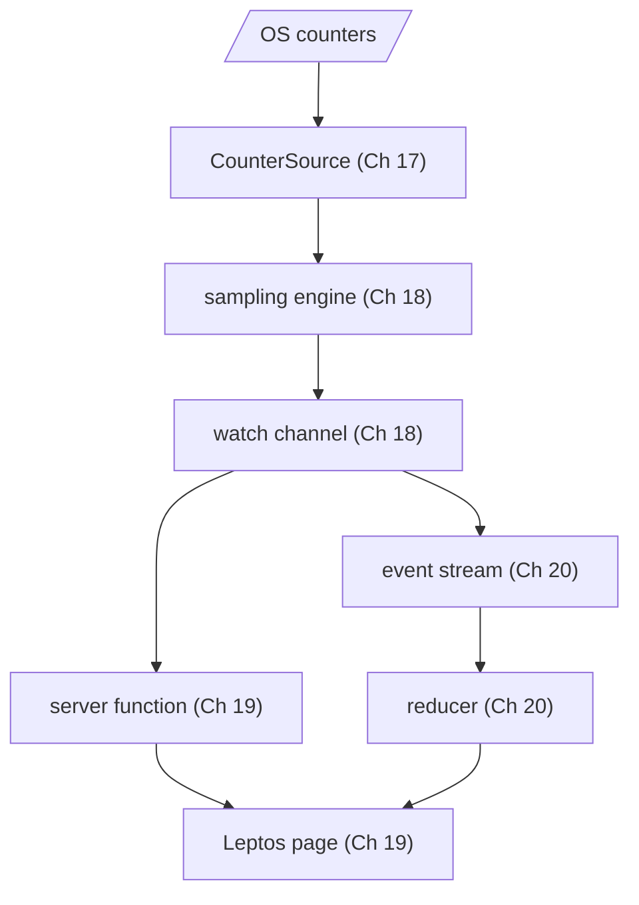
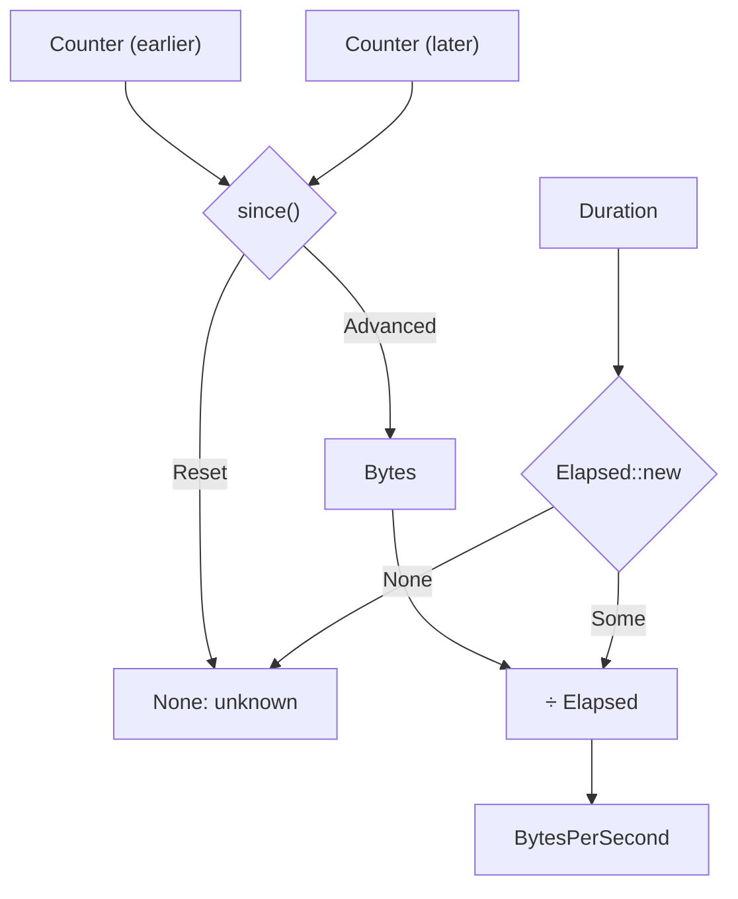

# Measuring the network

It's Tuesday afternoon and your video call has turned into a slideshow. Is it
your connection? Is something on your machine quietly uploading a backup? Is
the VPN eating everything? Your operating system knows exactly how many bytes
have gone in and out of every network interface since it booted. What it
doesn't do is tell you, in one glance, how fast each of them is moving *right
now* and how that compares with a minute ago.

Over the next four chapters we'll build `netdash`, a small web application
that does exactly that. It samples every interface once a second, keeps a
minute of history, and streams the results to a browser page that updates
live, with a tiny graph (a *sparkline*) per interface. It runs on Linux and
macOS. The server is Rust; so is the code in the browser, compiled to
WebAssembly with the Leptos framework.

Here is the whole system, so you can see where each chapter fits:



Before any of that is worth building, we have to get one small thing right:
turning what the operating system reports into numbers we can trust. It looks
like one line of arithmetic. It turns out to be a lesson in units of measure,
and in letting the type system refuse to do sums that don't mean anything.

## What the operating system tells us

On Linux, `/proc/net/dev` lists every interface with a column of received
bytes and a column of transmitted bytes. On macOS, `netstat -ib` shows the
same thing. Run either twice, a few seconds apart, and you'll notice the
numbers only ever go up:

```text
Name   Ibytes      Obytes
en0    15318452213 581031277
...
en0    15322117498 581109354
```

These are **counters**: running totals that start at zero when the interface
comes up and increase with every packet. They are like a car's odometer. The
reading itself (15,318,452,213) doesn't tell you how fast you're going. Two
readings, and the time between them, do.

So the first job is to pin down the vocabulary. In domain-driven terms this
is the *Ubiquitous Language* from Chapter 8: the words we'll use in
conversation, in the code and in the user interface, meaning the same thing in
all three.

| Term | Meaning |
|---|---|
| **interface** | A named network device: `en0`, `eth0`, `lo`, `utun4` |
| **rx / tx** | Received and transmitted: the two directions of traffic |
| **counter** | A cumulative byte count read from the OS; only meaningful relative to another reading |
| **total** | A counter's value read as an amount: bytes moved since it started |
| **elapsed** | The time between two readings |
| **rate** | Bytes per second over one elapsed interval |
| **sample** | One reading of every interface at one moment |

Notice that *counter*, *total* and *rate* all describe "some number of bytes",
and that they are not interchangeable. Most bugs in monitoring code live in
the gaps between those three words.

## A workspace with a pure core

`netdash` will end up with code that runs on a server and code that runs in a
browser. The domain (units, rates, history, formatting) is the same in both
places, so it belongs in a crate of its own that knows nothing about either.
Chapter 7 introduced cargo workspaces; this is what they're for.

```sh
mkdir netdash && cd netdash
cargo init --name netdash
cargo new --lib core --name netdash-core
```

The root manifest becomes both a package (the application) and a workspace
that contains the core:

```toml
# file: Cargo.toml
[workspace]
members = ["core"]

[package]
name = "netdash"
version = "0.1.0"
edition = "2024"

[dependencies]
netdash-core = { path = "core" }
```

The core starts with two dependencies we'll need shortly: `serde` (so our
types can travel to the browser in Chapter 19) and `thiserror` for error
enums. Neither performs I/O.

```toml
# file: core/Cargo.toml
[dependencies]
serde = { version = "1", features = ["derive"] }
thiserror = "2"

[dev-dependencies]
proptest = "1"
serde_json = "1"
```

> [!IMPORTANT]
> Nothing in `netdash-core` may read a clock, open a file, touch the network
> or spawn a task. That rule is what will let us compile the same crate to
> WebAssembly in Chapter 19 without a single `#[cfg]`, and it's what keeps
> every test in this chapter instant.

## The obvious version

Let's write the rate calculation the way it falls out of our fingers. Two
counter readings, a number of seconds, divide:

```rust
fn rate(prev: u64, next: u64, elapsed_secs: f64) -> f64 {
    (next - prev) as f64 / elapsed_secs
}

fn main() {
    println!("{}", rate(1_000, 3_048, 2.0));
    println!("{}", rate(1_000, 3_048, 0.0));
    println!("{}", rate(9_000, 10, 1.0));
}
```

The first call is the happy path: 2,048 bytes in two seconds. The second is a
sampler that fired twice in the same instant (it happens: timers coalesce,
clocks have coarse resolution). The third is an interface whose counter went
*backwards*, because someone unplugged a USB Ethernet adaptor and plugged it
back in, and the OS started it again from zero. Run it:

```text
1024
inf

thread 'main' panicked at src/bin/naive.rs:2:5:
attempt to subtract with overflow
```

Three calls, three different outcomes, and only one of them is right.

## Finding the cracks

**Division by zero time.** `0.0` seconds produced `inf`, a float that will
happily flow into averages, graphs and JSON (where it isn't even valid) and
poison all of them. Nothing in `f64` says "a duration that is not zero".

**Counters that go backwards.** In a debug build, `next - prev` on `u64`
panics when `next < prev`. In a release build, overflow checks are off by
default and the subtraction *wraps*: `10 - 9_000` becomes
18,446,744,073,709,542,626, and the dashboard proudly reports 16 EiB/s for one
second. Neither is acceptable for a long-running monitor. And notice where the
bug lives: a reset isn't an error in our code, it's a fact about the domain
that the code had nowhere to put.

**Everything is a number.** The deepest problem doesn't show up in this tiny
program at all. In the real thing we'll have counters, totals, rates, history
and durations, and they'll all be `u64` or `f64`. Nothing stops us adding a
rate to a total, dividing a counter by milliseconds where we meant seconds, or
passing yesterday's total where a counter was expected. Each of those compiles
and produces a plausible-looking number. Units bugs are the worst kind: the
program runs, the output looks reasonable, and it's wrong.

The fix for all three is the same move we made with `Celsius` in Chapter 1
and with every value object in Part II: give each meaning its own type. This
time we'll go a step further and decide which *arithmetic* between those types
makes sense.

## Bytes: an amount of data

We start with the simplest unit: an amount of data. It's the *Newtype* pattern
from Chapter 3, a `u64` with a name:

```rust
// file: core/src/units.rs
/// An amount of data.
#[derive(Debug, Clone, Copy, PartialEq, Eq, PartialOrd, Ord, Hash, Default)]
#[derive(Serialize, Deserialize)]
#[serde(transparent)]
pub struct Bytes(u64);

impl Bytes {
    pub const ZERO: Bytes = Bytes(0);

    pub const fn new(n: u64) -> Self {
        Bytes(n)
    }

    pub const fn get(self) -> u64 {
        self.0
    }
}
```

`#[serde(transparent)]` tells serde to serialise a `Bytes` exactly as its
inner `u64`, so the JSON the browser receives in Chapter 20 says `4096`, not
`{"0": 4096}`. The field is private: the only ways to make a `Bytes` are the
ones we provide.

What should you be able to do with an amount of data? Add two of them: 300 MB
received plus 20 MB sent is 320 MB moved. Rust spells operators as traits in
`std::ops`, so "`Bytes` supports `+`" is literally an `impl`:

```rust
impl Add for Bytes {
    type Output = Bytes;

    fn add(self, other: Bytes) -> Bytes {
        Bytes(self.0.saturating_add(other.0))
    }
}

impl Sum for Bytes {
    fn sum<I: Iterator<Item = Bytes>>(iter: I) -> Bytes {
        iter.fold(Bytes::ZERO, Add::add)
    }
}
```

`Add` has an associated type, `Output`, saying what `a + b` produces. Here
it's `Bytes` again. Implementing `Sum` lets `.sum()` at the end of an iterator
pipeline produce a `Bytes`, using the *Fold* from Chapter 6. The addition
saturates at `u64::MAX` (16 EiB) rather than wrapping. Real traffic will never
get there, but if it did, "a very large number" is a better failure than "a
very small one".

What about subtraction? Subtracting two unsigned amounts can fail, which is
exactly the bug we just met. `std::ops::Sub` has no way to say "might not have
an answer", so we don't implement it. Instead we offer the honest version:

```rust
    /// Subtraction that admits it can fail.
    pub fn checked_sub(self, other: Bytes) -> Option<Bytes> {
        self.0.checked_sub(other.0).map(Bytes)
    }
```

That's a design decision worth pausing on. Operator overloading is not about
making every operator available; it's about making the *meaningful* ones
convenient and leaving the dangerous ones out. A missing `impl` is a rule.

## A duration you can divide by

Next, the denominator. The standard library already has a fine type for
durations, `std::time::Duration`. What it can't promise is that a duration
isn't zero, and that's the one thing division needs. So we wrap it, with a
smart constructor (the *Parse, Don't Validate* pattern from Chapter 4):

```rust
/// A length of time that is known not to be zero, so we can divide by it.
#[derive(Debug, Clone, Copy, PartialEq, Eq, PartialOrd, Ord)]
pub struct Elapsed(Duration);

impl Elapsed {
    pub fn new(duration: Duration) -> Option<Elapsed> {
        (!duration.is_zero()).then_some(Elapsed(duration))
    }

    pub fn as_duration(self) -> Duration {
        self.0
    }
}
```

`bool::then_some` turns `true` into `Some(value)` and `false` into `None`: a
one-line guard that reads like the sentence it implements. The check happens
once, when an `Elapsed` is made. Every function that receives one can divide
by it without a second thought.

## Rates, and arithmetic between units

A rate is bytes per second. Rates are naturally fractional (1,000 bytes in
three seconds is 333.3 B/s), so this newtype wraps an `f64`:

```rust
/// A rate of data transfer.
#[derive(Debug, Clone, Copy, PartialEq, PartialOrd, Default)]
#[derive(Serialize, Deserialize)]
#[serde(transparent)]
pub struct BytesPerSecond(f64);
```

Now the interesting part. In physics, units obey an algebra: metres divided by
seconds is metres per second; metres per second times seconds is metres. We
can teach the compiler the same algebra for our units, one `impl` per rule:

```rust
impl Div<Elapsed> for Bytes {
    type Output = BytesPerSecond;

    fn div(self, elapsed: Elapsed) -> BytesPerSecond {
        BytesPerSecond(self.0 as f64 / elapsed.0.as_secs_f64())
    }
}

impl Mul<Elapsed> for BytesPerSecond {
    type Output = Bytes;

    fn mul(self, elapsed: Elapsed) -> Bytes {
        Bytes((self.0 * elapsed.0.as_secs_f64()).round() as u64)
    }
}
```

`Div<Elapsed> for Bytes` reads "a `Bytes` can be divided by an `Elapsed`", and
`Output = BytesPerSecond` says what you get. The generic parameter on `Div` is
the type of the right-hand side, which is how one type can support several
different divisions with different meanings. Because the denominator is an
`Elapsed`, this division cannot produce `inf`.

We also give `BytesPerSecond` an `Add` (two interfaces' rates sum to a
combined rate) and a `Sum`, in exactly the same shape as for `Bytes`.

Here's the payoff. Suppose that, deep in some view code, we accidentally add
a rate to a total:

```rust
// does not compile
let total = Bytes::new(4_096);
let rate = Bytes::new(1_024) / Elapsed::new(Duration::from_secs(1)).unwrap();
let nonsense = total + rate;
```

```text
error[E0308]: mismatched types
 --> src/bin/add.rs:7:28
  |
7 |     let nonsense = total + rate;
  |                    -----   ^^^^ expected `Bytes`, found `BytesPerSecond`
  |                    |
  |                    expected because this is `netdash_core::Bytes`
```

And if we forget to check that time has passed, and hand the raw `Duration`
straight to the division:

```rust
// does not compile
let elapsed = Duration::from_millis(0);
let rate = Bytes::new(1_024) / elapsed;
```

```text
error[E0308]: mismatched types
 --> src/bin/div.rs:6:36
  |
6 |     let rate = Bytes::new(1_024) / elapsed;
  |                                    ^^^^^^^ expected `Elapsed`, found `Duration`
```

The compiler is now checking our dimensional analysis. The only route from a
`Duration` to a rate goes through `Elapsed::new`, which makes us decide what
zero time means.



That diagram has one box we haven't built yet: `Counter`.

## Counters are not amounts

It's tempting to say the OS hands us `Bytes`. It doesn't. It hands us an
odometer reading, and odometer readings obey different rules from distances.
Adding two of them is meaningless (Monday's reading plus Tuesday's reading is
not a distance anyone has driven). Subtracting an earlier reading from a later
one *is* meaningful, and the answer is a distance, but only if the odometer
wasn't replaced in between.

So a counter gets its own type, deliberately poorer in operations than
`Bytes`:

```rust
// file: core/src/counter.rs
/// A cumulative byte counter, as read from the operating system.
///
/// Like a car's odometer: the reading itself is a position, not an
/// amount. Two readings apart in time tell you how far you went.
#[derive(Debug, Clone, Copy, PartialEq, Eq, PartialOrd, Ord, Hash)]
#[derive(Serialize, Deserialize)]
#[serde(transparent)]
pub struct Counter(u64);
```

We implement no operators on `Counter` at all, and the compiler holds us to
it:

```rust
// does not compile
let monday = Counter::new(9_000);
let tuesday = Counter::new(12_000);
let total = monday + tuesday;
```

```text
error[E0369]: cannot add `Counter` to `Counter`
 --> src/bin/ctr.rs:6:24
  |
6 |     let total = monday + tuesday;
  |                 ------ ^ ------- Counter
  |                 |
  |                 Counter
  |
note: `Counter` does not implement `Add`
```

### Saying what happened between two readings

What *can* you do with two counter readings? Ask how far the counter moved.
The naive version answered with a number and crashed when there wasn't one.
The honest answer has two shapes, so it's a sum type (*Algebraic Data Types*,
Chapter 3):

```rust
/// What happened to a counter between two readings.
#[derive(Debug, Clone, Copy, PartialEq, Eq)]
pub enum Delta {
    /// The counter moved forward by this much.
    Advanced(Bytes),
    /// The counter went backwards: the interface was reset, re-created
    /// or its counter wrapped. We can't know how much data moved.
    Reset,
}
```

```rust
impl Counter {
    /// The counter's value read as a total: bytes since it last started.
    pub fn total(self) -> Bytes {
        Bytes::new(self.0)
    }

    /// How far the counter moved since an earlier reading.
    pub fn since(self, earlier: Counter) -> Delta {
        match self.0.checked_sub(earlier.0) {
            Some(n) => Delta::Advanced(Bytes::new(n)),
            None => Delta::Reset,
        }
    }
}
```

Look at the conversions on offer. `total` turns a reading into an amount
explicitly, at the one place where that interpretation is correct ("bytes
since the interface came up"). `since` is the only way to compare two
readings, and its result forces the caller to handle a reset. There's no
`Sub`, because subtraction is the operation that lied to us.

### What about wraparound?

Older systems, and some network equipment you might poll over SNMP, keep
32-bit counters that wrap from 4,294,967,295 back to zero every 4 GiB. A
gigabit link can wrap one in about 35 seconds. You'll find monitoring code
that sees `next < prev` and computes `(2³² − prev) + next`, assuming a wrap.

We deliberately don't. From two readings alone, a wrap and a reset look
identical, and guessing wrong in either direction is bad: assume a wrap when
it was a reset and you invent up to 4 GiB of traffic; assume a reset when it
was a wrap and you lose one interval's data. Linux and macOS both expose
64-bit counters to `sysinfo`, which will not wrap in the lifetime of the
machine, so the only backwards movement we'll realistically see is a reset.
The cheap, honest response is to report *unknown* for that one interval and
carry on. The type made us choose, and it made the choice visible.

> [!TIP]
> If you do need to support 32-bit counters, don't change `since`. Add a
> separate `Counter32` type whose `since` *does* account for wrapping, so the
> assumption lives in a type rather than in an `if` somewhere.

## The pure rate function

Everything is now in place for the function we started with. Compare its
signature with the naive one:

```rust
/// The average rate between two readings of a counter, if it is knowable.
pub fn rate(
    prev: Counter,
    next: Counter,
    elapsed: Elapsed,
) -> Option<BytesPerSecond> {
    match next.since(prev) {
        Delta::Advanced(bytes) => Some(bytes / elapsed),
        Delta::Reset => None,
    }
}
```

The naive signature was `(u64, u64, f64) -> f64`: you could swap the first two
arguments, pass milliseconds, and receive `inf`. This one reads like its
documentation. It takes two counter readings and a non-zero time, and returns
a rate *if one is knowable*. Swapping `prev` and `next` still compiles (both
are `Counter`s), but now it produces `None` rather than a crash, and our tests
will catch it.

Every case from the start of the chapter becomes a one-line test:

```rust
#[test]
fn steady_traffic() {
    let r = rate(Counter::new(1_000), Counter::new(3_048), secs(2.0));
    assert_eq!(r.map(BytesPerSecond::get), Some(1_024.0));
}

#[test]
fn a_counter_that_goes_backwards_is_a_reset() {
    let r = rate(Counter::new(9_000), Counter::new(10), secs(1.0));
    assert_eq!(r, None);
}
```

There's no test for zero elapsed time, because we can't write one: the
argument can't be zero. One whole category of test case has been moved into
the type system.

The algebra also gives us a property worth checking. If the rate is bytes
divided by time, then rate times time should give the bytes back (to within
rounding). That's a *Property-Based Test* (Chapter 7), and `proptest` will
throw thousands of counters and durations at it:

```rust
proptest! {
    #[test]
    fn rate_times_elapsed_recovers_the_delta(
        start in 0u64..1 << 40,
        delta in 0u64..1 << 30,
        ms in 1u64..60_000,
    ) {
        let elapsed = Elapsed::new(Duration::from_millis(ms)).unwrap();
        let next = Counter::new(start + delta);
        let r = rate(Counter::new(start), next, elapsed).unwrap();
        let back = (r * elapsed).get();
        prop_assert!(back.abs_diff(delta) <= 1);
    }
}
```

A second property, `rates_are_never_negative`, takes *any* two `u64`s and
checks that whatever comes back is non-negative. It would have caught the
wrapping subtraction in the naive version on its first run.

> [!PATTERN] Units of Measure
> Give each physical or domain quantity its own newtype (`Bytes`,
> `BytesPerSecond`, `Elapsed`, `Counter`), then implement only the operator
> traits that are dimensionally meaningful: `Bytes / Elapsed =
> BytesPerSecond`, `Bytes + Bytes = Bytes`, and nothing for `Bytes +
> BytesPerSecond`. Use it wherever numbers with different meanings share a
> representation. The compiler then checks your unit algebra, at zero runtime
> cost.

## Naming interfaces

Rates belong to interfaces, and interfaces have names. The OS gives us a
`String`, and an empty or whitespace-filled one would break our table, our
JSON and our map keys in confusing ways. You know the drill from Chapter 8: a
*Value Object* with a smart constructor.

```rust
// file: core/src/interface.rs
#[derive(Debug, Clone, PartialEq, Eq, PartialOrd, Ord, Hash)]
#[derive(Serialize, Deserialize)]
#[serde(try_from = "String", into = "String")]
pub struct InterfaceName(String);
```

```rust
impl TryFrom<String> for InterfaceName {
    type Error = InterfaceNameError;

    fn try_from(name: String) -> Result<Self, Self::Error> {
        if name.is_empty() {
            Err(InterfaceNameError::Empty)
        } else if name.chars().any(|c| c.is_whitespace() || c.is_control()) {
            Err(InterfaceNameError::BadCharacters(name))
        } else {
            Ok(InterfaceName(name))
        }
    }
}
```

The interesting line is the serde attribute. `try_from = "String"` tells serde
to deserialise a plain string and then run it through our `TryFrom`. Without
it, `#[derive(Deserialize)]` would happily build an `InterfaceName("")` from
JSON, walking straight past the constructor. In Chapter 19 these values will
cross the network into the browser; the attribute means the smart constructor
guards that border too. There's a test for it:

```rust
#[test]
fn json_cannot_smuggle_in_a_bad_name() {
    let bad: Result<InterfaceName, _> = serde_json::from_str("\"\"");
    assert!(bad.is_err());
}
```

`InterfaceNameError` is a `thiserror` enum with `Empty` and
`BadCharacters(String)` variants, in the style of Chapter 4. We also derive
`Ord`, because interface names will be the keys of a `BTreeMap`, and a sorted
map gives the dashboard a stable row order for free.

One small trap is waiting in `Display`. The obvious implementation writes the
string with `f.write_str(&self.0)`. That works until someone formats an
`InterfaceName` with a width, `{name:<8}`, to line up a column, and the
padding is silently ignored, because `write_str` bypasses the formatter's
options. `Formatter::pad` honours them:

```rust
impl fmt::Display for InterfaceName {
    fn fmt(&self, f: &mut fmt::Formatter<'_>) -> fmt::Result {
        f.pad(&self.0)
    }
}
```

## Two directions, one shape

Everything we measure comes in pairs: received and transmitted. We could write
`rx_counter`, `tx_counter`, `rx_rate`, `tx_rate`, `rx_total`... and then write
every calculation twice. Instead, one small generic type captures "one of
these per direction":

```rust
/// One value for each direction of traffic: received and transmitted.
#[derive(Debug, Clone, Copy, PartialEq, Eq, Default)]
#[derive(Serialize, Deserialize)]
pub struct RxTx<T> {
    pub rx: T,
    pub tx: T,
}

impl<T> RxTx<T> {
    /// Apply the same function to both directions.
    pub fn map<U>(self, mut f: impl FnMut(T) -> U) -> RxTx<U> {
        RxTx {
            rx: f(self.rx),
            tx: f(self.tx),
        }
    }

    /// Pair this value up, direction by direction, with another.
    pub fn zip<U>(self, other: RxTx<U>) -> RxTx<(T, U)> {
        RxTx {
            rx: (self.rx, other.rx),
            tx: (self.tx, other.tx),
        }
    }
}
```

`map` and `zip` are the same *Higher-Order Functions* you know from
`Option` and iterators (Chapter 6), applied to a two-slot container. With
them, "the rate in each direction" is one expression, with no chance of
pairing the earlier rx counter with the later tx counter:

```rust
let rates = then.zip(*now).map(|(a, b)| rate(a, b, elapsed));
```

The type of `rates` is `RxTx<Option<BytesPerSecond>>`, and it tells the whole
story: per direction, maybe a rate.

## Numbers people can read

`15318452213` is not a helpful thing to show a person. We want `14.3 GiB` and
`4.37 MiB/s`. Network folk argue about decimal (MB, 10⁶) versus binary (MiB,
2²⁰) prefixes; we'll use binary, as most operating system tools do, and
label them correctly.

Scaling is a pure function from a number to a number and a prefix:

```rust
// file: core/src/format.rs
const PREFIXES: [&str; 7] = ["", "Ki", "Mi", "Gi", "Ti", "Pi", "Ei"];

/// Scale a raw number of bytes into a binary (IEC) prefix.
///
/// Returns the scaled value and its prefix: `1536.0` becomes `(1.5, "Ki")`.
pub fn scale(bytes: f64) -> (f64, &'static str) {
    let mut value = bytes.max(0.0);
    let mut prefix = 0;
    while value >= 1024.0 && prefix < PREFIXES.len() - 1 {
        value /= 1024.0;
        prefix += 1;
    }
    (value, PREFIXES[prefix])
}
```

For a dashboard that updates every second, the *width* of a number matters
as much as its precision: if `9.99 MiB/s` becomes `10.0 MiB/s` becomes
`100 MiB/s`, the column shouldn't jitter. Three significant figures keeps the
text a steady size:

```rust
/// Write a byte quantity with three significant figures and a unit.
fn write_scaled(
    f: &mut fmt::Formatter<'_>,
    bytes: f64,
    suffix: &str,
) -> fmt::Result {
    let (value, prefix) = scale(bytes);
    match prefix {
        "" => write!(f, "{value:.0} B{suffix}"),
        _ if value < 10.0 => write!(f, "{value:.2} {prefix}B{suffix}"),
        _ if value < 100.0 => write!(f, "{value:.1} {prefix}B{suffix}"),
        _ => write!(f, "{value:.0} {prefix}B{suffix}"),
    }
}
```

`Display` for `Bytes` calls `write_scaled(f, bytes, "")`, and for
`BytesPerSecond` it passes `"/s"`, so the unit's name is part of the unit's
type: you cannot print a rate without `/s` on the end. A table test pins the
behaviour down, including the edges:

```rust
let cases = [
    (0, "0 B"),
    (1_023, "1023 B"),
    (1_024, "1.00 KiB"),
    (52_428_800, "50.0 MiB"),
    (u64::MAX, "16.0 EiB"),
];
```

Finally, an unknown rate needs a face too. One helper, used everywhere a rate
is shown, renders `None` as an en dash:

```rust
/// A rate for display, with a dash when it isn't known.
pub fn show_rate(rate: Option<BytesPerSecond>) -> String {
    rate.map_or_else(|| "–".to_string(), |r| r.to_string())
}
```

## Reading the real machine

The core can now do everything except actually look at the network. That's
I/O, so by our rule it doesn't belong in the core. What *does* belong there is
the shape of the question: "what are the counters right now?". That's a
*Port* in the *Ports and Adapters* sense of Chapter 10:

```rust
// file: core/src/source.rs
/// Every interface's counters at one moment.
pub type Readings = BTreeMap<InterfaceName, RxTx<Counter>>;

/// Anything that can tell us the current byte counters.
pub trait CounterSource {
    fn read(&mut self) -> Readings;
}
```

Two decisions here. The trait is synchronous: reading counters is a quick,
local system call, not a network round-trip, so there's no need for the
`async fn` machinery from Part II. And `read` takes `&mut self` because real
sources keep state between reads (as we're about to see), and a fake source
for tests will want to advance through a script.

The adapter uses the `sysinfo` crate, which knows how to read interface
counters on Linux, macOS, Windows and the BSDs. We only need its networking
support, so we switch off the rest. It goes in the root package, not the
core:

```toml
# file: Cargo.toml
[dependencies]
netdash-core = { path = "core" }
sysinfo = { version = "0.39", default-features = false, features = ["network"] }
```

```rust
// file: src/sysinfo_source.rs
use netdash_core::{Counter, CounterSource, InterfaceName, Readings, RxTx};
use sysinfo::Networks;

pub struct SysinfoSource {
    networks: Networks,
}

impl SysinfoSource {
    pub fn new() -> Self {
        SysinfoSource {
            networks: Networks::new_with_refreshed_list(),
        }
    }
}
```

`Networks` is `sysinfo`'s handle on the interface list. It caches what it has
read, which is why our trait method takes `&mut self`. The implementation is
an *Anti-Corruption Layer* (Chapter 10) in miniature: it takes `sysinfo`'s
vocabulary (`String` names, `u64` totals) and translates it into ours,
dropping anything that doesn't make sense:

```rust
impl CounterSource for SysinfoSource {
    fn read(&mut self) -> Readings {
        self.networks.refresh(true);
        self.networks
            .iter()
            .filter_map(|(name, data)| {
                let name = InterfaceName::try_from(name.clone()).ok()?;
                let counters = RxTx {
                    rx: Counter::new(data.total_received()),
                    tx: Counter::new(data.total_transmitted()),
                };
                Some((name, counters))
            })
            .collect()
    }
}
```

`refresh(true)` re-reads the counters and drops interfaces that have
disappeared since last time. `total_received()` is the cumulative counter;
`sysinfo` also offers `received()`, "bytes since the last refresh", which is
tempting but quietly couples our rate to however long it's been since *anyone*
last called `refresh`. We'd rather own the arithmetic and the clock ourselves.

Inside `filter_map`, the `?` on `.ok()?` drops an interface whose name fails
validation rather than failing the whole read: one weird interface shouldn't
blank the dashboard. And `.collect()` builds the `BTreeMap` directly, because
`Readings` is a type alias for one and `collect` is driven by the type it's
asked to produce.

> [!NOTE]
> Clippy will ask for a `Default` implementation alongside a no-argument
> `new()` (the `new_without_default` lint). Add one that calls `Self::new()`.

## A first look

We have enough to see real numbers. A throwaway `main` reads every
interface, waits a second, reads again and prints the rates:

```rust
// file: src/main.rs
mod sysinfo_source;

use std::thread;
use std::time::{Duration, Instant};

use netdash_core::format::show_rate;
use netdash_core::{CounterSource, Elapsed, rate};
use sysinfo_source::SysinfoSource;

fn main() {
    let mut source = SysinfoSource::new();
    let before = source.read();
    let started = Instant::now();

    thread::sleep(Duration::from_secs(1));

    let after = source.read();
    let elapsed = Elapsed::new(started.elapsed()).expect("time has passed");
    // ... print each interface
}
```

`Instant` is the monotonic clock: unlike wall-clock time, it never jumps
backwards when the system clock is adjusted, which is exactly what you want
for measuring elapsed time. The `expect` is honest: after sleeping for a
second, a zero elapsed time would be a bug in the universe, not in the input.

The printing loop is where all our types meet:

```rust
    for (name, now) in &after {
        let Some(then) = before.get(name) else { continue };
        let rates = then.zip(*now).map(|(a, b)| rate(a, b, elapsed));
        println!(
            "{name:<8} down {:>11}   up {:>11}   total {}",
            show_rate(rates.rx),
            show_rate(rates.tx),
            now.rx.total() + now.tx.total(),
        );
    }
```

`let ... else` handles an interface that appeared during our one-second
sleep: no earlier reading, nothing to compare, skip it. `now.rx.total() +
now.tx.total()` is the `Add for Bytes` we wrote, used exactly where it means
something. Here's a run on a MacBook while a large download was in progress:

```sh
cargo run
```

```text
ap1      down       0 B/s   up       0 B/s   total 324 KiB
awdl0    down       0 B/s   up       0 B/s   total 4.59 MiB
en0      down  4.37 MiB/s   up  54.3 KiB/s   total 14.3 GiB
gif0     down       0 B/s   up       0 B/s   total 0 B
llw0     down       0 B/s   up       0 B/s   total 0 B
lo0      down  6.07 KiB/s   up  6.07 KiB/s   total 191 MiB
stf0     down       0 B/s   up       0 B/s   total 0 B
utun0    down       0 B/s   up       0 B/s   total 8.25 KiB
utun3    down       0 B/s   up       0 B/s   total 80 B
utun4    down  4.12 MiB/s   up  23.7 KiB/s   total 13.1 GiB
utun5    down       0 B/s   up       0 B/s   total 338 KiB
```

A few things worth noticing. Wi-Fi is `en0`. The VPN is `utun4`, and its
traffic is also counted on `en0`, because the encrypted tunnel packets travel
over Wi-Fi. `lo0` is loopback, traffic between programs on this machine. And
macOS has a crowd of interfaces (`awdl0` for AirDrop, `llw0`, `gif0`, `stf0`)
that are nearly always idle. A Linux machine shows a shorter list: `lo`,
`eth0` or `enp3s0`, `wlan0`, and perhaps `docker0` and some `veth` pairs. We'll
come back to hiding idle interfaces in Chapter 19.

> [!CHECKPOINT]
> Your workspace should now contain:
>
> - `core/src/units.rs`: `Bytes`, `Elapsed`, `BytesPerSecond` and their
>   operator impls
> - `core/src/counter.rs`: `Counter`, `Delta`, `rate`
> - `core/src/interface.rs`: `InterfaceName`, `InterfaceNameError`, `RxTx`
> - `core/src/format.rs`: `scale`, `Display` impls, `show_rate`
> - `core/src/source.rs`: `Readings` and the `CounterSource` trait
> - `core/src/lib.rs`: declaring those modules and re-exporting the main
>   types (`pub use counter::{Counter, Delta, rate};` and so on)
> - `src/sysinfo_source.rs` and the throwaway `src/main.rs`
>
> `cargo test -p netdash-core` should pass, with the property tests among
> them, and `cargo run` should print a line per interface.

## What we learned

- **Counters, totals and rates are different quantities** that happen to share
  a representation. Naming them in a *Ubiquitous Language* table was the first
  step to keeping them apart.
- **Units of Measure**: one newtype per quantity, and operator traits
  (`Add`, `Div`, `Mul`, `Sum`) only where the arithmetic is meaningful. The
  compiler checks your unit algebra; a missing `impl` is a rule.
- **Not every operator should exist.** `Sub` on unsigned amounts can't say "no
  answer", so we offered `checked_sub` and `Counter::since` instead.
- **Smart constructors remove whole classes of tests.** `Elapsed` can't be
  zero, so division can't produce `inf`, and there's no zero-time test to
  write.
- **When you can't know, say so in the type.** `Delta::Reset` and
  `Option<BytesPerSecond>` record honest uncertainty instead of inventing a
  spike or crashing.
- **`#[serde(try_from = "String")]`** keeps the smart constructor in charge
  even when values arrive as JSON.
- **A small generic container (`RxTx<T>`) with `map` and `zip`** removes
  duplicated per-direction code and the mistakes that come with it.
- **The core stays pure**: the OS is behind the `CounterSource` port, and the
  `sysinfo` adapter translates its vocabulary into ours.

## Exercises

> [!EXERCISE] Bits per second
> Network links are sold in bits per second. Add a `BitsPerSecond` unit and a
> conversion `impl From<BytesPerSecond> for BitsPerSecond`, with a `Display`
> that uses decimal prefixes (`kb/s`, `Mb/s`, `Gb/s`), as link speeds do.
> Should there be a conversion back? Should `BitsPerSecond + BytesPerSecond`
> compile?

> [!EXERCISE] Thirty-two bits
> Write the `Counter32` type suggested in the tip, whose `since` assumes a
> single wrap when the counter goes backwards. Write a property test showing
> that for any start value and any delta below 2³², `since` recovers the delta
> exactly. Then write down, in a doc comment, the situation in which it gives
> the wrong answer.

> [!EXERCISE] Totals across interfaces
> Write `fn combined(readings: &Readings) -> RxTx<Bytes>` that sums every
> interface's totals using `RxTx::map` and `Sum`. Then think about whether the
> answer means anything on the machine above, where VPN traffic is counted
> twice (on `utun4` and on `en0`). What would you have to know to make it
> meaningful?

> [!EXERCISE] A different denominator
> Change `rate` to take `Duration` instead of `Elapsed` and fix the
> compile errors that follow. Notice where you're forced to decide what zero
> means, and how many places that is. Then change it back.
