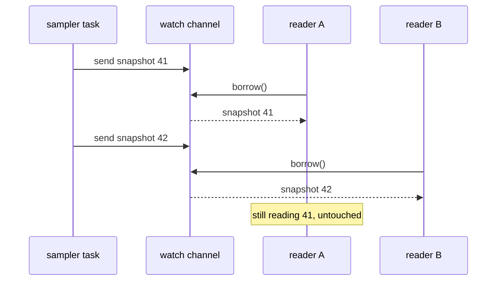
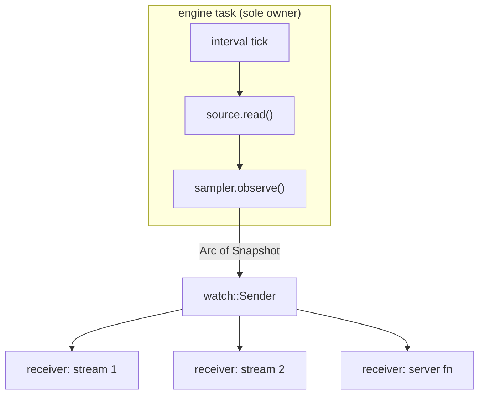

# The sampling engine

Our program from the last chapter takes one look at the network and exits. A
dashboard needs something that never stops looking. Once a second, forever, it
should read every interface, work out the rates, add them to a minute of
history and make the result available to anyone who asks.

And plenty of things will ask. Picture `netdash` running on a home server. You
have it open in a browser tab on your laptop, another on your phone, and you
reloaded the laptop tab a moment ago, so for a few milliseconds there are three
streams of updates plus a request for the current state, all on different
threads of the same web server, all wanting the latest numbers while the
sampler is busy writing new ones.

The classic answer is a shared map behind a lock. This chapter tries it, finds
out what it costs, and replaces it with something simpler: a single owner that
builds a complete, immutable **snapshot** each second and publishes it, so
readers never touch anything that can change. We'll also make the whole engine
testable without waiting a single real second.

## What the engine must do

Let's write the requirements down before any code, in the language from
Chapter 17:

1. Every `period` (one second), read all counters from a `CounterSource`.
2. For each interface, compute the rates since the previous sample.
3. Keep the most recent rates per interface: a fixed amount of history, so
   memory stays flat however long the server runs.
4. Cope with interfaces appearing (a VPN connects) and disappearing (a USB
   adaptor is unplugged).
5. Publish the result so that any number of readers, on any thread, can get
   the latest complete picture at any time, without slowing the sampler down.

Items 2 to 4 are decisions about data. Items 1 and 5 are about time and
concurrency. The *Functional Core, Imperative Shell* split from Chapter 1
tells us where the line goes: a pure `Sampler` in `netdash-core` that turns
readings into snapshots, and a small async loop in the application that feeds
it and publishes what it produces.

## Remembering a minute

Start with history. The first thing that comes to mind is a `Vec` that we
push onto and trim from the front:

```rust
history.push(rates);
if history.len() > 60 {
    history.remove(0);
}
```

This works, and for 60 items nobody would ever notice its cost, but it has
two quiet problems. `Vec::remove(0)` shifts every remaining element left by
one, so trimming is proportional to the length. More importantly, the rule
"never more than 60" lives in an `if` at the call site. Every place that
pushes must remember it, and a later change that pushes from somewhere else
can forget.

What we want is a type whose *only* push operation enforces the bound. The
standard library's `VecDeque` (a double-ended queue, backed by a growable
ring buffer) can pop from the front in constant time. We wrap it so the bound
can't be bypassed:

```rust
// file: core/src/history.rs
/// The most recent `capacity` values, oldest first.
///
/// Pushing onto a full history forgets the oldest value, so memory use
/// is fixed however long the program runs.
#[derive(Debug, Clone, PartialEq)]
pub struct History<T> {
    capacity: NonZeroUsize,
    points: VecDeque<T>,
}
```

```rust
impl<T> History<T> {
    pub fn new(capacity: NonZeroUsize) -> Self {
        History {
            capacity,
            points: VecDeque::with_capacity(capacity.get()),
        }
    }

    pub fn push(&mut self, value: T) {
        if self.points.len() == self.capacity.get() {
            self.points.pop_front();
        }
        self.points.push_back(value);
    }

    pub fn iter(&self) -> impl Iterator<Item = &T> {
        self.points.iter()
    }
}
```

Both fields are private, so the only way to add a point is `push`, and `push`
keeps the invariant. That's *Encapsulated Invariants (Privacy as Proof)* from
Chapter 7. The capacity is a `NonZeroUsize`, the standard library's own
smart-constructed integer: a history that can hold nothing would be a bug,
and now it's one we can't write. (We also add `len`, `is_empty` and
`capacity` accessors; clippy insists that a `len` comes with an `is_empty`.)

The invariant is easy to state, so it's easy to test as a property: whatever
sequence of values you push, the history holds the last `min(n, capacity)` of
them, in order.

```rust
proptest! {
    #[test]
    fn never_exceeds_capacity(
        cap in 1usize..50,
        values in prop::collection::vec(any::<u8>(), 0..200),
    ) {
        let mut h = History::new(NonZeroUsize::new(cap).unwrap());
        for v in &values {
            h.push(*v);
        }
        prop_assert_eq!(h.len(), values.len().min(cap));
        let tail = &values[values.len() - h.len()..];
        prop_assert!(h.iter().eq(tail.iter()));
    }
}
```

`Iterator::eq` compares two iterators element by element, so we can check the
contents without collecting into a `Vec`.

## What a snapshot is

Next, the thing we're going to publish. A snapshot is everything the dashboard
needs to draw one frame. For each interface: its name, its totals, and its
recent rates.

```rust
// file: core/src/snapshot.rs
/// The rate in each direction over one sampling interval, if known.
pub type Rates = RxTx<Option<BytesPerSecond>>;

/// Everything the dashboard shows about one interface.
#[derive(Debug, Clone, PartialEq, Serialize, Deserialize)]
pub struct InterfaceStats {
    pub name: InterfaceName,
    /// Bytes moved since the interface's counters last started.
    pub total: RxTx<Bytes>,
    /// Recent rates, oldest first. The last entry is the current rate.
    pub history: Vec<Rates>,
}
```

```rust
/// One consistent view of the whole machine, numbered in order.
#[derive(Debug, Clone, PartialEq, Default, Serialize, Deserialize)]
pub struct Snapshot {
    /// Increases by one with every sample; 0 means "nothing yet".
    pub seq: u64,
    /// Sorted by interface name.
    pub interfaces: Vec<InterfaceStats>,
}
```

A few design choices are hiding in here.

There's no `current_rate` field. The current rate is the last entry in the
history, so storing it separately would give us two copies of one fact and
the chance for them to disagree. It's a method instead:

```rust
impl InterfaceStats {
    /// The most recent rates, or unknown if there is no history yet.
    pub fn current(&self) -> Rates {
        self.history.last().copied().unwrap_or_default()
    }
}
```

`unwrap_or_default` works because `RxTx<T>` derives `Default` and the default
`Option` is `None`, so "no history" reads as "both rates unknown". We'll add an
`is_idle` method alongside it, true when no point in the history shows any
traffic; Chapter 19 uses it to hide the dozen dormant interfaces macOS likes
to show.

The history in a snapshot is a plain `Vec`, not our `History` type. The
`History` type exists to enforce a rule *while values are being added*. A
snapshot is never added to; it's a finished picture. Choosing the plainest
type that fits each job keeps the published data easy to serialise and easy
to read.

`seq` numbers snapshots in order. It costs eight bytes and lets every reader
tell whether the snapshot in front of it is new, which will matter more than
it looks.

And `Snapshot` derives `Clone`, `Serialize` and `Deserialize`, and contains
only owned data: no references, no locks, no handles. Remember that list;
it's the reason the rest of this chapter works.

## The sampler: a pure state machine

Now the logic that turns a stream of readings into a stream of snapshots. To
compute a rate we need the previous readings and when they were taken. To
build history we need each interface's `History`. That's the sampler's whole
state:

```rust
// file: core/src/sampler.rs
/// Remembers the previous readings and each interface's recent rates.
///
/// The sampler is owned by exactly one task and mutated in place. What it
/// hands out are [`Snapshot`]s: complete, immutable copies.
#[derive(Debug, Clone)]
pub struct Sampler {
    capacity: NonZeroUsize,
    seq: u64,
    previous: Option<(Duration, Readings)>,
    histories: BTreeMap<InterfaceName, History<Rates>>,
}
```

How does the sampler know what time it is? It mustn't read a clock: that's
I/O, and it would make every test depend on real time. Instead, time arrives
as data. The caller passes `at`, a `Duration` measured from any fixed starting
point, alongside the readings it took at that moment:

```rust
    /// Record the readings taken at time `at` (measured from any fixed
    /// starting point) and return the resulting snapshot.
    pub fn observe(&mut self, at: Duration, readings: Readings) -> Snapshot {
        let rates = self.rates_since_previous(at, &readings);

        self.histories.retain(|name, _| readings.contains_key(name));
        for (name, rates) in rates {
            self.histories
                .entry(name)
                .or_insert_with(|| History::new(self.capacity))
                .push(rates);
        }

        self.seq += 1;
        let snapshot = self.snapshot(&readings);
        self.previous = Some((at, readings));
        snapshot
    }
```

Read it as four steps. Work out the rates. Forget the history of any interface
that has gone (`retain` keeps only the entries for which the closure returns
`true`). Append the new rates, creating a fresh `History` for any interface
we haven't seen before (`entry(...).or_insert_with(...)` is the map idiom for
"get or create"). Then build the snapshot and remember these readings for next
time.

`observe` takes `&mut self`, so it isn't pure in the strictest sense. But its
effects are entirely on its own private state, and its output depends only on
that state and its arguments. Given the same sequence of calls, it always
produces the same snapshots. That's what makes it testable, and it's the same
shape as the event-sourced `evolve` from Chapter 15, folded over time.

The rate calculation is where Chapter 17's types pay off:

```rust
    fn rates_since_previous(
        &self,
        at: Duration,
        readings: &Readings,
    ) -> Vec<(InterfaceName, Rates)> {
        let previous = self.previous.as_ref().and_then(|(then, before)| {
            let elapsed = Elapsed::new(at.checked_sub(*then)?)?;
            Some((elapsed, before))
        });

        readings
            .iter()
            .map(|(name, now)| {
                let then = previous.and_then(|(elapsed, before)| {
                    Some((elapsed, before.get(name)?))
                });
                let rates = match then {
                    Some((elapsed, then)) => {
                        then.zip(*now).map(|(a, b)| rate(a, b, elapsed))
                    }
                    None => RxTx::default(),
                };
                (name.clone(), rates)
            })
            .collect()
    }
```

Every "we can't know" case collapses into the same honest answer, both rates
`None`: the very first sample (no `previous`), a clock that stood still or ran
backwards (`checked_sub` or `Elapsed::new` fails), and an interface that
wasn't there last time (`before.get(name)` is `None`). The `?` operator works
inside closures that return `Option`, which lets each of those conditions be
one character rather than an `if`.

Because the sampler is pure, its tests are just sequences of calls with
made-up times. No sleeping, no threads:

```rust
#[test]
fn a_reset_leaves_a_gap_then_recovers() {
    let mut s = sampler(4);
    s.observe(secs(0), readings(&[("en0", 5_000, 0)]));
    let reset = s.observe(secs(1), readings(&[("en0", 10, 0)]));
    assert_eq!(rx(&reset, 0), None);
    let after = s.observe(secs(2), readings(&[("en0", 1_034, 0)]));
    assert_eq!(rx(&after, 0), Some(1_024.0));
}
```

`sampler`, `readings`, `secs` and `rx` are three-line helpers in the test
module that build values from literals. Alongside this test sit others for the
first sample (totals but no rates), interfaces coming and going, the bound on
history and a clock that stands still. Each is five lines.

> [!TIP]
> Small test helpers that turn literals into domain values
> (`readings(&[("en0", 5_000, 0)])`) are worth writing early. They make each
> test read like a sentence about the domain instead of a page of setup, and
> they're the first thing to reach for when a new case occurs to you.

## Sharing: the obvious way

Now the hard part: getting each snapshot to many readers on many threads.

If you've written concurrent code in Java, Go or C#, the reflex is a shared
map behind a mutex. The sampler task updates entries in place; readers lock,
look, unlock. Let's try it in its plainest form, with `tokio` (introduced in
Part II) driving the loop:

```rust
// does not compile
type Stats = Arc<Mutex<HashMap<String, u64>>>;

async fn sample(stats: Stats) {
    loop {
        let mut map = stats.lock().unwrap();
        map.insert("en0".to_string(), 42);
        tokio::time::sleep(Duration::from_secs(1)).await;
    }
}

#[tokio::main]
async fn main() {
    let stats: Stats = Arc::default();
    tokio::spawn(sample(stats.clone()));
}
```

```text
error: future cannot be sent between threads safely
   --> src/bin/mutex.rs:18:18
    |
 18 |     tokio::spawn(sample(stats.clone()));
    |                  ^^^^^^^^^^^^^^^^^^^^^ future returned by `sample` is not `Send`
    |
    = help: within `impl Future<Output = ()>`, the trait `Send` is not implemented for `std::sync::MutexGuard<'_, HashMap<String, u64>>`
note: future is not `Send` as this value is used across an await
   --> src/bin/mutex.rs:11:52
    |
  9 |         let mut map = stats.lock().unwrap();
    |             ------- has type `std::sync::MutexGuard<'_, HashMap<String, u64>>` which is not `Send`
 10 |         map.insert("en0".to_string(), 42);
 11 |         tokio::time::sleep(Duration::from_secs(1)).await;
    |                                                    ^^^^^ await occurs here, with `mut map` maybe used later
```

This is the compiler catching a real bug. The lock guard `map` lives until the
end of the loop body, so we hold the lock *while sleeping for a second*. Every
reader would block for the entire second, every second. And because a
`std::sync::MutexGuard` must be released on the thread that acquired it, it
isn't `Send`, so a future that holds one across an `.await` (where tokio may
move it to another thread) can't be spawned. The `Send` wrinkle from Part II
strikes again, this time in our favour.

We could fix the error by dropping the guard before the `await`. But step back
and look at what the design costs even when it's written correctly:

- **Readers and the writer contend.** While the sampler holds the lock to
  update twenty interfaces, every reader waits; while a slow reader holds it
  to serialise the map to JSON for a phone on a bad connection, the sampler
  waits. One slow consumer delays everyone.
- **Views can be inconsistent.** If the sampler updates entries one at a time
  (lock, update `en0`, unlock, lock, update `lo0`...), a reader can see `en0`
  from this second and `lo0` from the last. A total across interfaces computed
  from that view corresponds to no moment that ever existed. Avoiding that
  means holding the lock for the whole update, which makes the contention
  worse.
- **Every reader must remember the protocol.** Lock, copy what you need,
  unlock promptly, never `await` while holding it. That's a rule that lives
  in people's heads, not in types.

The root cause is that we're sharing something *mutable*. Every one of those
problems is about coordinating access to a value that changes.

## Share values, not variables

So don't share anything that changes. The sampler is the only thing that
needs to mutate state, and it already owns that state outright: a single task
with a `&mut Sampler`, no sharing at all. What readers need isn't the
sampler's state; it's the *result*, and each `observe` call produces a
complete, self-contained `Snapshot`.

Once built, a snapshot never changes. To share an immutable value between
threads, Rust's tool is `Arc<T>`, an atomically reference-counted pointer.
Cloning an `Arc` doesn't copy the snapshot; it increments a counter and hands
out another pointer to the same data. When the last clone is dropped, the
snapshot is freed. A reader holding an `Arc<Snapshot>` from a minute ago is
completely unaffected by the dozens published since: it still has its own
consistent picture, for as long as it cares to keep it.

And here's that list from earlier paying off. `Snapshot` holds only owned,
plain data, so the compiler automatically considers it `Send` (safe to move
to another thread) and `Sync` (safe to share references between threads).
`Arc<Snapshot>` is therefore both too. We wrote no `unsafe`, no lock, and no
annotation. It's simply true.

What's left is a way to hand the newest `Arc<Snapshot>` to whoever wants it.



> [!PATTERN] Immutable Snapshots over Shared Mutation
> Let exactly one owner mutate the working state, and have it publish
> complete, immutable snapshots (`Arc<Snapshot>`) for everyone else to read.
> Readers never block the writer or each other, every view is consistent, and
> the types are `Send + Sync` without locks. Use it when one producer
> updates state that many consumers read, and readers care about the latest
> whole picture rather than every intermediate change.

## A channel that holds one value

Tokio provides exactly the channel this pattern wants: `tokio::sync::watch`.
Unlike the queue-like channels (`mpsc`, which you'll meet in Part VII, and
`broadcast`), a `watch` channel holds a single value: the latest. Sending
replaces it. Receivers can:

- `borrow()` the current value at any time, without waiting;
- `changed().await` to sleep until a newer value is sent;
- `borrow_and_update()` to read the value and mark it as seen.

A receiver that falls behind doesn't build up a backlog. If the sampler sends
snapshots 41, 42 and 43 while a slow browser connection is still busy with 40,
that reader's next `changed()` wakes once and sees 43. For a dashboard that is
precisely right: nobody wants to replay three stale seconds to catch up. The
slow reader also costs the sampler nothing, because `send` never waits for
receivers.

The borrow is held only for as long as it takes to clone the `Arc` out. The
cost of a read is one atomic increment, no matter how big the snapshot is.

## The engine loop

Now the imperative shell. It lives in the application, which needs `tokio`:

```toml
# file: Cargo.toml
[dependencies]
# ...
tokio = { version = "1", features = ["rt-multi-thread", "macros", "time", "sync"] }

[dev-dependencies]
tokio = { version = "1", features = ["test-util", "macros", "rt"] }
```

`time` gives us intervals, `sync` the `watch` channel, and the
`test-util` feature in dev-dependencies unlocks the controllable clock we'll
use for testing. Here's the loop:

```rust
// file: src/server/engine.rs
/// Sample until nobody is listening any more.
pub async fn run<S: CounterSource>(
    mut source: S,
    period: Duration,
    mut sampler: Sampler,
    publish: watch::Sender<Arc<Snapshot>>,
) {
    let started = Instant::now();
    let mut ticks = time::interval(period);
    ticks.set_missed_tick_behavior(MissedTickBehavior::Delay);

    loop {
        ticks.tick().await;
        let readings = source.read();
        let snapshot = sampler.observe(started.elapsed(), readings);
        if publish.send(Arc::new(snapshot)).is_err() {
            break;
        }
    }
}
```

It's short because it has nothing left to decide. A few details:

- `time::interval` fires immediately and then every `period`, measured from
  the start rather than from the end of each iteration, so the loop doesn't
  slowly drift as each read takes a few microseconds.
  `MissedTickBehavior::Delay` says that if we ever fall behind (the machine
  was asleep, say), we should resume the steady rhythm rather than firing a
  burst of catch-up ticks with tiny gaps between them.
- `Instant` here is `tokio::time::Instant`, tokio's view of the monotonic
  clock. `started.elapsed()` is the `at` the sampler wants. Using tokio's
  `Instant` rather than `std`'s matters for testing, as we'll see in a moment.
- `send` fails only when every receiver has been dropped. Then there's nobody
  left to sample for, and the task ends itself. No shutdown flag, no
  cancellation token: ownership tells us when to stop (the *Ownership as
  Resource Management* idea from Chapter 2, applied to tasks).

Starting the engine creates the channel, moves the sending half into a
spawned task and returns the receiving half:

```rust
/// The receiving end: always holds the latest snapshot.
pub type Snapshots = watch::Receiver<Arc<Snapshot>>;

/// Start sampling `source` every `period` in a background task.
pub fn start<S>(source: S, period: Duration, history: NonZeroUsize) -> Snapshots
where
    S: CounterSource + Send + 'static,
{
    let (publish, snapshots) = watch::channel(Arc::new(Snapshot::default()));
    tokio::spawn(run(source, period, Sampler::new(history), publish));
    snapshots
}
```

The bounds on `S` are what `tokio::spawn` needs: the task may run on any
worker thread (`Send`), and it may outlive the function that started it
(`'static`, meaning the source mustn't borrow anything short-lived). The
channel starts holding `Snapshot::default()`, sequence number 0, which
readers can recognise as "nothing sampled yet". A `watch::Receiver` is
cheap to clone; every part of the server that wants snapshots gets its own.

> [!NOTE]
> `source.read()` is a blocking call inside an async task. That's fine here:
> `sysinfo` reads a handful of kernel counters and returns in microseconds.
> If a source could take milliseconds (shelling out to a command, say), wrap
> the call in `tokio::task::spawn_blocking` so it runs on a thread set aside
> for blocking work instead of stalling one of tokio's worker threads.



## Testing with time under control

How do you test a loop whose whole point is to wait a second between
iterations? Not by waiting. Two things make it easy.

First, a fake source. Because the engine depends on the `CounterSource` trait
rather than on `sysinfo`, a test can hand it anything that implements the
trait. A source that replays a prepared script of readings is generally
useful (we'll reuse it for demos), so it goes in the core, next to the trait:

```rust
// file: core/src/source.rs
/// A source that replays prepared readings, for tests and demos.
///
/// Once the script runs out it keeps returning the last frame.
#[derive(Debug, Clone, Default)]
pub struct ScriptedSource {
    frames: VecDeque<Readings>,
    last: Readings,
}

impl CounterSource for ScriptedSource {
    fn read(&mut self) -> Readings {
        if let Some(next) = self.frames.pop_front() {
            self.last = next;
        }
        self.last.clone()
    }
}
```

Second, tokio's paused clock. A test marked
`#[tokio::test(start_paused = true)]` runs on a runtime whose clock is frozen.
Whenever every task is waiting on a timer, tokio jumps the clock straight to
the next timer's deadline. A one-second `interval` completes instantly, but
`Instant::now()` still advances by exactly one second. This is why the engine
uses `tokio::time::Instant`: it reads tokio's clock, which the test controls,
rather than the operating system's.

```rust
#[tokio::test(start_paused = true)]
async fn publishes_a_snapshot_every_period() {
    let source =
        ScriptedSource::new([frame(0), frame(1_000), frame(4_000)]);
    let mut snapshots = start(source, Duration::from_secs(1), history(8));

    let first = next(&mut snapshots).await;
    assert_eq!(first.seq, 1);
    assert_eq!(first.interfaces[0].current().rx, None);

    let second = next(&mut snapshots).await;
    assert_eq!(second.interfaces[0].current().rx.unwrap().get(), 1_000.0);

    let third = next(&mut snapshots).await;
    assert_eq!(third.interfaces[0].current().rx.unwrap().get(), 3_000.0);
    assert_eq!(third.interfaces[0].history.len(), 3);
}
```

`frame(n)` builds readings for one interface whose rx counter is `n`, and
`next` waits for `changed()` and clones out the latest `Arc`. The rates come
out as *exactly* 1,000.0 and 3,000.0 because the paused clock advanced by
exactly one second each time. With a real clock we'd be writing tolerances
and hoping the CI machine wasn't busy.

The pattern's central promise deserves its own test: an old snapshot is not
affected by newer ones.

```rust
#[tokio::test(start_paused = true)]
async fn an_old_snapshot_is_unaffected_by_new_ones() {
    let source = ScriptedSource::new([frame(0), frame(500)]);
    let mut snapshots = start(source, Duration::from_secs(1), history(8));

    let held = next(&mut snapshots).await;
    let _later = next(&mut snapshots).await;
    assert_eq!(held.seq, 1);
    assert_eq!(held.interfaces[0].history.len(), 1);
}
```

With a shared mutable map, `held` would be a view onto live data and this
test would be a race. Here it can't fail: nobody can reach inside an
`Arc<Snapshot>` to change it. A third test drops every receiver and checks that
`run` returns, which is how we know the engine cleans up after itself.

```sh
cargo test
```

```text
running 3 tests
test server::engine::tests::stops_when_nobody_is_listening ... ok
test server::engine::tests::an_old_snapshot_is_unaffected_by_new_ones ... ok
test server::engine::tests::publishes_a_snapshot_every_period ... ok

test result: ok. 3 passed; 0 failed; 0 ignored; 0 measured; 0 filtered out; finished in 0.00s
```

Three seconds of simulated sampling, finished in no measurable time.

## Watching it run

Let's swap Chapter 17's throwaway `main` for one that starts the engine and
prints every busy interface in each snapshot. Move `sysinfo_source.rs` into
`src/server/` next to `engine.rs`, with a `src/server/mod.rs` declaring both;
the next chapter explains why "server" is the right name.

```rust
// file: src/main.rs
// ... mod server; and the use declarations

#[tokio::main]
async fn main() {
    let history = NonZeroUsize::new(60).expect("60 is not zero");
    let period = Duration::from_secs(1);
    let mut snapshots = engine::start(SysinfoSource::new(), period, history);

    while snapshots.changed().await.is_ok() {
        let snapshot = snapshots.borrow_and_update().clone();
        let busy = snapshot.interfaces.iter().filter(|i| !i.is_idle());
        for stats in busy {
            let now = stats.current();
            println!(
                "#{:<3} {:<6} down {:>11}  up {:>11}",
                snapshot.seq,
                stats.name,
                show_rate(now.rx),
                show_rate(now.tx),
            );
        }
    }
}
```

The loop is the reader's side of the pattern in miniature: wait for a change,
take the latest `Arc` (one atomic increment, then the borrow is released),
and work with a snapshot nobody else can alter. The `while ... is_ok()`
condition ends the loop if the engine ever stops. Started during a download,
it prints:

```text
#2   en0    down  27.9 KiB/s  up  23.1 KiB/s
#2   utun4  down  13.1 KiB/s  up  12.0 KiB/s
#2   utun5  down       0 B/s  up      88 B/s
#3   en0    down  16.7 KiB/s  up  14.3 KiB/s
#3   lo0    down     853 B/s  up     853 B/s
#3   utun4  down  9.46 KiB/s  up  7.47 KiB/s
#3   utun5  down       0 B/s  up      88 B/s
#4   en0    down  3.46 MiB/s  up  50.1 KiB/s
#4   lo0    down       0 B/s  up       0 B/s
#4   utun4  down  3.27 MiB/s  up  21.0 KiB/s
#4   utun5  down       0 B/s  up      88 B/s
```

Snapshot 1 printed nothing: with no previous sample, every rate is unknown,
so every interface counts as idle. From snapshot 2 onwards the rates appear,
and at snapshot 4 the download kicks in. Notice `lo0` at #4: idle *now*, but
it had traffic a second ago, so it isn't idle over its history and still gets
a line.

> [!CHECKPOINT]
> Your workspace should now have:
>
> - `core/src/history.rs` (`History<T>`), `core/src/snapshot.rs`
>   (`Rates`, `InterfaceStats`, `Snapshot`) and `core/src/sampler.rs`
>   (`Sampler`), plus `ScriptedSource` in `core/src/source.rs`
> - `src/server/engine.rs` (`Snapshots`, `start`, `run`) and
>   `src/server/sysinfo_source.rs`
> - a `main` that prints busy interfaces every second
>
> `cargo test --workspace` should run the core's unit and property tests
> plus the three engine tests, all passing in well under a second.

## What we learned

- **A bounded ring buffer** (`VecDeque` behind a private field and a
  `NonZeroUsize`) keeps memory flat and makes the bound impossible to forget.
- **Time as data**: the sampler is given `at` rather than reading a clock, so
  it stays pure and its tests are plain sequences of calls.
- **Derive, don't store**: the current rate is the last history point, not a
  second field that could disagree with it.
- **Shared mutable maps cost more than a lock**: contention between readers
  and writer, inconsistent views, and a protocol every reader must remember.
  The compiler's `Send` error about a `MutexGuard` held across `.await` was the
  first symptom.
- **Immutable Snapshots over Shared Mutation**: one owner mutates; everyone
  else gets `Arc<Snapshot>`. Reads are an atomic increment, views are
  consistent, and `Send + Sync` come for free from owned, plain data.
- **`tokio::sync::watch`** is a channel of one: the latest value, with
  slow readers skipping straight to it.
- **Ownership ends tasks**: when every receiver is dropped, `send` fails and
  the engine stops.
- **Paused time** (`start_paused = true` and `tokio::time::Instant`) turns
  timing tests into instant, exact ones.

## Exercises

> [!EXERCISE] Variable sampling
> Make the period configurable from the command line, then try 250 ms.
> Nothing in `Sampler` should need to change. Why not? What *does* change
> about what a 60-slot history means, and where should that be shown to the
> user?

> [!EXERCISE] Peak hold
> Add a `peak: RxTx<Option<BytesPerSecond>>` to `InterfaceStats`: the highest
> rate in each direction across the history. Should it be a field computed by
> the sampler, or a method computed from `history` like `current`? Write down
> the argument for each, pick one, and test it.

> [!EXERCISE] A noisy source
> Write a `JitterSource` that wraps any `CounterSource` and occasionally (say
> one read in ten) returns a reading where one interface's counters have
> reset to zero. Run the engine test suite against it and check the sampler
> reports a gap followed by recovery. (Use a seeded random generator, or a
> simple counter, so the test is deterministic.)

> [!EXERCISE] Measure the alternative
> Write a small benchmark with eight tasks that each read the latest
> stats 100,000 times while one task updates every millisecond: once with
> `Arc<Mutex<HashMap<..>>>`, once with `watch` and `Arc<Snapshot>`. Compare
> the time the writer spends waiting. What happens to each version if one
> reader holds its view for 10 ms?
