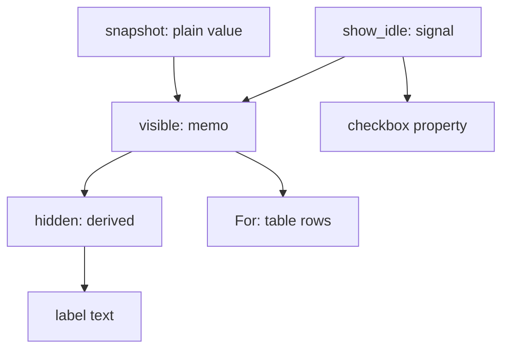
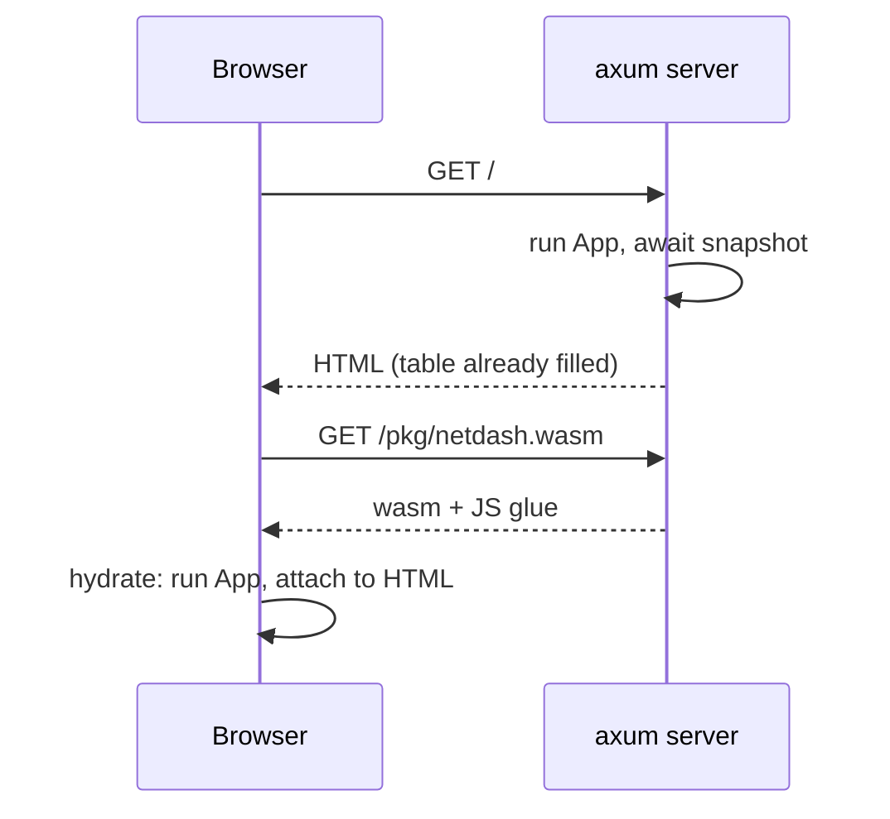
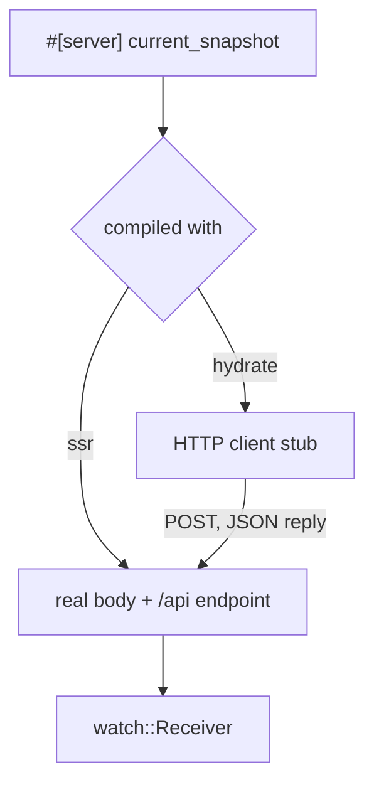

# Leptos from first principles

We have an engine producing a fresh `Arc<Snapshot>` every second. Now we want
it in a browser: a table with a row per interface, rates and totals, and a
checkbox to hide the dozen idle interfaces macOS insists on showing. Later it
should update live. In most stacks this is where the project splits in two: a
Rust (or Go, or Python) server exposing JSON, and a separate TypeScript
application that re-declares every type, re-implements the formatting, and
drifts out of step with the server one field at a time.

We're going to keep one language and, more importantly, one *domain*. The
`netdash-core` crate from Chapters 17 and 18 contains no I/O, so it compiles
for WebAssembly unchanged. The browser can use the very same `Snapshot`,
`BytesPerSecond` and `show_rate` the server uses. The framework that makes
this pleasant is **Leptos**: a Rust web framework that renders HTML on the
server, then brings the same components to life in the browser.

This chapter assumes you've never used Leptos, or any reactive UI framework.
We'll build up its ideas one at a time (components, signals, derived signals,
memos, server rendering, hydration and server functions) and finish with a
working, server-rendered dashboard. Chapter 20 makes it live.

## Components are functions

Start with the smallest piece of the page: one row of the table. Given the
stats for one interface, produce some HTML. That's a function from data to
markup, and in Leptos that's exactly what a component is:

```rust
#[component]
fn InterfaceRow(stats: InterfaceStats) -> impl IntoView {
    let now = stats.current();
    view! {
        <tr>
            <td class="name">{stats.name.to_string()}</td>
            <td class="num rx">{show_rate(now.rx)}</td>
            <td class="num tx">{show_rate(now.tx)}</td>
            <td class="num">{stats.total.rx.to_string()}</td>
            <td class="num">{stats.total.tx.to_string()}</td>
        </tr>
    }
}
```

There's very little magic here, and it's worth being clear about what there
is.

- **`#[component]`** turns the function's parameters into *props*: named
  inputs you supply when you use the component. Component names are
  `CamelCase` so they can't be confused with HTML elements.
- **`view!`** is a macro that takes HTML-like syntax and expands to ordinary
  Rust that builds the view. Text literals go in quotes (`"Down"`), and Rust
  expressions go in braces (`{show_rate(now.rx)}`). Anything that implements
  `IntoView` can go in braces: strings, numbers, other views, `Option`s of
  views, and (crucially, in a moment) closures.
- **`impl IntoView`** is the return type. Like `impl Iterator` in Chapter 6,
  it says "some concrete type implementing this trait; you don't need to know
  which". Each `view!` produces its own distinct, deeply nested type, which
  is how Leptos knows the shape of the markup at compile time.

Look at what's inside the braces: `stats.current()`, `show_rate`, `Display`
for `Bytes`. That's Chapter 17's domain code, running unchanged inside a view.
There is no separate "view model" layer and no JSON-to-object mapping. The
formatting rules that we unit-tested are the formatting rules the page uses.

Using a component looks like using an HTML element, with props as
attributes:

```rust
view! { <InterfaceRow stats/> }
```

`stats` on its own is shorthand for `stats=stats`, in the same spirit as
Rust's struct field shorthand.

> [!NOTE]
> A component function runs **once**, when the component is created. It is
> not a "render function" re-run on every change, as in React. That one fact
> explains most of what follows: if a component runs once, then anything that
> should change later has to be wired up to change by itself.

## Signals: values that announce their changes

`InterfaceRow` is static: it shows what it was given and never changes. The
"show idle interfaces" checkbox is not. When it's ticked, the table should
grow; when it's unticked, shrink. Some value, *whether to show idle
interfaces*, changes over time, and parts of the page depend on it.

In Leptos that value is a **signal**:

```rust
let show_idle = RwSignal::new(false);
```

A signal is a container for a value that keeps track of who is reading it.
`show_idle.get()` returns the current value (a clone of it); `show_idle.set(x)`
replaces it; `show_idle.update(|v| ...)` changes it in place; and
`show_idle.with(|v| ...)` borrows it without cloning. The difference from a
plain variable is what happens when it changes: everything that read it is
told, and re-runs.

Here's the checkbox, wired up in both directions:

```rust
<input
    type="checkbox"
    prop:checked=move || show_idle.get()
    on:change=move |ev| show_idle.set(event_target_checked(&ev))
/>
```

`on:change` attaches an event listener; `event_target_checked` is a Leptos
helper that reads the checkbox's state from the event. `prop:checked` sets the
element's `checked` *property* (the live state) rather than the `checked`
*attribute* (which only sets the initial state). And its value is not a
`bool` but a closure, `move || show_idle.get()`.

That closure is the whole trick. When you put a plain value in a view, Leptos
renders it once. When you put a *closure*, Leptos runs it inside a reactive
context, notes which signals it read, and re-runs just that closure when any
of them change, updating just that one property of that one element. Nothing
else on the page is touched. There's no virtual DOM being diffed; the
dependency graph says exactly what to update.

> [!TIP]
> Signals in Leptos 0.8 are `Copy`. An `RwSignal<bool>` is a small handle
> into a reactive arena, not the value itself, so you can move it into as
> many `move` closures as you like without cloning. That's why every closure
> above can say `move` and still share the same signal.

## Derived signals: closures over signals

The checkbox label should say how many interfaces are hidden: `Show idle (9
hidden)`. That number isn't a new piece of state. It's a *fact computed from
existing state*: the number of interfaces minus the number visible. If we
stored it in its own signal, we'd have to remember to update it every time
the checkbox or the data changed, and one day we'd forget.

Think of a spreadsheet. You type numbers into a few cells, and other cells
hold formulas like `=A1-B1`. You never update a formula cell yourself; it
recomputes when its inputs change. Leptos calls a formula cell a **derived
signal**, and it's nothing more exotic than a closure:

```rust
let hidden = move || total - visible.with(Vec::len);
```

Any function that reads signals is itself a reactive value. Put it in a view
(`{hidden}`) and the text updates whenever the signals it reads change. It's
a pure function of state, which is the idea from Chapter 1 showing up in a
user interface: the input cells are the only state, and everything else is a
function of them.

## Memos: formula cells that remember

`hidden` reads `visible`. What is `visible`? The list of interfaces to show,
which depends on the snapshot and the checkbox:

```rust
let visible = Memo::new(move |_| {
    let show_idle = show_idle.get();
    snapshot
        .interfaces
        .iter()
        .filter(|i| show_idle || !i.is_idle())
        .cloned()
        .collect::<Vec<_>>()
});
```

We could write this as a plain closure too, but it's read in two places (the
table rows and the hidden count), and a derived signal re-runs every time
anyone reads it. Filtering and cloning a list twice per change is wasteful,
and in Chapter 20 it'll change every second.

A **`Memo`** is a derived signal with a cache. It runs its function once,
stores the result, and hands out the stored value to every reader. When an
input changes, it recomputes, and here's the subtle part: it only notifies
*its* readers if the new value is different from the old (by `PartialEq`).
Tick the checkbox on a machine where nothing is idle, and `visible` recomputes
to an identical list, so nothing downstream re-runs at all.

That's the spreadsheet analogy completed. Signals are input cells. Derived
signals and memos are formula cells; memos also remember their last result.
The page is a set of cells displaying values, each updating exactly when its
inputs change.



> [!PATTERN] Reactive Derived State
> Keep the minimum set of independent facts in signals, and express every
> other value the interface shows as a pure function of them: a closure
> (derived signal) for cheap formulas, a `Memo` when the result is costly or
> read in several places. Never copy a derivable value into its own signal.
> The dependency graph then guarantees the screen is always a consistent
> function of state, with no "remember to update X when Y changes" code.

## Lists with `For`

The table body is a list of rows, one per visible interface. A closure that
maps the list to rows would work, but it would rebuild *every* row whenever
the list changed. Leptos's `For` component is smarter:

```rust
<tbody>
    <For
        each=move || visible.get()
        key=|stats| stats.name.clone()
        let:stats
    >
        <InterfaceRow stats/>
    </For>
</tbody>
```

`each` is a reactive source of items. `key` gives each item an identity; here,
its `InterfaceName`. When `each` changes, `For` compares the keys: rows whose
key disappeared are removed, new keys get new rows, and rows whose key is
still present are *left alone*. `let:stats` names each item for use in the
children.

Our `InterfaceName` value object, with its derived `Eq` and `Hash`, is
exactly what a key needs. Hold on to that "left alone", though. It's correct
and efficient for this chapter, where a row's data never changes. In Chapter
20 it'll bite us.

## The whole table

Put together, the table component owns one signal, one memo, one derived
signal and a view:

```rust
#[component]
fn InterfaceTable(snapshot: Snapshot) -> impl IntoView {
    let show_idle = RwSignal::new(false);
    let total = snapshot.interfaces.len();

    let visible = Memo::new(move |_| {
        // ... the filter from above
    });
    let hidden = move || total - visible.with(Vec::len);

    view! {
        <label>
            <input
                type="checkbox"
                // ... prop:checked and on:change from above
            />
            " Show idle (" {hidden} " hidden)"
        </label>
        <table>
            // ... a <thead> row, then the <tbody> with <For>
        </table>
    }
}
```

`snapshot` moves into the memo's closure. It isn't a signal: in this chapter
the table shows one snapshot for its whole life. `total` is computed once,
outside, because it can't change either. Deciding which values are reactive
and which are fixed is a design decision, and the honest answer here is "only
the checkbox".

So far this is all just Rust. To see it in a browser, we need to know how a
Leptos application actually reaches one.

## Two programs from one crate

Here's the arrangement Leptos uses, and the one we'll build:

1. A request for `/` arrives at an **axum** web server (the same `axum`
   ecosystem as the HTTP clients and servers elsewhere in this book). The
   server runs our components and renders them to an HTML string. The
   browser displays it immediately, before any WebAssembly has loaded.
   This is **server-side rendering (SSR)**.
2. The page includes a small script that loads the same components, compiled
   to **WebAssembly** (wasm). In the browser, they run again, but instead of
   creating new elements they walk the HTML that's already there, attach
   event listeners and connect signals to the existing nodes. This is
   **hydration**: the static page is brought to life.

The result is a page that appears instantly, works with JavaScript disabled
(as a static table), and becomes interactive moments later.



That means one crate is compiled *twice*: once for your machine as a server
binary, and once for `wasm32-unknown-unknown` as a library the browser
loads. The two builds need different dependencies. The server needs `tokio`,
`axum` and `sysinfo`; none of those can run in a browser. The browser needs
`wasm-bindgen` and `web-sys`; neither means anything on a server.

### Cargo features: `ssr` and `hydrate`

Cargo's answer is *features*: named switches that turn on optional
dependencies and code. Leptos convention is two: `ssr` for the server build
and `hydrate` for the browser build. First, every dependency that belongs to
only one side becomes `optional`:

```toml
# file: Cargo.toml
[dependencies]
netdash-core = { path = "core" }
leptos = "0.8.22"
leptos_meta = "0.8.7"
leptos_router = "0.8.17"
serde = { version = "1", features = ["derive"] }
serde_json = "1"

# Server only
axum = { version = "0.8", optional = true }
leptos_axum = { version = "0.8.10", optional = true }
sysinfo = { version = "0.39", optional = true, default-features = false, features = ["network"] }
tokio = { version = "1", features = ["rt-multi-thread", "macros", "time", "sync"], optional = true }
tracing = { version = "0.1", optional = true }
tracing-subscriber = { version = "0.3", optional = true }
anyhow = { version = "1", optional = true }

# Browser only
console_error_panic_hook = { version = "0.1", optional = true }
wasm-bindgen = { version = "=0.2.129", optional = true }
```

Then each feature lists what it switches on: `dep:` names an optional
dependency, and `leptos/ssr` enables a feature *of* the `leptos` crate.

```toml
[features]
hydrate = [
    "leptos/hydrate",
    "dep:console_error_panic_hook",
    "dep:wasm-bindgen",
]
ssr = [
    "dep:axum",
    "dep:leptos_axum",
    "dep:sysinfo",
    "dep:tokio",
    "dep:tracing",
    "dep:tracing-subscriber",
    "dep:anyhow",
    "leptos/ssr",
    "leptos_meta/ssr",
    "leptos_router/ssr",
]
```

Notice what's *not* optional: `netdash-core`, `serde` and the Leptos crates
themselves. They're shared. That list is the boundary of our design in one
glance: the domain and the components are common ground; everything that
touches an operating system or a browser API belongs to exactly one side.

> [!IMPORTANT]
> `wasm-bindgen` is pinned with `=0.2.129`. The build tool runs a separate
> `wasm-bindgen` command-line program over the compiled wasm, and the program
> and the library must be the *same version* or the build fails with a schema
> mismatch. Pinning the library makes the version you need explicit. We'll
> make the tooling match in a moment.

The crate becomes a library plus a binary. The library is built as both an
`rlib` (for the server binary to link against) and a `cdylib` (a standalone
dynamic library, which is what wasm needs):

```toml
[lib]
crate-type = ["cdylib", "rlib"]
```

### Code that only exists on one side

Features are visible to code through `#[cfg(feature = "...")]`. Our engine,
`sysinfo` adapter and (in the next chapter) the event stream are server-only,
so the whole `server` module is compiled only for `ssr`:

```rust
// file: src/lib.rs
pub mod app;

#[cfg(feature = "ssr")]
pub mod server;

#[cfg(feature = "hydrate")]
#[wasm_bindgen::prelude::wasm_bindgen]
pub fn hydrate() {
    console_error_panic_hook::set_once();
    leptos::mount::hydrate_body(app::App);
}
```

`hydrate` is the browser's entry point. `#[wasm_bindgen]` exports it so the
JavaScript glue can call it once the wasm has loaded.
`console_error_panic_hook` makes Rust panics print a readable message in the
browser console rather than an inscrutable `unreachable` trap.
`hydrate_body(App)` runs our `App` component against the server-rendered
`<body>`.

What happens if code shared between the two builds reaches for a browser-only
crate? Say someone adds a helper to `app.rs` that opens a browser
`EventSource` directly:

```rust
// does not compile
fn open_stream() {
    let _ = web_sys::EventSource::new("/api/stream");
}
```

The browser build would be fine. The server build is not:

```text
error[E0433]: cannot find module or crate `web_sys` in this scope
   --> src/app.rs:132:13
    |
132 |     let _ = web_sys::EventSource::new("/api/stream");
    |             ^^^^^^^ use of unresolved module or unlinked crate `web_sys`
    |
    = help: if you wanted to use a crate named `web_sys`, use `cargo add web_sys` to add it to your `Cargo.toml`
```

The error is the feature system doing its job: `web-sys` isn't a dependency
of the server build, so code that uses it can't sneak into shared code
unannounced. It needs a `#[cfg(feature = "hydrate")]` and a decision about
what the server should do instead, which is exactly the problem Chapter 20
has to solve.

> [!TIP]
> Get in the habit of checking both builds. `cargo check --features ssr`
> checks the server; `cargo check --lib --features hydrate --target
> wasm32-unknown-unknown` checks the browser. A change can easily break one
> and not the other, and `cargo leptos` only tells you after compiling both.

## The shell and the app

The server needs to produce a complete HTML document; the browser only ever
hydrates the `<body>`. Leptos splits those two jobs. `shell` is the document,
rendered only on the server:

```rust
// file: src/app.rs
pub fn shell(options: LeptosOptions) -> impl IntoView {
    view! {
        <!DOCTYPE html>
        <html lang="en">
            <head>
                <meta charset="utf-8"/>
                <meta name="viewport" content="width=device-width, initial-scale=1"/>
                <AutoReload options=options.clone()/>
                <HydrationScripts options/>
                <MetaTags/>
            </head>
            <body>
                <App/>
            </body>
        </html>
    }
}
```

`HydrationScripts` emits the `<script>` that loads the wasm and calls our
`hydrate` function. `AutoReload` reloads the page when you change code during
development. `MetaTags` is where `leptos_meta` puts any `<title>` or
stylesheet links that components ask for.

`App` is the part that runs in both places:

```rust
#[component]
pub fn App() -> impl IntoView {
    provide_meta_context();
    view! {
        <Stylesheet id="leptos" href="/pkg/netdash.css"/>
        <Title text="netdash"/>
        <Router>
            <main>
                <Routes fallback=|| "Not found.".into_view()>
                    <Route path=StaticSegment("") view=Home/>
                </Routes>
            </main>
        </Router>
    }
}
```

`leptos_router` maps URL paths to components. We have a single page, so a
single route: the empty path, showing `Home`. It's still worth having: the
server uses the route list to know which URLs to render, and adding a
per-interface detail page later is one more `<Route>`.

## Server functions: calling the server like a function

`Home` needs a snapshot. On the server, the snapshot is sitting in a
`watch::Receiver` from Chapter 18. In the browser, it's on the other side of
an HTTP request. Normally this is where you'd design a REST endpoint, write a
handler, write a client, and keep the JSON shapes in sync by hand.

Leptos offers a **server function** instead: an `async fn` whose body only
runs on the server, but which can be *called* from either side:

```rust
/// The latest snapshot, fetched from the server.
#[server]
pub async fn current_snapshot() -> Result<Snapshot, ServerFnError> {
    use crate::server::engine::Snapshots;

    let snapshots = expect_context::<Snapshots>();
    let latest = snapshots.borrow().clone();
    Ok(Snapshot::clone(&latest))
}
```

The `#[server]` macro generates two different things from this one function:

- In the **`ssr` build**, the function is as written, and the macro also
  registers an HTTP endpoint (under `/api/`) that calls it, deserialising
  arguments and serialising the result.
- In the **`hydrate` build**, the body is thrown away. The function becomes a
  small client that makes a request to that endpoint and deserialises the
  response.

That's why the body can mention `crate::server::engine`, a module that doesn't
exist in the browser build: the browser build never sees the body. And it's
why the return type must be serialisable: the `Snapshot` really does travel as
JSON, and it's the `Serialize`/`Deserialize` derives from Chapter 18, and the
`#[serde(try_from = "String")]` on `InterfaceName` from Chapter 17, that make
the trip safe. Both ends agree on the wire format because both ends *are the
same type*.



Where does the `Snapshots` receiver come from? From Leptos's **context**: a
way for an outer layer to provide a value that inner code can ask for by type.
`expect_context::<Snapshots>()` asks; we'll provide it from `main` shortly.
`borrow().clone()` is the reader side of Chapter 18's pattern: clone the
`Arc` out, release the borrow at once. Then `Snapshot::clone(&latest)` makes
the owned copy the server function hands to serde.

> [!WARNING]
> Server functions are public HTTP endpoints. Anyone who can reach your
> server can call them, with any arguments. `current_snapshot` takes no
> arguments and reveals only interface statistics, but a server function that
> takes an argument should validate it exactly as you would any other
> untrusted input: by parsing it into a domain type at the boundary.

## Waiting for data: resources and `Suspense`

`Home` calls the server function. Since it's `async`, Leptos needs to know
what to show while it's pending:

```rust
#[component]
fn Home() -> impl IntoView {
    let initial = OnceResource::new(current_snapshot());
    view! {
        <h1>"netdash"</h1>
        <Suspense fallback=|| view! { <p>"Taking the first sample…"</p> }>
            {move || Suspend::new(async move {
                match initial.await {
                    Ok(snapshot) => view! { <InterfaceTable snapshot/> }.into_any(),
                    Err(e) => view! { <p class="error">{e.to_string()}</p> }
                        .into_any(),
                }
            })}
        </Suspense>
    }
}
```

A **resource** wraps a future so the reactive system can track it.
`OnceResource` is the simplest kind: it runs its future once. Its real power
shows up with SSR. On the server, the resource runs `current_snapshot`
directly (no HTTP: it's just a function call there), and Leptos *serialises the
result into the page*. When the browser hydrates, the resource finds that
value waiting and uses it instead of calling the server again. The browser and
server therefore render from the same data, which is what hydration needs:
if the browser's first render differed from the server's HTML, the two
couldn't be matched up.

`Suspense` shows its `fallback` until the resources read inside it are ready.
`Suspend::new(async move { ... })` lets us write the ready case as ordinary
async code: `initial.await`, then `match` on the `Result`.

The two arms of the `match` produce different view types (a table and an
error paragraph), and a `match` needs both arms to have one type. `.into_any()`
erases each to `AnyView`, much as you'd box two different iterators as
`Box<dyn Iterator>` to return either from one function.

## The server's `main`

The last piece is the server binary. It's Chapter 18's `main`, with the engine
started exactly as before, plus axum and Leptos:

```rust
// file: src/main.rs
#[cfg(feature = "ssr")]
#[tokio::main]
async fn main() -> anyhow::Result<()> {
    // ... use declarations
    tracing_subscriber::fmt::init();

    let conf = get_configuration(None)?;
    let options = conf.leptos_options;
    let addr = options.site_addr;

    let history = NonZeroUsize::new(netdash::HISTORY_SLOTS)
        .expect("history must hold at least one sample");
    let snapshots =
        engine::start(SysinfoSource::new(), Duration::from_secs(1), history);

    // ... build the router, then serve
}

#[cfg(not(feature = "ssr"))]
pub fn main() {
    // The browser starts in `hydrate()` in lib.rs instead.
}
```

`get_configuration` reads the Leptos settings (address, output names) that
the build tool passes in as environment variables. `HISTORY_SLOTS` is a
`pub const HISTORY_SLOTS: usize = 60;` in `lib.rs`, outside any `cfg`: the
server needs it to size the history, and in Chapter 20 the browser will need
it to size the sparklines. One constant, one crate, both sides.

The router is where context gets provided:

```rust
    let app = Router::new()
        .leptos_routes_with_context(
            &options,
            generate_route_list(App),
            move || provide_context(snapshots.clone()),
            {
                let options = options.clone();
                move || shell(options.clone())
            },
        )
        .fallback(leptos_axum::file_and_error_handler(shell))
        .with_state(options);

    tracing::info!("listening on http://{addr}");
    let listener = tokio::net::TcpListener::bind(&addr).await?;
    axum::serve(listener, app.into_make_service()).await?;
    Ok(())
```

`leptos_routes_with_context` registers a handler for every route in `App`,
and for every server function. Before each one runs, it calls our closure,
`move || provide_context(snapshots.clone())`, so every page render and every
server function call can `expect_context::<Snapshots>()`. Each gets its own
clone of the receiver, which is cheap, and none can block the engine. The
`fallback` serves static files (the wasm, the CSS) and a 404 page for
anything else.

> [!NOTE]
> `anyhow` appears only here, in the outermost shell, as the book's error
> convention prescribes. `main` turns any startup failure (a missing
> configuration, a port already in use) into a printed error and a non-zero
> exit status.

## Building it: `cargo leptos`

Compiling a crate twice with different features and targets, running
`wasm-bindgen` over the result, copying static files and serving it all is a
lot of steps. `cargo-leptos` does them. It reads its settings from a section
of `Cargo.toml`:

```toml
[package.metadata.leptos]
output-name = "netdash"
site-root = "target/site"
site-pkg-dir = "pkg"
style-file = "style/main.css"
assets-dir = "public"
site-addr = "127.0.0.1:3000"
reload-port = 3001
bin-features = ["ssr"]
bin-default-features = false
lib-features = ["hydrate"]
lib-default-features = false
lib-profile-release = "wasm-release"
```

The key lines are `bin-features = ["ssr"]` and `lib-features = ["hydrate"]`:
build the binary with the server feature and the library (for wasm) with the
browser feature. `style-file` is a plain CSS file, copied and minified to
`/pkg/netdash.css`, which is the path our `<Stylesheet>` asked for.
`lib-profile-release` names a custom Cargo profile, `wasm-release`, that
optimises the browser bundle for size:

```toml
[profile.wasm-release]
inherits = "release"
opt-level = 'z'
lto = true
codegen-units = 1
panic = "abort"
```

You need four tools on top of the usual Rust toolchain: the
`wasm32-unknown-unknown` standard library, `cargo-leptos` itself,
`wasm-bindgen-cli` at *exactly* the version pinned in `Cargo.toml`, and
`binaryen` (whose `wasm-opt` shrinks release builds). Nixpkgs' Rust already
includes the wasm32 standard library, so with the dev-shell approach from
Part 0 the project's `flake.nix` needs only a few extra packages:

```nix
devShells.default = pkgs.mkShell {
  packages = [
    pkgs.cargo
    pkgs.rustc # nixpkgs' rustc ships the wasm32 standard library
    pkgs.clippy
    pkgs.rustfmt
    pkgs.rust-analyzer
    pkgs.cargo-leptos
    # must match the wasm-bindgen version in Cargo.lock
    pkgs.wasm-bindgen-cli_0_2_129
    pkgs.binaryen # wasm-opt, for release builds
    pkgs.lld
  ];
};
```

Nixpkgs keeps several `wasm-bindgen-cli_0_2_*` versions side by side
precisely because of the version-matching rule. If you use rustup instead,
`rustup target add wasm32-unknown-unknown` and `cargo install cargo-leptos
--locked` get you most of the way.

Then, from the workspace root:

```sh
cargo leptos watch
```

`watch` builds both halves, starts the server and rebuilds on every save. The
first build compiles a few hundred crates twice and takes several minutes;
after that it's incremental. Ask for the page with `curl` and you can see the
server-rendered output, data and all, before any wasm has run:

```sh
curl -s localhost:3000/
```

```text
<body><!--<() />--><!--<() />--><main><h1>netdash<!></h1><!--s-1-o-->
<p>Taking the first sample…<!></p><!--s-1-c-->...</main>...</html>
<template id="1-f"><label><input type="checkbox"> Show idle
(<!>11<!> hidden)<!><!></label><table><thead>...</thead><tbody><tr>
<td class="name">en0<!></td><td class="num rx">7.95 KiB/s<!></td>
<td class="num tx">6.11 KiB/s<!></td><td class="num">15.9 GiB<!></td>
<td class="num">616 MiB<!></td><!><!></tr>...
```

(The `<body>` onwards, wrapped and trimmed for the page.) Two things are worth noticing. The rates
and totals are *in the HTML*: `7.95 KiB/s`, formatted by `show_rate` on the
server. And the table arrives in a `<template>` after the fallback paragraph.
That's Leptos's **out-of-order streaming**: it sends the page shell and the
`Suspense` fallback straight away, then streams the resolved content in the
same response as soon as the server function finishes, along with a tiny
script that swaps it into place. The comments like `<!--s-1-o-->` and the empty `<!>` markers are what
hydration uses to line the browser's components up with the server's HTML.

Open <http://127.0.0.1:3000> in a browser. You'll see the table. Tick the
checkbox: idle interfaces appear and the count drops to zero, with no request
to the server. That's the wasm running our `Memo`, in your browser, over a
`Snapshot` that was deserialised from the page.

> [!CHECKPOINT]
> Your project should now have:
>
> - `Cargo.toml` with optional dependencies, the `ssr` and `hydrate`
>   features, `[lib] crate-type = ["cdylib", "rlib"]`,
>   `[package.metadata.leptos]` and the `wasm-release` profile
> - `src/lib.rs` (with `HISTORY_SLOTS` and `hydrate`), `src/main.rs` (the
>   server), `src/app.rs` (`shell`, `App`, `current_snapshot`, `Home`,
>   `InterfaceTable`, `InterfaceRow`), and `src/server/` from Chapter 18
> - `style/main.css` and an empty `public/` directory
>
> `cargo check --features ssr` and
> `cargo check --lib --features hydrate --target wasm32-unknown-unknown`
> should both succeed, `cargo test --workspace --features ssr` should
> pass, and `cargo leptos watch` should serve the table. Reload the page to
> see new numbers: for now, it only updates when you ask.

## What we learned

- **Components are functions** from props to views, and they run once.
  Anything that changes later must be wired to change by itself.
- **Signals** hold the few facts that really change, and track who reads them.
  In Leptos 0.8 they're `Copy` handles, so `move` closures can share them
  freely.
- **Reactive Derived State**: derived signals (closures) and `Memo`s are
  formula cells, pure functions of signals. Memos cache their value and only
  notify readers when it actually changes. Never copy a derivable value into
  its own signal.
- **`For` with a `key`** keeps rows whose key is unchanged. Our
  `InterfaceName` value object makes a natural key.
- **SSR plus hydration** gives a page that renders instantly from the server
  and then comes to life in the browser, from the same component code.
- **Cargo features (`ssr`, `hydrate`) and optional dependencies** compile one
  crate into two programs. Shared code that reaches for a one-sided crate
  fails to compile, which keeps the boundary honest.
- **Server functions** are typed RPC: one `async fn`, a real body on the
  server and an HTTP stub in the browser, with the domain's own `serde`
  derives as the wire format.
- **A pure core compiles anywhere.** `netdash-core` went to WebAssembly
  without a single change, because it never did any I/O.

## Exercises

> [!EXERCISE] A refresh button
> Add a "Refresh" button that fetches a new snapshot on demand. Leptos's
> `Action` type (`Action::new(|_: &()| current_snapshot())`) runs a server
> function when dispatched. Which values in `InterfaceTable` now need to
> become signals, and which can stay plain? Does `total` still belong outside
> the memo?

> [!EXERCISE] Sort order
> Add a signal for the sort column (name, down or up) and make `visible`
> sort by it. Clicking a header should set the signal. Write the sorting as a
> pure function in `netdash-core` (taking `&mut [InterfaceStats]` and a
> `SortBy` enum) and unit-test it there, not in the component.

> [!EXERCISE] Without JavaScript
> Disable JavaScript in your browser and load the page. What works? What
> doesn't? Now look at the `curl` output again: why does the table still
> appear, even though it arrives *after* the "Taking the first sample…"
> fallback?

> [!EXERCISE] Memo or closure?
> Change `visible` from a `Memo` to a plain `move ||` closure and add a
> `leptos::logging::log!` call inside it. Load the page, tick the checkbox
> and count the log lines in the browser console. Change it back and count
> again. Explain the difference.
