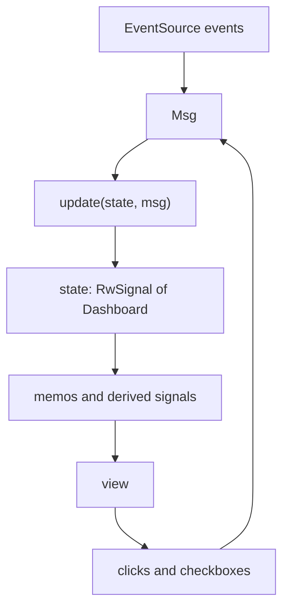

# The live dashboard

A dashboard you have to reload isn't a dashboard. Our page from Chapter 19
shows the network as it was at the moment you loaded it, while the server
behind it is producing a fresh snapshot every second that nobody sees. In this
chapter we close that gap: the server will push every snapshot to the browser
as it's made, and the page will update in place, with a sparkline of the last
minute for each interface.

That sounds like plumbing, and some of it is. But as soon as data starts
arriving on its own, the browser has more than one thing happening to it: new
snapshots, a connection that drops and recovers, a user ticking boxes and
pressing buttons. We'll see what happens when each of those pokes at the page's
state directly, and replace that with one of the most useful ideas in
front-end programming: a single pure function that is the only thing allowed
to change state. By the end we'll have a release build, running from a Nix
dev shell, that looks like this:


## Choosing a transport

We need the server to send a message whenever it has a new snapshot. There
are three common ways to do that over HTTP:

- **Polling.** The browser asks every second. It's simple but wasteful (a full
  request and response for each update) and always up to a second behind.
- **WebSockets.** A full two-way channel. Powerful, but it's a different
  protocol with its own upgrade handshake, framing and reconnection logic,
  and we only need one direction.
- **Server-Sent Events (SSE).** An ordinary HTTP response that never ends.
  The server writes `data: ...` lines whenever it likes, separated by blank
  lines, and the browser's built-in `EventSource` API delivers each one as an
  event. If the connection drops, `EventSource` reconnects by itself.

Our traffic is one-way, server to browser, one message a second. SSE fits it
exactly, and it works through proxies and load balancers that understand
plain HTTP.

## The stream endpoint

On the server, an SSE endpoint is an axum handler that returns a *stream* of
events. A stream is the async cousin of an iterator: a sequence of values
that arrive over time, which you `.await` one at a time. And we already have
something that produces values over time: Chapter 18's `watch::Receiver`.

The `tokio-stream` crate has an adaptor, `WatchStream`, that turns a `watch`
receiver into a stream. It yields the current value immediately, then each new
value as it's sent. We add it to the server-only dependencies:

```toml
# file: Cargo.toml
[dependencies]
# ...
tokio-stream = { version = "0.1", features = ["sync"], optional = true }

[features]
ssr = [
    # ...
    "dep:tokio-stream",
]
```

The handler is a map from snapshots to events:

```rust
// file: src/server/sse.rs
use axum::extract::State;
use axum::response::sse::{Event, KeepAlive, Sse};
use tokio_stream::wrappers::WatchStream;
use tokio_stream::{Stream, StreamExt};

use super::engine::Snapshots;

pub async fn stream(
    State(snapshots): State<Snapshots>,
) -> Sse<impl Stream<Item = Result<Event, axum::Error>>> {
    let events = WatchStream::new(snapshots)
        .map(|snapshot| Event::default().json_data(&*snapshot));
    Sse::new(events).keep_alive(KeepAlive::default())
}
```

`State(snapshots)` is an axum *extractor*: axum hands the handler its own
clone of the receiver. `.map` comes from `StreamExt`, and works just like
`Iterator::map`. `json_data` serialises the snapshot with serde, using the
derives we've relied on since Chapter 18, and returns a `Result` because
serialisation can fail in principle. `&*snapshot` turns the `Arc<Snapshot>`
into a `&Snapshot`: we serialise straight out of the shared, immutable
snapshot, with no lock and no copy. `KeepAlive` sends a comment line every
fifteen seconds or so when nothing else is happening, so idle proxies don't
close the connection.

This is the payoff from Chapter 18 in miniature. Each connected browser has
its own receiver. A phone on a slow connection that takes three seconds to
receive one snapshot simply skips the two it missed, because a `watch`
receiver only ever sees the latest value. It never holds anything the sampler
or any other browser is waiting for.

The route has its own state (a receiver), while the Leptos routes use
`LeptosOptions` as theirs. Axum lets us build the API as a separate small
router, give it its state, and merge it in:

```rust
// file: src/main.rs
    let api = Router::new()
        .route("/api/stream", get(sse::stream))
        .with_state(snapshots.clone());

    let app = Router::new()
        .leptos_routes_with_context(/* ... as in Chapter 19 */)
        .merge(api)
        .fallback(leptos_axum::file_and_error_handler(shell))
        .with_state(options);
```

Before writing any browser code we can watch the stream with `curl`. `-N`
turns off buffering so events print as they arrive:

```sh
curl -N localhost:3000/api/stream
```

```text
data: {"seq":4,"interfaces":[{"name":"ap1","total":{"rx":0,"tx":331846},
"history":[{"rx":null,"tx":null},{"rx":0.0,"tx":0.0},{"rx":0.0,"tx":0.0},
{"rx":0.0,"tx":0.0}]},{"name":"awdl0","total":{"rx":4454021,"tx":355833}, ...

data: {"seq":5,"interfaces":[{"name":"ap1","total":{"rx":0,"tx":331846},
"history":[{"rx":null,"tx":null},{"rx":0.0,"tx":0.0},{"rx":0.0,"tx":0.0}, ...
```

(Each event is one long line; it's wrapped and cut short here.) There's our
domain on the wire: `seq`, interface names as plain strings (thanks to
`#[serde(try_from = "String", into = "String")]`), totals as bare integers
(`#[serde(transparent)]` on `Bytes`), and the unknown first rate as `null`.
Snapshot 4 arrives first because `WatchStream` starts with the current value;
then one per second.

## Listening in the browser

The browser side uses `EventSource`, which Rust reaches through `web-sys`,
the crate of generated bindings to browser APIs. `web-sys` puts every API
behind its own feature to keep compile times down, so we ask for the two we
need, as a browser-only dependency:

```toml
# file: Cargo.toml
[dependencies]
# ...
web-sys = { version = "0.3", optional = true, features = ["EventSource", "MessageEvent"] }

[features]
hydrate = [
    # ...
    "dep:web-sys",
]
```

Now recall the compile error at the end of Chapter 19: shared code can't name
`web_sys`, because the server build doesn't have it. The way out is to give
the server a version of the function too. We write `connect` twice, once per
feature, with the same signature:

```rust
// file: src/stream.rs
/// Open the event stream and feed what arrives to `dispatch`.
#[cfg(feature = "hydrate")]
pub fn connect(dispatch: impl Fn(Msg) + Clone + 'static) {
    // ... the browser version, below
}

/// On the server there is no stream to open.
#[cfg(not(feature = "hydrate"))]
pub fn connect(_dispatch: impl Fn(Msg) + Clone + 'static) {}
```

Shared component code calls `connect(...)` without any `cfg` of its own, and
each build gets the version that makes sense for it. (`Msg` is coming up
shortly. For now, read `dispatch` as "a function to call with each thing that
happens".)

The browser version opens the connection and installs three handlers, one
each for messages, opening and errors:

```rust
    use netdash_core::Snapshot;
    use wasm_bindgen::{JsCast, closure::Closure};
    use web_sys::{Event, EventSource, MessageEvent};

    let Ok(source) = EventSource::new("/api/stream") else {
        return dispatch(Msg::StreamLost);
    };

    let on_message = {
        let dispatch = dispatch.clone();
        Closure::<dyn Fn(MessageEvent)>::new(move |event: MessageEvent| {
            let text = event.data().as_string().unwrap_or_default();
            match serde_json::from_str::<Snapshot>(&text) {
                Ok(snapshot) => dispatch(Msg::SnapshotArrived(snapshot)),
                Err(e) => leptos::logging::warn!("bad snapshot: {e}"),
            }
        })
    };
```

A JavaScript event handler is a JavaScript function, and a Rust closure isn't
one. `wasm_bindgen::closure::Closure` bridges the two: it wraps a Rust closure
in something JavaScript can call. The message's data arrives as a JavaScript
value; we take it as a string and parse it with `serde_json` into the *same*
`Snapshot` type the server serialised. If the JSON were malformed, or an
interface name failed `InterfaceName`'s validation, we'd log and carry on;
one bad message shouldn't stop the dashboard.

The `on_open` and `on_error` handlers have the same shape, and simply dispatch
`Msg::StreamOpened` and `Msg::StreamLost`. Then we hand all three to the
`EventSource`:

```rust
    source.set_onmessage(Some(on_message.as_ref().unchecked_ref()));
    source.set_onopen(Some(on_open.as_ref().unchecked_ref()));
    source.set_onerror(Some(on_error.as_ref().unchecked_ref()));

    // The dashboard lives as long as the page, so its handlers do too.
    on_message.forget();
    on_open.forget();
    on_error.forget();
```

`unchecked_ref` views the wrapped closure as a plain JavaScript `Function`,
the type the setters take. `forget` deserves its comment. A `Closure` frees
its Rust closure when dropped (*Ownership as Resource Management* again), and
dropping it while JavaScript still holds a reference would leave the browser
calling freed memory; `wasm-bindgen` would throw an error instead. `forget`
deliberately leaks the closure so it lives for the rest of the page. That's
correct for a component that lives as long as the page. A component that can
be removed should keep its closures and close the `EventSource` on cleanup;
there's an exercise for that.

## Many things happen to the page

Now: what should `dispatch` actually do with these events? Let's list
everything that can happen to the dashboard, now that it's live:

- a snapshot arrives;
- the stream connects, or reconnects;
- the stream is lost;
- the user ticks or unticks "show idle";
- the user presses Pause, or Resume.

That last one is new, and it's useful: when you spot something interesting in
a sparkline, you want to freeze the picture and look at it.

The approach Chapter 19 taught us suggests a signal per fact:

```rust
let snapshot = RwSignal::new(initial);
let connection = RwSignal::new(Connection::Connecting);
let show_idle = RwSignal::new(false);
let paused = RwSignal::new(false);
```

and then each handler pokes the signals it cares about. The message handler:

```rust
// in on_message
if !paused.get_untracked() {
    snapshot.set(s);
    connection.set(Connection::Live);
}
```

(`get_untracked` reads a signal without subscribing to it, which is what an
event handler wants.) The error handler sets `connection` to `Lost`. The pause
button flips `paused`. Each piece is small and looks fine.

## Finding the crack

The trouble is where the *rules* end up. Look at the message handler again.
It encodes two rules about the dashboard: "while paused, ignore new data" and
"receiving data means we're connected". Those rules aren't about
`EventSource` at all; they're about the dashboard's behaviour. But they live
inside a `Closure` in a function that only compiles for wasm.

Now ask some questions:

- *While paused, should the status still change to "Reconnecting…" if the
  server goes away?* Yes, probably: pausing freezes the picture, not the
  truth about the connection. Where would you look to check? In the error
  handler, which mentions neither `paused` nor the message handler.
- *How do you test "pausing ignores snapshots"?* Spin up a browser, a server
  and a stream, and click a button. It's a rule about values, tested with a
  browser.
- *What happens when we add a feature?* Say "freeze automatically if the
  connection is lost for ten seconds". That touches the error handler, the
  open handler and the pause button, and reasons about all of their
  interactions. Every new event has to know every rule.

This is the same smell we fixed in Part III with event sourcing: behaviour
scattered across the places where things happen, instead of collected where
decisions are made. And the fix is the same shape.

## The reducer

Stop letting events change state. Instead, turn every event into a *value*
describing what happened, and write one pure function that takes the current
state and one such value and returns the next state. Nothing else is allowed
to change state.

First, the state. It's the four facts from the naive version, gathered into
one type, in the core crate, because it has nothing to do with browsers:

```rust
// file: core/src/dashboard.rs
/// How the live stream from the server is doing.
#[derive(Debug, Clone, Copy, PartialEq, Eq, Default)]
pub enum Connection {
    #[default]
    Connecting,
    Live,
    Lost,
}

/// Everything the dashboard needs to draw itself.
#[derive(Debug, Clone, PartialEq, Default)]
pub struct Dashboard {
    pub snapshot: Snapshot,
    pub connection: Connection,
    pub show_idle: bool,
    pub paused: bool,
}
```

`Connection` is three states, not a `bool` or two, because the screen shows
three different things (*Make Illegal States Unrepresentable* from Chapter 3).
`#[default]` marks which variant `Default` should produce.

Next, the events, as an enum. In this style they're usually called
*messages*:

```rust
/// Everything that can happen to the dashboard.
#[derive(Debug, Clone, PartialEq)]
pub enum Msg {
    SnapshotArrived(Snapshot),
    StreamOpened,
    StreamLost,
    ToggleIdle,
    TogglePause,
}
```

This enum is the complete list of things that can happen. It's the bulleted
list from the previous section, written as a type. When someone adds a
feature, they add a variant here, and *Exhaustive Matching* (Chapter 3) will
point at the one place it must be handled:

```rust
/// The reducer: the current state and a message in, the next state out.
pub fn update(state: Dashboard, msg: Msg) -> Dashboard {
    match msg {
        Msg::SnapshotArrived(_) if state.paused => state,
        Msg::SnapshotArrived(snapshot) => Dashboard {
            snapshot,
            connection: Connection::Live,
            ..state
        },
        Msg::StreamOpened => Dashboard {
            connection: Connection::Live,
            ..state
        },
        Msg::StreamLost => Dashboard {
            connection: Connection::Lost,
            ..state
        },
        Msg::ToggleIdle => Dashboard {
            show_idle: !state.show_idle,
            ..state
        },
        Msg::TogglePause => Dashboard {
            paused: !state.paused,
            ..state
        },
    }
}
```

Every rule about the dashboard's behaviour is now in one function, one arm
per message. "While paused, ignore new data" is the first arm, a *match
guard* (`if state.paused`) that returns the state unchanged. "Data means
live" is in the second. And the question we couldn't answer before ("does
losing the stream while paused still update the status?") has an answer you
can read off the page: `StreamLost` has no guard, so yes.

`..state` is *struct update syntax*: "every other field as in `state`". It
moves the remaining fields out of the old state into the new one, so even
though `update` takes and returns whole values, nothing is copied that
doesn't need to be.

If `update` reminds you of something, it should. It's `evolve` from Chapter
15: a fold step, `(State, Event) -> State`. That means a sequence of messages
can be replayed with `fold`, which makes tests read like stories:

```rust
fn run(msgs: impl IntoIterator<Item = Msg>) -> Dashboard {
    msgs.into_iter().fold(Dashboard::default(), update)
}

#[test]
fn pausing_freezes_the_picture_but_not_the_status() {
    let state = run([
        Msg::SnapshotArrived(snapshot(1)),
        Msg::TogglePause,
        Msg::SnapshotArrived(snapshot(2)),
        Msg::StreamLost,
    ]);
    assert_eq!(state.snapshot.seq, 1);
    assert_eq!(state.connection, Connection::Lost);
}
```

No browser, no server, no stream: the rule from the last section, tested in
a millisecond in the core crate. A property-flavoured test checks that
toggles are their own inverse (`ToggleIdle` twice returns the starting state),
and another that unpausing lets the next snapshot through.

Queries that the view needs also live with the state, as plain methods. The
visible interfaces, which Chapter 19 computed inside a component, become:

```rust
impl Dashboard {
    /// The interfaces to draw, honouring the "show idle" setting.
    pub fn visible(&self) -> impl Iterator<Item = &InterfaceStats> {
        self.snapshot
            .interfaces
            .iter()
            .filter(|i| self.show_idle || !i.is_idle())
    }
}
```

plus a `hidden` method for the count. Now they're testable without Leptos too.

> [!PATTERN] Reducer (Elm Architecture)
> Model everything that can happen as a message enum, and make one pure
> function, `update(State, Msg) -> State`, the only way state changes. Event
> sources (network, clicks, timers) just *dispatch* messages; the view is a
> function of state. Use it when several independent sources of events affect
> shared UI state. All behaviour lives in one exhaustively matched function
> that can be tested by folding over messages, with no UI at all.



The name comes from the Elm language, which popularised the shape for web
front ends, and from Redux, which brought it to JavaScript. The loop in the
diagram is the whole architecture: events become messages, messages update
state, state determines the view, and the view produces more events.

## Wiring the reducer into Leptos

The reducer is pure; Leptos is reactive. Joining them takes one signal and
one closure. `Live` is the component that replaces Chapter 19's
`InterfaceTable`:

```rust
// file: src/app.rs
#[component]
fn Live(snapshot: Snapshot) -> impl IntoView {
    let state = RwSignal::new(Dashboard::new(snapshot));
    let dispatch = move |msg: Msg| {
        state.update(|s| *s = update(std::mem::take(s), msg));
    };
    Effect::new(move || connect(dispatch));
    // ... names memo and view, below
}
```

The whole dashboard is one signal holding a `Dashboard`. `dispatch` is the
only code that writes to it. `update` wants the old state *by value*, but
`state.update` gives us a `&mut Dashboard`. `std::mem::take` bridges the two:
it moves the value out and leaves `Dashboard::default()` in its place for an
instant, until we write the new state back. (That's what deriving `Default` on
`Dashboard` buys us.)

`dispatch` captures only `state`, which is `Copy`, so `dispatch` is `Copy`
too, and we can hand it to as many event handlers as we like.

`Effect::new` runs a closure *after* the component has been rendered, and only
in the browser; effects never run during server rendering. That's exactly the
right moment to open the event stream: on the server there's nothing to open,
and in the browser we want the page hydrated first. The effect doesn't read
any signals, so it runs once and is never re-triggered.

Notice how the initial snapshot arrives: through Chapter 19's server function
and `Suspense`, exactly as before. The server renders the page from it, the
browser hydrates from the same serialised value, and only then does the
stream start dispatching newer snapshots. The first frame is identical on both
sides, which is what hydration needs.

The toolbar shows how simple the view side becomes. Every control dispatches
a message and every display is a derived signal over `state`:

```rust
    let status = move || match state.with(|s| s.connection) {
        Connection::Connecting => ("connecting", "Connecting…"),
        Connection::Live => ("live", "Live"),
        Connection::Lost => ("lost", "Reconnecting…"),
    };
    let paused = move || state.with(|s| s.paused);

    view! {
        <span class=move || format!("status {}", status().0)>
            {move || status().1}
        </span>
        // ... sample number and the "show idle" checkbox
        <button on:click=move |_| dispatch(Msg::TogglePause)>
            {move || if paused() { "Resume" } else { "Pause" }}
        </button>
    }
```

The button doesn't decide what pausing means; it says "the user asked to
toggle pause" and lets `update` decide. The `Toolbar` component takes `state`
and `dispatch` as props; the prop type for `dispatch` is simply
`impl Fn(Msg) + Copy + 'static`, the same `impl Trait` argument syntax as
any other generic function.

## The rows that wouldn't update

Now we render the table, and here the `For` component from Chapter 19
springs its trap. The obvious move is to keep the Chapter 19 code and just
feed it from the new state:

```rust
<For
    each=move || state.with(|s| s.visible().cloned().collect::<Vec<_>>())
    key=|stats| stats.name.clone()
    let:stats
>
    <InterfaceRow stats/>
</For>
```

It compiles. It renders the right rows. And then the numbers never change.
Snapshots arrive, the sample number in the toolbar ticks up, but every rate
in the table stays frozen at its first value.

Remember what `For` does with keys: rows whose key is still present are *left
alone*. A new snapshot contains the same interface names, so `For` sees the
same keys and keeps every existing row. Those rows were built from
`InterfaceStats` values passed as plain props, and a component runs once. No
row ever looks at the new data.

The fix is to be honest about what's reactive. The *set of rows* depends on
which interfaces are visible: that's what `For` should iterate, keyed by name.
The *contents of a row* depend on that interface's latest stats: each row
should derive those from state itself. First, a memo of the visible names:

```rust
let names = Memo::new(move |_| {
    state.with(|s| s.visible().map(|i| i.name.clone()).collect::<Vec<_>>())
});
```

```rust
<For
    each=move || names.get()
    key=|name| name.clone()
    let:name
>
    <InterfaceRow name state/>
</For>
```

Because `names` is a memo, it only notifies `For` when the list of names
actually changes: when an interface appears, disappears or is hidden. A new
snapshot with the same interfaces produces an equal `Vec`, so `For` does
nothing at all. Then each row looks up its own stats:

```rust
#[component]
fn InterfaceRow(
    name: InterfaceName,
    state: RwSignal<Dashboard>,
) -> impl IntoView {
    let label = name.to_string();
    let stats = Memo::new(move |_| {
        state.with(|s| s.snapshot.interface(&name).cloned())
    });
    let cell = move |f: fn(&InterfaceStats) -> String| {
        move || stats.with(|s| s.as_ref().map(f).unwrap_or_default())
    };
    // ... sparkline paths, below
```

`Snapshot::interface` is a small lookup by name we add to the core. `stats`
is a per-row memo: it recomputes whenever `state` changes, but only notifies
the row's cells if *this* interface's stats changed. `cell` is a small
higher-order helper. Given a function from stats to text, it returns a
derived signal that applies it, so each table cell is one line:

```rust
<td class="num rx">{cell(|s| show_rate(s.current().rx))}</td>
<td class="num tx">{cell(|s| show_rate(s.current().tx))}</td>
<td class="num">{cell(|s| s.total.rx.to_string())}</td>
<td class="num">{cell(|s| s.total.tx.to_string())}</td>
```

This is *Reactive Derived State* from Chapter 19 doing its real job. State
is one signal. Everything on screen is derived from it, through a chain of
memos that each cut off updates that wouldn't change anything. When a
snapshot arrives, Leptos updates exactly the text nodes whose formatted values
differ, and nothing else. An idle interface's row isn't touched at all.

> [!WARNING]
> `For` with a key is an identity map, not a data binding. If the item for a
> key can change while the key stays the same, the row must read its data
> reactively (from a signal or memo), not from a prop captured when the row
> was created. Key by a stable identity, then derive the contents.

## Sparklines as pure functions

The last column is the sparkline: a tiny line graph of the last minute, rx
and tx in two colours. In the browser we'll draw it as inline SVG, whose
`<path>` element takes a string of drawing commands: `M x,y` moves the pen
without drawing, and `L x,y` draws a line to a point. So a sparkline is
*a function from a list of numbers to a string*. That's pure, so it goes in
the core, where we can test it without a browser.

First, the geometry. A frame is the box we draw into and how many samples it
spans:

```rust
// file: core/src/sparkline.rs
/// The box a sparkline is drawn into, and how many samples it holds.
#[derive(Debug, Clone, Copy, PartialEq)]
pub struct Frame {
    pub width: f64,
    pub height: f64,
    pub slots: usize,
}
```

`Frame` has two private helpers: `x(slot)` spreads slots evenly across the
width, and `y(value, max)` maps a value to a height. SVG's y axis points
*down*, so a value of `max` is drawn at `y = 0` and zero at `y = height`.

The path itself has two requirements beyond joining the dots. History fills
up from empty, so a short series should hug the *right* edge, newest point
always in the same place, as in every scrolling graph you've seen. And
unknown rates (`None`, from Chapter 17's resets) should leave a *gap*, not be
drawn as zero, which would be a lie:

```rust
/// SVG path data for a series, right-aligned in `frame` and scaled so
/// `max` touches the top. Unknown values (`None`) leave a gap.
pub fn path(frame: Frame, values: &[Option<f64>], max: f64) -> String {
    let first_slot = frame.slots.saturating_sub(values.len());
    let mut d = String::new();
    let mut pen_down = false;

    for (i, value) in values.iter().enumerate() {
        let Some(v) = value else {
            pen_down = false;
            continue;
        };
        let command = if pen_down { 'L' } else { 'M' };
        let (x, y) = (frame.x(first_slot + i), frame.y(*v, max));
        let _ = write!(d, "{command}{x:.1},{y:.1}");
        pen_down = true;
    }
    d
}
```

A gap is just "lift the pen": the next known value starts with `M` instead of
`L`. `write!` into a `String` (via `std::fmt::Write`) builds the path without
intermediate allocations; writing to a `String` can't fail, so we discard its
`Result` with `let _`.

Because it's a pure function from values to a string, the tests are literal
inputs and literal outputs. Here's the gap:

```rust
const FRAME: Frame = Frame {
    width: 100.0,
    height: 20.0,
    slots: 5,
};

#[test]
fn unknown_values_leave_gaps() {
    let values = [Some(1.0), Some(1.0), None, Some(1.0), Some(1.0)];
    assert_eq!(
        path(FRAME, &values, 1.0),
        "M0.0,0.0L25.0,0.0M75.0,0.0L100.0,0.0"
    );
}
```

You can read the expected string as a drawing: a line from 0 to 25, a jump,
a line from 75 to 100. Another test checks that two values in a five-slot
frame land at x = 75 and 100 (right-aligned), and another that an idle
interface draws a flat line along the bottom rather than dividing by zero.

Finally, rx and tx should share one scale, or a 5 KiB/s upload would look as
tall as a 5 MiB/s download. `paths` takes a whole history and produces both:

```rust
/// Paths for both directions of a history, on one shared scale so the
/// two lines can be compared by eye.
pub fn paths(frame: Frame, history: &[Rates]) -> RxTx<String> {
    let series = |pick: fn(&Rates) -> Option<BytesPerSecond>| {
        let values = history.iter().map(|r| pick(r).map(|v| v.get()));
        values.collect::<Vec<_>>()
    };
    let (rx, tx) = (series(|r| r.rx), series(|r| r.tx));
    let max = peak(rx.iter().chain(&tx).copied());
    RxTx {
        rx: path(frame, &rx, max),
        tx: path(frame, &tx, max),
    }
}
```

`peak` is a one-line fold that takes the largest known value, ignoring
`None`s. And this is the one place where a `BytesPerSecond` is deliberately
unwrapped to a bare `f64` (with `.get()`): geometry is unit-less, and the
sparkline module is where we've decided to leave the world of units.

In the row, the paths are one more memo over the row's `stats`, and each
`<path>` reads its half through a small helper shaped like `cell`:

```rust
    let paths = Memo::new(move |_| {
        stats.with(|s| s.as_ref().map(|s| sparkline::paths(FRAME, &s.history)))
    });
    let spark = move |pick: fn(&RxTx<String>) -> &String| {
        move || paths.with(|p| p.as_ref().map(|p| pick(p).clone()))
    };
```

```rust
<svg class="spark" viewBox="0 0 120 24" width="120" height="24">
    <path class="rx" d=spark(|p| &p.rx)/>
    <path class="tx" d=spark(|p| &p.tx)/>
</svg>
```

`FRAME` is a `const` in `app.rs`: 120 by 24, with `slots: HISTORY_SLOTS`. That's
the constant from Chapter 19 that the server uses to size the history. Both
sides agree on how many samples a minute holds because they read the same
line of code. The colours are CSS: `.spark path.rx { stroke: var(--rx); }`,
and `fill: none` so the lines aren't filled in as shapes.

> [!TIP]
> In the stylesheet, `font-variant-numeric: tabular-nums` on the numeric
> columns makes every digit the same width. Combined with the
> three-significant-figure formatting from Chapter 17, the table's columns
> stay perfectly still as the numbers change underneath them.

> [!CHECKPOINT]
> Your project should now contain:
>
> - `core/src/dashboard.rs` (`Connection`, `Dashboard`, `Msg`, `update`,
>   `visible`, `hidden`) and `core/src/sparkline.rs` (`Frame`, `peak`,
>   `path`, `paths`), each with tests
> - `src/server/sse.rs` and the `/api/stream` route in `main.rs`
> - `src/stream.rs` with the two versions of `connect`
> - `src/app.rs` with `Live`, `Toolbar` and the reactive `InterfaceRow`
>   replacing `InterfaceTable`
>
> `cargo test --workspace --features ssr` should pass, clippy should be
> clean for both builds, and `cargo leptos watch` should show a table whose
> numbers and sparklines move every second. Stop the server: the status
> should turn to "Reconnecting…" and recover by itself when you start it
> again.

## Building for release

`cargo leptos watch` builds in debug mode, which is fine for development and
very slow for wasm. A release build optimises both halves, using the
`wasm-release` profile from Chapter 19 for the browser bundle:

```sh
cargo leptos build --release
```

```text
    Finished `release` profile [optimized] target(s) in 4m 43s
       Cargo finished cargo build --package=netdash --bin=netdash
             --no-default-features --features=ssr --release
    Finished `wasm-release` profile [optimized] target(s) in 4m 48s
       Cargo finished cargo build --package=netdash --lib
             --target=wasm32-unknown-unknown --no-default-features
             --features=hydrate --profile=wasm-release
       Front generating JS/WASM with wasm-bindgen
    Finished generating JS/WASM for front in 4.740838s
```

You can see both builds from one crate, with exactly the feature flags from
the metadata. The output is a server binary at `target/release/netdash` and a
site directory at `target/site`:

```text
target/site/pkg/netdash.css     945 B
target/site/pkg/netdash.js     24759 B
target/site/pkg/netdash.wasm  521438 B
```

About half a megabyte of wasm (much less compressed) for a framework, a
reactive runtime, serde, and our whole domain. The binary reads its settings
from environment variables, which `cargo leptos` normally sets for you. To run
the release build by hand:

```sh
LEPTOS_OUTPUT_NAME=netdash LEPTOS_SITE_ROOT=target/site \
LEPTOS_SITE_PKG_DIR=pkg LEPTOS_SITE_ADDR=127.0.0.1:3000 \
  ./target/release/netdash
```

```text
INFO netdash: listening on http://127.0.0.1:3000
```

> [!CAUTION]
> `netdash` has no authentication, and network statistics reveal more than
> you might think: when you're at home, when you're on a VPN, when a backup
> runs. Keep `site-addr` on `127.0.0.1` unless it sits behind something that
> authenticates users, such as a reverse proxy or a VPN-only interface.

## Running it under Nix

Chapter 19 showed the `devShells.default` packages; here's the whole flake,
using `flake-utils` to produce a shell for every platform, so the same file
works on a Mac and on a Linux server:

```nix
# file: flake.nix
{
  description = "netdash: a live network dashboard built with Leptos";

  inputs = {
    nixpkgs.url = "github:NixOS/nixpkgs/nixos-unstable";
    flake-utils.url = "github:numtide/flake-utils";
  };

  outputs = { self, nixpkgs, flake-utils }:
    flake-utils.lib.eachDefaultSystem (system:
      let
        pkgs = nixpkgs.legacyPackages.${system};
      in
      {
        devShells.default = pkgs.mkShell {
          packages = [
            # ... the list from Chapter 19
          ];
        };
      });
}
```

With it, a fresh machine needs nothing but Nix to build and run the
dashboard:

```sh
nix develop -c cargo leptos watch
```

Part 0 showed how `direnv` can enter the shell automatically when you `cd`
into the project.

### Packaging

To deploy `netdash` as a service, you want a Nix *package*: a derivation
whose output is the binary plus the site directory. The difference from Part
II's DDNS daemon is that `cargo leptos`, not plain `cargo build`, does the
building, and the result is two artefacts that must travel together. Nixpkgs'
`buildRustPackage` still does the hard part (fetching and vendoring every
crate from `Cargo.lock`, so the build runs offline in the sandbox); we
override just its build and install steps:

```nix
packages.default = pkgs.rustPlatform.buildRustPackage {
  pname = "netdash";
  version = "0.1.0";
  src = ./.;
  cargoLock.lockFile = ./Cargo.lock;

  nativeBuildInputs = [
    pkgs.cargo-leptos
    pkgs.wasm-bindgen-cli_0_2_129
    pkgs.binaryen
    pkgs.lld
    pkgs.makeWrapper
  ];

  buildPhase = ''
    runHook preBuild
    cargo leptos build --release
    runHook postBuild
  '';
  doCheck = false;
  # installPhase: below
};
```

The install step copies the two artefacts and uses `makeWrapper` to bake the
Leptos settings into a small launcher script, so the binary always finds its
site directory inside the Nix store:

```nix
  installPhase = ''
    runHook preInstall
    mkdir -p $out/bin $out/share/netdash
    cp target/release/netdash $out/bin/
    cp -r target/site $out/share/netdash/site
    wrapProgram $out/bin/netdash \
      --set-default LEPTOS_SITE_ROOT $out/share/netdash/site \
      --set-default LEPTOS_SITE_PKG_DIR pkg \
      --set-default LEPTOS_OUTPUT_NAME netdash \
      --set-default LEPTOS_SITE_ADDR 127.0.0.1:3000
    runHook postInstall
  '';
```

`--set-default` means the variable is set only if it isn't already, so you can
still override the address when you run it. `doCheck = false` skips
`buildRustPackage`'s default `cargo test`, which would run without our
features; run `cargo test --workspace --features ssr` in CI instead. Then
`nix build` produces `result/bin/netdash`, and `nix run` starts it. From
there, a NixOS module and a hardened systemd unit look just like Chapter 12's,
with one addition: `sysinfo` reads interface counters from `/proc` and `/sys`,
which a unit with `ProtectSystem=strict` can still read, so no extra
permissions are needed. The one hardening option to avoid is
`PrivateNetwork=true`: it gives the service its own empty network namespace,
and the dashboard would faithfully report a single idle loopback interface.

## What we learned

- **Server-Sent Events** suit one-way, server-to-browser updates: plain HTTP,
  built-in reconnection, and an axum handler that is a `map` over a stream.
- **`WatchStream`** turns Chapter 18's `watch` receiver into a stream, so each
  browser gets its own reader that never blocks the sampler and skips
  straight to the latest snapshot.
- **One function, two `cfg`s**: giving the server a no-op `connect` lets shared
  components call browser-only code without `cfg` attributes of their own.
- **`wasm_bindgen::closure::Closure`** bridges Rust closures to JavaScript
  callbacks; `forget` is a deliberate, documented leak for page-lifetime
  handlers.
- **Reducer (Elm Architecture)**: every event becomes a `Msg`, and one pure
  `update(State, Msg) -> State` is the only way state changes. All behaviour
  lives in one exhaustive `match`, tested by folding over messages, exactly
  like `evolve` in Chapter 15.
- **`For` keys are identities, not data bindings.** Key by a stable name, then
  have each row derive its contents from state through a memo.
- **Sparklines are pure functions** from numbers to SVG path strings, tested
  with literal inputs and outputs; gaps for unknown values keep the picture
  honest.
- **`cargo leptos build --release`** produces a server binary and a site
  directory; a Nix package builds them offline and wraps the binary with its
  settings.

## Exercises

> [!EXERCISE] Clean up after yourself
> Make `Live` close its `EventSource` when the component is removed instead
> of leaking the closures. You'll need to keep the `EventSource` and the three
> `Closure`s alive somewhere (Leptos's `StoredValue::new_local` holds values
> that aren't `Send`) and call `source.close()` from `on_cleanup`. How can you
> test that it works?

> [!EXERCISE] Stale data warning
> If the server stops but the browser hasn't noticed yet, the dashboard shows
> old numbers as if they were current. Add a `Msg::Tick` dispatched by a
> one-second browser timer, and make `update` mark the connection as stale
> when no snapshot has arrived for three ticks. Write the tests with `fold`
> before touching the browser.

> [!EXERCISE] Click to inspect
> Clicking a row should select that interface and show a larger sparkline
> below the table, with the peak rate labelled. Add `Msg::Select(InterfaceName)`
> and a `selected: Option<InterfaceName>` field. What should `update` do when
> the selected interface disappears from a snapshot?

> [!EXERCISE] A demo mode
> Add a `--demo` flag to the server that uses `ScriptedSource` (from Chapter
> 18) with a generated script of plausible traffic instead of `sysinfo`. Which
> files did you need to change? Which did you not, and why?
