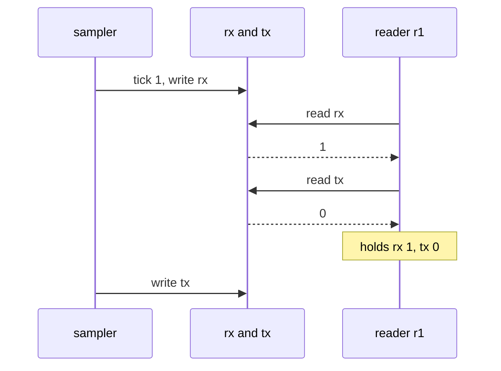
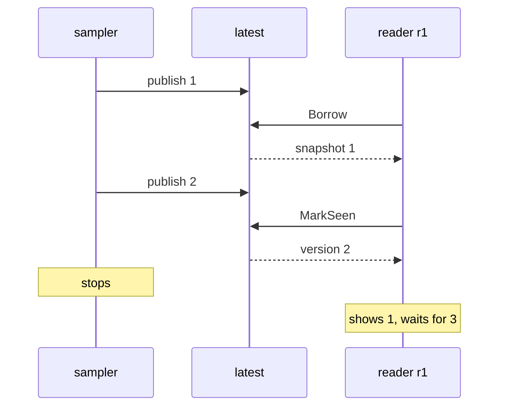

# Interlude: Latest value wins

Chapter 18 made an argument. A shared `Mutex<HashMap>` that the sampler
updates entry by entry lets a reader see "`en0` from this second and `lo0`
from the last": a view that corresponds to no moment that ever existed. Publish
whole, immutable snapshots through a `watch` channel instead, and every view
is consistent, slow readers simply skip ahead, and nobody waits for anybody.

It was a good argument, and the tests agreed with it. But look at what those
tests could see. `an_old_snapshot_is_unaffected_by_new_ones` ran on a paused
clock with one sampler and one reader, in one order, chosen by tokio. The bugs
Chapter 18 warned about don't live in any single order. They live in the
*interleavings*: the reader reads `rx`, then the sampler runs, then the reader
reads `tx`. Run a test a thousand times on a busy machine and you might hit
that order once; run it on your laptop and you might never.

So instead of arguing, let's check. In this interlude we'll model both
designs, have TLC find the torn read in the naive one as a concrete
interleaving, and then check four claims about the watch channel: views are
never torn, a reader never goes backwards, readers may skip versions, and a
reader that keeps getting scheduled always catches up. Along the way we'll
meet **PlusCal**, a way of writing TLA+ that looks like code and is built for
exactly this kind of question, and its central idea: **labels mark what
happens atomically**.

## Why PlusCal

We could write this in TLA+ as it stands. But think about what a "reader"
is: a little program that does one thing, then another, then maybe loops.
TLA+ has no "then". It has states and steps, so to describe "read `rx`, then
read `tx`" we'd need a variable recording *where each reader has got to*, and
every action would have to check it and advance it. That's a program counter,
written by hand, for every process. It's doable, and tedious, and easy to get
wrong.

**PlusCal** is Lamport's answer. It's a small algorithm language, with
variables, assignments, loops and processes, that a translator called `pcal`
turns into an ordinary TLA+ spec, program counter and all. You write the
algorithm; TLC checks the translation. Nothing new happens at checking time:
the result is plain TLA+ of the kind we've written since Interlude 1, with
`Init`, `Next` and `Spec`.

The algorithm lives *inside a comment* in the `.tla` file, so the TLA+ tools
ignore it and the translator can find it. PlusCal comes in two syntaxes that
mean the same thing: a "C syntax" with braces and a "P syntax" with
`begin`/`end`. We'll use the P syntax; it reads a little more like prose.

## The shared stats, naively

Let's model the design Chapter 18 rejected, cut down to its essence. One
interface, two numbers: its `rx` and `tx` totals. The sampler updates them
in place, one at a time, and readers read them, one at a time, as they would
if each access took the lock separately. To make tearing visible, the sampler
writes the *tick number* into both fields: after tick 1 completes, both are
1. A reader that ends up with `rx = 1` and `tx = 0` has seen half a tick.

```tla
\* file: SharedStats.tla
---- MODULE SharedStats ----
EXTENDS Integers

CONSTANTS Readers, MaxTick

(* --algorithm SharedStats
variables rx = 0, tx = 0;

\* ... processes, next

end algorithm; *)

====
```

The module and its `CONSTANTS` are ordinary TLA+. The algorithm starts at
`(* --algorithm SharedStats` and runs to `end algorithm; *)`. Its
`variables` line declares the **global** variables, the shared state every
process can touch, with their initial values. Here `=` gives an initial
value; inside the algorithm we'll assign with `:=`.

### The sampler

Now the sampler, as a **process**:

```tla
\* file: SharedStats.tla
(* --algorithm SharedStats
\* ...
process Sampler = "sampler"
variables tick = 0;
begin
  Sample:
    while tick < MaxTick do
      tick := tick + 1;
      WriteRx:
        rx := tick;
      WriteTx:
        tx := tick;
    end while;
end process;
```

`process Sampler = "sampler"` declares one process whose identity is the
string `"sampler"`. Its own `variables` are **local**: only the sampler sees
`tick`. The body sits between `begin` and `end process`, and `while ... do`
loops in the way you'd expect.

The names ending in a colon (`Sample:`, `WriteRx:`, `WriteTx:`) are
**labels**, and they're the most important thing on the page.

### Labels are steps

In PlusCal, a label marks the start of an **atomic step**. Everything from
one label up to the next is executed as a single TLA+ step, with no other
process able to run in the middle. Between steps, anything can happen: TLC
will try every process that could go next.

So this sampler takes three kinds of step. `Sample` checks the loop
condition and, if there's another tick to do, increments `tick`. `WriteRx`
writes `rx`. `WriteTx` writes `tx` and jumps back to the top of the loop.
Between `WriteRx` and `WriteTx` a reader may run. That's precisely the
behaviour of a sampler that locks, updates one field, unlocks, and locks again
for the next.

Labels are therefore not decoration. Each one is a *claim about the real
system*: "nothing else can happen during this". Put too few and the model is
more atomic than the code, so TLC will miss real interleavings. Put too many
and you'll find interleavings the code can't produce. We'll see both shortly.

PlusCal enforces a few rules about where labels must go (the first statement
of a process and every `while` need one, for instance), and `pcal` tells you
when you've missed one. Beyond those rules, where you put them is a modelling
decision.

### The readers

Readers come in a set:

```tla
\* file: SharedStats.tla
(* --algorithm SharedStats
\* ...
process Reader \in Readers
variables myRx = 0, myTx = 0;
begin
  ReadRx:
    myRx := rx;
  ReadTx:
    myTx := tx;
end process;
end algorithm; *)
```

`process Reader \in Readers` declares *one process per element* of the
constant set `Readers`. With `Readers = {r1, r2}` there are two readers, each
with its own `myRx` and `myTx`. Inside a process, the keyword `self` names
the process currently running: `"sampler"` in the sampler, `r1` or `r2` in a
reader. We don't need it in the code yet, but we'll see it all over the
translation.

Each reader takes two steps, one per field, and then it's done. That's a
reader that locks, copies `rx`, unlocks, locks, copies `tx`, unlocks.

## Translating with pcal

Before translating, add two marker lines after the algorithm's comment:

```tla
\* file: SharedStats.tla
\* ...
end algorithm; *)

\* BEGIN TRANSLATION
\* END TRANSLATION

====
```

`pcal` writes the translation between them, replacing whatever was there
before, so everything below `END TRANSLATION` is ours to keep. (Without
markers, `pcal` inserts them itself just after the algorithm.) Then:

```sh
pcal SharedStats.tla
```

```text
pcal.trans Version 1.11 of 31 December 2020
Parsing completed.
Translation completed.
New file SharedStats.tla written.
New file SharedStats.cfg written.
```

Two files changed. `SharedStats.tla` now contains the translation, and the
previous version is saved as `SharedStats.old`. And because we didn't have a
config file yet, `pcal` wrote one:

```text
\* file: SharedStats.cfg
SPECIFICATION Spec
\* Add statements after this line.
```

If a `.cfg` with a `SPECIFICATION` line already exists, `pcal` leaves your
statements alone (it may add that comment line at the top). So it's safe to
re-run `pcal` after every edit, and you must: TLC checks the translation, not
the algorithm, and a stale translation means a stale check. In the `entr`
loop from Interlude 1, make it `pcal SharedStats.tla && tlc SharedStats.tla`.

Add `states/` and `*.old` to `.gitignore` while you're there.

### Reading the translation

The translation is plain TLA+, and worth reading at least once. It opens with
the variables:

```tla
\* file: SharedStats.tla
VARIABLES rx, tx, pc, tick, myRx, myTx
```

There's our hand-written program counter, `pc`, which `pcal` added for us.
`pc` is a function from each process to the label it will execute next, held
as a string. Initially:

```tla
\* file: SharedStats.tla
        /\ myRx = [self \in Readers |-> 0]
        /\ pc = [self \in ProcSet |-> CASE self = "sampler" -> "Sample"
                                        [] self \in Readers -> "ReadRx"]
```

`ProcSet` is every process identity, `{"sampler"} \cup Readers`. The local
variables of the reader processes have become *functions* indexed by `self`,
one `myRx` per reader, using the function syntax from Interlude 3. (`CASE` is
a multi-way `IF`: the sampler starts at `Sample`, every reader at `ReadRx`.)

Each label becomes one action:

```tla
\* file: SharedStats.tla
WriteRx == /\ pc["sampler"] = "WriteRx"
           /\ rx' = tick
           /\ pc' = [pc EXCEPT !["sampler"] = "WriteTx"]
           /\ UNCHANGED << tx, tick, myRx, myTx >>

ReadTx(self) == /\ pc[self] = "ReadTx"
                /\ myTx' = [myTx EXCEPT ![self] = tx]
                /\ pc' = [pc EXCEPT ![self] = "Done"]
                /\ UNCHANGED << rx, tx, tick, myRx >>
```

This is exactly the shape we'd have written by hand. A guard says the
process is *at* this label; the body becomes primed assignments; `pc` moves
to the next label (`"Done"` when the process finishes); and everything else is
`UNCHANGED`. Reader actions take `self` as a parameter, and `Next` lets any
process take any enabled step:

```tla
\* file: SharedStats.tla
Next == Sampler
           \/ (\E self \in Readers: Reader(self))
           \/ Terminating

Spec == Init /\ [][Next]_vars
```

`\E self \in Readers` is Interlude 2's existential, here choosing *which
reader* moves. `Terminating` is a stuttering step `pcal` adds for when every
process is `"Done"`, so a finished algorithm isn't mistaken for a stuck one.
And `Spec` is the same `Init /\ [][Next]_vars` as ever. PlusCal is a
convenient way to *write* TLA+, not a different logic.

## The torn read

Now the property. A reader that has finished must hold a pair the sampler
actually published, which in our stamped model means equal numbers. It goes
below `END TRANSLATION`, because it mentions `pc` and the readers' locals,
which only exist once the translation has declared them:

```tla
\* file: SharedStats.tla
NoTornReads ==
  \A r \in Readers : pc[r] = "Done" => myRx[r] = myTx[r]
```

`\A` is "for all", the partner of Interlude 2's `\E`. Notice that we just
used `pc` in a property. It's an ordinary variable, and "when the reader has
finished" is often exactly the condition you want.

```text
\* file: SharedStats.cfg
\* Add statements after this line.
SPECIFICATION Spec

CONSTANTS
  Readers = {r1, r2}
  MaxTick = 2

INVARIANT NoTornReads
```

```sh
pcal SharedStats.tla
tlc SharedStats.tla
```

```text
Finished computing initial states: 1 distinct state generated.
Error: Invariant NoTornReads is violated.
Error: The behavior up to this point is:
State 1: <Initial predicate>
/\ rx = 0
/\ myTx = (r1 :> 0 @@ r2 :> 0)
/\ tx = 0
/\ pc = (r1 :> "ReadRx" @@ r2 :> "ReadRx" @@ "sampler" :> "Sample")
/\ myRx = (r1 :> 0 @@ r2 :> 0)
/\ tick = 0

State 2: <Sample line 50, col 11 to line 56, col 47 of module SharedStats>
/\ rx = 0
/\ myTx = (r1 :> 0 @@ r2 :> 0)
/\ tx = 0
/\ pc = (r1 :> "ReadRx" @@ r2 :> "ReadRx" @@ "sampler" :> "WriteRx")
/\ myRx = (r1 :> 0 @@ r2 :> 0)
/\ tick = 1

State 3: <WriteRx line 58, col 12 to line 61, col 50 of module SharedStats>
/\ rx = 1
/\ myTx = (r1 :> 0 @@ r2 :> 0)
/\ tx = 0
/\ pc = (r1 :> "ReadRx" @@ r2 :> "ReadRx" @@ "sampler" :> "WriteTx")
/\ myRx = (r1 :> 0 @@ r2 :> 0)
/\ tick = 1

State 4: <ReadRx line 70, col 17 to line 73, col 53 of module SharedStats>
/\ rx = 1
/\ myTx = (r1 :> 0 @@ r2 :> 0)
/\ tx = 0
/\ pc = (r1 :> "ReadTx" @@ r2 :> "ReadRx" @@ "sampler" :> "WriteTx")
/\ myRx = (r1 :> 1 @@ r2 :> 0)
/\ tick = 1

State 5: <ReadTx line 75, col 17 to line 78, col 53 of module SharedStats>
/\ rx = 1
/\ myTx = (r1 :> 0 @@ r2 :> 0)
/\ tx = 0
/\ pc = (r1 :> "Done" @@ r2 :> "ReadRx" @@ "sampler" :> "WriteTx")
/\ myRx = (r1 :> 1 @@ r2 :> 0)
/\ tick = 1
```

(As in Interlude 3, `r1 :> 1 @@ r2 :> 0` is how TLC prints a function: `r1`
maps to 1 and `r2` to 0.) The action names in the trace are our labels, and
`pc` tells us where every process is. Read it as a story: the sampler starts
tick 1 and writes `rx`. Before it can write `tx`, reader `r1` copies both
fields. It finishes holding `rx = 1, tx = 0`, a pair the sampler never
published: half of tick 1 and half of tick 0.



That's Chapter 18's "`en0` from this second and `lo0` from the last", as a
five-state trace. A dashboard computing a total download rate from that view
would show a number that was never true. The bug needs a reader to run in one
particular gap, which is why a test rarely sees it; TLC found it after
exploring 24 states, because it tried every gap.

## Moving the labels

The obvious fix is to make the sampler's update atomic: hold one lock for the
whole update. In PlusCal that means *deleting a label*, so that both writes
happen in one step:

```tla
\* file: SharedStats.tla
(* --algorithm SharedStats
\* ...
      tick := tick + 1;
      Write:
        rx := tick;
        tx := tick;
```

Translate and check again, and TLC still finds a torn read, five states long.
This time `r1` reads `rx = 0`, then the sampler's single `Write` step updates
both fields, then `r1` reads `tx = 1`. An atomic writer is no help to a reader
that reads in two steps. The reader has to be atomic too:

```tla
\* file: SharedStats.tla
(* --algorithm SharedStats
\* ...
begin
  Read:
    myRx := rx;
    myTx := tx;
end process;
```

```text
Finished computing initial states: 1 distinct state generated.
Model checking completed. No error has been found.
88 states generated, 58 distinct states found, 0 states left on queue.
The depth of the complete state graph search is 8.
```

All 58 reachable states are clean. So the torn read can be created, moved and
made to vanish purely by where we put labels. That's the lesson of this
section, and it cuts both ways.

It's good news because labels let us model *exactly* the atomicity the code
has. And it's a warning, because nothing stopped us deleting those labels.
TLC checked the model we wrote, and the model now claims that the reader's
two copies happen with nobody else able to run in between. That claim is
true *only* if the Rust really holds one lock across both copies, which is
the "hold the lock for the whole update" design Chapter 18 rejected for its
contention. A spec with one big label per process is easy to write and easy
to pass, and it proves nothing about code that isn't that atomic.

> [!PATTERN] Atomicity by Labels (PlusCal)
> In PlusCal, a label starts an atomic step: everything up to the next label
> happens with no other process interleaved. Place a label wherever the real
> code lets another thread or task observe or change shared state (a lock
> release, an atomic operation, a channel send or receive) and nowhere else.
> Then TLC explores every interleaving the code can actually produce. Too few
> labels hide real races; too many invent impossible ones. Treat each label
> as a claim about the code, and check that the code honours it.

## The watch channel

Now the design Chapter 18 chose. The sampler builds each snapshot privately
and publishes it whole with `send`; a reader waits with `changed()` and takes
the latest with `borrow_and_update()`. The shared state is a single value,
the latest snapshot, which we'll model as a record (Interlude 3) with its
sequence number and the two stamped fields:

```tla
\* file: Watch.tla
(* --algorithm Watch
variables latest = [seq |-> 0, rx |-> 0, tx |-> 0];

define
  Snapshot(n) == [seq |-> n, rx |-> n, tx |-> n]
end define;
```

A `define` block holds ordinary TLA+ definitions that the algorithm can use.
`pcal` places it straight after the global variables in the translation, so
definitions there can mention global variables (and `pc`) but not process
locals. `Snapshot(n)` builds the complete snapshot for sample `n`.

The sampler publishes complete snapshots, one atomic step each:

```tla
\* file: Watch.tla
(* --algorithm Watch
\* ...
process Sampler = "sampler"
begin
  Publish:
    while latest.seq < MaxSeq do
      latest := Snapshot(latest.seq + 1);
    end while;
end process;
```

Is one label for a whole publish honest? Yes, and it's worth seeing why. In
the Rust, `observe` builds the snapshot in the sampler's own memory, which no
other task can see, so however many steps it takes, nobody can observe it
half-built. The only moment that matters to anyone else is `send`, which
replaces the channel's value in one operation. Work on private state never
needs a label of its own.

The reader waits for something new, then copies it:

```tla
\* file: Watch.tla
(* --algorithm Watch
\* ...
process Reader \in Readers
variables view = Snapshot(0);
begin
  Changed:
    while TRUE do
      await latest.seq > view.seq;
      Borrow:
        view := latest;
    end while;
end process;
```

`await` blocks: the step it's in can only happen when its condition is true.
In the translation it's simply a guard, `latest.seq > view[self].seq`, so
`Changed` isn't enabled for a reader until there's a newer snapshot than the
one it holds. That's `changed().await`. Then, in a *separate* step, `Borrow`
copies whatever is latest *by then*. That's `borrow_and_update().clone()`,
and it's separate because tokio can run other tasks between the two calls.
The copy itself is one step: cloning an `Arc` hands over the whole snapshot
or nothing.

### What we want to be true

Four claims, written below the translation. The first two:

```tla
\* file: Watch.tla
NoTornReads ==
  \A r \in Readers : view[r].rx = view[r].seq /\ view[r].tx = view[r].seq

Monotonic ==
  [][\A r \in Readers : view'[r].seq >= view[r].seq]_vars
```

`NoTornReads` is the same idea as before: every view is a whole snapshot.
`Monotonic` says a reader's view never goes backwards. It's about *steps*, so
it uses primes, wrapped in the `[][...]_vars` form we know from `Spec`: in
every step, each reader's sequence number stays the same or grows. TLC checks
it as a `PROPERTY`.

The third claim is liveness, in Interlude 2's style:

```tla
\* file: Watch.tla
Converges ==
  <>[](\A r \in Readers : view[r] = latest)
```

Eventually, and from then on, every reader holds the latest snapshot. In our
finite model the sampler publishes at most `MaxSeq` snapshots and may stop
at any point, since nothing forces it to take another step. So this says:
*whenever the sampler stops publishing, every reader catches up with the last
thing it published*.

```text
\* file: Watch.cfg
SPECIFICATION Spec

CONSTANTS
  Readers = {r1, r2}
  MaxSeq = 2

INVARIANT NoTornReads
PROPERTY Monotonic
PROPERTY Converges
CHECK_DEADLOCK FALSE
```

The last line needs a word. Without it, TLC reports `Error: Deadlock
reached.` and a trace ending with the sampler `"Done"` and both readers
parked at `Changed`. A **deadlock**, to TLC, is a state where no process can
take a step but not every process has finished. Here that's simply a quiet
dashboard: readers waiting for a snapshot that isn't coming. That's the right
behaviour, so we switch the check off. (Interlude 6 meets deadlocks that
aren't so harmless.)

### An unfair reader

```text
Finished computing initial states: 1 distinct state generated.
Checking temporal properties for the complete state space with 60 total distinct states
Error: Temporal properties were violated.

Error: The following behavior constitutes a counter-example:

State 1: <Initial predicate>
/\ view = (r1 :> [seq |-> 0, rx |-> 0, tx |-> 0] @@ r2 :> [seq |-> 0, rx |-> 0, tx |-> 0])
/\ pc = (r1 :> "Changed" @@ r2 :> "Changed" @@ "sampler" :> "Publish")
/\ latest = [seq |-> 0, rx |-> 0, tx |-> 0]

State 2: <Publish line 52, col 12 to line 58, col 26 of module Watch>
/\ view = (r1 :> [seq |-> 0, rx |-> 0, tx |-> 0] @@ r2 :> [seq |-> 0, rx |-> 0, tx |-> 0])
/\ pc = (r1 :> "Changed" @@ r2 :> "Changed" @@ "sampler" :> "Publish")
/\ latest = [seq |-> 1, rx |-> 1, tx |-> 1]

State 3: <Changed line 62, col 18 to line 65, col 48 of module Watch>
/\ view = (r1 :> [seq |-> 0, rx |-> 0, tx |-> 0] @@ r2 :> [seq |-> 0, rx |-> 0, tx |-> 0])
/\ pc = (r1 :> "Changed" @@ r2 :> "Borrow" @@ "sampler" :> "Publish")
/\ latest = [seq |-> 1, rx |-> 1, tx |-> 1]

State 4: <Publish line 52, col 12 to line 58, col 26 of module Watch>
/\ view = (r1 :> [seq |-> 0, rx |-> 0, tx |-> 0] @@ r2 :> [seq |-> 0, rx |-> 0, tx |-> 0])
/\ pc = (r1 :> "Changed" @@ r2 :> "Borrow" @@ "sampler" :> "Publish")
/\ latest = [seq |-> 2, rx |-> 2, tx |-> 2]

State 5: <Publish line 52, col 12 to line 58, col 26 of module Watch>
/\ view = (r1 :> [seq |-> 0, rx |-> 0, tx |-> 0] @@ r2 :> [seq |-> 0, rx |-> 0, tx |-> 0])
/\ pc = (r1 :> "Changed" @@ r2 :> "Borrow" @@ "sampler" :> "Done")
/\ latest = [seq |-> 2, rx |-> 2, tx |-> 2]

State 6: <Changed line 62, col 18 to line 65, col 48 of module Watch>
/\ view = (r1 :> [seq |-> 0, rx |-> 0, tx |-> 0] @@ r2 :> [seq |-> 0, rx |-> 0, tx |-> 0])
/\ pc = (r1 :> "Borrow" @@ r2 :> "Borrow" @@ "sampler" :> "Done")
/\ latest = [seq |-> 2, rx |-> 2, tx |-> 2]

State 7: <Borrow line 67, col 17 to line 70, col 35 of module Watch>
/\ view = (r1 :> [seq |-> 0, rx |-> 0, tx |-> 0] @@ r2 :> [seq |-> 2, rx |-> 2, tx |-> 2])
/\ pc = (r1 :> "Borrow" @@ r2 :> "Changed" @@ "sampler" :> "Done")
/\ latest = [seq |-> 2, rx |-> 2, tx |-> 2]

State 8: Stuttering
```

The safety properties held (TLC checks them as it explores, before it looks
at liveness); `Converges` failed, and
the counterexample is a lasso that ends in stuttering, as in Interlude 2.
Reader `r1` noticed the change at State 6 and is ready to `Borrow`, but it
never takes another step. The sampler has stopped, `r2` has caught up, and
`r1` sits at `seq 0` for ever.

Nothing in our spec says a process that *can* move eventually *will*. A
reader that's never scheduled again is a legal behaviour. We need fairness.

## Fair processes

In Interlude 2 we added `WF_vars(A)` to `Spec` by hand: if action `A` stays
enabled, it eventually happens. PlusCal does this with one word:

```tla
\* file: Watch.tla
(* --algorithm Watch
\* ...
fair process Reader \in Readers
```

Translate, and `Spec` grows a conjunct:

```tla
\* file: Watch.tla
Spec == /\ Init /\ [][Next]_vars
        /\ \A self \in Readers : WF_vars(Reader(self))
```

Weak fairness for each reader: if a reader can take a step and keeps being
able to, it eventually does. The sampler stays unfair on purpose, because
"the sampler may stop at any moment" is the scenario we're asking about.

```text
Finished computing initial states: 1 distinct state generated.
Checking temporal properties for the complete state space with 60 total distinct states
Model checking completed. No error has been found.
128 states generated, 60 distinct states found, 0 states left on queue.
The depth of the complete state graph search is 10.
```

Every view is whole, no reader ever goes backwards, and every reader that
keeps being scheduled ends up with the last snapshot, however the sampler and
the other reader interleave.

### Latest value wins

The fourth claim is one we *expect to fail*. "Readers may skip versions" is
a permission, not a requirement, and the way to make sure a design really
allows something is to claim the opposite and watch TLC refute it:

```tla
\* file: Watch.tla
NeverSkips ==
  [][\A r \in Readers : view'[r].seq <= view[r].seq + 1]_vars
```

```text
Finished computing initial states: 1 distinct state generated.
Error: Action property NeverSkips is violated.
Error: The behavior up to this point is:
State 1: <Initial predicate>
/\ view = (r1 :> [seq |-> 0, rx |-> 0, tx |-> 0] @@ r2 :> [seq |-> 0, rx |-> 0, tx |-> 0])
/\ pc = (r1 :> "Changed" @@ r2 :> "Changed" @@ "sampler" :> "Publish")
/\ latest = [seq |-> 0, rx |-> 0, tx |-> 0]

State 2: <Publish line 52, col 12 to line 58, col 26 of module Watch>
/\ view = (r1 :> [seq |-> 0, rx |-> 0, tx |-> 0] @@ r2 :> [seq |-> 0, rx |-> 0, tx |-> 0])
/\ pc = (r1 :> "Changed" @@ r2 :> "Changed" @@ "sampler" :> "Publish")
/\ latest = [seq |-> 1, rx |-> 1, tx |-> 1]

State 3: <Publish line 52, col 12 to line 58, col 26 of module Watch>
/\ view = (r1 :> [seq |-> 0, rx |-> 0, tx |-> 0] @@ r2 :> [seq |-> 0, rx |-> 0, tx |-> 0])
/\ pc = (r1 :> "Changed" @@ r2 :> "Changed" @@ "sampler" :> "Publish")
/\ latest = [seq |-> 2, rx |-> 2, tx |-> 2]

State 4: <Changed line 62, col 18 to line 65, col 48 of module Watch>
/\ view = (r1 :> [seq |-> 0, rx |-> 0, tx |-> 0] @@ r2 :> [seq |-> 0, rx |-> 0, tx |-> 0])
/\ pc = (r1 :> "Borrow" @@ r2 :> "Changed" @@ "sampler" :> "Publish")
/\ latest = [seq |-> 2, rx |-> 2, tx |-> 2]

State 5: <Borrow line 67, col 17 to line 70, col 35 of module Watch>
/\ view = (r1 :> [seq |-> 2, rx |-> 2, tx |-> 2] @@ r2 :> [seq |-> 0, rx |-> 0, tx |-> 0])
/\ pc = (r1 :> "Changed" @@ r2 :> "Changed" @@ "sampler" :> "Publish")
/\ latest = [seq |-> 2, rx |-> 2, tx |-> 2]
```

The sampler publishes twice before `r1` looks, and `r1` goes from 0 straight
to 2. Snapshot 1 was never seen by anyone, and nobody is worse off. That's
the slow phone from Chapter 20, skipping the seconds it missed. Latest value
wins, and now we have a trace that shows it.

## Marking what you've seen

There's one more label decision hiding in `Borrow`. Tokio's receiver doesn't
compare snapshots; it keeps a *version number* of the last value it marked as
seen, separately from the value. Let's model that with a `seen` variable, and
suppose someone implemented "borrow and update" as two operations: copy the
value, then record the channel's current version.

```tla
\* file: Watch.tla
(* --algorithm Watch
\* ...
variables view = Snapshot(0), seen = 0;
begin
  Changed:
    while TRUE do
      await latest.seq > seen;
      Borrow:
        view := latest;
      MarkSeen:
        seen := latest.seq;
    end while;
```

Every reader is still fair. TLC's verdict: `Temporal properties were
violated`. The safety properties all pass. The ten-state counterexample
boils down to this:



The reader copied snapshot 1, the sampler published 2, and the reader then
marked *2* as seen. Its `await` now waits for something newer than 2, which
never comes, so it shows snapshot 1 for ever. This is a **lost wake-up**, and
fairness can't rescue it: `WF` only promises that a step which stays
*enabled* eventually happens, and this reader's `await` is never enabled
again.

The fix is to record the version *of the value we copied*, in the same step.
PlusCal's `with` binds a name for the rest of a step:

```tla
\* file: Watch.tla
(* --algorithm Watch
\* ...
      Borrow:
        with snap = latest do
          view := snap;
          seen := snap.seq;
        end with;
```

It translates to Interlude 3's `LET snap == latest IN ...`, and TLC passes
all three properties again over the same 60 states. This is precisely why
tokio offers `borrow_and_update()` as one call: it reads the value and marks
*its* version under the same internal lock. Chapter 18's `main` loop and
`WatchStream` both use it, so the book's design is fine. But it's a nice
demonstration that labels matter for liveness too: one misplaced step
boundary, and a dashboard freezes with no error anywhere.

> [!NOTE]
> `with` has a second form, `with x \in S do ... end with`, which picks *any*
> element of `S`, nondeterministically. It's PlusCal's way of writing
> Interlude 2's `\E`, and it translates to exactly that. The exercises use
> it.

## The browser reconnects

One more consumer to check: the browser. Chapter 20's `EventSource`
reconnects by itself, and each new connection gets a fresh `WatchStream`,
which starts with the current value. Within one connection, sequence
numbers only grow. But what if the *server* restarts? Its `seq` starts again
from 0.

This needs a process that can do one of several things, and PlusCal's
`either` / `or` says exactly that: any branch whose `await`s are satisfied
may be taken, and TLC tries them all. Snapshots can't tear any more, so we
abstract each one to its sequence number:

```tla
\* file: Stream.tla
(* --algorithm Stream
variables latest = 0, restarted = FALSE, connected = TRUE;

process Server = "server"
begin
  Serve:
    while TRUE do
      either
        await latest < MaxSeq;
        latest := latest + 1;
      or
        await ~restarted;
        latest := 0;
        restarted := TRUE;
        connected := FALSE;
      end either;
    end while;
end process;
```

The server either publishes the next snapshot or restarts (once, to keep the
model finite), which drops the connection. The browser either receives
something new on its connection, or reconnects:

```tla
\* file: Stream.tla
(* --algorithm Stream
\* ...
fair process Browser = "browser"
variables shown = 0, sent = 0;
begin
  Listen:
    while TRUE do
      either
        await connected /\ latest /= sent;
        sent := latest;
        shown := latest;
      or
        await ~connected;
        connected := TRUE;
        sent := -1;
      end either;
    end while;
end process;
```

`sent` is what this connection's stream last delivered; setting it to -1 on
reconnect makes the new stream deliver the current value first. `shown` is
the dashboard reducer's snapshot, and `shown := latest` is Chapter 20's
`update`, which accepts every snapshot that arrives. (Each process here is
one label around one loop, and `pcal` notices: this translation has no `pc`
at all.)

The config sets `MaxSeq = 2` and, as for `Watch`, `CHECK_DEADLOCK FALSE`.
With `Monotonic == [][shown' >= shown]_vars`, TLC finds a six-state trace:
the browser shows snapshot 1, the server restarts, the browser reconnects and
shows snapshot 0. Across a restart, the dashboard's sequence number goes
backwards. With `Converges == <>[](shown = latest)` alone, the model passes:
the browser always ends up showing what the server last published.

Should the reducer ignore snapshots whose `seq` isn't newer? It's tempting,
and it's one line in the model: wrap `shown := latest` in
`if latest > shown then ... end if;`. Now `Monotonic` holds, and TLC reports
`Converges` violated: the browser shows 1, the server restarts and stops at
0, and the browser keeps showing the old server's snapshot for ever. In real
life it would freeze until the new server's `seq` overtook the old one's,
which after a day of uptime is another day.

So Chapter 20's reducer, which doesn't compare sequence numbers, makes the
right trade: it gives up monotonicity across restarts to keep liveness. It's
worth knowing, though, that Chapter 18's `seq` only orders snapshots within
one server's lifetime. Having both properties would need something like a
server start identifier in each snapshot; that's the last exercise.

## Back to Rust

Here's how the specs line up with Chapters 18 and 20:

| Rust | Spec |
|---|---|
| `Mutex<HashMap>` updated entry by entry | `WriteRx`, `WriteTx`: one label per lock section |
| `watch::Sender::send(Arc::new(s))` | `Publish`: one atomic step |
| `Sampler::observe` (private state) | Inside `Publish`; no label needed |
| `Arc<Snapshot>` | A record value: copied whole or not at all |
| `changed().await` | `await latest.seq > seen` |
| `borrow_and_update()` | `Borrow` with `with`: copy and mark together |
| tokio running some ready task | TLC choosing a process |
| tokio polling every ready task eventually | `fair process` |
| `WatchStream` per connection | `sent`, reset on reconnect |
| `update` in Chapter 20 | `shown := latest` |

So where do labels go in a Rust program? In safe Rust, another task can only
observe shared state through something that synchronises: a lock, an
atomic, a channel. The borrow checker won't let you share a plain `&mut`
across tasks. That makes label placement unusually principled. **Put a label
boundary wherever your code releases a lock, touches an atomic, or sends or
receives on a channel**; the code in between is invisible to everyone else
and belongs in one step, however long it is.

`.await` points are the other half. An `.await` is where your task can be
suspended and others run, so it's normally a label boundary too. Unless you
hold a lock across it, that is. Chapter 18's first attempt held a
`MutexGuard` across `sleep(...).await`, which in PlusCal terms is a critical
section that contains a one-second wait: every reader's step `await`s a lock
that won't be free until the sleep ends. The compiler rejected it for a
different reason (the guard isn't `Send`), but the spec shows why it was a bad
idea even with a lock that is `Send`.

And the honest limits. We assumed `send` and `borrow_and_update` are atomic,
because tokio documents them that way; we didn't check tokio. TLC checked
two readers and two snapshots; the argument that more of each changes
nothing is plausible, but it's an argument. If you want to check the *real*
code's interleavings, the `loom` crate runs a concurrent Rust test under
every schedule it can generate, which is TLC's idea applied to the code
itself, at much higher cost per state. And what the Rust guarantees for the
spec: `Snapshot` really is immutable once inside an `Arc`, and `Send + Sync`
make sure nobody shares it any other way. The spec took that for granted;
the types made it true.

## What we learned

- **PlusCal** is an algorithm language that lives in a `(* --algorithm ...
  *)` comment and translates to ordinary TLA+. Use it when the system is
  several processes each doing things in sequence.
- **`variables`** declares global state; **`process P = id`** declares one
  process and **`process P \in S`** one per element of `S`, each with its
  own local variables and **`self`** for its identity.
- **Labels are the unit of atomicity**: everything from one label to the next
  is a single step. That makes them claims about the code.
- **Atomicity by Labels (PlusCal)**: label wherever the code lets others see
  shared state (lock boundaries, atomics, channel operations, `.await`s that
  release locks) and nowhere else.
- **`await`** is a guard, **`either`/`or`** a choice between branches,
  **`with x = e`** a `LET` and **`with x \in S`** an `\E`; **`define`** holds
  definitions the algorithm uses.
- **`pcal Name.tla`** writes the translation between the `BEGIN`/`END
  TRANSLATION` markers, keeps a `.old` backup and creates `Name.cfg` if it's
  missing. Re-run it after every edit. The translation reveals **`pc`**, the
  per-process program counter, which properties can use.
- **`fair process`** adds `WF_vars` for each process to `Spec`. Fairness
  helps a step that stays enabled; it can't help a process waiting on a
  condition that will never be true.
- **TLC confirmed Chapter 18's claims**: the naive shared update tears reads;
  the watch design never tears, never goes backwards, may skip, and always
  catches up for fair readers.
- **Claim the opposite of a permission** (`NeverSkips`) to make TLC show you
  the design really allows it.

## Exercises

> [!EXERCISE] A lock, honestly
> Add a global `lock = "free"` to `SharedStats` and keep the original
> fine-grained labels, but make each process take the lock before touching
> `rx` or `tx` (`await lock = "free"; lock := self;`) and release it after.
> Where can the labels go now, and why does `NoTornReads` pass without
> deleting any? Then add a `Sleep:` label inside the sampler's critical
> section, as Chapter 18's first attempt had, and write a liveness property
> saying every reader eventually finishes. What does fairness need to be for
> it to hold?

> [!EXERCISE] Any order will do
> A `HashMap` doesn't promise an iteration order. Change the naive sampler to
> update a set of fields `{"rx", "tx"}` held in a function, one per step, in
> any order, using `with f \in todo do ... end with`. Does the torn read get
> easier or harder to find? Compare the distinct-state counts.

> [!EXERCISE] Will it finish?
> `pcal` generated a property called `Termination` in every translation.
> Add `PROPERTY Termination` to `SharedStats.cfg`. Does it hold? What do you
> need to make fair, and why does the same property make no sense for
> `Watch`?

> [!EXERCISE] Surviving restarts
> Give each snapshot in `Stream` a server start identifier (an `epoch`
> incremented on restart) and make the browser ignore a snapshot only if it
> is older *within the same epoch*. Check that `Monotonic` (suitably
> restated for `<<epoch, seq>>` pairs) and `Converges` now both hold. Then
> sketch the change to `Snapshot` and to Chapter 20's `update`.
