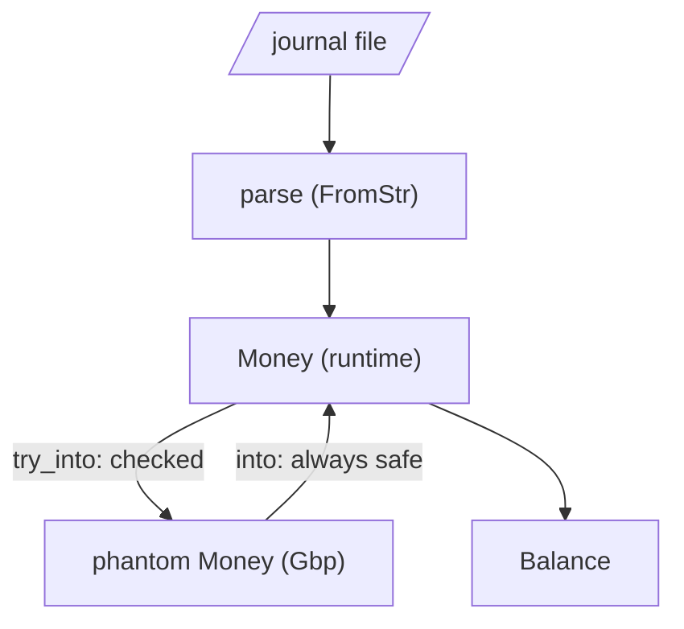
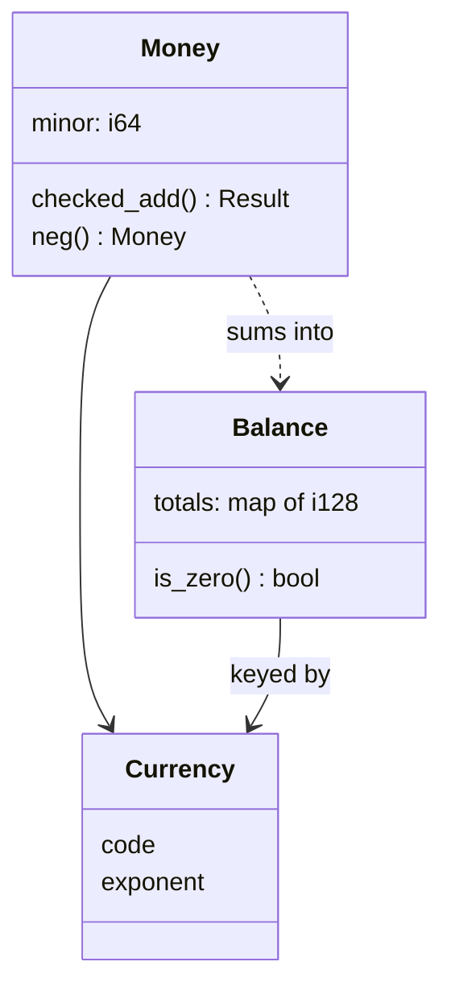

# Money is not a float

Three friends come back from a weekend in Edinburgh and split the costs in a
spreadsheet. Everyone's share is worked out, everyone pays up, and at the end
the kitty is a penny short. Nobody stole a penny. The spreadsheet stored
pounds as binary floating-point numbers, rounded them for display, and the
rounding errors quietly added up to something a human could see.

A penny is funny. A penny per transaction across a year of bank statements is
not, and an accounting program that can't be trusted to add up is worse than
no program at all. Over the next three chapters we'll build `ledger`, a small
double-entry bookkeeping tool that reads a plain-text journal like this one:

```text
2026-01-05 Tesco
    expenses:food:groceries      £64.20
    liabilities:credit-card
```

and answers questions like "what's in the bank?", "where did February's money
go?" and "does every transaction in this file actually balance?".

Before any of that, we need the most basic value in the domain: an amount of
money. It's tempting to think we have one already (`f64` is right there), but
by the end of this chapter we'll have a `Money` type that counts in whole
pennies, refuses to add pounds to dollars, says what it does on overflow, and
reads and writes both `£1,234.56` and `1234.56 GBP`. We'll also meet the
chapter's main new idea, *phantom types*, and be honest about when they're the
wrong tool.

## Setting up

`ledger` is a library with a thin binary on top, the same shape as every
project so far. Create it and add the dependencies we'll use across the part:

```sh
cargo new ledger
cd ledger
cargo add thiserror jiff anyhow
cargo add clap --features derive
cargo add --dev proptest
```

`jiff` gives us calendar dates in Chapter 22; `clap` and `anyhow` belong to
the command-line shell in Chapter 23. Add an empty `src/lib.rs` beside
`main.rs`; the domain lives there, starting with a `money` module:

```rust
// file: src/lib.rs
//! A small double-entry bookkeeping engine.

pub mod money;
```

## Why not `f64`?

Let's see the spreadsheet's problem in Rust, so we know exactly what we're
fixing:

```rust
fn main() {
    let total = 0.1 + 0.2;
    println!("{total}");
    println!("{}", total == 0.3);

    let mut pot = 0.0_f64;
    for _ in 0..10 {
        pot += 0.1;
    }
    println!("{pot}");
}
```

```text
0.30000000000000004
false
0.9999999999999999
```

Ten 10p coins make 99.99999999999999p. This isn't a Rust bug, or even a bug: an
`f64` stores a number as a binary fraction, and most decimal fractions (0.1
among them) have no exact binary representation, in the same way that 1/3 has
no exact decimal one. Every operation rounds to the nearest representable
value, and the errors accumulate.

Floats have a second problem that bites big numbers rather than small ones.
An `f64` has 53 bits of precision, so above 2^53^ (about nine quadrillion) it
can no longer represent every integer. Print `9_007_199_254_740_993.0` and you
get `9007199254740992`. That's far beyond any household budget, but it's the
sort of limit that turns up in currencies with many minor units or in
aggregates over many accounts.

The fix every serious accounting system uses is the same one you use at the
till: **count the smallest unit**. Not 12.34 pounds but 1234 pence. Integers
add exactly, compare exactly, and overflow loudly rather than drifting.

> [!NOTE]
> Decimal types (such as the `rust_decimal` crate) are the other honest answer:
> they store base-10 digits, so 0.1 is exact. They shine when you need
> fractional minor units, as in currency conversion or interest calculations.
> For a ledger that records what actually moved between accounts, whole minor
> units are simpler and make the rounding rules explicit.

## Counting in minor units

A first sketch of the type writes down what we just said, and nothing more:

```rust
// file: src/money/mod.rs
/// An amount of one currency, counted in its minor unit (pence, cents, yen).
#[derive(Clone, Copy, Debug, PartialEq, Eq, Hash)]
pub struct Money {
    minor: i64,
    currency: Currency,
}
```

Two decisions are hiding in those two lines.

**`i64`, signed.** Bookkeeping is full of negative amounts (as we'll see in
Chapter 22, half of every transaction is negative), so the type must be
signed. An `i64` holds about ±9.2 × 10^18^ minor units: 92 quadrillion
pounds. We could reach for `i128` and never think about overflow again, but
`i64` is the natural machine word, and later in this chapter we'll find a
better place to spend the extra bits.

**The fields are private.** Outside the module nobody can write
`Money { minor: 5, currency: ... }` or reach in and change an amount. That's
Chapter 7's *Encapsulated Invariants (Privacy as Proof)* at work: today
`Money` has no invariant to protect, but making the fields private now means
we can add one later without breaking a single caller. A pair of plain
constructors and accessors do the rest:

```rust
impl Money {
    pub fn from_minor(minor: i64, currency: Currency) -> Money {
        Money { minor, currency }
    }

    pub fn zero(currency: Currency) -> Money {
        Money::from_minor(0, currency)
    }

    pub fn minor(&self) -> i64 {
        self.minor
    }

    pub fn currency(&self) -> Currency {
        self.currency
    }
}
```

`Money` derives `Copy`. It's sixteen bytes or so, cheaper to copy than to
point at, and copying it can't surprise anyone because it owns no heap data.
That means amounts are passed and returned by value everywhere, the way you'd
pass an `i64`, and never borrowed.

## What a currency is

"Minor unit" means different things in different currencies. A pound has 100
pence, a US dollar 100 cents, a Japanese yen has no subdivision at all in
everyday use, and a Kuwaiti dinar has 1000 fils. The ISO 4217 standard
records this as each currency's *exponent*: the number of digits after the
decimal point. To turn `1234` minor units into text we need to know it.

So a `Currency` is a three-letter code *and* an exponent, packed small enough
to be `Copy`:

```rust
// file: src/money/currency.rs
/// A currency we know how to count in.
#[derive(Clone, Copy, PartialEq, Eq, PartialOrd, Ord, Hash)]
pub struct Currency {
    code: [u8; 3],
    exponent: u8,
}

impl Currency {
    pub const GBP: Currency = Currency::new(*b"GBP", 2);
    pub const USD: Currency = Currency::new(*b"USD", 2);
    pub const EUR: Currency = Currency::new(*b"EUR", 2);
    pub const JPY: Currency = Currency::new(*b"JPY", 0);

    /// Every currency the ledger understands.
    pub const ALL: [Currency; 4] =
        [Currency::GBP, Currency::USD, Currency::EUR, Currency::JPY];

    const fn new(code: [u8; 3], exponent: u8) -> Currency {
        Currency { code, exponent }
    }
}
```

`*b"GBP"` is a byte-string literal, dereferenced into a three-byte array, and
`new` is a private `const fn`, which means it can run at compile time to build
the associated constants. Because `new` is private, the four constants are the
only currencies that exist. Nobody can invent a currency with a five-letter
code or an exponent of 17. If you need more, you add them here, deliberately.

The `Ord` derive will matter later: it lets us use `Currency` as a key in a
`BTreeMap`, which keeps currencies in a stable, sorted order in reports.

A few small methods give the rest of the code what it needs, without exposing
the byte array:

```rust
impl Currency {
    /// The ISO code, such as `"GBP"`.
    pub fn code(&self) -> &str {
        // The constructor is private and every code is ASCII.
        std::str::from_utf8(&self.code).expect("currency codes are ASCII")
    }

    /// How many minor units make one major unit (100 pence in a pound).
    pub fn minor_per_major(&self) -> i64 {
        10_i64.pow(u32::from(self.exponent))
    }
    // ... exponent(), symbol(), from_symbol()
}
```

The `expect` in `code` is safe *because* the constructor is private: every
`Currency` that exists was built from one of our ASCII literals. Privacy is
what turns "this can't fail" from a hope into a fact the module can check by
reading itself.

Finally, a currency comes from text in a journal file, so it gets `FromStr`
(the *Conversion Traits* from Chapter 5) with a small error type of its own:

```rust
#[derive(Debug, Clone, PartialEq, Eq, Error)]
#[error("unknown currency `{0}`")]
pub struct UnknownCurrency(pub String);

impl FromStr for Currency {
    type Err = UnknownCurrency;

    fn from_str(s: &str) -> Result<Currency, UnknownCurrency> {
        Currency::ALL
            .into_iter()
            .find(|c| c.code() == s)
            .ok_or_else(|| UnknownCurrency(s.to_string()))
    }
}
```

## Adding money up: the obvious version

Now the interesting part. We want to write `rent + groceries`. Chapter 17
showed how operator overloading works for units of measure: implement
`std::ops::Add` and the `+` operator calls it. So let's do the obvious thing:

```rust
impl Add for Money {
    type Output = Money;

    fn add(self, other: Money) -> Money {
        assert_eq!(self.currency, other.currency, "currency mismatch");
        Money { minor: self.minor + other.minor, currency: self.currency }
    }
}
```

It compiles, and for a household that only ever spends pounds it works. Then
somebody goes to Boston, the journal gains a line in dollars, and a report
that adds up every posting does this (reproduced here in a small scratch
binary, `naiveadd`):

```text
thread 'main' panicked at src/bin/naiveadd.rs:16:9:
assertion `left == right` failed: currency mismatch
  left: Currency("GBP")
 right: Currency("USD")
```

A user's data file has crashed the program. Chapter 4 drew the line clearly:
`panic!` is for bugs, and a journal with two currencies in it isn't a bug,
it's Tuesday. The `Add` trait promises a total function: give me two
`Money`s, get a `Money` back. For money in arbitrary currencies, that
promise is false. Two pounds plus three dollars isn't five of anything.

There are two ways out, and they're both good. They differ in *when* we learn
which currency an amount is in.

## Design one: the currency in the type

Suppose the currency is known when the program is written. A payroll module
for a UK company only ever deals in pounds; a function that splits a hotel
bill in Boston only ever deals in dollars. In that case we can move the
currency out of the *value* and into the *type*, and let the compiler refuse
to mix them.

We start with a trait that says "this type stands for a currency", and a
couple of types that implement it:

```rust
// file: src/money/phantom.rs
/// A type that stands for one currency.
pub trait CurrencyUnit {
    const CURRENCY: Currency;
}

/// Marker types. They have no values; they exist only to be named.
#[derive(Debug, Clone, Copy, PartialEq, Eq)]
pub enum Gbp {}
#[derive(Debug, Clone, Copy, PartialEq, Eq)]
pub enum Usd {}

impl CurrencyUnit for Gbp {
    const CURRENCY: Currency = Currency::GBP;
}
// ... and the same for Usd
```

`enum Gbp {}` is an enum with no variants. It's a type you can name but
never construct, because there's nothing to construct it from. That's
exactly what we want: `Gbp` is a label for the type checker, not data.
`const CURRENCY` is an *associated constant*, a value that belongs to the
implementing type, so generic code can ask `C::CURRENCY` to get back to the
runtime world when it needs to print something.

Now the money type takes the currency as a type parameter:

```rust
/// An amount of the currency `C`, in minor units.
#[derive(Debug)]
pub struct Money<C> {
    minor: i64,
    currency: PhantomData<C>,
}
```

Rust insists that every type parameter is *used* in the struct's fields;
otherwise it can't work out how the type relates to `C` (whether it owns one,
borrows one, and so on). We don't want to store a `C` (there aren't any), so
we store `std::marker::PhantomData<C>`, a zero-sized field that tells the
compiler "act as though this struct holds a `C`". At runtime `Money<Gbp>` is
exactly one `i64`; the currency costs nothing.

Adding two amounts of the *same* currency is now total, so `Add` is honest
again:

```rust
impl<C: CurrencyUnit> Add for Money<C> {
    type Output = Money<C>;

    fn add(self, other: Money<C>) -> Money<C> {
        self.checked_add(other).expect("money overflowed i64")
    }
}
```

The signature does the work: `Money<C> + Money<C> -> Money<C>`, for the
*same* `C`. (We'll come back to that `expect` when we talk about overflow.)
Let's try adding a hotel bill in dollars to the rent in pounds:

```rust
// does not compile
let rent = Money::<Gbp>::from_minor(95_000);
let hotel = Money::<Usd>::from_minor(18_000);
let total = rent + hotel;
```

```text
error[E0308]: mismatched types
 --> src/bin/mix.rs:6:24
  |
6 |     let total = rent + hotel;
  |                        ^^^^^ expected `Money<Gbp>`, found `Money<Usd>`
  |
  = note: expected struct `Money<Gbp>`
             found struct `Money<Usd>`
```

The crash from the previous section has become a compile error, at the exact
line, naming both currencies. There's no runtime check because there's
nothing left to check.

> [!PATTERN] Phantom Types
> Give a type a parameter that appears in no runtime data, only in a
> `PhantomData<T>` field, so that values with the same representation but
> different meanings (pounds and dollars, validated and raw, metres and feet)
> become different types. Use it when the distinction is known at compile
> time; the compiler then rejects mixing them at zero runtime cost.

### A wrinkle with `derive`

You may have noticed `Money<C>` derives only `Debug`. Here's what happens if
we derive `Clone` and `Copy` as usual and write a tiny generic function:

```rust
// does not compile
#[derive(Debug, Clone, Copy, PartialEq)]
pub struct Money<C> {
    minor: i64,
    currency: PhantomData<C>,
}

pub fn double<C: CurrencyUnit>(m: Money<C>) -> Money<C> {
    m + m
}
```

```text
error[E0382]: use of moved value: `m`
  --> src/bin/derive.rs:22:9
   |
21 | pub fn double<C: CurrencyUnit>(m: Money<C>) -> Money<C> {
   |                                - move occurs because `m` has type `Money<C>`, which does not implement the `Copy` trait
22 |     m + m
   |     ----^
   |     |   |
   |     |   value used here after move
   |     `m` moved due to usage in operator
   |
note: if all bounds were met, you could clone the value
  --> src/bin/derive.rs:9:1
   |
 8 | #[derive(Debug, Clone, Copy, PartialEq)]
   |                 ----- derived `Clone` adds implicit bounds on type parameters
 9 | pub struct Money<C> {
   | ^^^^^^^^^^^^^^^^^-^
   |                  |
   |                  introduces an implicit `C: Clone` bound
...
   = help: consider manually implementing `Clone` to avoid undesired bounds
```

The compiler explains it well. `derive` is conservative: it generates
`impl<C: Clone> Clone for Money<C>`, assuming that if the struct mentions `C`
it must contain one. Ours doesn't, so the bound is unnecessary, and inside a
function that only knows `C: CurrencyUnit` it can't be satisfied. The fix is
to write the four impls by hand, without the bound:

```rust
// Written by hand: `#[derive(Clone)]` would demand `C: Clone`.
impl<C> Clone for Money<C> {
    fn clone(&self) -> Money<C> {
        *self
    }
}

impl<C> Copy for Money<C> {}
// ... PartialEq and Eq compare `minor` the same way
```

It's a few lines of boilerplate, and it's the price of most phantom types in
Rust. Now `Neg`, `Sub` and `Sum` follow the same shape as `Add`. `Sum` is
especially pleasant, because for a single currency it really is total: the
sum of no pounds is zero pounds.

```rust
impl<C: CurrencyUnit> Sum for Money<C> {
    fn sum<I: Iterator<Item = Money<C>>>(amounts: I) -> Money<C> {
        amounts.fold(Money::from_minor(0), Add::add)
    }
}

/// A monthly budget is a fixed-currency calculation: a good fit.
pub fn left_to_spend(income: Money<Gbp>, bills: &[Money<Gbp>]) -> Money<Gbp> {
    income - bills.iter().copied().sum()
}
```

`left_to_spend` reads like the sentence it implements, and its signature says
something no comment could enforce: this calculation is in pounds, all the
way through.

## Design two: the currency in the value

Now consider where *ledger*'s amounts come from: a text file the user writes.
When we compile the program we have no idea whether the next line says `GBP`,
`USD` or `JPY`. A type parameter has to be chosen at compile time, so
`Money<C>` can't represent "whatever currency the file says". We'd need to
match on the currency code and branch into a different generic
instantiation for each one, and every collection of mixed amounts would have
to erase the parameter again anyway.

For data-driven code the currency belongs in the value, which is where our
first `Money` already had it. What changes is the arithmetic. Adding two
runtime amounts *can* fail, so instead of pretending otherwise with `Add`,
we say so in the signature:

```rust
// file: src/money/mod.rs
/// Arithmetic that has no sensible answer.
#[derive(Debug, Clone, Copy, PartialEq, Eq, Error)]
pub enum MoneyError {
    #[error("cannot combine {left} with {right}")]
    CurrencyMismatch { left: Currency, right: Currency },
    #[error("amount is too large to represent")]
    Overflow,
}
```

```rust
impl Money {
    pub fn checked_add(self, other: Money) -> Result<Money, MoneyError> {
        if self.currency != other.currency {
            return Err(MoneyError::CurrencyMismatch {
                left: self.currency,
                right: other.currency,
            });
        }
        let minor = self
            .minor
            .checked_add(other.minor)
            .ok_or(MoneyError::Overflow)?;
        Ok(Money::from_minor(minor, self.currency))
    }
}
```

This follows the convention of the standard library's integers, whose
`checked_add` returns `None` instead of overflowing. Ours returns a
`Result`, because there are two different ways to fail and the caller may
want to tell them apart. *Errors as Values* (Chapter 4) again: the mixed
journal no longer crashes; it produces a `CurrencyMismatch` that the shell
can report with a line number.

Notice what we *didn't* implement. Runtime `Money` has no `Add`, `Sub` or
`Sum`. If someone writes `a + b` the compiler stops them and they go looking
for `checked_add`, where the signature tells them what can go wrong. An
operator is a promise of totality; we only make the promise where we can keep
it. Negation, on the other hand, can't change the currency, so `Neg` is
honest:

```rust
impl Neg for Money {
    type Output = Money;

    fn neg(self) -> Money {
        let minor = self.minor.checked_neg().expect("money overflowed i64");
        Money::from_minor(minor, self.currency)
    }
}
```

### Choosing between them

Neither design is "the type-driven one". Both put the currency rule where the
compiler can see it; they differ in what the compiler can know.

| | Phantom (`Money<Gbp>`) | Runtime (`Money { currency }`) |
|---|---|---|
| Currency known | when you write the code | when you read the data |
| Mixing currencies | compile error | `Err(CurrencyMismatch)` |
| `+`, `-`, `Sum` | yes, total | no; `checked_add` |
| Collections of mixed amounts | awkward | natural |
| Good for | payroll, pricing rules, tests of fixed scenarios | files, APIs, databases |

The two can live in the same program, and the boundary between them is a pair
of conversions. Forgetting the type-level currency is always safe;
recovering it has to be checked:

```rust
// file: src/money/phantom.rs
impl<C: CurrencyUnit> From<Money<C>> for super::Money {
    fn from(money: Money<C>) -> super::Money {
        super::Money::from_minor(money.minor, C::CURRENCY)
    }
}

impl<C: CurrencyUnit> TryFrom<super::Money> for Money<C> {
    type Error = super::MoneyError;

    fn try_from(money: super::Money) -> Result<Money<C>, Self::Error> {
        if money.currency() == C::CURRENCY {
            Ok(Money::from_minor(money.minor()))
        } else {
            Err(super::MoneyError::CurrencyMismatch {
                left: C::CURRENCY,
                right: money.currency(),
            })
        }
    }
}
```

That `TryFrom` is *Parse, Don't Validate* (Chapter 4) in a new setting: a
check that, once passed, produces a type that never needs checking again. A
payroll module could read amounts from a file as runtime `Money`, convert
them once with `try_into()?`, and then work entirely in `Money<Gbp>` with
ordinary operators.



The ledger itself lives on the runtime side of that picture: it reads files,
and its whole job is handling whatever currencies they contain. We keep the
phantom module alongside it as a tool for the parts of a larger program that
are fixed in one currency.

## Overflow is a decision

We've used two overflow policies already without stopping to look at them.
`checked_add` returns `Err(Overflow)`; the phantom `Add` and both `Neg`s call
`expect` and panic. Why the difference, and why not just write `self.minor +
other.minor`?

Because plain `+` on integers has *two* behaviours in Rust. In a debug build,
overflow panics. In a release build, by default, it silently wraps around:
`i64::MAX + 1` becomes `i64::MIN`, and a very large credit becomes a very
large debt. For a calculator that's an annoyance; for a ledger it's
corruption. So we never use bare `+` on amounts, and we pick one of the
explicit alternatives the standard library offers on purpose:

- `checked_add` returns `None` on overflow. We use it where overflow can
  come from *data*, and turn `None` into an error.
- `checked_add(...).expect(...)` panics in every build. We use it in
  operators, where the type promises a result and overflow would mean a bug
  (or a balance of 92 quadrillion pounds, which is the same thing).
- `saturating_add` and `wrapping_add` exist too. Neither is ever right for
  money: clamping at the maximum is as wrong as wrapping, just less dramatic.

> [!IMPORTANT]
> Integer overflow in Rust panics in debug builds and wraps in release builds.
> Tests run in debug, so a test suite can pass while production silently
> wraps. For values where wrapping is wrong (money, counts, sizes), use the
> `checked_*` methods and decide explicitly what overflow means.

Let's pin both behaviours down in tests, so a future refactor can't change
them unnoticed:

```rust
#[test]
fn overflow_is_an_error() {
    assert_eq!(gbp(i64::MAX).checked_add(gbp(1)), Err(MoneyError::Overflow));
    assert_eq!(gbp(0).checked_sub(gbp(i64::MIN)), Err(MoneyError::Overflow));
}
```

The second line is the sneaky one. `i64::MIN` has no positive counterpart
(the range is −2^63^ to 2^63^−1), so even subtracting from zero overflows.
`checked_sub` negates with `checked_neg` before adding, and reports it.

## Summing mixed currencies

There's one more thing we want to do with runtime money, and it's the most
important: add up a whole list of it. Every report in Chapter 23 is a sum of
some kind. Two questions stop us implementing `Sum` for `Money`:

1. What's the sum of an *empty* list? `Money::zero(...)` needs a currency, and
   there isn't one to hand.
2. What's the sum of `[£5, $2]`? We've already decided that's not a `Money`.

Both questions have the same answer: the result of summing money isn't
`Money`. It's a different domain concept, one bookkeepers have always had a
word for: a **balance**, which may hold amounts in several currencies side by
side. The balance of nothing is empty, and £5 plus $2 is "£5 and $2".

```rust
// file: src/money/balance.rs
/// Amounts of any number of currencies, held side by side.
///
/// Totals are kept in `i128`, so adding `i64` amounts cannot overflow
/// in any journal that fits on a computer. Zero totals are never stored,
/// so two balances are equal exactly when they hold the same amounts.
#[derive(Clone, Debug, Default, PartialEq, Eq)]
pub struct Balance {
    totals: BTreeMap<Currency, i128>,
}
```

Here's where those spare bits went. Each `Money` is an `i64`, but a
`Balance` accumulates in an `i128`. To overflow it you'd need to add more than
2^64^ maximum-sized amounts. At a million postings a second, that's over half
a million years of data entry. So adding money to a balance is total for any
journal that could actually exist, and needs no error path at all. Widening the accumulator is a cheap trick
worth remembering: it turns a fallible sum into an infallible one.

The second invariant is in the doc comment: no currency is ever stored with a
zero total. Without it, a balance that went +£5 then −£5 would hold
`{GBP: 0}` and compare unequal to an empty one, even though both mean
"nothing". One private method maintains the rule, and every public way of
changing a balance goes through it:

```rust
impl Balance {
    /// True when every currency nets to nothing.
    pub fn is_zero(&self) -> bool {
        self.totals.is_empty()
    }

    fn add_minor(&mut self, currency: Currency, minor: i128) {
        let total = self.totals.entry(currency).or_insert(0);
        *total += minor;
        if *total == 0 {
            self.totals.remove(&currency);
        }
    }
}
```

`entry(...).or_insert(0)` is the `BTreeMap` *entry API*: find the slot for
this key, creating it with `0` if it's missing, and hand back a mutable
reference to the value. It's the idiomatic way to update-or-insert in one
lookup.

Now the operators are honest. Adding a `Money` to a `Balance` is total, and
so is summing any number of amounts, in any mix of currencies:

```rust
impl AddAssign<Money> for Balance {
    fn add_assign(&mut self, money: Money) {
        self.add_minor(money.currency(), i128::from(money.minor()));
    }
}

impl Add<Money> for Balance {
    type Output = Balance;

    fn add(mut self, money: Money) -> Balance {
        self += money;
        self
    }
}

impl Sum<Money> for Balance {
    fn sum<I: Iterator<Item = Money>>(amounts: I) -> Balance {
        amounts.fold(Balance::new(), Balance::add)
    }
}
```

`Sum<Money> for Balance` reads "a `Balance` can be made by summing
`Money`s". It's the trait `Iterator::sum` looks for, so
`amounts.into_iter().sum::<Balance>()` just works. The `Balance` type is the
*fold's* accumulator made into a first-class value: the empty balance is the
starting point and `Balance::add` the step. (`Neg` and adding one balance to
another follow the same pattern.)

The relationships between our three types are worth a picture:



A test shows all of it working together:

```rust
#[test]
fn sums_mixed_currencies() {
    let total: Balance = [gbp(500), usd(200), gbp(-100)].into_iter().sum();
    assert_eq!(total.get(Currency::GBP), 400);
    assert_eq!(total.get(Currency::USD), 200);
    assert_eq!(format!("{total:#}"), "£4.00, $2.00");
}
```

That last line is a preview of formatting, which is the final piece.

## Reading and writing amounts

Amounts appear as text in two places: in the journal file, which a person
types and the program reads, and in reports, which the program writes and a
person reads. People write money several ways: `£1,234.56`, `-£5`,
`1234.56 GBP`. We'll accept all of those, and write two forms:

- a canonical form, `1234.56 GBP`: no thousands separators, the ISO code
  always present, unambiguous to parse. This is what `Display` produces, and
  what we'll write back into journal files.
- a pretty form, `£1,234.56`, for reports.

Rust's formatting machinery has a slot for exactly this kind of variant: the
*alternate* flag, `#`. You've used it with `{:#?}` for pretty `Debug` output;
any `Display` impl can check `f.alternate()` and do something different for
`{:#}`.

```rust
// file: src/money/mod.rs
/// `1234.56 GBP` normally; `£1,234.56` with the alternate flag (`{:#}`).
impl fmt::Display for Money {
    fn fmt(&self, f: &mut fmt::Formatter<'_>) -> fmt::Result {
        format::write_amount(f, i128::from(self.minor), self.currency)
    }
}
```

The real work is in a private `format` module, shared with `Balance` (which is
why it takes an `i128`):

```rust
// file: src/money/format.rs
pub(super) fn write_amount(
    f: &mut fmt::Formatter<'_>,
    minor: i128,
    currency: Currency,
) -> fmt::Result {
    let per = currency.minor_per_major().unsigned_abs() as u128;
    let sign = if minor < 0 { "-" } else { "" };
    let (whole, frac) =
        (minor.unsigned_abs() / per, minor.unsigned_abs() % per);

    let places = usize::from(currency.exponent());
    let fraction = match places {
        0 => String::new(),
        _ => format!(".{frac:0places$}"),
    };

    let text = match (f.alternate(), currency.symbol()) {
        (true, Some(symbol)) => {
            format!("{sign}{symbol}{}{fraction}", group(whole))
        }
        (true, None) => format!("{sign}{}{fraction} {currency}", group(whole)),
        (false, _) => format!("{sign}{whole}{fraction} {currency}"),
    };
    f.pad(&text)
}
```

Three details are worth a second look.

`unsigned_abs()` takes the magnitude as an unsigned number. Plain `abs()`
would overflow on the most negative value; the unsigned version has room for
it. We print the sign ourselves.

`{frac:0places$}` pads the fraction with zeros to `places` digits, where the
width comes from a variable. Five pence is `.05`, not `.5`.

`f.pad(&text)` instead of `write!(f, ...)` makes our type respect width and
alignment, so `format!("{:>#12}", amount)` right-aligns a pretty amount in a
twelve-character column. Reports will lean on that.

Parsing goes the other way, and is a good example of breaking a fiddly job
into steps that each do one thing. The outer function peels off the sign, an
optional symbol, and an optional trailing code, then checks they agree:

```rust
    let currency = match (symbol, code) {
        (Some(symbol), Some(code)) if symbol != code => {
            return Err(ParseMoneyError::ConflictingCurrency { symbol, code });
        }
        (Some(currency), _) | (None, Some(currency)) => currency,
        (None, None) => {
            return Err(ParseMoneyError::MissingCurrency(s.to_string()));
        }
    };
```

Matching on a *tuple* of two options lays out all four cases as a table: both
present and different, either one present, neither present. It's a good habit
whenever two optional things interact. Then a helper, `parse_minor`, turns
`"1,234.5"` into `123450`. It refuses anything it can't read exactly,
including more decimal places than the currency has:

```rust
    let allowed = currency.exponent();
    if frac.len() > usize::from(allowed) {
        return Err(ParseMoneyError::TooManyDecimals {
            currency,
            allowed,
            found: frac.len(),
        });
    }
```

`£1.234` is an error, not "about £1.23". A ledger that silently rounds what
it reads is the spreadsheet from the start of the chapter all over again.
Every way parsing can fail is a variant of `ParseMoneyError`, and the
`FromStr` impl just delegates:

```rust
// file: src/money/mod.rs
impl FromStr for Money {
    type Err = ParseMoneyError;

    fn from_str(s: &str) -> Result<Money, ParseMoneyError> {
        format::parse_amount(s)
    }
}
```

The most valuable test for a pair of functions like these isn't a list of
examples, it's a *round trip*: whatever we write, we must be able to read
back unchanged. We'll do it properly with property tests in Chapter 23; for
now a loop over awkward values and every currency catches most mistakes:

```rust
#[test]
fn display_round_trips_through_parse() {
    for minor in [0, 1, -1, 99, 100, 123_456, -987_654_321, i64::MAX] {
        for currency in Currency::ALL {
            let m = money(minor, currency);
            assert_eq!(m.to_string().parse(), Ok(m));
            assert_eq!(format!("{m:#}").parse(), Ok(m));
        }
    }
}
```

> [!TIP]
> Notice `i64::MIN` is missing from that list. Try adding it. The parser reads
> the digits as a positive `i64` and then negates, and 9223372036854775808
> doesn't fit. Whether that's worth fixing is a judgement call, and exactly
> the kind of edge case Chapter 7's property tests are good at finding.

> [!CHECKPOINT]
> Your `src/money/` directory should hold `mod.rs` (`Money`, `MoneyError`,
> `ParseMoneyError`), `currency.rs`, `balance.rs`, `format.rs` and
> `phantom.rs`, with `mod.rs` declaring `mod balance; mod currency; mod
> format; pub mod phantom;` and re-exporting `Balance` and `Currency`. With a
> handful of tests in each file:
>
> ```sh
> cargo test money
> ```
>
> ```text
> test money::balance::tests::sums_mixed_currencies ... ok
> test money::format::tests::display_round_trips_through_parse ... ok
> test money::phantom::tests::crosses_the_boundary ... ok
> test money::tests::overflow_is_an_error ... ok
> ...
> test result: ok. 18 passed; 0 failed; 0 ignored; 0 measured
> ```

## What we learned

- **Floats can't count money.** Binary fractions round every decimal amount;
  count whole minor units in an integer instead, and know each currency's
  exponent.
- **A `Currency` is a value object with a private constructor**, so the set of
  currencies is closed and `expect` on its invariants is safe.
- **Operators are promises of totality.** Implement `Add`, `Sub`, `Neg` and
  `Sum` only where every input has an answer; otherwise offer `checked_add`
  returning a `Result`.
- **Phantom types** put a compile-time label on a value at no runtime cost.
  Use them when the distinction is fixed in the code (`Money<Gbp>`); use a
  runtime field when it comes from data. `From`/`TryFrom` bridge the two.
- **`derive` adds bounds on type parameters**; phantom-typed structs usually
  need hand-written `Clone`, `Copy` and `PartialEq`.
- **Overflow is a decision.** Release builds wrap silently; use `checked_*`
  for data and `expect` for bugs, and never `wrapping_*` for money.
- **Widen the accumulator** (`i128` in `Balance`) to make a sum total, and
  keep a normal form (no zero entries) so equality means what it says.
- **The `#` alternate flag and `f.pad`** give one type a canonical and a
  pretty form that both respect width and alignment.

## Exercises

> [!EXERCISE] A fourth currency
> Add the Kuwaiti dinar (`KWD`, exponent 3, no symbol). Which parts of the code
> needed changing, and which "just worked"? Check that `1.250 KWD` parses and
> that `{:#}` prints `1.250 KWD`. Then add a round-trip test for it.

> [!EXERCISE] Splitting a bill
> Write `fn split(total: Money<Gbp>, ways: u32) -> Vec<Money<Gbp>>` that
> divides an amount into `ways` parts which differ by at most one penny and
> *always* sum back to the total. (Hint: integer division gives the base share;
> the remainder tells you how many parts get one extra penny.) Then write a
> test that `split(t, n).into_iter().sum() == t` for many values. Could
> you do this with `f64` and be sure?

> [!EXERCISE] Fix `i64::MIN`
> Make `display_round_trips_through_parse` pass with `i64::MIN` in the list.
> One approach parses the digits into a `u64` or `i128` and converts with
> `i64::try_from` after applying the sign. Keep `TooLarge` for values that
> really don't fit.

> [!EXERCISE] Phantom units elsewhere
> Chapter 17's `Bytes` and `BytesPerSecond` were separate newtypes. Sketch
> what a single `Quantity<U>` with phantom units would look like, including
> `Div<Seconds>` producing a rate. When is one generic type better than
> several newtypes, and when is it worse?
