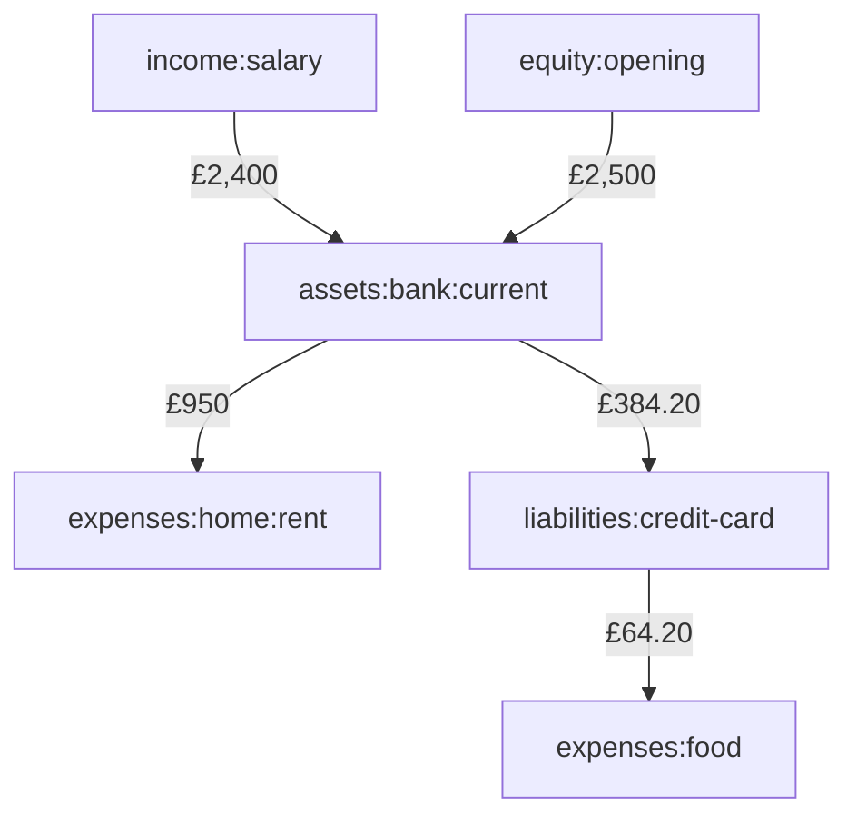
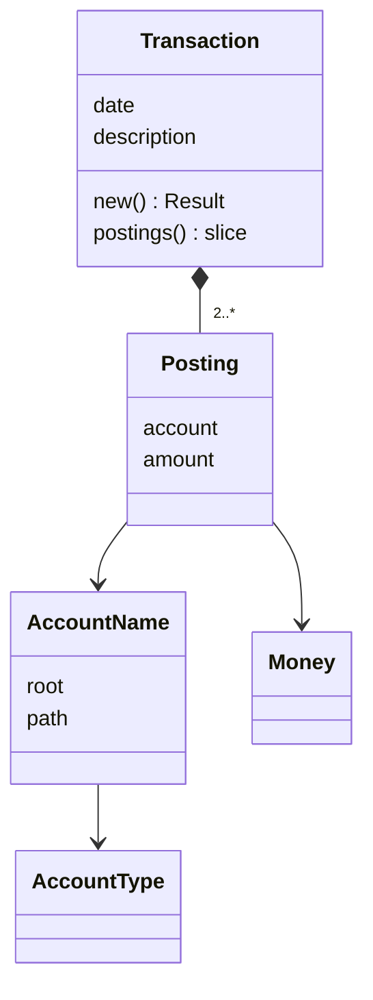
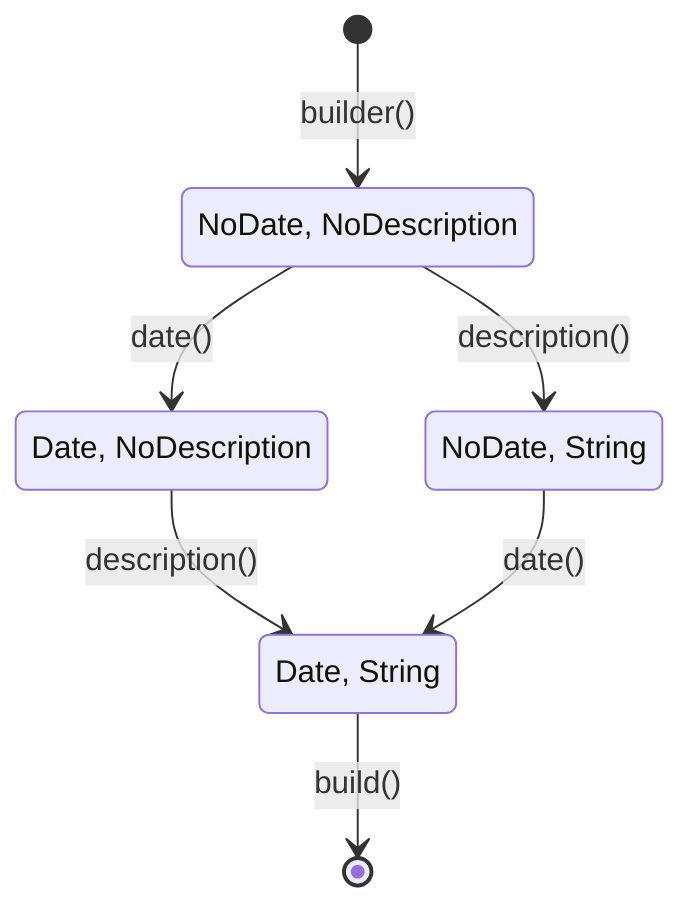

# Transactions that must balance

Open any banking app and you'll see single-entry bookkeeping: a list of
amounts going in and out of one account. It answers "what happened to my
current account?" well, and almost nothing else. Where did the £950 go? Rent,
probably, but the bank doesn't know that. How much do you owe on the credit
card, and how much of that was food? Was the £500 that left on the tenth a
bill, or did you just move it into savings? The list can't say, because each
line only records one side of what happened.

Double-entry bookkeeping, invented by Italian merchants about seven centuries
ago, records *both* sides. Every transaction says where value came from and
where it went, and the two sides must cancel exactly. That single rule is
what lets a ledger answer all those questions, and it's what makes the books
self-checking: if the sides don't cancel, someone made a mistake.

For us that rule is a gift, because it's an *invariant*: something that must
be true of every transaction, always. In this chapter we'll model accounts
and postings, then build a `Transaction` type that cannot exist unless it
balances. It's our first full *aggregate* in the domain-driven sense, and
we'll finish with two builders for it, one of which turns a forgotten field
into a compile error.

## Double-entry for programmers

Forget debits and credits for a moment and think about conservation. There
are a number of **accounts**, each holding some amount of value. A
**transaction** moves value between accounts. It's made of **postings**, each
of which adds a signed amount to one account. Value is never created or
destroyed, only moved, so the postings in a transaction always sum to zero.

Here's the January rent:

```text
2026-01-02 Rent
    expenses:home:rent          £950.00
    assets:bank:current        -£950.00
```

£950 goes into `expenses:home:rent` and comes out of `assets:bank:current`.
The sum is zero. If you've ever written a bank transfer function that debits
one account and credits another in the same database transaction, you've
done double-entry bookkeeping.

The trick that makes this work for *everything* (salaries, debts, spending,
opening balances) is that there are five kinds of account, and some of them
normally hold negative amounts:

| Type | What it is | Usual sign |
|---|---|---|
| **Assets** | things you have: bank accounts, cash | positive |
| **Liabilities** | things you owe: credit cards, loans | negative |
| **Equity** | what you started with; adjustments | negative |
| **Income** | where money comes from: salary | negative |
| **Expenses** | where money goes: rent, food | positive |

Why is income negative? Because when your salary arrives, `assets:bank` goes
*up* by £2,400 and something has to go down by £2,400 to balance it. That
something is `income:salary`: it's the *source* of the money, and a source
runs negative as it gives value away. Over a year, `income:salary` reaches
−£28,800, which you read as "£28,800 came from salary". Likewise, spending
£64.20 on a credit card makes `liabilities:credit-card` more negative: you owe
more.

Accountants call positive postings **debits** and negative ones **credits**,
and the conventions about which accounts are "debit-normal" are exactly the
signs in that table. We'll use signed numbers, as plain-text accounting tools
do; it's the same model with fewer words.

Here's money flowing around a household for a month. Each arrow is one
transaction, and each one moves value from one account to another:



Because every transaction sums to zero, the whole journal does too, and so
does any total over *all* accounts. That's the accounting equation in its
programmer's form: assets + liabilities + equity + income + expenses = 0. A
report that doesn't sum to zero is a report with a bug in it.

## Naming accounts

Account names are hierarchical paths: `assets:bank:current`,
`expenses:food:groceries`. The hierarchy lets reports roll totals up: all
food, all expenses. The first segment is always one of the five types.

The obvious representation is a `String`, and it fails the way stringly typed
data always does. A journal entry for `asset:bank:current` (missing an *s*)
silently creates a brand-new account that belongs to no type. `Assets:Bank`
and `assets:bank` become two accounts. A name with a space in the middle
breaks the file format we'll read in Chapter 23. And every report has to
re-split the string to find out what kind of account it is.

The five types are a closed set, so they're an enum:

```rust
// file: src/account.rs
/// The five kinds of account in double-entry bookkeeping.
///
/// Declaration order is report order: `Ord` is derived from it.
#[derive(Clone, Copy, Debug, PartialEq, Eq, PartialOrd, Ord, Hash)]
pub enum AccountType {
    Assets,
    Liabilities,
    Equity,
    Income,
    Expenses,
}
```

A derived `Ord` on an enum orders variants by declaration. Since accountants
always list accounts in exactly this order, we get conventional report order
for free just by writing the variants in that sequence.

The name itself is a *Value Object* (Chapter 8) that stores the parsed type
next to the full path:

```rust
/// A validated account name. The only way to make one is to parse it.
#[derive(Clone, Debug, PartialEq, Eq, PartialOrd, Ord, Hash)]
pub struct AccountName {
    root: AccountType,
    path: String,
}
```

Storing `root` is a small redundancy (it's also the first segment of `path`)
that buys two things. Asking an account its type is a field read, not a
parse. And because derived `Ord` on a struct compares fields in order, account
names sort by *type first*, then alphabetically by path:
`assets:...` before `liabilities:...` before `expenses:...`, rather than the
alphabetical `assets`, `equity`, `expenses`, `income`, `liabilities`. When we
put accounts in a `BTreeMap` in the next chapter, reports come out in the
right order with no sorting code at all.

Parsing is *Parse, Don't Validate* with a small error enum. Each check
rejects one specific way a name can be wrong:

```rust
impl FromStr for AccountName {
    type Err = AccountError;

    fn from_str(s: &str) -> Result<AccountName, AccountError> {
        if s.split(':').any(str::is_empty) {
            return Err(AccountError::EmptySegment(s.to_string()));
        }
        if let Some(bad) = s.chars().find(|&c| c != ':' && !valid_char(c)) {
            let name = s.to_string();
            return Err(AccountError::BadCharacter { name, bad });
        }
        let first = s.split(':').next().unwrap_or_default();
        let root = first.parse()?;
        Ok(AccountName {
            root,
            path: s.to_string(),
        })
    }
}
```

`valid_char` allows letters, digits, `-` and `_`; `first.parse()?` uses a
`FromStr` on `AccountType` that accepts exactly the five lowercase names and
returns `UnknownRoot` otherwise. The typo from earlier now fails loudly:

```rust
assert_eq!(
    "asset:bank".parse::<AccountName>(),
    Err(AccountError::UnknownRoot("asset".into()))
);
```

### Walking the tree

Reports need to move around the hierarchy. The parent of
`assets:bank:current` is `assets:bank`; a root has no parent. That's an
`Option`, and `rsplit_once` (split at the *last* colon) gives it to us almost
directly:

```rust
    /// `assets:bank` for `assets:bank:current`; `None` for a root.
    pub fn parent(&self) -> Option<AccountName> {
        let (parent, _) = self.path.rsplit_once(':')?;
        Some(AccountName {
            root: self.root,
            path: parent.to_string(),
        })
    }
```

This is one of the few places we build an `AccountName` without parsing, and
it's allowed because we're inside the module and we can see why it's valid:
a prefix of a valid name, cut at a colon, is still a valid name with the
same root. Privacy makes that reasoning local. Nobody outside `account.rs`
can construct one by hand, so this is the only place the argument needs to
be made.

Roll-ups in Chapter 23 will need *all* the ancestors of an account. Instead of
a loop, we can describe the sequence: start with this account, and get each
next element by calling `parent` on the previous one, until it returns
`None`. The standard library has exactly that iterator:

```rust
    /// This account and each of its parents, nearest first.
    pub fn ancestors(&self) -> impl Iterator<Item = AccountName> {
        std::iter::successors(Some(self.clone()), AccountName::parent)
    }
```

`successors(first, next)` is the iterator form of "follow the links". For
`assets:bank:current` it yields `assets:bank:current`, `assets:bank`,
`assets`, and stops.

The last tree operation answers "is this account under that one?", used for
filtering reports to `assets:bank` and everything beneath it. The obvious
implementation is a string prefix test:

```rust
// The obvious version, with a bug.
pub fn is_under(&self, other: &AccountName) -> bool {
    self.path.starts_with(&other.path)
}
```

And `assets:bankrupt-fund` is, according to this, under `assets:bank`. A
path prefix isn't a string prefix: after the prefix we need either nothing at
all (the account itself) or a colon (a child):

```rust
    /// True for the account itself and anything beneath it.
    pub fn is_under(&self, other: &AccountName) -> bool {
        match self.path.strip_prefix(&other.path) {
            Some(rest) => rest.is_empty() || rest.starts_with(':'),
            None => false,
        }
    }
```

It's a good example of why a domain type is worth having even when it's
"just a string": the right definition of `is_under` lives in one place, with
a test for `assets:bankrupt`, instead of being re-derived (wrongly) in every
report.

## Postings, and a transaction anyone can break

A posting is an account and an amount. It has no rules of its own, so it's a
plain value:

```rust
// file: src/transaction.rs
/// One line of a transaction: an amount moving into (or out of) an account.
#[derive(Clone, Debug, PartialEq, Eq)]
pub struct Posting {
    account: AccountName,
    amount: Money,
}
```

(The fields are private with a `new` constructor and accessors, for the same
future-proofing reason as `Money`'s.) Now a first attempt at a transaction,
written the way you might in any language:

```rust
// The obvious version.
pub struct Transaction {
    pub date: Date,
    pub description: String,
    pub postings: Vec<Posting>,
}
```

`Date` is `jiff::civil::Date`: a calendar date with no time or time zone,
which is exactly what a bookkeeping entry has. (Chapter 14 used `jiff` for
due dates.)

The crack in this version isn't a compiler error; it's that *nothing stops
you*. Any code anywhere can write `Transaction { postings: vec![], .. }`, or
push a posting onto an existing transaction, and the result is a value that
claims to be a transaction while breaking the one rule transactions have.
Then every function that takes a `Transaction` has a choice: check the rule
again (defensively, everywhere, with some error type for "this transaction I
was given is invalid") or trust that someone else did. Both are bad. The
first scatters the rule; the second makes it a rumour.

## The aggregate

Let's write down everything that must be true of a transaction:

1. It has a non-empty description.
2. It has at least two postings. (One posting can only balance if its amount
   is zero, and moving nothing from nowhere isn't a transaction.)
3. Its postings sum to zero **in each currency**. £5 and −$5 don't balance.

And one convenience from plain-text accounting, which makes journals much
nicer to write: you may leave out **one** posting's amount, and the
transaction infers it. In this entry the bank posting's amount is obviously
−£64.20, so you don't have to type it:

```text
2026-01-05 Tesco
    expenses:food:groceries      £64.20
    liabilities:credit-card
```

Inference only makes sense if what's left to balance is a single currency.
If the explicit postings leave £5 *and* $3 unbalanced, one posting can't
absorb both.

So there are two shapes of posting: the one a person writes, whose amount may
be missing, and the one a transaction holds, whose amount is always known.
Different facts, different types:

```rust
/// A posting as written by a person, whose amount may be left out.
#[derive(Clone, Debug, PartialEq, Eq)]
pub struct PostingDraft {
    pub account: AccountName,
    pub amount: Option<Money>,
}
```

`PostingDraft` has public fields because it promises nothing; it's raw input,
like the DTOs of Chapter 8. `Transaction` is the opposite. Its fields are
private, and its one constructor turns drafts into postings or explains why
it can't:

```rust
/// A dated, described set of postings that balances in every currency.
///
/// The fields are private and `new` is the only constructor, so holding a
/// `Transaction` is proof that its invariants hold.
#[derive(Clone, Debug, PartialEq, Eq)]
pub struct Transaction {
    date: Date,
    description: String,
    postings: Vec<Posting>,
}
```

Each way of failing gets a variant. Notice that `Unbalanced` carries the
`Balance` from Chapter 21, so an error message can say exactly how far off
the transaction was, in every currency:

```rust
#[derive(Debug, Clone, PartialEq, Eq, Error)]
pub enum TransactionError {
    #[error("a transaction needs a description")]
    EmptyDescription,
    #[error("a transaction needs at least two postings, found {0}")]
    TooFewPostings(usize),
    #[error("only one posting may leave its amount out")]
    MultipleElided,
    #[error("postings do not balance: off by {0}")]
    Unbalanced(Balance),
    #[error("cannot infer one amount to balance {0}")]
    CannotInfer(Balance),
    #[error("inferred amount is too large to represent")]
    Overflow,
}
```

Now the constructor. It reads top to bottom as the list of rules:

```rust
impl Transaction {
    pub fn new(
        date: Date,
        description: &str,
        drafts: Vec<PostingDraft>,
    ) -> Result<Transaction, TransactionError> {
        let description = description.trim();
        if description.is_empty() {
            return Err(TransactionError::EmptyDescription);
        }
        if drafts.len() < 2 {
            return Err(TransactionError::TooFewPostings(drafts.len()));
        }

        let residual: Balance = drafts.iter().filter_map(|d| d.amount).sum();
        let elided = drafts.iter().filter(|d| d.amount.is_none()).count();
        let inferred = match elided {
            0 if residual.is_zero() => None,
            0 => return Err(TransactionError::Unbalanced(residual)),
            1 => Some(infer(residual)?),
            _ => return Err(TransactionError::MultipleElided),
        };
        // ... build the postings
    }
}
```

The balance check is one line, and it's the payoff of Chapter 21.
`filter_map(|d| d.amount)` keeps the amounts that were written, and
`.sum()` into a `Balance` adds them up per currency, with no possibility of
overflow and no special case for mixed currencies. If everything is
explicit, the residual must be zero. If one amount is missing, the residual
is what it has to cancel.

The `match` on `elided` with a guard (`0 if residual.is_zero()`) puts the
four cases side by side: balanced, unbalanced, one to infer, too many to
infer.

Inference itself has to handle "exactly one currency, otherwise an error".
Collecting the balance's totals and matching on the *slice* says that
directly:

```rust
/// The amount that brings `residual` back to zero, if it is one currency.
fn infer(residual: Balance) -> Result<Money, TransactionError> {
    let totals: Vec<_> = residual.totals().collect();
    match totals.as_slice() {
        &[(currency, minor)] => i64::try_from(-minor)
            .map(|minor| Money::from_minor(minor, currency))
            .map_err(|_| TransactionError::Overflow),
        _ => Err(TransactionError::CannotInfer(residual)),
    }
}
```

`&[(currency, minor)]` is a *slice pattern*: it matches a slice of exactly
one element and destructures it. Empty slices and longer ones fall through to
`_`. (An empty residual with an elided posting would mean inferring a zero in
no particular currency, which we treat as an error too.) The residual is
an `i128`; the inferred `Money` is an `i64`, so `try_from` makes the
narrowing explicit and reports the absurd case.

Finally the drafts become postings:

```rust
        let postings = drafts
            .into_iter()
            .map(|d| {
                // `inferred` is `Some` whenever a draft has no amount.
                let amount = d.amount.or(inferred).expect("amount inferred");
                Posting::new(d.account, amount)
            })
            .collect();
        let description = description.to_string();
        Ok(Transaction {
            date,
            description,
            postings,
        })
```

`d.amount.or(inferred)` keeps a written amount and falls back to the inferred
one. The `expect` is safe for a reason we can point to three lines up: if any
draft had no amount, `elided` was 1 and `inferred` is `Some`. That's the kind
of local, checkable argument that makes an `expect` acceptable; if you can't
write the comment, you need an error instead.

### Privacy is the proof

A `Transaction` exposes read-only accessors and nothing else:

```rust
    pub fn date(&self) -> Date {
        self.date
    }

    pub fn description(&self) -> &str {
        &self.description
    }

    /// At least two, and they sum to zero in every currency.
    pub fn postings(&self) -> &[Posting] {
        &self.postings
    }
```

`postings` hands out a shared slice, so callers can read every posting but
can't push, remove or reorder. And if someone outside the module tries to
skip the constructor:

```rust
// does not compile
let tx = Transaction {
    date: date(2026, 1, 3),
    description: "Free money".to_string(),
    postings: vec![],
};
```

```text
error[E0451]: fields `date`, `description` and `postings` of struct `ledger::transaction::Transaction` are private
 --> src/bin/private.rs:6:9
  |
5 |     let tx = Transaction {
  |              ----------- in this type
6 |         date: date(2026, 1, 3),
  |         ^^^^ private field
7 |         description: "Free money".to_string(),
  |         ^^^^^^^^^^^ private field
8 |         postings: vec![],
  |         ^^^^^^^^ private field
```

This is Chapter 7's *Encapsulated Invariants (Privacy as Proof)* doing the
work it was made for. Every `Transaction` in the program came out of `new`,
so every `Transaction` balances. A report that receives `&Transaction` doesn't
check anything, doesn't have an error path for "unbalanced input", and can't
be handed one. The rule lives in one function and is enforced for the whole
program by the module system.

> [!PATTERN] Aggregate with Invariants
> An aggregate is a cluster of domain objects (here a transaction and its
> postings) treated as one unit, with a single root that is the only way in.
> The root's constructor and methods enforce the cluster's invariants; its
> fields are private, so an aggregate value is proof the rules hold. Change
> the parts only through the root, and keep the rules there, in one place.

In domain-driven design the aggregate is also the unit of consistency: you
never save half a transaction or let another object hold a mutable reference
to one of its postings. Our type makes those properties structural rather than
a team convention. Here's the shape of it:



> [!NOTE]
> Could the type itself say "at least two postings"? Yes: a struct like
> `struct AtLeastTwo<T> { first: T, second: T, rest: Vec<T> }` can't be built
> with fewer. Non-empty collection types like this are a fine tool, and crates
> such as `nonempty` provide them. We don't use one here because "at least
> two" isn't the interesting invariant; "balances" is, and no collection type
> can express that. Once a constructor has to check the balance anyway,
> checking the count there too is simpler than a custom collection that every
> report must learn to iterate.

## Building transactions

Our tests (and, later, the journal reader) need to make transactions, and
`new` is a little clumsy to call by hand:

```rust
let drafts = vec![
    PostingDraft { account: food, amount: Some(gbp(4_250)) },
    PostingDraft { account: bank, amount: None },
];
let tx = Transaction::new(date(2026, 1, 3), "Tesco", drafts)?;
```

It's a lot of ceremony for "£42.50 from the bank to food". The usual remedy is
a *builder*: an object that collects the parts one method call at a time and
assembles the result at the end. A typical first version stores every field
as an `Option` and checks at the end:

```rust
#[derive(Default)]
pub struct TransactionBuilder {
    date: Option<Date>,
    description: Option<String>,
    drafts: Vec<PostingDraft>,
}

impl TransactionBuilder {
    pub fn date(mut self, date: Date) -> Self {
        self.date = Some(date);
        self
    }
    // ... description(), post()

    pub fn build(self) -> Result<Transaction, BuildError> {
        let date = self.date.ok_or(BuildError::MissingDate)?;
        let description =
            self.description.ok_or(BuildError::MissingDescription)?;
        Transaction::new(date, &description, self.drafts)
            .map_err(BuildError::Invalid)
    }
}
```

Each method takes `self` by value and returns it, so calls chain. It works,
and it's an improvement. But look at the error type it needed: `BuildError`
now mixes two very different kinds of failure. `Invalid` is a *domain*
error: the postings don't balance, which can happen with perfectly correct
code given bad data. `MissingDate` is a *programming* error: someone wrote a
builder chain and forgot a line. That isn't data-dependent; the same code will
fail the same way every time it runs. Forgetting a date should be caught when
the code is compiled, not reported at runtime as though it were the user's
fault.

### The typestate builder

Chapter 14 introduced *Typestate*: encoding which state a value is in as a
type parameter, so that operations only exist in the states where they make
sense. A builder is a small state machine (nothing set, date set, description
set, both set), and `build` should only exist in the last state.

Here's the neat part: we don't need a separate "state" parameter *and* an
`Option` field. The type parameter can *be* the field's type. Before the date
is set, the `date` field holds a unit marker called `NoDate`; afterwards it
holds a real `Date`:

```rust
/// Typestate markers: "not set yet".
#[derive(Debug, Clone, Copy)]
pub struct NoDate;
#[derive(Debug, Clone, Copy)]
pub struct NoDescription;

/// Builds a [`Transaction`]. `build` exists only once a date and a
/// description have been given, so forgetting either is a compile error.
#[derive(Debug, Clone)]
pub struct TransactionBuilder<D, S> {
    date: D,
    description: S,
    drafts: Vec<PostingDraft>,
}
```

`Transaction::builder()` starts in the empty state,
`TransactionBuilder<NoDate, NoDescription>`. Setting the date is available in
*any* state, and moves the builder to one where `D` is `Date`, leaving the
description state `S` as it was:

```rust
impl<D, S> TransactionBuilder<D, S> {
    pub fn date(self, date: Date) -> TransactionBuilder<Date, S> {
        TransactionBuilder {
            date,
            description: self.description,
            drafts: self.drafts,
        }
    }
    // ... description() is the same shape, changing S to String

    /// Adds a posting with an explicit amount.
    pub fn post(mut self, account: AccountName, amount: Money) -> Self {
        let amount = Some(amount);
        self.drafts.push(PostingDraft { account, amount });
        self
    }
    // ... balance_to(account) pushes a draft with no amount
}
```

`post` returns `Self`: adding postings doesn't change the state. Notice that
`date` has to rebuild the struct field by field, because the result is a
*different type* from `self`, so `self.date = date` wouldn't type-check.

And `build` is implemented for one state only:

```rust
impl TransactionBuilder<Date, String> {
    pub fn build(self) -> Result<Transaction, TransactionError> {
        Transaction::new(self.date, &self.description, self.drafts)
    }
}
```

Look at its error type: plain `TransactionError`. The "missing" variants are
gone because the situation they described can no longer happen at runtime.
Here are the states and the moves between them:



Forget the date, and the mistake is caught before the program exists:

```rust
// does not compile
let tx = Transaction::builder()
    .description("Tesco")
    .post("expenses:food".parse().unwrap(), gbp(4_250))
    .balance_to("assets:bank".parse().unwrap())
    .build();
```

```text
error[E0599]: no method named `build` found for struct `TransactionBuilder<NoDate, String>` in the current scope
  --> src/bin/builder.rs:13:6
   |
 9 |   let tx = Transaction::builder()
   |  __________-
10 | |     .description("Tesco")
11 | |     .post("expenses:food".parse().unwrap(), gbp(4_250))
12 | |     .balance_to("assets:bank".parse().unwrap())
13 | |     .build();
   | |     -^^^^^ method not found in `TransactionBuilder<NoDate, String>`
   | |_____|
   |
   = note: the method was found for `TransactionBuilder<jiff::civil::date::Date, String>`
```

The compiler names the state we're in (`NoDate, String`) and the state where
`build` exists (`Date, String`). That's about as clear as a missing-field
error gets.

> [!PATTERN] Builder (and Typestate Builder)
> A builder assembles a complex value through a chain of method calls that
> each take and return the builder by value, then validates once in `build`.
> In the typestate variant, required fields are type parameters that start as
> marker types (`NoDate`) and become real types (`Date`) when set; `build` is
> implemented only for the complete state, so a missing field is a compile
> error and `build`'s error type is left with genuine domain failures only.

Now tests read like journal entries:

```rust
#[test]
fn infers_the_elided_amount() {
    let tx = Transaction::builder()
        .date(date(2026, 1, 3))
        .description("Tesco")
        .post(acct("expenses:food"), gbp(4_250))
        .balance_to(acct("assets:bank:current"))
        .build()
        .unwrap();
    assert_eq!(tx.postings()[1].amount(), gbp(-4_250));
}
```

(`acct` and `gbp` are two-line test helpers that parse an account name and
make a `Money` in pounds.)

> [!TIP]
> A typestate builder pays off when a type has a few *required* fields and
> several optional ones, and is built in code rather than from data. Past
> three or four required fields the type parameters get unwieldy; at that
> point, consider a plain constructor taking the required fields as
> arguments, with builder methods for the optional ones.

## The journal

The last type in this chapter is the simplest: a journal is all the
transactions, in date order. That ordering is an invariant too (reports in
Chapter 23 depend on it, and a running balance is meaningless out of
order), so the field is private and the constructor sorts:

```rust
// file: src/journal.rs
/// Transactions sorted by date. Same-day transactions keep the order in
/// which they were written.
#[derive(Clone, Debug, Default, PartialEq, Eq)]
pub struct Journal {
    transactions: Vec<Transaction>,
}

impl Journal {
    pub fn new(mut transactions: Vec<Transaction>) -> Journal {
        transactions.sort_by_key(Transaction::date);
        Journal { transactions }
    }

    pub fn transactions(&self) -> &[Transaction] {
        &self.transactions
    }
}
```

`sort_by_key` is a *stable* sort: elements with equal keys stay in their
original order. That's a real requirement, not an accident: if you pay rent
and then move money to savings on the same day, a register should show them
in the order you wrote them. A test pins it down, so nobody swaps in
`sort_unstable_by_key` for speed without noticing.

`Transaction::date` used as a function (rather than `|tx| tx.date()`) is a
small idiom worth knowing: methods are ordinary functions whose first
argument is `self`, so you can pass them by path.

Finally, a journal can be collected from any iterator of transactions,
by implementing `FromIterator`. The reader in Chapter 23 will use it:

```rust
impl FromIterator<Transaction> for Journal {
    fn from_iter<I: IntoIterator<Item = Transaction>>(iter: I) -> Journal {
        Journal::new(iter.into_iter().collect())
    }
}
```

> [!CHECKPOINT]
> Add `pub mod account; pub mod journal; pub mod transaction;` to
> `src/lib.rs`. With tests for account parsing, the tree operations
> (including `assets:bankrupt`), each `TransactionError` variant, inference
> and stable journal ordering:
>
> ```sh
> cargo test --lib -- account transaction journal
> ```
>
> ```text
> test account::tests::knows_what_is_under_what ... ok
> test account::tests::orders_by_type_then_path ... ok
> test account::tests::walks_up_the_tree ... ok
> test journal::tests::sorts_by_date_keeping_same_day_order ... ok
> test transaction::tests::cannot_infer_across_currencies ... ok
> test transaction::tests::infers_the_elided_amount ... ok
> test transaction::tests::rejects_unbalanced_postings ... ok
> ...
> test result: ok. 12 passed; 0 failed; 0 ignored; 0 measured
> ```

## What we learned

- **Double-entry bookkeeping is a conservation law.** Every transaction moves
  value between accounts, its postings sum to zero, and therefore so does
  everything built from them.
- **`AccountName` is a value object with structure**: the parsed
  `AccountType` stored beside the path, a derived `Ord` that gives report
  order for free, and tree operations (`parent`, `ancestors` via
  `iter::successors`, `is_under`) defined once and correctly.
- **Raw input and validated domain values are different types.**
  `PostingDraft` may lack an amount; `Posting` never does.
- **An aggregate's constructor is where its invariants live.** Private fields
  make every `Transaction` a proof that it balances, so no other code needs to
  check.
- **Summing into `Balance`** made "balances in every currency" a one-line
  check, and **slice patterns** expressed "exactly one currency left".
- **Builders** turn long constructor calls into readable chains; the
  **typestate builder** moves "you forgot the date" from runtime to compile
  time, leaving `build` with only real domain errors.
- **Stable sorting** is part of the journal's contract, so it gets a test.

## Exercises

> [!EXERCISE] Postings in the wrong place
> Some tools reject a transaction that posts to the same account twice with
> the same currency. Should ours? Decide, then either add a
> `TransactionError::DuplicatePosting` and enforce it in `new`, or write a
> test documenting that it's allowed. Either way, explain your choice in a
> doc comment.

> [!EXERCISE] Optional fields
> Add an optional `payee` to transactions (`2026-01-05 Tesco | Weekly shop`,
> say). Extend the typestate builder with a `payee()` method that is
> available in every state and doesn't change it. Why doesn't `payee` need a
> type parameter of its own?

> [!EXERCISE] Bounded depth
> Add `AccountName::truncate(&self, depth: usize) -> AccountName`, which
> turns `expenses:food:groceries` into `expenses:food` at depth 2. Write it
> using `ancestors()`. Where in this module are you allowed to build an
> `AccountName` without parsing, and why?

> [!EXERCISE] Break the proof
> Make `Transaction::postings` return `&mut Vec<Posting>` instead of a slice
> and write a test that unbalances a transaction after construction. Which
> line of the type's documentation is now a lie? Change it back.
