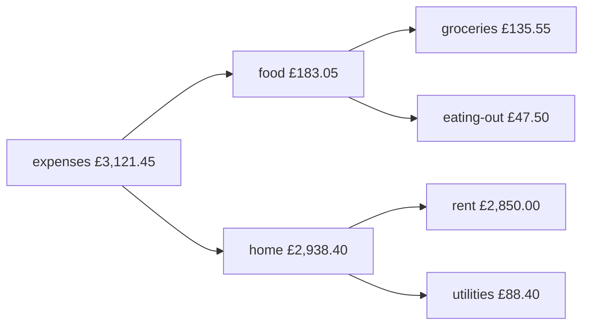
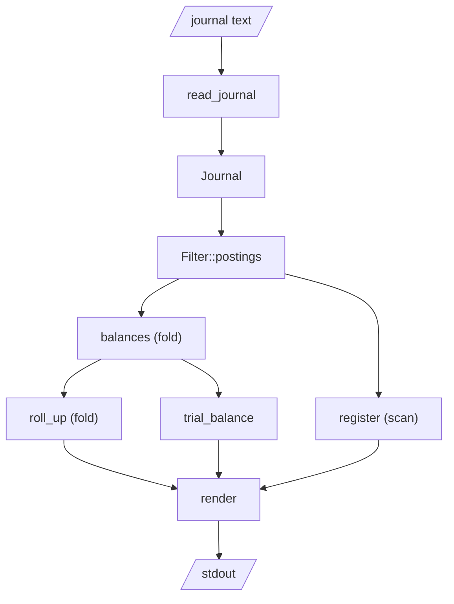

# Reports as folds

It's the end of the quarter and you have three questions. How much is in the
bank? Where did February's money go? And is there a mistake anywhere in the
three months of entries you've typed?

Each question sounds like it needs its own program. They don't. Every report
a bookkeeping tool produces (balances, a register of postings, a trial
balance, an income statement) is the same computation in different clothes:
walk the journal from start to finish, carrying some accumulator, and update
it at each posting. Chapter 6 gave that computation a name: a *fold*. In this
chapter the whole reporting side of `ledger` turns out to be a handful of
folds, a few iterator adaptors to choose *which* postings go in, and some pure
functions that turn the result into text.

We'll also give `ledger` its front door: a reader for plain-text journal
files, and a command-line interface with `balance`, `register` and `check`.
And we'll finish with property tests that check what double-entry promises
for *any* journal, not just the ones we thought to write down.

## The journal file

Here's the sample journal we'll use throughout, a household's first quarter
of 2026. Save it as `household.journal` in the project root. January first:

```text
; A household's first quarter of 2026.

2026-01-01 Opening balances
    assets:bank:current       £2,500.00
    assets:bank:savings       £8,000.00
    liabilities:credit-card    -£320.00
    equity:opening

2026-01-02 Rent
    expenses:home:rent          £950.00
    assets:bank:current

2026-01-05 Tesco
    expenses:food:groceries      £64.20
    liabilities:credit-card

2026-01-12 Electricity
    expenses:home:utilities      £88.40
    assets:bank:current

2026-01-28 Salary
    assets:bank:current       £2,400.00
    income:salary

2026-01-30 Pay credit card
    liabilities:credit-card     £384.20
    assets:bank:current
```

The format is the one plain-text accounting tools share, cut down to what
we've modelled. A transaction starts with an unindented header (a date and a
description); its postings follow, indented, one per line, with an account
name, whitespace, and an optional amount. Semicolons start comments. Blank
lines are for humans.

The opening balances entry shows what equity is for: it records where the
starting money "came from", so that even the first transaction balances.

February includes a trip to Boston, which needs one more idea. Buying dollars
with pounds involves two currencies, and a transaction balances *per
currency*, so we route the exchange through an equity account that takes the
other side of each leg:

```text
2026-02-02 Rent
    expenses:home:rent          £950.00
    assets:bank:current

2026-02-09 Dinner out
    expenses:food:eating-out     £47.50
    liabilities:credit-card

2026-02-14 Buy dollars for holiday
    assets:cash:usd               $250.00
    equity:conversion            -$250.00
    equity:conversion             £198.00
    assets:bank:current          -£198.00

2026-02-20 Diner in Boston
    expenses:travel:food           $42.80
    assets:cash:usd

2026-02-21 Museum tickets
    expenses:travel:sights         $56.00
    assets:cash:usd

2026-02-27 Salary
    assets:bank:current       £2,400.00
    income:salary
```

In the exchange, pounds balance and dollars balance, and `equity:conversion`
ends up holding "£198 in, $250 out", which is precisely the exchange rate you
got. Real tools offer price annotations as shorthand for this, but underneath
it's the same bookkeeping. March is quieter:

```text
2026-03-02 Rent
    expenses:home:rent          £950.00
    assets:bank:current

2026-03-10 Save for a rainy day
    assets:bank:savings         £500.00
    assets:bank:current

2026-03-15 Tesco
    expenses:food:groceries      £71.35
    liabilities:credit-card
```

## Reading the journal

This is a line-oriented format with no nesting, so a hand-written reader is
the right size of tool. Part VI builds a far more capable parser with parser
combinators (Chapter 24); here we'll split lines and lean on the `FromStr`
impls we already have for dates, accounts and money. The reader's job is
just to find the pieces and hand them over.

### Errors with line numbers

A journal is written by a person, so the reader's most important output is a
good error message. Each error gets the line it came from, and its *kind*
reuses the domain errors from the last two chapters:

```rust
// file: src/reader.rs
/// Something wrong with the journal, and where.
#[derive(Debug, Clone, PartialEq, Eq, Error)]
#[error("line {line}: {kind}")]
pub struct ReadError {
    pub line: usize,
    pub kind: ReadErrorKind,
}

#[derive(Debug, Clone, PartialEq, Eq, Error)]
pub enum ReadErrorKind {
    #[error("expected `YYYY-MM-DD description`, found `{0}`")]
    BadHeader(String),
    #[error("`{0}` is not a date (expected YYYY-MM-DD)")]
    BadDate(String),
    #[error("posting is not inside a transaction")]
    OrphanPosting,
    #[error(transparent)]
    Account(#[from] AccountError),
    #[error(transparent)]
    Money(#[from] ParseMoneyError),
    #[error(transparent)]
    Transaction(#[from] TransactionError),
}
```

This is *Error Translation at Boundaries* (Chapter 4) in miniature. `#[from]`
generates a `From<AccountError> for ReadErrorKind`, so `?` converts domain
errors as they cross into the reader, and `#[error(transparent)]` reuses
their messages verbatim. The reader adds only what it alone knows: the line.

### Two passes: group, then parse

Parsing line by line in one loop gets tangled, because a posting line means
nothing without the header above it. It's easier in two steps. First, group
the lines into *blocks*, each a header and the postings beneath it, keeping
line numbers and borrowing slices of the input rather than copying:

```rust
/// A header line and the indented posting lines beneath it.
struct Block<'a> {
    line: usize,
    header: &'a str,
    postings: Vec<(usize, &'a str)>,
}
```

The lifetime `'a` says that a `Block` borrows from the input text and can't
outlive it (Chapter 2). The grouping loop strips comments, skips blanks, and
starts a new block at each unindented line:

```rust
/// Groups lines into blocks, dropping comments and blank lines.
fn blocks(text: &str) -> Vec<Result<Block<'_>, ReadError>> {
    let mut out: Vec<Result<Block<'_>, ReadError>> = Vec::new();
    for (index, raw) in text.lines().enumerate() {
        let line = raw.split(';').next().unwrap_or_default();
        if line.trim().is_empty() {
            continue;
        }
        let number = index + 1;
        if !line.starts_with(char::is_whitespace) {
            let header = line.trim();
            out.push(Ok(Block {
                line: number,
                header,
                postings: vec![],
            }));
            continue;
        }
        match out.last_mut() {
            Some(Ok(block)) => block.postings.push((number, line.trim())),
            Some(Err(_)) => {} // already reported this orphan run
            None => out.push(Err(ReadError {
                line: number,
                kind: ReadErrorKind::OrphanPosting,
            })),
        }
    }
    out
}
```

The interesting part is the final `match` on `out.last_mut()`: an indented
line belongs to the most recent block, unless there isn't one, in which case
it's an orphan posting at the top of the file. Matching on
`Option<&mut Result<Block, _>>` lays the three possibilities out flat.

This is a loop with a mutable vector, and that's fine. It could be written as
a `fold`, but the accumulator would be this same vector and the closure this
same body. Functional style is about *pure functions* and *values*, not about
avoiding `for`; `blocks` takes a `&str` and returns a value, and nothing
outside it can tell how it was written.

### Parsing a posting

The second step parses each block. A posting line is an account name, then
optionally whitespace and an amount. Account names can't contain whitespace
(Chapter 22 made sure of that), so the first whitespace is the separator:

```rust
/// `expenses:food  £42.50`, or just `assets:bank` for an elided amount.
fn parse_posting(text: &str) -> Result<PostingDraft, ReadErrorKind> {
    let (account, amount) = match text.split_once(char::is_whitespace) {
        Some((account, amount)) => (account, Some(amount.trim())),
        None => (text, None),
    };
    Ok(PostingDraft {
        account: account.parse()?,
        amount: amount.map(str::parse).transpose()?,
    })
}
```

The last line is worth slowing down for. `amount` is an `Option<&str>`.
Mapping `str::parse` over it gives an `Option<Result<Money, _>>`: maybe there
was an amount, and if so maybe it parsed. What we want is the other way round,
a `Result<Option<Money>, _>`, so that `?` can propagate a parse error while
"no amount" stays a perfectly good `None`. `transpose` swaps the two layers.
It's a small method that comes up whenever optional input meets fallible
parsing.

The block parser splits the header into date and description, parses every
posting (collecting into `Result<Vec<_>, _>` stops at the first bad one,
Chapter 6's trick), and hands everything to the aggregate:

```rust
    let drafts = block
        .postings
        .iter()
        .map(|&(line, text)| {
            parse_posting(text).map_err(|kind| ReadError { line, kind })
        })
        .collect::<Result<Vec<_>, _>>()?;

    Transaction::new(date, description, drafts).map_err(|e| at(e.into()))
```

Notice what the reader *doesn't* do: check that the transaction balances.
That rule lives in `Transaction::new` and nowhere else. The reader's job is to
turn text into the arguments the domain asks for; the domain decides whether
they make a transaction. This is the *Raw DTO → Validated Domain* pattern
from Chapter 8, with `PostingDraft` playing the DTO.

### Every error, not just the first

When a journal has three mistakes, a tool that reports one, makes you fix
it, then reports the next, is tedious. So `read_journal` keeps going after a
bad block and collects every error:

```rust
/// Parses a whole journal, reporting every bad transaction, not just the
/// first.
pub fn read_journal(text: &str) -> Result<Journal, Vec<ReadError>> {
    let mut transactions = Vec::new();
    let mut errors = Vec::new();
    for block in blocks(text) {
        match block.and_then(|b| parse_block(&b)) {
            Ok(tx) => transactions.push(tx),
            Err(e) => errors.push(e),
        }
    }
    match errors.is_empty() {
        true => Ok(Journal::new(transactions)),
        false => Err(errors),
    }
}
```

The return type says the policy: you get a whole journal, or a list of
everything wrong with it. Never a journal with some transactions quietly
missing. (`block.and_then(...)` chains the grouping error and the parsing
error into one `Result`.)

## Balances: the first fold

Now the reports. The most basic question is "what's the balance of each
account?" Spelled out: start with an empty map from account to balance; for
each posting, add its amount to its account's entry. That's a fold, and in
Rust it reads almost exactly like the sentence:

```rust
// file: src/report.rs
/// The balance of every account, in account order.
pub type Balances = BTreeMap<AccountName, Balance>;

/// Folds postings into a balance per account.
pub fn balances<'a>(
    postings: impl IntoIterator<Item = &'a Posting>,
) -> Balances {
    postings
        .into_iter()
        .fold(Balances::new(), |mut acc, posting| {
            *acc.entry(posting.account().clone()).or_default() +=
                posting.amount();
            acc
        })
}
```

Several earlier decisions pay off in these few lines.

- **`BTreeMap`, not `HashMap`.** A `BTreeMap` keeps its keys sorted, and
  `AccountName`'s derived `Ord` sorts by account type then path. So iterating
  the result lists assets, then liabilities, equity, income and expenses, each
  in alphabetical order, with every parent directly before its children. The
  report's order is a property of the data structure, not a sort we have to
  remember to do. A `HashMap` would be no faster for a few dozen accounts and
  would print in a different order every run.
- **`or_default()`** inserts `Balance::default()` (empty) for a new account,
  and `+=` is the `AddAssign<Money>` from Chapter 21. Because adding money to
  a balance is total, the fold has no error path at all.
- **The input is any iterator of postings.** `balances` doesn't know about
  journals, dates or filters. Whatever chooses the postings is someone else's
  job, which is what makes this one function serve every report.

> [!PATTERN] Report as Fold
> Treat every report as a fold over the journal: an initial accumulator (an
> empty map, a zero balance), a pure step function that folds in one posting,
> and an iterator pipeline in front that chooses which postings take part.
> Reports then share their filtering, differ only in their accumulator, and
> are trivial to test with hand-made input.

## Rolling up the tree

A flat list of leaf accounts answers "how much on groceries?" but not "how
much on food?" or "how much did we spend at all?". For that, each account's
balance must also count towards every one of its ancestors. Here's the pound side
of the sample journal's expenses rolled up (the dollar spending under
`expenses:travel` rolls up the same way); each parent is the sum of its
children:



Chapter 22 gave us `AccountName::ancestors()`, which yields an account and
each parent up to the root. Rolling up is then a fold over the flat balances,
adding each one into every ancestor's entry:

```rust
/// Adds every account's balance into each of its parents as well.
pub fn roll_up(flat: &Balances) -> Balances {
    flat.iter()
        .fold(Balances::new(), |mut acc, (account, balance)| {
            for ancestor in account.ancestors() {
                *acc.entry(ancestor).or_default() += balance;
            }
            acc
        })
}
```

It's the same shape as `balances`: an empty map, and a step that adds into
entries. The only difference is that one input touches several entries. The
roll-up of a leaf includes the leaf itself (`ancestors` starts with `self`),
so leaves keep their own balances and parents gain their children's.

## Choosing postings: filters

"Where did February's money go?" means: only postings dated in February, only
to accounts under `expenses`. Both conditions are *filters*, and both belong
in front of the fold rather than inside it.

A date range has a classic off-by-one trap: does "to 2026-03-01" include the
first of March? We pick the convention most date libraries use and make it
part of the type's documentation: the start is included, the end is not.
Half-open ranges compose cleanly (February is `[02-01, 03-01)` and March is
`[03-01, 04-01)`, with no gap and no overlap) and nobody has to know how many
days February has.

```rust
/// Dates from `from` (inclusive) up to `to` (exclusive). Either end may be
/// open.
#[derive(Clone, Copy, Debug, Default, PartialEq, Eq)]
pub struct DateRange {
    pub from: Option<Date>,
    pub to: Option<Date>,
}

impl DateRange {
    pub fn contains(&self, date: Date) -> bool {
        self.from.is_none_or(|from| date >= from)
            && self.to.is_none_or(|to| date < to)
    }
}
```

`Option::is_none_or` reads exactly as the rule does: "there's no lower bound,
or the date is on or after it". An open end imposes no condition, and
`DateRange::default()` (both `None`) contains every date.

A `Filter` combines a date range with an optional account, and produces the
matching postings, each paired with the transaction it belongs to (reports
like the register need the date and description):

```rust
impl Filter {
    /// Matching postings, each paired with its transaction.
    pub fn postings<'a>(
        &'a self,
        journal: &'a Journal,
    ) -> impl Iterator<Item = (&'a Transaction, &'a Posting)> {
        journal
            .transactions()
            .iter()
            .filter(|tx| self.dates.contains(tx.date()))
            .flat_map(|tx| tx.postings().iter().map(move |p| (tx, p)))
            .filter(|(_, p)| self.wants(p.account()))
    }
}
```

This is an *Iterator Pipeline* (Chapter 6), and it's lazy: nothing happens
until a report pulls postings through it, and no intermediate collection is
ever built. `flat_map` turns "a sequence of transactions, each with several
postings" into one flat sequence of postings. The inner closure needs
`move` so that it captures its own copy of the `tx` reference rather than
borrowing the outer closure's parameter, which would die at the end of each
call. The `'a` lifetimes tie the iterator to both the filter and the
journal: the postings it yields are borrowed, not copied.

`wants` uses `is_under` from Chapter 22, the one that knows
`assets:bankrupt-fund` isn't under `assets:bank`.

Here's the whole reporting side as a picture. Only the two slanted boxes at
the ends touch the outside world; every step between them is a pure function
of its input:



## The register: a running balance with `scan`

A *register* lists postings one per line with a running balance: the bank
statement view, but for any account or group of accounts. Each line's
running total depends on all the lines before it. That's a fold that emits
its accumulator at every step, instead of only at the end, and the iterator
adaptor for that is `scan`:

```rust
/// A running balance over postings, threaded through with `scan`.
pub fn register<'a>(
    postings: impl Iterator<Item = (&'a Transaction, &'a Posting)>,
) -> impl Iterator<Item = RegisterRow<'a>> {
    postings.scan(Balance::new(), |running, (tx, posting)| {
        *running += posting.amount();
        Some(RegisterRow {
            date: tx.date(),
            description: tx.description(),
            account: posting.account(),
            amount: posting.amount(),
            running: running.clone(),
        })
    })
}
```

`scan` hands the closure a mutable reference to its state (`running`) and
the next item; the closure updates the state and returns `Some(output)` to
emit a row (or `None` to stop early). The state is private to the iterator:
the mutation is real, but nobody outside can see it, so `register` is still
a pure function from postings to rows. The `.clone()` is visible because each
row needs its own snapshot of the running balance.

`RegisterRow` borrows its description and account from the journal (`&'a
str`, `&'a AccountName`) rather than copying them. A register over a large
journal allocates only the running balances.

## The trial balance

Before computers, the *trial balance* was how a bookkeeper checked their
arithmetic. You list every account's balance in two columns, debits
(positive) and credits (negative), and add up both columns. If the books are
right, the columns are equal. If not, there's a mistake somewhere, and you
start hunting.

In our ledger, that check can't fail. Every `Transaction` balances, because
the aggregate wouldn't exist otherwise; a sum of balanced transactions
balances; so the trial balance is zero by construction. We build it anyway,
for two reasons. It's a useful *report*, laying every account out with its
side of the books. And it's an end-to-end check of the whole pipeline: if
some future change to the reader, the folds or `Balance` broke the
arithmetic, this is where it would show.

```rust
pub fn trial_balance(flat: &Balances) -> TrialBalance {
    let rows: Vec<_> = flat
        .iter()
        .filter(|(_, balance)| !balance.is_zero())
        .map(|(account, balance)| (account.clone(), balance.clone()))
        .collect();
    let debits = rows.iter().map(|(_, b)| b.debits()).sum();
    let credits = rows.iter().map(|(_, b)| b.credits()).sum();
    TrialBalance {
        rows,
        debits,
        credits,
    }
}
```

`Balance::debits` and `credits` keep only the positive or negative totals of
a balance (an account can be in debit in one currency and credit in another,
as `equity:conversion` is), and summing balances is the same total operation
as before. `TrialBalance::is_balanced` checks that `debits + credits` is zero
in every currency.

## The command line

The functional core is finished. The imperative shell is a `main.rs` that
parses arguments, reads one file, calls the core, and prints. We use `clap`'s
derive API exactly as in Chapter 13, with one detail worth pointing out:

```rust
// file: src/main.rs
#[derive(Subcommand)]
enum Command {
    /// Show balances, rolled up the account tree.
    Balance {
        /// Only accounts under this one.
        account: Option<AccountName>,
        /// List full account names without rolling up.
        #[arg(long)]
        flat: bool,
        #[command(flatten)]
        dates: Dates,
    },
    // ... Register { account, dates } and Check
}
```

The account argument is an `AccountName`, not a `String`. `clap` accepts any
type that implements `FromStr` with a displayable error, so the domain's own
parser validates the argument at the boundary. That's Chapter 13's *Parse the
Boundary (CLI → Domain Command)* with no extra code:

```sh
ledger register asset:bank
```

```text
error: invalid value 'asset:bank' for '[ACCOUNT]': `asset` is not one of assets, liabilities, equity, income, expenses

For more information, try '--help'.
```

`Dates` is a small `#[derive(Args)]` struct with `--from` and `--to` options
of type `Option<jiff::civil::Date>`, flattened into both reporting commands
and converted to a `DateRange`. Loading the journal is the shell's one piece
of I/O, and it's where the reader's list of errors becomes output:

```rust
fn load(path: &PathBuf) -> anyhow::Result<Journal> {
    let text = std::fs::read_to_string(path)
        .with_context(|| format!("reading {}", path.display()))?;
    read_journal(&text).or_else(|errors| {
        for error in &errors {
            eprintln!("{}: {error}", path.display());
        }
        bail!("{} has {} error(s)", path.display(), errors.len())
    })
}
```

As the book's convention has it, domain code returns typed errors and only
the shell uses `anyhow`. Each command is then three or four lines that wire
core functions together:

```rust
        Command::Balance {
            account,
            flat,
            dates,
        } => {
            let filter = Filter {
                dates: dates.range(),
                account,
            };
            let postings = filter.postings(&journal).map(|(_, p)| p);
            let flat_balances = report::balances(postings);
            let total = report::total(flat_balances.values());
            let text = match flat {
                true => render::balance_flat(&flat_balances, &total),
                false => {
                    let rolled = report::roll_up(&flat_balances);
                    render::balance_tree(&rolled, &total)
                }
            };
            println!("{text}");
        }
```

The `render` module turns reports into strings with pure functions. It's
mostly `format!` with widths: `{part:>#14}` right-aligns a pretty amount in
fourteen columns, using the `f.pad` support from Chapter 21. Its one idea
worth showing is how a multi-currency balance is printed: one line per
currency, with the account name on the first:

```rust
// file: src/render.rs
/// One line per currency; the first carries `label`.
fn amount_lines(balance: &Balance, label: &str) -> Vec<String> {
    let mut parts: Vec<Balance> = balance.per_currency().collect();
    if parts.is_empty() {
        parts.push(Balance::new());
    }
    parts
        .iter()
        .enumerate()
        .map(|(i, part)| match i {
            0 => format!("{part:>#AMOUNT$}  {label}").trim_end().to_string(),
            _ => format!("{part:>#AMOUNT$}"),
        })
        .collect()
}
```

(`AMOUNT` is a `const` column width of 14; format strings can take a width
from any variable or constant in scope with `name$`.) Rendering being pure
means it's tested by comparing strings, with no terminal involved.

### Running it

Time to ask our three questions. First, the balances, rolled up:

```sh
cargo run -q -- -f household.journal balance
```

```text
    £11,779.40  assets
       $151.20
    £11,779.40    bank
     £3,279.40      current
     £8,500.00      savings
       $151.20    cash
       $151.20      usd
      -£118.85  liabilities
      -£118.85    credit-card
    -£9,982.00  equity
      -$250.00
       £198.00    conversion
      -$250.00
   -£10,180.00    opening
    -£4,800.00  income
    -£4,800.00    salary
     £3,121.45  expenses
        $98.80
       £183.05    food
        £47.50      eating-out
       £135.55      groceries
     £2,938.40    home
     £2,850.00      rent
        £88.40      utilities
        $98.80    travel
        $42.80      food
        $56.00      sights
--------------
             0
```

Read it top to bottom and it's the household's finances: £11,779.40 in the
bank and $151.20 in a wallet, £118.85 owed on the card, £4,800 earned, and
the spending broken down by category. The grand total is `0`, as it must be:
everything that's anywhere came from somewhere.

Second, where February's money went:

```sh
cargo run -q -- -f household.journal balance expenses \
  --from 2026-02-01 --to 2026-03-01
```

```text
       £997.50  expenses
        $98.80
        £47.50    food
        £47.50      eating-out
       £950.00    home
       £950.00      rent
        $98.80    travel
        $42.80      food
        $56.00      sights
--------------
       £997.50
        $98.80
```

The total isn't zero this time, and it shouldn't be: we filtered to one side
of the books. Third, the register for the bank accounts in January:

```sh
cargo run -q -- -f household.journal register assets:bank --to 2026-02-01
```

```text
2026-01-01 Opening balances assets:bank:current        £2,500.00      £2,500.00
2026-01-01 Opening balances assets:bank:savings        £8,000.00     £10,500.00
2026-01-02 Rent             assets:bank:current         -£950.00      £9,550.00
2026-01-12 Electricity      assets:bank:current          -£88.40      £9,461.60
2026-01-28 Salary           assets:bank:current        £2,400.00     £11,861.60
2026-01-30 Pay credit card  assets:bank:current         -£384.20     £11,477.40
```

Finally, `check` on the full journal prints the trial balance:

```sh
cargo run -q -- -f household.journal check
```

```text
         Debit         Credit  Account
     £3,279.40                 assets:bank:current
     £8,500.00                 assets:bank:savings
       $151.20                 assets:cash:usd
                      £118.85  liabilities:credit-card
       £198.00                 equity:conversion
                      $250.00  equity:conversion
                   £10,180.00  equity:opening
                    £4,800.00  income:salary
        £47.50                 expenses:food:eating-out
       £135.55                 expenses:food:groceries
     £2,850.00                 expenses:home:rent
        £88.40                 expenses:home:utilities
        $42.80                 expenses:travel:food
        $56.00                 expenses:travel:sights
-------------- --------------
    £15,098.85     £15,098.85
       $250.00        $250.00

ok: 15 transactions balance
```

And on a journal with three mistakes in it (a misspelt account, a typo that
swapped two digits, and a third decimal place), every one is reported at
once, with its line, in the domain's own words:

```text
broken.journal: line 7: `liabilites` is not one of assets, liabilities, equity, income, expenses
broken.journal: line 9: postings do not balance: off by 0.36 GBP
broken.journal: line 14: GBP has 2 decimal places, found 3
ledger: broken.journal has 3 error(s)
```

> [!CHECKPOINT]
> `src/lib.rs` now declares `account`, `journal`, `money`, `reader`,
> `render`, `report` and `transaction`. `cargo run -- -f household.journal
> check` should print a balanced trial balance and exit with status 0; any
> malformed journal should exit with status 1 and list every error.

## Properties every journal must have

Our unit tests check examples we thought of. Double-entry bookkeeping makes
promises about *every* journal, which is exactly what property-based testing
(Chapter 7) is for. We'll put these in `tests/properties.rs`, an
integration test that uses only the library's public API, just as any other
client would.

### Generating valid transactions

The hard part of property testing is usually the generator. We need random
transactions that are valid, and since the only way to make a `Transaction`
is through `new`, our generator has to produce balanced postings. The trick
is to generate unbalanced postings first, then add one balancing posting per
currency, using `Balance` to work out what's needed:

```rust
// file: tests/properties.rs
/// Random postings, then one balancing posting per unbalanced currency.
fn transaction() -> impl Strategy<Value = Transaction> {
    let postings = prop::collection::vec((account(), money()), 2..6);
    let description = "[A-Za-z][A-Za-z0-9 ]{0,20}";
    (day(), description, postings, account()).prop_map(
        |(on, description, postings, balancing)| {
            let residual: Balance = postings.iter().map(|(_, m)| *m).sum();
            let fixes = residual.per_currency().map(|b| {
                let (currency, minor) = b.totals().next().unwrap();
                let minor = i64::try_from(-minor).unwrap();
                (balancing.clone(), Money::from_minor(minor, currency))
            });
            // ... turn postings and fixes into drafts
            Transaction::new(on, &description, drafts).unwrap()
        },
    )
}
```

`account()`, `money()` and `day()` are small strategies built the same way:
`money()` picks a currency from `Currency::ALL` and an amount between ±10^9^
minor units; `account()` picks a root and up to two random segments; `day()`
picks a year, month and a day up to the 28th, so every date is real. A
journal is then a vector of up to twenty transactions:

```rust
fn journal() -> impl Strategy<Value = Journal> {
    prop::collection::vec(transaction(), 0..20).prop_map(Journal::new)
}
```

### The properties

The first property is the accounting equation itself. However the
transactions are generated, the balances over all accounts sum to zero:

```rust
proptest! {
    #[test]
    fn every_journal_sums_to_zero(journal in journal()) {
        let all = journal.transactions().iter().flat_map(|t| t.postings());
        let balances = report::balances(all);
        prop_assert!(report::total(balances.values()).is_zero());
    }
}
```

The second checks `roll_up`. Rolling up mustn't create or lose money, so the
total of the *root* accounts after rolling up must equal the total of all the
leaf balances before. A bug that double-counted a level, or skipped the
account itself, would break it:

```rust
    #[test]
    fn roll_ups_preserve_totals(journal in journal()) {
        let all = journal.transactions().iter().flat_map(|t| t.postings());
        let flat = report::balances(all);
        let rolled = report::roll_up(&flat);
        let roots = rolled.iter().filter(|(a, _)| a.depth() == 1);
        prop_assert_eq!(
            report::total(roots.map(|(_, b)| b)),
            report::total(flat.values())
        );
    }
```

The third is the round trip. `Transaction`'s `Display` writes the journal
format, with every amount written out in canonical form, so reading what we
write must give back the same transaction:

```rust
    #[test]
    fn transactions_round_trip_through_text(tx in transaction()) {
        let journal = read_journal(&tx.to_string()).unwrap();
        prop_assert_eq!(journal.transactions(), &[tx][..]);
    }
```

(A fourth test does the same for whole journals.) Round-trip properties are
among the most valuable tests you can write, because they check two pieces
of code against each other with no expected values to maintain.

### What the round trip found

When we first wrote the generator, descriptions could contain any printable
ASCII character. Here's a run with semicolons allowed:

```text
thread 'transactions_round_trip_through_text' panicked at tests/properties.rs:64:1:
Test failed: assertion failed: `(left == right)`
...
minimal failing input: tx = Transaction {
    date: 2000-01-01,
    description: "a;",
    postings: [
        ...
    ],
}
```

Proptest found a failing case and then *shrank* it to the smallest one it
could: the year 2000, two zero postings to `assets`, and the description
`"a;"`. Written out, that's `2000-01-01 a;`, and the reader, quite correctly,
treats everything after `;` as a comment. The description comes back as `a`.

This is a real design question, not a test bug. The `Transaction` aggregate
happily accepts a semicolon; the file format can't represent one. We have
three choices: escape semicolons when writing, make `;` (and newlines)
illegal in descriptions as a domain rule, or accept that the format has a
limit and constrain the generator to document it. We took the third, the
smallest change, by narrowing the generator to letters, digits and spaces.
The first exercise asks you to take the second, which is arguably better.

The point is that we didn't think of this case. The property did.

> [!CHECKPOINT]
> The whole suite passes: unit tests beside each module, integration tests
> over the sample journal, and the properties.
>
> ```sh
> cargo test
> ```
>
> ```text
>      Running tests/properties.rs
> test transactions_round_trip_through_text ... ok
> test roll_ups_preserve_totals ... ok
> test every_journal_sums_to_zero ... ok
> test journals_round_trip_through_text ... ok
>
> test result: ok. 4 passed; 0 failed; 0 ignored; 0 measured
> ```

## Looking back at Part V

Step back and look at how the work is divided in `ledger`. `Money` and
`Balance` make arithmetic exact and total. `AccountName` makes the hierarchy
a type with correct tree operations. `Transaction` makes "balances in every
currency" a fact about every value in the program. The reports, as a
result, are almost trivial: folds with no error handling, because there's no
invalid input left for them to handle. All the difficulty was spent once,
in the types, and every report gets the benefit.

That's the trade this book keeps making. Effort spent on the domain model is
repaid every time the model is used, and in a bookkeeping system the model is
used by everything.

## What we learned

- **Every report is a fold** with a different accumulator: a map of balances,
  a running total, a pair of debit and credit columns. Filters belong in front
  of the fold, as iterator adaptors, so all reports share them. That's
  *Report as Fold*.
- **`BTreeMap` with a well-chosen `Ord`** gives deterministic, conventional
  report order without any sorting code.
- **Roll-ups** are a fold that adds each balance into every ancestor, using
  `AccountName::ancestors()`.
- **`scan`** is a fold that emits its state at each step: the right tool for
  running balances.
- **Half-open date ranges** (`[from, to)`) compose without gaps or overlaps;
  `Option::is_none_or` expresses open ends neatly.
- **A hand-written reader** can stay small by grouping lines first, delegating
  every value to an existing `FromStr`, and leaving validation to the
  aggregate. `Option::transpose` turns `Option<Result<_>>` inside out.
- **Collect all errors** at a human-facing boundary, each with its line number.
- **`clap` can parse arguments straight into domain types** that implement
  `FromStr`.
- **Property tests check promises, not examples**: "every journal sums to
  zero", "roll-ups preserve totals", and round trips through text, which
  found a format limitation we hadn't thought of.

## Exercises

> [!EXERCISE] Descriptions the format can carry
> Introduce a `Description` value object that rejects empty text, newlines and
> semicolons, and use it in `Transaction`. Which `TransactionError` variant
> changes? Then widen the property test's description generator to include
> `;` and check that the round trip still holds, because invalid
> descriptions now can't be generated (filter them with `prop_filter`, or
> generate only valid ones).

> [!EXERCISE] Depth limits
> Add `--depth N` to `ledger balance`, showing only accounts at most `N`
> segments deep (with their rolled-up totals). Implement it as a filter on the
> rolled-up `Balances`, not as a change to `roll_up`. Write a property that the
> total of depth-1 accounts is the same whatever `N` is.

> [!EXERCISE] An income statement
> An income statement shows income and expenses for a period, and their sum:
> the profit (or loss) for that period. Write
> `fn income_statement(journal: &Journal, dates: DateRange) -> ...` as a fold
> using only the pieces in this chapter, and add a `ledger income` command.
> What should the return type be so that rendering stays a separate, pure
> step?

> [!EXERCISE] Balance assertions
> Plain-text accounting tools support *balance assertions*: a posting like
> `assets:bank:current  £0 = £3,279.40` asserts the account's running balance
> at that point. Extend the reader to accept them and `check` to verify them.
> Where does the assertion belong in the types: on `PostingDraft`, on
> `Posting`, or in a separate list on the `Journal`? (Hint: it's checked
> against the *journal*, not the transaction.)
