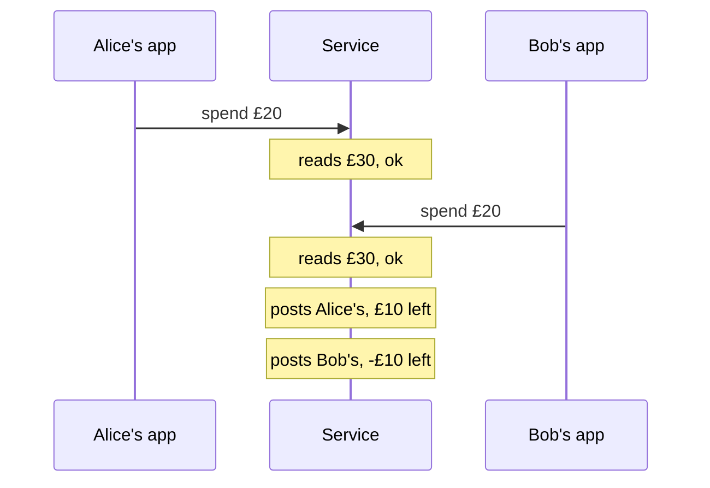
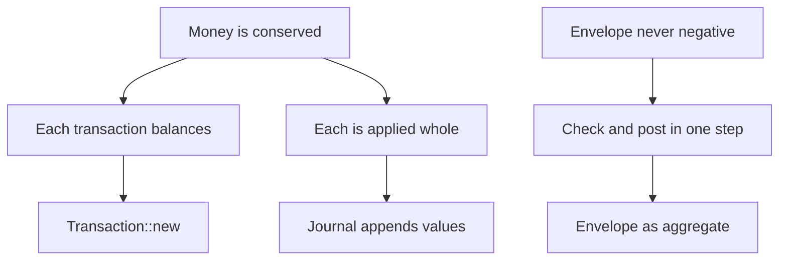

# Interlude: Money never leaks

Part V ended with a ledger we can trust. `Money` can't be added to the wrong
currency, and a `Transaction` can't exist unless its postings sum to zero.
A property test generates hundreds of random journals and checks that every
one of them sums to zero. Reports are folds with no error paths, because
there's no invalid input left for them to handle.

Now imagine the ledger grows up. The household keeps cash envelopes, an old
budgeting trick: £30 a week goes into a `groceries` envelope, and when it's
empty, it's empty. We put the ledger behind a small service, and two family
members, Alice and Bob, each have an app on their phone that records a
purchase by asking the service to post it. The service is careful. Before
posting, it reads the envelope's balance and refuses the purchase if there
isn't enough in it.

Two questions follow, and they sound alike:

1. **Is money conserved?** Does every report still sum to zero, however
   the two phones' requests interleave?
2. **Can an envelope go negative?** The service checks before every post,
   but Alice and Bob are in different aisles of the same shop, and they tap
   "buy" at the same moment.

Our tests can't answer either well. The property test generates *journals*,
lists of transactions in some order, not *schedules*: the ways two requests'
steps can overlap. A concurrent test that fires two requests at a real
service would pass almost every time, because the bad overlap needs one
request to land in a window a few microseconds wide. This interlude models
the service in PlusCal, has TLC try every overlap, and gets two different
answers to the two questions. The difference between them is the most useful
lesson in the strand about *where invariants live*. Then we'll grow the
model until TLC starts to struggle, and talk honestly about what a small
model can and can't tell us.

## Balances are a function

Let's start with the nouns. There are accounts, each with a balance, and the
balances change as transactions are posted. In Rust, Chapter 23's
`report::balances` folded postings into a `BTreeMap<AccountName, Balance>`.
In TLA+ the natural shape for "a balance for every account" is a
**function**, which we met in Interlude 3: a mapping with a fixed domain,
like a `HashMap` that always has an entry for every key.

First the accounts and the constants a model will fix:

```tla
\* file: Transfers.tla
---- MODULE Transfers ----
EXTENDS Integers, FiniteSets

CONSTANTS Clients, Envelopes, Amounts, Budget

Opening  == "equity"
Food     == "expenses:food"
Accounts == Envelopes \cup {Opening, Food}
```

`Clients` will be Alice and Bob, and `Envelopes` the envelopes, both as
model values (Interlude 2). An envelope stands for an asset account such as
`assets:cash:groceries`. `Amounts` is the set of prices a purchase can have,
and `Budget` what each envelope starts with. Two ordinary accounts complete
the books: `equity`, where opening balances come from, and `expenses:food`,
where purchases go.

As usual, we decide what to leave out. One currency is enough, because
Chapter 21's `Balance` keeps currencies separate. Whole pounds are enough,
because nothing we're asking depends on pennies. Dates, descriptions and the
account hierarchy go too.

### Opening the books

Every envelope starts with `Budget`, and, double-entry being what it is,
that money has to come from somewhere: `equity` goes negative by the same
total. Here's the opening balance sheet as a function:

```tla
\* file: Transfers.tla
\* Every envelope starts with the budget, funded from equity.
Opened ==
    [a \in Accounts |-> IF a \in Envelopes THEN Budget
                        ELSE IF a = Opening
                             THEN -Budget * Cardinality(Envelopes)
                             ELSE 0]
```

`[a \in Accounts |-> e]` builds a function with one entry per account, as in
Interlude 3, and `Opened[a]` looks one up. The new piece is
`Cardinality(Envelopes)`: the number of elements in a finite set. It lives in
the standard module **`FiniteSets`**, which is why the module now extends
it. With two envelopes and a budget of 30, `equity` opens at −60.

### A transaction is a function too

What does posting a transaction do to the balances? In Chapter 22 a
`Transaction` was a list of postings, each an account and an amount. For a
model, there's an even simpler view: a transaction is *another* function
from accounts to numbers, saying how much each account changes. Most
entries are zero.

```tla
\* file: Transfers.tla
\* The postings of one purchase: a map from account to change.
Spend(env, amt) ==
    [a \in Accounts |-> IF a = env THEN -amt
                        ELSE IF a = Food THEN amt
                        ELSE 0]

\* Add a transaction's postings to the balances, account by account.
Apply(bal, tx) == [a \in Accounts |-> bal[a] + tx[a]]
```

`Spend(groceries, 20)` is the purchase −20 from the envelope and +20 to
food, written as a whole-books map. `Apply` adds two such maps pointwise:
every account's new balance is its old one plus its change. That's the
step function of Chapter 23's fold, `*acc.entry(account) += amount`, applied
to a whole transaction at once.

Treating balances and transactions as the same kind of thing, a map from
accounts to numbers, is what keeps the rest of the spec short.

## Adding up a map

Conservation is "the balances sum to zero". That needs a sum over a
function's values, and TLA+ doesn't have one built in. It does have
`RECURSIVE` from Interlude 3, where we replayed a sequence by peeling off its
head. A set has no head, though. To peel an element off a set we need a way
to say "some element of this set", and that's the job of `CHOOSE`.

### `CHOOSE`

`CHOOSE x \in S : P(x)` means *an* element of `S` for which `P` is true.
`CHOOSE x \in S : TRUE` is "an element of `S`, any one". Here is a sum over a
set, using it:

```tla
\* file: Transfers.tla
RECURSIVE Sum(_, _)
Sum(f, S) == IF S = {} THEN 0
             ELSE LET a == CHOOSE x \in S : TRUE
                  IN  f[a] + Sum(f, S \ {a})
```

Pick an account `a`, add its value to the sum of the rest. `S \ {a}` is set
difference: `S` without `a`. The recursion stops at the empty set.

`CHOOSE` is easy to misread, so it's worth being precise about three things.

- **It is deterministic.** `CHOOSE` doesn't pick at random, and it doesn't
  try every element. For a given set and condition it always means the
  *same* element, though the spec doesn't say which. It's a mathematical
  function: `CHOOSE x \in {1, 2, 3} : TRUE` is one fixed number every time it's
  evaluated, in every state, on every run. TLC uses an internal order to
  decide which.
- **It doesn't branch.** That makes it quite unlike `\E` in an action or
  `with` in PlusCal (Interludes 2 and 4), which mean "any of these, and
  explore them all". `CHOOSE` adds no behaviours and no states. Use it to
  *compute* something; use `\E` or `with` to model a choice the world
  makes.
- **It must have something to choose.** If no element satisfies the
  condition, the result is unspecified and TLC stops with an error. Our
  `Sum` only chooses from a non-empty set.

Since we can't know which element `CHOOSE` picks, `Sum` is only
meaningful because the answer doesn't depend on it: addition doesn't care
about order, which is also why a fold over a `HashMap` gives the same total
as one over a `BTreeMap`. "The first account" would not be meaningful,
because a set has no first element.

### Every transaction balances

Now `Sum` works on any map from accounts to numbers, so it gives us both the
total of the books and the total of a transaction:

```tla
\* file: Transfers.tla
Balanced(tx) == Sum(tx, Accounts) = 0

ASSUME \A e \in Envelopes, a \in Amounts : Balanced(Spend(e, a))
```

`Balanced` is Chapter 22's rule, "the postings sum to zero", for the
model's transactions. `ASSUME` states a fact about the constants that TLC
checks once, before it explores anything. If `Spend` were wrong (say it
credited `amt - 1` to food), TLC would refuse to start:

```text
Error: Assumption line 33, col 8 to line 33, col 64 of module Transfers is false.
```

That's the spec's version of `Transaction::new`. In Rust, the constructor
checks the rule for every transaction that is ever made. In the spec, the
only transactions are `Spend(e, a)`, and `ASSUME` checks every one of
those.

## The naive service

Now the service, in PlusCal (Interlude 4). Each client is a process that
makes one purchase. A careful but naive service handles it the way you'd
write it first: read the envelope's balance, refuse if it's too low, then
post. In Rust that's an `.await` to read, an `if`, and an `.await` to
append, so there are two places the request can be interrupted, and so two
labels:

```tla
\* file: Transfers.tla
(* --algorithm transfers
variables balance = Opened;

define
    TypeOK       == balance \in [Accounts -> Int]
    Conservation == Sum(balance, Accounts) = 0
    NoOverdraft  == \A e \in Envelopes : balance[e] >= 0
end define;
\* ...
```

The global state is a single function, `balance`. `TypeOK` uses the set
form from Interlude 3: `[Accounts -> Int]` is the set of *all* functions
from accounts to integers, so it reads "`balance` is a balance sheet".
`Conservation` is the accounting equation from Chapter 22. `NoOverdraft`
says every envelope is at zero or above;
`equity` and `expenses:food` aren't envelopes, and `equity` is meant to be
negative.

Here's a client:

```tla
\* file: Transfers.tla
process client \in Clients
variables env \in Envelopes, amt \in Amounts;
begin
  Read:
    if balance[env] < amt then
      goto Done;
    end if;
  Post:
    balance := Apply(balance, Spend(env, amt));
end process;
end algorithm; *)
```

A process variable declared with `\in` instead of `=` may start as any
element of the set, so each client's purchase (which envelope, how much) is
part of the nondeterministic initial state, just like the starting
temperature in Interlude 1. The `Read` step checks the balance and, if
it's too low, gives up: `goto L` jumps to label `L`, and `Done` is the
implicit label at the end of every process. Otherwise control falls through
to `Post`, which applies the whole transaction.

The configuration fixes a small model: two clients, one envelope with £30 in
it, and purchases of £10 or £20.

```text
\* file: Transfers.cfg
SPECIFICATION Spec

CONSTANTS
    Clients   = {alice, bob}
    Envelopes = {groceries}
    Amounts   = {10, 20}
    Budget    = 30

INVARIANT TypeOK
INVARIANT Conservation
```

### Conservation holds

Translate and check:

```sh
pcal Transfers.tla
tlc Transfers.tla
```

```text
Finished computing initial states: 4 distinct states generated.
Model checking completed. No error has been found.
57 states generated, 37 distinct states found, 0 states left on queue.
The depth of the complete state graph search is 5.
```

Four initial states (Alice's purchase is £10 or £20, and so is Bob's), 37
reachable states, and money is conserved in every one of them, however the
two requests interleave.

It's worth asking *why*, because nothing in the service protects it. There's
no lock and no transaction isolation. Conservation holds because every step
that changes `balance` adds a balanced map to it, and adding zero-sum maps
to a zero-sum map gives a zero-sum map. The order in which the additions
happen doesn't matter, so interleaving can't hurt. Conservation is a
property of each step *on its own*.

That rests on one detail we could easily have got wrong: `Post` applies the
whole transaction in one step. Let's break it, to see. Suppose the service
updated a balance table one posting at a time, debiting the envelope and then
crediting food:

```tla
\* file: Transfers.tla
  Debit:
    balance[env] := balance[env] - amt;
  Credit:
    balance[Food] := balance[Food] + amt;
```

```text
Finished computing initial states: 4 distinct states generated.
Error: Invariant Conservation is violated.
Error: The behavior up to this point is:
State 1: <Initial predicate>
/\ balance = (groceries :> 30 @@ "equity" :> -30 @@ "expenses:food" :> 0)
/\ amt = (alice :> 10 @@ bob :> 10)
/\ env = (alice :> groceries @@ bob :> groceries)
/\ pc = (alice :> "Read" @@ bob :> "Read")

State 2: <Read line 78, col 15 to line 82, col 50 of module Transfers>
/\ balance = (groceries :> 30 @@ "equity" :> -30 @@ "expenses:food" :> 0)
/\ amt = (alice :> 10 @@ bob :> 10)
/\ env = (alice :> groceries @@ bob :> groceries)
/\ pc = (alice :> "Debit" @@ bob :> "Read")

State 3: <Debit line 84, col 16 to line 87, col 42 of module Transfers>
/\ balance = (groceries :> 20 @@ "equity" :> -30 @@ "expenses:food" :> 0)
/\ amt = (alice :> 10 @@ bob :> 10)
/\ env = (alice :> groceries @@ bob :> groceries)
/\ pc = (alice :> "Credit" @@ bob :> "Read")

13 states generated, 13 distinct states found, 7 states left on queue.
The depth of the complete state graph search is 3.
```

Reading the functions as in Interlude 3 (`key :> value`, joined by `@@`),
State 3 says: £20 in the envelope, −£30 in equity, nothing yet in food. £10 is
nowhere. Any report run at that moment, by Bob's app, say, sees books that
don't balance. The trace is short and dull, which is the point: a half-posted
transaction is a state, and an invariant is a claim about every state.

This is precisely what Chapter 22's aggregate rules out. A `Transaction` is
one value; you can't hold half of one, and the journal appends whole
transactions. Put the two `Debit` and `Credit` steps back into a single
`Post`, and conservation returns. Remember what made it work: *each
transaction is balanced, and each transaction is applied whole.* Both are
facts about one transaction at a time.

## The envelope goes negative

Now the second question. Add the other invariant to the configuration:

```text
\* file: Transfers.cfg
INVARIANT TypeOK
INVARIANT Conservation
INVARIANT NoOverdraft
```

```text
Finished computing initial states: 4 distinct states generated.
Error: Invariant NoOverdraft is violated.
Error: The behavior up to this point is:
State 1: <Initial predicate>
/\ balance = (groceries :> 30 @@ "equity" :> -30 @@ "expenses:food" :> 0)
/\ amt = (alice :> 20 @@ bob :> 20)
/\ env = (alice :> groceries @@ bob :> groceries)
/\ pc = (alice :> "Read" @@ bob :> "Read")

State 2: <Read line 76, col 15 to line 80, col 50 of module Transfers>
/\ balance = (groceries :> 30 @@ "equity" :> -30 @@ "expenses:food" :> 0)
/\ amt = (alice :> 20 @@ bob :> 20)
/\ env = (alice :> groceries @@ bob :> groceries)
/\ pc = (alice :> "Post" @@ bob :> "Read")

State 3: <Read line 76, col 15 to line 80, col 50 of module Transfers>
/\ balance = (groceries :> 30 @@ "equity" :> -30 @@ "expenses:food" :> 0)
/\ amt = (alice :> 20 @@ bob :> 20)
/\ env = (alice :> groceries @@ bob :> groceries)
/\ pc = (alice :> "Post" @@ bob :> "Post")

State 4: <Post line 82, col 15 to line 85, col 41 of module Transfers>
/\ balance = (groceries :> 10 @@ "equity" :> -30 @@ "expenses:food" :> 20)
/\ amt = (alice :> 20 @@ bob :> 20)
/\ env = (alice :> groceries @@ bob :> groceries)
/\ pc = (alice :> "Done" @@ bob :> "Post")

State 5: <Post line 82, col 15 to line 85, col 41 of module Transfers>
/\ balance = (groceries :> -10 @@ "equity" :> -30 @@ "expenses:food" :> 40)
/\ amt = (alice :> 20 @@ bob :> 20)
/\ env = (alice :> groceries @@ bob :> groceries)
/\ pc = (alice :> "Done" @@ bob :> "Done")

52 states generated, 37 distinct states found, 4 states left on queue.
The depth of the complete state graph search is 5.
```

Read it as a story. Alice and Bob each want to spend £20 from an envelope
holding £30. Alice's request reads the balance: £30, plenty. Before it
posts, Bob's request reads the balance: still £30, plenty. Alice's purchase
is posted, leaving £10. Bob's purchase is posted, on the strength of a
check made against a balance that no longer exists, leaving −£10. Here's
the same story as a picture:



This is a **check-then-act race**: a decision made on a value that can
change between the check and the action. It's the same bug as a file
existence check before an open, or a `SELECT` before an `UPDATE`, and it's
invisible in any single request. Each request did exactly the right thing
with what it read.

And look at the last state again. `Conservation` still holds there:
−10 + (−30) + 40 = 0. Every pound is accounted for. The books are
perfectly consistent, and the envelope is overdrawn. The two invariants failed independently, because they're
different *kinds* of invariant.

### Conservation versus non-negativity

Conservation is a property of each step. If every step adds a balanced
transaction, the sum never moves, whatever else is going on. That's why
it held without any coordination at all.

Non-negativity is not like that. Whether Bob's £20 purchase is safe depends
on what *other* transactions have been posted against the same envelope
first. It's a rule that relates each transaction to the ones before it, so
no check on a single transaction can enforce it. `Spend(groceries, 20)` is a
perfectly good, perfectly balanced transaction; whether it may be posted is a
question about the state of the books at the moment it lands.

In TLA+ terms, `Conservation` is preserved by every action independently,
and `NoOverdraft` is only preserved by an action whose guard is evaluated
*in the same step as its effect*. The naive service evaluates its guard in
`Read` and acts in `Post`, and there's a gap between them where another
client can act.

## Making the check part of the step

Domain-driven design has a rule for exactly this: **an aggregate's
invariants are protected inside one transaction** (in the database sense of
the word). The aggregate is the *consistency boundary*. Whatever must be
true of it is checked and changed together, atomically, and nothing outside
the boundary can slip in between.

Chapter 22 drew that boundary around a `Transaction`, and it was the right
boundary for *balancing*. But "the envelope never goes negative" is an
invariant of the *envelope*, so the envelope (or the journal that holds its
history) is the aggregate that has to protect it. In the spec that means
one label for the whole decision:

```tla
\* file: Transfers.tla
process client \in Clients
variables env \in Envelopes, amt \in Amounts;
begin
  Purchase:
    if balance[env] >= amt then
      balance := Apply(balance, Spend(env, amt));
    end if;
end process;
```

A label is a unit of atomicity (Interlude 4's *Atomicity by Labels*), so the
check and the post now happen as one step, and no other client can act in
between. With all three invariants:

```text
Finished computing initial states: 4 distinct states generated.
Model checking completed. No error has been found.
24 states generated, 16 distinct states found, 0 states left on queue.
The depth of the complete state graph search is 3.
```

Every interleaving keeps the envelope at zero or above. The state space
also shrank, from 37 states to 16, because there are
fewer places for the clients to interleave. Atomicity is a simplification
for the checker as well as for the reader.

How you get that atomicity in a real system is an implementation choice: a
mutex around the envelope, a database transaction at a suitable isolation
level, or a single actor that owns the envelope and handles one request at a
time (Chapter 27). The spec doesn't care which. It says what has to be one
step.

### Or: compare-and-swap

Holding a lock across a read and a write isn't always possible; the read
might happen on the phone. The other classic fix is *optimistic*: let the
read and the write be separate, but make the write conditional. The store
keeps a version number that goes up with every post. A client remembers the
version it read, and the post succeeds only if the version is still the
same; otherwise the client reads again and re-checks. That's
**compare-and-swap**, and only the compare and the write need to be atomic.

Copy the spec and its configuration to `TransfersCas.tla` and
`TransfersCas.cfg` (renaming the module), add `version = 0` to the global
variables, and give the client a variable `seen` for the version it read:

```tla
\* file: TransfersCas.tla
  Read:
    seen := version;
    if balance[env] < amt then
      goto Done;
    end if;
  Post:
    if version = seen then
      balance := Apply(balance, Spend(env, amt));
      version := version + 1;
    else
      goto Read;
    end if;
```

```text
Finished computing initial states: 4 distinct states generated.
Model checking completed. No error has been found.
66 states generated, 46 distinct states found, 0 states left on queue.
The depth of the complete state graph search is 5.
```

In the race from before, Bob's `Post` now finds the version has moved since
his `Read`, goes back, reads £10, and refuses. Both fixes pass. The CAS
version has more states (46) than even the naive one, because it has an
extra variable per client and a retry loop. Keep that in mind; it's about to
matter.

Here's where each of our invariants is enforced:



## How big can it get?

Every model so far has been tiny. Interlude 1 promised that wouldn't last.
A real household might have four phones, a dozen envelopes and purchases of
any amount, so let's grow the CAS model and watch.

Every run below checks `TypeOK`, `Conservation` and `NoOverdraft` with
`Budget = 30` and `Amounts = {10, 20}` unless the row says otherwise, on one
TLC worker (the default) on an Apple A18 Pro laptop with 8 GB of memory.
Times are wall-clock from TLC's own report, and they vary: an earlier run
of the seven-client model on the same laptop took six minutes rather than
eleven. Yours will differ; the state counts won't.

First, more clients, with one envelope:

| Clients | Distinct states | Time |
|---:|---:|---:|
| 2 | 46 | under 1 s |
| 3 | 460 | under 1 s |
| 4 | 5,668 | under 1 s |
| 5 | 78,704 | 1 s |
| 6 | 1,157,878 | 11 s |
| 7 | 17,547,436 | 11 min |

Each extra client multiplies the state space by ten to fifteen. That's
**state-space explosion**, and it's not a quirk of TLC; it's arithmetic. A
state records, for every client, its purchase, its position (`pc`) and the
version it saw, so the number of combinations is something like the
product of each client's possibilities: *k* possibilities per client and *n*
clients gives *k* to the power *n* states. Every new client also brings new ways to
interleave with all the others. Seven clients meant 17.5 million states and
several minutes; at fifteen times per client, ten clients would be around
sixty billion.

More envelopes and bigger price lists grow it too, with three clients:

| Clients | Envelopes | Amounts | Distinct states | Time |
|---:|---:|---|---:|---:|
| 3 | 1 | `{10, 20}` | 460 | under 1 s |
| 3 | 2 | `{10, 20}` | 4,112 | under 1 s |
| 3 | 3 | `{10, 20}` | 14,364 | under 1 s |
| 3 | 1 | `{10, 20, 30}` | 1,197 | under 1 s |
| 3 | 1 | `{10, 20, 30, 40}` | 2,132 | under 1 s |
| 4 | 2 | `{10, 20}` | 122,008 | 1 s |
| 4 | 3 | `{10, 20}` | 676,476 | 4 s |
| 5 | 2 | `{10, 20}` | 4,440,568 | 30 s |

### Symmetry sets

Look at the initial states of the two-client model again. "Alice buys £10
and Bob buys £20" and "Alice buys £20 and Bob buys £10" are different
states, but they're mirror images. Swap the names, and every behaviour from
one becomes a behaviour from the other, with the same invariants true or
false at every step. Nothing in the spec treats Alice differently from Bob:
they're both just elements of `Clients`. The same goes for envelopes. TLC is
checking every story twice, or with seven clients, 5,040 times.

TLC can be told so. A **symmetry set** is a set of model values that the
spec treats interchangeably, and TLC then checks only one state from each
group of states that differ by a renaming. Two pieces are needed. In the
spec, a definition of the renamings, using `Permutations` from the standard
`TLC` module:

```tla
\* file: TransfersCas.tla
EXTENDS Integers, FiniteSets, TLC

\* ...
Perms == Permutations(Clients) \cup Permutations(Envelopes)
```

`Permutations(S)` is the set of all functions that rearrange `S`: for
`{alice, bob}`, the identity and the swap. And in the configuration:

```text
\* file: TransfersCas.cfg
SYMMETRY Perms
```

Here are the same models with and without it:

| Clients | Envelopes | Without symmetry | With symmetry | Time without | Time with |
|---:|---:|---:|---:|---:|---:|
| 2 | 1 | 46 | 25 | under 1 s | under 1 s |
| 3 | 1 | 460 | 92 | under 1 s | under 1 s |
| 4 | 1 | 5,668 | 315 | under 1 s | under 1 s |
| 5 | 1 | 78,704 | 1,004 | 1 s | under 1 s |
| 6 | 1 | 1,157,878 | 2,968 | 11 s | 1 s |
| 7 | 1 | 17,547,436 | 8,155 | 11 min | 37 s |
| 3 | 3 | 14,364 | 482 | under 1 s | under 1 s |
| 4 | 3 | 676,476 | 5,264 | 4 s | 1 s |
| 5 | 2 | 4,440,568 | 21,403 | 30 s | 2 s |

Seven clients drop from 17.5 million states to eight thousand. With
symmetry, adding a client multiplies the states by about three rather than
fifteen, because most of what the extra client added was renamings of
stories TLC had already seen.

The last column has a catch in it. TLC finds a state's representative by
trying the renamings, and there are *n*! of them: 5,040 for seven clients.
The seven-client model with symmetry visits two thousand times fewer
states but runs only about eighteen times faster, because each state costs
more. Symmetry is a large win, but it's not free.

> [!WARNING]
> Symmetry is only sound if the spec really does treat the values
> interchangeably. Model values can't be compared with `<` and have no
> order, which helps, but `CHOOSE` over a symmetric set can break it: TLC's
> choice depends on the names. Our `Sum` uses `CHOOSE` over the accounts,
> and it's safe only because the sum doesn't depend on which account is
> chosen. Symmetry can also make TLC miss violations of liveness properties
> (Interlude 2), so use it for invariants and check temporal properties
> without it.

### The small-scope hypothesis

So TLC can check a household with five phones, but not with fifty. Should
that worry us?

Look at where the bug was found: two clients, one envelope, two prices.
The smallest model that could possibly race found the race. That's not luck.
The **small-scope hypothesis**, a name from Daniel Jackson's work on the
Alloy analyser, is the observation that most design bugs have small
counterexamples. A race needs two actors, not two thousand. An overflow of
an envelope needs a couple of purchases that together exceed it. If a model
with two of everything has no bad interleaving, a model with fifty of
everything usually doesn't either, because the extra copies mostly repeat
patterns the small one already covered. Interlude 1 saw the same thing
from the other side: widening the thermostat's temperature range from 11 to
2,001 degrees found nothing new.

But "usually" is doing real work in that sentence, and the way it fails is
instructive. Go back to the *naive* spec and change the budget to 40, with
everything else the same:

```text
\* file: Transfers.cfg
    Budget    = 40
```

```text
Finished computing initial states: 4 distinct states generated.
Model checking completed. No error has been found.
56 states generated, 36 distinct states found, 0 states left on queue.
The depth of the complete state graph search is 5.
```

The racy design passes. Two purchases of at most £20 can't overdraw £40, so
two clients can't show the bug. Add a third client, `carol`, and TLC finds
it again, with a seven-state trace in which Alice spends £10 first, and
then Bob and Carol both read £30 and both spend £20, leaving −£10. The bug
was there all along; the scope was too small *relative to the other
constants*.

So "small" doesn't mean "as small as possible". It means small, but big
enough that each part of the model can do the interesting thing it can do in
real life: enough clients to contend, prices that can add up to more than a
budget, at least two envelopes if envelopes can interact. Choosing a scope is
a design decision, and it's worth writing down why you chose the one you did.

> [!PATTERN] Small-Scope Model Checking
> Check a design exhaustively in a small but deliberately chosen model:
> few processes, few values, short histories, with constants chosen so every
> part can still do something interesting (contend, overflow, retry).
> Most design bugs have small counterexamples, and an exhaustive check of a
> small model finds them with shortest traces. Measure how the state space
> grows as you raise each constant, use symmetry sets for interchangeable
> model values, and treat "no error" as a statement about that scope only.

## Mapping back to Rust

Here's how `Transfers.tla` lines up with Part V:

| Part V (Rust) | `Transfers.tla` |
|---|---|
| `Money` in minor units, `Balance` per currency | whole pounds, one currency |
| `AccountName` such as `assets:cash:groceries` | `groceries`, `"equity"`, `"expenses:food"` |
| a `Transaction`'s postings | `Spend(env, amt)`, a map account → change |
| `Transaction::new`'s balance check | `Balanced`, checked by `ASSUME` |
| `report::balances`, the fold | `Apply` and the variable `balance` |
| `every_journal_sums_to_zero` | `Conservation` |
| nothing | `NoOverdraft`, the clients, the service |

The interesting row is the one with `Transaction::new`. In the spec,
conservation needed nothing from the service: no lock, no version, no care
about interleaving. It followed from two facts, that every transaction
balances and that every transaction is applied whole. In the Rust, both of
those facts are *types*. A `Transaction` can't exist unless it balances,
because its fields are private and `new` checks. And a `Transaction` is one
value, which a `Journal` holds or doesn't; there's no way to append half. The
TLA+ spec had to *assume* every posting balances and had to be careful to
post atomically. The Rust makes both true by construction, which is why
conservation in a concurrent `ledger` would need no coordination of its own:
any store that appends whole transactions preserves it, in any order.

Non-negativity is different, and no type on `Transaction` can help. "This
envelope may not go negative" is not a property of any one transaction;
it's a property of the sequence of transactions posted against the envelope,
and each new one must be checked against the state the others left behind.
That's a **cross-transaction invariant**, and it needs its own consistency
boundary: an `Envelope` aggregate (or the journal itself) whose one method
both checks and records a spend, under a lock, in a database transaction,
inside an actor, or with a compare-and-swap on a version. Within a single
Rust process there's a pleasing echo of this: a method like
`fn spend(&mut self, ..) -> Result<Transaction, Overdrawn>` gets exclusive
access to the envelope from the borrow checker, so the check and the post
can't be separated by another caller. Across processes, the borrow checker
can't see, and you need one of the other mechanisms.

So the lesson about where invariants live is this. **An invariant about one
value belongs in that value's type.** An invariant that relates values to
each other over time belongs in an aggregate whose operations are atomic,
and that's the kind of claim to check with a model.

Part V's `ledger` doesn't have this bug, for a plain reason: it's a
single-user command-line tool over a text file, with no service and no
envelopes. The spec describes what we'd have to get right on the day it
grows one.

And the honest limits. TLC checked a model with whole pounds, one currency
and one purchase per client, never the Rust. It checked the scopes in the
tables and nothing larger. The CAS version passed with versions that count
up from zero; a real store's version could wrap, be shared across envelopes,
or be checked by a database whose isolation level isn't what we assumed.
None of that is in the model, and each is a question worth asking.

## What we learned

- **Functions as maps**: a balance sheet is a function from accounts to
  numbers, and so is a transaction. `Apply` adds them pointwise, like the
  step of Chapter 23's fold, and `[Accounts -> Int]` is the set of all
  balance sheets, for `TypeOK`.
- **`FiniteSets`** provides `Cardinality`, the size of a finite set.
- **`CHOOSE x \in S : P`** means one fixed element satisfying `P`. It's
  deterministic and doesn't branch; use it to compute, and `\E` or `with` to
  model choices. A recursive sum over a set uses it to peel off one element
  at a time, and is well defined because addition ignores order.
- **`ASSUME`** checks a fact about the constants before exploration starts;
  here, that every possible transaction balances.
- **Conservation versus non-negativity**: an invariant preserved by every
  step on its own survives any interleaving; one that depends on earlier
  steps needs its guard and its effect in the same atomic step.
- **A check-then-act race** is a decision made on a value that changes
  before the action. TLC found one in the smallest model that could have
  one, with a five-state trace.
- **The aggregate is the consistency boundary**: make the check and the
  post one step, by locking, by owning the state in one place, or by
  compare-and-swap on a version.
- **State-space explosion** is arithmetic: states multiply with each client
  and each value. Measure it as you grow a model.
- **Symmetry sets** (`Permutations`, `SYMMETRY`) let TLC check one
  representative of each group of renamed states. They shrink models
  dramatically, cost *n*! work per state, and are only sound when the
  values really are interchangeable, and only for invariants.
- **Small-Scope Model Checking**: most bugs have small counterexamples, but
  "small" must still be big enough relative to the other constants.

## Exercises

> [!EXERCISE] Postings in two steps
> Put the naive service's `Debit` and `Credit` back as separate labels, but
> make `Conservation` hold anyway by changing *what we claim* rather than
> the service: add a history variable for money "in flight" and define a
> weaker invariant that includes it. Then explain why a report run in the
> middle would still be wrong, and what that says about which invariant
> users care about.

> [!EXERCISE] One version per envelope
> The CAS spec has a single `version` for the whole store, so Bob's purchase
> from `fuel` is retried because Alice bought from `groceries`. Change it to a
> function, `version = [e \in Envelopes |-> 0]`. Check that the invariants
> still hold with two envelopes, and compare the state counts with the
> single-version spec. Which design is cheaper for TLC, and which for the
> clients?

> [!EXERCISE] Repeat customers
> Let each client make up to two purchases instead of one, with a loop and a
> counter (keep it bounded). Predict which of the tables' numbers will grow
> fastest, then measure the CAS model with two and three clients, with and
> without symmetry. Does anything new go wrong?

> [!EXERCISE] An envelope in Rust
> In the `ledger` crate, write an `Envelope` aggregate that owns a budget and
> a list of spends, with `fn spend(&mut self, amount: Money) ->
> Result<Transaction, Overdrawn>` that checks and records in one method.
> Wrap it in `Arc<Mutex<Envelope>>` and write a test that spawns two threads
> spending £20 each from £30. Which line of the TLA+ spec does the mutex
> correspond to? Then move the check outside the lock and see whether your
> test catches the race. How often?
