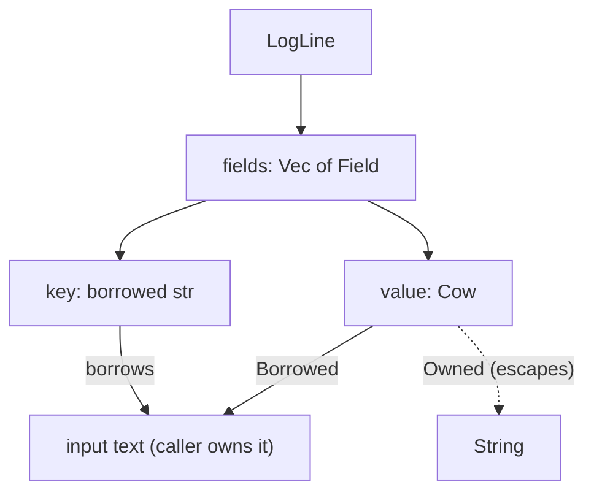
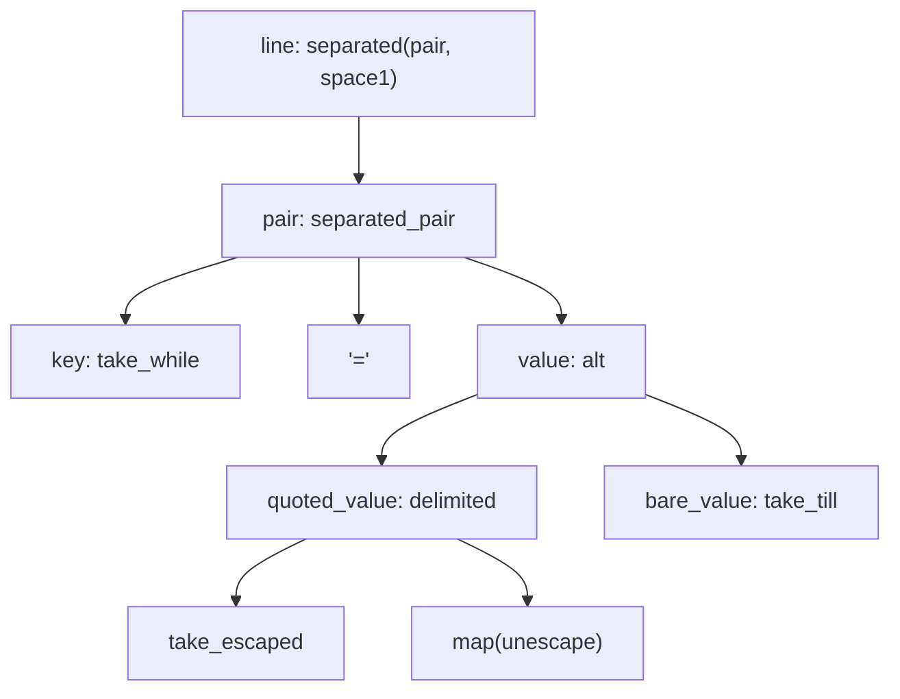

# Parsing is design

It's 09:14 on a Monday and the checkout page is slow. Somewhere in a 2 GB log
file is the answer. You reach for the tool you always reach for:

```sh
grep timeout app.log | less
```

Four thousand lines come back. Most are `level=info` lines saying
`msg="timeout configured" timeout_ms=5000`, written once per request by a
well-meaning colleague. What you actually want is "warnings or worse whose
message mentions a timeout", and maybe "how many per service". `grep` can't
help, because to `grep` a log line is a string of characters. It doesn't know
that `level=warn` is a *field*, that `warn` is a *severity*, or that severities
have an order.

The logs themselves are already structured. They're written in *logfmt*, a
simple and widespread format of space-separated `key=value` pairs, with double
quotes around values that contain spaces:

```text
ts=2026-10-19T09:12:03Z level=warn service=api msg="upstream timeout" latency_ms=5012
```

Over the three chapters of Part VI we'll build `logq`, a tool that understands
that structure:

```sh
logq 'level >= warn and msg ~ "timeout"' app.log
logq 'service = api' --count-by level app.log
```

This chapter is about the first step: turning a line of text into a value our
program understands. It sounds like plumbing. It isn't. Deciding what a parsed
line *is* (what it owns, what it borrows, what its fields mean) is the most
consequential design decision in the tool, because every later stage will
handle millions of them. Along the way we'll finally use lifetimes for what
they're best at: describing, in a type, where data lives.

## Setting up

`logq` is a library (the pure core: parsing, querying, aggregating) plus a
small binary (the shell: files, flags, printing). Create it as a binary crate
and add a `src/lib.rs` beside `main.rs`:

```sh
cargo new logq
cd logq
touch src/lib.rs
cargo add winnow@1 jiff@0.2 thiserror@2
cargo add --dev proptest@1
```

We'll use [`winnow`](https://docs.rs/winnow) for parsing, `jiff` for
timestamps and `thiserror` for error types. Here's the sample log we'll test
against for the rest of the part. Save it as `examples/app.log`. Note line 10:
real logs always contain at least one line that somebody wrote with `print`.

```text
ts=2026-10-19T09:12:01Z level=info service=api msg="request served" path=/orders latency_ms=42
ts=2026-10-19T09:12:02Z level=debug service=db msg="pool checkout" latency_ms=3
ts=2026-10-19T09:12:03Z level=warn service=api msg="upstream timeout" latency_ms=5012
ts=2026-10-19T09:12:04Z level=info service=auth msg="token issued" user=alice
ts=2026-10-19T09:12:05Z level=error service=db msg="connection reset by peer" latency_ms=30001
ts=2026-10-19T09:12:06Z level=warn service=api msg="slow request" path=/search latency_ms=950
ts=2026-10-19T09:12:07Z level=info service=api msg="request served" path=/orders latency_ms=38
ts=2026-10-19T09:12:08Z level=error service=api msg="upstream timeout after \"3\" retries" latency_ms=15020
ts=2026-10-19T09:12:09Z level=info service=auth msg="login failed" user=bob reason=password
this line was written by a print statement
ts=2026-10-19T09:12:10Z level=warn service=auth msg="rate limited" user=bob
ts=2026-10-19T09:12:11Z level=info service=api msg="request served" path=/health latency_ms=1
```

## The parser we write on autopilot

Logfmt looks easy. Split on whitespace, split each piece on `=`, done:

```rust
fn parse_naive(line: &str) -> HashMap<&str, &str> {
    line.split_whitespace()
        .filter_map(|pair| pair.split_once('='))
        .collect()
}
```

It's three lines, it compiles, and it even has a virtue we'll come back to:
the map holds `&str` slices *into* `line`, so nothing is copied. Let's try it
on the line from the opening and on one with an escaped quote:

```rust
let line = r#"level=warn msg="upstream timeout" latency_ms=5012"#;
println!("{:?}", parse_naive(line).get("msg"));

let line = r#"msg="say \"hi\" a=b" level=info"#;
let mut fields: Vec<_> = parse_naive(line).into_iter().collect();
fields.sort();
println!("{fields:?}");
```

```text
Some("\"upstream")
[("a", "b\""), ("level", "info"), ("msg", "\"say")]
```

Both answers are wrong, and wrong in the quietest possible way. The message
is truncated to `"upstream`, quote included. The second line grows a field
`a` that nobody logged, because a quoted value happened to contain `a=b`.
Nothing crashed and nothing warned. A query for `msg ~ "timeout"` would just
silently miss the line we were looking for.

The problem isn't that `split` was the wrong function. It's that the code has
no idea what the *grammar* of a line is. Quoting and escaping are part of the
format, and a parser that doesn't model them is guessing. Before we fix the
parser, though, let's decide what it should produce.

## What is a parsed line?

The nouns are simple. A **line** is a sequence of **fields**. A field has a
**key** (`level`) and a **value** (`warn`). Keys are never quoted. Values
sometimes are, and quoted values may contain escapes such as `\"`.

The obvious Rust is to own everything:

```rust
pub struct Field {
    pub key: String,
    pub value: String,
}
```

That works, and in many programs it's the right call. Here it isn't, and the
reason is arithmetic. A typical line has six to ten fields. Owning them means
two heap allocations per field, so twelve to twenty allocations per line,
before we've even decided whether we care about the line. Most lines in a
query run are thrown away a microsecond later. At a few million lines, the
allocator becomes the busiest part of the program.

But look at what the naive parser did right: its `&str` slices pointed into
the original text. The key `level` is *already sitting in memory*, in the
line we read. All a field needs is to say where.

### Borrowing in a struct

So let's store slices:

```rust
// does not compile
pub struct Field {
    pub key: &str,
    pub value: &str,
}
```

```text
error[E0106]: missing lifetime specifier
 --> src/line.rs:2:14
  |
2 |     pub key: &str,
  |              ^ expected named lifetime parameter
  |
help: consider introducing a named lifetime parameter
  |
1 ~ pub struct Field<'a> {
2 ~     pub key: &'a str,
  |
```

Chapter 2 introduced lifetimes as *relationships*, and this error is the
compiler asking us to state one. A function that borrows can let the compiler
infer the relationship from its arguments, but a struct sits in variables,
vectors and return values, far from where it was made. So the struct's *type*
has to carry the information: "a `Field` is a view into some text, and is
only valid while that text is". We name that text's lifetime `'a`:

```rust
pub struct Field<'a> {
    pub key: &'a str,
    pub value: &'a str,
}
```

Read `Field<'a>` as "a field borrowed from something that lives for `'a`".
The `'a` doesn't make anything live longer; it's a promise the compiler will
check at every use. You'll see in a moment how good it is at checking.

### The escape hatch that isn't

Quoted values spoil the plan slightly. For `msg="upstream timeout"` the value
we want, `upstream timeout`, is a slice of the input: it's the text between
the quotes. But for `msg="say \"hi\""` the value is `say "hi"`, and *that*
string doesn't exist anywhere in the input. The input has backslashes in it.

Let's try to write the unescaping function with our borrowed type anyway:

```rust
// does not compile
fn unescape<'a>(raw: &'a str) -> &'a str {
    if !raw.contains('\\') {
        return raw;
    }
    let unescaped = raw.replace("\\\"", "\"");
    &unescaped
}
```

```text
error[E0515]: cannot return reference to local variable `unescaped`
 --> src/parse/logfmt.rs:6:5
  |
6 |     &unescaped
  |     ^^^^^^^^^^ returns a reference to data owned by the current function
```

This is the classic "why can't I return this?" error, and the signature
explains it better than the message does. `-> &'a str` promises a slice of
something that lives for `'a`, and the only thing with that lifetime is
`raw`. The new `String` lives in this function's stack frame and is freed
when the function returns. A reference to it would dangle. In a garbage
collected language this code would work and quietly keep the string alive; in
C it would compile and quietly read freed memory. Rust makes us say which we
mean.

What we mean is "usually borrowed, occasionally owned". The standard library
has a type for exactly that: `std::borrow::Cow` (*clone on write*).

```rust
// simplified from the standard library
pub enum Cow<'a, B: ?Sized + ToOwned> {
    Borrowed(&'a B),
    Owned(<B as ToOwned>::Owned),
}
```

A `Cow<'a, str>` is either a borrowed `&'a str` or an owned `String`. It
derefs to `&str` either way, so callers don't care which they got. Here's
`unescape` returning one:

```rust
/// Borrow when there is nothing to unescape; allocate only when there is.
fn unescape(raw: &str) -> Cow<'_, str> {
    if !raw.contains('\\') {
        return Cow::Borrowed(raw);
    }
    let mut out = String::with_capacity(raw.len());
    let mut chars = raw.chars();
    while let Some(c) = chars.next() {
        if c != '\\' {
            out.push(c);
            continue;
        }
        match chars.next() {
            Some('n') => out.push('\n'),
            Some('t') => out.push('\t'),
            Some(other) => out.push(other),
            None => {}
        }
    }
    Cow::Owned(out)
}
```

The `'_` in `Cow<'_, str>` is the *elided* lifetime: with a single reference
argument, the compiler ties the result to it, exactly as if we'd written
`'a` twice. The common case costs nothing; the rare escaped value costs one
allocation. The type records which happened.

Now the domain types can be written down properly:

```rust
// file: src/line.rs
use std::borrow::Cow;

/// One `key=value` pair, borrowed from the text it was parsed from.
#[derive(Debug, Clone, PartialEq)]
pub struct Field<'a> {
    pub key: &'a str,
    pub value: Cow<'a, str>,
}

/// A parsed log line. It cannot outlive the text it borrows from.
#[derive(Debug, Clone, PartialEq, Default)]
pub struct LogLine<'a> {
    fields: Vec<Field<'a>>,
}
```

The one remaining allocation per line is the `Vec` of fields. We'll leave it;
Chapter 26 measures whether it matters.

> [!PATTERN] Zero-Copy Borrowed Domain
> When values are carved out of a larger input and are usually short-lived,
> make the domain types *borrow* from the input (`&'a str`) instead of owning
> copies. Use `Cow<'a, str>` for the cases that sometimes need a transformed
> copy. The lifetime parameter documents, and the compiler enforces, that the
> parsed value can't outlive its source.

Here's the relationship as a picture. The arrows into the input text are
borrows; the one dashed arrow is the rare owned copy.



### Lifetimes at the call site

What does the lifetime buy us? Suppose `parse_line(&str) -> LogLine` exists
(we'll write it next), and someone tries to keep a line after its text is
gone:

```rust
// does not compile
let line = {
    let text = String::from("level=warn service=api");
    parse_line(&text).unwrap()
};
println!("{:?}", line.get("level"));
```

```text
error[E0597]: `text` does not live long enough
 --> src/main.rs:6:20
  |
4 |     let line = {
  |         ---- borrow later stored here
5 |         let text = String::from("level=warn service=api");
  |             ---- binding `text` declared here
6 |         parse_line(&text).unwrap()
  |                    ^^^^^ borrowed value does not live long enough
7 |     };
  |     - `text` dropped here while still borrowed
```

Read the labels from top to bottom: where the borrow is stored, where the
owner is declared, where it's borrowed, where it's dropped. That's the whole
story of a use-after-free, told at compile time. In C++ a `string_view` into
a temporary is the same bug, and it compiles.

### Lifetimes in signatures

Accessors are where lifetimes stop being abstract. We want `get("level")`
returning the value as `&str`. As a free function, the obvious signature
fails:

```rust
// does not compile
fn lookup(line: &LogLine, key: &str) -> Option<&str> {
    line.get(key)
}
```

```text
error[E0106]: missing lifetime specifier
 --> src/line.rs:3:48
  |
3 | fn lookup(line: &LogLine, key: &str) -> Option<&str> {
  |                 --------       ----            ^ expected named lifetime parameter
  |
  = help: this function's return type contains a borrowed value, but the signature does not say whether it is borrowed from one of `line`'s 2 lifetimes or `key`
```

It's a genuinely ambiguous question, and a useful one. `line` brings *two*
lifetimes: the borrow of the `LogLine` itself, and the `'a` inside it, the
lifetime of the text. The result could come from either, or from `key`.
(The compiler's suggested fix ties all of them together, which compiles but
is far more restrictive than we need.)

As a method on `&self`, elision picks the borrow of `self`, which is the
right answer:

```rust
impl<'a> LogLine<'a> {
    pub fn new(fields: Vec<Field<'a>>) -> Self {
        LogLine { fields }
    }

    /// The value of the first field called `key`, if there is one.
    pub fn get(&self, key: &str) -> Option<&str> {
        self.fields
            .iter()
            .find(|field| field.key == key)
            .map(|field| field.value.as_ref())
    }

    pub fn fields(&self) -> &[Field<'a>] {
        &self.fields
    }
}
```

You might wonder whether we could promise more: return `Option<&'a str>`, a
slice of the original text, valid even after the `LogLine` is gone. Try it:

```rust
// does not compile
pub fn get(&self, key: &str) -> Option<&'a str> {
    let field = self.fields.iter().find(|f| f.key == key)?;
    Some(field.value.as_ref())
}
```

```text
error: lifetime may not live long enough
  --> src/line.rs:15:9
   |
12 | impl<'a> LogLine<'a> {
   |      -- lifetime `'a` defined here
13 |     pub fn get(&self, key: &str) -> Option<&'a str> {
   |                - let's call the lifetime of this reference `'1`
14 |         let field = self.fields.iter().find(|f| f.key == key)?;
15 |         Some(field.value.as_ref())
   |         ^^^^^^^^^^^^^^^^^^^^^^^^^^ method was supposed to return data with lifetime `'a` but it is returning data with lifetime `'1`
```

The compiler is right, and it's pointing at our own design decision. A value
might be `Cow::Owned`, in which case the `String` lives *inside the
`LogLine`*, not in the input text. Promising `'a` would be a lie for exactly
the escaped values. Keys are always borrowed, so a method returning
`&'a str` for a *key* would compile. The types know precisely what we chose,
field by field.

> [!TIP]
> When a lifetime error confuses you, write out every lifetime by hand,
> including elided ones, and ask "which of these does the result *actually*
> come from?". Usually the answer is in your data types, not in the function.

## Parser combinators

Now the parser. We could hand-write a character loop with a state machine
(the journal reader in Chapter 23 did roughly that, and promised a better way
here). Instead we'll build the parser the way we've built everything else in
this book: from small pure functions, composed.

### What a parser is

In `winnow`, a parser is a function that takes a mutable reference to the
remaining input, consumes some of it, and returns a result:

```rust
fn key<'a>(input: &mut &'a str) -> ModalResult<&'a str>
```

That type rewards a slow read. `input: &mut &'a str` is a mutable reference
to a string slice. The parser doesn't modify the *text* (it can't; it only has
a shared `&str`). It modifies the *slice*, moving its start forward past
whatever it consumed. On success, the output here is itself a `&'a str`: a
piece of the original input, with the input's lifetime. Zero-copy parsing
falls straight out of the signature.

`ModalResult<O>` is `winnow`'s `Result<O, ErrMode<ContextError>>`. We'll see
why the error is "modal" when we get to error messages. For now, read it as
"either an `O`, or a reason we couldn't parse one".

> [!NOTE]
> `winnow` reached 1.0 recently, and its API changed a lot through the 0.x
> releases (it began life as a fork of `nom`, whose parsers return
> `IResult<Input, Output>` tuples). Blog posts and answers online often show
> older signatures. Everything in this part is written against `winnow`
> 1.0: parsers take `&mut I`, and plain `winnow::Result` or `ModalResult` is
> the return type.

### Keys

A key is one or more characters from a small set. `take_while` returns the
longest prefix whose characters satisfy a predicate:

```rust
// file: src/parse/logfmt.rs
use winnow::error::StrContext;
use winnow::prelude::*;
use winnow::token::take_while;

fn key<'a>(input: &mut &'a str) -> ModalResult<&'a str> {
    take_while(1.., is_key_char)
        .context(StrContext::Label("key"))
        .parse_next(input)
}

fn is_key_char(c: char) -> bool {
    c.is_alphanumeric() || matches!(c, '_' | '.' | '-')
}
```

`1..` is the number of characters required: at least one. `.context(...)`
attaches a label used in error messages; ignore it for now. `.parse_next`
runs the composed parser on our input. Because parsers are plain functions,
we can test them on their own, and watch the input advance:

```rust
#[test]
fn keys_stop_at_equals() {
    let mut input = "level=warn";
    assert_eq!(key(&mut input), Ok("level"));
    assert_eq!(input, "=warn");
}
```

That test is the whole contract of a parser in two lines: it returned what it
recognised, and left the rest.

### Values

A bare value runs until whitespace or a quote. `take_till` is the mirror of
`take_while`, and `0..` allows an empty value (`key=` is legal logfmt):

```rust
fn bare_value<'a>(input: &mut &'a str) -> ModalResult<&'a str> {
    take_till(0.., |c: char| c.is_whitespace() || c == '"').parse_next(input)
}
```

A quoted value is a quote, a body that may contain escapes, and a closing
quote. `winnow` has a combinator for the body: `take_escaped(normal,
control, escapable)` recognises runs of normal characters interleaved with a
control character (`\`) followed by an escapable one. It returns the *raw*
slice, backslashes and all, which is exactly what our `unescape` wants:

```rust
fn quoted_value<'a>(input: &mut &'a str) -> ModalResult<Cow<'a, str>> {
    let body = take_escaped(
        take_till(1.., ['"', '\\']),
        '\\',
        one_of(['"', '\\', 'n', 't']),
    );
    delimited('"', body, '"').map(unescape).parse_next(input)
}
```

`delimited(open, inner, close)` runs three parsers and keeps the middle
result. `'"'` on its own is a parser too: `winnow` implements `Parser` for
`char` and `&str`, meaning "match this literal". `.map(unescape)` transforms
the output, raw slice in and `Cow` out, without touching the input.

Now we combine the two kinds. `alt` tries alternatives in order and returns
the first success. The arms must produce the same type, so the bare branch
wraps its `&str` in `Cow::Borrowed`:

```rust
fn value<'a>(input: &mut &'a str) -> ModalResult<Cow<'a, str>> {
    alt((quoted_value, bare_value.map(Cow::Borrowed))).parse_next(input)
}
```

Order matters: `bare_value` would happily match zero characters in front of a
quote, so the quoted branch goes first.

### Pairs and lines

The rest is assembly. A pair is a key and a value separated by `=`:

```rust
fn pair<'a>(input: &mut &'a str) -> ModalResult<Field<'a>> {
    separated_pair(key, '=', value)
        .map(|(key, value)| Field { key, value })
        .parse_next(input)
}
```

A line is zero or more pairs separated by spaces, allowing stray spaces at
either end. `separated` collects the results into anything that can be
accumulated, here the `Vec<Field>` that `LogLine::new` takes:

```rust
fn line<'a>(input: &mut &'a str) -> ModalResult<LogLine<'a>> {
    delimited(space0, separated(0.., pair, space1), space0)
        .map(LogLine::new)
        .parse_next(input)
}
```

Here's the structure we've built. Each box is a function we can test on its
own; each edge is a combinator.



Finally, the public entry point. `Parser::parse` (as opposed to
`parse_next`) runs a parser over the *whole* input: it fails if anything is
left over, and wraps failures in a `ParseError` that knows where in the input
it stopped:

```rust
/// Parse one line of logfmt, borrowing from `input` wherever possible.
pub fn parse_line(input: &str) -> Result<LogLine<'_>, ParseFailure> {
    line.parse(input).map_err(ParseFailure::from)
}
```

The signature is the design in one line: borrow a line of text, return a
`LogLine` tied to it, or explain why not. `ParseFailure` is next.

> [!PATTERN] Parser Combinators
> Build a parser from tiny parsers (a key, a value, a literal), each an
> ordinary function from input to result, and compose them with higher-order
> functions (`alt`, `delimited`, `separated`, `map`). The grammar is visible
> in the code's shape, every piece is testable on its own, and in Rust the
> output can borrow from the input with no copies.

## Errors worth reading

A parse error is a value, and we want it to outlive the parse: we'll print
it after the line is gone, possibly collect it. `winnow`'s `ParseError`
borrows the input, so we translate it at the boundary into our own owned
type, as Chapter 4's *Error Translation at Boundaries* recommends:

```rust
// file: src/parse/mod.rs
/// A parse error, detached from the text it came from.
#[derive(Debug, Clone, PartialEq, Eq, thiserror::Error)]
#[error("at column {}: {message}", offset + 1)]
pub struct ParseFailure {
    /// Byte offset into the input where parsing stopped.
    pub offset: usize,
    pub message: String,
}

impl<I> From<ParseError<I, ContextError>> for ParseFailure {
    fn from(err: ParseError<I, ContextError>) -> Self {
        let message = match err.inner().to_string() {
            m if m.is_empty() => "unexpected input".to_string(),
            m => m.replace('\n', "; "),
        };
        ParseFailure { offset: err.offset(), message }
    }
}
```

A small `render` method draws a caret under the offending column (it counts
characters, not bytes, so it stays aligned on non-ASCII text). Let's feed the
parser a line whose closing quote went missing:

```text
level=warn msg="upstream timeout
               ^ unexpected input
```

Accurate, but unhelpful. The caret points at the *opening* quote, and the
message says nothing. Here's what happened. `quoted_value` matched the quote,
consumed the body, and failed at the end of input looking for `"`. Its error
was a *backtrack*: "this alternative didn't work, try another". So `alt`
dutifully tried `bare_value`, which matched zero characters before the quote.
The pair succeeded with an empty value, `separated` found no space after it,
and `parse` complained that the remaining `"upstream timeout` was unexpected.
Every step was locally reasonable, and the result is useless.

The fix is to tell `winnow` when backtracking stops making sense. Once we've
seen an opening quote, we are definitely parsing a quoted value; if it goes
wrong, there's no point trying anything else. That's what "modal" in
`ModalResult` means: an error is either `Backtrack` (try the next
alternative) or `Cut` (stop, this is the real error). `cut_err` converts one
into the other. We add that, and a `context` saying what we expected:

```rust
pub(crate) fn quoted_value<'a>(
    input: &mut &'a str,
) -> ModalResult<Cow<'a, str>> {
    let body = take_escaped(
        take_till(1.., ['"', '\\']),
        '\\',
        one_of(['"', '\\', 'n', 't']).context(expected("escape")),
    );
    delimited('"', cut_err(body), cut_err('"').context(expected("`\"`")))
        .map(unescape)
        .parse_next(input)
}

pub(crate) fn expected(what: &'static str) -> StrContext {
    StrContext::Expected(StrContextValue::Description(what))
}
```

(`pub(crate)` because the query parser in the next chapter will reuse
`quoted_value` for string literals.) The same treatment for the `=` in a pair
gives us: once we have a key, an `=` must follow.

```rust
fn pair<'a>(input: &mut &'a str) -> ModalResult<Field<'a>> {
    separated_pair(key, cut_err('=').context(expected("`=`")), value)
        .map(|(key, value)| Field { key, value })
        .parse_next(input)
}
```

Now the errors say what's wrong and where:

```text
level=warn msg="upstream timeout
                                ^ expected `"`
level=warn msg="bad \q escape"
                     ^ expected escape
this line was written by a print statement
    ^ expected `=`
```

> [!TIP]
> A good rule of thumb for `cut_err`: cut as soon as the input has
> *committed* to one alternative. An opening quote, a keyword, an operator: after
> each of these, only one thing can legally follow, so a failure there is the
> real error.

Let's pin the behaviour down with tests, including the zero-copy claim
itself. `matches!` lets us assert on the `Cow` variant, so if a refactor ever
makes bare values allocate, a test fails:

```rust
#[test]
fn quoted_values_keep_spaces() {
    let line = parse_line(r#"msg="upstream timeout" x=1"#).unwrap();
    assert_eq!(line.get("msg"), Some("upstream timeout"));
    assert!(matches!(line.fields()[0].value, Cow::Borrowed(_)));
}

#[test]
fn escapes_allocate() {
    let line = parse_line(r#"msg="say \"hi\"\n""#).unwrap();
    assert_eq!(line.get("msg"), Some("say \"hi\"\n"));
    assert!(matches!(line.fields()[0].value, Cow::Owned(_)));
}
```

## From text to meaning

We can now find the `level` field. But a query like `level >= warn` needs
to know what `warn` *means*. Let's see what happens if we compare the text:

```rust
assert!("error" >= "warn"); // fails: 'e' < 'w'
```

As strings, `error` sorts before `warn`, so "warnings or worse" would quietly
exclude every error. Numbers have the same disease: `"90" > "500"` is true,
because `'9' > '5'`. Text comparison is the right answer for text and the
wrong answer for everything else. Each kind of value needs its own type.

### Levels

Severity is a small closed set with a natural order, which in Rust is an
`enum` deriving `Ord`. Derived ordering follows declaration order, so the
order of the variants *is* the definition of severity:

```rust
/// How serious a log line is. The declaration order *is* the ordering.
#[derive(Debug, Clone, Copy, PartialEq, Eq, PartialOrd, Ord, Hash)]
pub enum Level {
    Trace,
    Debug,
    Info,
    Warn,
    Error,
}
```

Real logs are untidy about spelling (`WARN`, `warning`, `err`), so parsing
accepts aliases, case-insensitively. A first draft might lower-case the input
with `to_ascii_lowercase()`, but that allocates a `String` on every call, and
this runs once per line. A table and `eq_ignore_ascii_case` do the same job
without allocating:

```rust
impl FromStr for Level {
    type Err = UnknownLevel;

    fn from_str(s: &str) -> Result<Self, Self::Err> {
        const NAMES: [(&str, Level); 7] = [
            ("trace", Level::Trace),
            ("debug", Level::Debug),
            ("info", Level::Info),
            ("warn", Level::Warn),
            ("warning", Level::Warn),
            ("error", Level::Error),
            ("err", Level::Error),
        ];
        NAMES
            .iter()
            .find(|(name, _)| name.eq_ignore_ascii_case(s))
            .map(|&(_, level)| level)
            .ok_or_else(|| UnknownLevel(s.to_string()))
    }
}
```

`UnknownLevel` is a one-field `thiserror` struct whose message reads
"unknown level `loud`". A matching `Display` prints the canonical lower-case
names.

### Timestamps and numbers

Timestamps get the same treatment from `jiff`, whose `Timestamp` parses RFC
3339 text like `2026-10-19T09:12:03Z` and implements `Ord`. Numbers parse as
`f64`. We don't parse these eagerly into the `LogLine`: most fields of most
lines are never looked at, and a field is only "a number" if a query treats
it as one. Instead, `LogLine` offers typed readings on demand:

```rust
impl<'a> LogLine<'a> {
    // ...
    pub fn level(&self) -> Option<Level> {
        self.get("level")?.parse().ok()
    }

    pub fn timestamp(&self) -> Option<Timestamp> {
        self.get("ts")?.parse().ok()
    }

    pub fn number(&self, key: &str) -> Option<f64> {
        self.get(key)?.parse().ok()
    }
}
```

Each is a pipeline over `Option`: find the field (`?` returns `None` if it's
missing), parse it, and turn a parse failure into `None` with `.ok()`. A
missing field and an unreadable one both mean "no level", which is the
honest answer for a filter.

This is a deliberate split of responsibilities. The logfmt parser knows
*syntax*: keys, values, quotes. The typed readings know *meaning*. Keeping them
apart means the parser stays fast and the meanings stay in one place, where
the query language in the next chapter can use them.

> [!CHECKPOINT]
> `src/lib.rs` declares `pub mod line;` and `pub mod parse;`, and
> `src/parse/mod.rs` declares `pub mod logfmt;`. With tests for levels,
> typed readings and each parser, you should see:
>
> ```sh
> cargo test
> ```
>
> ```text
> running 9 tests
> test line::tests::levels_are_ordered_by_severity ... ok
> test line::tests::levels_parse_with_aliases ... ok
> test parse::logfmt::tests::empty_and_padded_lines ... ok
> test parse::logfmt::tests::errors_point_at_the_problem ... ok
> test line::tests::typed_readings ... ok
> test parse::logfmt::tests::bare_values_borrow ... ok
> test parse::logfmt::tests::escapes_allocate ... ok
> test parse::logfmt::tests::keys_stop_at_equals ... ok
> test parse::logfmt::tests::quoted_values_keep_spaces ... ok
>
> test result: ok. 9 passed; 0 failed; 0 ignored; 0 measured
> ```

## What we learned

- **Parsing decides your data model.** The naive split parser was short and
  silently wrong, because it didn't model quoting. A grammar is part of the
  domain.
- **Lifetimes are a performance tool.** `LogLine<'a>` borrows keys and values
  from the input, so a parsed line costs one allocation instead of twenty.
  The lifetime parameter is the type-level record of where the data lives.
- **`Cow<'a, str>`** expresses "borrowed, unless we had to transform it", and
  makes the rare allocation visible in the type.
- **Lifetime errors are design feedback.** "Cannot return reference to local
  variable", "does not live long enough" and "lifetime may not live long
  enough" each pointed at a real relationship we had or hadn't promised.
- **Parser combinators** (`take_while`, `alt`, `delimited`, `separated`) build
  a parser from small, separately testable functions whose outputs borrow
  from the input. That's the *Parser Combinators* pattern.
- **`cut_err` and `context`** turn "something somewhere didn't parse" into
  "expected `\"` here". Cut once the input has committed to an alternative.
- **Syntax and meaning are separate layers.** The parser yields text; typed
  readings (`Level` with derived `Ord`, `jiff::Timestamp`, `f64`) give it
  meaning on demand.

## Exercises

> [!EXERCISE] Bare keys
> Logfmt allows a key with no `=`, meaning "true": `level=info cached`.
> Extend `pair` so a key followed by whitespace or end of line becomes a
> field with value `"true"`. Where does `cut_err('=')` have to change? Write a
> test proving that `cached` alone parses and that `cached"` still fails.

> [!EXERCISE] JSON lines
> Many services log JSON objects, one per line. Write
> `parse_json_line(&str) -> Result<LogLine<'_>, ParseFailure>` using
> `serde_json`. Can you keep it zero-copy? (Hint: deserialise into a
> `HashMap<&'a str, serde_json::Value>`, or look up `#[serde(borrow)]` and
> `Cow<'a, str>`; think about what happens to numbers and nested objects.)

> [!EXERCISE] Count the allocations
> Write a test that parses 1,000 copies of the sample line and counts heap
> allocations, using a small counting `#[global_allocator]` wrapper around
> `std::alloc::System`. How many allocations does one line cost? Now change
> `Field` to own `String`s and measure again.

> [!EXERCISE] Duplicate keys
> `get` returns the *first* field with a given key. Some loggers repeat a key
> to override it. Decide what `logq` should do, encode the decision in a
> test, and change `get` if necessary. Would a `HashMap` have been a better
> container than a `Vec`? Consider order, duplicates, and typical field
> counts.
