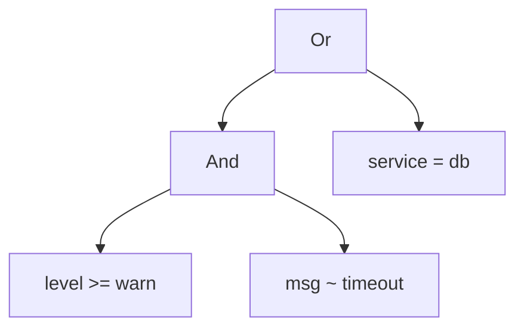

# A tiny query language

We can turn a line of logfmt into a `LogLine`. Now we need to ask it
questions. The questions people ask of logs are small but varied:

```text
level >= warn
service = api and latency_ms > 1000
msg ~ "timeout" and not (service = db or level < info)
ts >= 2026-10-19T09:12:06Z
```

We could offer a flag for each kind of question: `--level`, `--service`,
`--min-latency`. That's how many tools start, and it's how they end up with
forty flags that can't express "this *or* that". The alternative is to accept
that our users are writing *programs*, tiny ones, and give them a tiny
language.

That sounds grand, and the result is surprisingly small: a few hundred lines
covering a grammar, a parser, a type checker, an interpreter, a simplifier
and a printer. Each is a pure function over one recursive data type. By the
end of the chapter you'll have seen the shape behind every compiler, SQL
engine and spreadsheet formula evaluator, at a size you can hold in your head.

## The grammar

Let's pin down the language before writing any code. A query is a boolean
expression over comparisons:

| Form | Meaning |
|---|---|
| `field = value`, `field != value` | equal, not equal |
| `field < value` (and `<=`, `>`, `>=`) | ordered comparison |
| `field ~ "text"` | the field's value contains the text |
| `a and b`, `a or b`, `not a` | boolean logic |
| `( ... )` | grouping |
| `true`, `false` | constants |

Values are bare words (`warn`, `api`, `5012`, `2026-10-19T09:12:06Z`) or
quoted strings (`"upstream timeout"`). As in nearly every language, `not`
binds tightest, then `and`, then `or`, so `a or b and c` means
`a or (b and c)`.

Written as a grammar, one rule per precedence level, it looks like this:

```text
or_expr    = and_expr ("or" and_expr)*
and_expr   = unary ("and" unary)*
unary      = "not" unary | atom
atom       = "(" or_expr ")" | "true" | "false" | comparison
comparison = field op value
```

Each rule refers only to rules that bind more tightly, except for the
parentheses, which loop back to the top. That's the whole trick of
precedence, and our parser will mirror it exactly.

## A tree, not a string

What should the parser produce? We could evaluate while parsing, but then we
couldn't check, simplify or print the query. Instead the parser produces a
data structure that represents the query's *structure*: an **abstract syntax
tree** (AST). "Abstract" because it forgets the details of spelling, such as
spaces and redundant parentheses, and keeps only the meaning.

An expression is one of a handful of shapes, which is a sum type. Some of the
shapes contain further expressions. Let's write that down directly:

```rust
// does not compile
pub enum Expr {
    Leaf(String),
    Not(Expr),
    And(Expr, Expr),
    Or(Expr, Expr),
}
```

```text
error[E0072]: recursive type `Expr` has infinite size
 --> src/query/ast.rs:1:1
  |
1 | pub enum Expr {
  | ^^^^^^^^^^^^^
2 |     Leaf(String),
3 |     Not(Expr),
  |         ---- recursive without indirection
  |
help: insert some indirection (e.g., a `Box`, `Rc`, or `&`) to break the cycle
  |
3 |     Not(Box<Expr>),
  |         ++++    +
```

Rust lays values out inline. An `enum` is as large as its largest variant,
and `Not(Expr)` would contain a whole `Expr`, which might contain another,
forever. In Java or TypeScript every object is behind a reference, so this
never comes up. In Rust we choose where the indirection goes, and the
compiler tells us we need some.

`Box<T>` is the simplest indirection: an owning pointer to a `T` on the heap.
It's the size of a pointer, so `Expr` gets a fixed size, and when the box is
dropped so is its contents. A tree of boxes is owned top-down, with no cycles
and no sharing, which is exactly a syntax tree's shape.

The leaves need more structure than a `String`. A comparison has a field, an
operator and a literal value:

```rust
// file: src/query/ast.rs
/// What the parser produces at each leaf: `field op value`, unchecked.
#[derive(Debug, Clone, PartialEq)]
pub struct Comparison {
    pub field: String,
    pub op: CmpOp,
    pub value: Literal,
}

#[derive(Debug, Clone, Copy, PartialEq, Eq)]
pub enum CmpOp {
    Eq,
    Ne,
    Lt,
    Le,
    Gt,
    Ge,
    Contains,
}

#[derive(Debug, Clone, PartialEq)]
pub enum Literal {
    Text(String),
    Number(f64),
}
```

Notice that the AST *owns* its strings, unlike `LogLine`. A query is parsed
once and then used against millions of lines; it outlives the command-line
argument it came from in spirit, if not in fact. Ownership makes it a
free-standing value, and the cost is a handful of allocations, once.

Here's `level >= warn and msg ~ "timeout" or service = db` as a tree. Read it
bottom-up: the leaves are comparisons, and `and` sits below `or` because it
binds more tightly.



## Parsing with precedence

We have `winnow` from Chapter 24, and the grammar maps onto it almost line
for line.

### Lexical odds and ends

Queries allow spaces between tokens, so we start with a helper that wraps any
parser to skip whitespace either side. It returns `impl ModalParser`, which
is `winnow`'s shorthand for "some parser with our error type":

```rust
// file: src/parse/query.rs
/// Allow whitespace either side of `inner`.
fn ws<'a, O>(
    inner: impl ModalParser<&'a str, O, Error>,
) -> impl ModalParser<&'a str, O, Error> {
    delimited(multispace0, inner, multispace0)
}
```

This is a *parser combinator* we wrote ourselves: a function from a parser
to a parser. Nothing distinguishes it from the ones `winnow` ships.

Keywords are next, and they hide a classic bug. The obvious keyword parser is
the literal `"not"`. Now consider a field called `notes`:

```text
notes = x
```

`"not"` happily matches the first three letters, leaving `es = x`, and the
query parses as `not (es = x)`. Silent, and wrong. A keyword has to be a
*whole word*: the literal, not followed by another word character. `winnow`'s
`not` combinator succeeds only if its parser *fails*, without consuming
anything:

```rust
/// A keyword is a whole word: `not` must not match the start of `notes`.
fn keyword<'a>(
    word: &'static str,
) -> impl ModalParser<&'a str, &'a str, Error> {
    ws(terminated(word, not(one_of(is_word_char))))
}
```

(`is_word_char` allows ASCII letters, digits and `_ . : -`, which covers
field names, levels, numbers and timestamps.)

Operators are a list of literals. Order matters here too: `alt` takes the
first success, so `<=` must come before `<`, or `<=` would parse as `<`
followed by a stray `=`.

```rust
fn cmp_op(input: &mut &str) -> ModalResult<CmpOp> {
    alt((
        "!=".value(CmpOp::Ne),
        "<=".value(CmpOp::Le),
        ">=".value(CmpOp::Ge),
        "<".value(CmpOp::Lt),
        ">".value(CmpOp::Gt),
        "=".value(CmpOp::Eq),
        "~".value(CmpOp::Contains),
    ))
    .parse_next(input)
}
```

`.value(v)` replaces a parser's output with a constant. It reads nicely as a
table.

Literals reuse `quoted_value` from Chapter 24 (one grammar for quoting is
better than two), or take a bare word and classify it:

```rust
fn literal(input: &mut &str) -> ModalResult<Literal> {
    alt((
        quoted_value.map(|s| Literal::Text(s.into_owned())),
        take_while(1.., is_word_char).map(classify),
    ))
    .parse_next(input)
}

/// A bare word is a number if it looks like one, otherwise text.
fn classify(word: &str) -> Literal {
    let numeric = word.starts_with(|c: char| c.is_ascii_digit() || c == '-');
    match word.parse::<f64>() {
        Ok(n) if numeric && n.is_finite() => Literal::Number(n),
        _ => Literal::Text(word.to_string()),
    }
}
```

`Cow::into_owned` turns the borrowed-or-owned string into a `String`,
allocating only if it was borrowed. The `numeric` guard is there because
Rust's float parser accepts `inf` and `NaN`, and a user who writes
`level = info` doesn't mean infinity.

### One parser per level

Now the comparison, which follows the grammar exactly. After a field name,
an operator *must* follow, and after an operator, a value must: that's where
the input commits, so that's where we cut, with context for the message:

```rust
fn comparison(input: &mut &str) -> ModalResult<Comparison> {
    let op = cut_err(ws(cmp_op)).context(expected("operator"));
    let value = cut_err(ws(literal)).context(expected("value"));
    (ws(field), op, value)
        .map(|(field, op, value)| Comparison {
            field: field.to_string(),
            op,
            value,
        })
        .parse_next(input)
}
```

A tuple of parsers is itself a parser that runs them in sequence and returns
a tuple of results. `field` is a letter or underscore followed by word
characters.

The `atom` rule is an `alt` over the four possibilities. The last arm,
`fail`, never succeeds; it exists to carry the context "expected
comparison" when nothing else matched:

```rust
fn atom(input: &mut &str) -> ModalResult<Ast> {
    let close = cut_err(ws(')')).context(expected("`)`"));
    alt((
        delimited(ws('('), cut_err(or_expr), close),
        keyword("true").value(Expr::Const(true)),
        keyword("false").value(Expr::Const(false)),
        comparison.map(Expr::Leaf),
        fail.context(expected("comparison")),
    ))
    .parse_next(input)
}
```

(`Ast` is a local alias for the tree type; `Const` is a variant for the
constants, which we'll value when we start rewriting trees.) The parentheses
arm calls `or_expr`, the *top* of the grammar. That's the recursion that lets
groups nest.

`unary` handles `not`, which can repeat (`not not x`), so it calls itself:

```rust
fn unary(input: &mut &str) -> ModalResult<Ast> {
    alt((
        preceded(keyword("not"), cut_err(unary)).map(Expr::negation),
        atom,
    ))
    .parse_next(input)
}
```

`Expr::negation`, `Expr::and` and `Expr::or` are small constructors that do
the boxing, so call sites read as logic rather than as memory management.

### Left to right

The binary operators need care. The tempting recursive rule
`and_expr = unary "and" and_expr | unary` works, but it builds
`a and (b and c)`: it's *right*-associative. For `and` that's harmless, but
it's the wrong habit: for an operator like subtraction, `a - b - c` must mean
`(a - b) - c`. Writing the rule *left*-recursive instead
(`and_expr = and_expr "and" unary`) sends a combinator parser into infinite
recursion, since it calls itself before consuming anything.

The way out is to parse a flat list, `unary (and unary)*`, and *fold* it from
the left. `winnow` packages exactly that as `separated_foldl1`:

```rust
/// Lowest precedence: `a or b or c`, folded to the left.
/// Operands are `cut_err`: after an `or`, something must follow.
fn or_expr(input: &mut &str) -> ModalResult<Ast> {
    let operand = cut_err(and_expr);
    separated_foldl1(operand, keyword("or"), |a, _, b| Expr::or(a, b))
        .parse_next(input)
}

fn and_expr(input: &mut &str) -> ModalResult<Ast> {
    let operand = cut_err(unary);
    separated_foldl1(operand, keyword("and"), |a, _, b| Expr::and(a, b))
        .parse_next(input)
}
```

It's a fold, the same idea as `Iterator::fold` from Chapter 6, applied
during parsing: start with the first operand, and combine each subsequent
one into the accumulated tree.

> [!NOTE]
> With many precedence levels, one function per level gets repetitive.
> `winnow` also offers an `expression` combinator implementing *Pratt
> parsing*, where each operator is declared with a numeric binding power.
> For three levels, the explicit version is easier to read and debug.

The entry point allows surrounding whitespace and requires the whole input
to be consumed, converting errors into the `ParseFailure` from Chapter 24:

```rust
pub fn parse_query(input: &str) -> Result<Ast, ParseFailure> {
    ws(or_expr).parse(input).map_err(ParseFailure::from)
}
```

The tests we care about most are about structure, so we compare whole trees:

```rust
#[test]
fn and_binds_tighter_than_or() {
    let ast = parse_query("a = 1 or b = 2 and c = 3").unwrap();
    let expected = Expr::or(
        cmp("a", CmpOp::Eq, Literal::Number(1.0)),
        Expr::and(
            cmp("b", CmpOp::Eq, Literal::Number(2.0)),
            cmp("c", CmpOp::Eq, Literal::Number(3.0)),
        ),
    );
    assert_eq!(ast, expected);
}
```

And thanks to the cuts, malformed queries get specific errors (this is the
binary we'll finish in Chapter 26, reporting a parse failure):

```text
logq: bad query
latency_ms > 
             ^ expected value
logq: bad query
(level >= warn
              ^ expected `)`
logq: bad query
level >= warn and
                 ^ expected comparison
```

## Meaning before evaluation

Let's evaluate a tree. The obvious interpreter compares the field's text with
the literal's text. And it's wrong, for the reason we found at the end of
Chapter 24: `level >= warn` compared as text is `"error" >= "warn"`, which is
false. `latency_ms > 500` compared as text makes `"90"` greater than `"500"`.
Comparisons need types.

We could look at the literal and the field name *during* evaluation, on every
line: is this the `level` field? Does `warn` parse as a level? That repeats
the same decisions millions of times, and worse, it can't report a mistake.
`level >= loud` would just match nothing, silently, on every line.

This is Chapter 4's *Parse, Don't Validate* again, at a new scale. The
parser's output is an unchecked tree: syntactically valid, semantically
unknown. We want a function that consumes it and returns a tree in which every
comparison has already been understood, or an error explaining why one
can't be.

### Typed predicates

First, what an understood comparison *is*. Each kind of value supports a
particular set of operators, and we can make the wrong combinations
unrepresentable by splitting the operator type:

```rust
// file: src/query/check.rs
#[derive(Debug, Clone, PartialEq)]
pub struct Predicate {
    pub field: String,
    pub test: Test,
}

/// What we know how to compare, and with which operators.
#[derive(Debug, Clone, PartialEq)]
pub enum Test {
    Text(TextOp, String),
    Number(OrdOp, f64),
    Level(OrdOp, Level),
    Time(OrdOp, Timestamp),
}
```

`TextOp` is `Eq | Ne | Contains`; `OrdOp` is `Eq | Ne | Lt | Le | Gt | Ge`.
There is no way to build "contains" on a number or "less than" on text. The
evaluator will never have to wonder.

### One tree, two kinds of leaf

Now we need a tree whose leaves are `Predicate`s. We could copy `Expr` into
a second enum with `Leaf(Predicate)`, along with everything that works on
trees. Look at what would differ, though: only the leaf. The boolean
structure (`and`, `or`, `not`, constants) is the same in both. So we make the
leaf a type parameter:

```diff
-pub enum Expr {
+pub enum Expr<P> {
     Const(bool),
-    Leaf(Comparison),
-    Not(Box<Expr>),
-    And(Box<Expr>, Box<Expr>),
-    Or(Box<Expr>, Box<Expr>),
+    Leaf(P),
+    Not(Box<Expr<P>>),
+    And(Box<Expr<P>>, Box<Expr<P>>),
+    Or(Box<Expr<P>>, Box<Expr<P>>),
 }
```

The parser now produces `Expr<Comparison>`, and a checked query is
`Expr<Predicate>`, for which we add an alias:

```rust
/// A query that has passed type checking.
pub type Query = Expr<Predicate>;
```

The two types can't be confused (you can't evaluate an unchecked tree), yet
they share every function that only cares about structure. The first such
function is the one that gets us from one to the other: rebuild the same
shape, transforming each leaf with a function that might fail.

```rust
impl<P> Expr<P> {
    /// Replace every leaf, keeping the shape; stop at the first error.
    pub fn try_map<Q, E>(
        self,
        f: &mut impl FnMut(P) -> Result<Q, E>,
    ) -> Result<Expr<Q>, E> {
        Ok(match self {
            Expr::Const(b) => Expr::Const(b),
            Expr::Leaf(p) => Expr::Leaf(f(p)?),
            Expr::Not(e) => Expr::negation(e.try_map(f)?),
            Expr::And(a, b) => Expr::and(a.try_map(f)?, b.try_map(f)?),
            Expr::Or(a, b) => Expr::or(a.try_map(f)?, b.try_map(f)?),
        })
    }
}
```

If you've met `map` on `Option` or iterators, this is the same idea on a
tree. It takes `self` by value, so the old tree is consumed as the new one is
built: the field names move into the new leaves rather than being copied.
And `f` is `&mut impl FnMut`, so one closure can be lent to every recursive
call.

### The checker

With `try_map`, checking a whole query is checking one comparison:

```rust
/// Parse, don't validate: an unchecked tree in, a typed tree out.
pub fn check(ast: Expr<Comparison>) -> Result<Query, TypeError> {
    ast.try_map(&mut check_comparison)
}
```

The rules for one comparison are a `match` on the field name and literal.
The well-known fields `level` and `ts` have fixed types; any other field
takes the type of its literal:

```rust
fn check_comparison(c: Comparison) -> Result<Predicate, TypeError> {
    let Comparison { field, op, value } = c;
    let test = match (field.as_str(), value) {
        ("level", value) => match value.into_text().parse() {
            Ok(level) => Test::Level(ord_op(&field, op)?, level),
            Err(reason) => return Err(TypeError::BadLevel { field, reason }),
        },
        ("ts", value) => {
            let value = value.into_text();
            match value.parse() {
                Ok(time) => Test::Time(ord_op(&field, op)?, time),
                Err(_) => return Err(TypeError::BadTimestamp { field, value }),
            }
        }
        (_, Literal::Number(n)) => Test::Number(ord_op(&field, op)?, n),
        (_, Literal::Text(text)) => Test::Text(text_op(&field, op)?, text),
    };
    Ok(Predicate { field, test })
}
```

`ord_op` and `text_op` convert a `CmpOp` into the narrower operator type, or
return `TypeError::NotText` / `NotOrdered`. `into_text` gives a literal back
as the user typed it, so `level = 500` is checked as a level named `500`,
which doesn't exist. The query is rejected before any log is read:

```text
logq: `level`: unknown level `loud`
logq: `level`: unknown level `500`
logq: `service < ...`: `<` needs a number, level or time
```

> [!WARNING]
> An early version of `check` called `value.to_string()` instead of
> `into_text()`. `Literal`'s `Display` (coming later in this chapter) puts
> quotes around text that isn't a plain word, so every timestamp arrived as
> `"2026-10-19T09:12:06Z"`, *with* the quotes, and failed to parse. `Display`
> is for showing a value to people; when you mean "the underlying data", give
> it its own method.

## The interpreter

Evaluation is now almost embarrassingly direct. Here it is generically: to
evaluate any boolean tree, you only need to know how to evaluate a leaf.

```rust
// file: src/query/eval.rs
/// Evaluate any boolean tree, given a way to evaluate its leaves.
pub fn evaluate<P>(expr: &Expr<P>, leaf: &impl Fn(&P) -> bool) -> bool {
    match expr {
        Expr::Const(b) => *b,
        Expr::Leaf(p) => leaf(p),
        Expr::Not(e) => !evaluate(e, leaf),
        Expr::And(a, b) => evaluate(a, leaf) && evaluate(b, leaf),
        Expr::Or(a, b) => evaluate(a, leaf) || evaluate(b, leaf),
    }
}

/// Does this line match the query?
pub fn matches(query: &Query, line: &LogLine) -> bool {
    evaluate(query, &|p| p.holds(line))
}
```

Each arm says what its construct *means*, in terms of the meanings of its
parts. `&&` and `||` short-circuit, so `and` stops at the first false operand
for free. The function borrows the tree (`&Expr<P>`) because evaluation
reads; it will run once per log line against the same query.

The leaves do the typed work. Every ordered comparison has the same shape:
compare the two values, getting a `std::cmp::Ordering` (`Less`, `Equal` or
`Greater`), then ask whether the operator accepts that ordering:

```rust
impl OrdOp {
    /// Does `actual <op> wanted` hold, given how they compare?
    pub fn holds(self, ordering: Ordering) -> bool {
        use Ordering::*;
        match self {
            OrdOp::Eq => ordering == Equal,
            OrdOp::Ne => ordering != Equal,
            OrdOp::Lt => ordering == Less,
            OrdOp::Le => ordering != Greater,
            OrdOp::Gt => ordering == Greater,
            OrdOp::Ge => ordering != Less,
        }
    }
}
```

So six operators times three ordered types is one table, not eighteen cases.
`Predicate::holds` finds the field, and dispatches on the test:

```rust
impl Predicate {
    /// A comparison against a missing or unreadable field is false.
    pub fn holds(&self, line: &LogLine) -> bool {
        let Some(raw) = line.get(&self.field) else {
            return false;
        };
        match &self.test {
            Test::Text(op, wanted) => match op {
                TextOp::Eq => raw == wanted,
                TextOp::Ne => raw != wanted,
                TextOp::Contains => raw.contains(wanted.as_str()),
            },
            Test::Number(op, wanted) => raw
                .parse::<f64>()
                .ok()
                .and_then(|n| n.partial_cmp(wanted))
                .is_some_and(|ord| op.holds(ord)),
            Test::Level(op, wanted) => compare(raw, wanted, *op),
            Test::Time(op, wanted) => compare(raw, wanted, *op),
        }
    }
}
```

`compare` is a small generic helper for any `T: FromStr + Ord`: parse the
raw text as a `T`, `cmp` it with the wanted value, apply the operator.
Numbers use `partial_cmp` instead, because `f64` is only partially ordered
(Chapter 1's old friend `NaN` again).

The doc comment states a semantic decision worth dwelling on: **a comparison
on a missing field is false**, including `!=`. `service != api` means "has a
service, and it isn't `api`". It's the same choice SQL makes with `NULL`, and
it will matter in a moment.

> [!PATTERN] Interpreter (AST + Eval)
> Represent a program in a small language as a recursive data type (the
> abstract syntax tree), and give it meaning with a recursive function that
> evaluates each node in terms of its children. In Rust, the AST is an `enum`
> with `Box`ed children, and `match` makes the evaluator exhaustive: add a
> construct and the compiler lists every function that must learn about it.

## Rewriting trees

Users write redundant queries, and so do scripts that build queries by
pasting fragments together: `not not level >= warn`, or
`true and service = api` from a template whose first clause was optional.
They evaluate correctly, but they're harder to read in `--explain` output and
slightly slower to run. Because a query is data, we can transform it before
running it: a function from tree to tree that keeps the meaning and removes
the noise.

### The rules

The rules are the laws of boolean logic, read left to right:

| Before | After |
|---|---|
| `not not x` | `x` |
| `not true` | `false` |
| `true and x`, `x and true` | `x` |
| `false and x`, `x and false` | `false` |
| `false or x`, `x or false` | `x` |
| `true or x`, `x or true` | `true` |
| `not (a and b)` | `not a or not b` (De Morgan) |
| `not (a or b)` | `not a and not b` (De Morgan) |

The De Morgan rules push each `not` down towards the leaves, which puts
every `not` in the same predictable place.

Simplification works bottom-up: simplify the children first, then look at
what they became. Matching on a *pair* of simplified children expresses the
constant rules compactly, with `|` patterns covering both orders:

```rust
// file: src/query/simplify.rs
/// Rewrite bottom-up until no rule applies. Meaning is preserved.
pub fn simplify(expr: Query) -> Query {
    match expr {
        Expr::Not(e) => negate(simplify(*e)),
        Expr::And(a, b) => match (simplify(*a), simplify(*b)) {
            (Expr::Const(false), _) | (_, Expr::Const(false)) => {
                Expr::Const(false)
            }
            (Expr::Const(true), x) | (x, Expr::Const(true)) => x,
            (a, b) => Expr::and(a, b),
        },
        // Expr::Or(a, b) => the mirror image
        leaf => leaf,
    }
}
```

`*e` moves the expression out of its `Box`, so we take apart the old tree and
build the new one from its pieces without cloning anything. `simplify` takes
`Query` by value for that reason: rewriting is consumption.

Negation gets its own function, which knows how to push a `not` through each
kind of node:

```rust
/// Push a `not` inwards (De Morgan) until it reaches a leaf.
fn negate(expr: Query) -> Query {
    match expr {
        Expr::Const(b) => Expr::Const(!b),
        Expr::Not(e) => *e,
        Expr::And(a, b) => {
            simplify(Expr::or(Expr::negation(*a), Expr::negation(*b)))
        }
        Expr::Or(a, b) => {
            simplify(Expr::and(Expr::negation(*a), Expr::negation(*b)))
        }
        leaf => Expr::negation(leaf),
    }
}
```

The last arm is where the push stops: a `not` directly above a comparison.

### A rule too far

That last arm looks like a missed opportunity. Surely `not latency_ms < 500`
is just `latency_ms >= 500`? We could flip the operator and lose the `not`
entirely:

```rust
Expr::Leaf(Predicate { field, test: Test::Number(op, n) }) => {
    let test = Test::Number(op.flip(), n);
    Expr::Leaf(Predicate { field, test })
}
```

where `flip` maps `Lt` to `Ge`, `Eq` to `Ne`, and so on. Before trusting it,
let's state what every rule must satisfy, as a property test: **for every
query and every line, the simplified query matches exactly when the original
does.**

```rust
// file: tests/properties.rs
proptest! {
    #[test]
    fn simplify_preserves_matches(q in query(), pairs in fields()) {
        let line = line(&pairs);
        let simpler = simplify(q.clone());
        prop_assert_eq!(matches(&simpler, &line), matches(&q, &line));
    }
}
```

`query()` is a `proptest` strategy that builds random trees with
`prop_recursive`, from leaves drawn from a small vocabulary (`level`,
`service` and `latency_ms`; a few operators; values such as `warn`, `api` and
`500`) and kept only if they type-check. `fields()` builds random lines from a
similar vocabulary, sometimes with fields missing. Running it with the flip
rule in place:

```text
thread 'simplify_preserves_matches' panicked at tests/properties.rs:92:1:
Test failed: assertion failed: `(left == right)`
  left: `false`,
 right: `true` at tests/properties.rs:103.
minimal failing input: q = Not(
    Leaf(
        Predicate {
            field: "service",
            test: Number(
                Eq,
                500.0,
            ),
        },
    ),
), pairs = []
```

`proptest` has *shrunk* its first failure down to the smallest case it could
find: `not service = 500` against a line with no fields at all. On that line
`service = 500` is false (missing field), so `not service = 500` is true. The
flipped version, `service != 500`, is false: missing field again. The rule is
wrong, and the reason is the decision we made deliberately in `holds`. Under
our semantics a comparison has *three* outcomes (true, false, or "the field
isn't there"), and `not` and operator-flipping treat the third differently.

We remove the rule. The property didn't just catch a bug; it stopped us
shipping a plausible-looking "optimisation" that changes what queries mean,
on exactly the lines (malformed, partial, from a different service) where
you're least likely to notice.

### Seeing that it's generic

With the flip rule gone, look at `simplify` and `negate` again. They never
look inside a leaf. They only care about tree structure, so they work for
*any* leaf type:

```rust
pub fn simplify<P>(expr: Expr<P>) -> Expr<P> {
    // ... body unchanged
}
```

That opens up a much stronger test. If the leaves are just numbered boolean
variables, an environment is a bitmask, and `evaluate` with a closure that
reads the bit is a complete model of boolean logic:

```rust
proptest! {
    #[test]
    fn simplify_preserves_meaning(e in expr(0..6u8), env in any::<u8>()) {
        let var = |v: &u8| env & (1 << v) != 0;
        let simpler = simplify(e.clone());
        prop_assert_eq!(evaluate(&simpler, &var), evaluate(&e, &var));
    }
}
```

`expr(leaf)` is the same tree strategy used before, generic over its leaves.
Here it ranges over every shape of tree with six variables, hitting the
constant and De Morgan rules far harder than realistic queries would. A
third property checks the *shape* of the output: no constants except at the
root, and every `not` sitting directly on a leaf.

> [!PATTERN] Tree Rewriting (Simplifier)
> Transform a tree into an equivalent, simpler tree with a recursive function
> that rewrites children first and then applies local rules to the result.
> In Rust, take the tree by value and move pieces out of their `Box`es, so
> rewriting doesn't clone. Pin "equivalent" down with a property test
> comparing the evaluator's results before and after.

## Printing it back

The last piece is turning a tree back into text, for `--explain` and for
error messages. The obvious `Display` prints each node with its own syntax
and puts parentheses around anything that binds more loosely than its
parent. A precedence number per node makes that a comparison:

```rust
fn precedence(&self) -> u8 {
    match self {
        Expr::Or(..) => 1,
        Expr::And(..) => 2,
        Expr::Not(_) => 3,
        Expr::Const(_) | Expr::Leaf(_) => 4,
    }
}
```

and a helper writes an operand, parenthesised if its precedence is below a
minimum:

```rust
/// Write `e`, parenthesised if it binds more loosely than `min`.
fn operand<P: fmt::Display>(
    f: &mut fmt::Formatter<'_>,
    e: &Expr<P>,
    min: u8,
) -> fmt::Result {
    if e.precedence() < min {
        write!(f, "({e})")
    } else {
        write!(f, "{e}")
    }
}
```

What property should `Display` have? The useful one is **round-tripping**:
parsing the printed form gives back the same tree, `parse(display(e)) == e`.
If that holds, `--explain` output is a valid query that means what we
showed. Here's the property, for unchecked trees with arbitrary field names,
operators and literals, including strings full of quotes and backslashes:

```rust
proptest! {
    #[test]
    fn display_round_trips(e in expr(comparison())) {
        let printed = e.to_string();
        prop_assert_eq!(parse_query(&printed), Ok(e), "{}", printed);
    }
}
```

With a first `Display` that passes each node's own precedence as the minimum
for both operands, the test fails at once:

```text
Test failed: assertion failed: `(left == right)`
  left: `Ok(And(And(Const(false), Const(false)), Const(false)))`,
 right: `Ok(And(Const(false), And(Const(false), Const(false))))`: false and false and false at tests/properties.rs:96.
minimal failing input: e = And(
    Const(
        false,
    ),
    And(
        Const(
            false,
        ),
        Const(
            false,
        ),
    ),
)
```

The tree was `false and (false and false)`, a right-nested `and`. We
printed it without parentheses, as `false and false and false`, and since
our parser folds to the left, it came back as `(false and false) and false`.
Logically the same, structurally different, and a printer that lies about
structure will eventually lie about meaning (picture `-` instead of `and`).
The fix: because our operators associate to the left, the *right* operand
must bind strictly tighter than its parent:

```rust
impl<P: fmt::Display> fmt::Display for Expr<P> {
    fn fmt(&self, f: &mut fmt::Formatter<'_>) -> fmt::Result {
        match self {
            Expr::Const(b) => write!(f, "{b}"),
            Expr::Leaf(p) => write!(f, "{p}"),
            Expr::Not(e) => {
                f.write_str("not ")?;
                operand(f, e, self.precedence())
            }
            Expr::And(a, b) | Expr::Or(a, b) => {
                let word = if let Expr::And(..) = self { "and" } else { "or" };
                operand(f, a, self.precedence())?;
                write!(f, " {word} ")?;
                // The right operand binds one tighter: `and` is left-assoc.
                operand(f, b, self.precedence() + 1)
            }
        }
    }
}
```

`Literal`'s `Display` needs the same care at a smaller scale. A text literal
can print bare only if it would be *read back* as the same text; otherwise
it's quoted, escaping exactly the characters `quoted_value` unescapes. The
first draft printed any word-shaped text bare, and the round-trip property
(once its generator included some awkward words) objected:

```text
  left: `Ok(... Comparison { field: "_", op: Eq, value: Number(1000.0) } ...)`,
 right: `Ok(... Comparison { field: "_", op: Eq, value: Text("1e3") } ...)`
```

The text `1e3` printed as `_ = 1e3`, which `classify` reads back as the
number 1000. A bare word must start with a letter:

```rust
/// Can `s` be written without quotes and read back as the same text?
pub fn is_bare_word(s: &str) -> bool {
    s.starts_with(|c: char| c.is_ascii_alphabetic())
        && s.chars().all(is_word_char)
}
```

> [!TIP]
> A property test is only as sharp as its generator. Random strings almost
> never happen to be `1e3`, so the generator mixes in a handful of
> deliberately awkward values (words that look like numbers or keywords,
> a lone `-`) alongside arbitrary text.

`Predicate` gets a `Display` too, by converting itself back into a
`Comparison`, so checked queries print in the same syntax. Here are a few
queries after checking and simplification, as Chapter 26's `--explain`
prints them:

```text
level >= warn
not service = api and not level < info
msg ~ timeout or service = db and latency_ms > 1000
```

The first was `not not (true and level >= warn)`. The second was
`not (service = api or level < info)`, with De Morgan applied. The third
shows the printer leaving out every parenthesis that precedence makes
unnecessary.

> [!CHECKPOINT]
> `src/query/` now holds `ast.rs` (the tree, `try_map`, `Display`),
> `check.rs`, `eval.rs` and `simplify.rs`; `src/parse/query.rs` holds the
> parser. Alongside the unit tests, `tests/properties.rs` holds four
> properties:
>
> ```sh
> cargo test --test properties
> ```
>
> ```text
> running 4 tests
> test simplify_preserves_meaning ... ok
> test simplified_trees_are_tidy ... ok
> test display_round_trips ... ok
> test simplify_preserves_matches ... ok
>
> test result: ok. 4 passed; 0 failed; 0 ignored; 0 measured
> ```

## What we learned

- **A small language beats a pile of flags.** A grammar of five rules
  expresses every combination; flags express only the ones you anticipated.
- **One parser per precedence level**, each calling the next tighter one,
  makes precedence fall out of the grammar's shape. `separated_foldl1` folds
  binary operators to the left without left recursion.
- **Keywords are whole words.** `not(...)` in `winnow` checks what *doesn't*
  follow, preventing `notes` from parsing as `not es`.
- **Recursive types need indirection.** `Box<Expr>` gives the tree a finite
  size and single, top-down ownership.
- **A type parameter on the tree** (`Expr<P>`) separates structure from
  leaves. The parser produces `Expr<Comparison>`, the checker
  `Expr<Predicate>`, and `try_map`, `evaluate`, `simplify` and `Display` are
  written once.
- **Type checking is Parse, Don't Validate** for programs: ill-typed queries
  are rejected before any input is read, and the evaluator never sees an
  impossible operator.
- **Interpreter**: evaluation is a recursive `match`, one arm per construct.
- **Tree Rewriting**: simplification consumes a tree and builds a smaller
  equivalent one. Property tests defined "equivalent" and rejected a
  plausible but wrong rule.
- **Round-tripping** (`parse(display(e)) == e`) is the property that keeps a
  printer honest, and it caught an associativity bug no example test would
  have.

## Exercises

> [!EXERCISE] Set membership
> Add `field in (a, b, c)`, meaning "equal to any of these". Decide whether
> it belongs in the AST as its own variant or should be *desugared* by the
> parser into `field = a or field = b or field = c`. Implement your choice,
> and make sure `display_round_trips` still passes.

> [!EXERCISE] Exists
> Missing fields make comparisons false. Add `has field` (true when the field
> is present). With it, write down a correct version of the rejected flip
> rule: what is `not latency_ms < 500` equivalent to? Add it to the
> simplifier and let `simplify_preserves_matches` judge.

> [!EXERCISE] Constant folding for levels
> `level >= trace` is true for every line *that has a readable level*. Is it
> safe to simplify it to `true`? Write the property that decides, then
> decide.

> [!EXERCISE] Pratt parsing
> Rewrite `or_expr`, `and_expr` and `unary` using `winnow`'s `expression`
> combinator with `Prefix` and `Infix` operators. Your existing tests,
> especially `and_binds_tighter_than_or` and the round-trip property, are
> the specification.
