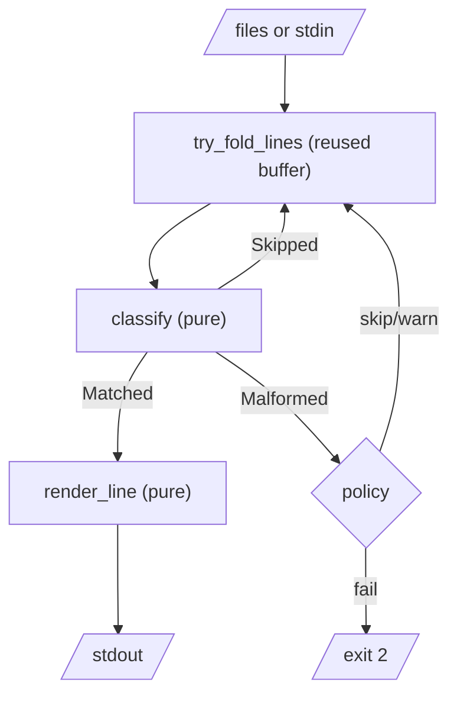
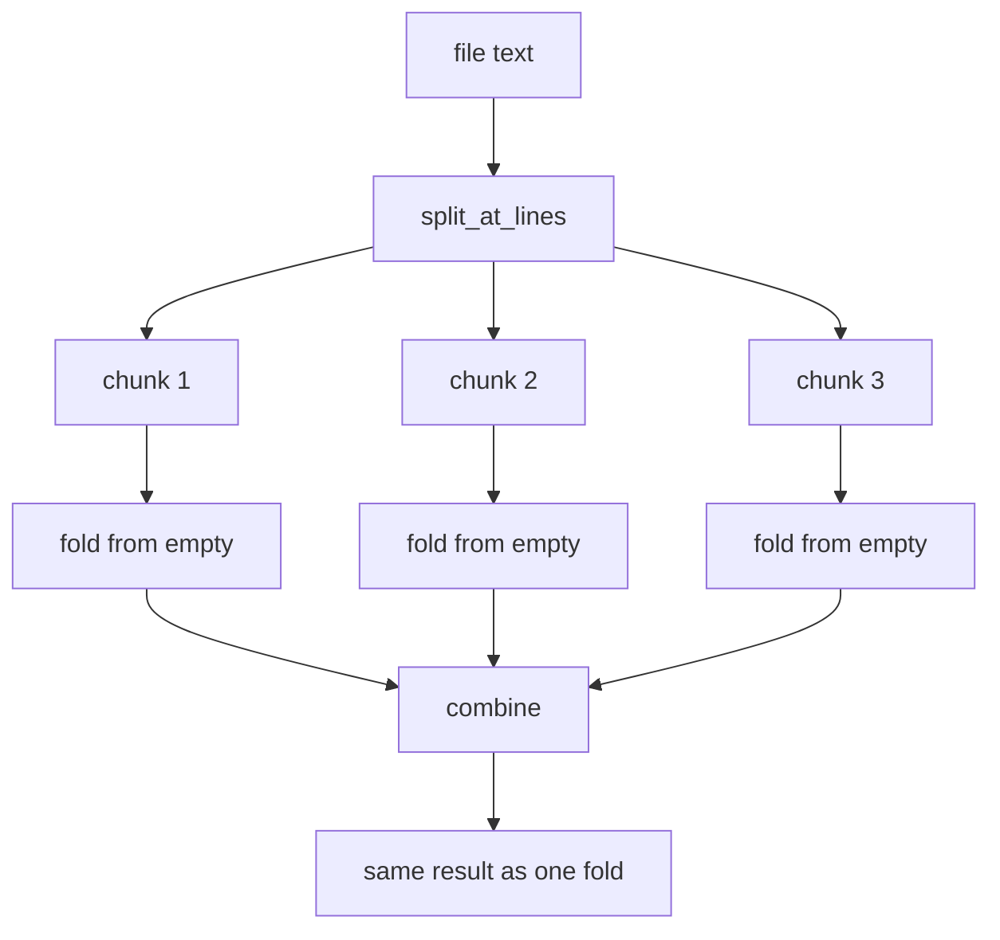

# Streaming and aggregation

We have the two halves of a tool. Chapter 24 turns a line of text into a
`LogLine<'a>` that borrows from it; Chapter 25 turns a query into a checked,
simplified `Query` and decides whether a line matches. What's missing is
everything around them: reading input, deciding what to do with lines that
won't parse, printing results, and answering the questions people ask most
often, which aren't "show me the lines" but "how many?" and "how slow?".

The constraints come from how logs are actually used. Files are large: a
busy service writes gigabytes a day. And the most useful input is often not a
file at all, but a pipe:

```sh
kubectl logs -f deploy/api | logq 'level >= warn'
```

That stream never ends. A tool that reads all of its input before doing
anything prints nothing, ever. So `logq` must *stream*: read a line, deal
with it, forget it, read the next, in constant memory.

This is where Chapter 24's lifetimes come back to collect their debt. A
`LogLine` borrows from the text it was parsed from. In a streaming program,
that text is about to be overwritten by the next line. The compiler is going
to make us think carefully about which values live how long, and the design
that falls out is a better one than we'd have written without it.

## The easy version

Let's start with the simplest thing that could work, for files. Read the
whole file into one `String`, then run an iterator pipeline over its lines:

```rust
let text = std::fs::read_to_string(path)?;
let matching = text
    .lines()
    .filter_map(|line| parse_line(line).ok())
    .filter(|line| matches(&query, line));
for line in matching {
    println!("{:?}", line.get("msg"));
}
```

This is lovely, and fully zero-copy. Every `LogLine` borrows from `text`,
which lives for the whole loop, so the compiler is satisfied. It's lazy, too:
no line is parsed until the `for` loop asks for it.

The crack is the first line. `read_to_string` holds the entire file in
memory before the pipeline starts, which is fine for 10 MB and not for 10 GB,
and it never returns at all for `kubectl logs -f`. We need to read
incrementally.

## Reading a line at a time

Rust's tool for incremental text input is the `BufRead` trait, implemented by
buffered files (`BufReader<File>`) and by a locked standard input. Its
`read_line` method appends the next line to a `String` you supply. The
idiomatic loop reuses one buffer for the whole run, so reading a line doesn't
allocate once the buffer has grown to fit the longest line:

```rust
let mut buf = String::new();
while reader.read_line(&mut buf)? != 0 {
    // ... use buf ...
    buf.clear();
}
```

`read_line` returns the number of bytes read, and zero means end of input.
Now let's do something slightly ambitious: collect the warnings, to print a
count at the end.

```rust
// does not compile
let mut reader = io::stdin().lock();
let mut buf = String::new();
let mut warnings: Vec<LogLine> = Vec::new();
while reader.read_line(&mut buf)? != 0 {
    if let Ok(line) = parse_line(buf.trim_end()) {
        if line.get("level") == Some("warn") {
            warnings.push(line);
        }
    }
    buf.clear();
}
println!("{}", warnings.len());
```

```text
error[E0502]: cannot borrow `buf` as mutable because it is also borrowed as immutable
  --> src/main.rs:10:28
   |
10 |     while reader.read_line(&mut buf)? != 0 {
   |                            ^^^^^^^^ mutable borrow occurs here
11 |         if let Ok(line) = parse_line(buf.trim_end()) {
   |                                      --- immutable borrow occurs here
...
18 |     println!("{}", warnings.len());
   |                    -------- immutable borrow later used here
```

The compiler has spotted a real bug, and it's worth seeing it in the
compiler's own terms. Each `LogLine` in `warnings` borrows `buf`. On the next
iteration, `read_line` and `buf.clear()` want to *change* `buf`: that's
Chapter 2's "many readers XOR one writer" rule. If this compiled, every
stored line would be pointing into text that had since been replaced by a
different line. In a language without the check, this is the bug where all
your stored records mysteriously contain the last line of the file.

### Why not an iterator?

The pipeline in the easy version was so pleasant. Couldn't we have it over a
stream too? `BufRead` does offer an iterator, `lines()`, which yields each
line as a fresh `String`:

```rust
// does not compile
let parsed = io::stdin()
    .lock()
    .lines()
    .map_while(Result::ok)
    .filter_map(|text| parse_line(&text).ok());
```

```text
error[E0515]: cannot return value referencing function parameter `text`
  --> src/main.rs:10:28
   |
10 |         .filter_map(|text| parse_line(&text).ok());
   |                            ^^^^^^^^^^^-----^^^^^^
   |                            |          |
   |                            |          `text` is borrowed here
   |                            returns a value referencing data owned by the current function
```

The closure owns `text` (a `String`), parses a `LogLine` borrowing it, and
tries to return the `LogLine`, at which point `text` is dropped. The same
"why can't I return this?" from Chapter 24, now inside a closure.

The underlying issue is a limitation of the `Iterator` trait itself. Each
item an iterator yields must be able to outlive the next call to `next()`;
that's what lets you `collect()` them. What we want is a *lending* iterator,
whose items borrow from the iterator and are invalidated by the next call.
Rust's type system can express that (with generic associated types), but the
standard `Iterator` trait doesn't, and the ecosystem hasn't settled on one.

We could sidestep it: make each `LogLine` own its data (`into_owned`,
allocating per field). That throws away Chapter 24's whole design. There's a
better answer, and it comes from turning the problem inside out.

## Inverting control: a fold over lines

An iterator is *external* iteration: the caller pulls items out, and may hold
on to them. The alternative is *internal* iteration: the caller hands over a
function, and the loop calls it for each item. With internal iteration, the
loop owns the buffer and *lends* each line to the function for the duration
of one call. The borrow can't escape, so there's nothing to go wrong.

What does the function do with each line? In general, it updates some state:
a count, a map, a "have we matched anything yet" flag. That shape, a state
threaded through a sequence of steps, is `fold`. Chapter 6 introduced
`Iterator::fold` and its fallible sibling `try_fold`. Let's write `try_fold`
for lines of a reader:

```rust
// file: src/stream.rs
/// Like `Iterator::try_fold`, but over a reader's lines. Each line is
/// lent to `step` and gone by the next call, so `A` must own its data.
pub fn try_fold_lines<R, A, E>(
    mut reader: R,
    init: A,
    mut step: impl FnMut(A, usize, &str) -> Result<A, E>,
) -> Result<A, E>
where
    R: BufRead,
    E: From<io::Error>,
{
    let mut buf = Vec::new();
    let mut acc = init;
    let mut number = 0;
    loop {
        buf.clear();
        if reader.read_until(b'\n', &mut buf)? == 0 {
            return Ok(acc);
        }
        number += 1;
        let text = String::from_utf8_lossy(&buf);
        acc = step(acc, number, text.trim_end_matches(['\n', '\r']))?;
    }
}
```

There's a lot packed into the signature.

- **`step` takes `&str` with no named lifetime.** In a closure type, that
  means "for *any* lifetime the caller chooses", a so-called higher-ranked
  bound. `step` must work no matter how briefly the line lives, so it can't
  assume the line outlives the call.
- **The accumulator `A` is passed in and returned by value.** It's the only
  thing that survives from one line to the next, so it's the only place a
  line could escape to.
- **`E: From<io::Error>`** lets the caller choose its error type, as long as
  read errors can be converted into it. `?` on `read_until` does the
  conversion.
- **The buffer holds bytes, not a `String`.** `read_line` fails outright on
  invalid UTF-8, and one corrupt byte in a 10 GB log shouldn't abort the
  run. `String::from_utf8_lossy` replaces bad bytes with `U+FFFD`, and its
  return type is our old friend `Cow<str>`: borrowed from `buf` when the
  bytes were valid (almost always), owned only when something had to be
  replaced.

Now try to smuggle a line out through the accumulator:

```rust
// does not compile
let all = try_fold_lines(reader, Vec::new(), |mut acc, _, text| {
    if let Ok(line) = parse_line(text) {
        acc.push(line);
    }
    Ok::<Vec<LogLine>, io::Error>(acc)
})?;
```

```text
error[E0521]: borrowed data escapes outside of closure
  --> src/main.rs:11:13
   |
 9 |     let all = try_fold_lines(reader, Vec::new(), |mut acc, _, text| {
   |                                                   -------     ---- `text` is a reference that is only valid in the closure body
   |                                                   |
   |                                                   `acc` declared here, outside of the closure body
10 |         if let Ok(line) = parse_line(text) {
11 |             acc.push(line);
   |             ^^^^^^^^^^^^^^ `text` escapes the closure body here
```

"`text` is a reference that is only valid in the closure body." That's the
signature's promise, enforced. The accumulator must own whatever it keeps,
which is exactly the property a streaming program needs: memory use is
bounded by what you *choose* to keep, not by how much input there was.

> [!NOTE]
> Rust's own standard library makes the same move. `Iterator::for_each` and
> `try_for_each` are internal iteration, and some iterator adaptors are
> faster through them, because the loop is inside the adaptor where the
> compiler can see all of it.

## The decision, and the policy

Each line goes through the same pure decision: parse it, and if it parses,
evaluate the query. There are three possible outcomes, so we give them a
type:

```rust
/// What one line of input turned out to be.
#[derive(Debug, PartialEq)]
pub enum Outcome<'a> {
    Matched(LogLine<'a>),
    Skipped,
    Malformed(ParseFailure),
}

/// The pure heart of the tool: text in, a decision out.
pub fn classify<'a>(query: &Query, text: &'a str) -> Outcome<'a> {
    match parse_line(text) {
        Ok(line) if matches(query, &line) => Outcome::Matched(line),
        Ok(_) => Outcome::Skipped,
        Err(failure) => Outcome::Malformed(failure),
    }
}
```

The lifetimes tell the story: a `Matched` outcome borrows the text, and
`Malformed` doesn't, because Chapter 24 made `ParseFailure` own its message.
`classify` decides nothing about *what to do* with a malformed line. That's
policy, and policy belongs in the shell, where the user can choose it:

```rust
// file: src/main.rs
/// The shell's policy for malformed lines; the core only reports them.
#[derive(Debug, Clone, Copy, clap::ValueEnum)]
enum Policy {
    Skip,
    Warn,
    Fail,
}
```

Deriving `clap::ValueEnum` lets `clap` parse `--on-error skip|warn|fail`
straight into this type and list the choices in `--help`. It's Chapter 13's
*Parse the Boundary* in one line.

Here is the whole flow for printing matches. The boxes marked *pure* are
plain functions of their inputs; only the reading, the policy and the
printing touch the world.



### Printing matches

The shell's loop is now short. The state threaded through the fold is `()`:
for printing, we don't need to keep anything from one line to the next. The
closure still captures `out` and a `matched` flag mutably, which is why
`step` is `FnMut`:

```rust
fn print_matches(args: &Args, query: &Query) -> anyhow::Result<bool> {
    let mut out = io::BufWriter::new(io::stdout().lock());
    let mut matched = false;
    for (name, reader) in inputs(&args.files)? {
        try_fold_lines(reader, (), |(), number, text| {
            match classify(query, text) {
                Outcome::Matched(line) => {
                    matched = true;
                    writeln!(out, "{}", render_line(args.format, text, &line))?;
                }
                Outcome::Skipped => {}
                Outcome::Malformed(failure) => {
                    let place = format!("{name}:{number}");
                    malformed(args.on_error, &place, &failure.render(text))?;
                }
            }
            Ok::<_, anyhow::Error>(())
        })?;
    }
    out.flush()?;
    Ok(matched)
}
```

A few details are worth pointing at. `inputs` turns the file arguments into
`(name, Box<dyn BufRead>)` pairs, with standard input when there are none:
one of Chapter 5's uses for dynamic dispatch, since files and stdin are
different types behind the same trait. The `BufWriter` matters more than it
looks: without it, every `writeln!` is a separate system call. And the
function returns whether anything matched, so `main` can exit with status 1
when nothing did, just like `grep`. Scripts rely on that.

`malformed` applies the policy: return `Ok` for `skip`, print the rendered
error for `warn`, and return an error for `fail`, which `?` propagates out of
the fold, ending the run.

### Output formats

`--format` chooses between the original text, normalised logfmt and JSON.
Rendering is a pure function from a line to a `String`:

```rust
// file: src/output.rs
/// Render one matching line. `raw` is the text it was parsed from.
pub fn render_line(format: Format, raw: &str, line: &LogLine) -> String {
    match format {
        Format::Text => raw.to_string(),
        Format::Logfmt => {
            let pairs = line.fields().iter().map(|f| {
                format!("{}={}", f.key, logfmt_value(&f.value))
            });
            pairs.collect::<Vec<_>>().join(" ")
        }
        Format::Json => {
            let pairs = line.fields().iter().map(|f| {
                format!("{}:{}", json_string(f.key), json_string(&f.value))
            });
            format!("{{{}}}", pairs.collect::<Vec<_>>().join(","))
        }
    }
}
```

`json_string` borrows `serde_json`'s string escaping, so we can't get JSON
quoting subtly wrong, and `logfmt_value` quotes and escapes values containing
spaces, quotes or `=`. A unit test checks that the logfmt output parses back
to the same `LogLine`: Chapter 25's round-trip idea, applied to data.

Let's run it on the sample log from Chapter 24:

```sh
logq 'level >= warn and msg ~ "timeout"' examples/app.log
```

```text
examples/app.log:10: skipped malformed line
this line was written by a print statement
    ^ expected `=`
ts=2026-10-19T09:12:03Z level=warn service=api msg="upstream timeout" latency_ms=5012
ts=2026-10-19T09:12:08Z level=error service=api msg="upstream timeout after \"3\" retries" latency_ms=15020
```

The warning goes to standard error, so it doesn't pollute a pipeline; the
matches go to standard output. The error line matched too, because `>=` on a
level now means what it says. In JSON:

```sh
logq 'level >= warn' --format json --on-error skip examples/app.log
```

```text
{"ts":"2026-10-19T09:12:03Z","level":"warn","service":"api","msg":"upstream timeout","latency_ms":"5012"}
{"ts":"2026-10-19T09:12:05Z","level":"error","service":"db","msg":"connection reset by peer","latency_ms":"30001"}
{"ts":"2026-10-19T09:12:06Z","level":"warn","service":"api","msg":"slow request","path":"/search","latency_ms":"950"}
{"ts":"2026-10-19T09:12:08Z","level":"error","service":"api","msg":"upstream timeout after \"3\" retries","latency_ms":"15020"}
{"ts":"2026-10-19T09:12:10Z","level":"warn","service":"auth","msg":"rate limited","user":"bob"}
```

The escaped quotes in line 8 survived two trips: unescaped by our parser
into a `Cow::Owned`, then re-escaped by `serde_json`.

> [!TIP]
> `logq` also accepts `--explain`, which prints the checked and simplified
> query and exits. It's the cheapest possible debugger for a query that
> isn't matching what you expected, and it's three lines in `run`, because
> `Display` on `Query` already exists.

## Counting things

"Show me the lines" is the start of an investigation. The next question is
nearly always "how many, broken down by what?". That's `--count-by`:

```sh
logq 'service = api' --count-by level examples/app.log
```

The answer is a map from field value to count, built up one line at a time.
In other words, a fold, with a map as the accumulator. We want the output
sorted by key, so the map is a `BTreeMap` (Chapter 23's reports made the same
choice):

```rust
#[derive(Debug, Clone, PartialEq, Default)]
pub struct Counts(BTreeMap<String, u64>);

impl Counts {
    pub fn record(mut self, key: &str) -> Self {
        *self.0.entry(key.to_owned()).or_insert(0) += 1;
        self
    }
}
```

`record` takes `self` by value and returns it, so it slots straight into a
fold as the step function. And the key *must* be owned (`to_owned()`),
because the `&str` borrows the current line, and `try_fold_lines` has
already taught us that nothing borrowed survives to the next one.

But look at the cost. `entry` needs an owned key up front, so this allocates a
`String` for *every line*, only to throw it away when the key already exists,
which after the first few lines is nearly always. The fix is to look before
allocating, and to pay only for keys we haven't seen:

```rust
// file: src/aggregate.rs
/// How many lines had each value of a field, and how many lacked it.
#[derive(Debug, Clone, PartialEq, Default)]
pub struct Counts {
    seen: BTreeMap<String, u64>,
    missing: u64,
}

impl Counts {
    /// Count one more `key`. Allocates only for a key not seen before.
    pub fn record(mut self, key: Option<&str>) -> Self {
        match key {
            None => self.missing += 1,
            Some(key) => match self.seen.get_mut(key) {
                Some(n) => *n += 1,
                None => {
                    self.seen.insert(key.to_owned(), 1);
                }
            },
        }
        self
    }
}
```

`get_mut(key)` works with a `&str` even though the map's keys are `String`s,
thanks to the `Borrow` trait: a `String` can be looked up by the `&str` it
derefs to. The second version also handles a line that *lacks* the field,
counted separately rather than silently dropped. Allocation now scales with
the number of distinct values (a handful of services, five levels), not with
the number of lines.

The shell plugs `record` into a generic `aggregate` function (we'll see its
insides shortly) with a one-line closure:

```rust
let step = |c: Counts, line: &LogLine| c.record(line.get(field));
let counts = aggregate(&args, &query, step)?;
print!("{}", render_counts(format, field, &counts));
```

```text
1 malformed line(s) ignored
error               1
info                3
warn                2
```

### Statistics

`--stats latency_ms` asks a numeric question: count, minimum, maximum, mean
and 95th percentile of a field across the matching lines. Same shape, a
different accumulator:

```rust
/// Running numeric statistics for one field.
#[derive(Debug, Clone, PartialEq)]
pub struct Stats {
    count: u64,
    sum: f64,
    min: f64,
    max: f64,
    values: Vec<f64>,
}

impl Stats {
    pub fn record(mut self, value: f64) -> Self {
        self.count += 1;
        self.sum += value;
        self.min = self.min.min(value);
        self.max = self.max.max(value);
        self.values.push(value);
        self
    }
}
```

The interesting question is the starting value. What are `min` and `max`
before we've seen anything? Not zero: then a log full of positive latencies
would report a minimum of zero. The answer that makes `record` correct with
no special cases is `min = +∞` and `max = −∞`, because `∞.min(x)` is `x` for
any `x`:

```rust
fn empty() -> Self {
    Stats {
        count: 0,
        sum: 0.0,
        min: f64::INFINITY,
        max: f64::NEG_INFINITY,
        values: Vec::new(),
    }
}
```

Of course, infinity must never be *reported* as a minimum. As in Chapter 1,
the summary only exists if there was data:

```rust
/// `None` if nothing was observed: there is no mean of nothing.
pub fn summary(&self) -> Option<Summary> {
    if self.count == 0 {
        return None;
    }
    let mut sorted = self.values.clone();
    sorted.sort_by(f64::total_cmp);
    let rank = (sorted.len() as f64 * 0.95).ceil() as usize;
    Some(Summary {
        count: self.count,
        min: self.min,
        max: self.max,
        mean: self.sum / self.count as f64,
        p95: sorted[rank.max(1) - 1],
    })
}
```

```sh
logq 'service = api' --stats latency_ms examples/app.log
```

```text
1 malformed line(s) ignored
field=latency_ms count=6 min=1 max=15020 mean=3510.5 p95=15020
```

The output is itself logfmt, so you can pipe `logq` into `logq`.

> [!WARNING]
> The percentile keeps every value: eight bytes per matching line, which is
> 8 MB per million lines. That's fine for a command-line tool on a file, and
> not fine for a never-ending `-f` stream. The second exercise replaces it
> with a fixed-size histogram.

> [!PATTERN] Streaming Fold / Aggregation
> Process an unbounded input in constant memory by folding each item into an
> accumulator that owns only what it needs (counts, sums, a map of distinct
> keys), and discarding the item before reading the next. In Rust, pass each
> item to the step function as a short-lived borrow; the compiler then
> guarantees nothing from an item outlives it except what the accumulator
> deliberately copies.

## Monoids, and parallelism for free

There's a structure hiding in `Counts` and `Stats` that's worth naming,
because it pays for itself immediately.

Each has an **empty** value: no counts, or `count: 0, min: ∞`. And each can
**combine** two accumulators into one: add the counts key by key, or add the
sums, take the smaller minimum and the larger maximum, concatenate the
values. Combining has two properties:

- **Empty is an identity**: `empty().combine(x)` is `x`, and so is
  `x.combine(empty())`.
- **Combine is associative**: `a.combine(b).combine(c)` equals
  `a.combine(b.combine(c))`. Grouping doesn't matter.

A type with those two things and those two properties is called a
**monoid**. The word is from algebra, and the idea is everywhere: integers
with `0` and `+`, strings with `""` and concatenation, booleans with `true`
and `and`. In Rust, it's a trait:

```rust
/// `combine` must be associative and `empty()` must be its identity.
pub trait Monoid {
    fn empty() -> Self;
    fn combine(self, other: Self) -> Self;
}
```

The laws are in a comment because Rust can't check them; a property test can
(it lives beside the code, comparing `counts(a).combine(counts(b))` with
`counts(a ++ b)`).

Monoids compose. If `A` and `B` are monoids, a *pair* `(A, B)` is one too:
combine each side.

```rust
/// A pair of monoids is a monoid: combine each side.
impl<A: Monoid, B: Monoid> Monoid for (A, B) {
    fn empty() -> Self {
        (A::empty(), B::empty())
    }
    fn combine(self, other: Self) -> Self {
        (self.0.combine(other.0), self.1.combine(other.1))
    }
}
```

With `u64` as a monoid (`0` and `+`), `(u64, Counts)` is a monoid that
counts malformed lines *and* field values in one pass. That's how the
"1 malformed line(s) ignored" message above was produced.

### Why associativity matters

Here's the payoff. Associativity means we can split the input into pieces
*anywhere*, fold each piece separately starting from `empty()`, and combine
the results, and the answer is the same as one fold over everything. If the
pieces are folded on different threads, that's a parallel aggregation, and we
didn't have to change `Counts` or `Stats` at all.



Splitting needs care only in one respect: never cut a line in half.
`split_at_lines` aims for equal-sized chunks and then moves each cut forward
to just after the next newline. The parallel fold uses
`std::thread::scope`:

```rust
/// Fold `text` in `jobs` chunks on scoped threads, then combine.
pub fn fold_parallel<A, F>(text: &str, jobs: usize, step: F) -> A
where
    A: Monoid + Send,
    F: Fn(A, &str) -> A + Sync,
{
    let chunks = split_at_lines(text, jobs.max(1));
    std::thread::scope(|scope| {
        let workers: Vec<_> = chunks
            .into_iter()
            .map(|chunk| {
                let step = &step;
                scope.spawn(move || chunk.lines().fold(A::empty(), step))
            })
            .collect();
        workers
            .into_iter()
            .map(|worker| worker.join().expect("worker panicked"))
            .fold(A::empty(), A::combine)
    })
}
```

Scoped threads are the reason this is so short. An ordinary
`std::thread::spawn` requires its closure to be `'static`, because the
thread might outlive the function that started it. A *scoped* thread is
guaranteed to finish before `scope` returns, so it may borrow: here each
worker borrows its `chunk` of `text` and the shared `step` function. Our
zero-copy `LogLine`s borrow from those chunks inside each thread, and nothing
is copied between threads except the finished accumulators. The bounds say
what's needed: `step` is shared by every thread (`Sync`), and each
accumulator is sent back to the joining thread (`Send`). Part VII explains
those two traits properly.

The final `fold(A::empty(), A::combine)` combines the per-chunk results. Read
it again: it's folding *accumulators* with the monoid, the same move one
level up.

A property test pins down the claim the diagram makes, for any input and any
number of threads:

```rust
#[test]
fn parallel_fold_agrees_with_sequential(
    keys in prop::collection::vec("[abc]", 0..50),
    jobs in 1..6usize,
) {
    let text: String = keys.iter().map(|k| format!("{k}\n")).collect();
    let step = |c: Counts, line: &str| c.record(Some(line));
    let sequential = text.lines().fold(Counts::empty(), step);
    prop_assert_eq!(fold_parallel(&text, jobs, step), sequential);
}
```

### One aggregate function for both

The shell's `aggregate` uses whichever strategy fits. It wraps the user's
`step` in a function that classifies each line and tracks malformed ones in
the pair monoid:

```rust
// The accumulator is (malformed lines, A): a pair of monoids.
let observe = |(bad, acc): (u64, A), text: &str| match classify(query, text)
{
    Outcome::Matched(line) => (bad, step(acc, &line)),
    Outcome::Skipped => (bad, acc),
    Outcome::Malformed(_) => (bad + 1, acc),
};
```

With `--jobs N` and files, each file is read whole and handed to
`fold_parallel(&text, args.jobs, observe)`. Otherwise each input is streamed
through `try_fold_lines`, also starting from `empty()`. Either way the
per-input results are combined with `combine`, so several files on the
command line are just more pieces of the same monoid. The parallel path
gives up streaming (it needs the file in memory to split it), which is why
it's opt-in and files-only.

> [!NOTE]
> This is the idea behind MapReduce, Spark's `reduceByKey`, and the
> `rayon` crate's `fold` + `reduce`: if your aggregation is a monoid, the
> framework is free to split, parallelise and recombine. We wrote twenty
> lines of `std` instead of adding a dependency, but `rayon`'s
> `par_lines().fold(...).reduce(...)` would express the same thing.

## How fast is it?

Let's measure. A small example program generates synthetic logs
deterministically, using a xorshift generator so runs are repeatable without
a `rand` dependency. It lives in `examples/gen.rs`, and writes N lines like
this to standard output:

```text
ts=2026-10-19T00:00:00Z level=warn service=api msg="cache miss" latency_ms=575
```

```sh
cargo run --release --example gen -- 2000000 > big.log
cargo build --release
time target/release/logq 'level >= warn and msg ~ "timeout"' big.log > /dev/null
time target/release/logq 'level >= warn' --count-by service big.log
time target/release/logq 'level >= warn' --count-by service --jobs 6 big.log
```

On the six-core laptop this chapter was written on, with two million lines
(168 MB), the best of three runs were:

| Command | Wall time |
|---|---|
| filter and print 222,162 matches | 0.79 s |
| `--count-by service` | 0.79 s |
| `--count-by service --jobs 6` | 0.29 s |

About 210 MB/s, or 400 ns per line, on a single core, including UTF-8
validation, parsing, type-aware comparison and output. The parallel version
is 2.7 times faster on six threads. It isn't six times faster because
reading the file into memory isn't parallel, and because the machine was
busy with other work (these numbers moved by a factor of two between runs on
a loaded system, so measure on yours).

Where does the remaining time go? Some honest notes:

- **One allocation per line** remains: the `Vec<Field>` inside each
  `LogLine`. Reusing a vector across lines is harder than it looks, because
  a `Vec<Field<'a>>` is tied to one line's lifetime (the fourth exercise).
- **Level parsing** runs once per line per level comparison. An early
  version lower-cased the text with `to_ascii_lowercase()`, allocating every
  time; the table lookup with `eq_ignore_ascii_case` in Chapter 24 removed
  that.
- **We parse every field** even when the query only reads two. A lazy
  parser that stops once it has the fields it needs is possible, at the cost
  of reporting malformed lines less reliably.

None of these would have been visible in a design that allocated a `String`
per field: the noise would have drowned them. Borrowing by default made the
remaining costs few enough to list.

> [!CHECKPOINT]
> The finished tool: `src/stream.rs` (`try_fold_lines`, `classify`),
> `src/aggregate.rs` (`Monoid`, `Counts`, `Stats`, `fold_parallel`),
> `src/output.rs` and a `src/main.rs` shell with `clap`. Add `clap@4`
> (with the `derive` feature), `anyhow@1` and `serde_json@1`. Then:
>
> ```sh
> cargo test
> cargo clippy --all-targets
> cargo run -- 'user = bob' --on-error skip examples/app.log
> ```
>
> ```text
> ts=2026-10-19T09:12:09Z level=info service=auth msg="login failed" user=bob reason=password
> ts=2026-10-19T09:12:10Z level=warn service=auth msg="rate limited" user=bob
> ```

## What we learned

- **Streaming means bounded memory**, and in Rust that's a borrow-checker
  fact, not a hope: a reused buffer can't be changed while anything still
  borrows it.
- **`Iterator` can't lend.** Items must outlive the next call to `next()`,
  so an iterator can't yield values borrowing a reused buffer.
- **Internal iteration solves it.** `try_fold_lines` owns the buffer and lends
  each line to a step function for one call. The higher-ranked `&str` in the
  closure type stops lines escaping, so the accumulator must own what it
  keeps.
- **`String::from_utf8_lossy` returns a `Cow`**: zero-copy for valid text,
  and a corrupt byte no longer aborts the run.
- **Decide in the core, apply policy in the shell.** `classify` returns an
  `Outcome`; the user chooses `skip`, `warn` or `fail`.
- **Aggregations are folds** (*Streaming Fold / Aggregation*). Allocate per
  distinct key, not per line; choose identities (`∞` for `min`) that remove
  special cases; return `Option` when there may be no answer.
- **Monoids** (an identity plus an associative combine) compose as tuples,
  and they make splitting and recombining safe. Associativity is what makes
  parallelism correct.
- **Scoped threads may borrow**, so a parallel fold over zero-copy data needs
  no copying, and the result is checked against the sequential fold by a
  property test.

## Exercises

> [!EXERCISE] Follow mode
> Add `--follow`, which keeps reading a file as it grows, like `tail -f`.
> Which part of the program needs to change? (Hint: `try_fold_lines` stops at
> the first zero-byte read. Should following be a different reader or a
> different fold?) Make sure aggregations print something useful when the
> user presses Ctrl-C.

> [!EXERCISE] A histogram monoid
> Replace `Stats::values` with a fixed array of buckets whose boundaries grow
> geometrically (say, by 10% each), so memory is constant however many
> values arrive. Implement `Monoid` for it, prove associativity with a
> property test, and report p95 as the upper bound of the bucket containing
> the 95th percentile. How far off can it be?

> [!EXERCISE] Count by two fields
> Support `--count-by service,level`. What's the key type? Can you reuse
> `Counts`, or does the design want `Counts<K>`? What does `combine` need
> from `K`?

> [!EXERCISE] Recycle the field vector
> Make `parse_line` accept a `Vec<Field<'static>>` to reuse, returning it
> (emptied) when the line is done. You can't store `Field<'a>`s in a
> `Vec<Field<'static>>`, but an *empty* vector has no elements whose lifetime
> matters. Look up the "vec recycling" trick (`v.clear()` followed by
> `v.into_iter().map(|_| unreachable!()).collect()`), explain why it
> compiles and allocates nothing, then measure whether it was worth it.
