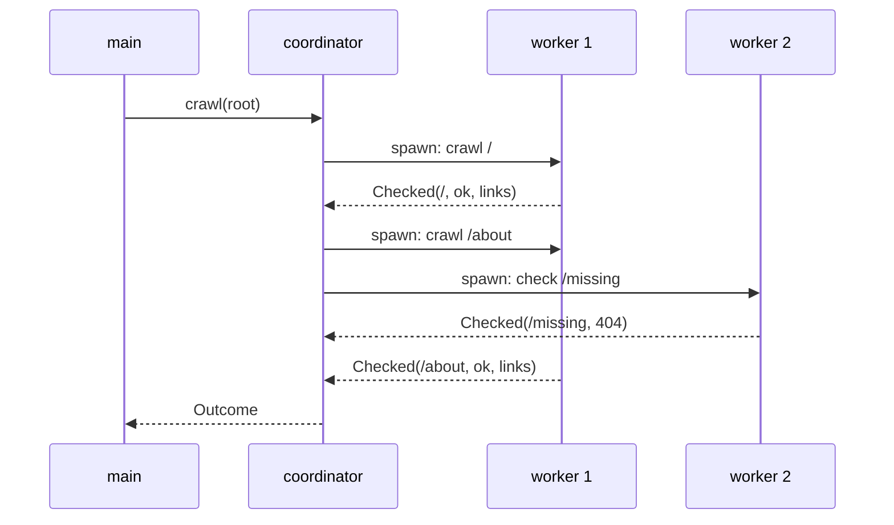
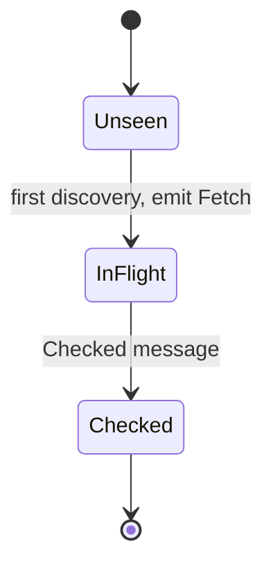

# Concurrency with actors

Your team's documentation site has grown to four hundred pages. Nobody remembers
writing half of them. Every few weeks someone renames a page, and a dozen links
across the site quietly start returning `404 Not Found`. Readers notice before
you do. You'd like a tool that runs in CI, walks the whole site, checks every
link (including the ones that point elsewhere), and fails the build with a list
of what's broken and which pages need fixing:

```sh
linkcheck https://docs.example.com --max-depth 3 --concurrency 16
```

```text
404 Not Found  https://docs.example.com/guides/old-install
    linked from https://docs.example.com/
    linked from https://docs.example.com/faq

9 checked, 1 broken, 0 skipped
```

Checking one link is easy: make an HTTP request and look at the status. The
interesting part is doing *hundreds* of them at once, because a link checker
that waits for each request in turn takes minutes on a site that should take
seconds. And concurrency is where most languages leave you on your own: you
share a set of visited URLs between tasks, protect it with a lock, and hope
you've reasoned about every interleaving.

Rust doesn't let you hope. Its type system knows which values may cross between
threads, and it will refuse to compile a program that gets that wrong. This
chapter uses those refusals as a teacher. We'll write the obvious concurrent
crawler, read the compiler's objections until we understand `Send` and `Sync`,
discover the problem the compiler *can't* see, and then redesign around an idea
that makes shared mutable state disappear: an **actor** whose brain is a **pure
state machine**. Chapter 28 then makes it bounded, polite, cancellable and
thoroughly tested.

We assume the async basics from Chapters 10 and 11: `async fn`, `.await`,
`#[tokio::main]` and `async fn` in traits.

## The words of the domain

Before any code, let's agree on the vocabulary. This is the *Ubiquitous
Language* from Chapter 8, and it will become our type names.

- A **page URL** identifies something we can request. Two spellings of the same
  page (`https://Example.com` and `https://example.com/`) are the same page.
- An **origin** is a URL's scheme, host and port. Links within the starting
  origin are **internal**; everything else is **external**.
- A **link** goes from a **referrer** (the page it appears on) to a **target**.
- **Crawling** a page means fetching it and following its links. **Checking** a
  URL means only finding out whether it works. We crawl internal pages and only
  check external ones: we're not going to crawl the whole internet.
- **Depth** is how many links away from the start page we are. `--max-depth`
  stops the crawl wandering forever.
- A **verdict** is what we conclude about a target: fine, broken with a status
  code, unreachable, or deliberately skipped.
- The **frontier** is the crawl's state: what we've seen, what's in progress
  and what we've concluded.

Let's start the project. It's a library with a thin binary on top, the
*Functional Core, Imperative Shell* split from Chapter 1:

```sh
cargo new linkcheck
cd linkcheck
touch src/lib.rs
```

```toml
# file: Cargo.toml
[dependencies]
anyhow = "1"
clap = { version = "4", features = ["derive"] }
http = "1"
reqwest = { version = "0.13", default-features = false,
            features = ["rustls", "charset", "http2"] }
scraper = "0.27"
thiserror = "2"
tokio = { version = "1", features = ["macros", "rt-multi-thread", "sync",
                                     "time", "signal"] }
tokio-util = "0.7"
url = "2"
```

`url` parses and resolves URLs to the WHATWG standard browsers use. `scraper`
parses HTML and finds elements with CSS selectors. `http` gives us
`StatusCode`, a vocabulary type that both `reqwest` and our own code can speak
without the domain depending on an HTTP client.

## One page, one identity

The crawler's most important question is "have I seen this page before?". If
we answer it with strings, we'll fetch the same page many times:

```text
https://example.com
https://example.com/
HTTPS://EXAMPLE.COM/
https://example.com:443/
https://example.com/#installation
https://example.com/docs/../
```

Those are six spellings of one page. The `url` crate already normalises most of
them when it parses: it lowercases the scheme and host, drops default ports,
resolves `..` and turns an empty path into `/`. What remains is ours to decide.
A fragment (`#installation`) is a position *within* a page that the browser
handles; the server never sees it, so it's not part of the page's identity. An
empty query (`?`) means nothing either.

That's a rule, and rules belong in a constructor. A `PageUrl` is a *Newtype*
around `url::Url` that can only be built through one door:

```rust
// file: src/url.rs
#[derive(Debug, Clone, PartialEq, Eq, Hash, PartialOrd, Ord)]
pub struct PageUrl(Url);

impl TryFrom<Url> for PageUrl {
    type Error = UrlError;

    fn try_from(mut url: Url) -> Result<PageUrl, UrlError> {
        if !matches!(url.scheme(), "http" | "https") {
            return Err(UrlError::UnsupportedScheme(url.scheme().into()));
        }
        url.set_fragment(None);
        if url.query() == Some("") {
            url.set_query(None);
        }
        Ok(PageUrl(url))
    }
}
```

This is *Parse, Don't Validate* from Chapter 4 again. Every `PageUrl` in the
program is http(s), fragment-free and canonical, so `==` and `Hash` on it mean
"same page", and a `HashSet<PageUrl>` really is a set of pages. A `mailto:` or
`javascript:` link can't sneak in; it fails to become a `PageUrl` at all.

Two more constructors go through the same door. `parse` is for the URL the user
types; `join` resolves an `href` found on a page:

```rust
impl PageUrl {
    pub fn parse(input: &str) -> Result<PageUrl, UrlError> {
        Url::parse(input)?.try_into()
    }

    /// Resolve an `href` found on this page.
    pub fn join(&self, href: &str) -> Result<PageUrl, UrlError> {
        self.0.join(href)?.try_into()
    }
}
```

`UrlError` is a two-variant `thiserror` enum (`Invalid(#[from]
url::ParseError)` and `UnsupportedScheme(String)`), and a `FromStr`
implementation that calls `parse` will let `clap` produce a `PageUrl` straight
from the command line.

### The trailing slash

What about `https://example.com/docs` versus `https://example.com/docs/`? It's
tempting to strip trailing slashes so they compare equal. Many servers do treat
them as the same page. Before deciding, let's write down what we know as a
test:

```rust
#[test]
fn relative_links_resolve_against_the_page() {
    let dir = url("https://example.com/docs/");
    let file = url("https://example.com/docs");
    assert_eq!(dir.join("intro").unwrap(), url("https://example.com/docs/intro"));
    assert_eq!(file.join("intro").unwrap(), url("https://example.com/intro"));
}
```

That test passes, and it's the reason we *won't* strip slashes. A relative link
`intro` on `/docs/` means `/docs/intro`; on `/docs` it means `/intro`. The
slash changes what every relative link on the page points to, so the two URLs
are genuinely different resources even when a server happens to serve the same
bytes. Our rule is: **the url crate's normalisation, minus the fragment and an
empty query; trailing slashes are significant.** We pin that down too, so
nobody "fixes" it later:

```rust
#[test]
fn trailing_slash_is_significant() {
    assert_ne!(url("https://example.com/docs/"), url("https://example.com/docs"));
}
```

> [!TIP]
> When a normalisation rule is a judgement call, write the test that shows
> *why* you chose it. The next person tempted to change the rule will meet the
> reason before they meet the bug.

### Origin and depth

"Same site" means same scheme, host and port. `url` can compute that, and we
wrap it so our domain has its own word for it:

```rust
#[derive(Debug, Clone, PartialEq, Eq, Hash)]
pub struct Origin(url::Origin);

impl PageUrl {
    pub fn origin(&self) -> Origin {
        Origin(self.0.origin())
    }
}
```

Depth is a count that only ever goes up by one link at a time. A newtype with
no public arithmetic says exactly that:

```rust
// file: src/frontier.rs
#[derive(Debug, Clone, Copy, PartialEq, Eq, PartialOrd, Ord)]
pub struct Depth(u32);

impl Depth {
    pub const START: Depth = Depth(0);

    pub fn new(depth: u32) -> Depth {
        Depth(depth)
    }

    pub fn next(self) -> Depth {
        Depth(self.0 + 1)
    }
}
```

## Verdicts and the fetching port

A link's verdict is a sum type. Here it is with every case the domain cares
about, including two kinds of failure that a `bool` would blur together:

```rust
// file: src/status.rs
#[derive(Debug, Clone, PartialEq, Eq)]
pub enum LinkStatus {
    Ok,
    Broken(StatusCode),
    Unreachable(FetchError),
    Skipped(SkipReason),
}

#[derive(Debug, Clone, Copy, PartialEq, Eq)]
pub enum SkipReason {
    External,
    Cancelled,
}
```

`Broken` means the server answered and said no (`404`, `410`, `500`).
`Unreachable` means there was no answer to read: the connection was refused or
timed out. The distinction matters to whoever fixes it: one is a typo in your
site, the other might be someone else's outage. `Skipped` is for links we
choose not to check; Chapter 28 produces both reasons.

Fetching is I/O, so it goes behind a port, exactly as Chapter 10 put
Cloudflare behind `DnsProvider`. The crawler needs two operations: `HEAD`
("does this exist?") and `GET` ("give me the page so I can read its links"):

```rust
// file: src/fetch/mod.rs
pub trait Fetcher: Send + Sync + 'static {
    fn head(
        &self,
        url: &PageUrl,
    ) -> impl Future<Output = Result<StatusCode, FetchError>> + Send;

    fn get(
        &self,
        url: &PageUrl,
    ) -> impl Future<Output = Result<Page, FetchError>> + Send;
}

pub struct Page {
    pub status: StatusCode,
    /// Where we ended up after redirects: the base for relative links.
    pub base: PageUrl,
    /// The body, if it was HTML.
    pub html: Option<String>,
}
```

Chapter 10 mentioned "the `Send` bound wrinkle" with async functions in
traits. This is where it stops being a footnote. A plain `async fn head(...)`
in a trait doesn't promise that the future it returns is `Send`, and we're
about to run these futures on a multi-threaded runtime that needs exactly that
promise. Writing the desugared form, `-> impl Future<Output = ...> + Send`,
makes the promise part of the contract. Implementations can still write
`async fn`; the compiler checks that each one keeps the promise. By the end of
this chapter you'll know precisely what that promise means.

`FetchError` is our own small enum (`Timeout`, `Connect(String)`,
`TooManyRedirects`, and a catch-all `Other(String)`), and the `reqwest`
adapter's job is to translate into it. That's the *Anti-Corruption Layer*:
`reqwest::Error` never leaks past the adapter.

```rust
// file: src/fetch/http.rs
fn translate(e: reqwest::Error) -> FetchError {
    if e.is_timeout() {
        FetchError::Timeout
    } else if e.is_redirect() {
        FetchError::TooManyRedirects
    } else if e.is_connect() {
        FetchError::Connect(root_cause(&e))
    } else {
        FetchError::Other(root_cause(&e))
    }
}
```

`root_cause` walks the error's `source()` chain to the bottom, because
`reqwest`'s own message ("error sending request for url") is true but useless;
the bottom of the chain says "Connection refused". The adapter's `get` sends
the request, records `response.url()` (the URL *after* redirects) as the page's
base, and only reads the body when the `Content-Type` is `text/html`. There's
nothing new in it beyond Chapter 10, so we won't dwell on it.

### Finding links is a pure function

The last building block takes HTML and a base URL and returns links. It
touches no network and no clock:

```rust
// file: src/extract.rs
static LINKS: LazyLock<Selector> = LazyLock::new(|| {
    Selector::parse("a[href], link[href], img[src], script[src]")
        .expect("valid selector")
});

pub fn extract_links(base: &PageUrl, html: &str) -> Vec<PageUrl> {
    let document = Html::parse_document(html);
    let mut links: Vec<PageUrl> = Vec::new();
    for element in document.select(&LINKS) {
        let attrs = element.value();
        let Some(href) = attrs.attr("href").or(attrs.attr("src")) else {
            continue;
        };
        if let Ok(link) = base.join(href.trim())
            && !links.contains(&link)
        {
            links.push(link);
        }
    }
    links
}
```

`LazyLock` builds the selector once, on first use. Links that don't parse, or
aren't http(s), simply fail `join` and are dropped. Notice the signature: it's
a plain `fn`, not an `async fn`, and it returns *owned* `PageUrl`s. That isn't
an accident, and we'll see why it matters in a few pages.

## The crawler you'd write first

With the pieces in place, the first crawler practically writes itself. Keep a
queue of URLs to visit and a set of URLs we've already seen; pop, fetch,
extract, push the new ones:

```rust
pub async fn crawl(
    fetcher: &impl Fetcher,
    root: PageUrl,
) -> Vec<(PageUrl, LinkStatus)> {
    let origin = root.origin();
    let mut seen = HashSet::from([root.clone()]);
    let mut todo = VecDeque::from([root]);
    let mut results = Vec::new();

    while let Some(url) = todo.pop_front() {
        let page = match fetcher.get(&url).await {
            Ok(page) => page,
            Err(e) => {
                results.push((url, LinkStatus::Unreachable(e)));
                continue;
            }
        };
        results.push((url, LinkStatus::from_status(page.status)));
        let html = page.html.unwrap_or_default();
        for link in extract_links(&page.base, &html) {
            if link.origin() == origin && seen.insert(link.clone()) {
                todo.push_back(link);
            }
        }
    }
    results
}
```

(`LinkStatus::from_status` maps 2xx to `Ok` and anything else to `Broken`.)
This is honestly not bad. It's correct, it's readable and it's easy to test
with a fake `Fetcher`. It has no depth limit, doesn't check external links and
doesn't remember referrers, but those are additions, not redesigns.

Its problem is time. Every `.await` on `fetcher.get` waits for a full network
round trip before starting the next. If the average request takes 100 ms and
the site has 2,000 URLs, the crawl takes over three minutes, almost all of it
spent waiting. The work is *embarrassingly parallel*: checking `/about` doesn't
depend on checking `/faq`. We should be waiting for many responses at once.

## Just spawn a task per link

`tokio::spawn` takes a future and runs it as an independent **task**: a
lightweight, runtime-managed unit of concurrency. Tasks are cheap (a few
hundred bytes each, no OS thread per task), so spawning one per link seems
natural. Each task fetches a page and spawns more tasks for the links it
finds. They all need to agree on what's been seen, so the seen-set becomes
shared:

```rust
type Seen = Arc<Mutex<HashSet<PageUrl>>>;

pub fn visit(fetcher: Arc<HttpFetcher>, seen: Seen, url: PageUrl) {
    tokio::spawn(async move {
        let Ok(page) = fetcher.get(&url).await else { return };
        let html = page.html.unwrap_or_default();
        for link in extract_links(&page.base, &html) {
            if seen.lock().unwrap().insert(link.clone()) {
                visit(Arc::clone(&fetcher), Arc::clone(&seen), link);
            }
        }
    });
}
```

This compiles and runs. `Arc` (*atomically reference-counted*) gives many tasks
shared ownership of one value; `Mutex` lets them take turns mutating it. If
you've done concurrent programming in Java or Go, this is the shape you know.

Now let's make three small, reasonable-looking changes and listen to what the
compiler says about each. Each refusal teaches one piece of how Rust thinks
about threads.

### Why tasks must be `Send`

First, one piece of background. `#[tokio::main]` starts a **multi-threaded
runtime**: a pool of OS threads (one per CPU core by default), each running
tasks. When a task reaches an `.await` that isn't ready, it's parked, and when
it wakes up it may be resumed on *a different thread*. Idle threads steal work
from busy ones. That's how a handful of threads keeps thousands of tasks moving.

So a spawned future, and everything it holds across an `.await`, may move
between threads mid-flight. That's what the bound on `tokio::spawn` says:

```rust
pub fn spawn<F>(future: F) -> JoinHandle<F::Output>
where
    F: Future + Send + 'static,
    F::Output: Send + 'static,
```

`'static` means the future can't borrow anything from the function that spawned
it (the spawner might return long before the task finishes), which is why we
pass `Arc` clones and owned `PageUrl`s with `async move`. `Send` means the
future is safe to move to another thread. The compiler works out whether a
future is `Send` from what it holds at each `.await`.

### Crack one: holding a lock across an `.await`

Suppose we tidy the loop by locking once, outside it, and also check each new
link with a `HEAD` request as we go:

```rust
// does not compile
pub fn visit(fetcher: Arc<HttpFetcher>, seen: Seen, url: PageUrl) {
    tokio::spawn(async move {
        let Ok(page) = fetcher.get(&url).await else { return };
        let html = page.html.unwrap_or_default();
        let mut seen = seen.lock().unwrap();
        for link in extract_links(&page.base, &html) {
            if seen.insert(link.clone()) {
                let _ = fetcher.head(&link).await;
            }
        }
    });
}
```

```text
error: future cannot be sent between threads safely
  --> src/broken/guard.rs:11:5
   |
11 | /     tokio::spawn(async move {
12 | |         let Ok(page) = fetcher.get(&url).await else { return };
13 | |         let html = page.html.unwrap_or_default();
14 | |         let mut seen = seen.lock().unwrap();
...  |
20 | |     });
   | |______^ future created by async block is not `Send`
   |
   = help: within `{async block@src/broken/guard.rs:11:18: 11:28}`, the
     trait `Send` is not implemented for
     `std::sync::MutexGuard<'_, HashSet<PageUrl>>`
note: future is not `Send` as this value is used across an await
  --> src/broken/guard.rs:17:45
   |
14 |         let mut seen = seen.lock().unwrap();
   |             -------- has type `std::sync::MutexGuard<'_,
   |                      HashSet<PageUrl>>` which is not `Send`
...
17 |                 let _ = fetcher.head(&link).await;
   |                                             ^^^^^ await occurs here,
   |                                     with `mut seen` maybe used later
note: required by a bound in `tokio::spawn`
```

Read it from the bottom up. `tokio::spawn` requires `Send`. The future isn't
`Send` because, at the `.await` on line 17, it's holding a `MutexGuard`, the
value `lock()` returns, which unlocks the mutex when dropped (the *RAII*
pattern from Chapter 2). And `MutexGuard` is not `Send`.

Why not? Because the operating system's mutex must be unlocked by the same
thread that locked it. If the task locked on thread 3, parked at the
`.await`, and resumed on thread 7, the unlock would happen on the wrong thread.
In C that's undefined behaviour you'd discover in production. Here it's a type
error, found before the program exists.

There's a second, subtler problem the error saves us from. Even if it were
allowed, holding the lock across a network request means every other task
that wants the seen-set waits for *our* `HEAD` request to finish. We'd have
built a concurrent crawler that runs one request at a time.

The fix is to keep the critical section short and synchronous: lock, update,
unlock, *then* await. That's what the original version did by locking inside
the `if` condition, where the guard is a temporary dropped before the body
runs.

> [!WARNING]
> `tokio::sync::Mutex` has a guard that *is* `Send`, so swapping it in makes
> this error vanish. Resist the temptation. It compiles because it's designed
> to be held across `.await`, but holding any lock across a network call
> serialises everything behind it. Reach for the async mutex only when the
> critical section genuinely must await, which is rarer than you'd think.

### Crack two: `Rc` instead of `Arc`

`Arc` uses atomic CPU instructions to update its reference count, which cost a
little more than plain increments. Rust also has `Rc`, a non-atomic reference
count, and `RefCell`, which checks borrowing rules at runtime instead of
compile time. Someone optimising might try:

```rust
// does not compile
type Seen = Rc<RefCell<HashSet<PageUrl>>>;

pub fn visit(fetcher: Arc<HttpFetcher>, seen: Seen, url: PageUrl) {
    tokio::spawn(async move {
        let Ok(page) = fetcher.get(&url).await else { return };
        let html = page.html.unwrap_or_default();
        for link in extract_links(&page.base, &html) {
            if seen.borrow_mut().insert(link.clone()) {
                visit(Arc::clone(&fetcher), Rc::clone(&seen), link);
            }
        }
    });
}
```

```text
error: future cannot be sent between threads safely
  --> src/broken/rc.rs:13:5
   |
13 | /     tokio::spawn(async move {
14 | |         let Ok(page) = fetcher.get(&url).await else { return };
15 | |         let html = page.html.unwrap_or_default();
16 | |         for link in extract_links(&page.base, &html) {
...  |
21 | |     });
   | |______^ future created by async block is not `Send`
   |
   = help: within `{async block@src/broken/rc.rs:13:18: 13:28}`, the trait
     `Send` is not implemented for `Rc<RefCell<HashSet<PageUrl>>>`
note: captured value is not `Send`
  --> src/broken/rc.rs:17:16
   |
17 |             if seen.borrow_mut().insert(link.clone()) {
   |                ^^^^ has type `Rc<RefCell<HashSet<PageUrl>>>` which is
   |                     not `Send`
note: required by a bound in `tokio::spawn`
```

This time the note says *captured value*: the problem isn't something held at
an `.await`, it's the `Rc` moved into the task at all. Two threads each holding
a clone of an `Rc` could both bump its count at the same moment, and a
non-atomic increment can lose one of the updates. The count goes wrong, the
value is freed while still in use, and you have a use-after-free. So `Rc` is
not `Send`, and the compiler won't let it near another thread.

### Send and Sync, properly

We've now met the two traits that make all of this work. They're *marker
traits*: they have no methods, and the compiler implements them automatically
for any type whose parts all implement them.

- **`T: Send`** means a value of type `T` can be *moved* to another thread.
- **`T: Sync`** means a `&T` can be *shared* between threads; formally, `T` is
  `Sync` exactly when `&T` is `Send`.

Most types are both. The exceptions are the interesting part:

| Type | `Send` | `Sync` | Why |
|---|---|---|---|
| `String`, `Vec<T>`, `PageUrl` | yes | yes | Plain owned data |
| `Rc<T>` | no | no | Non-atomic reference count |
| `Cell<T>`, `RefCell<T>` | yes | no | Unsynchronised interior mutation |
| `Arc<T>` | if `T: Send + Sync` | if `T: Send + Sync` | Atomic count; shares `T` |
| `Mutex<T>` | if `T: Send` | if `T: Send` | Makes a `Send` type shareable |
| `MutexGuard<'_, T>` | no | if `T: Sync` | Must unlock on the locking thread |

Read down the `Arc` and `Mutex` rows and you can see why `Arc<Mutex<T>>` is the
standard recipe: `Mutex` turns "safe to move" into "safe to share", and `Arc`
makes the shared thing ownable by many tasks. Read the `Cell` row and you can
see the difference between the traits: you may hand a `RefCell` to another
thread, but two threads may not poke it at once.

Because the traits are derived automatically, a single non-`Send` field
anywhere inside a type makes the whole type non-`Send`, and a future's "fields"
are whatever it holds across `.await`. That's how a mistake deep inside a
dependency can surface at your `tokio::spawn`, as the next crack shows.

### Crack three: a parser that can't travel

Earlier we made `extract_links` a plain function that returns owned URLs. Here
is what happens if we don't, and instead walk the parsed document inside the
task, checking each link as we find it:

```rust
// does not compile
pub fn check_page(fetcher: Arc<HttpFetcher>, url: PageUrl) {
    tokio::spawn(async move {
        let Ok(page) = fetcher.get(&url).await else { return };
        let html = page.html.unwrap_or_default();
        let document = Html::parse_document(&html);
        let links = Selector::parse("a[href]").unwrap();
        for a in document.select(&links) {
            let Some(href) = a.attr("href") else { continue };
            if let Ok(link) = page.base.join(href) {
                let _ = fetcher.head(&link).await;
            }
        }
    });
}
```

The compiler produces six near-identical errors, one per non-thread-safe part
of `scraper`'s document tree. Here's the first:

```text
error: future cannot be sent between threads safely
  --> src/broken/html.rs:8:5
   |
 8 | /     tokio::spawn(async move {
 9 | |         let Ok(page) = fetcher.get(&url).await else { return };
10 | |         let html = page.html.unwrap_or_default();
11 | |         let document = Html::parse_document(&html);
...  |
19 | |     });
   | |______^ future created by async block is not `Send`
   |
   = help: within `ego_tree::Node<Node>`, the trait `Sync` is not
     implemented for `std::cell::OnceCell<Option<tendril::tendril::Tendril<
     tendril::fmt::UTF8>>>`
   = note: if you want to do aliasing and mutation between multiple
     threads, use `std::sync::OnceLock` instead
note: future is not `Send` as this value is used across an await
  --> src/broken/html.rs:16:45
   |
13 |         for a in document.select(&links) {
   |             - has type `ElementRef<'_>` which is not `Send`
...
16 |                 let _ = fetcher.head(&link).await;
   |                                             ^^^^^ await occurs here,
   |                                             with `a` maybe used later
note: required by a bound in `tokio::spawn`
```

`scraper` builds its tree from cells and non-atomic string buffers, because
parsing is single-threaded and that's faster. Our `ElementRef` borrows from the
tree, so holding one across the `.await` would let the tree be touched from two
threads. None of this is a flaw in `scraper`; it's a library telling us, through
its types, how it may be used.

The fix is the shape `extract_links` already has: **do non-`Send` work in a
synchronous function and return owned, `Send` data.** The document lives and
dies inside one call that never awaits, and only a `Vec<PageUrl>` crosses into
async code. This is a good habit generally. Pure, synchronous functions are
easy to test, and they can't hold anything across an `.await`, because they
don't have one.

### The crack the compiler can't see

So we go back to the version that compiles. It's fast. Is it right?

Start with the simplest question: how does `main` know the crawl has finished?
`visit` returns `()` immediately. The tasks are detached; nobody holds their
handles. If `main` returns, the runtime shuts down and kills them all
mid-request. To wait properly we need to count outstanding tasks: an
`Arc<AtomicUsize>` incremented before each spawn and decremented at the end of
each task, plus a way to wake `main` when it reaches zero. Get the order of
increment and spawn wrong and the count can touch zero while work remains.

Then the features we skipped arrive. Referrers need an
`Arc<Mutex<HashMap<PageUrl, BTreeSet<PageUrl>>>>`. Results need another. The
depth limit needs each task to know its depth. External links need checking but
not crawling. Every one of those is another piece of shared mutable state,
another lock, and another set of questions. Can a task record a result before
another task has recorded the referrer? Does it matter? If two locks are taken
in different orders by different tasks, can they deadlock?

None of those are type errors. The compiler has guaranteed there are no *data
races*, unsynchronised access to memory, and that is a huge guarantee. It
cannot guarantee that our *logic* is consistent across thousands of
interleavings. And notice what has happened to testing: the crawl's rules (when
to crawl versus check, when we're done, which referrers to record) are smeared
across tasks, locks and counters. To test any of them we need a runtime, real
concurrency and luck.

The trouble isn't `Mutex`. It's that the crawl's state has many owners. Let's
give it one.

## One owner, many messengers

Here's the redesign in a sentence: **one task owns all of the crawl's state,
and every other task talks to it by sending messages.**

The owner is the **coordinator**. It holds the seen-set, the results, the
referrers and the count of work in progress, as ordinary non-shared values:
no `Arc`, no `Mutex`. **Workers** do the slow part. Each gets one job (a URL,
its depth, crawl or check), does the network I/O, and sends back a message
saying what it found. The coordinator handles messages one at a time, so there
is no interleaving *inside* the state to reason about; there's only a sequence
of messages.

This is the **actor** model, which Erlang made famous and which Akka brought to
the JVM. In Rust it needs nothing more than a task and a channel. Here's one
round trip:



The channel is `tokio::sync::mpsc`: *multi-producer, single-consumer*. Any
number of `Sender`s (cheap to clone, one per worker) and exactly one
`Receiver`, owned by the coordinator. That "single consumer" is the type
system enforcing the actor's defining rule: only one task reads the mailbox, so
only one task decides anything.

> [!PATTERN] Actor
> Give mutable state exactly one owner: a task that receives messages on a
> channel and handles them one at a time. Other tasks never touch the state;
> they send messages describing what happened. In Rust: a spawned task or
> async loop that owns its state, a `tokio::sync::mpsc::Receiver` as its
> mailbox, and cloned `Sender`s for everyone else. Shared mutable state
> becomes a sequence of messages, which is far easier to reason about.

We could write the coordinator as a loop full of `if`s that mutates its state
and spawns workers directly. That would already be better than the locks. But
the actor gives us an opportunity that's worth more than the concurrency fix,
and it's the one this book keeps returning to.

## The frontier as a pure state machine

Look at what the coordinator actually *decides*. A message arrives: "`/about`
was fine, and it links to `/`, `/docs` and `/missing`". The coordinator updates
what it knows and decides which new jobs to start, and whether the crawl is
over. None of that needs the network, a clock or a runtime. It's a function:

> old state + message → new state + things to do

The "things to do" are **effects**: descriptions of I/O we'd like the shell to
perform, as plain data. That's *Decision as Data* from Chapter 9, and it's the
same move as Chapter 15's `decide` and Chapter 20's reducer. Let's write the
types first, *Type-Driven Development* style:

```rust
// file: src/frontier.rs
#[derive(Debug, Clone, Copy, PartialEq, Eq)]
pub enum Mode {
    /// GET it and follow its links.
    Crawl,
    /// Only find out whether it works.
    Check,
}

#[derive(Debug, Clone, PartialEq, Eq)]
pub struct Job {
    pub url: PageUrl,
    pub depth: Depth,
    pub mode: Mode,
}
```

A `Job` is everything a worker needs. Then the two vocabularies of the actor,
what it can be told and what it can ask for:

```rust
/// Everything the coordinator can be told.
#[derive(Debug, Clone, PartialEq, Eq)]
pub enum Msg {
    Checked { job: Job, status: LinkStatus, links: Vec<PageUrl> },
}

/// Everything the coordinator can be asked to do.
#[derive(Debug, Clone, PartialEq, Eq)]
pub enum Effect {
    Fetch(Job),
    Done,
}
```

`Msg` has a single variant for now; Chapter 28 adds a second, and the compiler
will walk us to every `match` that needs to know about it. Now the state
itself, which is everything the shared-state version scattered across locks:

```rust
#[derive(Debug, Clone)]
pub struct Frontier {
    origin: Origin,
    max_depth: Depth,
    seen: HashSet<PageUrl>,
    in_flight: usize,
    results: BTreeMap<PageUrl, LinkStatus>,
    referrers: BTreeMap<PageUrl, BTreeSet<PageUrl>>,
}
```

The fields are private, so the only way to change a `Frontier` is through the
functions we're about to write (*Encapsulated Invariants*, Chapter 7). The
`BTreeMap`s keep results sorted by URL, which will make the report stable.

And the signatures:

```rust
impl Frontier {
    pub fn new(root: PageUrl, max_depth: Depth) -> (Frontier, Vec<Effect>) {
        todo!()
    }
}

pub fn handle(state: Frontier, msg: Msg) -> (Frontier, Vec<Effect>) {
    todo!()
}
```

Read `handle`'s signature carefully, because it's the whole design. It takes
the state *by value* and returns a new one. There's no `&mut self`, no `async`,
no `Arc`, no channel. Starting a crawl is a transition too: `new` returns the
initial state together with its first effects, so there's no special "kick
off" code hiding in the shell.

### Filling it in

`new` builds an empty frontier that has already seen the root, and asks for it
to be crawled:

```rust
pub fn new(root: PageUrl, max_depth: Depth) -> (Frontier, Vec<Effect>) {
    let mut state = Frontier {
        origin: root.origin(),
        max_depth,
        seen: HashSet::from([root.clone()]),
        in_flight: 0,
        results: BTreeMap::new(),
        referrers: BTreeMap::new(),
    };
    let job = Job { url: root, depth: Depth::START, mode: Mode::Crawl };
    let effects = vec![state.fetch(job)];
    (state, effects)
}
```

Two private helpers do the real work. `fetch` is the only place a `Fetch`
effect is created, so it's the only place that needs to count work in flight:

```rust
fn fetch(&mut self, job: Job) -> Effect {
    self.in_flight += 1;
    Effect::Fetch(job)
}
```

`discover` decides what one newly found link means. It always records the
referrer, because the report wants *every* page that links to a broken target,
but it only creates a job the first time it sees a URL:

```rust
fn discover(&mut self, from: &Job, link: PageUrl) -> Option<Effect> {
    self.referrers
        .entry(link.clone())
        .or_default()
        .insert(from.url.clone());
    if !self.seen.insert(link.clone()) {
        return None; // already known: we only needed the referrer
    }
    let depth = from.depth.next();
    let internal = link.origin() == self.origin;
    let mode = if internal && depth <= self.max_depth {
        Mode::Crawl
    } else {
        Mode::Check
    };
    Some(self.fetch(Job { url: link, depth, mode }))
}
```

The crawl-or-check rule is now one `if`, in one place, in words a reviewer can
check against the requirements: internal pages within the depth limit are
crawled; everything else is only checked. With `--max-depth 0` we crawl just
the start page and check its links.

And `handle` is glue:

```rust
pub fn handle(mut state: Frontier, msg: Msg) -> (Frontier, Vec<Effect>) {
    let Msg::Checked { job, status, links } = msg;
    state.in_flight -= 1;
    let mut effects: Vec<Effect> = links
        .into_iter()
        .filter_map(|link| state.discover(&job, link))
        .collect();
    state.results.insert(job.url, status);
    if state.in_flight == 0 {
        effects.push(Effect::Done);
    }
    (state, effects)
}
```

The termination problem that needed an atomic counter and a careful ordering
argument in the shared-state version is now three lines. `in_flight` counts
`Fetch` effects that haven't yet come back as `Checked` messages. Messages are
handled one at a time, so there's no race: when it hits zero after handling a
message, nothing is running and nothing new was discovered. We're done.

> [!NOTE]
> `handle` says `mut state` and mutates it. Is it still pure? From the
> outside, yes. It owns `state` outright, since it was moved in and nobody else
> can hold a reference to it, so no caller can observe the mutation. They see
> only a value going in and a value coming out. This is ownership (Chapter 2)
> doing something garbage-collected languages can't: in-place updates with the
> semantics of immutable values.

Here is the life of a single URL inside the frontier. Every arrow is a line of
code we've just written, and there's no other way for a URL to move:



Discovering a URL again, in either of the later states, only adds a referrer;
it never moves the URL backwards or fetches it twice.

> [!PATTERN] Pure State Machine Driven by Messages
> Put an actor's decisions in a pure function
> `handle(State, Msg) -> (State, Vec<Effect>)`. Messages describe what
> happened; effects describe what should happen next, as data. The actor's
> loop only receives messages and interprets effects. The state machine can
> then be tested exhaustively with plain values, with no runtime, network or
> timing involved.

### Testing the brain without a body

Here's the payoff. A test of the crawl's core rule needs no `#[tokio::test]`,
no fake server and no sleeping. It's values in, values out:

```rust
#[test]
fn internal_links_are_crawled_and_external_ones_checked() {
    let (state, _) = Frontier::new(url(ROOT), Depth::new(1));
    let msg = Msg::Checked {
        job: job(ROOT, 0, Mode::Crawl),
        status: LinkStatus::Ok,
        links: vec![
            url("https://example.com/about"),
            url("https://rust-lang.org/"),
        ],
    };

    let (_, effects) = handle(state, msg);

    assert_eq!(
        effects,
        vec![
            Effect::Fetch(job("https://example.com/about", 1, Mode::Crawl)),
            Effect::Fetch(job("https://rust-lang.org/", 1, Mode::Check)),
        ]
    );
}
```

(`url` and `job` are three-line helpers that build values.) In the same way,
we can test that a URL linked twice is fetched once but keeps both referrers,
that links past `max_depth` are checked rather than crawled, and that `Done`
arrives exactly when the last job comes back. Each test runs in microseconds
and can't be flaky, because there's nothing in it that varies between runs.
We can test *any interleaving we like* simply by choosing the order of the
messages, which is precisely what was impossible with shared state.

## The worker: one job in, one message out

A worker performs one `Job` and turns the result into a `Msg`. It's generic
over the `Fetcher` port, so tests can hand it a fake:

```rust
// file: src/worker.rs
pub async fn run<F: Fetcher>(fetcher: &F, job: Job) -> Msg {
    let (status, links) = match job.mode {
        Mode::Crawl => crawl(fetcher, &job.url).await,
        Mode::Check => (check(fetcher, &job.url).await, Vec::new()),
    };
    Msg::Checked { job, status, links }
}
```

Crawling is a `GET` followed by our pure extractor, using the post-redirect
`base` so relative links resolve correctly. Checking deserves a closer look:

```rust
/// HEAD first. Plenty of servers mishandle HEAD, so anything other than
/// success gets a second opinion from GET.
async fn check<F: Fetcher>(fetcher: &F, url: &PageUrl) -> LinkStatus {
    match fetcher.head(url).await {
        Ok(status) if status.is_success() => LinkStatus::Ok,
        Ok(_) => match fetcher.get(url).await {
            Ok(page) => LinkStatus::from_status(page.status),
            Err(e) => LinkStatus::Unreachable(e),
        },
        Err(e) => LinkStatus::Unreachable(e),
    }
}
```

`HEAD` asks for the headers without the body, which is cheaper for everyone.
In theory a server answers `HEAD` exactly as it would `GET`. In practice some
answer `405 Method Not Allowed`, some `404`, and some `403`, for pages that
work perfectly in a browser. So a failing `HEAD` is only a hint, and `GET` gets
the final word. A failure to connect is *not* retried with `GET`: if the host
is down, asking twice just doubles the wait.

Notice that the worker knows nothing about seen-sets, depth limits or
termination. It can't make a wrong decision about the crawl, because it doesn't
make any.

## The coordinator: a loop that interprets effects

Now the shell. The coordinator owns the `Frontier`, the mailbox's `Receiver`
and the means to start workers. Its loop has exactly two jobs: perform the
effects the frontier asked for, then wait for the next message and feed it
back in.

```rust
// file: src/coordinator.rs
pub async fn crawl<F: Fetcher>(
    root: PageUrl,
    max_depth: Depth,
    fetcher: Arc<F>,
) -> Outcome {
    let (tx, mut inbox) = mpsc::channel(64);
    let (mut state, mut effects) = Frontier::new(root, max_depth);
    loop {
        for effect in effects {
            match effect {
                Effect::Fetch(job) => {
                    let fetcher = Arc::clone(&fetcher);
                    let tx = tx.clone();
                    tokio::spawn(async move {
                        let msg = worker::run(&*fetcher, job).await;
                        let _ = tx.send(msg).await;
                    });
                }
                Effect::Done => return state.into_outcome(),
            }
        }
        let msg = inbox.recv().await.expect("we hold a sender");
        (state, effects) = handle(state, msg);
    }
}
```

A few details are worth slowing down for.

`mpsc::channel(64)` creates a **bounded** channel with room for 64 messages.
If a worker finds it full, its `send(...).await` waits until the coordinator
has made room. Chapter 28 is largely about what that waiting means.

Each worker gets its own clone of the `Sender` and of the `Arc<F>`. Cloning an
`Arc` is a reference-count increment, not a copy of the fetcher. That's also
why `Fetcher` demands `Send + Sync + 'static`: the same fetcher is *shared* by
every worker on every thread (`Sync`), inside an `Arc` that moves into each task
(`Send` and `'static`).

`inbox.recv()` returns `None` only when every `Sender` has been dropped. The
coordinator keeps `tx` alive for the whole loop, so that can't happen, and
`.expect` documents the reasoning rather than handling an impossible case.

`(state, effects) = handle(state, msg)` is a *destructuring assignment*: it
assigns both halves of the returned tuple to existing variables. The state is
moved into `handle` and moved back out, so at no point do two pieces of code
hold it.

Finally, look at what's *not* here: no lock, no atomic counter, no termination
logic, no rule about depth. The shell has been reduced to the part that
genuinely needs a runtime, and the part that needs thinking about lives in a
function we've already tested.

## Reporting and running

When the frontier says `Done`, `into_outcome` hands over its results and
referrers as an `Outcome`, a plain struct with two public `BTreeMap`s. Turning
that into something a person reads is another pure function. `summarise`
counts and collects the broken targets, each with the pages that refer to it:

```rust
// file: src/report.rs
pub fn summarise(outcome: &Outcome) -> Report {
    let skipped = outcome
        .results
        .values()
        .filter(|s| matches!(s, LinkStatus::Skipped(_)))
        .count();
    let broken = outcome
        .results
        .iter()
        .filter(|(_, status)| status.is_broken())
        .map(|(target, status)| Broken {
            target: target.clone(),
            status: status.clone(),
            referrers: outcome
                .referrers
                .get(target)
                .map(|refs| refs.iter().cloned().collect())
                .unwrap_or_default(),
        })
        .collect();
    let checked = outcome.results.len() - skipped;
    Report { checked, broken, skipped }
}
```

`is_broken` is true for `Broken` and `Unreachable`. A `render(&Report) ->
String` function formats each broken target with its referrers, and
`Report::exit_code` returns `1` if anything is broken and `0` otherwise; both
are short and get their own tests. Then `main` is the outermost shell, the only
place `anyhow` appears:

```rust
// file: src/main.rs
#[tokio::main]
async fn main() -> anyhow::Result<ExitCode> {
    let args = Args::parse();
    let fetcher = Arc::new(HttpFetcher::new(Duration::from_secs(10))?);
    let depth = Depth::new(args.max_depth);
    let outcome = crawl(args.url, depth, fetcher).await;
    let report = summarise(&outcome);
    println!("{}", render(&report));
    Ok(ExitCode::from(report.exit_code()))
}
```

`Args` is a `clap` derive struct (Chapter 13) with a positional `url: PageUrl`,
which `clap` parses through our `FromStr`, and a `--max-depth` option. A
mistyped URL is rejected before any of our code runs.

### A site to break

We need a website with known broken links, and we don't want to practise on
somebody else's. A few lines of `axum` (Chapter 20) give us one on localhost.
Add `axum = "0.8"` under `[dev-dependencies]` and create an example:

```rust
// file: examples/fixture_site.rs
pub fn app() -> Router {
    Router::new()
        .route("/", get(|| page(r#"
            <link rel="stylesheet" href="/style.css">
            <a href="/about">About</a> <a href="/docs/">Docs</a>
            <a href="/missing">Missing</a>
            <a href="http://127.0.0.1:9/">Dead server</a>
            <a href="mailto:hello@example.com">Email us</a>"#)))
        .route("/about", get(|| page(r#"
            <a href="/">Home</a> <a href="/docs">Docs</a>
            <a href="/missing">Missing again</a> <a href="/slow">Slow</a>"#)))
        .route("/docs", get(|| async { Redirect::permanent("/docs/") }))
        .route("/docs/", get(|| page(r#"
            <a href="intro">Intro</a> <a href="../old-page">Old</a>"#)))
        .route("/old-page", get(|| async { StatusCode::GONE }))
        // ... /docs/intro, /style.css, and a /slow page that sleeps for 30s
}
```

`page` is a one-line `async fn` that wraps a `&'static str` in `Html`, and the
example's `main` binds `127.0.0.1:3000` and serves `app()`. Nothing listens on
port 9, so that link will be refused. Start the site in one terminal (a tmux
split is ideal) and point `linkcheck` at it from another:

```sh
cargo run --example fixture_site
```

```sh
cargo run -- http://127.0.0.1:3000/ --max-depth 3
```

```text
404 Not Found  http://127.0.0.1:3000/missing
    linked from http://127.0.0.1:3000/
    linked from http://127.0.0.1:3000/about

410 Gone  http://127.0.0.1:3000/old-page
    linked from http://127.0.0.1:3000/docs
    linked from http://127.0.0.1:3000/docs/

unreachable: timed out  http://127.0.0.1:3000/slow
    linked from http://127.0.0.1:3000/about

unreachable: connection failed: Connection refused (os error 61)  http://127.0.0.1:9/
    linked from http://127.0.0.1:3000/

10 checked, 4 broken, 0 skipped
```

Everything we planted is found, each with the pages that need fixing. The
`mailto:` link was silently dropped by `PageUrl`. The relative `../old-page`
on `/docs/` resolved correctly to `/old-page`, which is our trailing-slash rule
earning its keep. The process exits with status `1`, so CI fails.

One line deserves a second look: `/old-page` is "linked from" both `/docs` and
`/docs/`. The `/docs` link redirects to `/docs/`, so we crawled the same page
under two identities. That's correct by our rules, because they are different
URLs, but a person reading the report would rather see one. An exercise below
picks this up.

> [!CHECKPOINT]
> You should have `src/url.rs`, `src/status.rs`, `src/fetch/` (the port and
> the `reqwest` adapter), `src/extract.rs`, `src/frontier.rs`,
> `src/worker.rs`, `src/coordinator.rs`, `src/report.rs` and a thin
> `src/main.rs`, plus `examples/fixture_site.rs`. The pure parts are all
> tested without a runtime:
>
> ```sh
> cargo test --lib
> ```
>
> ```text
> test url::tests::relative_links_resolve_against_the_page ... ok
> test url::tests::only_http_is_a_page ... ok
> test url::tests::origin_is_scheme_host_and_port ... ok
> test report::tests::groups_broken_links_with_their_referrers ... ok
> test url::tests::trailing_slash_is_significant ... ok
> test url::tests::spellings_of_the_same_page_are_equal ... ok
> test frontier::tests::internal_links_are_crawled_and_external_ones_checked ... ok
> test extract::tests::finds_and_resolves_links ... ok
>
> test result: ok. 8 passed; 0 failed; 0 ignored; 0 measured
> ```

It works, it's fast, and the logic is in one testable place. It also has a
serious flaw that our ten-link test site is far too small to reveal. Chapter 28
points it at a page with two thousand links.

## What we learned

- **`Send` means "may move to another thread"; `Sync` means "may be shared
  between threads".** Both are derived automatically from a type's parts, and
  a future's parts are whatever it holds across `.await`.
- **`tokio::spawn` needs `Send + 'static` futures**, because the multi-threaded
  runtime may resume a task on any thread. The compiler's "future cannot be
  sent between threads safely" errors point at the exact value and `.await`.
- **Never hold a lock across `.await`.** `std::sync::MutexGuard` isn't `Send`,
  and an async mutex that allows it quietly serialises your program.
- **Do non-`Send` work in synchronous functions that return owned data**, as
  `extract_links` does with `scraper`'s document tree.
- **The compiler rules out data races, not logic races.** Shared mutable state
  spread across tasks is still hard to reason about and hard to test.
- **The *Actor* pattern** gives state a single owner and turns concurrency into
  a sequence of messages over an `mpsc` channel.
- **The *Pure State Machine Driven by Messages*** puts the actor's decisions in
  `handle(State, Msg) -> (State, Vec<Effect>)`: testable with plain values, in
  any message order we choose.
- **`PageUrl`** applies *Parse, Don't Validate* to identity: one canonical
  form, with a tested, deliberate rule for trailing slashes.

## Exercises

> [!EXERCISE] Redirect aliases
> The report listed `/docs` and `/docs/` as separate referrers. When a `GET`
> was redirected, `Page::base` differs from the job's URL. Add an `alias`
> field to `Msg::Checked`, record redirects in the frontier, and make
> `summarise` report referrers under their final URL. Start with a failing
> frontier test; you won't need the network.

> [!EXERCISE] Shallowest first
> A page might be discovered first at depth 3 (and so only checked) and later
> at depth 1, where it should have been crawled. Write a frontier test that
> shows this, then decide on a rule. Is it enough to "upgrade" a URL that's
> still in flight? What should happen if it has already been checked?

> [!EXERCISE] Count the interleavings
> Pick the two-page site from the frontier tests and deliver the `Checked`
> messages in every possible order (there are only a few). Assert that the
> final `Outcome` is the same each time. Why is that a strong test, and why
> would it be nearly impossible to write against the `Arc<Mutex<_>>` crawler?

> [!EXERCISE] Read the error, predict the fix
> Change `extract_links` to take a `scraper::Html` instead of `&str`, and have
> the worker parse the document before awaiting anything else. Before you
> compile, predict whether the error appears and on which line. Then try
> `tokio::task::spawn_local` inside a `LocalSet`, and explain why that makes
> the error go away and what it costs.
