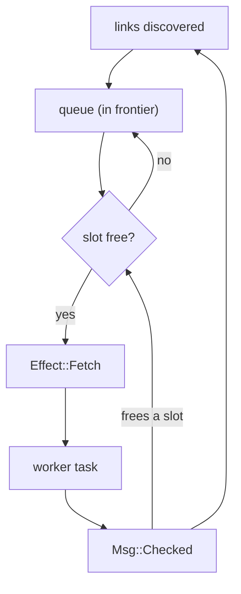
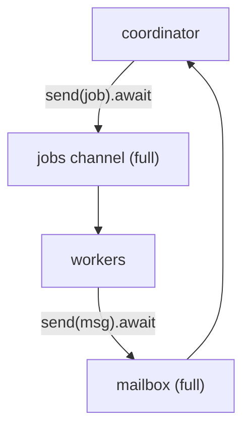
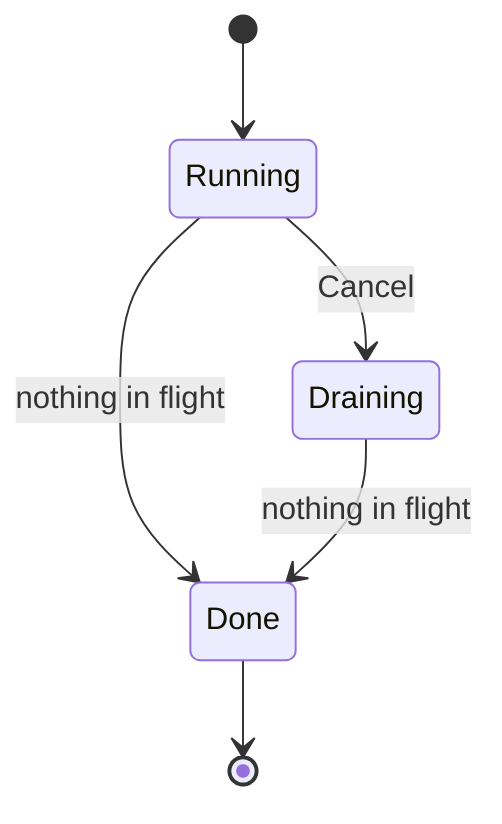

# Backpressure and cancellation

The link checker from Chapter 27 found every planted bug on our ten-link test
site. So let's give it something more like a real site: a page with two
thousand links, the kind of thing a large changelog, a product catalogue or an
auto-generated API index produces without anyone trying. The fixture site
grows a `/many` route that links to `/item/0` through `/item/1999`, every one
of which returns `200 OK`.

```sh
cargo run --release -- http://127.0.0.1:3000/many --max-depth 1
```

```text
unreachable: connection failed: Too many open files (os error 24)  http://127.0.0.1:3000/item/1000
    linked from http://127.0.0.1:3000/many

...

2001 checked, 1724 broken, 0 skipped
```

Every one of those pages works. We reported 1,724 of them as broken.

This chapter is about the difference between a concurrent program that works
and one you can let loose on the world. We'll bound how much we do at once and
see what *backpressure* means. We'll be polite to the servers we visit, put
deadlines on everything, give every task an owner, and let the user press
ctrl-c without losing the results gathered so far. Then we'll test the whole
crawl deterministically, including timeouts that take "sixty seconds" and run
in microseconds.

## Unbounded is a bug

What went wrong? When the frontier handled the `/many` page it emitted two
thousand `Fetch` effects at once, and the coordinator dutifully spawned two
thousand tasks. Tasks are cheap. What each one *does* isn't: it opens a TCP
connection, and on Unix every open connection is a **file descriptor**, an
entry in a per-process table the operating system limits. On macOS the default
soft limit is 256. The first couple of hundred connections succeed and the
rest fail with `EMFILE`, "Too many open files". Our honest error translation
reported each of them as unreachable, which is true, and useless.

Raising the limit (`ulimit -n 10240`) makes the symptom go away on your
laptop. It doesn't fix the design, because the file-descriptor table was never
the real problem. On the other end of those connections is somebody's server.
Two thousand simultaneous requests from one client is indistinguishable from
an attack. A small site will slow to a crawl or fall over; a large one will
rate-limit or block us, and we'll report *that* as two thousand broken links.

The number of things a program does at once is a resource, like memory. An
unbounded amount of it is a bug that's waiting for a big enough input.

### The first fix: a semaphore

The classic tool for "at most *n* at a time" is a **semaphore**: a counter of
*permits*. Acquiring a permit decrements it, waiting if it's zero; dropping
the permit increments it again and wakes a waiter. Tokio's lives in
`tokio::sync`. We can bolt one onto Chapter 27's coordinator in three lines:

```rust
// file: src/coordinator.rs
let permits = Arc::new(Semaphore::new(16));
// ...
Effect::Fetch(job) => {
    let fetcher = Arc::clone(&fetcher);
    let tx = tx.clone();
    let permits = Arc::clone(&permits);
    tokio::spawn(async move {
        let _permit = permits.acquire().await.unwrap();
        let msg = worker::run(&*fetcher, job).await;
        let _ = tx.send(msg).await;
    });
}
```

The permit is an RAII guard (Chapter 2): it's released when `_permit` goes
out of scope at the end of the task, whether the task finishes normally or
not. Run it again under the same 256-descriptor limit:

```text
2001 checked, 0 broken, 0 skipped
```

Correct, and still quick: against localhost the release build checks all two
thousand pages in a fraction of a second. We could stop here. Let's not,
because the semaphore has quietly hidden something.

### What the semaphore hides

There are still two thousand tasks. Sixteen are doing work; the other 1,984
are parked inside `acquire()`, each holding a job. That's a queue. It's just
not one we can see. It lives in the semaphore's list of waiters, in an order
we didn't choose, and the frontier believes all two thousand jobs are "in
flight".

That matters as soon as we want to do anything with the waiting work. When
the user presses ctrl-c we'd like to stop *starting* jobs, let the sixteen in
progress finish, and report the rest as "not checked". With the queue hidden
in a semaphore, the frontier can't tell a running job from a waiting one, so
it can't say which were never checked. If we later want to prioritise
shallow pages, or report progress ("312 of 2,001"), we'd need to reach into
the semaphore for those as well.

The pending work is part of the crawl's state. In this design, state belongs
in the frontier.

## Backpressure as state

Let's move the limit and the queue into the pure state machine. The frontier
gains a `Settings` value, a queue of jobs it knows about but hasn't released,
and (for later in the chapter) a flag for cancellation:

```rust
// file: src/frontier.rs
#[derive(Debug, Clone, Copy, PartialEq, Eq)]
pub struct Settings {
    pub max_depth: Depth,
    pub concurrency: usize,
    pub check_external: bool,
}

pub struct Frontier {
    origin: Origin,
    settings: Settings,
    seen: HashSet<PageUrl>,
    queue: VecDeque<Job>,
    in_flight: usize,
    cancelled: bool,
    // ... results and referrers, as before
}
```

> [!WARNING] What does a concurrency of zero mean?
> `concurrency: usize` lets `--concurrency 0` through, and a frontier allowed
> zero jobs in flight releases nothing and immediately decides it's done:
> "0 checked", exit 0. A `.max(1)` in `main` papers over it; a
> `NonZeroUsize` field makes it impossible. We left it as `usize` here because
> TLA+ Interlude 6 finds this hole from the spec alone, which is a better
> lesson than us quietly fixing it.

`Frontier::new` now takes `Settings` instead of a bare `Depth`; the compiler
points at every call site. `discover` no longer emits an effect. It decides
what a link means and puts the job in the queue:

```rust
// ... record the referrer and consult `seen`, as before
let internal = link.origin() == self.origin;
if !internal && !self.settings.check_external {
    let skipped = LinkStatus::Skipped(SkipReason::External);
    self.results.insert(link, skipped);
    return;
}
let depth = from.depth.next();
let mode = if internal && depth <= self.settings.max_depth {
    Mode::Crawl
} else {
    Mode::Check
};
self.queue.push_back(Job { url: link, depth, mode });
```

(While we were here, we added the `--skip-external` option: with
`check_external` off, external links go straight to a `Skipped` verdict, which
is handy in CI environments without internet access.)

One new function decides how much queued work becomes effects. It's the only
place a `Fetch` is ever created:

```rust
/// Turn queued work into effects, as far as the concurrency limit allows.
fn release(&mut self) -> Vec<Effect> {
    let mut effects = Vec::new();
    while self.in_flight < self.settings.concurrency {
        let Some(job) = self.queue.pop_front() else { break };
        self.in_flight += 1;
        effects.push(Effect::Fetch(job));
    }
    if self.in_flight == 0 {
        effects.push(Effect::Done);
    }
    effects
}
```

`new` and `handle` both end by calling `release`. When a `Checked` message
comes back, `in_flight` drops by one, the page's links join the back of the
queue, and `release` hands out exactly as many jobs as there are free slots.
The `Done` condition is unchanged in spirit: when nothing is in flight after
releasing, the queue must be empty too.

The queue is first-in, first-out, so we now crawl breadth-first: all of depth
1, then depth 2. The spawn-everything version had no defined order at all.

Here's how work flows now. The frontier owns the decision of how much runs at
once; the shell never sees more `Fetch` effects than there are free slots:



That loop is **backpressure**: the rate at which the consumer finishes work
limits the rate at which the producer may hand out more. Discovering links is
nearly free; fetching them is slow. Without backpressure, the cheap stage
swamps the expensive one, and the excess piles up somewhere: in memory, in file
descriptors, or in a server's patience. With it, the excess waits in a queue
we own, can see and can test.

And test it we can, with no runtime and no network:

```rust
#[test]
fn never_releases_more_than_the_concurrency_limit() {
    let links = ["/a", "/b", "/c", "/d", "/e"].map(|p| format!("{ROOT}{p}"));
    let links: Vec<&str> = links.iter().map(|s| s.as_str()).collect();
    let (state, _) = Frontier::new(url(ROOT), settings(0, 2));

    let (state, effects) = handle(state, ok(job(ROOT, 0, Mode::Crawl), &links));
    let first = fetches(&effects);
    assert_eq!(first.len(), 2);

    // One result back frees one slot.
    let (_, effects) = handle(state, ok(first[0].clone(), &[]));
    assert_eq!(fetches(&effects).len(), 1);
}
```

`ok` builds a successful `Checked` message and `fetches` filters a list of
effects down to its jobs. The test says, in plain values, that five discovered
links with a limit of two produce two fetches, and that each result back
releases exactly one more.

> [!PATTERN] Bounded Concurrency and Backpressure
> Put an explicit limit on how much work is in progress, and make producers
> wait (or queue visibly) when the limit is reached, so the slowest stage sets
> the pace. In Rust: a `tokio::sync::Semaphore` for a simple cap, bounded
> `mpsc` channels whose `send().await` waits when full, or, best of all when
> there's a state machine, a queue and an in-flight count in the pure state,
> where the limit can be unit tested.

## Bounded channels, and a deadlock to design out

Chapter 27 created the mailbox with `mpsc::channel(64)`, and promised to
explain what the number means. A **bounded** channel has a fixed capacity.
When it's full, `send(...).await` doesn't fail and doesn't drop the message;
it *waits* until the receiver makes room. The sender is slowed to the
receiver's pace, which is backpressure again, enforced by the channel.

Tokio also has `mpsc::unbounded_channel`, whose `send` never waits. That's
convenient and occasionally right, but every message a slow receiver hasn't
got to yet sits in memory, so the backlog is limited only by RAM. An
unbounded channel is an unbounded queue with a friendlier name.

Bounded channels have a sharp edge, though, and a design closely related to
ours would cut itself on it. Suppose that instead of spawning a task per job,
we'd started a fixed pool of workers and fed them through a second bounded
channel of jobs:



Picture both channels full. The coordinator is waiting to send a job, so it
isn't reading its mailbox. Every worker has finished a job and is waiting to
send its result, so none is reading the jobs channel. Each side waits for the
other, forever. Nothing crashes and nothing is logged; the program simply
stops. It's a **deadlock**, and on a small site it never happens, because the
channels never fill.

The rule that prevents it is worth remembering: **in a cycle of bounded
channels, at least one participant must never block on a send.** Our design
obeys it by construction. The coordinator never sends on a channel at all; it
spawns tasks, and it only spawns as many as `release` allows. At most
`concurrency` workers exist, each sends exactly one message, and new workers
are only spawned *after* the coordinator has received one. So there can never
be more than `concurrency` messages waiting, and a mailbox at least that large
can never be full. The bound is a fact we can prove, not a hope.

> [!WARNING]
> A full bounded channel never produces an error message. When an actor system
> mysteriously stops making progress, look for a cycle of `send().await`s. If
> you can't break the cycle, make one edge non-blocking (`try_send`, or an
> unbounded channel whose growth you've bounded some other way).

## Being polite to each host

A global limit of 16 protects *us*. It doesn't protect the sites we visit. If
the first page we crawl links mostly to one external host (a documentation
site linking to its API reference, say), all sixteen slots might hit that one
server at once. Well-behaved crawlers also limit how hard they hit **each**
host.

That's a policy about fetching, not about crawl state, so it doesn't belong in
the frontier. It belongs around the `Fetcher`. Chapter 10 showed how to add
behaviour to a port by wrapping it: *Combinators over Strategies*. A decorator
that implements `Fetcher` by delegating to an inner `Fetcher` can add any
policy without the inner one, or the crawler, knowing:

```rust
// file: src/fetch/polite.rs
pub struct Polite<F> {
    inner: F,
    per_host: usize,
    gates: Mutex<HashMap<Origin, Arc<Semaphore>>>,
}

impl<F: Fetcher> Fetcher for Polite<F> {
    async fn head(&self, url: &PageUrl) -> Result<StatusCode, FetchError> {
        let _permit = self.permit(url).await;
        self.inner.head(url).await
    }

    async fn get(&self, url: &PageUrl) -> Result<Page, FetchError> {
        let _permit = self.permit(url).await;
        self.inner.get(url).await
    }
}
```

Each origin gets its own semaphore, created the first time we see it. Here,
finally, the semaphore is exactly the right tool: a small, local cap that
nothing else needs to inspect.

Fetching the right semaphore involves a `Mutex`, inside an `async fn`, which
should make you think of Chapter 27's first compiler error:

```rust
async fn permit(&self, url: &PageUrl) -> OwnedSemaphorePermit {
    let gate = {
        let mut gates = self.gates.lock().expect("gates lock poisoned");
        gates
            .entry(url.origin())
            .or_insert_with(|| Arc::new(Semaphore::new(self.per_host)))
            .clone()
    }; // the MutexGuard is dropped here, before we await
    gate.acquire_owned().await.expect("semaphore never closed")
}
```

The block is the whole trick. The guard lives only inside it, long enough to
look up or insert the origin's semaphore and clone the `Arc`, and it's dropped
at the closing brace, before the `.await`. The future never holds the guard
while suspended, so it's `Send`, and the critical section is a hash-map lookup,
not a network round trip. A plain `std::sync::Mutex` is the right choice for
short, synchronous critical sections like this, even in async code.

`acquire_owned` takes the `Arc<Semaphore>` by value and returns a permit that
owns its share of the semaphore, so the permit doesn't borrow from `gate` and
can live as long as we like. (`.expect` is safe because nobody ever calls
`close()` on these semaphores.)

> [!TIP]
> "Shared mutable state is hard" doesn't mean "never use a `Mutex`". It means
> keep each shared thing small, keep each critical section short and
> synchronous, and keep *decisions* out of it. This map of semaphores holds no
> crawl logic at all.

## Deadlines for everything

The fixture site's `/slow` page sleeps for thirty seconds. Without a deadline,
a worker waiting on it holds one of our sixteen slots for thirty seconds, and a
server that accepts connections but never answers would hold it forever. Every
network operation needs a timeout.

`reqwest` has its own (`connect_timeout` and an overall `timeout` on the
client builder), and our `HttpFetcher` sets both. But a policy as important as
"no request takes longer than *n* seconds" shouldn't depend on each adapter
remembering to implement it, and it should work with the fake fetcher in tests
too. So it's another decorator, built on `tokio::time::timeout`:

```rust
// file: src/fetch/timed.rs
pub struct Timed<F> {
    inner: F,
    limit: Duration,
}

impl<F: Fetcher> Fetcher for Timed<F> {
    async fn head(&self, url: &PageUrl) -> Result<StatusCode, FetchError> {
        timeout(self.limit, self.inner.head(url))
            .await
            .unwrap_or(Err(FetchError::Timeout))
    }

    async fn get(&self, url: &PageUrl) -> Result<Page, FetchError> {
        timeout(self.limit, self.inner.get(url))
            .await
            .unwrap_or(Err(FetchError::Timeout))
    }
}
```

`timeout(limit, future)` races the future against a timer. It returns
`Ok(output)` if the future wins and `Err(Elapsed)` if the timer does, and in
the second case it *drops* the inner future. Dropping a future is how
cancellation works in async Rust: a future that's never polled again simply
stops, and its destructors run (so `reqwest` closes the connection, and any
semaphore permit it held is released). `unwrap_or` turns "the timer won" into
our domain's `FetchError::Timeout`.

Now `main` assembles the stack, and the order of the layers is a design
decision you can read:

```rust
// file: src/main.rs
let timeout = Duration::from_secs(args.timeout);
let http = HttpFetcher::new(timeout)?;
let fetcher = Polite::new(Timed::new(http, timeout), args.per_host.max(1));
```

`Polite` is outside `Timed`, so the clock starts *after* we've been given a
slot for the host. The other way round, a request queued behind three slow
ones to the same server would "time out" without ever being sent, and we'd
report a perfectly good link as unreachable. With decorators, that subtle
difference is the visible order of two constructor calls rather than a
property buried in a function.

There's one small piece of plumbing that makes decorators easy to compose
with tests. A test wants to keep a handle on its fake site (to ask it
questions afterwards) while also wrapping it. So we say that an `Arc` of a
fetcher is itself a fetcher:

```rust
// file: src/fetch/mod.rs
impl<F: Fetcher> Fetcher for std::sync::Arc<F> {
    fn head(
        &self,
        url: &PageUrl,
    ) -> impl Future<Output = Result<StatusCode, FetchError>> + Send {
        (**self).head(url)
    }

    // ... get, the same way
}
```

## Who owns the workers?

Our workers are spawned with `tokio::spawn`, which returns a `JoinHandle` that
we immediately throw away. The task is **detached**: it runs to completion on
its own, and nothing is responsible for it. That's been fine because every
worker always sends exactly one message. What if one doesn't?

Workers call code we don't control: an HTML parser, a TLS library, a fake
fetcher in a test. Here's a test with a fetcher that panics on one URL, the
way a bug in a dependency might. It runs Chapter 27's coordinator with a
five-second safety net:

```rust
#[tokio::test]
async fn a_panicking_worker_hangs_the_crawl() {
    let root = PageUrl::parse("https://example.com/").unwrap();
    let crawling = crawl(root, Depth::new(1), Arc::new(Grumpy));
    let result = tokio::time::timeout(Duration::from_secs(5), crawling).await;
    assert!(result.is_ok(), "crawl never finished");
}
```

```text
thread 'a_panicking_worker_hangs_the_crawl' panicked at tests/panic.rs:19:13:
the parser fell over

thread 'a_panicking_worker_hangs_the_crawl' panicked at tests/panic.rs:31:5:
crawl never finished
```

A panic in a spawned task doesn't crash the program; Tokio catches it, ends
that task, and stores the panic in the `JoinHandle` we threw away. The worker
never sends its `Checked` message, so the frontier's `in_flight` never
reaches zero, and the coordinator waits on its mailbox for the rest of time.
Without the test's timeout, `linkcheck` would hang in your CI pipeline until
the job was killed, without a word about why.

The deeper problem is that detached tasks are *unstructured*: their lifetimes
aren't tied to anything. If the coordinator returned early, its workers would
carry on in the background, still making requests for a crawl that no longer
exists. **Structured concurrency** is the discipline of making every task a
child of some scope that waits for, or cancels, all its children before it
ends, just as a block owns its local variables.

### `JoinSet`

Tokio's tool for this is `JoinSet<T>`: a collection that owns a group of tasks
returning `T`. You `spawn` into it, and `join_next().await` gives you each
task's result as it finishes: `Ok(value)`, or `Err(JoinError)` if the task
panicked or was aborted. When a `JoinSet` is dropped, every task still in it is
aborted. Its tasks can't outlive their owner.

And there's a pleasing consequence. If the `JoinSet` hands back each task's
return value, the worker can simply *return* its `Msg`, and we don't need the
mpsc mailbox for results at all. The coordinator's mailbox becomes the set of
tasks it owns. Let's wrap the set in a small type that also remembers which job
each task is doing:

```rust
// file: src/coordinator.rs
struct Workers<F> {
    fetcher: Arc<F>,
    tasks: JoinSet<Msg>,
    jobs: HashMap<task::Id, Job>,
}

impl<F: Fetcher> Workers<F> {
    fn spawn(&mut self, job: Job) {
        let fetcher = Arc::clone(&self.fetcher);
        let task = self.tasks.spawn({
            let job = job.clone();
            async move { worker::run(&*fetcher, job).await }
        });
        self.jobs.insert(task.id(), job);
    }
}
```

Every task has a `task::Id`, and `spawn` returns an `AbortHandle` that tells
us what it is. We keep the job under that id so that if the task dies, we still
know what it was doing:

```rust
/// The next finished job, as a message. A worker that panicked still
/// produces one, so the frontier never waits for it forever.
async fn next(&mut self) -> Option<Msg> {
    let msg = match self.tasks.join_next_with_id().await? {
        Ok((id, msg)) => {
            self.jobs.remove(&id);
            msg
        }
        Err(e) => {
            let job = self.jobs.remove(&e.id())?;
            let status = LinkStatus::Unreachable(FetchError::Crashed);
            Msg::Checked { job, status, links: Vec::new() }
        }
    };
    Some(msg)
}
```

A crashed worker becomes an ordinary `Checked` message with a new
`FetchError::Crashed` reason, so the frontier's bookkeeping stays exact and the
report tells the user which URL caused trouble. The frontier didn't change at
all: a panic is just another verdict. `next` returns `None` only when the set
is empty.

## Stopping politely

A crawl of a large site can take minutes. Sometimes you'll want to stop it
early, because you've seen enough or because CI has a time limit. The
traditional ctrl-c behaviour, dying instantly, throws away every verdict
gathered so far. We'd like better:

1. On the first ctrl-c, stop **starting** new requests.
2. Let the requests already in flight finish; the `Timed` decorator guarantees
   that they will, within the timeout.
3. Print a report of everything we did check, and say clearly that it's
   partial.
4. On a second ctrl-c, give up immediately.

The signal is something that happened, so in our design it's a message:

```rust
// file: src/frontier.rs
pub enum Msg {
    Checked { job: Job, status: LinkStatus, links: Vec<PageUrl> },
    Cancel,
}
```

The compiler now points at `handle`, whose `let Msg::Checked { .. } = msg`
pattern no longer covers every case. That's *Exhaustive Matching* earning its
keep: the new variant can't be forgotten. `handle` becomes a `match`, and the
cancel arm only sets a flag:

```rust
pub fn handle(mut state: Frontier, msg: Msg) -> (Frontier, Vec<Effect>) {
    match msg {
        Msg::Checked { job, status, links } => {
            state.in_flight -= 1;
            for link in links {
                state.discover(&job, link);
            }
            state.results.insert(job.url, status);
        }
        Msg::Cancel => state.cancelled = true,
    }
    let effects = state.release();
    (state, effects)
}
```

The meaning of cancellation lives in `release`, which gains three lines at the
top. Once cancelled, queued work is never released; it's recorded as skipped:

```rust
fn release(&mut self) -> Vec<Effect> {
    if self.cancelled {
        for job in self.queue.drain(..) {
            let skipped = LinkStatus::Skipped(SkipReason::Cancelled);
            self.results.insert(job.url, skipped);
        }
    }
    // ... release up to the limit, then Done when nothing is in flight
}
```

This is where moving the queue into the frontier pays off. Because the
frontier knows the difference between "queued" and "in flight", cancellation
is a precise, pure rule. Links discovered by in-flight pages after the cancel
are queued and immediately drained, so they're reported as skipped too, and
`Done` arrives when the last in-flight job reports back. The crawl's whole
lifecycle fits in a small picture:



While `Running`, each `Checked` message releases more queued work. While
`Draining`, each one only shrinks the work in flight, and any links it brings
are recorded as skipped.

And because it's pure, the test reads like the requirement:

```rust
#[test]
fn cancelling_skips_queued_work_and_waits_for_in_flight_work() {
    let links = ["https://example.com/a", "https://example.com/b"];
    let (state, _) = Frontier::new(url(ROOT), settings(0, 1));
    let (state, effects) = handle(state, ok(job(ROOT, 0, Mode::Crawl), &links));
    let in_flight = fetches(&effects).remove(0);

    let (state, effects) = handle(state, Msg::Cancel);
    assert_eq!(effects, vec![], "still waiting for /a");

    let (state, effects) = handle(state, ok(in_flight, &[]));
    assert_eq!(effects, vec![Effect::Done]);
    // ... and /b is Skipped(Cancelled), and the outcome says `cancelled`
}
```

### Delivering the signal: `CancellationToken`

The shell's job is to turn ctrl-c into `Msg::Cancel`. The tool for passing
"please stop" around an async program is `CancellationToken` from
`tokio_util::sync`. A token is cheap to clone; any clone can call `cancel()`,
and any clone can `.await` the future returned by `cancelled()`, which
completes once the token has been cancelled. Child tokens
(`token.child_token()`) let you cancel a whole subtree of work without
touching its parent, which is the structured version of a global "stop" flag.

`main` creates the token and hands one clone to a small task that watches for
ctrl-c:

```rust
// file: src/main.rs
/// First ctrl-c: stop starting work, finish what's in flight.
/// Second ctrl-c: give up immediately.
async fn stop_on_ctrl_c(cancel: CancellationToken) {
    if tokio::signal::ctrl_c().await.is_ok() {
        eprintln!("stopping: finishing requests in flight (ctrl-c to abort)");
        cancel.cancel();
    }
    if tokio::signal::ctrl_c().await.is_ok() {
        std::process::exit(130);
    }
}
```

(130 is the conventional exit status for "killed by SIGINT".) The other clone
goes to the coordinator, which now waits on two things at once. That's what
`tokio::select!` is for: it polls several futures and runs the branch of
whichever finishes first. Here's the finished coordinator:

```rust
// file: src/coordinator.rs
pub async fn crawl<F: Fetcher>(
    root: PageUrl,
    settings: Settings,
    fetcher: Arc<F>,
    cancel: CancellationToken,
) -> Outcome {
    let mut workers = Workers::new(fetcher);
    let (mut state, mut effects) = Frontier::new(root, settings);
    loop {
        for effect in effects {
            match effect {
                Effect::Fetch(job) => workers.spawn(job),
                Effect::Done => return state.into_outcome(),
            }
        }
        let msg = tokio::select! {
            Some(msg) = workers.next() => msg,
            () = cancel.cancelled(), if !state.is_cancelled() => Msg::Cancel,
        };
        (state, effects) = handle(state, msg);
    }
}
```

Each `select!` branch is `pattern = future => expression`. If a future
completes but its value doesn't match the pattern (`workers.next()` returning
`None`), that branch is disabled and `select!` keeps waiting on the others. The
`if !state.is_cancelled()` is a precondition: once we've cancelled,
`cancel.cancelled()` would complete instantly every time round the loop, so we
stop listening to it. When a branch wins, the other futures are dropped, which
is safe here because neither loses anything by being dropped and recreated:
both are *cancel-safe*, in Tokio's terminology.

Compare this with the Chapter 27 loop. The shape is identical (perform
effects, wait for a message, call `handle`). The waiting got richer, but the
part that decides things didn't grow by a line to accommodate the runtime.
And the `JoinSet` is a local variable of `crawl`, so if `crawl` returns, for
any reason, its workers go with it.

> [!PATTERN] Structured Cancellation
> Tie every task's lifetime to an owner, and make stopping a deliberate,
> observable step rather than an abrupt kill. In Rust: own tasks in a
> `JoinSet` (dropping it aborts them), propagate "please stop" with a
> `tokio_util::sync::CancellationToken`, turn the signal into a message so the
> state machine decides what stopping means, and bound how long in-flight work
> may take with timeouts.

Let's try it on the fixture site with one slot, pressing ctrl-c almost
immediately:

```sh
cargo run --release -- http://127.0.0.1:3000/ --concurrency 1 --timeout 3
```

```text
stopping: finishing requests in flight (ctrl-c to abort)
404 Not Found  http://127.0.0.1:3000/missing
    linked from http://127.0.0.1:3000/
    linked from http://127.0.0.1:3000/about

unreachable: timed out  http://127.0.0.1:3000/slow
    linked from http://127.0.0.1:3000/about

unreachable: connection failed: Connection refused (os error 61)  http://127.0.0.1:9/
    linked from http://127.0.0.1:3000/

8 checked, 3 broken, 2 skipped (cancelled: partial report)
```

The request in flight when we pressed ctrl-c happened to be `/slow`. We waited
for it, as promised, until the three-second timeout gave its verdict. The two
pages still queued are counted as skipped, and the report says it's partial.

## The report, and what the exit code means

The report from Chapter 27 gains one field, `complete: bool`, which is
`!outcome.cancelled`, and `render` appends "(cancelled: partial report)" when
it's false. Note that `summarise` is a *Report as Fold* (Chapter 23) over the
results: it never needed to know that those results were gathered
concurrently, by an actor, with cancellation. The concurrency is entirely in
the shell.

A link checker's most important output in CI isn't the text but the exit
status, so it's worth deciding carefully, as a pure function:

```rust
// file: src/report.rs
impl Report {
    /// 0: all good. 1: broken links. 2: no broken links seen, but the crawl
    /// was cut short, so we can't vouch for the rest.
    pub fn exit_code(&self) -> u8 {
        match (self.broken.is_empty(), self.complete) {
            (false, _) => 1,
            (true, false) => 2,
            (true, true) => 0,
        }
    }
}
```

Matching on a tuple makes the decision table explicit, and the compiler checks
that all four combinations are covered. A cancelled crawl that found nothing
wrong must not exit `0`: "I didn't look" isn't "everything is fine".

## Testing the whole crawl

The frontier's tests cover the decisions. We also want to know that the shell
interprets them correctly: that the concurrency limit really holds when
workers run on real threads, that a slow page really times out, that ctrl-c
really yields a partial report. Those need a runtime, but they don't need a
network.

### A fake website

The *Ports and Adapters* payoff from Chapter 10 applies again: a `FakeSite`
implements `Fetcher` from an in-memory `HashMap<PageUrl, FakePage>`. Unknown
pages are 404s, and a builder makes each test's site read like a sitemap:

```rust
// file: tests/crawl.rs
fn site() -> FakeSite {
    FakeSite::new()
        .page(ROOT, FakePage::html(r#"<a href="/about">About</a>
            <a href="/gone">Old post</a>
            <a href="https://partner.example/">Partner</a>"#))
        .page("https://example.com/about", FakePage::html(r#"
            <a href="/">Home</a> <a href="/gone">Old post</a>"#))
        .page("https://partner.example/", FakePage::status(200).rejecting_head())
}
```

`rejecting_head` makes that page answer `HEAD` with `405`, to exercise the
fallback to `GET`. `FakePage::slow(duration)` makes a page sleep before
answering, and `FakeSite::unreachable(url)` makes a whole origin refuse
connections. Here's the headline test:

```rust
#[tokio::test]
async fn finds_broken_links_and_who_links_to_them() {
    let report = run(site(), settings(4)).await;

    assert_eq!(report.checked, 4);
    assert_eq!(report.broken.len(), 1);
    let gone = &report.broken[0];
    assert_eq!(gone.target, url("https://example.com/gone"));
    assert_eq!(gone.status, LinkStatus::Broken(StatusCode::NOT_FOUND));
    assert_eq!(gone.referrers, vec![url(ROOT), url("https://example.com/about")]);
}
```

`run` is a four-line helper that calls `crawl` with a fresh token and
summarises the outcome. Because the frontier's maps are sorted and the fake
site has no randomness, the assertions can be exact.

### Measuring concurrency

To check the limits hold, the fake site counts. Each request increments an
`AtomicUsize` of requests in progress on the way in and decrements it on the
way out, and records the highest value it ever saw with `fetch_max`. Atomics
are the right tool here: a single number, updated by many tasks, with no
decision attached.

```rust
#[tokio::test(start_paused = true)]
async fn concurrency_is_bounded() {
    // ... a root page linking to 50 pages that each take 100 ms
    let site = Arc::new(site.page(ROOT, FakePage::html(&home)));

    let cancel = CancellationToken::new();
    crawl(url(ROOT), settings(8), Arc::clone(&site), cancel).await;

    assert_eq!(site.request_count(), 51);
    assert_eq!(site.peak_concurrency(), 8);
}
```

The `Arc` impl for `Fetcher` is what lets the test keep `site` to ask it
questions afterwards. A second test wraps the same kind of site in
`Polite::new(Arc::clone(&site), 2)` with a global limit of 16, and asserts that
the peak is 2: the per-host limit wins.

`start_paused = true` is the trick that makes timing tests fast and
deterministic. It starts Tokio's clock **paused** (it needs the `test-util`
feature in the dev-dependency on `tokio`). A paused clock doesn't follow the
wall clock. Whenever every task is waiting on a timer, the runtime jumps time
straight forward to the next timer. Our "100 ms" pages take no real time at
all, and neither does this:

```rust
#[tokio::test(start_paused = true)]
async fn slow_pages_time_out() {
    let site = site().page(
        "https://example.com/about",
        FakePage::html("").slow(Duration::from_secs(60)),
    );
    let fetcher = Timed::new(site, Duration::from_secs(5));
    let report = run_with(fetcher).await;

    let about = &report.broken[0];
    assert_eq!(about.target, url("https://example.com/about"));
    assert_eq!(about.status, LinkStatus::Unreachable(FetchError::Timeout));
}
```

A sixty-second page, a five-second timeout, and a test that finishes in
microseconds. The cancellation test works the same way: it spawns the crawl,
sleeps 500 virtual milliseconds so that the first slow page is in flight,
calls `cancel.cancel()`, and asserts on the partial outcome, including exit
code 2. A panicking `Fetcher` like `Grumpy` gets a test too, now asserting that
the crawl finishes and reports `Unreachable(FetchError::Crashed)`.

> [!TIP]
> If a test involving time is slow or flaky, ask whether its clock can be
> paused. Code that uses `tokio::time` (`sleep`, `timeout`, `interval`) is
> automatically testable this way; code that reads `std::time::Instant::now()`
> directly is not.

### One test against a real server

Fakes test our logic against our *beliefs* about HTTP. One end-to-end test
checks those beliefs against reality: real sockets, real redirects, a real
`reqwest`, and the real binary with its real exit code. The fixture site from
Chapter 27 serves on a random free port (port `0` asks the OS to choose):

```rust
// file: tests/e2e.rs
#[path = "../examples/fixture_site.rs"]
mod fixture_site;

#[tokio::test(flavor = "multi_thread")]
async fn reports_the_fixture_sites_broken_links() {
    let listener = tokio::net::TcpListener::bind("127.0.0.1:0").await.unwrap();
    let addr = listener.local_addr().unwrap();
    tokio::spawn(async move {
        axum::serve(listener, fixture_site::app()).await.unwrap()
    });

    let output = tokio::task::spawn_blocking(move || {
        Command::new(env!("CARGO_BIN_EXE_linkcheck"))
            .args([&format!("http://{addr}/"), "--timeout", "1"])
            .output()
            .unwrap()
    })
    .await
    .unwrap();
    let stdout = String::from_utf8(output.stdout).unwrap();

    assert_eq!(output.status.code(), Some(1), "{stdout}");
    assert!(stdout.ends_with("10 checked, 4 broken, 0 skipped\n"), "{stdout}");
    // ... and each planted broken link appears by URL
}
```

`#[path]` includes the example's source as a module, so the test and the
example share one fixture (the example's `main` needs an
`#[allow(dead_code)]`, since the test doesn't call it). Cargo sets
`CARGO_BIN_EXE_linkcheck` to the path of the built binary for integration
tests. Running a child process is blocking I/O, so it goes in
`spawn_blocking`, which runs it on a thread set aside for blocking work and
keeps the runtime's worker threads free to serve the fixture. And the test
asks for a `multi_thread` runtime, because the server must keep running while
we wait.

> [!CHECKPOINT]
> Your crawler now has a bounded, cancellable coordinator, `Polite` and
> `Timed` decorators, a `FakeSite`, and tests at three levels: pure unit
> tests, async tests against the fake, and one end-to-end test.
>
> ```sh
> cargo test
> ```
>
> ```text
> test frontier::tests::never_releases_more_than_the_concurrency_limit ... ok
> test frontier::tests::cancelling_skips_queued_work_and_waits_for_in_flight_work ... ok
> ...
> test result: ok. 15 passed; 0 failed; 0 ignored; 0 measured
>
>      Running tests/crawl.rs
> test slow_pages_time_out ... ok
> test cancelling_finishes_in_flight_work_and_reports_the_rest ... ok
> test unreachable_hosts_are_broken_too ... ok
> test politeness_limits_each_host ... ok
> test concurrency_is_bounded ... ok
> test finds_broken_links_and_who_links_to_them ... ok
> test result: ok. 6 passed; 0 failed; 0 ignored; 0 measured
>
>      Running tests/e2e.rs
> test reports_the_fixture_sites_broken_links ... ok
> test result: ok. 1 passed; 0 failed; 0 ignored; 0 measured
>
>      Running tests/panic.rs
> test a_panicking_worker_is_reported_not_waited_for ... ok
> test result: ok. 1 passed; 0 failed; 0 ignored; 0 measured
> ```

## Where the pieces ended up

It's worth stepping back to see where each concern settled, because the
placement is the design:

| Concern | Where it lives | Pure? |
|---|---|---|
| What to crawl, what to check, when we're done | `frontier::handle` | yes |
| Global concurrency limit and queue | `Frontier::release` | yes |
| What cancellation means | `Frontier::release` | yes |
| Per-host politeness | `Polite` decorator | no |
| Deadlines | `Timed` decorator, `reqwest` client | no |
| Task lifetimes, crashed workers | `Workers` (`JoinSet`) | no |
| Turning ctrl-c into a message | `main`, `CancellationToken` | no |
| What the user sees, the exit code | `report` | yes |

Everything that decides is pure and tested with values. Everything that
touches threads, clocks, sockets or signals is a thin layer around it, each
piece small enough to test with a fake. That's the same *Functional Core,
Imperative Shell* we started the book with, holding up under the most
demanding kind of shell there is.

## What we learned

- **Unbounded concurrency is a bug** that waits for a big enough input: file
  descriptors run out, and somebody's server suffers.
- **A `Semaphore` caps concurrency**, but its waiters are a hidden queue.
  Moving the queue and the limit into the pure frontier made them visible,
  testable and cancellable.
- **Backpressure** lets the slowest stage set the pace. Bounded channels apply
  it by making `send().await` wait; a cycle of them can deadlock unless one
  participant never blocks on a send.
- **Policies wrap ports.** `Polite` and `Timed` are decorators over `Fetcher`,
  and their order (`Polite<Timed<_>>`) is a visible design decision.
- **Short, synchronous critical sections** with `std::sync::Mutex` are fine in
  async code; drop the guard before you `.await`.
- **Dropping a future cancels it.** `tokio::time::timeout` uses this, and
  `select!` drops the branches that lose.
- **`JoinSet` gives tasks an owner**: results come back as values, panics come
  back as `JoinError`s, and dropping the set aborts the rest.
- **`CancellationToken` turned into a message** lets the state machine decide
  what stopping means: finish what's in flight, skip the queue, report
  honestly.
- **Paused time** (`start_paused = true`) makes timeouts and delays
  deterministic and instant in tests.

## Exercises

> [!EXERCISE] Respect robots.txt
> Well-behaved crawlers read `/robots.txt` before crawling a site. Add a
> `SkipReason::Disallowed`, a pure function that decides whether a path is
> allowed by a (simplified) robots file, and fetch the file once per origin
> before crawling it. Where should the fetched rules live: in the frontier, in
> a decorator, or in the worker? Defend your answer with the table above.

> [!EXERCISE] A gap between requests
> Some sites ask crawlers to wait between requests, not just limit how many
> run at once. Write a `Spaced<F>` decorator that ensures at least `gap`
> elapses between the *starts* of requests to the same origin. Keep the
> scheduling arithmetic in a pure function,
> `next_start(last: Option<Instant>, now: Instant, gap: Duration) -> Instant`,
> and test the decorator with a paused clock.

> [!EXERCISE] Progress
> Add an `Effect::Progress { checked: usize, queued: usize }` that the
> frontier emits after each message, and have the coordinator print it to
> stderr at most once a second. Which part decides *what* the progress is, and
> which part decides *how often* to show it?

> [!EXERCISE] Deadlock on purpose
> In a scratch project, build the fixed-pool design from the deadlock diagram:
> a jobs channel and a results channel, both with capacity 2, and a
> coordinator that awaits each `send`. Feed it a page with ten links and watch
> it stop. Then fix it in two different ways, and write down which one you'd
> rather explain to a colleague.
