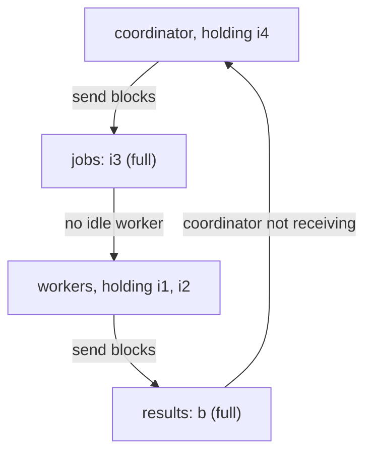
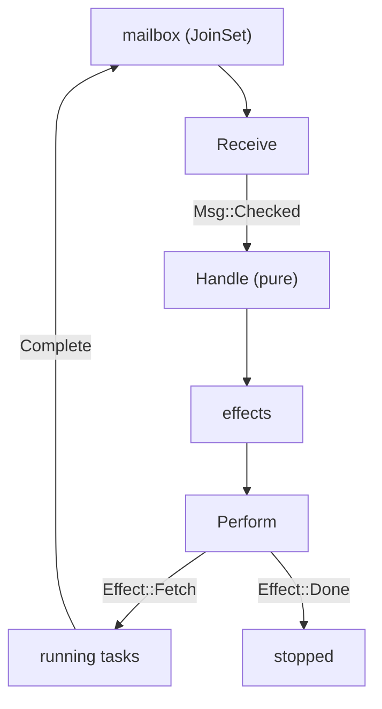

# Interlude: Does the crawl finish?

Chapter 28 ended with a crawler we can trust in CI. Its frontier is a pure
function with its own unit tests; the whole crawl runs against a fake site
with paused time; a panicking worker becomes a verdict instead of a hang. And
along the way the chapter made three claims that none of those tests checks:

- the crawl **always finishes**;
- it **never fetches a URL twice**;
- it **can't deadlock**, unlike the fixed-pool design with two bounded
  channels, because "the coordinator never sends on a channel at all".

Each of those is a statement about *every* interleaving of a coordinator and
its workers. The frontier tests pick one order of messages each. The
whole-crawl tests pick whatever order Tokio's scheduler happens to produce,
which on a paused clock is nearly always the same one. A deadlock that needs
both channels to fill at the same moment is precisely the kind of thing those
tests never see. Chapter 28 said as much: "on a small site it never happens".

This last interlude puts the claims to TLC. We'll model the naive fixed-pool
design first and have TLC produce its deadlock as a concrete trace. Then
we'll model the design the book actually built, with the spec's actions
lined up against `handle`, `Msg` and `Effect` almost one for one, and check
termination, cancellation and the rest. Along the way TLC finds a real hole
in the frontier, one that the Rust tests had walked straight past. We'll
finish by looking back over all six interludes.

## Channels are sequences

A channel is a queue: senders add to the back, the receiver takes from the
front. Interlude 3 gave us exactly that in TLA+, a sequence, so a channel
needs no new machinery:

- `send(x)` is `ch' = Append(ch, x)`;
- `recv()` takes `Head(ch)` and leaves `ch' = Tail(ch)`, and is only possible
  when `ch /= <<>>`.

An **unbounded** channel is just that. A **bounded** channel of capacity
`Cap` adds one guard to the send: `Len(ch) < Cap`. And that guard is all
`send(...).await` means in a spec. When the channel is full the guard is
false, so the send action isn't enabled, and the sender can do nothing else
until someone receives. "Blocked" isn't a special state we have to model; it's
simply an action that isn't enabled.

That's the whole vocabulary for this interlude. Let's use it on the design
Chapter 28 warned us about.

## The naive crawler

In the naive design the coordinator owns a fixed pool of workers and talks to
them through two bounded channels: `jobs` going out and `results` coming
back. The coordinator's loop is Chapter 27's, with one change: for each
`Fetch` effect it does `jobs.send(job).await` instead of spawning a task.

The model needs a link graph. We'll use three pages that link to one another,
written as a record whose fields are page names and whose values are the set
of pages each one links to:

```tla
\* file: NaiveCrawl.tla
---- MODULE NaiveCrawl ----
EXTENDS Integers, Sequences, FiniteSets

CONSTANTS Workers, Cap

None == "none"

Links == [root |-> {"a", "b"}, a |-> {"root", "b"}, b |-> {"a"}]
Pages == DOMAIN Links
```

A record is a function from field names to values (Interlude 3), so
`Links["a"]` is `{"root", "b"}` and `DOMAIN Links` is the set of pages. Pages
aren't fetched in the model; a worker that "fetches" `p` simply reports `p`
back, and the coordinator reads its links from `Links[p]`. The network, HTTP
status codes, depth and external links are all left out: none of them
affects who waits for whom.

The state is the two channels, what each worker holds, and the coordinator's
own variables:

```tla
\* file: NaiveCrawl.tla
VARIABLES jobs, results, holding, outbox, seen, inFlight, done
vars == <<jobs, results, holding, outbox, seen, inFlight, done>>

Bounded == Len(jobs) <= Cap /\ Len(results) <= Cap
```

`holding[w]` is the page worker `w` is working on, or `None`. `outbox` is the
coordinator's list of jobs it still has to send: the `effects` vector it's
part-way through. We've made it a set, so TLC tries every order of sending.
`seen` and `inFlight` are the frontier's. `done` records that the coordinator
has returned. `Bounded` is an invariant that checks we wrote the guards
properly. `Init` starts with the root in the outbox, seen and in flight.

The coordinator has two actions. The first is the `for` loop over effects,
with the bounded-send guard:

```tla
\* file: NaiveCrawl.tla
\* Coordinator: for effect in effects { jobs.send(job).await }
Send == /\ \E p \in outbox :
             /\ Len(jobs) < Cap
             /\ jobs' = Append(jobs, p)
             /\ outbox' = outbox \ {p}
        /\ UNCHANGED <<results, holding, seen, inFlight, done>>
```

The second runs only once the outbox is empty, exactly as the Rust loop only
reaches `recv()` after its `for` loop. It takes one result and does the
frontier's bookkeeping:

```tla
\* file: NaiveCrawl.tla
Receive == /\ outbox = {}
           /\ ~done
           /\ results /= <<>>
           /\ LET p   == Head(results)
                  new == Links[p] \ seen
              IN /\ results' = Tail(results)
                 /\ outbox' = new
                 /\ seen' = seen \cup new
                 /\ inFlight' = inFlight - 1 + Cardinality(new)
                 /\ done' = (inFlight' = 0)
           /\ UNCHANGED <<jobs, holding>>
```

Each worker takes a job when it's idle and reports when it has one. The
fetch itself happens somewhere between the two; for a question about waiting,
we don't need to see it:

```tla
\* file: NaiveCrawl.tla
Take(w) == /\ holding[w] = None
           /\ jobs /= <<>>
           /\ holding' = [holding EXCEPT ![w] = Head(jobs)]
           /\ jobs' = Tail(jobs)
           /\ UNCHANGED <<results, outbox, seen, inFlight, done>>

Report(w) == /\ holding[w] /= None
             /\ Len(results) < Cap
             /\ results' = Append(results, holding[w])
             /\ holding' = [holding EXCEPT ![w] = None]
             /\ UNCHANGED <<jobs, outbox, seen, inFlight, done>>

Next == \/ Send
        \/ Receive
        \/ \E w \in Workers : Take(w) \/ Report(w)
```

A worker in `Report` whose guard is false is a worker stuck in
`results.send(msg).await`. The config uses two workers, given as model values
(Interlude 2), and channels of capacity one:

```text
\* file: NaiveCrawl.cfg
SPECIFICATION Spec
CONSTANTS
    Workers = {w1, w2}
    Cap = 1

INVARIANT TypeOK
INVARIANT Bounded
```

## When nothing can happen

We haven't asked TLC about deadlock, but it checks anyway. Interludes 3 and 4
met the check briefly: a **deadlock**, to TLC, is a reachable state in which
no action of `Next` is enabled, and both of those interludes switched the
check off with `CHECK_DEADLOCK FALSE` because their quiet states were
harmless. Today deadlock is the question, so the check stays on, and the
very first run trips over it:

```text
Finished computing initial states: 1 distinct state generated.
Error: Deadlock reached.
Error: The behavior up to this point is:
State 1: <Initial predicate>
/\ inFlight = 1
/\ results = <<>>
/\ seen = {"root"}
/\ jobs = <<>>
/\ done = FALSE
/\ outbox = {"root"}
/\ holding = (w1 :> "none" @@ w2 :> "none")

...

State 13: <Receive line 40, col 12 to line 50, col 41 of module NaiveCrawl>
/\ inFlight = 0
/\ results = <<>>
/\ seen = {"root", "a", "b"}
/\ jobs = <<>>
/\ done = TRUE
/\ outbox = {}
/\ holding = (w1 :> "none" @@ w2 :> "none")

55 states generated, 35 distinct states found, 0 states left on queue.
The depth of the complete state graph search is 13.
```

(We've cut states 2 to 12. `(w1 :> "none" @@ w2 :> "none")` is how TLC
prints a function: `:>` maps one key, `@@` joins the pieces.)

Look at the last state before reading anything else. All three pages are
seen, nothing is in flight, both channels are empty, and `done` is `TRUE`. The
crawl has *finished*. Nothing can happen because there's nothing left to do.
Appendix E warns that this is the most common surprise on a first run: to TLC,
"finished" and "stuck" look the same, because both are states with no
successor.

There are two ways to tell them apart. One is to turn deadlock checking off,
as before, which throws away the check we want today. The better one is to say what *finished* means, with an
explicit step that's allowed only then:

```tla
\* file: NaiveCrawl.tla
\* The crawl is over: the coordinator has returned.
Finished == /\ done
            /\ UNCHANGED vars

Next == \/ Send
        \/ Receive
        \/ \E w \in Workers : Take(w) \/ Report(w)
        \/ Finished
```

`Finished` changes nothing, so it adds no new states. What it does is make
a finished crawl a state with a successor, a step that stutters in place,
so TLC no longer counts it as stuck. From now on, `Deadlock reached` means
something can't happen that should. (This is the `Terminating` step that
`pcal` added to every translation in Interlude 4, written by hand.)

```text
Finished computing initial states: 1 distinct state generated.
Model checking completed. No error has been found.
56 states generated, 35 distinct states found, 0 states left on queue.
The depth of the complete state graph search is 13.
```

No deadlock. Is the naive design fine, then?

## A page with many links

Interlude 5's small-scope hypothesis says most bugs show up in small models.
It has a corollary we've just walked into: the model must be big enough for
the bug to *exist*. With three pages, at most two jobs are ever outstanding at
once, which isn't enough to fill two channels and two workers. Chapter 28's
trouble started with a page of two thousand links. Let's give the site a
small `/many`:

```tla
\* file: NaiveCrawl.tla
Links == [root |-> {"a", "b"}, a |-> {"root", "b", "many"}, b |-> {"a"},
          many |-> {"i1", "i2", "i3", "i4"},
          i1 |-> {}, i2 |-> {}, i3 |-> {}, i4 |-> {}]
```

With two items on `many`, and then three, TLC still finds nothing. With four:

```text
Finished computing initial states: 1 distinct state generated.
Error: Deadlock reached.
Error: The behavior up to this point is:

...

State 21: <Send line 35, col 9 to line 39, col 63 of module NaiveCrawl>
/\ inFlight = 5
/\ results = <<"b">>
/\ seen = {"root", "a", "b", "many", "i1", "i2", "i3", "i4"}
/\ jobs = <<"i3">>
/\ done = FALSE
/\ outbox = {"i4"}
/\ holding = (w1 :> "i1" @@ w2 :> "i2")

548 states generated, 380 distinct states found, 119 states left on queue.
The depth of the complete state graph search is 22.
```

This time `done` is `FALSE` and five pages are in flight: the deadlock is real.
Read the final state as a story. The coordinator received `many`'s result and
has four jobs to send. It has sent `i1`, `i2` and `i3`. Both workers took one
(`i1`, `i2`), so `i3` waits in the full jobs channel, and the coordinator,
still holding `i4`, can't send it. Meanwhile `b`'s result sits in the full
results channel, and both workers have finished and want to report. Each side
is waiting to send to the other:



It's the cycle from Chapter 28's diagram, found rather than imagined, with a
reproducible schedule attached. Notice how much had to line up: two channels
full, both workers finished, and the coordinator mid-way through a batch of
four. Count the slots: one in `jobs`, one in `results`, two in the workers,
and one more in the coordinator's hand. Any page with fewer than five
outstanding jobs can't fill the cycle, which is why the three-page site and
the two- and three-item `many` pages passed.

Chapter 28's rule was that in a cycle of bounded channels, at least one
participant must never block on a send. The cheapest way to test the rule is
to make the results channel unbounded: delete the `Len(results) < Cap` guard
from `Report`, and `Len(results) <= Cap` from `Bounded`.

```text
Finished computing initial states: 1 distinct state generated.
Model checking completed. No error has been found.
8388 states generated, 3612 distinct states found, 0 states left on queue.
The depth of the complete state graph search is 33.
```

No deadlock, at the price of a backlog whose size nothing in the design
limits. Let's look at a design that limits it.

## The design we built

The real `linkcheck` has no jobs channel. The frontier keeps its own queue
and releases work only while `in_flight` is below the limit. Each `Fetch`
effect spawns a task into a `JoinSet`, and the task *returns* its `Msg`
instead of sending it. `join_next` hands the results back to the coordinator
one at a time. Nothing in the loop ever waits to send.

This time we'll model it the other way round: start from the Rust types and
make the spec say the same things. `Msg` and `Effect` become records, one
constructor per variant:

```tla
\* file: Crawl.tla
Fetch(p)   == [type |-> "Fetch", url |-> p]
Done       == [type |-> "Done"]
Checked(p) == [type |-> "Checked", url |-> p]
```

A page's links are now a *sequence*, in document order, because that's what
`links: Vec<PageUrl>` is: `Links == [root |-> <<"a", "b">>, ...]`. The
`Frontier` struct becomes a record with fields `seen`, `queue`, `inFlight`
and `checked` (the keys of `results`). And the frontier's private helpers
become operators. Here's `discover`, applied to each link in turn, as a
recursive operator from Interlude 3:

```tla
\* file: Crawl.tla
RECURSIVE Discover(_, _)
Discover(s, links) ==
    IF links = <<>> THEN s
    ELSE LET l == Head(links)
             s2 == IF l \in s.seen THEN s
                   ELSE [s EXCEPT !.seen = s.seen \cup {l},
                                  !.queue = Append(s.queue, l)]
         IN Discover(s2, Tail(links))
```

That's `for link in links { state.discover(&job, link) }`, and inside it the
`if !self.seen.insert(link)` early return. `release` is a `while` loop in Rust;
in TLA+ we compute how many jobs it would release and take them in one go:

```tla
\* file: Crawl.tla
Release(s) ==
    LET n    == Min(Limit - s.inFlight, Len(s.queue))
        jobs == [i \in 1..n |-> Fetch(s.queue[i])]
        s2   == [s EXCEPT !.queue = SubSeq(s.queue, n + 1, Len(s.queue)),
                          !.inFlight = s.inFlight + n]
    IN <<s2, IF s2.inFlight = 0 THEN Append(jobs, Done) ELSE jobs>>
```

`Limit` is a constant (`--concurrency`), and `Min` a one-line `IF` we define
ourselves. `jobs` is built as a function on `1..n`, which is what a sequence
is. And the result is a pair, `<<state, effects>>`, the TLA+ spelling of
`(Frontier, Vec<Effect>)`. With those, `handle` is the same glue it is in
Rust:

```tla
\* file: Crawl.tla
Handle(s, msg) ==
    Release(Discover([s EXCEPT !.inFlight = s.inFlight - 1,
                               !.checked = s.checked \cup {msg.url}],
                     Links[msg.url]))

New == Release([seen |-> {"root"}, queue |-> <<"root">>, inFlight |-> 0,
                checked |-> {}])
```

Notice what *isn't* there: no variables, no primes. `Handle` is an
operator from values to values, just as `handle` is a function from values
to values. The pure core of the Rust became the pure part of the spec.

### The shell, as actions

The variables are what the shell holds: the frontier, the `effects` vector
the loop is working through, the tasks in the `JoinSet`, and the finished
results it hasn't yet handed back. Two more exist only for checking: `log`,
every URL ever fetched, and `stopped`, which says the coordinator returned.

```tla
\* file: Crawl.tla
VARIABLES frontier, effects, running, mailbox, log, stopped
vars == <<frontier, effects, running, mailbox, log, stopped>>
```

`Init` sets `frontier = New[1]`, `effects = New[2]`, and the rest empty. Each
line of the coordinator loop becomes an action. Performing one effect:

```tla
\* file: Crawl.tla
\* for effect in effects { match effect { ... } }
Perform == /\ ~stopped
           /\ effects /= <<>>
           /\ LET e == Head(effects) IN
                IF e.type = "Fetch"
                THEN /\ running' = running \cup {e.url}
                     /\ log' = Append(log, e.url)
                     /\ UNCHANGED stopped
                ELSE /\ stopped' = TRUE
                     /\ UNCHANGED <<running, log>>
           /\ effects' = Tail(effects)
           /\ UNCHANGED <<frontier, mailbox>>
```

Receiving a message and handling it, once the effects are all performed:

```tla
\* file: Crawl.tla
\* (state, effects) = handle(state, msg)
Step(msg) == /\ frontier' = Handle(frontier, msg)[1]
             /\ effects' = Handle(frontier, msg)[2]
             /\ UNCHANGED <<running, log, stopped>>

\* Some(msg) = workers.next() => msg
Receive == /\ ~stopped
           /\ effects = <<>>
           /\ mailbox /= <<>>
           /\ Step(Checked(Head(mailbox)))
           /\ mailbox' = Tail(mailbox)
```

And a worker finishing. The `JoinSet` keeps a finished task's `Msg` until
`join_next` asks for it, so from the model's point of view it's a channel
with no capacity guard. Workers never block:

```tla
\* file: Crawl.tla
Complete(p) == /\ p \in running
               /\ running' = running \ {p}
               /\ mailbox' = Append(mailbox, p)
               /\ UNCHANGED <<frontier, effects, log, stopped>>

Finished == stopped /\ UNCHANGED vars

Coordinator == Perform \/ Receive
Workers == \E p \in running : Complete(p)
Next == Coordinator \/ Workers \/ Finished
```

Here's the correspondence as a picture. Every `Msg` variant is a way into
`Handle`, and every `Effect` is a way out:



> [!PATTERN] Spec–Code Correspondence
> When the code has a pure core of the form
> `handle(State, Msg) -> (State, Vec<Effect>)`, write the spec to match: the
> state struct becomes a record, `handle` becomes an operator with no primes,
> each `Msg` variant becomes an action that feeds it, and each `Effect`
> becomes an action that performs it (a send, a spawn, a stop). The rest of
> `Next` models only the shell and the environment. The closer the shapes,
> the easier it is to keep spec and code in step, and to check one against
> the other.

## What should be true

Now we can write Chapter 28's claims down. Nothing is fetched twice:

```tla
\* file: Crawl.tla
NoDoubleFetch == \A i, j \in 1..Len(log) : i /= j => log[i] /= log[j]
```

The frontier's count is exact: `in_flight` equals the tasks running, plus the
finished ones waiting in the `JoinSet`, plus the `Fetch` effects not yet
performed. This is the claim Chapter 27's three-line termination argument
rested on:

```tla
\* file: Crawl.tla
PendingFetches == {i \in 1..Len(effects) : effects[i].type = "Fetch"}

InFlightIsExact ==
    ~stopped => frontier.inFlight = Cardinality(running) + Len(mailbox)
                                    + Cardinality(PendingFetches)

WithinLimit == frontier.inFlight <= Limit
```

`{i \in S : P}` is the subset of `S` where `P` holds. Together, the two
invariants give Chapter 28's argument about the mailbox: it can never hold
more than `Limit` results. And termination detection, the subject of this
interlude's title, becomes two properties. The safety half says `Done` is
never premature; the liveness half says it always comes:

```tla
\* file: Crawl.tla
DoneMeansDone == stopped => /\ frontier.queue = <<>>
                            /\ frontier.inFlight = 0

HonestReport == stopped => frontier.checked = Pages

Terminates == <>stopped
```

`Terminates` needs fairness (Interlude 2). The coordinator and the workers
both get weak fairness: if one of them can keep taking a step, it eventually
does.

```tla
\* file: Crawl.tla
Spec == /\ Init /\ [][Next]_vars
        /\ WF_vars(Coordinator)
        /\ WF_vars(Workers)
```

The config lists all five invariants and `PROPERTY Terminates`, with
`CONSTANT Limit = 2`: two workers, as before. Deadlock checking is on, as it
is by default:

```text
Finished computing initial states: 1 distinct state generated.
Checking temporal properties for the complete state space with 17 total distinct states
Model checking completed. No error has been found.
22 states generated, 17 distinct states found, 0 states left on queue.
The depth of the complete state graph search is 11.
```

Every interleaving of two workers and the coordinator over the three-page site
crawls each page once, keeps the count exact, never declares done early, and
always finishes. Swap in the `many` graph that deadlocked the naive design
and it still passes: 106 distinct states, no deadlock. The design's claim
was that no participant ever blocks on a send. In the spec, there's simply no
action whose guard waits on a full channel.

## Done, or just quiet?

Termination detection is easy to get subtly wrong, so let's get it wrong on
purpose. A plausible slip in `release` is to test the queue instead of the
count, "nothing left to do":

```rust
// file: src/frontier.rs
if self.queue.is_empty() {
    effects.push(Effect::Done);
}
```

In the spec that's `IF s2.queue = <<>>` in `Release`. TLC needs three
states to object:

```text
Finished computing initial states: 1 distinct state generated.
Error: Invariant DoneMeansDone is violated.
Error: The behavior up to this point is:
State 1: <Initial predicate>
/\ mailbox = <<>>
/\ effects = <<[type |-> "Fetch", url |-> "root"], [type |-> "Done"]>>
/\ frontier = [seen |-> {"root"}, queue |-> <<>>, inFlight |-> 1, checked |-> {}]
/\ running = {}
/\ stopped = FALSE
/\ log = <<>>

State 2: <Perform line 55, col 12 to line 65, col 45 of module Crawl>
/\ mailbox = <<>>
/\ effects = <<[type |-> "Done"]>>
/\ frontier = [seen |-> {"root"}, queue |-> <<>>, inFlight |-> 1, checked |-> {}]
/\ running = {"root"}
/\ stopped = FALSE
/\ log = <<"root">>

State 3: <Perform line 55, col 12 to line 65, col 45 of module Crawl>
/\ mailbox = <<>>
/\ effects = <<>>
/\ frontier = [seen |-> {"root"}, queue |-> <<>>, inFlight |-> 1, checked |-> {}]
/\ running = {"root"}
/\ stopped = TRUE
/\ log = <<"root">>

3 states generated, 3 distinct states found, 0 states left on queue.
The depth of the complete state graph search is 3.
```

`new` releases the root, which empties the queue, so the very first batch of
effects is `Fetch(root), Done`. The coordinator spawns the root and returns
before it has been fetched: a crawl of nothing that reports success. A unit
test of `new` would catch this one, if anyone thought to assert that `Done` is
absent. TLC needed no such thought. It only needed to be told what `Done`
means.

## Does it always finish?

What does fairness buy? Delete the two `WF_vars` conjuncts and check
`Terminates` again:

```text
Finished computing initial states: 1 distinct state generated.
Checking temporal properties for the complete state space with 17 total distinct states
Error: Temporal properties were violated.

...

State 10: <Receive line 73, col 12 to line 77, col 38 of module Crawl>
/\ mailbox = <<>>
/\ effects = <<[type |-> "Done"]>>
/\ frontier = [ seen |-> {"root", "a", "b"},
  queue |-> <<>>,
  inFlight |-> 0,
  checked |-> {"root", "a", "b"} ]
/\ running = {}
/\ stopped = FALSE
/\ log = <<"root", "a", "b">>

State 11: Stuttering
22 states generated, 17 distinct states found, 0 states left on queue.
```

Every page is checked and `Done` is sitting in `effects`, and then the
coordinator simply never takes another step. Without fairness, that's a
legal behaviour: a spec only says what *may* happen. Put the coordinator's
fairness back and leave the workers' out, and TLC finds a different lasso, in
which a fetch never completes. That one is worth a second look, because it's
Chapter 28's panicking worker. In the model, fairness is an assumption we
write down. In the code, the `JoinSet` turning a panic into a `Crashed`
verdict, and `Timed` putting a deadline on every request, are what make that
assumption true.

## Pressing ctrl-c

Chapter 28 added cancellation by adding a `Msg` variant, and the compiler
walked it to every `match`. The spec changes in the same places. There's a
new message constructor, `Cancel == [type |-> "Cancel"]`. The frontier record
gains `cancelled` and `skipped`. `Handle` grows the arm that sets the flag:

```tla
\* file: Crawl.tla
Handle(s, msg) ==
    IF msg.type = "Checked"
    THEN Release(Discover([s EXCEPT !.inFlight = s.inFlight - 1,
                                    !.checked = s.checked \cup {msg.url}],
                          Links[msg.url]))
    ELSE Release([s EXCEPT !.cancelled = TRUE])
```

`Release` gains the three lines at the top of the Rust version: once
cancelled, the queue is drained into `skipped`.

```tla
\* file: Crawl.tla
Drain(s) ==
    IF s.cancelled
    THEN [s EXCEPT !.queue = <<>>,
                   !.skipped = s.skipped \cup Range(s.queue)]
    ELSE s

Release(s) ==
    LET d    == Drain(s)
        \* ... as before, with d in place of s
```

`Range(s)` is `{s[i] : i \in 1..Len(s)}`, the set of a sequence's
elements. And the new message needs a way in, which is the second branch of
the coordinator's `select!`, guard and all:

```tla
\* file: Crawl.tla
\* () = cancel.cancelled(), if !state.is_cancelled() => Msg::Cancel
CtrlC == /\ ~stopped
         /\ effects = <<>>
         /\ ~frontier.cancelled
         /\ Step(Cancel)
         /\ UNCHANGED mailbox

Next == Coordinator \/ CtrlC \/ Workers \/ Finished
```

`CtrlC` stands for both the user and the token. The user can press ctrl-c at
any moment; the coordinator *notices* only in its `select!`, which is what
the `effects = <<>>` guard says. Note also what's *not* in `Spec`: `CtrlC`
has no fairness condition. A user who never presses ctrl-c is perfectly
legal, and the crawl must finish anyway.

The report's honesty changes too: when the crawl stops, every page we
discovered must be either checked or skipped, and only an uncancelled crawl
may claim to have checked them all. And Chapter 28's promise, that after a
cancel the crawl still reaches `Done`, is a leads-to:

```tla
\* file: Crawl.tla
HonestReport ==
    stopped => /\ frontier.checked \cup frontier.skipped = frontier.seen
               /\ ~frontier.cancelled => frontier.checked = Pages

CancelThenDone == frontier.cancelled ~> stopped
```

```text
Finished computing initial states: 1 distinct state generated.
Checking 2 branches of temporal properties for the complete state space with 64 total distinct states
Model checking completed. No error has been found.
51 states generated, 32 distinct states found, 0 states left on queue.
The depth of the complete state graph search is 12.
```

It's reassuring, but a pass shows us nothing. To *see* a cancelled crawl,
claim one can't happen, `NeverPartial == ~(stopped /\ frontier.skipped /= {})`,
and let TLC refute it. Here's the trace, trimmed to the two states that
matter:

```text
Error: Invariant NeverPartial is violated.
Error: The behavior up to this point is:
State 1: <Initial predicate>
...
State 3: <CtrlC line 90, col 10 to line 94, col 29 of module Crawl>
/\ mailbox = <<>>
/\ effects = << >>
/\ frontier = [ seen |-> {"root"},
  queue |-> <<>>,
  cancelled |-> TRUE,
  skipped |-> {},
  inFlight |-> 1,
  checked |-> {} ]
/\ running = {"root"}
/\ stopped = FALSE
/\ log = <<"root">>
...
State 5: <Receive line 83, col 12 to line 87, col 38 of module Crawl>
/\ mailbox = <<>>
/\ effects = <<[type |-> "Done"]>>
/\ frontier = [ seen |-> {"root", "a", "b"},
  queue |-> <<>>,
  cancelled |-> TRUE,
  skipped |-> {"a", "b"},
  inFlight |-> 0,
  checked |-> {"root"} ]
/\ running = {}
/\ stopped = FALSE
/\ log = <<"root">>
```

The user presses ctrl-c while the root is in flight. The root comes back
with links to `a` and `b`, which are queued and immediately drained as
skipped, and `Done` follows. That's the sentence from Chapter 28, "links
discovered by in-flight pages after the cancel are queued and immediately
drained", as a trace.

## A hole in the frontier

One more check, of the kind Interlude 1 called a measurement: what happens at
the edge of the constants? Set `Limit = 0` in the config:

```text
Finished computing initial states: 1 distinct state generated.
Error: Invariant DoneMeansDone is violated.
Error: The behavior up to this point is:
State 1: <Initial predicate>
/\ mailbox = <<>>
/\ effects = <<[type |-> "Done"]>>
/\ frontier = [ seen |-> {"root"},
  queue |-> <<"root">>,
  cancelled |-> FALSE,
  skipped |-> {},
  inFlight |-> 0,
  checked |-> {} ]
/\ running = {}
/\ stopped = FALSE
/\ log = <<>>

State 2: <Perform line 65, col 12 to line 75, col 45 of module Crawl>
...
/\ stopped = TRUE
```

(State 2 is trimmed to the line that matters.)

This one isn't in the model alone. `Settings::concurrency` is a `usize`, and
nothing in `Frontier` rules out zero. With a limit of zero, `release` hands
out nothing, sees `in_flight == 0`, and emits `Done` with the root still
queued. A one-line test against the real frontier confirms it:

```rust
// file: src/frontier/tests.rs
#[test]
fn a_concurrency_of_zero_is_done_before_it_starts() {
    let (_, effects) = Frontier::new(url(ROOT), settings(1, 0));
    assert_eq!(effects, vec![Effect::Done]);
}
```

That test passes, which is the bug. Unless something in the shell stops it
first, `linkcheck --concurrency 0` would print
"0 checked, 0 broken, 0 skipped" and exit `0`, a green CI build that checked
nothing. Chapter 28's `main` clamps `--per-host` with `.max(1)`; the same
clamp on `--concurrency` closes the door at the CLI. But the frontier is a
library type with a rule it doesn't state, and this book has a better habit
for that: make the field a `std::num::NonZeroUsize`, so a zero limit can't be
constructed at all.

The spec has its own way to say the same thing. `ASSUME` states a fact about
the constants that TLC checks before exploring anything:

```tla
\* file: Crawl.tla
CONSTANT Limit
ASSUME Limit \in Nat \ {0}
```

With `Limit = 0` in the config, TLC now stops at once with `Assumption line 5,
col 8 to line 5, col 26 of module Crawl is false`. `ASSUME` and
`NonZeroUsize` are the same rule written twice: the spec assumes it; the type
makes it true.

## Checking the code against the spec

Everything so far has checked the spec. The gap Interlude 1 was honest about
remains: TLC never reads the Rust. But because the shapes match, we can close
some of the gap from both directions. The general idea is called **trace
validation**: take behaviours from one side and check them against the other.

**From the spec to the code**, a TLC trace becomes a unit test. The
cancellation trace above is a sequence of messages and effects, and the pure
`handle` needs no runtime to replay it:

```rust
// file: src/frontier/tests.rs
#[test]
fn replays_the_tlc_cancel_trace() {
    let (a, b) = ("https://example.com/a", "https://example.com/b");
    let root = job(ROOT, 0, Mode::Crawl);

    // Init: effects = <<Fetch("root")>>
    let (state, effects) = Frontier::new(url(ROOT), settings(1, 2));
    assert_eq!(effects, vec![Effect::Fetch(root.clone())]);

    // CtrlC: effects = <<>>
    let (state, effects) = handle(state, Msg::Cancel);
    assert_eq!(effects, vec![]);

    // Receive Checked("root"): effects = <<Done>>, skipped = {a, b}
    let (state, effects) = handle(state, ok(root, &[a, b]));
    assert_eq!(effects, vec![Effect::Done]);
    let outcome = state.into_outcome();
    let skipped = LinkStatus::Skipped(SkipReason::Cancelled);
    assert_eq!(outcome.results[&url(a)], skipped);
    assert_eq!(outcome.results[&url(b)], skipped);
}
```

Done by hand, that's one test per interesting trace. Done by machine,
`tlc -simulate file=trace,num=100 Crawl.tla` writes a hundred random
behaviours to files, and a small Rust test can parse each, replay its
messages through `handle`, and compare the effects. Either way it's the
message–action correspondence, run in reverse.

**From the code to the spec**, the shell logs each message it handles and the
effects that came back (a `tracing` event in the coordinator loop is enough),
and TLC checks that the log is a behaviour the spec allows. A small module
extends the spec and forces each message step to match the next log entry:

```tla
\* file: TraceCrawl.tla
---- MODULE TraceCrawl ----
EXTENDS Crawl

Log == << [msg |-> Cancel,          effects |-> <<>>],
          [msg |-> Checked("root"), effects |-> <<Done>>] >>

VARIABLE i

Matches(msg) == /\ i < Len(Log)
                /\ Log[i + 1].msg = msg
                /\ effects' = Log[i + 1].effects
                /\ i' = i + 1

TraceNext == \/ (Perform \/ Workers) /\ UNCHANGED i
             \/ Receive /\ Matches(Checked(Head(mailbox)))
             \/ CtrlC /\ Matches(Cancel)

TraceSpec == Init /\ i = 0 /\ [][TraceNext]_<<vars, i>>
LogUnexplained == i < Len(Log)
====
```

With `SPECIFICATION TraceSpec`, `INVARIANT LogUnexplained` and
`CHECK_DEADLOCK FALSE`, a *violation* is the good outcome: TLC found a
behaviour of the spec that explains the whole log, and prints it. Change the
second entry's effects to `<<Fetch("a"), Fetch("b")>>`, as a frontier that
forgot about cancellation would log, and TLC reports "No error has been
found": no behaviour explains it, so the code and the spec disagree.

We haven't wired either direction into `linkcheck`, and for a frontier this
small the hand-written replay is probably enough. But it's worth knowing that
the gap between spec and code isn't fixed. A design shaped as
`handle(State, Msg) -> (State, Vec<Effect>)` is unusually easy to check
against a spec, for the same reason it's easy to test: everything that
matters goes in and comes out as values.

### Mapping back to Rust

| Chapters 27 and 28 (Rust) | `Crawl.tla` |
|---|---|
| `struct Frontier` | the record `frontier` |
| `handle`, `discover`, `release` | `Handle`, `Discover`, `Release` (no primes) |
| `Frontier::new` | `New`, used in `Init` |
| `Msg::Checked`, `Msg::Cancel` | `Receive`, `CtrlC` |
| `Effect::Fetch`, `Effect::Done` | the two branches of `Perform` |
| `JoinSet<Msg>` | `running` and `mailbox` |
| `select!` precondition | `~frontier.cancelled` in `CtrlC` |
| `Settings::concurrency` | `Limit`, with `ASSUME` |
| Nothing | `log`, `stopped`, and every property |

What the spec checked that the tests couldn't: every interleaving of
completions, cancellation and handling, the exactness of `in_flight`, and that
`Done` always comes. What the Rust guarantees that the spec takes on trust:
that `handle` is pure (its signature), that `Msg` has exactly two variants
(exhaustive matching), that a worker always produces a `Msg` (the `JoinSet`),
and that it does so in bounded time (`Timed`).

## Looking back: six interludes

Interlude 1 asked whether a thermostat flickers. Five interludes later,
here's what TLA+ added to the book's other two tools.

**Types** made illegal *values* unrepresentable. **Tests**, example-based and
property-based, ran the real code on the inputs we or `proptest` chose.
**Specs** described every *behaviour* of a small model and let TLC check them
all. The thermostat's minimum run turned out to be a fact about the room, not
about `decide` (Interlude 1). Whether the DDNS loop converges came with its
assumptions about the world written down as fairness (Interlude 2). Replaying
`tdo`'s log refined an abstract to-do list, and crashes mid-write were
checked rather than hoped about (Interlude 3). PlusCal labels made the atomicity of netdash's two designs
something we could see (Interlude 4). TLC found the ledger's check-then-act
race (Interlude 5). And here it found a deadlock in a design we didn't build,
a termination bug we might have written, and a hole in the one we did. Every one of those
is a bug about *time* or *interleaving*, the space between values where types
and tests are weakest.

**When to reach for it**: concurrency, actors and channels; anything with
retries, crashes or partial failure; protocols between processes or machines;
and any requirement with "always", "never" or "eventually" in it that spans
more than one call. A useful sign is a design argument in prose, like
Chapter 28's paragraph about why the mailbox can't fill. If the argument
matters, it can be checked.

**When not to**: Part VI had no interlude, on purpose. `logq`'s parser and
evaluator are pure transformations of one input to one output, with no
interleaving and no time. Their bugs live in the values, where types and
`proptest`'s round-trip properties are exactly the right tools, and a TLA+
model would restate the grammar at much greater cost. The same goes for
layout, performance and anything whose correctness depends on real data
rather than on order. A spec is a model you have to keep in step with the
code, and that's only worth paying for where the design is hard to get right
in your head.

The good news is that the book's habits make specs cheap. A pure state machine
driven by messages is already most of a spec: its state is the variables, its
messages are the actions, and its effects are what the environment does next.
Write the design that way, and checking it is an afternoon's work.

## What we learned

- **Channels are sequences**: `Append` to send, `Head` and `Tail` to receive.
  A bounded channel adds a `Len(ch) < Cap` guard, and a blocked
  `send().await` is just an action that isn't enabled.
- **TLC checks for deadlock by default**: a reachable state with no enabled
  action. A finished system looks the same, so give "finished" an explicit
  stuttering step; then every `Deadlock reached` is real.
- **A model must be big enough for the bug to exist**: the cyclic deadlock
  needed five jobs outstanding at once, and a three-page site never had them.
- **Termination detection is two properties**: safety
  (`Done => queue empty /\ inFlight = 0`) and liveness (`<>Done` under
  fairness). Without fairness, a crawl may simply stop.
- **Cancellation is a message**: an unfair environment action that feeds
  `Handle`, with `~>` to check that stopping still finishes.
- **Spec–Code Correspondence**: a `handle(State, Msg) -> (State, Vec<Effect>)`
  core maps onto a spec almost line for line. Messages become actions, effects
  become sends or spawns, and the pure function becomes an operator.
- **`ASSUME` states facts about constants**, the spec's counterpart of a type
  such as `NonZeroUsize`. TLC found that `Frontier` needs one.
- **Trace validation** checks across the gap: replay TLC traces through
  `handle` as tests, or check logged Rust behaviours against the spec.
- **Reach for TLA+** when a design argument is about order, interleaving or
  eventuality. **Don't** for pure transformations like a parser.

## Exercises

> [!EXERCISE] Bigger channels
> In `NaiveCrawl`, set `Cap = 2`. Predict how many items the `many` page needs
> before TLC finds the deadlock, using the slot-counting argument, then check
> your prediction. Then make the *jobs* channel unbounded instead of the
> results channel. Does the deadlock go away? What grows without bound now?

> [!EXERCISE] A worker that never reports
> Model Chapter 27's detached tasks: add an action `Crash(p)` that removes `p`
> from `running` without adding it to `mailbox`. Which property fails, and
> how? Then model Chapter 28's fix, where a crashed task still produces a
> `Checked` message, and confirm that every property passes again.

> [!EXERCISE] Drop the precondition
> Remove `~frontier.cancelled` from `CtrlC`, which is what deleting
> `if !state.is_cancelled()` from the `select!` would do, and give `CtrlC`
> weak fairness too, mimicking a token whose `cancelled()` future completes
> immediately every time round the loop. Predict what TLC says about the
> invariants and `Terminates`, then check. If the model is happy, why is the
> precondition in the Rust at all? Name what the spec leaves out that makes
> the difference, and say how you could model it.

> [!EXERCISE] Replay by machine
> Run `tlc -simulate file=trace,num=20 Crawl.tla` and look at one of the files
> it writes. Write a Rust test that reads a hand-simplified version of one
> trace (a list of messages and expected effects, in JSON) and replays it
> through `handle`, failing on the first effect that differs. Which details of
> the spec (page names, the `links` of each page) did you have to translate,
> and where would a mismatch be most likely to hide?
