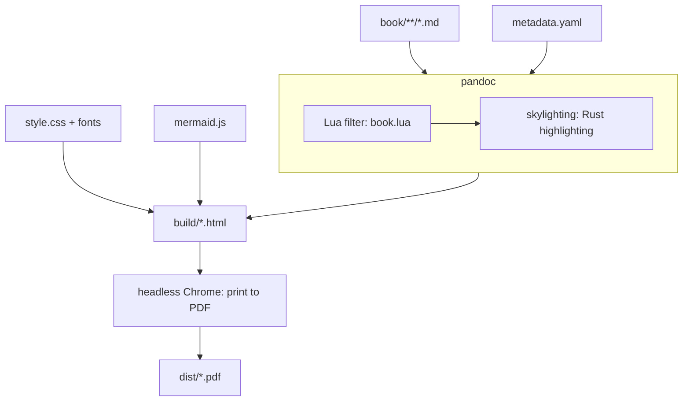

# Appendix C: Building this book

The book is plain Markdown in the `book/` folder. It reads fine on GitHub or in
any editor, and a small pipeline turns it into the PDF you may be reading now.
This appendix explains how that pipeline works, so you can change it, or reuse
it for your own documents.

## The short version

```sh
nix develop            # pandoc, python3 and the Rust toolchain
make pdf               # -> dist/rust-by-design.pdf
make parts             # + dist/rust-by-design-<part>.pdf for each part
make html              # stop at HTML; open build/rust-by-design.html
```

Without Nix you need **pandoc 3.1 or later**, **Python 3.10 or later**, and
**Google Chrome or Chromium**. Set `CHROME=/path/to/chrome` if it isn't in a
standard location.

## How it works



1. **Discovery.** `pipeline/build.py` treats each folder under `book/` as a part
   and each Markdown file in it as a chapter, in name order. Files whose first
   heading starts with `Part`, `Preface`, `Appendix` or `Afterword` are left
   unnumbered, as are the chapters of Part 0 (shown as *Workshop 1, 2, ...*);
   everything else is a numbered chapter.
2. **Pandoc** concatenates the files and converts them to a single HTML document
   using `pipeline/template.html`. It numbers sections, builds the contents page,
   and highlights code using the colour theme in
   `pipeline/ferris-night.theme`.
3. **The Lua filter** (`pipeline/filters/book.lua`) upgrades a few plain-Markdown
   conventions, so the sources stay readable on GitHub:
   - `> [!PATTERN] Title` blockquotes (GitHub's alert syntax, plus custom kinds)
     become styled callout boxes;
   - a first line of `// file: path` in a code block becomes a filename tab;
   - ` ```mermaid ` blocks are passed through for mermaid.js to draw;
   - `# Part II: ...` headings and the italic paragraph after them become
     full-page part dividers.
4. **Headless Chrome** opens the HTML, runs mermaid.js to draw the diagrams as
   SVG, and prints to PDF using the CSS paged-media rules in
   `pipeline/style.css`: A4 pages, running footers, page numbers, page breaks
   before chapters, and the dark cover and part pages. PDF bookmarks are generated
   from the headings.

Fonts (Source Serif 4, Inter, JetBrains Mono) and mermaid.js are vendored in
`pipeline/vendor/`, so builds work offline and look identical on every machine.

## Per-part PDFs and chapter numbers

`make parts` builds one PDF per part as well as the whole book. To keep chapter
numbers consistent ("Chapter 17" is Chapter 17 in both), the build script counts
the numbered chapters in earlier parts, ignoring `#` lines inside code fences,
and passes that count to pandoc's `--number-offset`.

## Changing the look

| To change | Edit |
|---|---|
| Code colours | `pipeline/ferris-night.theme` (skylighting JSON: one entry per token kind) |
| Page size, margins, footers | the `@page` rules at the top of `style.css` |
| Fonts | `@font-face` rules in `style.css`, files in `pipeline/vendor/fonts` |
| Callout colours | the `--note`, `--pattern`, ... variables in `style.css` |
| Diagram palette | `themeVariables` in `pipeline/template.html` |
| Cover | the `.cover` section of `template.html` and `style.css` |

## Writing new chapters

Read `AUTHORING.md` in the repository root first. It's the style guide every
chapter follows: the build-up-don't-dump teaching approach, Markdown conventions,
the pattern catalogue, and a checklist. Drop a new Markdown file into the right
part folder with a two-digit prefix that puts it in order, and rebuild.
