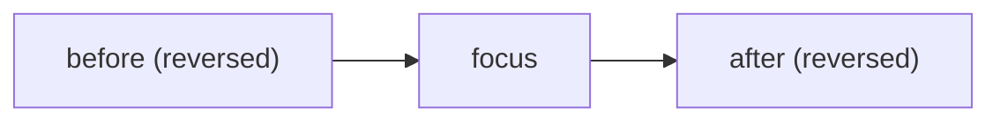
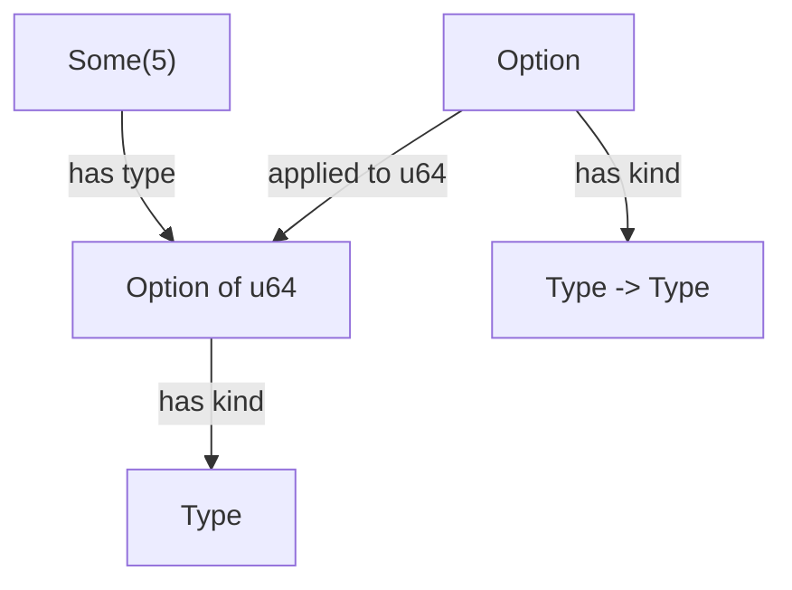

# Types as propositions

The first version of our checkout recorded each payment attempt with three
flags. It looked harmless:

```rust
pub struct Flags {
    pub pending: bool,
    pub completed: bool,
    pub failed: bool,
}
```

Then, one Tuesday, a provider timed out halfway through a callback. The retry
marked the attempt `completed`; the timeout handler, a few milliseconds later,
marked it `failed`. Both flags were true. The customer saw "payment failed",
tried again, and was charged twice. Support refunded one charge by hand, and
someone added an `if` to the timeout handler.

You know the cure; it was Chapter 3's whole argument. But this part of the
book is about taking that cure seriously, as far as Rust will let us, and
it's worth asking *why* it works. Why does replacing three `bool`s with a
three-variant enum remove a whole class of bug? And if types can rule out
bad states, what else can they rule out? Bad transitions? Missing evidence?
Programs that do the steps in the wrong order?

This is Part VIII's theory chapter, kept practical. We'll do arithmetic with
types, find that a signature is a *claim* and its body a *proof*, see where
Rust's logic leaks, meet the abstraction Rust can't express, and finish by
testing *laws*, promises the compiler never checks. Along the way we start
`pay`, the payment core that Chapter 30 turns into a state machine. Each idea
comes from Haskell, whose community has thought hard about types as logic;
we'll show a few lines of it for each, explained as we go. The teaching is
in Rust.

## Setting up `pay`

```sh
cargo new pay --lib
cd pay
cargo add thiserror@2
cargo add --dev proptest@1
```

```toml
# file: Cargo.toml
[dependencies]
thiserror = "2"

[dev-dependencies]
proptest = "1"
```

Two value types will follow us through Part VIII. A `PaymentId` is any
`u64`, so its field is public. An `Amount` is money in pence. Part V built a
full multi-currency `Money`; `pay` deliberately works in a single currency,
because the ideas in this part are about lifecycles and evidence, not
currencies, and one `u64` keeps the examples short.

```rust
// file: src/amount.rs
/// Identifies one payment. Any `u64` will do.
#[derive(Debug, Clone, Copy, PartialEq, Eq, PartialOrd, Ord, Hash)]
pub struct PaymentId(pub u64);

/// An amount of money in pence (single currency, never negative).
#[derive(Debug, Clone, Copy, PartialEq, Eq, PartialOrd, Ord, Hash)]
pub struct Amount(u64);

impl Amount {
    pub const ZERO: Amount = Amount(0);

    pub const fn from_pence(pence: u64) -> Amount {
        Amount(pence)
    }

    pub const fn pence(self) -> u64 {
        self.0
    }

    pub fn checked_add(self, other: Amount) -> Option<Amount> {
        self.0.checked_add(other.0).map(Amount)
    }
}
```

`checked_sub` is the same shape. Add `From<u64>` (pence in, `Amount` out)
and a `Display` that prints `£12.50`, exactly as in Chapter 21, and declare
`pub mod amount;` in `lib.rs` with a `pub use` for both types.

## Three flags, eight shapes

Back to the flags. In Haskell, the honest type is one line:

```haskell
data Status = Pending | Completed | Failed
```

`data` declares a type, and `|` separates its alternatives: a `Status` is one
of these three, which in Rust is:

```rust
// file: src/status.rs
#[derive(Debug, Clone, Copy, PartialEq, Eq)]
pub enum Status {
    Pending,
    Completed,
    Failed,
}
```

Chapter 3 taught us to count. `Flags` is a struct, so its possibilities
multiply: 2 × 2 × 2 = 8. `Status` is an enum, so they add: 1 + 1 + 1 = 3.
The business has three states, and the flags admit five more that mean
nothing (completed *and* failed, neither pending nor finished, all three at
once). The technique is to **shrink the representable states until they
match the domain's**, and the arithmetic tells us when we've done it.

That's where Chapter 3 stopped. Let's go further, because the arithmetic has
more to say than "count your structs".

## The algebra of types

### Zero and one

Every algebra needs a zero and a one. In types, one is a type with exactly
one value, and Rust's is `()`, the unit type. Knowing you have a `()` tells
you nothing, because there was only one thing it could be. Zero is a type
with *no* values at all:

```rust
// file: src/logic.rs
/// Falsehood: no values, so no proofs.
pub enum Void {}
```

An enum with no variants. You can name the type, write functions that take
or return it, but you can never make one, because there's no variant to
construct. Chapter 3's table listed it with a count of 0. It sounds useless.
It's going to be one of the most useful types in this chapter.

Chapter 3's table already gave the rest of the basic arithmetic: `Option<T>`
is 1 + *T* (`None`, plus a `Some` for every `T`) and `Result<T, E>` is *T* +
*E*. Zero and one obey the laws you'd expect. A pair with a unit in it is no
bigger than the other half, *A* × 1 = *A*, and a `Result` whose error side
is empty is no bigger than its success side, *A* + 0 = *A*. "No bigger"
means you can convert back and forth without losing anything:

```rust
pub fn drop_unit<A>((a, ()): (A, ())) -> A {
    a
}

pub fn add_unit<A>(a: A) -> (A, ()) {
    (a, ())
}
```

The patterns in the arguments take the tuple apart where it arrives, and
`()` is a pattern too. We'll meet the *A* + 0 case in a moment, and it pays
real dividends. And the zero law for products, *A* × 0 = 0, says a struct
with a `Void` field can never be built, however ordinary its other fields.

### Functions are exponentials

Products multiply and sums add. Functions do something more dramatic. How
many functions are there from `bool` to `Status`? A function (a pure,
terminating one, which is all we're counting) has to pick an output for each
input. For `false` it has three choices; for `true`, independently, three
more. That's 3 × 3 = 3² = 9:

```rust
// file: src/status.rs
/// Every pure, total function from `bool` to `Status` (there are 3^2 = 9).
pub fn all_bool_to_status() -> Vec<[Status; 2]> {
    use Status::*;
    let all = [Pending, Completed, Failed];
    all.iter()
        .flat_map(|&f| all.iter().map(move |&t| [f, t]))
        .collect()
}
```

Each `[Status; 2]` is a lookup table, one output per input, and a lookup
table *is* a function as far as counting goes. In general a function from
*A* to *B* has |*B*|^|*A*| implementations, which is why type theorists
write the function type `A -> B` as *B*^*A*. And now the school algebra laws
turn into design facts.

*B*^(*A*+*C*) = *B*^*A* × *B*^*C*: a function out of a sum is the same as a
pair of functions, one per variant. That's exactly what a `match` on a
`Result` is, and exactly what `Result::map_or_else` takes as arguments: one
closure for `Err`, one for `Ok`. Handling an enum *means* supplying a
function per variant.

(*C*^*B*)^*A* = *C*^(*A*×*B*): a function returning a function is the same as
a function of a pair. That's *currying*, after the logician Haskell Curry,
whose first name the language took. A closure that captures an `A` and waits
for a `B`, `move |b| f(a, b)`, is the left-hand side; `fn(A, B) -> C` is the
right.

The exponential also says something about design. Every input you add to a
function's argument type multiplies the space of possible implementations,
and so the space of possible bugs. A function from our 8-shape `Flags` to
`Status` has 3⁸ = 6,561 implementations, almost all of them wrong in some
case nobody tested; from `Status` to `Status`, 3³ = 27. Narrow inputs don't
only make data easier to read. They make functions easier to *get right*.

### Derivatives, and zippers

Here's the strangest law, and it turns out to be practical. Write a list of
`T` as an equation: a list is empty, or an element followed by a list.

> *L* = 1 + *T* × *L*

Solve it formally, as if it were school algebra, and you get *L* = 1/(1 −
*T*). Now take the derivative with respect to *T*, which by the usual rules
is 1/(1 − *T*)², or *L* × *L*. A pair of lists.

What does it mean? The derivative of a type is that type *with a hole in it*:
one position knocked out, marked as "here". For a list, a hole has a list
before it and a list after it, which is two lists. Put an element back in
the hole and you have a **zipper**: a sequence with a focus, which you can
move left and right and edit in place, without rebuilding the whole
sequence. In Haskell:

```haskell
data Zipper a = Zipper [a] a [a]         -- before, focus, after

right :: Zipper a -> Zipper a
right (Zipper before x (y : after)) = Zipper (x : before) y after
right z = z
```

Moving right pushes the old focus onto `before` and takes the next element
off the front of `after` (`y : after` is a list whose first element is `y`).
At the end of the list, the second line leaves the zipper alone. The Rust
version keeps both halves as `Vec`s with the nearest element *last*, so each
move is a `pop` and a `push`:

```rust
// file: src/zipper.rs
/// A non-empty sequence with one element in focus.
#[derive(Debug, Clone, PartialEq, Eq)]
pub struct Zipper<T> {
    before: Vec<T>, // nearest element last
    focus: T,
    after: Vec<T>, // nearest element last
}

impl<T> Zipper<T> {
    pub fn right(mut self) -> Zipper<T> {
        if let Some(next) = self.after.pop() {
            self.before.push(std::mem::replace(&mut self.focus, next));
        }
        self
    }

    pub fn replace(self, focus: T) -> Zipper<T> {
        Zipper { focus, ..self }
    }
}
```

`left` mirrors `right`; `from_vec` reverses its input into `after` and pops
the first element as the focus (returning `None` for an empty `Vec`); and
`into_vec` stitches the three parts back together. The picture is small:



Zippers matter most for immutable trees, where "change this one node" would
otherwise mean rebuilding the path from the root, and text editors and
syntax tree tools use them for that. For `pay` they're a curiosity. What
matters is the habit: **the algebra of a type tells you what shapes are
nearby**, and sometimes one of those shapes is exactly the data structure
you need.

## Types as propositions

Now for the main event. Look at this signature and ask what the body could
possibly be:

```rust
fn first<A, B>(pair: (A, B)) -> A
```

The function is generic, so it knows nothing about `A` or `B`. Chapter 5
called this *parametricity*: it can't inspect an `A`, compare one, or make
one up. The only `A` it can return is the one in the pair. So there is
exactly one sensible body:

```rust
// file: src/logic.rs
/// A ∧ B → A
pub fn first<A, B>((a, _): (A, B)) -> A {
    a
}
```

Read the signature as logic, with each type standing for a statement.
"Given a proof of *A* and a proof of *B*, I can give you a proof of *A*."
That's a true statement of logic, *A* ∧ *B* → *A*, and the body is how we
prove it: take the pair apart and hand back the left half. Haskell writes it
the same way:

```haskell
first :: (a, b) -> a
first (a, _) = a
```

The first line is the type (`::` reads "has type"), and the second is the
body. Now try to prove something false. "If *A*, then *B*", for any *A* and
*B* whatsoever, is not a law of logic: it rains, therefore the moon is made
of cheese. So there should be no way to write this:

```rust
// does not compile
pub fn conjure<A, B>(a: A) -> B {
    a
}
```

```text
error[E0308]: mismatched types
   --> src/logic.rs:133:5
    |
132 | pub fn conjure<A, B>(a: A) -> B {
    |                -  -           - expected `B` because of return type
    |                |  |
    |                |  expected type parameter
    |                found type parameter
133 |     a
    |     ^ expected type parameter `B`, found type parameter `A`
    |
    = note: the caller chooses a type for `B` which can be different from `A`
```

That last note is the logic in plain English. The caller chooses what `B`
stands for; we have no evidence of it, so we can't produce one. The compiler
has refused a bad proof.

This correspondence has a name: the **Curry–Howard correspondence**, after
Curry and the logician William Howard, who noticed that the rules for typing
programs and the rules for proving theorems are the same rules. Here's the
dictionary:

| Programming | Logic |
|---|---|
| a type | a proposition (a statement) |
| a value of that type | a proof of it |
| a function `A -> B` | an implication *A* → *B* |
| calling a function | modus ponens (from *A* and *A* → *B*, conclude *B*) |
| a tuple or struct `(A, B)` | conjunction, *A* ∧ *B* |
| an enum `Result<A, B>` | disjunction, *A* ∨ *B* |
| `()` | truth: trivially provable |
| an empty enum | falsehood: no proof exists |

### Or

A `Result<A, B>` is either an `A` or a `B`, so it's a proof of "*A* or *B*".
The logical fact that "or" is symmetric becomes a function:

```haskell
swap :: Either a b -> Either b a
swap (Left a)  = Right a
swap (Right b) = Left b
```

Haskell's `Either` is Rust's `Result` with neutral names, `Left` and `Right`.
In Rust:

```rust
/// A ∨ B → B ∨ A
pub fn swap<A, B>(r: Result<A, B>) -> Result<B, A> {
    match r {
        Ok(a) => Err(a),
        Err(b) => Ok(b),
    }
}
```

The proof is a case analysis: whichever we were given, we can produce the
other side. That's what proofs about "or" look like on paper, and it's what
`match` is. Exhaustive matching (Chapter 3) is the compiler insisting that a
proof by cases covers every case.

Implications chain, too. If *A* implies *B* and *B* implies *C*, then *A*
implies *C*, and the proof is function composition:

```rust
/// (A → B) ∧ (B → C) → (A → C)
pub fn chain<A, B, C>(
    f: impl Fn(A) -> B,
    g: impl Fn(B) -> C,
) -> impl Fn(A) -> C {
    move |a| g(f(a))
}
```

### True and false

`()` is truth: you can always produce one, from nothing. The empty enum is
falsehood: you can never produce one. And here's the remarkable part. If
someone *hands* you a `Void`, you can produce anything at all:

```rust
/// From falsehood, anything follows.
pub fn absurd<T>(v: Void) -> T {
    match v {}
}
```

A `match` with no arms. It's exhaustive, because `Void` has no variants, so
there's nothing to cover. And it type-checks as returning any `T` whatsoever,
because no arm ever runs. Logicians call this *ex falso quodlibet*: from a
falsehood, anything. Programmers can read it more practically: **code that
receives an impossible value is unreachable, and the compiler knows it.**

```haskell
data Void                       -- no constructors at all

absurd :: Void -> a
absurd v = case v of {}
```

Haskell needs the `EmptyCase` extension for the empty `case`, but the idea is
identical. Negation falls out too: "not *A*" is "*A* leads to the
impossible", the type `fn(A) -> Void`.

The standard library has its own empty enum, `std::convert::Infallible`, and
uses it exactly this way. Rust also has a built-in empty type, `!`, the
*never* type, which is the type of expressions that never produce a value:
`panic!(...)`, `loop {}`, `return`, `continue`. That's why
`let n: u64 = match s.parse() { Ok(n) => n, Err(_) => return };` type-checks:
`return` has type `!`, and `!` converts to any type, just like `absurd`. On
stable Rust, though, `!` may only be written as a function's return type.
Using it as an ordinary type, say for a fee lookup that can't fail, is still
experimental:

```text
error[E0658]: the `!` type is experimental
  --> src/fees.rs:49:49
   |
49 | pub fn no_fee(amount: Amount) -> Result<Amount, !> {
   |                                                 ^
   |
   = note: see issue #35121 <https://github.com/rust-lang/rust/issues/35121>
           for more information
```

So in type positions we use `Infallible`, which means the same thing.

### Infallible, in practice

Here's where *A* + 0 = *A* pays. `pay` needs to know the fee on an amount.
In production, fees come from a pricing service that can be down; in tests,
and for some merchants, the fee is flat. A port with an associated error type
(Chapter 5) lets each implementation say how it fails:

```rust
// file: src/fees.rs
use std::convert::Infallible;

use crate::Amount;

pub trait FeeSchedule {
    type Error;
    fn fee_for(&self, amount: Amount) -> Result<Amount, Self::Error>;
}

/// A flat fee: a lookup that cannot go wrong.
pub struct FlatFee(pub Amount);

impl FeeSchedule for FlatFee {
    type Error = Infallible;

    fn fee_for(&self, _amount: Amount) -> Result<Amount, Infallible> {
        Ok(self.0)
    }
}
```

`Result<Amount, Infallible>` has |`Amount`| + 0 values: it's an `Amount` in
a `Result`-shaped box. Generic code still sees a `Result`, so one function
serves both schedules:

```rust
/// Total cost to the customer, whatever the schedule's error type.
pub fn with_fee<F: FeeSchedule>(
    schedule: &F,
    amount: Amount,
) -> Result<Option<Amount>, F::Error> {
    let fee = schedule.fee_for(amount)?;
    Ok(amount.checked_add(fee))
}
```

But a caller who *knows* it has a `FlatFee` can open the box with no
`unwrap`, no `expect`, and no possible panic:

```rust
#[test]
fn flat_fee_needs_no_unwrap() {
    let Ok(total) = with_fee(&FlatFee(Amount::from_pence(20)), 1000.into());
    assert_eq!(total, Some(Amount::from_pence(1020)));
}
```

`let Ok(total) = ...` is a pattern that only matches one variant, and Rust
normally refuses those in a `let`. Try it with a pricing service whose error
is real:

```text
error[E0005]: refutable pattern in local binding
  --> src/fees.rs:60:9
   |
60 |     let Ok(fee) = PricingService.fee_for(amount);
   |         ^^^^^^^ pattern `Err(_)` not covered
   |
   = note: the matched value is of type
           `Result<amount::Amount, PricingUnavailable>`
help: you might want to use `let...else` to handle the variant that isn't
      matched
```

With `Infallible`, the compiler knows the `Err` case is empty, so the pattern
covers everything there is. The function's type *states* that it can't fail,
and the caller gets to rely on it. The standard library does the same:
because `Amount` implements `From<u64>`, it gets `TryFrom<u64>` for free,
with `Error = Infallible`.

> [!PATTERN] Types as Propositions (Curry–Howard)
> Read a type as a statement and a value of it as evidence that the statement
> holds: tuples are "and", enums are "or", functions are "implies", `()` is
> trivially true and an empty enum (`Infallible`, or your own `enum Void {}`)
> is impossible. Use it to make signatures say exactly what a function needs
> and guarantees: a `Result<T, Infallible>` can't fail, a `match v {}` marks
> unreachable code, and a generic signature often admits only one honest body.

## Why Rust isn't a proof system

There's a catch, and you've already met it. Chapter 1 wrote this:

```rust
pub fn summarise(readings: &[Reading]) -> Option<Summary> {
    todo!()
}
```

It compiled. By the dictionary above, that's a proof of "given readings, a
possible summary". But `todo!()` doesn't produce a summary; it panics. In
logical terms, `todo!()` has type `!`, and `!` converts to anything, so it
"proves" any statement at all. So do these:

```rust
#[allow(clippy::empty_loop)]
pub fn anything<A, B>(_: A) -> B {
    loop {}
}
```

`loop {}` never returns, so it never has to produce a `B`. `panic!`,
`unimplemented!`, `unreachable!` and `std::process::exit` all do the same
trick, and `unsafe` code can conjure a value of any type from raw bytes.
Haskell has exactly the same hole, called *bottom*:

```haskell
loop :: a
loop = loop
```

A value that's defined as itself, which never finishes evaluating, and so
has every type. Logicians would say both languages are *inconsistent* as
logics: you can prove false statements. The Curry–Howard reading only holds
if we add a promise that the type checker doesn't check: **every function
returns, without panicking**. Languages built for proof, such as Lean, Coq or
Agda, enforce that promise. They reject `loop {}`, insist that recursion
visibly terminates, and have no `panic!`. Chapter 31 uses Lean for exactly
this reason.

Does that make the whole idea useless in Rust? No. It makes it a discipline
rather than a guarantee. A Rust signature is a proof *modulo divergence*: if
the function returns, the statement holds. That's still a great deal, and
it's why the book has treated `panic!` as a bug (Chapter 4), not an error
strategy. Every `unwrap` in domain code is a small hole in a proof. Clippy
can find most of them for you (`clippy::unwrap_used`, `clippy::panic`), and
a team that turns those lints on in the core is, quite literally, keeping its
proofs honest.

## Kinds, and the abstraction Rust can't write

### Types of types

`Option<u64>` is a type. Is `Option`? Not on its own. You can't have a
variable of type `Option`; it needs another type before it becomes one. It's
a *type constructor*, a function at the type level, from a type to a type.

Haskell makes this explicit. Just as values have types, types have *kinds*.
`Int` has kind `Type`; `Maybe` (Haskell's `Option`) has kind
`Type -> Type`; `Either` has kind `Type -> Type -> Type`. And Haskell lets
you write code that abstracts over anything of kind `Type -> Type`:

```haskell
class Functor f where
  fmap :: (a -> b) -> f a -> f b

instance Functor Maybe where
  fmap _ Nothing  = Nothing
  fmap f (Just a) = Just (f a)
```

A `class` is a trait (Chapter 5 called traits *typeclasses*), and `instance`
is `impl`. The parameter `f` isn't a type; it's a type *constructor*, and
`f a` applies it. So `Functor` is "things you can map over", with one
definition covering `Maybe`, lists, `Either e`, trees, parsers and
everything else. The levels look like this:



### Trying to write `Functor`

Rust's `Option`, `Result` and `Vec` all have a `map`. Can we write one
function that maps over any of them? Let's try the obvious thing:

```rust
// does not compile
pub fn map_all<F, A, B>(fa: F<A>, f: impl Fn(A) -> B) -> F<B> {
    todo!()
}
```

```text
error[E0109]: type arguments are not allowed on type parameter `F`
  --> src/mappable.rs:64:31
   |
64 | pub fn map_all<F, A, B>(fa: F<A>, f: impl Fn(A) -> B) -> F<B> {
   |                             - ^ type argument not allowed
   |                             |
   |                             not allowed on type parameter `F`
```

In Rust, every type parameter stands for a complete type, of kind `Type`.
There's no way to say "`F` is something you apply to a type". That feature
is called **higher-kinded types** (HKT), and Rust doesn't have it.

### Generic associated types: a partial answer

What Rust does have, since 1.65, is *generic associated types* (GATs): an
associated type that takes its own parameters. That's enough to fake much of
what we want, from the other direction. Instead of abstracting over `Option`,
we describe a container that knows what it *becomes* when mapped:

```rust
// file: src/mappable.rs
/// A container whose contents can be mapped to another type.
pub trait Mappable {
    type Item;
    type Mapped<B>: Mappable<Item = B>;

    fn map_to<B>(self, f: impl FnMut(Self::Item) -> B) -> Self::Mapped<B>;
}

impl<A> Mappable for Option<A> {
    type Item = A;
    type Mapped<B> = Option<B>;

    fn map_to<B>(self, f: impl FnMut(A) -> B) -> Option<B> {
        self.map(f)
    }
}
```

`Mapped<B>` is the GAT: for each `B`, the implementation says what type it
produces. `Result<A, E>` maps to `Result<B, E>`, and `Vec<A>` to `Vec<B>`
(via `into_iter().map(f).collect()`), in impls of the same shape. Now one
function works on all three:

```rust
/// Add a fee to every amount, in whatever shape the amounts come in.
pub fn add_fee<M>(amounts: M, fee: Amount) -> M::Mapped<Option<Amount>>
where
    M: Mappable<Item = Amount>,
{
    amounts.map_to(|a| a.checked_add(fee))
}
```

`add_fee(Some(a), fee)` gives an `Option<Option<Amount>>`; `add_fee(vec![a],
fee)` gives a `Vec<Option<Amount>>`. It works, but notice what's missing.
Nothing forces `Option`'s `Mapped<B>` to be an `Option`; an impl could
declare `type Mapped<B> = Vec<B>` and the compiler wouldn't object. Haskell's
`f a -> f b` *guarantees* the container is the same; our trait only invites
it. Error messages get long, inference gets weaker, and every container
needs its own impl. GATs are a real tool (lending iterators and many library
traits depend on them), but they're not HKT.

### What we actually write

In practice, Rust programmers don't write `Functor`. Each type has its own
`map` and `and_then`, and `?` works for `Option` and `Result`. That's less
reuse than Haskell, and mostly fine: there are a handful of these types, and
their methods share names and meanings by convention. Where Haskell would
write a function generic over any `Monad m`, Rust picks the concrete type, or
abstracts over the one thing that varies with an ordinary trait, as
`FeeSchedule` did.

The convention matters, though. `map` on `Option`, on `Result` and on an
iterator all promise the same *behaviour*, not just the same name. That
promise has a precise form.

## Laws are properties

### The functor laws

Haskell's `Functor` class comes with two laws, written in its documentation
rather than its code:

```haskell
-- fmap id      == id
-- fmap (g . f) == fmap g . fmap f
```

`id` is the function that returns its argument, and `.` is composition. The
first law says mapping with "do nothing" does nothing: `map` may change the
contents, never the shape. The second says mapping twice is the same as
mapping once with both functions, so you can fuse or split maps freely.
`Option::map` obeys both, and we can check it with `proptest` (Chapter 7):

```rust
// file: tests/laws.rs
use pay::Amount;
use proptest::prelude::*;

fn amounts() -> impl Strategy<Value = Option<Amount>> {
    proptest::option::of(any::<u64>().prop_map(Amount::from_pence))
}

proptest! {
    #[test]
    fn map_identity(m in amounts()) {
        prop_assert_eq!(m.map(|x| x), m);
    }

    #[test]
    fn map_composition(m in amounts()) {
        let pence = |a: Amount| a.pence();
        let double = |p: u64| p.wrapping_mul(2);
        prop_assert_eq!(m.map(pence).map(double), m.map(|a| double(pence(a))));
    }
}
```

### The monad laws

`and_then` (Haskell's `>>=`, pronounced "bind") sequences steps where each
depends on the last: authorise, then capture with the code from the
authorisation. A type with `and_then` and a way to wrap a plain value
(`Some`, `Ok`) is a *monad*, and `?` is Rust's built-in syntax for it on
`Option` and `Result`, as `do` notation is in Haskell. Three laws come with
it:

```haskell
-- return a >>= f   == f a                       -- left identity
-- m >>= return     == m                         -- right identity
-- (m >>= f) >>= g  == m >>= (\x -> f x >>= g)   -- associativity
```

`return` is Haskell's `Some`, and `\x -> ...` is a closure. The identities
say wrapping a value adds nothing. Associativity says that in a chain of
steps, how you *group* them doesn't matter, which is what lets you extract
the middle of a long `?` chain into a helper function without changing what
it does. In Rust, with two steps that can fail:

```rust
fn f(a: Amount) -> Option<Amount> {
    a.checked_add(Amount::from_pence(20))
}

fn g(a: Amount) -> Option<Amount> {
    a.checked_sub(Amount::from_pence(100))
}

proptest! {
    #[test]
    fn left_identity(p in any::<u64>()) {
        let a = Amount::from_pence(p);
        prop_assert_eq!(Some(a).and_then(f), f(a));
    }

    #[test]
    fn associativity(m in amounts()) {
        prop_assert_eq!(
            m.and_then(f).and_then(g),
            m.and_then(|x| f(x).and_then(g))
        );
    }
}
```

Right identity is `m.and_then(Some) == m`. All five pass, of course; the
standard library is well tested. Run `cargo clippy --all-targets` on this
file, though, and something charming happens:

```text
warning: using `Option.and_then(Some)`, which is a no-op
  --> tests/laws.rs:48:25
   |
48 |         prop_assert_eq!(m.and_then(Some), m);
   |                         ^^^^^^^^^^^^^^^^ help: use the expression
   |                                          directly: `m`
```

There's a matching `map_identity` lint for `m.map(|x| x)`. Clippy rewrites
your code *assuming the laws hold*. So do you, every time you refactor a
chain of `?`s. So we put
`#![allow(clippy::map_identity, clippy::bind_instead_of_map)]` at the top of
`tests/laws.rs`, with a comment saying why, and turn to a type whose laws
nobody has checked yet: our own.

### A type of our own

Every step of a payment should leave an audit trail. A neat way to carry one
is to pair each value with the entries produced while computing it, and
combine trails as steps chain together:

```rust
// file: src/audited.rs
#[derive(Debug, Clone, PartialEq, Eq)]
pub struct Entry(pub String);

/// A value together with what happened while computing it.
#[derive(Debug, Clone, PartialEq, Eq)]
pub struct Audited<T> {
    pub value: T,
    pub trail: Vec<Entry>,
}

impl<T> Audited<T> {
    pub fn pure(value: T) -> Audited<T> {
        Audited { value, trail: Vec::new() }
    }

    pub fn and_then<U>(self, f: impl FnOnce(T) -> Audited<U>) -> Audited<U> {
        let next = f(self.value);
        let mut trail = self.trail;
        trail.extend(next.trail);
        Audited { value: next.value, trail }
    }
}
```

`Audited::note(value, "text")` builds a value with a one-entry trail. (This
is what Haskell calls the *Writer* monad, and it's lawful precisely because
`Vec` concatenation is a monoid, Chapter 26's pattern: an empty trail is the
identity, and concatenation is associative.)

Now `map`. Somebody on the team thinks every transformation should be
audited, and writes this:

```rust
pub fn map<U>(self, f: impl FnOnce(T) -> U) -> Audited<U> {
    let mut trail = self.trail;
    trail.push(Entry("mapped".to_string()));
    Audited { value: f(self.value), trail }
}
```

It compiles. Its type is exactly right. Our law tests, adapted to
`Audited` with a strategy that generates random values and trails, say:

```text
---- audited_map_identity stdout ----
thread 'audited_map_identity' (104952) panicked at tests/laws.rs:71:1:
Test failed: assertion failed: `(left == right)`
  left: `Audited { value: 0, trail: [Entry("mapped")] }`,
 right: `Audited { value: 0, trail: [] }` at tests/laws.rs:74.
minimal failing input: m = Audited {
    value: 0,
    trail: [],
}
```

Mapping with "do nothing" did something. Why does that matter, if the extra
entry is harmless? Because everyone who uses `map` assumes the law. Clippy
will delete a `.map(|x| x)`. A colleague will fuse two maps into one during
a refactor, and the audit trail will silently lose an entry. A reviewer will
reason about the code as if `map` only touches the value. The bug isn't the
extra entry; it's that the type *looks* like a functor and doesn't behave
like one. The fix is to make `map` touch only the value, and to give
auditing its own explicit operation (`and_then` with `note`).

**The compiler checks types, not laws.** Rust can't express "for all `m`,
`m.map(|x| x) == m`" as a type; nor can Haskell, which is why its laws live
in comments. Property tests are how both communities check them. One more
subtlety: a version of `and_then` that put the *new* entries *before* the old
ones passes all three monad laws, because reversed concatenation is still a
monoid. It's lawful, and wrong. Laws are necessary, not sufficient, and a
plain example test (two steps, entries in order) still earns its keep.

> [!PATTERN] Lawful Abstractions (Laws as Properties)
> When a type offers a familiar abstraction (`map`, `and_then`, `combine`,
> `empty`), write down the laws callers will assume, such as identity,
> composition and associativity, and check them with property tests. The
> compiler checks that operations have the right types; only tests (or
> proofs) check that they behave as the abstraction promises, so that
> refactoring by the laws stays safe.

> [!CHECKPOINT]
> `src/` now holds `amount.rs`, `status.rs`, `logic.rs`, `zipper.rs`,
> `fees.rs`, `mappable.rs` and `audited.rs`, each declared `pub mod` in
> `lib.rs`, with `Amount` and `PaymentId` re-exported. `tests/laws.rs` holds
> the five `Option` law properties and four for `Audited` (map identity and
> the three monad laws). With the lawful `map`:
>
> ```sh
> cargo test
> ```
>
> ```text
> test audited_associativity ... ok
> test audited_left_identity ... ok
> test audited_map_identity ... ok
> test audited_right_identity ... ok
> test associativity ... ok
> test left_identity ... ok
> test map_composition ... ok
> test map_identity ... ok
> test right_identity ... ok
>
> test result: ok. 9 passed; 0 failed; 0 ignored; 0 measured
> ```

## What we learned

- **Types have an arithmetic.** `()` is 1, an empty enum is 0, structs
  multiply, enums add, `Option<T>` is 1 + *T*, and a function `A -> B` is
  *B*^*A*. Counting tells you how many states, and how many implementations,
  a type admits; narrower types mean fewer ways to be wrong.
- **The laws of algebra are design facts.** A function out of an enum is a
  function per variant (that's `match`); currying is (*C*^*B*)^*A* =
  *C*^(*A*×*B*); and the derivative of a type is a zipper.
- **A signature is a proposition and a body is its proof** (*Types as
  Propositions*). Tuples are "and", `Result` is "or", `fn` is "implies", and
  the compiler rejects proofs that don't hold, such as producing a `B` from
  an `A`.
- **Empty types mark the impossible.** `match v {}` on an empty enum is
  exhaustive, and `Result<T, Infallible>` lets callers write `let Ok(x) = ...`
  with no `unwrap`. `!` is the never type, usable only as a return type on
  stable.
- **Rust is a logic only if functions return.** `loop {}`, `panic!` and
  `todo!()` inhabit every type. Treating panics as bugs keeps the proofs
  honest; Lean and friends enforce it.
- **Rust has no higher-kinded types.** `F<A>` for a type parameter `F` is
  E0109. GATs (`type Mapped<B>`) get part of the way; per-type `map`,
  `and_then` and `?` are the everyday reality.
- **Laws are properties** (*Lawful Abstractions*). Functor and monad laws are
  promises the compiler never checks; `proptest` can, and an `Audited::map`
  with the right type and the wrong behaviour fails them.

## Exercises

> [!EXERCISE] Count the implementations
> How many pure, total functions are there of type `fn(Status) -> bool`? Of
> `fn(bool, bool) -> bool`? Of `fn(Option<bool>) -> Option<bool>`? Write a
> test that enumerates the first, in the style of `all_bool_to_status`. Then
> explain, using the arithmetic, why `fn<T>(T) -> T` has exactly one.

> [!EXERCISE] Proofs by hand
> Write bodies for these signatures, or explain why none exists (ignoring
> `panic!` and `loop`): `fn<A, B>(A) -> Result<A, B>`;
> `fn<A, B>(Result<A, B>) -> A`; `fn<A, B, C>((A, Result<B, C>)) -> Result<(A,
> B), (A, C)>`; `fn<A>(fn(A) -> Void, A) -> Void`. Which logical law is the
> third one?

> [!EXERCISE] A tree zipper
> Write a zipper for a binary tree, `enum Tree { Leaf, Node(Box<Tree>, u64,
> Box<Tree>) }`. Differentiate *T* = 1 + *T* × *X* × *T* with respect to the
> element position first: what is the "context" of a focused subtree? Use it
> to replace one node's value without rebuilding the parts of the tree you
> didn't walk through.

> [!EXERCISE] Lawful, or merely plausible?
> Add `Audited::map2(a, b, f)`, which combines two audited values with a
> function of two arguments. Decide what order the trails should go in, then
> write property tests showing `map2(pure(x), m, f)` agrees with
> `m.map(|y| f(x, y))`. Finally, write the reversed-order `and_then`
> described above, confirm that the monad laws still pass, and write the
> example test that catches it.
