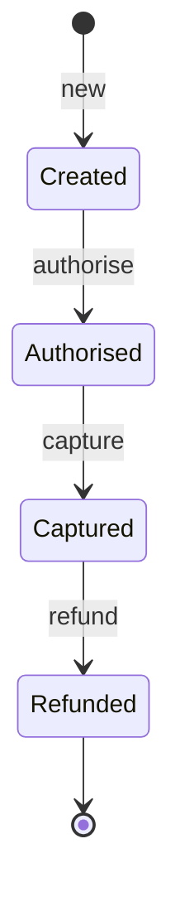
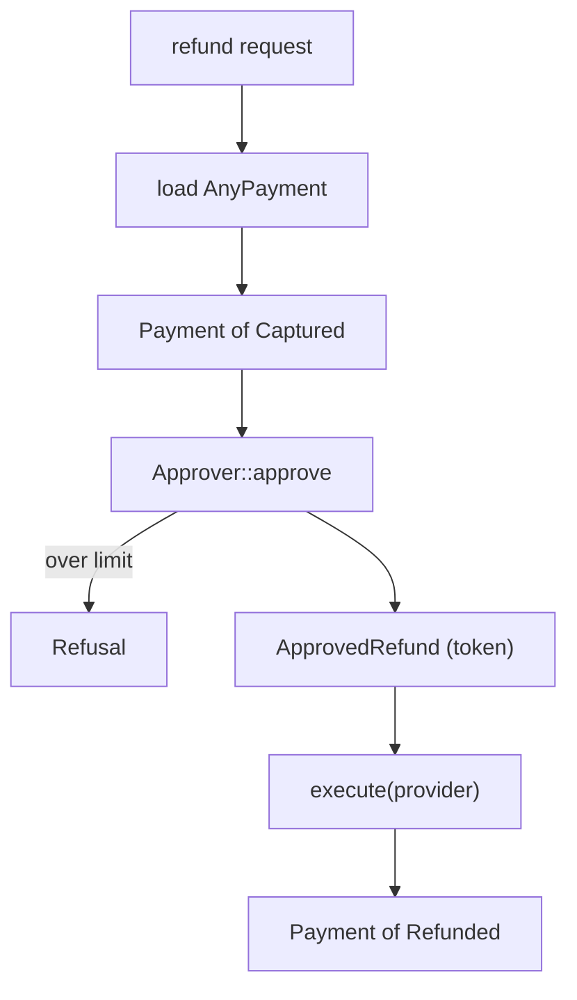
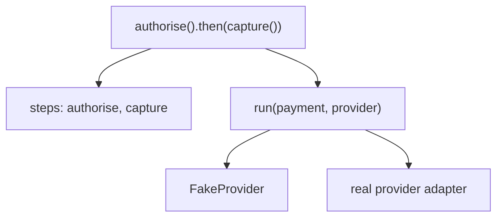

# State machines in the type system

A card payment has a short, strict life. When the customer clicks "pay", we
*authorise*: the provider reserves the money on their card and gives us an
authorisation code. When the goods ship, we *capture*: the reserved money is
actually taken, and the provider gives us a capture id. If the goods come
back, we *refund* against that capture. Created, authorised, captured,
refunded, in that order, each step needing what the previous one produced.

The first version of `pay` modelled that with a status field. Six weeks in,
a support agent clicked "refund" on a payment that had been authorised but
never captured. A status check refused it, at run time, because someone had
added that check after the previous incident. Every rule about the lifecycle
lived in an `if` somewhere, and every new caller had to remember them all.

This chapter moves those rules into the types, using the ideas Chapter 29
set up. A payment's state becomes part of its type; the data each state
needs becomes a function of that type; allowed transitions become trait
impls; evidence that a step happened becomes a value nobody can forge. Then
we push further than typestate usually goes: payment protocols as composable
values, fixed-size data whose length is in its type, and scopes whose
indices can't leak. Each idea starts as a few lines of Haskell, and each
ends with an honest note about what Rust can and can't promise.

## A payment with a status field

Here's the version that went to production. The states are an enum (we
learned that much in Chapter 3), and the data that only exists in some
states is a set of `Option`s:

```rust
pub struct Payment {
    pub id: PaymentId,
    pub amount: Amount,
    pub status: Status,
    pub auth_code: Option<AuthCode>,
    pub capture_id: Option<CaptureId>,
    pub refund_id: Option<RefundId>,
}
```

`AuthCode`, `CaptureId` and `RefundId` are value objects holding the
provider's reference strings, each with a public `new` and an `as_str`.
Refunding has to check the state, then trust that the state and the
`Option`s agree:

```rust
impl Payment {
    pub fn refund(
        &mut self,
        provider: &impl Provider,
    ) -> Result<(), PaymentError> {
        if self.status != Status::Captured {
            return Err(PaymentError::WrongState {
                action: "refund",
                status: self.status,
            });
        }
        let capture = self.capture_id.as_ref().expect("captured has an id");
        self.refund_id = Some(provider.refund(capture, self.amount)?);
        self.status = Status::Refunded;
        Ok(())
    }
}
```

`PaymentError` is a `thiserror` enum with that `WrongState` variant and one
wrapping provider errors. `Provider` is our port to the card provider
(Chapter 10's *Ports and Adapters*), a plain synchronous trait here, since
nothing in this chapter depends on `async`:

```rust
// file: src/provider.rs
pub trait Provider {
    fn authorise(
        &self,
        id: PaymentId,
        amount: Amount,
    ) -> Result<AuthCode, ProviderError>;

    fn capture(
        &self,
        code: &AuthCode,
        amount: Amount,
    ) -> Result<CaptureId, ProviderError>;

    fn refund(
        &self,
        capture: &CaptureId,
        amount: Amount,
    ) -> Result<RefundId, ProviderError>;
}
```

`ProviderError` is a `thiserror` enum with `Declined(String)` and
`Unavailable`. A `FakeProvider` in `provider::fake` hands out references
`auth-1`, `cap-2` and so on, records each call, and can be told to decline
amounts over a limit.

The lifecycle we want is small:



The status-field version admits 4 × 2³ = 32 shapes of state and evidence,
and the diagram has four. The `expect` is the tell: it's a promise that the
other 28 never happen, enforced by nothing.

## Typestate, sealed

Chapter 14 showed the fix for tasks: make the state a type parameter, so
each state has its own methods. Haskell does it by lifting a data type's
values to the type level:

```haskell
{-# LANGUAGE DataKinds, KindSignatures #-}

data Status = Created | Authorised | Captured | Refunded

authorise :: Payment 'Created
          -> IO (Either PaymentError (Payment 'Authorised))
refund    :: Payment 'Captured
          -> IO (Either PaymentError (Payment 'Refunded))
```

The `{-# ... #-}` line switches on two extensions. With `DataKinds`, `Status`
is both an ordinary type and a *kind*, and `'Created` (with a tick) is a type
of that kind, so `Payment 'Created` is a payment indexed by its state. `IO`
marks a function with side effects, and `Either` is Rust's `Result`. Call
`refund` on a created payment and GHC says "Couldn't match type `Created`
with `Captured`".

Rust has no `DataKinds`, so we use the same encoding as Chapter 14: one
zero-sized type per state, and a trait that says "this type is a state":

```rust
// file: src/state.rs
mod sealed {
    pub trait Sealed {}
}

/// A payment lifecycle state. Sealed: these four are all there are.
pub trait State: sealed::Sealed {
    /// How the state is written in storage.
    const NAME: &'static str;
}

#[derive(Debug, Clone, Copy, PartialEq, Eq)]
pub struct Created;
// ... Authorised, Captured and Refunded, the same way

impl sealed::Sealed for Created {}
impl State for Created {
    const NAME: &'static str = "created";
}
// ... and the same pair of impls for the other three
```

Haskell's `Status` is a closed set: four constructors, and nobody can add a
fifth. A Rust trait is open by default, so the `sealed` module closes it.
`State` requires `Sealed`, and `Sealed` lives in a private module, so no
other crate can name it, let alone implement it. A crate that depends on
`pay` and tries to invent a state gets:

```text
error[E0277]: the trait bound `Settled: state::sealed::Sealed` is not
              satisfied
  --> src/lib.rs:5:16
   |
 5 | impl State for Settled {
   |                ^^^^^^^ unsatisfied trait bound
   |
   = note: `State` is a "sealed trait", because to implement it you also
           need to implement `pay::state::sealed::Sealed`, which is not
           accessible; this is usually done to force you to use one of the
           provided types that already implement it
   = help: the following types implement the trait:
             pay::Created
             pay::Authorised
             pay::Captured
             pay::Refunded
```

Why does it matter that the set is closed? Because the rest of this chapter
writes code generic over `S: State`, and every one of those generic
functions is a place where a state we've never heard of could turn up with
behaviour we never designed. We'll see a concrete forgery shortly.

Then the payment itself. For now we carry the evidence `Option`s across from
the naive version and mark the state with `PhantomData`, Chapter 14's tool
for "a type parameter used only as a label":

```rust
// file: src/payment/mod.rs
pub struct Payment<S: State> {
    id: PaymentId,
    amount: Amount,
    auth_code: Option<AuthCode>,
    capture_id: Option<CaptureId>,
    refund_id: Option<RefundId>,
    state: PhantomData<S>,
}
```

The fields are private, and that isn't a detail. Haskell programmers state
the rule crisply: **export the type, not the constructor**. If other modules could write `Payment::<Captured> { .. }`,
they could produce a captured payment that no provider ever captured, and
every guarantee below would be void. Chapter 7 called this *Encapsulated
Invariants (Privacy as Proof)*, and here's the compiler enforcing it on a
would-be forger in another crate:

```text
error[E0451]: fields `id`, `amount` and `evidence` of struct `Payment` are
              private
 --> src/lib.rs:5:9
  |
4 |     Payment::<Captured> {
  |     ------------------- in this type
5 |         id: PaymentId(1),
  |         ^^ private field
6 |         amount: Amount::from_pence(10_000),
  |         ^^^^^^ private field
7 |         evidence: CaptureId::new("cap-made-up"),
  |         ^^^^^^^^ private field
```

(That error is from the finished struct, which we'll reach in a moment; its
fields are `id`, `amount` and `evidence`.)

### Transitions that consume

Each transition lives on the state it starts from, takes `self` by value and
returns the next state, exactly as in Chapter 14. Authorising calls the
provider and moves the code into the new payment:

```rust
impl Payment<Created> {
    pub fn new(id: PaymentId, amount: Amount) -> Payment<Created> {
        Payment {
            id,
            amount,
            auth_code: None,
            capture_id: None,
            refund_id: None,
            state: PhantomData,
        }
    }

    pub fn authorise(
        self,
        provider: &impl Provider,
    ) -> Result<Payment<Authorised>, ProviderError> {
        let code = provider.authorise(self.id, self.amount)?;
        Ok(Payment {
            id: self.id,
            amount: self.amount,
            auth_code: Some(code),
            capture_id: None,
            refund_id: None,
            state: PhantomData,
        })
    }
}
```

Listing every field is Chapter 14's struct-update wall again: `..self` needs
`self` to be the same type, and `Payment<Created>` isn't
`Payment<Authorised>`. `capture` on `Payment<Authorised>` and `refund` on
`Payment<Captured>` follow the same pattern. Now the support agent's refund,
in a test:

```rust
// does not compile
let created = Payment::new(PaymentId(1), Amount::from_pence(500));
let refunded = created.refund(&provider)?;
```

```text
error[E0599]: no method named `refund` found for struct
              `payment::Payment<state::Created>` in the current scope
   --> src/payment/mod.rs:162:32
    |
 18 | pub struct Payment<S: State> {
    | ---------------------------- method `refund` not found for this struct
...
162 |         let refunded = created.refund(&provider)?;
    |                                ^^^^^^ method not found in
    |                                       `payment::Payment<state::Created>`
    |
    = note: the method was found for `payment::Payment<state::Captured>`
```

The compiler even points at where `refund` does exist. And because each
transition consumes `self`, a payment can't be captured twice: after
`capture`, the `Payment<Authorised>` is gone (Chapter 2's E0382 if you try).

> [!NOTE]
> If the provider declines, `authorise` returns `Err` and the
> `Payment<Created>` it consumed is gone too. Here that's harmless: a created
> payment is just an id and an amount, which the caller still has. Where a
> failed transition must hand the old state back, return it inside the
> error, as `Vec`'s `try_into` for arrays does. We'll do exactly that for
> refund approvals below.

## Evidence as a type-level function

Those `Option`s are still there, though, and `capture` still has to write
`self.auth_code.expect("authorised has a code")`. The type knows the payment
is authorised; the field doesn't. What we want is a field whose *type*
depends on the state: nothing when created, an `AuthCode` when authorised, a
`CaptureId` when captured. Haskell has a feature for exactly this, the *type
family*, a function from types to types:

```haskell
type family Evidence (s :: Status) :: Type where
  Evidence 'Created    = ()
  Evidence 'Authorised = AuthCode
  Evidence 'Captured   = CaptureId
  Evidence 'Refunded   = RefundId

data Payment (s :: Status) = Payment
  { paymentId :: PaymentId
  , amount    :: Money
  , evidence  :: Evidence s
  }
```

Read it as a `match` that runs in the type checker: given a state, it
returns a type. The `evidence` field of a `Payment 'Captured` is a
`CaptureId`, full stop.

Rust's version of a type-level function is one we've had since Chapter 5:
an **associated type**. Each `impl State for X` fills it in, so `S::Evidence`
is "the evidence type for state `S`":

```rust
// file: src/state.rs
pub trait State: sealed::Sealed {
    /// What we must hold to be in this state.
    type Evidence;
    const NAME: &'static str;
}

impl State for Created {
    type Evidence = ();
    const NAME: &'static str = "created";
}

impl State for Authorised {
    type Evidence = AuthCode;
    const NAME: &'static str = "authorised";
}
// ... Captured => CaptureId, Refunded => RefundId
```

And the payment shrinks to three fields:

```rust
// file: src/payment/mod.rs
#[derive(Debug, Clone, PartialEq, Eq)]
pub struct Payment<S: State> {
    id: PaymentId,
    amount: Amount,
    evidence: S::Evidence,
}
```

`PhantomData` has gone too: `S` is used, through `S::Evidence`. A
`Payment<Created>` is an id and an amount, because `()` takes no space. A
`Payment<Captured>` *has* a `CaptureId`, not maybe-has. The accessors stop
returning `Option`:

```rust
impl Payment<Authorised> {
    pub fn auth_code(&self) -> &AuthCode {
        &self.evidence
    }
}

impl Payment<Captured> {
    pub fn capture_id(&self) -> &CaptureId {
        &self.evidence
    }
}
```

The 32 shapes are down to exactly four, one per state, and the `expect`
calls have nowhere to live. Methods for every state go in an
`impl<S: State> Payment<S>` block: `id()`, `amount()`, `evidence()` and
`status()`, which returns `S::NAME`.

Why not do what Chapter 14 did, and put the data inside the state type
(`struct Captured(CaptureId)`)? That works, and for two states it's simpler.
Keeping the states as empty labels pays off when we want to *talk about* a
state without having its data: in a trait bound, a transition table, or a
protocol type later in this chapter. `Captured` is a name; `S::Evidence` is
what you need to be in it.

> [!PATTERN] Type-Level Functions (Associated Types)
> When a type's shape should depend on another type, such as the evidence a
> payment carries depending on its state, write the dependency as an
> associated type on a trait (`trait State { type Evidence; }`) and use the
> projection (`S::Evidence`) in your structs and signatures. Each `impl` is
> one line of the function's definition. It's Rust's closest equivalent of a
> Haskell type family, and it removes `Option` fields that only exist to
> cover states the type already rules out.

## The transition table

Every transition now does the same dull thing: keep the id and amount, swap
the evidence. Let's write it once. But a generic `fn transition<T>(self) ->
Payment<T>` would allow *every* pair, refunds of created payments included.
We want the allowed pairs written down, as data the compiler checks. In
Haskell, a type family returning a type-level `Bool`:

```haskell
type family Allowed (from :: Status) (to :: Status) :: Bool where
  Allowed 'Created    'Authorised = 'True
  Allowed 'Authorised 'Captured   = 'True
  Allowed 'Captured   'Refunded   = 'True
  Allowed from        to          = 'False

transition :: (Allowed from to ~ 'True)
           => Payment from -> Evidence to -> Payment to
```

The `~` constraint means "these types must be equal", so `transition` only
type-checks when the table says `'True`. Rust says the same thing with a
trait implemented only for the allowed pairs:

```rust
// file: src/state.rs
/// `Self` may move to `T`. Implemented only for the allowed pairs.
#[diagnostic::on_unimplemented(
    message = "a payment cannot move from `{Self}` to `{T}`",
    label = "no such transition"
)]
pub trait TransitionTo<T: State>: State {}

impl TransitionTo<Authorised> for Created {}
impl TransitionTo<Captured> for Authorised {}
impl TransitionTo<Refunded> for Captured {}
```

Three empty impls: the arrows of the state diagram, in code. The
`#[diagnostic::on_unimplemented]` attribute (stable since Rust 1.78) lets
us replace the compiler's generic message with one in the domain's language.
Now one private method does every transition, gated by the table:

```rust
// file: src/payment/mod.rs
impl<S: State> Payment<S> {
    /// The one way to change state. Private, and only along allowed edges.
    fn transition<T: State>(self, evidence: T::Evidence) -> Payment<T>
    where
        S: TransitionTo<T>,
    {
        Payment { id: self.id, amount: self.amount, evidence }
    }
}
```

`authorise` becomes `Ok(self.transition(code))`, and `capture` likewise.
Suppose someone adds a convenient shortcut:

```rust
// does not compile
impl Payment<Created> {
    /// A shortcut nobody asked for.
    pub fn refund_now(self, id: RefundId) -> Payment<Refunded> {
        self.transition::<Refunded>(id)
    }
}
```

```text
error[E0277]: a payment cannot move from `Created` to `Refunded`
  --> src/payment/mod.rs:53:14
   |
53 |         self.transition::<Refunded>(id)
   |              ^^^^^^^^^^ no such transition
   |
help: the trait `TransitionTo<Refunded>` is not implemented for `Created`
      but trait `TransitionTo<Authorised>` is implemented for it
  --> src/state.rs:58:1
   |
58 | impl TransitionTo<Authorised> for Created {}
   | ^^^^^^^^^^^^^^^^^^^^^^^^^^^^^^^^^^^^^^^^^
```

This is where sealing earns its keep. Without the seal, another crate can
define `struct Settled`, implement `State` for it, and then write
`impl TransitionTo<Settled> for Captured {}` and
`impl TransitionTo<Refunded> for Settled {}`. Rust's orphan rule allows
both, because `Settled` is local to that crate. (We checked: with `State`
unsealed, those lines compile.) Our transition table would have rows we
never wrote. With the seal, `Settled` can't be a `State`, so it can't appear
in the table at all.

> [!IMPORTANT]
> The table checks that a transition is *allowed*. It doesn't check that it
> *happened*. Nothing in `TransitionTo<Authorised>` proves the provider
> really reserved the funds; that's established at run time by `authorise`
> calling the provider and getting back a code. The type rule is only as
> good as the code that constructs the evidence, which is why `transition`
> is private.

## Proof tokens

Refunds need one more rule: each one must be approved by a person, up to
that person's limit. Adding an `approver` parameter to `refund` would work,
but it welds approving and executing into one step, and nothing in the types
would record that an approval happened.

Haskell writing on this problem often uses a bank transfer: separate
*authorising* a transfer from *executing* it, and make execution demand
evidence that authorisation succeeded:

```haskell
authoriseTransfer :: Principal -> TransferRequest
                  -> IO (Either AuthorisationError AuthorisedTransfer)
executeTransfer   :: AuthorisedTransfer -> IO (Either TransferError Receipt)
```

The trick is that the module exports `AuthorisedTransfer` without its
constructor, so `authoriseTransfer` is the only way to get one. Holding an
`AuthorisedTransfer` *is* proof that authorisation ran and said yes. In
Rust, the approval holds the payment itself, so an approval can't be applied
to the wrong payment:

```rust
// file: src/payment/refund.rs
use super::Payment;
use crate::{Amount, Captured, Provider, ProviderError, Refunded};

/// Evidence that a refund of this payment was approved.
#[derive(Debug)]
pub struct ApprovedRefund {
    payment: Payment<Captured>,
    approved_by: String,
}

/// Why approval was refused, with the payment handed back.
#[derive(Debug)]
pub struct Refusal {
    pub payment: Payment<Captured>,
    pub limit: Amount,
}
```

`refund.rs` is a child module of `payment`, declared with `mod refund;` and
re-exported, so it can see `Payment`'s private fields (Rust's privacy is per
module, and children see their ancestors' private items). `ApprovedRefund`'s
own fields are private, so outside this module nobody can build one. The
only door in is an approver:

```rust
/// Someone allowed to approve refunds up to a limit.
#[derive(Debug, Clone)]
pub struct Approver {
    name: String,
    limit: Amount,
}

impl Approver {
    pub fn approve(
        &self,
        payment: Payment<Captured>,
    ) -> Result<ApprovedRefund, Refusal> {
        if payment.amount > self.limit {
            return Err(Refusal { payment, limit: self.limit });
        }
        let approved_by = self.name.clone();
        Ok(ApprovedRefund { payment, approved_by })
    }
}
```

`Approver::new(name, limit)` is an ordinary constructor. And the only way to
reach `Refunded` is to spend the token:

```rust
impl ApprovedRefund {
    pub fn execute(
        self,
        provider: &impl Provider,
    ) -> Result<Payment<Refunded>, ProviderError> {
        let p = self.payment;
        let id = provider.refund(&p.evidence, p.amount)?;
        Ok(p.transition(id))
    }
}
```

We delete `refund` from `Payment<Captured>`, and the compiler lists every
caller that now needs an approval. Here's the flow, from untrusted input to
money moving:



Every arrow into `ApprovedRefund` goes through `approve`. That's the whole
guarantee, and it's worth being exact about its size. The token proves that
*our* approval code ran and said yes for *this* payment. It doesn't prove the
approver is who they claim to be (that's authentication, at the shell, which
is where an `Approver` is built), and it doesn't prove the provider then
moved any money. A proof token is only as trustworthy as its mint.

Refunds here are all-or-nothing: `Refunded` is the end of the line. Real
refunds are often *partial*, a scarf returned from a coat-and-scarf order,
and the rule "never refund more than was captured, in total" is arithmetic
across several refunds, not a state. That needs a pure function along the
lines of `refundable(captured, already_refunded, request) -> Option<Amount>`,
and Chapter 31 writes it, and then asks how sure we can be that it's right.

> [!PATTERN] Proof Token (Unforgeable Evidence)
> Separate deciding from doing. A checking step returns a token type whose
> constructor is private to its module (`ApprovedRefund`), and the action
> requires that token by value (`execute(self, ..)`). Possession of the token
> proves the check ran and passed, for exactly the data inside it, and moving
> the token stops it being spent twice. The guarantee covers only the code
> that mints it.

## Payments from the database

Typestate is a compile-time fact, and a payment loaded from the database has
a state only known at run time. Chapter 14 met this wall with tasks and
climbed it with `AnyTask`, and gave the technique its name: *Existential
Packaging*. Haskell's version is a GADT that hides the state,
`data SomePayment where SomePayment :: Payment s -> SomePayment`. Ours is
an enum with one variant per state:

```rust
// file: src/payment/mod.rs
#[derive(Debug, Clone, PartialEq, Eq)]
pub enum AnyPayment {
    Created(Payment<Created>),
    Authorised(Payment<Authorised>),
    Captured(Payment<Captured>),
    Refunded(Payment<Refunded>),
}
```

Rows arrive as a raw DTO (Chapter 8's *Raw DTO → Validated Domain*): every
column, every `Option`, the status as a string. Converting one is where the
32 shapes get checked, once, at the boundary:

```rust
// file: src/payment/row.rs
impl TryFrom<PaymentRow> for AnyPayment {
    type Error = RowError;

    fn try_from(row: PaymentRow) -> Result<AnyPayment, RowError> {
        let id = PaymentId(row.id);
        let amount = Amount::from_pence(row.amount_pence);
        let need = |v: Option<String>, s: &'static str, what| {
            v.ok_or(RowError::MissingEvidence(s, what))
        };
        Ok(match row.status.as_str() {
            "created" => AnyPayment::Created(restore(id, amount, ())),
            "captured" => {
                let cap = need(row.capture_id, "captured", "capture id")?;
                AnyPayment::Captured(restore(id, amount, CaptureId::new(cap)))
            }
            // ... "authorised" and "refunded" the same way
            other => return Err(RowError::UnknownStatus(other.to_string())),
        })
    }
}
```

`PaymentRow` has public `u64`, `String` and `Option<String>` fields, and
`RowError` has `UnknownStatus` and `MissingEvidence` variants. A
`"captured"` row without a capture id never becomes a `Payment<Captured>`.
After this, matching on an `AnyPayment` hands back the precise type, and the
rest of the code never asks again.

Notice `restore`. It's a private generic function in the same child module,
`fn restore<S: State>(id, amount, evidence: S::Evidence) -> Payment<S>`, and
it builds a payment in any state *without* going through `transition`. It's
a second mint, and it trusts our own database to have recorded only states
we reached honestly. Most systems need one, which is the general shape of
this whole chapter: **the types guarantee what happens inside the boundary,
and a handful of small, private, carefully reviewed functions vouch for what
crosses it.**

> [!CHECKPOINT]
> `src/` now has `evidence.rs` (`AuthCode`, `CaptureId`, `RefundId`),
> `state.rs` (sealed `State` with `Evidence` and `NAME`, the four states,
> `TransitionTo`), `provider.rs` (`Provider`, `ProviderError`,
> `fake::FakeProvider`) and `payment/` with `mod.rs` (`Payment<S>`,
> `AnyPayment`), `refund.rs` and `row.rs`. Tests cover a full
> authorise–capture run, a decline, an approved refund, a refusal that hands
> the payment back, and both row conversions:
>
> ```text
> test payment::refund::tests::approved_refunds_reach_the_provider ... ok
> test payment::refund::tests::over_the_limit_hands_the_payment_back ... ok
> test payment::row::tests::a_captured_row_becomes_a_captured_payment ... ok
> test payment::row::tests::a_captured_row_without_its_id_is_rejected ... ok
> test payment::tests::a_decline_is_an_error_value ... ok
> test payment::tests::authorise_then_capture ... ok
> ```

## Sized types

Before a payment is authorised, a fraud model scores it. The model was
trained on a fixed set of signals (amount, hour of day, account age, and
whether the card's country matches the delivery address), so it has exactly
four weights. Pass it three features, or five, and a dynamic language
quietly computes nonsense.

Haskell can put a length in a type, using type-level natural numbers:

```haskell
data Vec (n :: Nat) a where
  Nil  :: Vec 0 a
  Cons :: a -> Vec n a -> Vec (1 + n) a

mapVec :: (a -> b) -> Vec n a -> Vec n b
```

Each constructor says what it does to the length, so `mapVec`'s type *proves*
that mapping preserves it. Rust's version is the *const generic*, a type
parameter that's a value: `[f64; N]` is an array of exactly `N` floats, and
structs can take `N` too:

```rust
// file: src/risk.rs
/// Exactly `N` numeric signals about a payment.
#[derive(Debug, Clone, Copy, PartialEq)]
pub struct Features<const N: usize>([f64; N]);

/// A linear model trained on exactly `N` features.
pub struct RiskModel<const N: usize> {
    weights: [f64; N],
}

impl<const N: usize> RiskModel<N> {
    pub fn score(&self, features: &Features<N>) -> f64 {
        self.weights.iter().zip(&features.0).map(|(w, x)| w * x).sum()
    }
}
```

Each has a `new` taking an array. (Scores are floats, which is fine; they're
not money.) The shared `N` is the point: a four-weight model with three
features doesn't compile.

```rust
// does not compile
let model = RiskModel::new([0.5, 2.0, 1.0, 0.25]);
let features = Features::new([1.0, 1.0, 0.0]);
model.score(&features)
```

```text
error[E0308]: mismatched types
  --> src/risk.rs:77:17
   |
77 |     model.score(&features)
   |           ----- ^^^^^^^^^ expected `4`, found `3`
   |           |
   |           arguments to this method are incorrect
   |
   = note: expected reference `&Features<4>`
              found reference `&Features<3>`
```

Arrays' own `map` preserves `N`, just like `mapVec`, so transformations keep
the guarantee for free:

```rust
impl<const N: usize> Features<N> {
    /// Same length out as in: `map` on an array preserves `N`.
    pub fn scaled(self, by: f64) -> Features<N> {
        Features(self.0.map(|x| x * by))
    }
}
```

Features from the outside world (a JSON body, a feature store) arrive as a
slice of unknown length. The standard library's `<[T; N]>::try_from(slice)`
is the boundary: it succeeds only if the length is right, packaging runtime
data into a statically sized type, which is existential packaging again:

```rust
impl<const N: usize> TryFrom<&[f64]> for Features<N> {
    type Error = WrongLength;

    fn try_from(values: &[f64]) -> Result<Features<N>, WrongLength> {
        <[f64; N]>::try_from(values)
            .map(Features)
            .map_err(|_| WrongLength { expected: N, found: values.len() })
    }
}
```

Here Rust stops short of Haskell. Suppose we want a bias term, which adds a
constant `1.0` feature, giving `N + 1`:

```rust
// does not compile
pub fn with_bias<const N: usize>(f: Features<N>) -> Features<{ N + 1 }> {
    todo!()
}
```

```text
error: generic parameters may not be used in const operations
  --> src/risk.rs:74:64
   |
74 | pub fn with_bias<const N: usize>(f: Features<N>) -> Features<{ N + 1 }> {
   |                                                                ^ cannot
   |                                         perform const operation using `N`
   |
   = help: const parameters may only be used as standalone arguments here,
           i.e. `N`
```

Arithmetic on const parameters in types needs the unstable
`generic_const_exprs` feature, which has been in the works for years. On
stable, `N` can be passed along but not computed with. Haskell's
`GHC.TypeLits` can do `1 + n`, though even there anything harder than simple
arithmetic needs extra evidence or a plugin.

> [!PATTERN] Sized Types (Const Generics)
> When two pieces of data must agree on a size (weights and features, a
> matrix's rows and a vector's length, a key and a fixed-width buffer), put
> the size in the type with a const generic (`Features<const N: usize>`) so
> mismatches don't compile. Convert runtime data at the boundary with
> `<[T; N]>::try_from`, and prefer operations like array `map` that preserve
> `N`. Stable Rust can't compute with `N` in types (`N + 1`).

## A protocol as a value

Typestate methods enforce the order of steps *as you call them*. Sometimes we
want the sequence itself as a value, such as one merchant's "authorise and
capture now" against another's "capture on dispatch": flows we build,
inspect, test and run later. Chapter 9's `Plan` and Chapter 27's `Effect`
were decisions as data. Can a *protocol* be data, with its order checked?

Haskell's answer is an *indexed* program type, whose type records the state
before and after:

```haskell
authorise :: Money -> Program 'Created 'Authorised AuthCode
capture   :: AuthCode -> Program 'Authorised 'Captured CaptureId

(>>>=) :: Program a b x -> (x -> Program b c y) -> Program a c y
```

`Program a b x` starts in state `a`, ends in `b` and produces an `x`. The
operator `>>>=` sequences two programs, and the shared `b` is the whole
trick: the first must end where the second begins. Putting `capture` first
and `authorise` second doesn't type-check, because one ends in `'Captured`
and the other begins in `'Created`. In Rust:

```rust
// file: src/program.rs
type Run<From, To, Out> = Box<
    dyn FnOnce(Payment<From>, &dyn Provider)
        -> Result<(Payment<To>, Out), ProviderError>,
>;

/// Steps that take a `Payment<From>` to a `Payment<To>`, yielding `Out`.
pub struct Program<From: State, To: State, Out> {
    steps: Vec<&'static str>,
    run: Run<From, To, Out>,
}
```

A program is a description (its step names, which we can print or assert on)
and a boxed closure that will carry it out. The building blocks wrap the
typed transitions we already have:

```rust
pub fn authorise() -> Program<Created, Authorised, AuthCode> {
    Program {
        steps: vec!["authorise"],
        run: Box::new(|payment, provider| {
            let authorised = payment.authorise(&provider)?;
            let code = authorised.auth_code().clone();
            Ok((authorised, code))
        }),
    }
}
```

`capture()` is the same with `Authorised`, `Captured` and `CaptureId`. (The
`&provider` is a `&&dyn Provider`. That works because `provider.rs` adds a
small blanket impl, `impl<P: Provider + ?Sized> Provider for &P`, whose
methods forward to `**self`: a reference to any provider is a provider.) Then
`then`, whose signature is the Haskell operator's:

```rust
impl<From: State, To: State, Out: 'static> Program<From, To, Out>
where
    From: 'static,
    To: 'static,
{
    /// Run `self`, then `next`. Only compiles if the states meet.
    pub fn then<Next: State + 'static, Out2: 'static>(
        self,
        next: Program<To, Next, Out2>,
    ) -> Program<From, Next, Out2> {
        let mut steps = self.steps;
        steps.extend(next.steps);
        let (first, second) = (self.run, next.run);
        Program {
            steps,
            run: Box::new(move |payment, provider| {
                let (middle, _) = first(payment, provider)?;
                second(middle, provider)
            }),
        }
    }
}
```

`next` must start at `To`, the state `self` ends in. So
`authorise().then(capture())` is a `Program<Created, Captured, CaptureId>`,
and the reverse is refused:

```rust
// does not compile
let nonsense = capture().then(authorise());
```

```text
error[E0308]: mismatched types
   --> src/program.rs:111:35
    |
111 |     let nonsense = capture().then(authorise());
    |                              ---- ^^^^^^^^^^^ expected
    |                              |    `Program<Captured, _, _>`, found
    |                              |    `Program<Created, Authorised, AuthCode>`
    |                              |
    |                              arguments to this method are incorrect
    |
    = note: expected struct `Program<state::Captured, _, _>`
               found struct `Program<Created, Authorised, evidence::AuthCode>`
```

The interpreter is `run`, which hands the payment and a real provider to the
closure: `sale.run(payment, &provider)` returns the captured payment and its
capture id. A test can assert on `sale.steps()`, which is
`["authorise", "capture"]`, without running anything, and then run it
against `FakeProvider` and check the calls it recorded.



When the description is entirely data, instructions with no meaning of their
own plus interpreters that give them one (production, test, dry run),
Haskell programmers call it a *free monad*. Ours is a halfway house: the step
names are data, but the behaviour is a closure, so we can print a program
but not rewrite it. A fully data-driven version would make the steps an
enum, like `Plan`, and move the provider calls into the interpreter.

Either way, one caveat holds. **The indices guarantee that the description
is well ordered; the interpreter must honour it.** An interpreter that skipped a step, or a provider adapter that
returned an `AuthCode` without asking the provider, would type-check
perfectly. The guarantee covers the program, not what runs it.

> [!PATTERN] Indexed Protocol (Composable Typestate)
> Represent a multi-step protocol as a value indexed by its start and end
> states (`Program<From, To, Out>`), with combinators whose signatures make
> the states line up (`then` takes a `Program<To, Next, _>`). Wrong orders
> don't compile, and the protocol can be built, inspected and passed around
> before an interpreter runs it. The types check the description; the
> interpreter must still do what it says.

## Branded scopes

End-of-day settlement works through a batch of captured payments, finding
them by id and reading them back by position. Positions are fast, but a
`usize` from Monday's batch indexes Tuesday's just as happily, and either
gets the wrong payment or panics. We'd like an index that only works with the
batch it came from.

Haskell's `ST` type does something similar for mutable references:

```haskell
runST :: (forall s. ST s a) -> a
```

The `forall s` inside the argument means the computation must work for
*every* `s`, which `runST` picks and nobody else can name, so references
tagged with `s` can't escape or mix with another run's. Chapter 26 met Rust's
cousin, `thread::scope`, whose handles carry a lifetime that can't leave the
scope. We'll build the same thing on purpose. The brand is a lifetime used
only as a name:

```rust
// file: src/brand.rs
/// An invariant lifetime used only as a unique name.
#[derive(Debug, Clone, Copy, PartialEq, Eq)]
struct Brand<'id>(PhantomData<fn(&'id ()) -> &'id ()>);

pub struct Batch<'id> {
    payments: Vec<Payment<Captured>>,
    brand: Brand<'id>,
}

/// A position in the batch with the same brand. Always in bounds.
#[derive(Debug, Clone, Copy, PartialEq, Eq)]
pub struct Slot<'id> {
    index: usize,
    brand: Brand<'id>,
}
```

The odd `PhantomData<fn(&'id ()) -> &'id ()>` makes `'id` *invariant*: the
compiler may not shrink or stretch it to make two brands match, which is
what normally happens to lifetimes. The only way to get a `Batch` is through
a function that invents a fresh brand for each call:

```rust
pub fn with_batch<R>(
    payments: Vec<Payment<Captured>>,
    f: impl for<'id> FnOnce(Batch<'id>) -> R,
) -> R {
    f(Batch { payments, brand: Brand(PhantomData) })
}

impl<'id> Batch<'id> {
    pub fn find(&self, id: PaymentId) -> Option<Slot<'id>> {
        let index = self.payments.iter().position(|p| p.id() == id)?;
        Some(Slot { index, brand: self.brand })
    }

    /// No `Option`, no bounds check that can fail: the brand is the proof.
    pub fn get(&self, slot: Slot<'id>) -> &Payment<Captured> {
        &self.payments[slot.index]
    }
}
```

`for<'id>` is Rust's `forall`: the closure must work for every lifetime, so
it can't assume anything about `'id`, and two calls get two unrelated
brands. Since a batch never shrinks, a `Slot<'id>` is always in bounds for
the one `Batch<'id>` that shares its brand. Mixing batches:

```rust
// does not compile
with_batch(monday, |mon| {
    with_batch(tuesday, |tue| {
        if let Some(slot) = mon.find(PaymentId(7)) {
            println!("{:?}", tue.get(slot));
        }
    })
})
```

```text
error[E0521]: borrowed data escapes outside of closure
  --> src/brand.rs:73:33
   |
71 |     with_batch(monday, |mon| {
   |                         --- `mon` declared here, outside of the closure
   |                             body
72 |         with_batch(tuesday, |tue| {
   |                              --- `tue` is a reference that is only valid
   |                                  in the closure body
73 |             if let Some(slot) = mon.find(PaymentId(7)) {
   |                                 ^^^^^^^^^^^^^^^^^^^^^^ `tue` escapes the
   |                                                        closure body here
   |
   = note: the struct `Batch<'id>` is invariant over the parameter `'id`
```

The wording is about escaping because, to the compiler, that's what it is:
using Monday's slot with Tuesday's batch would need the two brands to be the
same lifetime, and they can't be. (A second, similar error follows for the
`get` call.) Smuggling a slot *out*, as in `with_batch(monday, |mon|
mon.find(id))`, fails too, with "lifetime may not live long enough". The
`GhostCell` library uses this technique for safe shared mutation with no
runtime cost. The price is real: errors are cryptic, and everything that
touches a brand has to live inside the closure.

> [!PATTERN] Branded Scope
> Give values that belong together (a collection and its indices, a cell and
> its access token) a shared, invariant lifetime brand, and create the brand
> only inside a higher-ranked closure (`impl for<'id> FnOnce(Batch<'id>) ->
> R`). Each call gets a fresh, unnameable brand, so values from one scope
> can't be used with another or escape it. It's Rust's version of Haskell's
> `runST` trick.

## Affine, not linear

Chapter 2 drew the line: Rust values are *affine*, used at most once, which
is why consuming transitions work without ceremony and a `Payment<Authorised>`
can't be captured twice. Haskell needs its `LinearTypes` extension
(`Resource %1 -> Result`) to rule out reuse, and that goes further, to
*exactly* once. Rust values aren't *linear*: nothing forces you to use one. An authorised payment that's never
captured holds the customer's funds until the authorisation expires, days
later.

Chapter 2's partial answer applies. `#[must_use]` can't target one
instantiation like `Payment<Authorised>`, but on `Payment<S>` it covers every
state, which is what we want anyway: every transition returns a new state
that must be saved or acted on.

```rust
#[must_use = "a payment's new state must be saved or acted on"]
#[derive(Debug, Clone, PartialEq, Eq)]
pub struct Payment<S: State> {
    id: PaymentId,
    amount: Amount,
    evidence: S::Evidence,
}
```

A checkout that authorises and then forgets the result now draws:

```text
warning: unused `Payment` that must be used
 --> src/checkout.rs:6:5
  |
6 |     created.authorise(provider)?;
  |     ^^^^^^^^^^^^^^^^^^^^^^^^^^^^
  |
  = note: a payment's new state must be saved or acted on
```

It's a lint, not a proof: `let _ = ...` silences it, and a payment bound to
a variable and later dropped goes unnoticed. The real backstop is outside
the type system, a job that voids stale authorisations.

## What the types can't see

One last scenario. A customer double-clicks "refund". Two workers each load
the same row, each gets a perfectly good `Payment<Captured>`, each gets it
approved, and each calls `execute`. Every line is type-correct. Ownership
even guarantees that each worker spends *its* token once. But there were two
tokens, minted from one row, and the provider pays out twice.

Types are local. They describe what one piece of code may do with the values
it holds, not how many copies of "the same" payment exist across processes,
or what a database row says between a read and a write. Chapter 31 takes
this bug to TLA+, alongside the partial refunds rule that types can't hold
either.

## What we learned

- **Typestate with a sealed trait.** `Payment<S: State>` puts the lifecycle
  in the type; a private `Sealed` supertrait closes the set of states, so
  other crates can't invent states or add rows to the transition table.
  Private fields make the states unforgeable (E0451).
- **Associated types are type-level functions** (*Type-Level Functions*).
  `S::Evidence` gives each state exactly the data it needs, removing `Option`
  fields and `expect` calls.
- **Allowed transitions as trait impls.** `TransitionTo<T>` lists the edges;
  a private, generic `transition` requires one, and
  `#[diagnostic::on_unimplemented]` makes the E0277 speak the domain. It
  checks the rule, not that the provider did anything.
- **Proof tokens separate deciding from doing** (*Proof Token*). Only
  `Approver::approve` can mint an `ApprovedRefund`, and only spending one
  reaches `Refunded`.
- **Existential packaging at the boundary.** A raw row becomes an
  `AnyPayment` once; a small private `restore` is the trusted second mint.
- **Const generics put sizes in types** (*Sized Types*). Mismatched lengths
  don't compile, `try_from` packages runtime slices, and stable Rust can't
  compute `N + 1`.
- **Protocols can be values** (*Indexed Protocol*). `Program<From, To, Out>`
  with `then` makes wrong orders a type error; the interpreter must honour
  the description.
- **Brands keep indices in their scope** (*Branded Scope*). An invariant
  lifetime from a `for<'id>` closure makes cross-batch use an error.
- **Affine isn't linear, and types are local.** `#[must_use]` nudges;
  double refunds across workers need something beyond types.

## Exercises

> [!EXERCISE] Voiding an authorisation
> Add a `Voided` state, reachable only from `Authorised`, with a `VoidId`
> as its evidence and a `void` method that calls a new `Provider` method.
> Follow the compiler through `State`, `TransitionTo`, `AnyPayment` and the
> row conversion. Which of those changes did the compiler demand, and which
> did you have to remember?

> [!EXERCISE] An infallible provider
> Give `Provider` an associated `type Error` (as Chapter 29's `FeeSchedule`
> has) and make the transitions return `Result<_, P::Error>`. Set
> `FakeProvider`'s error to `Infallible` and rewrite a test with
> `let Ok(captured) = ...`. What do you gain, and what does it cost
> `Program`, whose closures take a `&dyn Provider`?

> [!EXERCISE] A protocol you can rewrite
> Replace `Program`'s closure with a `Vec<Step>` (an enum) and move the
> provider calls into an interpreter function that walks the steps over an
> `AnyPayment`. Keep `then`'s type indices. Now write a second interpreter
> that returns the total amount the program would move, without calling a
> provider. Where does the interpreter have to trust the indices, and what
> does it do if they lie?

> [!EXERCISE] Brands for refunds
> Make `Approver::approve` return an approval branded with the lifetime of a
> settlement run, so approvals from one run can't be executed in another.
> Is that a better or worse tool than storing a run id in the approval and
> checking it at run time? Consider error messages, testing and how the
> approvals get stored overnight.
