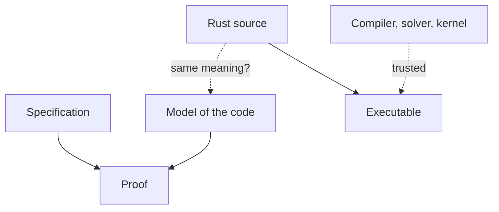
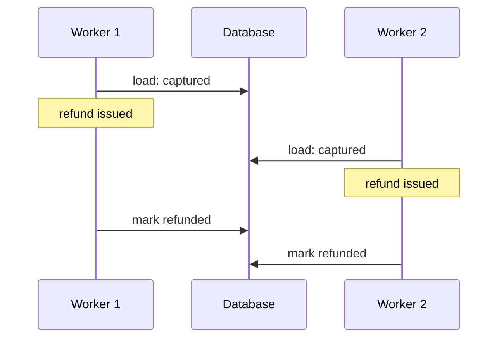

# Beyond the type checker

A customer buys a £100 coat and a £30 scarf in one payment, then sends the
scarf back. Support refunds £30. A week later the coat goes back too, and
support refunds £100, because that's the number on the coat's label. The
payment provider happily pays out £130 against a £100 capture... or, more
likely, rejects the second refund with an opaque error at 4pm on a Friday.
Either way, our system asked for something it should never have asked for.

Chapter 30 gave us payments whose lifecycle is checked by the compiler. A
`Payment<Captured>` can be refunded, with an `ApprovedRefund` token to prove
someone said yes; a `Payment<Created>` can't, and trying is a compile error.
But, as Chapter 30 admitted, real refunds are *partial*, and the rule for
them isn't about which state we're in. It's arithmetic:

> The total refunded never exceeds the captured amount, and each refund is
> positive.

This chapter is about rules like that one, which types alone can't hold, and
about the tools that pick up where the type checker stops. We'll write the
refund check, watch a plausible version pass its tests while being wrong,
and then meet four ways of being more sure: refinement types, Rust's
verifiers (we'll run Kani for real), proofs by induction (by hand, then in
Lean 4), and, for the bug no single function can prevent, one more trip to
TLA+. We'll end by stepping back over the whole book and putting every
technique on one ladder.

## What the types can say

Let's start where we always start: what can the types say about a refund?

Chapter 29's `Amount` wraps a `u64` of pence, so it already says *not
negative*. The standard library has `NonZeroU64`, which says *not zero*, so
"each refund is positive" is expressible too, if we want it. What we can't
write is a type for "at most the captured amount minus what's already been
refunded". That bound depends on two other values that only exist at run
time. Rust's types can depend on other types and on constants
(`[u8; 32]`), but not on runtime values.

We could reach for *Parse, Don't Validate* (Chapter 4) and make a
`RefundableAmount` with a smart constructor. That's a good idea, and we'll
effectively do it, but notice what it buys. The constructor *is* the check.
The type then proves that the check ran; it can't prove the check was right.
So the question moves to the function itself.

## A refund check that passes its tests

Here's the function, written the obvious way. Given what was captured, what's
been refunded so far and the new request, it returns the amount we may refund,
or `None`:

```rust
// file: src/refund.rs
use crate::Amount;

pub fn refundable(
    captured: Amount,
    already_refunded: Amount,
    request: Amount,
) -> Option<Amount> {
    let total = already_refunded.pence() + request.pence();
    if request.pence() > 0 && total <= captured.pence() {
        Some(request)
    } else {
        None
    }
}
```

It reads like the rule. It's pure, so the tests are a table:

```rust
// file: src/refund.rs
#[cfg(test)]
mod tests {
    use super::*;

    fn p(pence: u64) -> Amount {
        Amount::from_pence(pence)
    }

    #[test]
    fn examples() {
        assert_eq!(refundable(p(1000), p(0), p(400)), Some(p(400)));
        assert_eq!(refundable(p(1000), p(600), p(400)), Some(p(400)));
        assert_eq!(refundable(p(1000), p(600), p(401)), None);
        assert_eq!(refundable(p(1000), p(0), p(0)), None);
        assert_eq!(refundable(p(1000), p(1000), p(1)), None);
    }
}
```

All green. Exactly at the limit, one penny over, zero, fully refunded: these
are the cases a careful reviewer asks for. Chapter 7 taught us not to stop at
examples, so let's state the rule as a property and let `proptest` hunt:

```rust
// file: tests/refunds.rs
proptest! {
    #[test]
    fn never_over_refunds(
        captured in 0u64..1_000_000,
        already in 0u64..1_000_000,
        request in 0u64..1_000_000,
    ) {
        let (c, a, r) = (p(captured), p(already), p(request));
        if let Some(x) = refundable(c, a, r) {
            prop_assert!(x.pence() > 0);
            prop_assert!(already + x.pence() <= captured);
        }
    }
}
```

```text
test never_over_refunds ... ok
```

(The file starts with the usual `use` lines, `proptest` as a dev-dependency
as in Chapter 7, and its own copy of the `p` helper.) We picked "realistic"
ranges, up to £10,000, because that's what payments look like. And the
property passes. Now add a second property over the whole of `u64`, and do
the sum in the assertion as `u128` so the *test* itself can't overflow:

```rust
// file: tests/refunds.rs
    #[test]
    fn never_over_refunds_any(
        captured in any::<u64>(),
        already in any::<u64>(),
        request in any::<u64>(),
    ) {
        let (c, a, r) = (p(captured), p(already), p(request));
        if let Some(x) = refundable(c, a, r) {
            let wide = |n: u64| n as u128;
            prop_assert!(x.pence() > 0);
            prop_assert!(wide(already) + wide(x.pence()) <= wide(captured));
        }
    }
```

Run it with `cargo test --release`, the way production runs:

```text
thread 'never_over_refunds_any' (88706) panicked at tests/refunds.rs:9:1:
Test failed: assertion failed: wide(already) + wide(x.pence()) <=
wide(captured) at tests/refunds.rs:33.
minimal failing input: captured = 2515386738942902097,
already = 3934706795185778016, request = 14512037278523773600
```

(The output is real; we've wrapped two long lines.) `already + request`
overflowed. In a debug build Rust panics with "attempt to add with overflow".
In release builds overflow checks are off by default, so the sum *wraps*
around to a small number, passes the `<=` test, and the function approves a
refund larger than the capture. Nobody will refund eighteen quintillion pence,
but a function whose safety depends on "nobody will" has a hole in it, and
the inputs on the other side of a hole aren't always friendly.

Two lessons, both uncomfortable. The example tests passed because we chose
the examples. The property test found the bug only once we chose ranges that
reach the edge; with realistic ranges it said "ok". Property testing samples,
and a sample is only as good as its distribution.

The fix is to say what we meant: the *remaining* refundable amount is a
subtraction that can fail, and `Amount` already has `checked_sub`.

```rust
// file: src/refund.rs
pub fn refundable(
    captured: Amount,
    already_refunded: Amount,
    request: Amount,
) -> Option<Amount> {
    let remaining = captured.checked_sub(already_refunded)?;
    (request > Amount::ZERO && request <= remaining).then_some(request)
}
```

No addition, so nothing to overflow; if more has been refunded than captured
(a corrupt record), `?` refuses. The examples and both property tests pass.
But we've been here before. How do we know this one is right, for every one
of the 2¹⁹² possible inputs, rather than the few hundred `proptest` tried?

## Refinement types, the idea

Haskell's answer, or rather LiquidHaskell's, is to let types carry *logical
predicates*. A **refinement type** is an ordinary type plus a condition that
its values satisfy. The basic example is

```haskell
{-@ type Nat = {v:Int | v >= 0} @-}
```

which reads "an `Int`, call it `v`, such that `v >= 0`". LiquidHaskell
writes refinements in special `{-@ ... @-}` comments that GHC ignores and
the LiquidHaskell checker reads. Its prelude already defines `Nat` exactly
like that (writing the alias again is an error: "Multiple definitions of
Type Alias `Nat`"), so we can use it straight away:

```haskell
-- file: Withdraw.hs
module Withdraw where

{-@ withdraw :: balance:Nat
             -> {amount:Nat | amount <= balance}
             -> {result:Nat | result == balance - amount} @-}
withdraw :: Int -> Int -> Int
withdraw balance amount = balance - amount
```

The signature of `withdraw` says three things: the balance is a natural
number; the amount is a natural number *no larger than the balance*; and the
result is exactly `balance - amount`. The second argument's type mentions the
first argument's value. That's the thing Rust's types can't do.

LiquidHaskell runs as a GHC plugin, and needs an SMT solver (more on those
in a moment) on the `PATH`. We used `haskellPackages.liquidhaskell` from
nixpkgs (version 0.9.10, with GHC 9.10) and `z3`:

```sh
ghc -fplugin=LiquidHaskell Withdraw.hs
```

```text
**** LIQUID: SAFE (3 constraints checked) **************************************
```

Now change the body to `balance + amount`. GHC alone compiles it without a
murmur: `Int -> Int -> Int` is satisfied. With the plugin (output trimmed of
its context section):

```text
**** LIQUID: UNSAFE ************************************************************
Withdraw.hs:7:1: error:
    Liquid Type Mismatch
    .
    The inferred type
      VV : {v : GHC.Types.Int | v == balance##aDp + amount##aDq}
    .
    is not a subtype of the required type
      VV : {VV##600 : GHC.Types.Int | VV##600 == balance##aDp - amount##aDq}
```

The `##aDp` suffixes are GHC's internal names for `balance` and `amount`.
LiquidHaskell inferred that the body returns `balance + amount`, and couldn't
show that equals `balance - amount` for every allowed input. (It's only true
when `amount` is zero.) That's the bug, found without running anything.

### Verification conditions and SMT

How does a checker "show" something for every input? Not by trying them.

First it turns the code and its annotations into **verification
conditions**: plain logical formulas that must be true for the program to
meet its contract. For `withdraw`, roughly: "for all integers `b` and `a`,
if `b ≥ 0` and `a ≥ 0` and `a ≤ b`, then the body's result `b + a` equals
`b - a`, and is `≥ 0`".

Then it hands each formula to an **SMT solver** (*satisfiability modulo
theories*: a program that decides whether a formula can be made true, with
built-in knowledge of arithmetic, arrays and so on; Z3 is the usual one). The
trick is to ask the opposite question. Instead of "is this formula always
true?", it asks "can you find values that make it *false*?". If the solver
proves no such values exist, the condition holds for every input, the infinite
number included. If it finds some, those values are a counterexample: `b = 1,
a = 1` makes `b + a = b - a` false.

That's a different kind of answer from a test. A test says "these inputs
worked". A discharged verification condition says "no input can fail this",
*relative to the contract we wrote*.

### The caveats

The writing on Haskell's type system that inspired this part of the book
(we'll call it *the article*) is careful about the limits, and we should be
too:

- **A failed verification may not mean a wrong program.** The checker only
  knows what the annotations tell it. If a helper function has no contract,
  the solver can't see what it returns, and a correct caller fails to verify.
  The fix is often more annotation, not different code.
- **Arithmetic has to be modelled correctly.** Mathematical integers don't
  overflow; machine integers do. A tool that reasons about `Int` as unbounded
  integers can prove things about a program that aren't true of 64-bit
  hardware. (That's precisely our refund bug.) And money in binary floating
  point is a lost cause before any prover arrives.
- **The predicates must say what we mean.** A proof that `result >= 0` is no
  help if the real rule was `result == balance - amount`.
- **Assumptions are admitted, not proved.** Anything we tell the tool to
  trust (an external function's contract, an "assume" for a hard case) is a
  place a bug can hide.
- **The toolchain is trusted.** The checker, the solver and the compiler that
  produces the binary all have to be right.

None of that makes refinement types weak. It makes them precise about what
they've established.

## Rust's verifiers

Rust has no refinement types in the language. It does have a lively set of
research and industrial tools that verify Rust programs against
specifications, in three flavours: model checking, refinement types and
deductive verification.

**Kani** is a *bounded model checker*. It compiles your actual Rust code
(through the compiler's mid-level representation, MIR) into a logical formula
describing every possible execution, and asks a solver whether any execution
fails an assertion, panics, overflows or does something undefined. "Bounded"
means loops are unrolled up to a limit; for loop-free code like `refundable`
it covers every input. You write *proof harnesses* that look like tests.
Amazon built it and uses it on real systems code, and it's being used to
verify parts of the Rust standard library.

**Flux** brings LiquidHaskell's idea to Rust: refinement types written as
attributes on ordinary functions, checked with an SMT solver, with types
like "a `u64` whose value is `n`" or "a `Vec` of length `n`".

**Prusti** and **Creusot** are *deductive* verifiers. You annotate functions
with preconditions (`requires`) and postconditions (`ensures`), and loop
invariants where needed; the tool generates verification conditions and
discharges them, as in the previous section. Prusti builds on the Viper
verification infrastructure; Creusot translates to the Why3 platform.

**Verus** is also deductive, but designed around writing proofs alongside
code in a Rust-like language: specifications, *ghost* code that exists only
for the proof, and proof functions, all erased before compilation. Here's
`withdraw` in Verus syntax, so you can see the family resemblance with
LiquidHaskell:

```rust
// Verus syntax, not plain Rust: needs the verus tool (not run here)
verus! {
fn withdraw(balance: u64, amount: u64) -> (result: u64)
    requires amount <= balance,
    ensures result == balance - amount,
{
    balance - amount
}
}
```

Prusti and Creusot look much the same (`#[requires(...)]` and
`#[ensures(...)]` attributes), and Flux writes the contract into the
signature as refined types. We haven't run any of these four here; their
syntax moves faster than a book, so treat the snippet as a sketch and check each
tool's documentation.

An honest summary: these tools are real and some are used in production, but
they're not yet part of the everyday Rust toolchain in the way `clippy` is.
They cost setup, annotation effort and the patience to learn what a tool can
and can't prove. Of the five, Kani asks the least of us, because a harness is
just Rust. So let's run it.

### Kani on `refundable`

Kani isn't in nixpkgs. It installs through cargo, then downloads its own
pinned nightly toolchain and solver:

```sh
cargo install --locked kani-verifier
cargo kani setup
```

That needs `rustup` on your `PATH` (`nix shell nixpkgs#rustup` will do) and
a few hundred megabytes. If you'd rather not touch your real `~/.cargo`,
point `CARGO_HOME`, `RUSTUP_HOME` and `HOME` at a scratch directory for both
commands; Kani 0.68 installed cleanly that way for us.

Kani compiles our code with `--cfg kani`, so harnesses live behind
`#[cfg(kani)]` and normal builds never see them. Tell cargo that cfg is
expected, or it warns:

```toml
# file: Cargo.toml
[lints.rust]
unexpected_cfgs = { level = "warn", check-cfg = ['cfg(kani)'] }
```

A harness is a function marked `#[kani::proof]`. Where a test would pick
inputs, a harness asks for `kani::any()`: a *symbolic* value standing for
every possible value of that type at once. `kani::assume` narrows the inputs
to the ones the contract allows. Then we assert the contract, stated with
`u128` sums so the specification itself can't overflow:

```rust
// file: src/refund.rs
#[cfg(kani)]
mod proofs {
    use super::*;

    #[kani::proof]
    fn refundable_meets_contract() {
        let captured = Amount::from_pence(kani::any());
        let already = Amount::from_pence(kani::any());
        let request = Amount::from_pence(kani::any());
        kani::assume(already <= captured);

        let wide = |a: Amount| a.pence() as u128;
        match refundable(captured, already, request) {
            Some(r) => {
                assert!(r == request && r > Amount::ZERO);
                assert!(wide(already) + wide(r) <= wide(captured));
            }
            None => assert!(
                request == Amount::ZERO
                    || wide(already) + wide(request) > wide(captured)
            ),
        }
    }
}
```

Notice that the contract has two halves. `Some` must be safe: positive, and
within what's left. `None` must be *justified*: we only refuse when we must.
Without the second half, `fn refundable(..) { None }` would verify, which is
safe and useless.

Point it at the first, naive version:

```sh
cargo kani --harness refundable_meets_contract --output-format terse
```

```text
Checking harness refund::proofs::refundable_meets_contract...

VERIFICATION RESULT:
 ** 1 of 37 failed
Failed Checks: attempt to add with overflow
 File: "src/refund.rs", line 8, in refund::refundable

VERIFICATION:- FAILED
Verification Time: 0.15744026s
```

(This and the other Kani output here are real, trimmed only of build
lines.) Kani found the overflow without being told to look for it:
arithmetic overflow checks come free with every harness, along with checks
for panics, out-of-bounds indexing and pointer misuse (the other 36
"checks" are mostly those). To see the inputs, ask for a *concrete
playback*, which writes the counterexample out as an ordinary unit test:

```sh
cargo kani --harness refundable_meets_contract \
    -Z concrete-playback --concrete-playback=print
```

```text
    let concrete_vals: Vec<Vec<u8>> = vec![
        // 18446744073709551615ul
        vec![255, 255, 255, 255, 255, 255, 255, 255],
        // 18446744073709551615ul
        vec![255, 255, 255, 255, 255, 255, 255, 255],
        // 18446744073709551615ul
        vec![255, 255, 255, 255, 255, 255, 255, 255],
    ];
```

Captured, already refunded and requested are all `u64::MAX`. It's an
absurd payment and a perfectly good counterexample. Now the fixed version:

```text
Checking harness refund::proofs::refundable_meets_contract...

VERIFICATION RESULT:
 ** 0 of 41 failed

VERIFICATION:- SUCCESSFUL
Verification Time: 0.17787096s
```

A fifth of a second, and that isn't "a few hundred cases passed". Kani has
established that for *every* combination of three `u64` values satisfying the
assumption, the function doesn't panic or overflow and meets both halves of
the contract. That's the difference between sampling and checking.

It has limits, and they're the caveats from LiquidHaskell in new clothes.
Kani is *bounded*: for code with loops or recursion you give it an unwinding
limit (`#[kani::unwind(8)]`), and it proves the property for inputs up to
that size, which is a strong small-scope result, not a proof for all sizes.
It trusts its own toolchain and solver. And it checks the harness we wrote:
had we forgotten the `None` half of the contract, it would have verified
that too.

> [!PATTERN] Refinement Types and Verified Contracts
> When a rule relates values to each other ("at most what's left"), types
> can't hold it, so state it as a *contract*: preconditions, postconditions,
> and both halves (what's allowed and what's refused). Then check the
> contract for all inputs with a verifier rather than a sample: refinement
> types (LiquidHaskell, Flux), deductive verifiers (Prusti, Creusot, Verus),
> or bounded model checking of the real code (Kani harnesses with
> `kani::any()` and `kani::assume`). Keep the function pure and small; it
> makes the contract short and the proof cheap.

> [!CHECKPOINT]
> `src/refund.rs` has the fixed `refundable`, its example tests and the
> `#[cfg(kani)]` harness; `tests/refunds.rs` has both property tests,
> including the one over `any::<u64>()`. `cargo test` passes (in debug and
> with `--release`), `cargo clippy --all-targets` is clean, and, if you
> installed Kani, `cargo kani` reports `VERIFICATION:- SUCCESSFUL`.

## Induction by hand

Kani proved a fact about one call. The rule we started with is about a
*history*: "the total refunded never exceeds the captured amount". Totals are
folds over lists (Chapter 23), and facts about folds over lists of any length
are where *induction* comes in. Let's do one by hand before we let a machine
check it.

The classic first example: the length of two lists joined together is the
sum of their lengths.

> length(xs ++ ys) = length(xs) + length(ys)

Testing can check this for some lists. Induction proves it for all of them,
by following the shape of the data. A list is either empty, `[]`, or an
element in front of a shorter list, `x : xs`. And `length` is defined by
those same two cases: `length [] = 0` and `length (x : xs) = 1 + length xs`.

**Base case.** Suppose `xs` is empty. Then `[] ++ ys` is just `ys`, so the
left side is `length ys`. The right side is `length [] + length ys`, which is
`0 + length ys`. Equal.

**Inductive case.** Suppose `xs` is `x : rest`, and suppose (this is the
*inductive hypothesis*) that the theorem already holds for the shorter list
`rest`: `length(rest ++ ys) = length rest + length ys`. Then:

- `(x : rest) ++ ys` is `x : (rest ++ ys)` (that's how append is defined),
- so its length is `1 + length(rest ++ ys)`,
- which by the hypothesis is `1 + length rest + length ys`,
- which is `length (x : rest) + length ys`. Equal.

Every list is built by finitely many `:`s on top of `[]`. The base case
covers `[]`, and the inductive case carries the result across each `:`, so
it holds for every list. The proof has the same shape as the data, just as a
recursive function does. As the article puts it, proofs compose around the
structure of programs as functions compose around the structure of data.

Now the same move in `pay`. The total refunded on a payment is a fold over
its refunds. In the same Haskell-style notation:

```haskell
total []       = 0
total (r : rs) = r + total rs
```

and the property we want is the same shape:

> total(xs ++ ys) = total(xs) + total(ys)

The proof is the one above with `r +` in place of `1 +`, plus one step of
arithmetic (`r + (a + b) = (r + a) + b`). Why care? Because it's what makes
"the total refunded" a well-behaved quantity. It means we can total refunds
batch by batch, page by page, or across a database partition and add the
results, and get the same answer as totalling them all at once. It's the
*Monoid* property from Chapter 26 doing real work: the empty list totals to
zero, and totals of joined lists combine by `+`.

There's a catch, and it's the one that bit us in `refundable`. In Rust the
total is computed with `checked_add`, so it's an `Option<Amount>`, and the
clean equation becomes "if the total of `xs ++ ys` exists, then so do both
halves, and it's their sum". The mathematics is about unbounded numbers; the
code is about 64-bit ones. Hold that thought.

## Machine-checked proofs in Lean 4

A proof by hand is only as good as the person checking it. **Lean 4** is a
programming language and a *proof assistant*: you write definitions and
theorems, and Lean checks the proofs mechanically. It's available through
Nix:

```sh
nix shell nixpkgs#lean4
lean --version
```

```text
Lean (version 4.35.0, arm64-apple-darwin, Release)
```

Three words before we start.

- A **theorem** is a named proposition with a proof. By Curry–Howard
  (Chapter 29) that's literally a value of a type: the proposition is the
  type, the proof is the value.
- A **tactic** is a command that helps build the proof. Writing proof terms
  by hand gets tedious, so after `by` we give Lean a script of tactics
  ("introduce this hypothesis", "do induction on this list", "this is
  linear arithmetic, solve it"), and each step transforms the remaining
  *goal* until nothing is left.
- The **kernel** is a small, carefully reviewed core that checks the
  finished proof term. Tactics can be as clever (or buggy) as they like; if
  they produce something the kernel rejects, there's no proof. The trust
  rests on the kernel and the axioms, not on the tactics.

Chapter 29 explained why Rust's Curry–Howard reading only holds "if the
function returns". Lean is a *total* language for proofs: there's no `loop
{}`, `panic!` or `todo!()` that quietly inhabits every type, so a theorem
with a proof really has one (given the kernel and axioms). Lean does have a
`todo!()`: the tactic `sorry` closes any goal. But it can't hide. A file
that uses it still checks, with a warning on every theorem that relies on
it:

```text
Sorry.lean:1:8: warning: declaration uses `sorry`
```

### First proofs

Two warm-ups, in a file of their own:

```lean
-- file: Basics.lean
theorem left_of_and (A B : Prop) : A ∧ B → A := by
  intro h
  exact h.left

theorem add_zero_right (n : Nat) : n + 0 = n := by
  omega
```

`left_of_and` says: for any propositions `A` and `B`, if `A` and `B` then `A`.
`intro h` assumes the left of the arrow and names it `h`; the goal is now
`A`, and `h.left` is a proof of it. That's Chapter 29's `fn first<A, B>((a,
_): (A, B)) -> A`, as a theorem. `add_zero_right` is arithmetic, and `omega`
is a tactic that decides linear arithmetic over integers and naturals.

```sh
lean Basics.lean
```

It prints nothing and exits with status 0. Silence is success. Now a false
claim:

```lean
-- file: Wrong.lean
theorem add_one_right (n : Nat) : n + 1 = n := by
  omega
```

```text
Wrong.lean:2:2: error: omega could not prove the goal:
a possible counterexample may satisfy the constraints
  a ≥ 0
where
 a := ↑n
```

Any `n` at all is a counterexample, and Lean says so. There's no way to make
this file check short of `sorry` or a new axiom, both of which are visible
and greppable.

### The append theorem, checked

Here's our hand proof, transcribed. We define our own `len` so nothing is
hidden in a library:

```lean
-- file: Append.lean
def len : List α → Nat
  | []      => 0
  | _ :: xs => 1 + len xs

theorem len_append (xs ys : List α) :
    len (xs ++ ys) = len xs + len ys := by
  induction xs with
  | nil => simp [len]
  | cons x xs ih => simp [len, ih]; omega
```

The `induction` tactic produces exactly our two cases. In `nil`, `simp [len]`
unfolds the definition and simplifies `[] ++ ys`. In `cons`, `ih` is the
inductive hypothesis, `simp` rewrites with it, and `omega` finishes the
arithmetic. The file checks silently.

It's instructive to leave the hypothesis out. Copy the file to `Stuck.lean`
and change the last line to `simp [len]`:

```text
Stuck.lean:9:17: error: unsolved goals
case cons
α : Type u_1
ys : List α
x : α
xs : List α
ih : len (xs ++ ys) = len xs + len ys
⊢ 1 + len (xs ++ ys) = 1 + len xs + len ys
```

That's Lean's *goal state*: everything we know above the line, what's left to
prove after the `⊢`. It's the third bullet of our hand proof, with the
hypothesis sitting unused. An incomplete proof isn't a warning you can
ignore; the theorem is simply not proved. The same file with `List Nat` and
`r +` in place of `1 +` proves `total_append`, the refunds version, with the
identical script.

### A model of `refundable`

Now let's prove our refund rule. We can't hand Lean our Rust function; Lean
checks Lean. So we write a *model*: a Lean function meant to behave like the
Rust one.

```lean
-- file: Refund.lean
def refundable (captured already request : Nat) : Option Nat :=
  if 0 < request ∧ request ≤ captured - already then
    some request
  else
    none

#eval refundable 1000 600 400
#eval refundable 1000 600 401
```

```text
some 400
none
```

`#eval` runs the model, which is a useful sanity check that it's the
function we think it is. The first theorem: whatever we grant fits in what's
left, and the second gives the rule from the start of the chapter.

```lean
-- file: Refund.lean
theorem refundable_le_remaining {c a r x : Nat}
    (h : refundable c a r = some x) : x ≤ c - a := by
  unfold refundable at h
  split at h
  · cases h; omega
  · contradiction

theorem refundable_within {c a r x : Nat}
    (ha : a ≤ c) (h : refundable c a r = some x) : a + x ≤ c := by
  have := refundable_le_remaining h
  omega
```

Read the first as an implication: *if* `refundable` returned `some x`, *then*
`x ≤ c - a`. `unfold` exposes the `if`, `split` considers its two branches,
and in the `else` branch the hypothesis says `none = some x`, which is
`contradiction`. The second theorem builds on the first: a theorem, once
proved, is a value we can use.

Now the history. `settle` processes a list of refund requests in order,
granting each one that's refundable given the running total:

```lean
-- file: Refund.lean
def settle (captured : Nat) : Nat → List Nat → Nat
  | total, []      => total
  | total, r :: rs =>
    match refundable captured total r with
    | some x => settle captured (total + x) rs
    | none   => settle captured total rs

theorem settle_within (c : Nat) :
    ∀ (total : Nat) (rs : List Nat),
      total ≤ c → settle c total rs ≤ c := by
  intro total rs
  induction rs generalizing total with
  | nil => intro h; simpa [settle] using h
  | cons r rs ih =>
    intro h
    unfold settle
    split
    · rename_i x hx
      exact ih _ (refundable_within h hx)
    · exact ih _ h
```

This is the rule from the opening paragraph, for any sequence of requests of
any length: if we start within the captured amount, we finish within it.
It's induction on the list of requests, and its inductive step leans on
`refundable_within`. `generalizing total` is the one subtlety: the running
total changes as we recurse, so the hypothesis has to hold for *every*
starting total, not just the first. Apart from the two `#eval` results,
`lean Refund.lean` prints nothing: every theorem in the file is proved.

Finally, let's watch Lean catch a plausible bug. A tired programmer compares
the request against the captured amount and forgets what's been refunded:

```lean
-- file: RefundWrong.lean
def refundable (captured already request : Nat) : Option Nat :=
  if 0 < request ∧ request ≤ captured then
    some request
  else
    none
```

With the same proof of `refundable_within`, Lean reports (trimmed):

```text
RefundWrong.lean:1:25: warning: Variable name `already` is not explicitly
referenced.
RefundWrong.lean:11:13: error: omega could not prove the goal:
a possible counterexample may satisfy the constraints
  e ≥ 1
  d ≥ 0
  b ≥ 0
  b - d ≥ 0
  b - d - e ≤ -1
  b - e ≥ 0
where
 b := ↑c
 d := ↑a
 e := ↑r
```

The linter noticed the unused parameter before the prover did, which is a
lesson of its own. The constraints describe a counterexample: a request that
fits in the capture (`c - r ≥ 0`) but not in what's left (`c - a - r < 0`).
Captured £10, already refunded £6, request £5.

### A proof of what, exactly?

We've proved that the Lean `refundable` and `settle` never over-refund. We
haven't proved anything about the Rust code. Look at the model again:

- It uses `Nat`, unbounded natural numbers. The Rust uses `u64`. The
  overflow that broke our first version *can't happen* in the model.
- In `Nat`, `captured - already` is *truncated*: if `already` is larger it's
  `0`, not an error. The Rust uses `checked_sub` and `?`. Both end up
  refusing, but for different reasons, and the proof doesn't know the Rust
  exists.
- The model of the history is a list processed in order by one caller. The
  real system is a database and several workers. (That one is about to
  matter.)

The article puts the general point precisely. To get from "we proved
something" to "the program we deployed is correct", four things must be
connected:



The **specification** says what correct means. A **representation of the
implementation's semantics** says what the code does, in terms the prover
understands. The **proof** connects those two. And the **executable** must
be what that representation described, which means trusting the compiler and
its assumptions. Our Lean work is strong on the first three and silent on the
dotted arrow: "we may have proved a model while deploying a different
implementation".

That's where the Rust verifiers sit. Kani and Verus close the dotted arrow
from the other side: they reason about the Rust code itself (Kani about the
compiled MIR, Verus about verified Rust that's then compiled by `rustc`), so
there's no separate model to drift. In exchange, Kani's results are bounded
and it can't express the inductive `settle_within` for lists of any length,
while Verus asks us to write proofs in its Rust dialect. Tools such as
Aeneas and hax go a third way, translating Rust into Lean or other provers so
the model is generated rather than hand-written. And in practice we narrow
the gap cheaply with what we already have: property tests that run the Rust
and the specification side by side over the same inputs, like Chapter 29's
law checks.

## The double refund

Everything so far has been about one function call. Chapter 30 ended with
a bug in which every function call is correct. A customer double-clicks
"refund" (or a queue redelivers the message after a timeout), and two
workers each load the same row, each get a perfectly good
`Payment<Captured>`, each get an `ApprovedRefund`, and each call `execute`.
Ownership guarantees each worker spends *its* token once. There were two
tokens, and the provider pays out twice.

Chapter 30's diagnosis was that types are local. Let's make the missing
property precise. It isn't about any one value, or any one function call;
it's about every state the whole system can reach:

> □(refundCount ≤ 1)

"Always, at most one refund." That's a TLA+ invariant, so we know what to do.

### The race, in PlusCal

This is the check-then-act race from Interlude 5, where two purchases each
read £30 in an envelope and together overdrew it. We'll model it with as
little as possible: one payment, two workers, three steps each.

```tla
\* file: Refunds.tla
(* --algorithm refunds
variables
    state = "captured",
    refundCount = 0;

define
    TypeOK == /\ state \in {"captured", "refunded"}
              /\ refundCount \in Nat
    NoDoubleRefund == refundCount <= 1
end define;
\* ...
```

`refundCount` counts refunds the provider has actually issued. The worker
loads the payment and gives up unless it's captured (the runtime check that
produces a `Payment<Captured>`, as with `AnyPayment` in Chapter 30), asks the
provider to refund (Chapter 30's approved refund, `ApprovedRefund::execute`),
then writes the new state back:

```tla
\* file: Refunds.tla
process worker \in Workers
begin
  Load:
    if state /= "captured" then
      goto Done;
    end if;
  Refund:
    refundCount := refundCount + 1;
  Mark:
    state := "refunded";
end process;
end algorithm; *)
```

```text
\* file: Refunds.cfg
SPECIFICATION Spec
CONSTANTS
    Workers = {w1, w2}
INVARIANT TypeOK
INVARIANT NoDoubleRefund
```

Both pieces sit in a module that `EXTENDS Naturals` and declares
`CONSTANT Workers`. Translate with `pcal` and check with `tlc`, as in
Interlude 4 (output trimmed as usual):

```text
Error: Invariant NoDoubleRefund is violated.
Error: The behavior up to this point is:
State 1: <Initial predicate>
/\ state = "captured"
/\ refundCount = 0
/\ pc = (w1 :> "Load" @@ w2 :> "Load")

State 2: <Load line 47, col 15 to line 51, col 51 of module Refunds>
/\ state = "captured"
/\ refundCount = 0
/\ pc = (w1 :> "Refund" @@ w2 :> "Load")

State 3: <Refund line 53, col 17 to line 56, col 33 of module Refunds>
/\ state = "captured"
/\ refundCount = 1
/\ pc = (w1 :> "Mark" @@ w2 :> "Load")

State 4: <Load line 47, col 15 to line 51, col 51 of module Refunds>
/\ state = "captured"
/\ refundCount = 1
/\ pc = (w1 :> "Mark" @@ w2 :> "Refund")

State 5: <Refund line 53, col 17 to line 56, col 33 of module Refunds>
/\ state = "captured"
/\ refundCount = 2
/\ pc = (w1 :> "Mark" @@ w2 :> "Mark")

16 states generated, 13 distinct states found, 4 states left on queue.
The depth of the complete state graph search is 5.
```

Worker 1 loads a captured payment and refunds it. Before it writes
"refunded" back, worker 2 loads the same row, still "captured", and refunds
again. Here it is as a picture:



The same race breaks partial refunds, and it's worth seeing why our proofs
didn't help. Each worker reads `already_refunded` from the database and calls
the verified `refundable`. Both read £0, both are told £100 is fine, and
£200 goes out. The function was right *about its arguments*. Kani and Lean
proved that if `already_refunded` is the true total, the answer is safe;
nothing proved that the value was still true by the time we acted on it.
That's Interlude 5's `NoOverdraft` all over again: a rule that relates each
refund to the ones before it can only be protected by a step that checks and
acts at once.

### Making the claim atomic

Interlude 5 offered two fixes, and both apply. Here's the compare-and-swap
flavour, moved to the front of the process: before calling the provider, a
worker *claims* the payment by changing its state from `captured` to
`refunding`, in one step that fails if someone else got there first.
(`refunding` is a status in the database row, not a new typestate.)

```tla
\* file: RefundsCas.tla
  Claim:
    if state = "captured" then
      state := "refunding";
    else
      goto Done;
    end if;
  Refund:
    refundCount := refundCount + 1;
  Mark:
    state := "refunded";
```

`TypeOK` gains `"refunding"`. TLC agrees:

```text
Model checking completed. No error has been found.
18 states generated, 12 distinct states found, 0 states left on queue.
The depth of the complete state graph search is 5.
```

In a real system the `Claim` label is a single conditional write:

```sql
UPDATE payments SET state = 'refunding'
WHERE id = $1 AND state = 'captured'
```

If it changes one row, this worker owns the refund; if it changes none,
another worker does, and this one stops. For partial refunds the same idea is
Interlude 5's version number: read the total and its version, decide with
`refundable`, then record the refund only `WHERE version = $seen`, retrying
if it moved. A **unique constraint** does the job too: insert a row into a
`refunds` table keyed by the request's ID before calling the provider, and
let the database reject the duplicate.

And the provider call itself should carry an **idempotency key**, an ID the
provider uses to recognise a repeated request and return the original result
instead of paying again. That protects against a different interleaving:
a worker that crashes after the provider paid but before `Mark`, and is
retried. The model above doesn't include crashes, so TLC can't see that one
yet. (It's the last exercise.)

Notice what the fix is. It isn't a better type. It's a protocol between
processes, checked by a tool that explores interleavings. The types still do
their job inside each worker: once a worker holds the claim, Chapter 30's
typestate and proof token make sure it refunds only a captured, approved
payment, and records the result.

## The assurance ladder

We've now used, somewhere in this book, every technique this part set out
to cover, plus a few more. It's worth putting them side by side, one
last time, with the question each one answers.

| Technique | Question it answers | What it costs | Where we used it |
|---|---|---|---|
| Rust types | Is this value well formed, and this operation structurally allowed? | Design time; nearly free to run | Everywhere; newtypes and ADTs from Ch 3 |
| Parametricity | What can a generic function possibly do? | A careful signature | Ch 5; Ch 29 |
| Typestate and proof tokens | Are steps taken in a permitted order, with evidence? | More types; awkward with collections and storage | Ch 14, Ch 22, Ch 30 |
| Property tests | Does a stated property hold on many sampled inputs? | Writing properties; good generators | Ch 7, 9, 16, 23, 29 |
| Refinement and verifiers | Does this function meet its contract for *all* inputs? | Tool setup; contracts; bounds | Kani, this chapter |
| Lean proofs | Is this model correct for every size and shape? | Real proof effort; a model to keep in sync | This chapter |
| TLA+ | Can the system reach a bad state through any interleaving? | Writing a spec; small finite models | Interludes 1 to 6; this chapter |
| Integration tests | Does the assembled system work, in the cases we ran? | Slow, environment-heavy | Ch 16, Ch 28 |

Two cautions, both from the article.

First, this is a progression in *expressiveness*, not a ranking of
guarantees. A Lean proof can state more than a Rust type, but a Rust type is
checked against the code that ships every time it's built, and the proof is
checked against a model. A TLA+ spec explores every interleaving of a tiny
system; an integration test runs one interleaving of the real one. Higher up
the ladder isn't "more certain", it's "able to say more, about something".

Second, **no one technique establishes the others.** Kani proved
`refundable` correct, and two workers still refunded twice. TLC proved the
claim protocol correct, for two workers and one payment, and says nothing
about whether the SQL we wrote implements `Claim`. Lean proved the refund
history safe for unbounded numbers that our code doesn't use. Each answer is
true, and each is about something slightly different. The skill is knowing
which question you're asking.

> [!PATTERN] The Assurance Ladder
> Match each correctness requirement to the cheapest technique that can
> actually express it: types for structure and permitted operations,
> property tests for sampled behaviour, verifiers for a function's contract
> over all inputs, proofs for unbounded models, TLA+ for interleavings and
> global invariants, integration tests for the assembled system. Treat the
> rungs as answers to different questions, not as stronger or weaker
> versions of one answer, and expect to need several.

In practice, the bottom rungs carry most of the weight. Every project in this
book was mostly types, pure functions and property tests, with a model
checker brought in where concurrency made testing hopeless. The higher rungs
are for the places where being wrong is expensive and the rule is
precise: money, permissions, protocols, a parser at a trust boundary. Our
refund check is exactly that kind of place, and it took one small harness to
check it completely. That's a good trade to know about.

## What we learned

- **Types can't depend on runtime values in Rust.** `u64` says
  non-negative and `NonZeroU64` says non-zero, but "at most what's left to
  refund" relates values to each other, and a smart constructor only proves
  that a check ran, not that it was right.
- **Overflow is a semantic bug.** `a + b <= c` on `u64` wraps in release
  builds; `checked_sub` and `Option` say what we mean.
- **Property tests sample.** The same property passed with "realistic"
  ranges and failed over all of `u64`; a sample is only as good as its
  distribution.
- **Refinement Types and Verified Contracts**: LiquidHaskell's
  `{v:Int | v >= 0}` turns contracts into verification conditions that an
  SMT solver discharges for all inputs, relative to the annotations, the
  arithmetic model and a trusted toolchain.
- **Kani** checks real Rust for all inputs (up to loop bounds) with
  `#[kani::proof]`, `kani::any()` and `kani::assume`, and finds overflows for
  free; **Flux**, **Prusti**, **Creusot** and **Verus** take the refinement
  and deductive routes.
- **Structural induction** proves facts about every list by following its
  shape; "total over an append" is what makes refund totals composable.
- **Lean 4** checks such proofs mechanically: theorems are types, tactics
  build proofs, and a small kernel checks them. A proof of a model isn't a
  proof of the code; specification, semantics, proof and executable must all
  connect.
- **Type safety isn't temporal correctness.** Two workers each holding a
  valid `Payment<Captured>` can refund twice; □(refundCount ≤ 1) is a global
  property, found by TLC and fixed with an atomic claim, a unique constraint
  or compare-and-swap, plus idempotency keys at the provider.
- **The Assurance Ladder**: each technique answers a different question, and
  none of them establishes the others.

## Exercises

> [!EXERCISE] Bounded totals with Kani
> Write a Kani harness for `total_refunded(&[Amount]) -> Option<Amount>`
> (a `try_fold` with `checked_add`). Fill a `[Amount; 4]` with symbolic
> amounts, pick symbolic `split <= len <= 4`, and check that whenever the
> total of `buf[..len]` is `Some`, the totals of `buf[..split]` and
> `buf[split..len]` are both `Some` and add up to it. You'll need
> `#[kani::unwind(5)]`. (Avoid building `Vec` values in the harness: allocation
> makes Kani's job much harder, and slices of one array are enough.) What
> does the bound mean for your conclusion?

> [!EXERCISE] One more theorem
> In `Refund.lean`, prove that `settle` never *decreases* the total:
> `total ≤ settle c total rs`. It's the same induction as `settle_within`.
> Then change the model to use a capped "saturating" subtraction like Rust's
> `saturating_sub`, and decide whether any proof changes.

> [!EXERCISE] Partial refunds race
> Extend `Refunds.tla` so each worker refunds an amount from
> `Amounts = {40, 100}` against `Captured = 100`, checking the running total
> with the same rule as `refundable`. Write the invariant
> `refunded <= Captured` and let TLC find the race. Fix it with a version
> number and compare-and-swap, as in Interlude 5.

> [!EXERCISE] The crash after payment
> Add a step to the fixed spec in which a worker can crash after `Refund` and
> before `Mark`, and a retry process that finds payments stuck in
> `"refunding"` and refunds them. Show that TLC finds a double refund. Then
> model the provider's idempotency key (a set of keys it has already paid)
> and check that `NoDoubleRefund` holds again.
