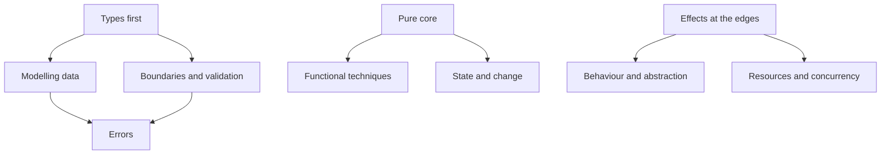

# Appendix A: Pattern catalogue

Every design pattern in the book, in one place. They're grouped by the kind of
problem they solve rather than the order they appeared, so that when you're
stuck you can look up the *problem* and find the moves available.

Each entry gives the idea in a sentence, when to reach for it, the Rust
mechanism that makes it work, and where in the book it's introduced and used
again. Chapter numbers refer to where you can see it working in a real program.

The patterns aren't independent. Most of them are ways of carrying out three
underlying ideas, and it helps to see them that way:

## The design stance

### Functional Core, Imperative Shell
**Idea.** Decisions and transformations are pure functions from values to
values; all I/O lives in a thin outer layer that gathers inputs, calls the
core, and acts on its outputs.
**Reach for it** in every program. It's the default shape, not a special
technique.
**In Rust.** Core functions take borrowed data (`&[Reading]`, `&State`) and
return owned results, `Result`s or plans; `main` and async tasks own the
sockets, files and clocks.
**Introduced** Ch 1. **Used throughout:** `plan` (Ch 9), `decide`/`evolve`
(Ch 15), the sampling engine (Ch 18), the frontier state machine (Ch 27).

### Type-Driven Development
**Idea.** Write the types and function signatures first, with `todo!()`
bodies, and get them compiling; then fill in bodies one at a time with the
compiler checking each against the design.
**Reach for it** when starting anything non-trivial, or when a change feels
risky: change the types and follow the errors.
**In Rust.** `todo!()` type-checks as any type; exhaustive `match` and
precise signatures turn the compiler's errors into a to-do list.
**Introduced** Ch 1. **Worked end to end** Ch 7 (the thermostat); the daily
loop in Workshop 5.

### Ubiquitous Language
**Idea.** Use the domain's own words for types, functions and modules, and
keep them consistent between conversations, code and documentation.
**Reach for it** before writing types for a new domain: list the nouns and
verbs, and what can go wrong.
**In Rust.** Newtypes and enums give each term a home; modules group them.
**Introduced** Ch 8 (zones, records, observed addresses). **Also** Ch 13
(commands vs queries), Ch 22 (accounts, postings, transactions).

## Modelling data

### Algebraic Data Types
**Idea.** Build types from *products* (this **and** that: structs, tuples) and
*sums* (this **or** that: enums with data). The number of values a type can
hold is the product or sum of its parts, so you can count and design states.
**Reach for it** whenever data has alternatives. If you're about to add a
`bool` or an `Option` field to distinguish cases, you probably want a sum.
**In Rust.** `struct` and `enum`; variants carry their own data.
**Introduced** Ch 3.

### Make Illegal States Unrepresentable
**Idea.** Shape types so invalid combinations can't be constructed at all,
instead of checking for them at runtime.
**Reach for it** when you find comments like "only set if…" or code that
asserts two fields agree.
**In Rust.** Enums whose variants hold exactly the data valid in that state;
private fields; separate types per state.
**Introduced** Ch 3 (the roastery order: 64 possible shapes down to 6).
**Also** Ch 8 (an AAAA record can't hold an IPv4 address), Ch 22 (a
transaction that doesn't balance can't exist).

### Newtype
**Idea.** Wrap a primitive in a single-field struct so the compiler can tell
apart values that share a representation but not a meaning.
**Reach for it** whenever two values of the same primitive type could be
swapped by mistake (ids, names, units, tokens).
**In Rust.** `struct ZoneId(String);` costs nothing at runtime; derive or
implement only the operations that make sense.
**Introduced** Ch 3 (informally Ch 1). **Everywhere after:** `DnsName`,
`ApiToken` (Ch 8), `TaskId`, `Title` (Ch 14), `Bytes` (Ch 17), `AccountName`
(Ch 22), `PageUrl` (Ch 27).

### Exhaustive Matching
**Idea.** Handle every variant explicitly, so adding a variant produces a
compile error at every place that needs a decision.
**Reach for it** by default; use `_` only where new variants genuinely share
the existing behaviour.
**In Rust.** `match` must be exhaustive; error E0004 lists what's missing.
**Introduced** Ch 3 (Ch 1 previews it with `Unit::Kelvin`). **Also** Ch 15
(a missing `evolve` arm).

### Existential Packaging
**Idea.** When a value's precise type (its state) is only known at runtime,
package it with "some type that satisfies X", then match once to recover the
precise type and carry that evidence inward.
**Reach for it** when loading typestate values from storage or the network.
**In Rust.** An enum over the typestates (`AnyTask`, `AnyPayment`), or
`Box<dyn Trait>`; Haskell uses GADTs and existential types.
**Introduced** Ch 14. **Also** Ch 30.

### Value Object
**Idea.** A domain value defined entirely by its attributes, with no
identity, immutable and always valid.
**Reach for it** for anything you'd compare by value: amounts, names,
addresses, date ranges.
**In Rust.** A newtype or small struct with a validating constructor,
private fields, and derived `Clone`, `PartialEq`, `Eq`, `Hash`.
**Introduced** Ch 8. **Also** `Title` and `Tag` (Ch 14), `Money` (Ch 21).

### Units of Measure
**Idea.** Give quantities types that only allow dimensionally meaningful
arithmetic. A byte count divided by a non-zero time span is a rate; a rate can't
be added to a byte count; and a counter that went *backwards* yields "reset",
not a negative number.
**Reach for it** wherever numbers carry units, especially counters versus
rates and money.
**In Rust.** Newtypes with *selective* operator impls (`Div<Elapsed>` for
`Bytes`) and deliberately missing ones (no `Sub` for `Bytes`, only
`checked_sub` and `Counter::since`); a divisor type that can't be zero.
**Introduced** Ch 17. **Also** money in Ch 21.

### Phantom Types
**Idea.** Add a type parameter that exists only at compile time to
distinguish otherwise identical values, such as `Money<Gbp>` versus
`Money<Usd>`.
**Reach for it** when the distinction is known when you write the code. When
it comes from data (a currency in a file), use a runtime field instead.
**In Rust.** `PhantomData<C>`; hand-written `Clone`/`Copy`/`PartialEq`
because `derive` would add unwanted `C: Clone` bounds.
**Introduced** Ch 21. **Previewed** by `PhantomData` in typestate (Ch 14).

### Typestate
**Idea.** Encode an object's state in its type, so operations are only
available in the states where they make sense, and transitions consume the
old state.
**Reach for it** for protocols and lifecycles with a fixed order that live in
one place in the code. Wrap the typestates in an enum when they must sit
together in collections or on disk.
**In Rust.** `Task<Open>` / `Task<Done>` with marker types; transitions
take `self` by value; calling a method in the wrong state is E0599.
**Introduced** Ch 14. **Also** the typestate builder (Ch 22).

### Aggregate with Invariants
**Idea.** A cluster of objects treated as one unit for changes, whose only
constructor and methods guarantee its business rules.
**Reach for it** when a rule spans several values ("postings sum to zero"),
so no single field can enforce it.
**In Rust.** Private fields, a fallible constructor returning `Result`, and
no public way to mutate parts independently.
**Introduced** Ch 22 (`Transaction`).

### Zero-Copy Borrowed Domain
**Idea.** Domain types that borrow from their input instead of copying it,
with lifetimes stating the relationship.
**Reach for it** in hot paths over large inputs: parsers, log processors.
**In Rust.** `LogLine<'a>` holding `&'a str`; `Cow<'a, str>` when some values
need unescaping.
**Introduced** Ch 24. **Lifetimes** first appear Ch 2.

## Boundaries and validation

### Parse, Don't Validate (Smart Constructor)
**Idea.** Instead of checking a value and carrying on with the unchecked type,
turn it into a type that *proves* the check happened. The constructor is the
only way in.
**Reach for it** at every point where untrusted data becomes domain data.
**In Rust.** `fn new(..) -> Result<Self, Error>` or `TryFrom`, with private
fields so nothing else can construct the type.
**Introduced** Ch 4 (`Celsius::new`). **Also** Ch 8 (config), Ch 25 (a
type-check pass turns a parsed query into a validated one).

### Encapsulated Invariants (Privacy as Proof)
**Idea.** A module boundary plus private fields makes the smart constructor
*mandatory*, so every value of the type is evidence that its invariant holds.
**Reach for it** whenever a type has an invariant.
**In Rust.** Fields are private by default; code outside the module can't
build the struct literal (E0423, E0451) or reach its fields (E0616).
**Introduced** Ch 7. **Also** Ch 22.

### Raw DTO → Validated Domain
**Idea.** Deserialise external data into a permissive "raw" type that mirrors
the format, then convert it into strict domain types in one place.
**Reach for it** for config files, API payloads, user input.
**In Rust.** `#[derive(Deserialize)] struct RawConfig` plus
`impl TryFrom<RawConfig> for Config`.
**Introduced** Ch 8. **Also** `PostingDraft` → `Posting` (Ch 22).

### Parse the Boundary (CLI → Domain Command)
**Idea.** Treat command-line arguments as a boundary format: parse them into a
domain command type, and keep the CLI library's types out of the core.
**Reach for it** in every CLI.
**In Rust.** `clap` derive structs, converted into a domain `enum Command`.
**Introduced** Ch 13. **Also** Ch 23 (arguments parsed straight into
`AccountName`).

### Anti-Corruption Layer
**Idea.** Keep an external system's model out of your domain. Translate its
types and errors at the adapter, so the core speaks only its own language.
**Reach for it** whenever you integrate with an API you don't control.
**In Rust.** Private DTO modules inside the adapter; `TryFrom` conversions;
adapter error enums translated into domain errors.
**Introduced** Ch 10 (Cloudflare's API). **Also** a mirror enum for `clap`
(Ch 13).

### Tolerant Reader
**Idea.** Be lenient about data you *consume* from systems you don't control
(ignore fields you don't need, so their additions don't break you), and strict
about data you *own* (reject unknown keys, so typos are caught).
**Reach for it** whenever you deserialise someone else's API.
**In Rust.** `serde`'s default of ignoring unknown fields for external DTOs;
`#[serde(deny_unknown_fields)]` on your own configuration.
**Introduced** Ch 10 (in prose), alongside the Anti-Corruption Layer.

### Conversion Traits (`From` / `TryFrom` / `FromStr`)
**Idea.** Express conversions through the standard traits, so they compose
with `?`, `.into()`, `.parse()` and generic code.
**Reach for it** instead of ad-hoc `to_x` / `from_y` functions.
**In Rust.** `From` for infallible, `TryFrom` for fallible, `FromStr` for
text; `?` uses `From` to convert error types.
**Introduced** Ch 5.

### Typed Configuration at Every Layer
**Idea.** Keep configuration typed from end to end: typed NixOS module
options generate the file, and the program parses it into validated types.
Mistakes surface at the earliest layer that can catch them.
**Reach for it** whenever configuration crosses tools.
**In Rust and Nix.** `lib.types` options → generated TOML → `serde` raw DTO →
`TryFrom` into `Config`.
**Introduced** Ch 12. **Previewed** by home-manager's typed options
(Workshop 1).

## Errors

### Errors as Values
**Idea.** Failure is an ordinary return value whose type lists what can go
wrong, not an invisible jump.
**Reach for it** always, for anything that can fail for reasons outside the
program's control.
**In Rust.** `Result<T, E>`, error enums, `?` for propagation; `panic!` is
reserved for bugs.
**Introduced** Ch 4 (previewed Ch 1).

### Error Translation at Boundaries
**Idea.** Each layer has its own error type in its own terms. Crossing a
boundary wraps the lower error as the source and adds what this layer knows
(a line number, a path, a record id).
**Reach for it** in any program with more than one layer.
**In Rust.** One `thiserror` enum per layer; `#[from]` when wrapping adds
nothing, `map_err` when it adds context; `anyhow` only in the shell.
**Introduced** Ch 4. **Also** Ch 10.

### Error Classification by Type (transient vs fatal)
**Idea.** Make "should we retry?" a property of the error's *type*, so the
loop can't confuse a network blip with a bad API token.
**Reach for it** in daemons, retry loops and anything long-running.
**In Rust.** An enum split such as `Transient(..)` / `Fatal(..)`, or a
classifying method that `match`es exhaustively.
**Introduced** Ch 11. **Also** exit codes in Ch 28.

### Applicative Validation (Accumulate Errors)
**Idea.** When checks are independent, run them all and report every failure,
rather than stopping at the first. `?` sequences dependent steps (monadic);
independent checks can be combined side by side (applicative).
**Reach for it** for forms, configuration files, journals: anywhere a person
fixes input and would rather see every problem at once.
**In Rust.** Run each validator, combine `Result`s into `Result<T, Vec<E>>`
(a small `both` combinator); keep `?` for steps that need earlier results.
**Introduced** Ch 4. **Also** configuration (Ch 8), the journal reader (Ch 23).

## Behaviour and abstraction

### Traits as Contracts
**Idea.** A trait names a capability and its rules; anything that implements
it can be used where the capability is needed. It's closer to a Haskell
typeclass than a class hierarchy.
**Reach for it** when several types share behaviour, or when code should
depend on *what* something does rather than *which* thing it is.
**In Rust.** `trait`, default methods, generic bounds, associated types.
**Introduced** Ch 5.

### Static vs Dynamic Dispatch
**Idea.** Choose between generics (one compiled copy per type, inlined, no
runtime cost) and trait objects (one copy, a vtable lookup, mixed types in
one collection).
**Reach for** generics by default; `dyn Trait` for heterogeneous collections
or to keep compile times and binary size down.
**In Rust.** `fn f<T: Trait>(t: T)` / `impl Trait` versus `&dyn Trait` /
`Box<dyn Trait>`.
**Introduced** Ch 5.

### Extension Trait
**Idea.** Add methods to a type you don't own by defining a trait for them and
implementing it for that type.
**Reach for it** for domain-flavoured helpers on standard or third-party
types.
**In Rust.** `trait TemperaturesExt { .. } impl TemperaturesExt for [Celsius]`; the
orphan rule (E0117) limits what you can implement.
**Introduced** Ch 5.

### Parametricity (Constraints as Permissions)
**Idea.** A generic function knows nothing about `T` except what its bounds
grant, so its signature limits what it can do: `fn f<T>(Vec<T>) -> Vec<T>` can
only drop, reorder or (with `Clone`) duplicate elements. Free theorems follow
from the type alone.
**Reach for it** to make signatures say less, so implementations can do less,
especially when reviewing code you didn't write.
**In Rust.** Generics with minimal bounds. The leaks are panics, loops, side
effects, `size_of::<T>()` and `Any` with `T: 'static`.
**Introduced** Ch 5.

### Capabilities, Not Ambient Authority
**Idea.** Give code only the capabilities it needs, passed in explicitly,
instead of letting it reach anything in scope. Haskell's effect systems put
them in the type; in Rust, trait-bound parameters document them.
**Reach for it** at every boundary where code shouldn't be able to email,
write files or call the network.
**In Rust.** Ports as parameters (`&impl DnsProvider`); backed up by crate
boundaries, clippy's `disallowed_methods`, `cap-std` and review, because Rust
doesn't track effects. A capability in a signature is not proof of correct use.
**Introduced** Ch 10.

### Ports and Adapters
**Idea.** The core declares the capabilities it needs as interfaces (ports);
the outside world plugs in through implementations (adapters). Real adapters
in production, fakes in tests.
**Reach for it** wherever the core needs something from the outside world:
the network, the clock, storage.
**In Rust.** A trait per port, often with `async fn`; generic or `dyn`
parameters on the application service.
**Introduced** Ch 10 (`IpSource`, `DnsProvider`). **Previewed** Ch 5 (a
`Clock` trait). **Also** `EventStore` (Ch 16), `CounterSource` (Ch 18),
`Fetcher` (Ch 27).

### Repository (Event Store)
**Idea.** A port that presents storage as a collection of domain objects (or
events), hiding files, formats and durability.
**Reach for it** whenever the core needs to load or save.
**In Rust.** `trait EventStore` with a JSON-lines file implementation and an
in-memory one for tests.
**Introduced** Ch 16.

### Combinators over Strategies (fallback, retry, decorators)
**Idea.** Build behaviour by wrapping implementations of a trait in other
implementations: try A then B, retry, rate-limit, add a timeout.
**Reach for it** when you're tempted to add flags to an adapter.
**In Rust.** Generic wrapper structs that implement the same trait:
`Fallback<P, S>`, `Polite<F>`, `Timed<F>`.
**Introduced** Ch 10. **Also** Ch 28 (politeness and timeouts as
decorators).

### Builder (and Typestate Builder)
**Idea.** Construct complex values step by step; with typestate, the
`build()` method doesn't exist until the required parts are set.
**Reach for it** when constructors would take many arguments, or some are
optional.
**In Rust.** Methods taking and returning `self`; type parameters that
change as fields are set (E0599 if you call `build()` too early).
**Introduced** Ch 22. **Builds on** Typestate (Ch 14).

## Functional techniques

### Higher-Order Functions
**Idea.** Pass behaviour as an argument, or return it as a result, instead
of duplicating the code around it.
**Reach for it** when two functions differ only in a small decision.
**In Rust.** Closures; `impl Fn(T) -> U` parameters; `Fn` / `FnMut` /
`FnOnce` describe how the closure uses what it captured; `move` closures as
function factories.
**Introduced** Ch 6.

### Iterator Pipeline
**Idea.** Describe a computation as a chain of lazy transformations (`map`,
`filter`, `take_while`, …) ending in a consumer (`collect`, `sum`, `fold`).
**Reach for it** instead of index loops and mutable accumulators.
**In Rust.** The `Iterator` trait; adaptors are lazy and compile to tight
loops; `collect` into `Vec`, `HashMap` or `Result<Vec<_>, _>`.
**Introduced** Ch 6 (previewed Ch 1). **Also** Ch 23, Ch 26.

### Fold (Reduce)
**Idea.** Every loop that builds a result is a fold: a starting value plus a
function combining the result so far with the next element.
**Reach for it** when you see `let mut acc = ..; for x in xs { acc = .. }`.
**In Rust.** `Iterator::fold`, `try_fold`, `sum`, `scan`.
**Introduced** Ch 6. **Specialised by** Report as Fold, Streaming Fold, and
event replay in Ch 15 (`events.fold(State::default(), evolve)`).

### Report as Fold
**Idea.** A report is a fold of the journal into an accumulator, often an
ordered map, followed by pure formatting.
**Reach for it** for any summary over a history of records.
**In Rust.** `fold` into `BTreeMap` for stable ordering; `scan` for running
totals.
**Introduced** Ch 23.

### Streaming Fold / Aggregation
**Idea.** Aggregate an unbounded stream in one pass with constant memory,
folding each item into an accumulator as it arrives.
**Reach for it** for logs, metrics and anything too large to hold in memory.
**In Rust.** Internal iteration (`try_fold_lines`) over a reused buffer;
counters and statistics as accumulators.
**Introduced** Ch 26.

### Monoid (Identity + Associative Combine)
**Idea.** An accumulator with an identity value and an associative way to
combine two of them. Because grouping doesn't matter, the work can be split
into chunks, folded in parallel and combined.
**Reach for it** when an aggregation needs to scale across threads or
machines.
**In Rust.** A trait with `empty()` and `combine(self, other)`; tuple
instances combine component-wise; `std::thread::scope` for a parallel fold.
**Previewed** Ch 5 (as a typeclass example). **Used** Ch 26.

### Schedule as Iterator (backoff)
**Idea.** Represent a retry or polling schedule as an iterator of durations,
so it's pure, testable and composable.
**Reach for it** for backoff, polling and rate limits.
**In Rust.** `impl Iterator<Item = Duration>`, `iter::successors`, with
jitter injected as a parameter so it stays deterministic in tests.
**Introduced** Ch 11. **Previewed** Ch 6 (`PollTimes`, `successors`).

### Parser Combinators
**Idea.** Build parsers for complex formats by composing tiny parsers with
combinators (sequence, choice, repetition, map).
**Reach for it** for any structured text beyond `split`.
**In Rust.** `winnow`: parsers are functions over `&mut &str`; `cut_err`
and `context` give precise errors.
**Introduced** Ch 24. **Also** Ch 25. Ch 23's hand-written reader shows the
alternative.

### Interpreter (AST + Eval)
**Idea.** Represent a little language as a tree of enum values, and give it
meaning with a recursive function over that tree.
**Reach for it** for queries, rules, filters and configuration logic.
**In Rust.** Recursive `enum Expr` with `Box`; `fn eval(&Expr, &Ctx) -> T`
matching exhaustively.
**Introduced** Ch 25.

### Tree Rewriting (Simplifier)
**Idea.** Transform an AST into an equivalent, simpler one with pure rewrite
rules, checked by a property: evaluating before and after gives the same
answer.
**Reach for it** for optimisers, normalisers and pretty-printers.
**In Rust.** `fn simplify(Expr) -> Expr` by structural recursion; `proptest`
for soundness.
**Introduced** Ch 25.

## State and change

### Decision as Data
**Idea.** The core doesn't *do* things; it returns a value describing what
should be done (a plan, a list of effects), which the shell executes.
**Reach for it** whenever logic and side effects are tangled.
**In Rust.** An enum such as `Plan` or `Effect`, returned by a pure function
and interpreted by the shell.
**Introduced** Ch 9. **Also** effects in Ch 27; `classify` returning an
`Outcome` in Ch 26.

### Event Sourcing (Decide / Evolve)
**Idea.** Store what happened (events), not the current state. `decide` turns
a command into events; `evolve` applies an event to state; state is a fold of
the events.
**Reach for it** when history, undo or audit matter.
**In Rust.** `fn decide(&State, Command) -> Result<Vec<Event>, Error>` and
`fn evolve(State, &Event) -> State`.
**Introduced** Ch 15.

### Command–Query Separation
**Idea.** Operations either change state (commands) or report it (queries),
never both. Only commands go through `decide`.
**Reach for it** when designing any API or CLI that has both kinds of
operation.
**In Rust.** Separate enums (`Request::Command(..)` / `Request::Query(..)`).
**Introduced** Ch 13 (in prose).

### Reactive Derived State
**Idea.** Keep the minimum state as signals and derive everything else as
pure functions of it, recomputed automatically, like spreadsheet cells.
**Reach for it** in UIs.
**In Rust.** Leptos signals, derived signals (closures) and `Memo`.
**Introduced** Ch 19.

### Reducer (Elm Architecture)
**Idea.** All state changes go through one pure function
`update(State, Msg) -> State`; the view is a function of state.
**Reach for it** when state changes arrive from several sources (user,
server, timers).
**In Rust.** A `Msg` enum and an exhaustive `match` in `update`.
**Introduced** Ch 20. **Compare** Event Sourcing: a reducer is a fold over
messages, just as state is a fold over events with `evolve` (Ch 15).

### Immutable Snapshots over Shared Mutation
**Idea.** Instead of many tasks sharing a mutable map behind a lock, a single
writer publishes complete immutable snapshots, and readers take the latest.
**Reach for it** for read-heavy shared state such as metrics, configuration
and dashboards.
**In Rust.** `Arc<Snapshot>` published through `tokio::sync::watch`.
**Introduced** Ch 18.

### Pure State Machine Driven by Messages
**Idea.** A component's logic is a pure function
`(State, Msg) -> (State, Vec<Effect>)`. A thin loop feeds it messages and
carries out the effects.
**Reach for it** for coordinators, protocols and anything that reacts to
events over time.
**In Rust.** Owned state moved through the function; effects as an enum;
unit tests without a runtime.
**Introduced** Ch 27. **Previewed** by `apply(status, event)` in Ch 3.

## Resources and concurrency

### Borrow, Don't Own
**Idea.** Functions that only need to read take references, so callers keep
their data and nothing is copied.
**Reach for it** by default for parameters; take ownership only when the
function needs to keep or consume the value.
**In Rust.** `&T`, `&str`, `&[T]` parameters; `&mut T` for in-place change.
**Introduced** Ch 2.

### Ownership as Resource Management (RAII)
**Idea.** Tie a resource's lifetime to a value's: when the value goes out of
scope, the resource is released, deterministically.
**Reach for it** for files, locks, connections and sessions.
**In Rust.** `Drop`; ownership guarantees exactly one cleanup.
**Introduced** Ch 2 (a sensor session that always says `BYE`).

### Actor
**Idea.** A task that exclusively owns some state and is only reached by
messages, so nothing is shared and nothing needs a lock.
**Reach for it** when several concurrent tasks need to coordinate around
shared state.
**In Rust.** A `tokio::spawn`ed loop over an `mpsc::Receiver`; replies via
`oneshot` or further messages.
**Introduced** Ch 27.

### Bounded Concurrency and Backpressure
**Idea.** Cap how much work is in flight, and make producers wait when
consumers are busy, so the system degrades gracefully instead of exhausting
memory, sockets or the remote server.
**Reach for it** whenever work can fan out.
**In Rust.** Limits in the pure state machine; `Semaphore` per host; bounded
`mpsc` channels.
**Introduced** Ch 28.

### Structured Cancellation
**Idea.** Tasks have owners. Cancelling the owner cancels its children,
in-flight work finishes or stops cleanly, and nothing is leaked.
**Reach for it** in every long-running async program, for shutdown and ctrl-c.
**In Rust.** `JoinSet`, `tokio_util::sync::CancellationToken`, `select!`.
**Introduced** Ch 28. **Previewed** by graceful shutdown in Ch 11.

## Testing

### Property-Based Testing
**Idea.** State a property that must hold for *all* inputs and let the
framework search for a counterexample, then shrink it to the smallest one.
**Reach for it** for invariants, round trips (`parse(display(x)) == x`),
algebraic laws, and checking an optimised version against a simple one.
**In Rust.** `proptest!` with strategies; shrinking finds minimal failing
cases.
**Introduced** Ch 7. **Found real bugs** in Ch 23 (a `;` in a description),
Ch 25 (an unsound rewrite rule) and Ch 26 (the parallel fold checked against
the sequential one).

## Specifying and checking designs (TLA+)

These patterns come from the TLA+ interludes. Appendix E is the syntax
reference.

### Specification as State Machine
**Idea.** Describe a system as its possible states (variables), where it can
start (`Init`), and every step it can take (`Next`). A behaviour is a sequence
of states; the spec is the set of all allowed behaviours.
**Reach for it** when the question is about *sequences of events*: orderings,
interleavings, retries, crashes. Types and unit tests are better at single
values and single calls.
**In TLA+.** `VARIABLES`, `Init`, `Next` as a disjunction of named actions,
primed variables for the next state.
**Introduced** Interlude 1 (the thermostat).

### Invariants over Behaviours (Safety)
**Idea.** A property that must hold in *every reachable state*, checked
exhaustively by the model checker rather than sampled by tests. A violation
comes with the shortest trace that reaches it.
**Reach for it** for "this must never happen" rules that span time:
no short-cycling, no double fetch, no negative envelope.
**In TLA+.** `INVARIANT` in the `.cfg`; `TypeOK` as the TLA+ cousin of Rust's
types.
**Introduced** Interlude 1. **Compare** Rust types (invariants of values) and
property tests (sampled behaviours).

### Model the Environment as Nondeterminism
**Idea.** Don't try to predict the outside world (the ISP, the network, the
user, a crash). Let it do *anything allowed* at *any moment*, and check that
the system copes.
**Reach for it** whenever correctness depends on things you don't control.
**In TLA+.** `\E x \in S : ...` in an action, or `either`/`with` in PlusCal;
environment actions as separate disjuncts of `Next`.
**Introduced** Interlude 2 (an ISP that changes the address at any time,
someone editing the record in the dashboard, Cloudflare failing).
**Also** crashes at any point (Interlude 3), a server restart (Interlude 4),
ctrl-c (Interlude 6).

### Liveness and Fairness
**Idea.** Safety says nothing bad happens; liveness says something good
*eventually* happens. Liveness needs fairness assumptions (a process that
can keep making progress eventually does), and an honest statement of what the
environment must eventually stop doing.
**Reach for it** for "it converges", "it finishes", "every request is
answered".
**In TLA+.** `<>`, `~>`, `<>[]` in a `PROPERTY`; `WF_vars(A)` or
`fair process`; counterexamples are lassos.
**Introduced** Interlude 2, where it found a real bug in Chapter 10's
`tick`: with IPv4 lookups failing for ever, the AAAA record is never
corrected. **Also** a lost wake-up (Interlude 4), crawl termination
(Interlude 6).

### Refinement Mapping
**Idea.** Write a simple abstract spec of *what* the system does, and a
detailed spec of *how*. Map the detailed state onto the abstract one, and
check that every behaviour of the detailed spec is a behaviour of the
abstract one.
**Reach for it** when an implementation stores something different from what
it means: an event log that means a to-do list, a cache that means a database.
**In TLA+.** `Abs == INSTANCE Abstract WITH tasks <- Replay(log)` and
`PROPERTY Abs!Spec`.
**Introduced** Interlude 3, where it rejects undo checkpoints taken per
event instead of per command. **Compare** `evolve` and replay (Ch 15): the
mapping *is* the fold.

### Atomicity by Labels (PlusCal)
**Idea.** In a concurrent model, the size of each atomic step is a design
decision. Put a step boundary wherever the real system can be interrupted:
between a read and a write, at an `.await`, at a lock release.
**Reach for it** whenever you model concurrency. Too-coarse steps hide real
bugs; too-fine steps explode the state space.
**In PlusCal.** Labels: everything between two labels is one atomic step.
**Introduced** Interlude 4 (torn reads vs whole snapshots, and why
`borrow_and_update` is one call). **Also** a check-then-act overdraft race
(Interlude 5).

### Small-Scope Model Checking
**Idea.** Most design bugs show up in small instances: two clients, three
URLs, a channel of capacity one. Check small models exhaustively rather than
large ones partially, and grow them only as far as time allows.
**Reach for it** every time you choose `CONSTANTS` for a model.
**In TLA+.** Tiny model values; `SYMMETRY` to collapse equivalent states;
watching distinct-state counts as the model grows.
**Introduced** Interlude 5: two clients can't show the overdraft race at one
budget, three can; symmetry cuts 17.5 million states to about 8,000.
**Also** Interlude 6's deadlock appears only once a page has enough links.

### Spec–Code Correspondence
**Idea.** Keep the code's structure close to the spec's: a pure transition
function in Rust is the spec's `Next` relation, each message variant is an
action, and effects are sends. Then the spec checks the design you actually
built, and traces can be replayed against the code.
**Reach for it** when the Rust core is a pure state machine
(*Pure State Machine Driven by Messages*, Ch 27).
**In Rust and TLA+.** `handle(Frontier, Msg) -> (Frontier, Vec<Effect>)`
beside `Next == \/ Discover \/ Fetched \/ Cancel ...`; trace validation as a
test.
**Introduced** Interlude 6, where the spec's `ASSUME Limit > 0` exposed that
Chapter 28's `concurrency: usize` lets a zero through (fix: `NonZeroUsize`).

## Types as proofs

Patterns from Part VIII, most of them borrowed from Haskell.

### Types as Propositions (Curry–Howard)
**Idea.** A type is a statement, and a value of that type is evidence for it:
tuples are "and", enums are "or", functions are "implies", an empty enum is
"false". Writing a total function is constructing a proof.
**Reach for it** when designing signatures: if a function can't fail, say so
with `Infallible`; if a case is impossible, make its type empty.
**In Rust.** `(A, B)`, `Result<A, B>`, `fn(A) -> B`, `enum Void {}` with
`match v {}`, `Infallible`. Not a proof system: `loop {}`, `panic!` and
`todo!()` inhabit every type.
**Introduced** Ch 29.

### Lawful Abstractions (Laws as Properties)
**Idea.** Abstractions like `map` and `and_then` come with laws (identity,
composition, associativity). The compiler checks types, not laws; property
tests check the laws.
**Reach for it** whenever you write your own `map`, `and_then`, `combine` or
monoid.
**In Rust.** `proptest` properties such as `x.map(|v| v) == x`; clippy's
lints quietly assume the laws.
**Introduced** Ch 29 (a buggy `Audited::map` fails the identity law).

### Type-Level Functions (Associated Types)
**Idea.** Compute one type from another at compile time, so a field's type
depends on a state: Haskell's type families.
**Reach for it** when the data you hold differs by state or by kind.
**In Rust.** `trait State { type Evidence; }` and
`struct Payment<S: State> { evidence: S::Evidence }`.
**Introduced** Ch 30.

### Proof Token (Unforgeable Evidence)
**Idea.** Represent "this has been checked or authorised" as a value only the
checking code can create, and require that value to perform the action.
**Reach for it** for authorisation, approval, validation that must happen
before execution.
**In Rust.** A struct with private fields minted by one function in one module
(`Approver::approve` → `ApprovedRefund`), consumed by the action it permits.
**Introduced** Ch 30. **Related** Parse, Don't Validate; Encapsulated
Invariants.

### Sized Types (Const Generics)
**Idea.** Put sizes in types, so mismatched dimensions don't compile and
size-preserving operations say so.
**Reach for it** for fixed-width data: feature vectors, matrices, batches.
**In Rust.** `[T; N]`, `struct Features<const N: usize>`, array `map`;
`try_from` to package runtime data. Arithmetic like `N + 1` in types is
unstable.
**Introduced** Ch 30.

### Indexed Protocol (Composable Typestate)
**Idea.** Give a whole sequence of operations a type that records its start
and end state, so steps compose only when the states line up.
**Reach for it** for protocols with a fixed order: handshakes, payment flows,
migrations.
**In Rust.** `Program<From, To, Out>` with `then`, run by an interpreter; the
interpreter must honour the description.
**Introduced** Ch 30. **Related** Decision as Data (Ch 9), free monads.

### Branded Scope
**Idea.** Use a fresh, unnameable lifetime as a brand, so values tied to one
scope can't be used with another, and nothing escapes the scope.
**Reach for it** for indices or tokens that are only valid for one collection
or session.
**In Rust.** `fn with_batch<R>(f: impl for<'id> FnOnce(Batch<'id>) -> R)`
with an invariant lifetime; the same idea as Haskell's `runST` and
`thread::scope`.
**Introduced** Ch 30. **Previewed** Ch 26.

### Refinement Types and Verified Contracts
**Idea.** Attach logical predicates to types or functions (pre- and
postconditions) and have a solver or model checker prove the code meets them
for every input, not just sampled ones.
**Reach for it** for arithmetic contracts and invariants that types can't
express: "never refund more than was captured".
**In Rust.** Kani harnesses (`kani::any`, `kani::assume`, `assert!`), and Flux,
Prusti, Creusot and Verus for contracts; LiquidHaskell in Haskell; Lean for
proofs about a model.
**Introduced** Ch 31 (Kani found an overflow in `refundable` that example
tests and range-limited property tests missed).

### The Assurance Ladder
**Idea.** Each technique answers a different question: types (is it
structurally permitted?), property tests (does it hold on many inputs?),
verifiers (does this function meet its contract?), proofs (does the model have
this property?), model checking (can a bad global state be reached?),
integration tests (does the assembled system work?). None establishes the
others.
**Reach for it** when deciding how much assurance a piece of code needs, and
which tool buys it.
**Introduced** Ch 31: `refundable` was verified, and two workers still
refunded twice.
